# Day 1 — OOP Foundations: Classes, Objects & Access Modifiers

> **How to use these notes:** each section maps to one checklist item. Read the concept, run the code yourself, look at the diagram, then test yourself with the collapsible interview questions at the end of the section. Sections go from **basic → intermediate → advanced**. Items marked 🚀 are the "senior-level" details that separate a 2–3 YOE answer from a fresher answer.

**Today's goal:** be able to explain *exactly* what happens in memory when you write `new`, who can see what, how constructors run, and why `String`, `static`, `final` and wrappers behave the way they do. On the DSA side, be able to look at any loop or recursion and state its time and space complexity with confidence.

<!-- topic: d1_t1 -->
## ☕ Java — OOP Foundations

<!-- subtopic: d1_t1_s1 -->
### 1. Classes & Objects — fields, methods, constructors, default constructor, `this`

> **TL;DR:** A **class** is a blueprint (type definition). An **object** is a concrete instance of that blueprint living on the heap. A **constructor** initializes the object; `this` is a reference to "the current object".

#### 1.1 Class vs Object

| | Class | Object |
|---|---|---|
| What | Blueprint / template / type | Instance of the class |
| Memory | Class metadata loaded once (Metaspace) | Each object gets its own memory on the **heap** |
| Created by | Writing code + class loading | `new` (or reflection, clone, deserialization) |
| How many | One per class loader | As many as you create |
| Example | `class Car { ... }` | `new Car("Tesla")` |

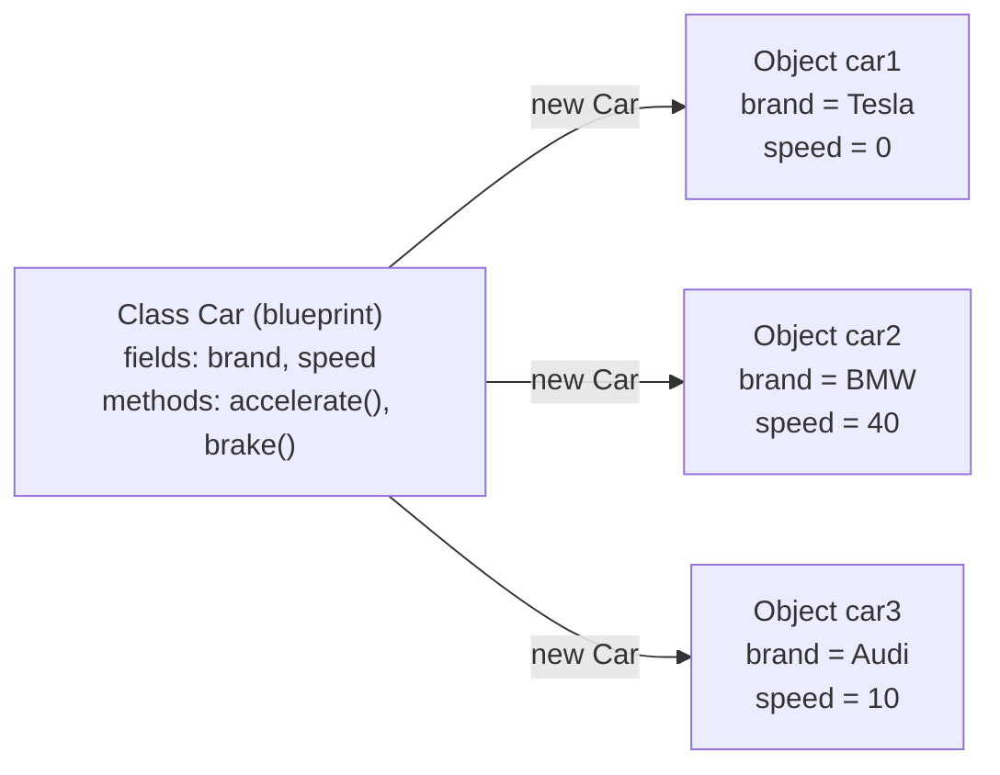

#### 1.2 Anatomy of a class

```java
public class Car {                       // class declaration

    // ── Fields (state / instance variables) ──
    private String brand;                // each object has its own copy
    private int speed;                   // default value 0
    private static int carsBuilt = 0;    // ONE copy shared by all objects (class variable)

    // ── Constructors (initialization) ──
    public Car(String brand) {
        this.brand = brand;              // 'this.brand' = field, 'brand' = parameter
        carsBuilt++;
    }

    // ── Methods (behaviour) ──
    public void accelerate(int delta) {
        speed += delta;                  // same as this.speed += delta
    }

    public int getSpeed() { return speed; }

    public static int getCarsBuilt() { return carsBuilt; }
}
```

A class can contain: **fields, methods, constructors, initializer blocks (static & instance), nested classes/interfaces/enums/records.**

#### 1.3 Fields and default values

**Instance & static fields** get a default value automatically. **Local variables do NOT** — using one before assignment is a compile error.

| Type | Default value |
|---|---|
| `byte`, `short`, `int`, `long` | `0` / `0L` |
| `float`, `double` | `0.0f` / `0.0d` |
| `char` | `'\u0000'` (null character) |
| `boolean` | `false` |
| Any reference (`String`, arrays, objects) | `null` |

```java
class Demo {
    int count;          // 0
    String name;        // null

    void test() {
        int local;
        // System.out.println(local);   // ❌ compile error: variable might not have been initialized
        System.out.println(count);      // ✅ 0
    }
}
```

#### 1.4 What happens when you write `new Car("Tesla")`

1. **Class loading** (only the first time): `Car.class` is loaded, linked, and its static initializers run.
2. **Memory allocation** on the heap for all instance fields (+ an object header).
3. **Default initialization** — every field set to `0 / false / null`.
4. **Constructor call** — first `super(...)` runs all the way up to `Object`, then instance field initializers and instance initializer blocks run (in textual order), then the rest of the constructor body.
5. **Reference returned** — the address of the object is stored in the variable (`car1`).

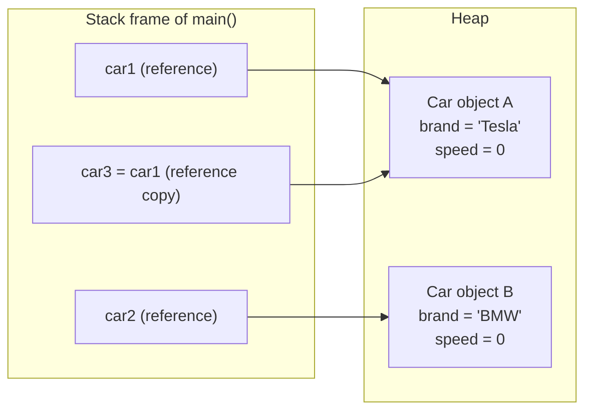

```java
Car car1 = new Car("Tesla");
Car car2 = new Car("BMW");
Car car3 = car1;            // NO new object — car3 points to the SAME object as car1
car3.accelerate(50);
System.out.println(car1.getSpeed());   // 50 — both references see the change
```

> **💡 Key idea:** variables of class type hold **references** (like an address), never the object itself. Assigning a reference copies the address, not the object.

#### 1.5 Java is ALWAYS pass-by-value

Java passes a **copy of the value**. For objects, the "value" is the reference. So you can **mutate** the object a method receives, but you **cannot make the caller's variable point to a different object**.

```java
static void rename(Car c)  { c.setBrand("Ferrari"); }   // mutates shared object ✅ visible to caller
static void replace(Car c) { c = new Car("Ferrari"); }  // re-points LOCAL copy ❌ caller unaffected

Car car = new Car("Tesla");
replace(car);   System.out.println(car.getBrand());  // Tesla
rename(car);    System.out.println(car.getBrand());  // Ferrari
```

#### 1.6 Methods

- **Signature** = method name + parameter types (order matters). Return type and exceptions are *not* part of the signature.
- **Instance methods** operate on an object (have access to `this`); **static methods** belong to the class.
- **Varargs**: `int sum(int... nums)` — must be the last parameter; internally an array.
- **Getters/setters** enforce **encapsulation**: keep fields `private`, expose controlled access.

```java
public int sum(int... nums) {          // sum(), sum(1), sum(1,2,3) all valid
    int total = 0;
    for (int n : nums) total += n;
    return total;
}
```

#### 1.7 Constructors

A constructor is a special block that **initializes** a new object.

- Same name as the class, **no return type** (not even `void` — if you add `void` it becomes a normal method!).
- Can be overloaded; can have any access modifier.
- **Cannot** be `static`, `final`, `abstract`, or `synchronized`.
- **Not inherited** (a subclass doesn't get the parent's constructors).

```java
public class Car {
    private String brand;
    private int speed;

    public Car() {                       // no-arg constructor
        this("Unknown");                 // delegates to the other constructor
    }

    public Car(String brand) {           // parameterized constructor
        this.brand = brand;
    }

    public void Car() { }                // ⚠️ legal but this is a METHOD, not a constructor!
}
```

#### 1.8 The default constructor

- If you write **no constructor at all**, the compiler inserts a **default constructor**: no parameters, same access as the class, and its body is just `super();`.
- The moment you write **any** constructor, the compiler **no longer** adds the default one.

```java
class A { }                    // compiler generates:  A() { super(); }
new A();                       // ✅

class B {
    B(int x) { }
}
// new B();                    // ❌ compile error: constructor B() not found

class C extends B {
    // ❌ compile error! The default constructor C() { super(); } tries to call B(),
    //    which does not exist. Fix: write C() { super(0); }
}
```

> **Interview nuance:** "default constructor" (compiler-generated) ≠ "no-arg constructor" (any constructor with no parameters, possibly written by you).

#### 1.9 The `this` keyword

`this` is a reference to the **current object** — the object on which the method/constructor was invoked.

| Use | Example |
|---|---|
| Disambiguate field vs parameter (shadowing) | `this.brand = brand;` |
| Call another constructor in the same class | `this("Unknown");` (must be first statement) |
| Pass the current object to another method | `registry.register(this);` |
| Return the current object (fluent API / builder) | `return this;` |
| Access outer instance from inner class | `Outer.this.field` |

```java
public class QueryBuilder {
    private final StringBuilder sql = new StringBuilder("SELECT * FROM users");

    public QueryBuilder where(String cond) {
        sql.append(" WHERE ").append(cond);
        return this;                                  // enables chaining
    }
    public QueryBuilder limit(int n) {
        sql.append(" LIMIT ").append(n);
        return this;
    }
    public String build() { return sql.toString(); }
}

String q = new QueryBuilder().where("age > 25").limit(10).build();
```

Rules for `this`:
- ❌ Not available in a `static` context (there is no "current object").
- ❌ You cannot assign to it (`this = other;` is illegal).
- ⚠️ Avoid leaking `this` from a constructor (e.g., registering a listener or starting a thread) — another thread may see a half-constructed object.

#### 1.10 Ways to create an object

1. `new` keyword — `new Car()` (by far the most common).
2. Reflection — `Car.class.getDeclaredConstructor().newInstance()` (`Class.newInstance()` is deprecated since Java 9).
3. `clone()` — copies an existing object (class must implement `Cloneable`); **no constructor is called**.
4. Deserialization — `ObjectInputStream.readObject()`; the class's own constructor is **not** called.
5. Factory / builder methods — `List.of(...)`, `LocalDate.now()` (they use `new` internally).

#### 🚀 1.11 Advanced: object memory layout (HotSpot, 64-bit)

- Every object has a **header**: *mark word* (hash code, GC age, lock state) + *class pointer*. With compressed class pointers this is typically **12 bytes**, and objects are padded to a multiple of 8 bytes. So `new Object()` takes about **16 bytes**. (Newer JDKs are introducing *compact object headers* to shrink this to 8 bytes.)
- References are 4 bytes with **compressed oops** (default for heaps < ~32 GB), otherwise 8.
- That's why `Integer` (16 bytes) is much heavier than `int` (4 bytes) — this matters for Day 1's wrapper discussion and for DSA memory limits.
- Objects that never escape a method may be optimized by the JIT (**escape analysis** → scalar replacement), so "every `new` is a heap allocation" is a simplification.

#### ⚠️ Common pitfalls
- Forgetting `this.` in a setter → `brand = brand;` assigns the parameter to itself; the field stays `null`.
- Writing `void` before a constructor name turns it into a method.
- Adding a parameterized constructor and then breaking frameworks (JPA/Jackson) that need a no-arg constructor.
- Assuming `car3 = car1` copies the object.

#### 🎯 Interview questions

<details><summary>Q1. What is the difference between a class and an object?</summary>

A class is a blueprint that defines state (fields) and behaviour (methods). An object is a runtime instance of that class with its own copy of instance fields, allocated on the heap. One class → many objects.

</details>

<details><summary>Q2. When does the compiler provide a default constructor?</summary>

Only when the class declares **no constructors at all**. It has no parameters, the same access modifier as the class, and simply calls `super()`. If the superclass has no no-arg constructor, compilation fails.

</details>

<details><summary>Q3. Can a constructor return a value? Can it be private / static / final?</summary>

No return value (not even `void`). It **can** be `private` (singletons, utility classes, factories). It **cannot** be `static`, `final`, or `abstract` — constructors aren't inherited, so these modifiers make no sense.

</details>

<details><summary>Q4. Is Java pass-by-value or pass-by-reference?</summary>

Always pass-by-value. For objects, the value copied is the reference, so a method can mutate the object but cannot change which object the caller's variable points to.

</details>

<details><summary>Q5. Why can't we use `this` inside a static method?</summary>

Static methods belong to the class and are called without an instance, so there is no "current object" for `this` to refer to.

</details>

<details><summary>Q6. Which ways of creating an object skip the constructor?</summary>

`clone()` and deserialization (for a `Serializable` class, the first non-serializable superclass's no-arg constructor runs, but the class's own constructor does not).

</details>

<!-- subtopic: d1_t1_s2 -->
### 2. Access Modifiers — `private`, default, `protected`, `public`

> **TL;DR:** Access modifiers control **who can see** a class, field, method or constructor. From most restrictive to least: `private` → *default (package-private)* → `protected` → `public`.

#### 2.1 The visibility table (memorize this)

| Modifier | Same class | Same package | Subclass (other package) | Anywhere else |
|---|:-:|:-:|:-:|:-:|
| `private` | ✅ | ❌ | ❌ | ❌ |
| *default* (no keyword) | ✅ | ✅ | ❌ | ❌ |
| `protected` | ✅ | ✅ | ✅ (via inheritance only) | ❌ |
| `public` | ✅ | ✅ | ✅ | ✅ |

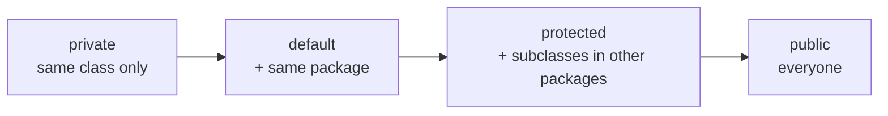

#### 2.2 Where can each modifier be used?

| Element | Allowed modifiers |
|---|---|
| Top-level class / interface / enum / record | `public` or default **only** |
| Nested (member) class | all four |
| Fields, methods, constructors | all four |
| Local variables | **none** (only `final`) |
| Interface methods | implicitly `public` (`private` allowed since Java 9 for helper methods) |
| Interface fields | implicitly `public static final` |

Rules for files: a `.java` file can contain **at most one public top-level class**, and the file name must match it.

#### 2.3 Example across packages

```java
// File: com/bank/core/Account.java
package com.bank.core;

public class Account {
    private double balance;          // only Account
    String branchCode;               // default: anything in com.bank.core
    protected String ownerName;      // com.bank.core + subclasses anywhere
    public String accountId;         // everyone

    private void audit() { }         // internal helper
}
```

```java
// File: com/bank/core/Teller.java  (same package)
package com.bank.core;

class Teller {
    void serve(Account a) {
        // a.balance = 0;      ❌ private
        a.branchCode = "B1";   // ✅ default — same package
        a.ownerName = "Sam";   // ✅ protected — same package
        a.accountId = "X1";    // ✅ public
    }
}
```

```java
// File: com/bank/premium/GoldAccount.java  (different package, subclass)
package com.bank.premium;
import com.bank.core.Account;

public class GoldAccount extends Account {
    void test(Account other, GoldAccount gold) {
        ownerName = "Me";        // ✅ inherited protected member
        gold.ownerName = "G";    // ✅ through a GoldAccount reference
        // other.ownerName = "X";   ❌ compile error! (see 2.4)
        // branchCode = "B2";       ❌ default — different package
    }
}
```

#### 🚀 2.4 The `protected` trap

In a **different package**, a subclass can access a protected member **only through a reference of its own type (or a subtype)** — not through a reference of the parent type. The idea: you may touch the protected parts of *your own kind* of object, not of arbitrary `Account`s that might belong to other subclasses.

Also: a `protected` **constructor** can be called from another package only via `super(...)` in a subclass (or an anonymous subclass `new Account() {}`), not with plain `new Account()`.

#### 2.5 Access modifiers and overriding

When overriding, you **can widen** access but **cannot narrow** it:

```java
class Parent { protected void greet() { } }
class Child extends Parent {
    @Override public void greet() { }      // ✅ protected → public (wider)
    // @Override void greet() { }          ❌ protected → default (narrower)
}
```

Why: Liskov Substitution — code using a `Parent` reference must still be able to call the method on a `Child`.

`private` methods are **not inherited**, so a method with the same name in a subclass is a brand-new method, not an override.

#### 2.6 Design guidelines (what interviewers want to hear)

- **Encapsulation:** fields `private`, expose behaviour via methods. Start with the most restrictive modifier and open up only when needed.
- **Private constructor** → Singleton, utility classes (`Math`, `Collections`), static factory methods.
- **Package-private** is great for hiding implementation classes inside a package (e.g., a `UserRepositoryImpl`).
- **`protected`** is for "extension points" designed for subclasses (template method pattern).
- Prefer **immutable + private final** fields.

#### 🚀 2.7 Advanced

- **Java Modules (Java 9+, JPMS):** `public` is no longer "visible everywhere" — a public class is accessible outside its module only if its package is `exports`-ed in `module-info.java`.
- **Reflection** can bypass access checks with `setAccessible(true)` (frameworks like Spring/Hibernate do this), but strong encapsulation of JDK internals (Java 16/17+) blocks it for JDK classes unless `--add-opens` is used.
- **Nested classes** can access each other's `private` members (Java 11 introduced *nest-based access control*, so the compiler no longer generates synthetic accessor methods).

#### ⚠️ Common pitfalls
- Forgetting that *default* is not the same as `protected` — default does **not** cross package boundaries even for subclasses.
- Making everything `public` "to be safe" — breaks encapsulation and makes refactoring hard.
- Trying to declare a top-level class `private` or `protected` (compile error).

#### 🎯 Interview questions

<details><summary>Q1. Can a top-level class be private or protected?</summary>

No. Top-level types can only be `public` or package-private. Only nested classes can be `private`/`protected`.

</details>

<details><summary>Q2. Difference between default and protected?</summary>

Both allow same-package access. `protected` additionally allows subclasses in **other** packages to access the member through inheritance.

</details>

<details><summary>Q3. Can you reduce the visibility of an overridden method?</summary>

No — you can only keep it the same or make it wider. Reducing it would break the substitution principle.

</details>

<details><summary>Q4. Why would you make a constructor private?</summary>

Singleton pattern, utility classes with only static methods, forcing creation through static factory methods (`of`, `valueOf`) or builders, and preventing subclassing from outside the class.

</details>

<details><summary>Q5. What is the access level of interface methods and fields?</summary>

Abstract/default/static interface methods are implicitly `public` (Java 9+ also allows `private` helper methods). Fields are implicitly `public static final` constants.

</details>

<!-- subtopic: d1_t1_s3 -->
### 3. Constructor Chaining — `this()` and `super()`, order of execution

> **TL;DR:** Constructor chaining means one constructor calling another — `this(...)` for the same class, `super(...)` for the parent. The chain **always** goes up to `Object` first, so parents are fully initialized before children.

#### 3.1 Rules

1. `this(...)` or `super(...)` must be the **first statement** in a constructor. (Java 25 relaxes this slightly — "flexible constructor bodies" allow statements *before* it that don't touch `this`, e.g., argument validation.)
2. You can have **either** `this(...)` **or** `super(...)`, never both.
3. If you write neither, the compiler inserts **`super()`** automatically.
4. Recursive chains (`A() { this(1); }` + `A(int x) { this(); }`) are a compile error.
5. Every chain eventually ends in a constructor that calls `super(...)` — up to `Object()`.

#### 3.2 Chaining inside the same class — `this()`

Avoids duplicating initialization logic. Put the full logic in the "most complete" constructor and have the others delegate to it.

```java
public class Employee {
    private final String name;
    private final String dept;
    private final double salary;

    public Employee(String name) {
        this(name, "General");                 // → 2-arg
    }
    public Employee(String name, String dept) {
        this(name, dept, 30_000);              // → 3-arg
    }
    public Employee(String name, String dept, double salary) {
        if (salary < 0) throw new IllegalArgumentException("salary < 0");
        this.name = name;                      // single place with real logic
        this.dept = dept;
        this.salary = salary;
    }
}
```

#### 3.3 Chaining to the parent — `super()`

```java
class Vehicle {
    protected final int wheels;
    Vehicle(int wheels) { this.wheels = wheels; }
}

class Bike extends Vehicle {
    private final boolean electric;
    Bike(boolean electric) {
        super(2);                 // MUST call — Vehicle has no no-arg constructor
        this.electric = electric;
    }
}
```

#### 3.4 Order of execution with inheritance (classic output question)

```java
class Parent {
    static { System.out.println("1. Parent static block"); }
    { System.out.println("3. Parent instance block"); }
    Parent() { System.out.println("4. Parent constructor"); }
}

class Child extends Parent {
    static { System.out.println("2. Child static block"); }
    { System.out.println("5. Child instance block"); }
    Child() {
        super();                                   // implicit anyway
        System.out.println("6. Child constructor");
    }
}

public class Main {
    public static void main(String[] args) {
        new Child();
        System.out.println("----");
        new Child();
    }
}
```

**Output:**
```
1. Parent static block
2. Child static block
3. Parent instance block
4. Parent constructor
5. Child instance block
6. Child constructor
----
3. Parent instance block
4. Parent constructor
5. Child instance block
6. Child constructor
```

Static blocks run **once**, when the class is initialized (parent before child). Instance blocks + constructors run **every time** an object is created.

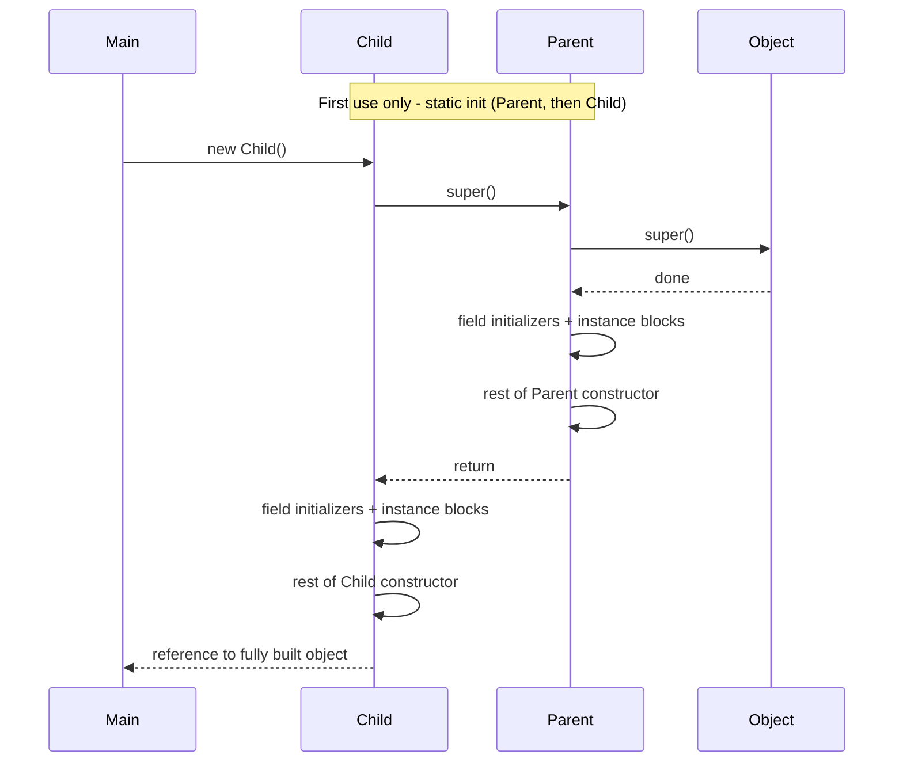

> **Memory hook:** **S**tatic (parent → child, once) → then for each object: **P**arent (init blocks → constructor) → **C**hild (init blocks → constructor). "**SPC**".

#### 3.5 Where do field initializers go?

The compiler copies instance field initializers and instance initializer blocks (in source order) **into every constructor that calls `super(...)`**, right after the `super` call. Constructors that start with `this(...)` don't get them (otherwise they'd run twice).

```java
class Demo {
    int a = 10;                 // ① runs after super()
    { a = 20; }                 // ② then this block
    Demo() { a = 30; }          // ③ then constructor body → final value 30
}
```

#### 🚀 3.6 Advanced trap: calling an overridable method from a constructor

```java
class Base {
    Base() { init(); }                 // calls an overridable method ⚠️
    void init() { }
}

class Derived extends Base {
    private String name = "Derived";   // assigned AFTER Base() finishes
    @Override void init() {
        System.out.println(name.length());   // 💥 NullPointerException — name is still null
    }
}

new Derived();
```

The `Base` constructor runs **before** `Derived`'s fields are initialized, but dynamic dispatch still calls `Derived.init()`. **Rule (Effective Java): constructors must not invoke overridable methods.** Make such methods `private`, `final` or `static`.

(Subtle twist: if the field were `private final String name = "Derived";` it would print `7`, because a `final` field initialized with a compile-time constant is inlined by the compiler.)

#### ⚠️ Common pitfalls
- Parent has only parameterized constructors and the child doesn't call `super(args)` → compile error.
- Putting logic before `this(...)`/`super(...)` (compile error before Java 25).
- Assuming instance blocks run once — they run per object.

#### 🎯 Interview questions

<details><summary>Q1. Can a constructor call both this() and super()?</summary>

No. Each must be the first statement, so only one is possible. A `this(...)` chain will eventually reach a constructor that calls `super(...)`.

</details>

<details><summary>Q2. What happens if the parent class has no no-arg constructor?</summary>

Every child constructor must explicitly call `super(args)` with a matching parent constructor; otherwise the implicit `super()` fails to compile.

</details>

<details><summary>Q3. In what order are static blocks, instance blocks and constructors executed?</summary>

Static blocks: parent then child, once at class initialization. Then for each `new`: parent instance initializers → parent constructor body → child instance initializers → child constructor body.

</details>

<details><summary>Q4. Why is calling an overridable method from a constructor dangerous?</summary>

The subclass override runs before the subclass's fields are initialized, so it sees default values (null/0), leading to NPEs or wrong behaviour.

</details>

<details><summary>Q5. Are constructors inherited?</summary>

No. A subclass must declare its own constructors (or get the default one), and they call the parent's via `super(...)`.

</details>

<!-- subtopic: d1_t1_s4 -->
### 4. The `static` Keyword — variables, methods, blocks, imports

> **TL;DR:** `static` means "belongs to the **class**, not to any object". One copy, shared by all instances, accessible without creating an object.

#### 4.1 Static variables (class variables)

```java
public class Employee {
    private static int count = 0;           // ONE copy for the whole class
    private static final String COMPANY = "Acme";   // constant
    private final int id;

    public Employee() {
        id = ++count;                        // each employee gets a unique id
    }
    public static int getCount() { return count; }
}

new Employee(); new Employee(); new Employee();
System.out.println(Employee.getCount());   // 3
```

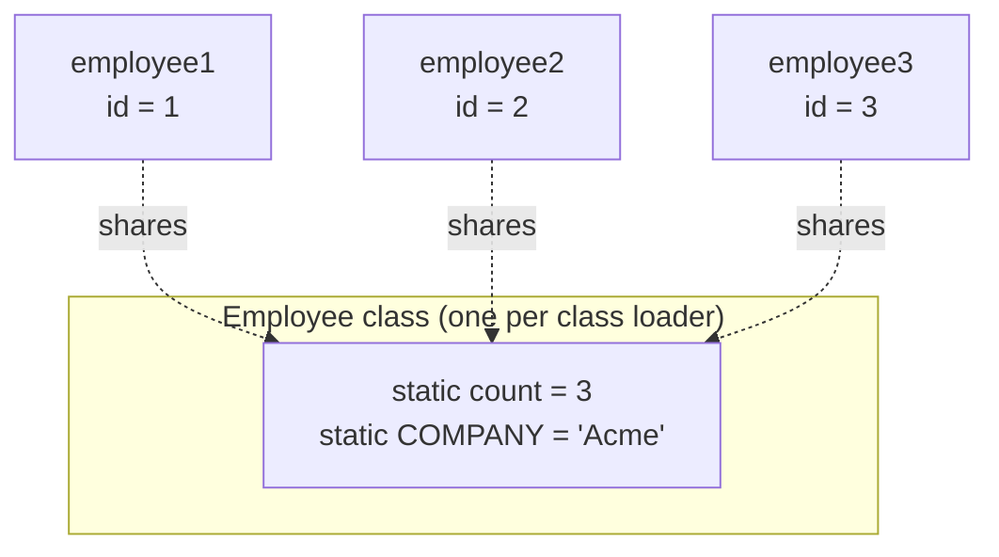

**Where do they live?** Since Java 8, PermGen is gone. Class metadata lives in **Metaspace**; static variables are stored with the class's `java.lang.Class` object on the **heap**.

Common uses: counters, constants (`static final`), caches, singleton instances, loggers (`private static final Logger log = ...`).

#### 4.2 Static methods

- Called on the class: `Math.max(a, b)`, `Integer.parseInt("5")`, `Collections.sort(list)`.
- Can access **only static members directly**. To use instance members they need an object reference.
- No `this` or `super` inside.
- **Cannot be overridden** — only **hidden**. Resolution happens at **compile time** using the reference type.

```java
class A { static void hi() { System.out.println("A"); } }
class B extends A { static void hi() { System.out.println("B"); } }   // hides, doesn't override

A ref = new B();
ref.hi();          // prints "A"  — decided by the reference type A, not the object
B.hi();            // prints "B"

A nothing = null;
nothing.hi();      // prints "A" — no NPE! static call doesn't need the object
```

**Why is `main` static?** The JVM must be able to call it before any object exists.

#### 4.3 Static blocks (static initializers)

Run **once**, when the class is **initialized**, in textual order. Used for complex static initialization.

```java
public class CountryCodes {
    private static final Map<String, String> CODES;
    static {
        Map<String, String> m = new HashMap<>();
        m.put("IN", "India");
        m.put("US", "United States");
        CODES = Collections.unmodifiableMap(m);   // or Map.of(...) in Java 9+
        System.out.println("CountryCodes loaded");
    }
}
```

If a static block throws an exception, you get `ExceptionInInitializerError`, and any later use of that class throws `NoClassDefFoundError`.

#### 🚀 4.4 When exactly is a class initialized?

A class's static initializers run on its **first active use**:

| Triggers initialization ✅ | Does NOT trigger ❌ |
|---|---|
| `new MyClass()` | Declaring a variable `MyClass x;` |
| Calling a static method | Creating an array `new MyClass[10]` |
| Reading/writing a static field (non-constant) | Reading a compile-time constant (`static final int X = 5;` — inlined) |
| `Class.forName("MyClass")` | `MyClass.class` literal |
| Initializing a subclass (parent first) | Accessing a parent's static field via `Child.field` (only Parent is initialized) |

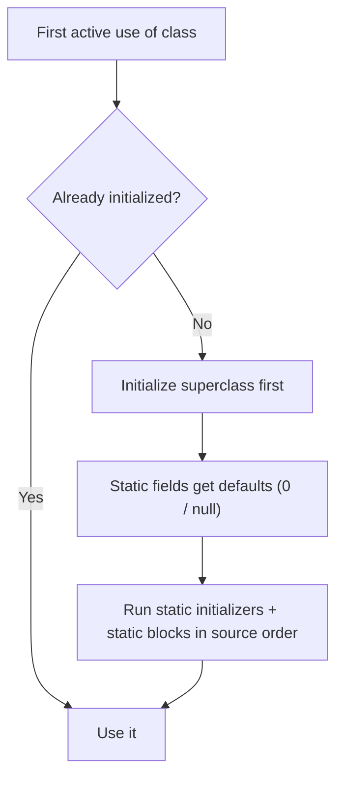

#### 4.5 Static imports

```java
import static java.lang.Math.PI;
import static java.lang.Math.*;         // all static members

double area = PI * pow(r, 2);           // instead of Math.PI * Math.pow(r, 2)
```

Use sparingly (common in tests: `import static org.junit.jupiter.api.Assertions.*;`). Overuse hurts readability.

#### 4.6 Static nested class vs inner class

```java
public class Outer {
    private int x = 10;
    private static int y = 20;

    static class StaticNested {           // no link to an Outer instance
        void show() { System.out.println(y); }        // only static members of Outer
    }

    class Inner {                         // holds a hidden reference Outer.this
        void show() { System.out.println(x + y); }    // can use both
    }
}

Outer.StaticNested sn = new Outer.StaticNested();
Outer.Inner in = new Outer().new Inner();             // needs an outer instance
```

Prefer **static nested** classes unless you really need the outer instance — inner classes keep the outer object alive (memory-leak risk), e.g., the `Builder` pattern uses a static nested class. Since Java 16, inner classes may also declare static members.

#### 🚀 4.7 Static & design: singleton, thread safety, testing

**Bill Pugh / holder-class singleton** — lazy and thread-safe thanks to class-initialization guarantees:

```java
public final class AppConfig {
    private AppConfig() { }                              // no outside instantiation

    private static class Holder {                        // not loaded until getInstance() is called
        static final AppConfig INSTANCE = new AppConfig();
    }

    public static AppConfig getInstance() {
        return Holder.INSTANCE;                          // JVM guarantees one-time, thread-safe init
    }
}
```

- **Mutable static state is shared by all threads** → needs synchronization (`AtomicInteger`, locks).
- Static state lives as long as the class is loaded → classic source of **memory leaks** (e.g., a static `List` cache that only grows).
- Static methods are hard to mock in tests → in Spring, prefer injected beans over static utilities for anything with logic/dependencies.

#### ⚠️ Common pitfalls & trick facts
- Can a static method access an instance variable? Not directly — only through an object reference.
- Can we override static methods? **No** — hiding.
- Can a constructor be static? **No.** Local variables can't be static either. Top-level classes can't be static.
- Calling a static method through an instance (`obj.staticMethod()`) compiles but is misleading — use the class name.

#### 🎯 Interview questions

<details><summary>Q1. Why can't a static method use `this` or call instance methods directly?</summary>

It runs without an instance, so there is no current object. You must create or receive an object to call instance members.

</details>

<details><summary>Q2. Can static methods be overridden?</summary>

No. A same-signature static method in a subclass **hides** the parent's. The call is bound at compile time based on the reference type — no runtime polymorphism.

</details>

<details><summary>Q3. When do static blocks run, and how many times?</summary>

Once per class (per class loader), during class initialization on first active use, in source order, parent class first.

</details>

<details><summary>Q4. Static nested class vs inner class?</summary>

A static nested class has no reference to an outer instance and can be created independently. An inner class holds an implicit `Outer.this` reference, needs an outer object to be created, and can access the outer's instance members.

</details>

<details><summary>Q5. Where are static variables stored in Java 8+?</summary>

Class metadata is in Metaspace (native memory); static field values are stored with the `Class` object in the heap. (Before Java 8, they were in PermGen.)

</details>

<details><summary>Q6. Why is the holder-class singleton thread-safe without synchronized?</summary>

The JVM guarantees that class initialization happens exactly once and is properly synchronized. The `Holder` class is only initialized on the first `getInstance()` call, giving lazy, thread-safe creation.

</details>

<!-- subtopic: d1_t1_s5 -->
### 5. The `final` Keyword — variables, methods, classes

> **TL;DR:** `final` = "cannot be changed after it's set". A final **variable** can be assigned once, a final **method** can't be overridden, a final **class** can't be extended.

#### 5.1 Final variables

```java
final int MAX = 100;
// MAX = 200;                  ❌ cannot assign a value to final variable

final int x;                   // "blank final" — assign exactly once later
x = 5;                         // ✅
// x = 6;                      ❌
```

**Blank final instance field:** must be assigned exactly once in **every** constructor (or in an initializer).
**Blank static final field:** must be assigned in a static block.

```java
public class User {
    private final String id;                 // blank final
    private static final Instant BOOT_TIME;

    static { BOOT_TIME = Instant.now(); }

    public User(String id) { this.id = id; }           // ✅ assigned
    public User() { this("anonymous"); }               // ✅ via chaining
    // public User(int x) { }                          ❌ id not initialized in this path
}
```

**Final parameters / locals:** `void process(final Order order)` — prevents reassigning inside the method.

#### 5.2 Final reference ≠ immutable object ⭐

`final` freezes the **reference**, not the object it points to.

```java
final List<String> names = new ArrayList<>();
names.add("Asha");                  // ✅ object is mutable
names.add("Ravi");                  // ✅
// names = new ArrayList<>();       ❌ cannot re-point the reference

final int[] arr = {1, 2, 3};
arr[0] = 99;                        // ✅ contents can change
```

To make the content unmodifiable: `List.of(...)`, `Collections.unmodifiableList(...)`, or design an immutable class.

#### 5.3 Effectively final (Java 8+)

A variable that is never reassigned after initialization is **effectively final**, even without the keyword. Lambdas and anonymous classes can only capture final or effectively final local variables.

```java
int base = 10;                              // effectively final
Function<Integer, Integer> add = n -> n + base;   // ✅

int counter = 0;
// list.forEach(s -> counter++);            ❌ counter is modified → not effectively final
```

Why? Lambdas capture a **copy** of the value; allowing changes would make the copy and the original diverge (and would be unsafe across threads).

#### 5.4 Final methods

Cannot be **overridden** (but can be **overloaded** and are inherited).

```java
class Payment {
    public final boolean validate() { /* core rule that subclasses must not change */ return true; }
    public void process() { }
}
class CardPayment extends Payment {
    // @Override public boolean validate() { }    ❌ cannot override final method
    @Override public void process() { }          // ✅
}
```

Use it to lock down algorithm steps (e.g., the *template method* itself is often `final`). `private` methods are implicitly un-overridable. A `static final` method cannot even be hidden.

#### 5.5 Final classes

Cannot be **extended**. Examples in the JDK: `String`, all wrapper classes (`Integer`, `Long`...), `Math`, `System`, `StringBuilder`, `LocalDate`. **Records** are implicitly final.

Why make `String` final? So nobody can subclass it and break immutability, security (class names, file paths, URLs) and the String pool.

#### 5.6 Illegal combinations

| Combination | Why illegal |
|---|---|
| `abstract final` (class or method) | abstract needs subclassing/overriding; final forbids it |
| `final` constructor | constructors aren't inherited, so nothing to prevent |
| `final` interface | interfaces exist to be implemented |

#### 5.7 Recipe: immutable class (asked very often)

```java
public final class Money {                          // 1. final class
    private final BigDecimal amount;                // 2. private final fields
    private final String currency;
    private final List<String> tags;

    public Money(BigDecimal amount, String currency, List<String> tags) {
        this.amount = amount;
        this.currency = currency;
        this.tags = List.copyOf(tags);              // 3. defensive copy of mutable inputs
    }

    public BigDecimal getAmount() { return amount; } // 4. getters only, no setters
    public List<String> getTags() { return tags; }   // 5. already unmodifiable (or return a copy)

    public Money add(Money other) {                  // 6. "modifiers" return NEW objects
        return new Money(amount.add(other.amount), currency, tags);
    }
}
```

Java 16+: `public record Money(BigDecimal amount, String currency) {}` gives you final fields, constructor, accessors, `equals`, `hashCode`, `toString` for free (but you still need defensive copies for mutable components).

#### 🚀 5.8 Advanced

- **Compile-time constants are inlined:** `public static final int TIMEOUT = 30;` gets copied into every class that uses it. If you change it and recompile only the defining class, other classes still see `30`. Constants are only `static final` primitives/Strings initialized with constant expressions.
- **Java Memory Model guarantee:** once a constructor finishes, any thread that obtains a reference to the object is guaranteed to see the correctly initialized values of its `final` fields — without synchronization (as long as `this` didn't escape during construction). This is why immutable objects are thread-safe.
- **Reflection** can still change non-static `final` fields via `setAccessible(true)` (not `static final` fields and not record fields). The JDK is moving toward forbidding this ("Prepare to Make Final Mean Final", JEP 500).
- **`sealed` classes (Java 17)** are the middle ground between `final` and fully open: `sealed class Shape permits Circle, Square`.

#### 5.9 `final` vs `finally` vs `finalize`

| | What it is |
|---|---|
| `final` | Modifier: constant variable / non-overridable method / non-extendable class |
| `finally` | Block after `try`/`catch` that always runs (cleanup) — prefer try-with-resources |
| `finalize()` | Old `Object` method called by GC before reclaiming — unpredictable; **deprecated** since Java 9 and deprecated for removal since Java 18. Use `try-with-resources` / `Cleaner`. |

#### 🎯 Interview questions

<details><summary>Q1. If a List is declared final, can you add elements to it?</summary>

Yes. `final` only prevents reassigning the reference. To prevent modification, use an unmodifiable list (`List.of`, `Collections.unmodifiableList`).

</details>

<details><summary>Q2. Can a final method be overloaded? Inherited?</summary>

Yes to both. It just can't be overridden.

</details>

<details><summary>Q3. What is a blank final variable?</summary>

A final variable declared without an initializer. It must be assigned exactly once — in every constructor for instance fields, or in a static block for static fields.

</details>

<details><summary>Q4. What is "effectively final" and why do lambdas need it?</summary>

A local variable that is never reassigned. Lambdas capture the value, not the variable; requiring it to be unchanged avoids confusing behaviour and race conditions.

</details>

<details><summary>Q5. Why is String final? Name other final classes.</summary>

To guarantee immutability (security, String pool, cached hashCode, thread-safety). Others: Integer and all wrappers, Math, System, StringBuilder, LocalDate, records.

</details>

<details><summary>Q6. How do you create an immutable class?</summary>

Final class, private final fields, no setters, initialize all fields in the constructor, defensive copies of mutable inputs and outputs, and methods that "modify" return new instances.

</details>

<!-- subtopic: d1_t1_s6 -->
### 6. Wrapper Classes — autoboxing, unboxing & the Integer cache

> **TL;DR:** Each primitive has an object "wrapper". Java converts between them automatically (**autoboxing/unboxing**). `Integer.valueOf` caches **-128 to 127**, which makes `==` on wrappers a classic bug.

#### 6.1 Primitives and their wrappers

| Primitive | Size | Range / values | Wrapper | Cache |
|---|---|---|---|---|
| `byte` | 8-bit | -128 to 127 | `Byte` | all values |
| `short` | 16-bit | -32,768 to 32,767 | `Short` | -128 to 127 |
| `int` | 32-bit | -2³¹ to 2³¹-1 (~±2.1 billion) | `Integer` | -128 to 127 (upper bound configurable) |
| `long` | 64-bit | -2⁶³ to 2⁶³-1 (~±9.2×10¹⁸) | `Long` | -128 to 127 |
| `float` | 32-bit | ~7 decimal digits | `Float` | none |
| `double` | 64-bit | ~15–16 decimal digits | `Double` | none |
| `char` | 16-bit unsigned | 0 to 65,535 | `Character` | 0 to 127 |
| `boolean` | JVM-dependent | `true` / `false` | `Boolean` | `TRUE` / `FALSE` constants |

All wrappers are **immutable** and **final**. Numeric wrappers extend `Number`.

#### 6.2 Why do wrappers exist?

1. **Generics & Collections** work only with objects: `List<Integer>`, not `List<int>`.
2. Represent **"no value"** with `null` (e.g., a nullable DB column → `Integer`).
3. **Utility methods**: `Integer.parseInt`, `Integer.toBinaryString`, `Character.isDigit`, `Integer.MAX_VALUE`.
4. Needed for reflection, serialization frameworks, etc.

#### 6.3 Autoboxing & unboxing

```java
Integer boxed = 42;           // autoboxing → compiler writes: Integer.valueOf(42)
int raw = boxed;              // unboxing   → compiler writes: boxed.intValue()

List<Integer> list = new ArrayList<>();
list.add(5);                  // autoboxing
int first = list.get(0);      // unboxing
```

#### 6.4 The Integer cache ⭐ (most asked)

```java
Integer a = 127, b = 127;
System.out.println(a == b);        // true  — both come from the cache (same object)

Integer c = 128, d = 128;
System.out.println(c == d);        // false — two different objects
System.out.println(c.equals(d));   // true  — compares values ✅

Integer e = 128;
int f = 128;
System.out.println(e == f);        // true  — Integer vs int → e is UNBOXED, numeric comparison
```

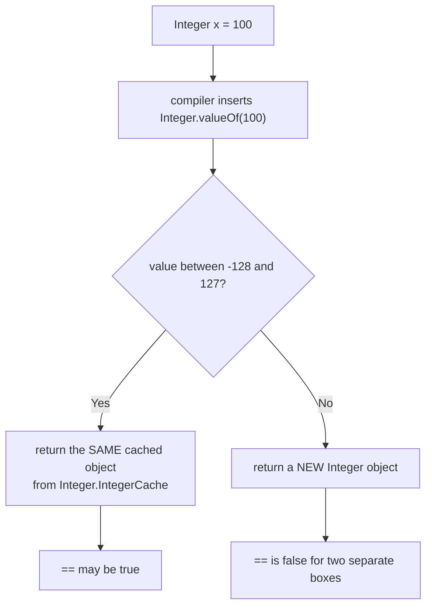

- The cache is created when `Integer` is initialized. The **upper bound** can be raised with `-XX:AutoBoxCacheMax=<n>` (or `-Djava.lang.Integer.IntegerCache.high=<n>`); the lower bound is fixed at -128.
- `new Integer(5)` always creates a new object — this constructor is **deprecated** (Java 9, marked for removal in Java 16). Use `Integer.valueOf(5)`.

> **Rule:** never compare wrapper objects with `==`. Use `.equals()`, `Objects.equals(a, b)`, or compare primitives (`a.intValue() == b.intValue()`, `Integer.compare(a, b)`).

#### 6.5 Unboxing `null` → NullPointerException

```java
Map<String, Integer> stock = new HashMap<>();
int qty = stock.get("apple");          // 💥 NPE: get() returns null, unboxing null.intValue()

Integer qty2 = stock.getOrDefault("apple", 0);   // ✅ safe
```

**Ternary trap:**
```java
Integer cached = null;
boolean useCache = true;
Integer result = useCache ? cached : 0;   // 💥 NPE!
```
When one branch is `Integer` and the other is `int`, the expression's type becomes `int`, so `cached` is unboxed. Fix: `useCache ? cached : Integer.valueOf(0)`.

#### 6.6 More autoboxing traps

```java
// 1. Performance: boxing inside hot loops
Long sum = 0L;                               // ⚠️ wrapper
for (long i = 0; i < 1_000_000; i++) sum += i;   // creates ~1 million Long objects
long fast = 0L;                              // ✅ primitive

// 2. Literal types
// Long big = 5;                             ❌ compile error: int cannot be converted to Long
Long big = 5L;                               // ✅

// 3. equals across types
Long l = 5L;
System.out.println(l.equals(5));             // false! 5 boxes to Integer, Long.equals(Integer) → false
System.out.println(l.equals(5L));            // true

// 4. List<Integer>.remove ambiguity
List<Integer> nums = new ArrayList<>(List.of(10, 20, 30));
nums.remove(1);                              // removes INDEX 1 → [10, 30]
nums.remove(Integer.valueOf(10));            // removes VALUE 10 → [30]
```

**Overload resolution order:** exact match → **widening** → **boxing** → **varargs**.

```java
static void m(long x)    { System.out.println("long"); }
static void m(Integer x) { System.out.println("Integer"); }
m(5);       // "long" — widening beats boxing
```

#### 6.7 Useful wrapper methods

```java
int n = Integer.parseInt("123");          // String → int (primitive)
Integer w = Integer.valueOf("123");       // String → Integer (object, cached)
String s = Integer.toString(255);         // "255"
String bin = Integer.toBinaryString(10);  // "1010"
String hex = Integer.toHexString(255);    // "ff"
int bits = Integer.bitCount(7);           // 3
int max = Integer.MAX_VALUE;              // 2147483647
int cmp = Integer.compare(3, 7);          // negative
boolean d = Character.isDigit('7');       // true
boolean l = Character.isLetterOrDigit('_'); // false
char up = Character.toUpperCase('a');     // 'A'
// Integer.parseInt("abc")                → NumberFormatException
```

#### 🚀 6.8 Advanced

- **Overflow:** `Integer.MAX_VALUE + 1 == Integer.MIN_VALUE` (wraps around silently). `Math.abs(Integer.MIN_VALUE)` is still **negative**. Use `Math.addExact` / `Math.multiplyExact` to get an exception, or use `long`. Very common in DSA (e.g., `mid = (lo + hi) / 2` overflow → use `lo + (hi - lo) / 2`).
- **Floating point oddities:** `Double.NaN == Double.NaN` is `false`, but `Double.valueOf(Double.NaN).equals(Double.NaN)` is `true`. `0.0 == -0.0` is `true`, but `Double.valueOf(0.0).equals(-0.0)` is `false`. `0.1 + 0.2 != 0.3` → use `BigDecimal` for money.
- **Memory:** an `Integer` is ~16 bytes + a 4-byte reference vs 4 bytes for `int` → `ArrayList<Integer>` uses ~5× the memory of `int[]`. Prefer primitive arrays / `IntStream` in performance-critical code.
- **Wrappers are value-based classes** — don't synchronize on them or rely on identity. Project Valhalla aims to bring primitive-like "value classes" to Java.

#### 🎯 Interview questions

<details><summary>Q1. Why does `Integer a = 127, b = 127; a == b` return true, but 128 returns false?</summary>

Autoboxing uses `Integer.valueOf`, which returns cached objects for -128..127. Within that range both variables point to the same object; outside it, two different objects are created, so `==` (reference comparison) is false.

</details>

<details><summary>Q2. What is autoboxing and when can it cause an NPE?</summary>

Automatic conversion between primitives and wrappers by the compiler (`valueOf` / `xxxValue()`). Unboxing a `null` wrapper (e.g., from `Map.get`, or in a mixed ternary) throws `NullPointerException`.

</details>

<details><summary>Q3. parseInt vs valueOf?</summary>

`Integer.parseInt` returns a primitive `int`. `Integer.valueOf` returns an `Integer` object (using the cache).

</details>

<details><summary>Q4. Can you change the Integer cache range?</summary>

Only the upper bound, via `-XX:AutoBoxCacheMax=<size>`. Other wrapper caches are fixed.

</details>

<details><summary>Q5. Why use int instead of Integer in loops/arrays?</summary>

No allocation, no GC pressure, no unboxing cost, no NPE risk, and roughly 4–5× less memory.

</details>

<!-- subtopic: d1_t1_s7 -->
### 7. String Basics — String pool, immutability, `new String("abc")`

> **TL;DR:** `String` is **immutable** and **final**. String literals are stored once in the **String pool** and reused. `new String("abc")` forces a new heap object, so it creates up to **2 objects**.

#### 7.1 Creating strings

```java
String s1 = "Java";                 // literal → goes into / comes from the String pool
String s2 = "Java";                 // reuses the SAME pooled object
String s3 = new String("Java");     // forces a NEW object on the heap (outside the pool)
String s4 = s3.intern();            // returns the pooled "Java"

System.out.println(s1 == s2);       // true  — same pooled object
System.out.println(s1 == s3);       // false — different objects
System.out.println(s1 == s4);       // true  — intern() gave back the pooled one
System.out.println(s1.equals(s3));  // true  — same content
```

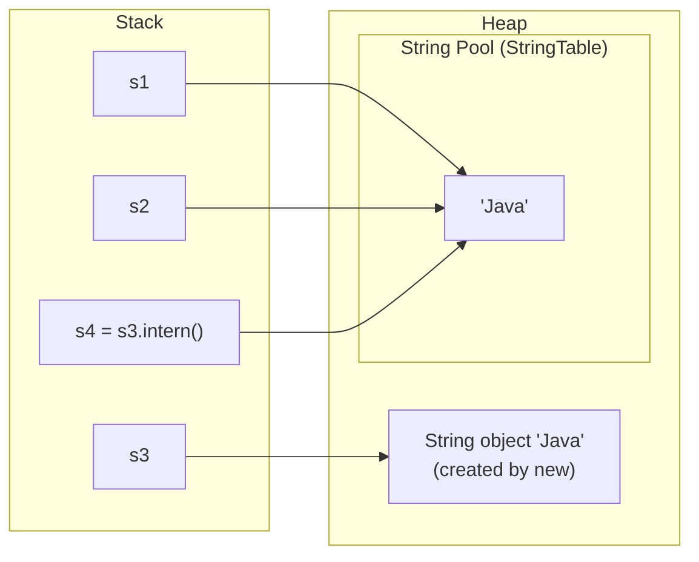

#### 7.2 What is the String pool?

- A special area (a hash table called the **StringTable**) where the JVM keeps **one copy of each distinct string literal** so they can be shared.
- **Location:** PermGen up to Java 6; **heap since Java 7** (so pooled strings can be garbage collected).
- Literals and compile-time constant expressions are pooled automatically. Strings created at runtime (`new`, concatenation with variables, `substring`, reading input) are **not** pooled unless you call `intern()`.

#### 7.3 Why does `new String("abc")` create 2 objects?

```java
String s = new String("abc");
```

1. The literal `"abc"` → a String object in the **pool** (only if not already there).
2. `new` → **another** String object on the heap with the same content.

So: **2 objects** if `"abc"` wasn't pooled yet, **1 new object** if it was. (Interviewers expect "two, one in the pool and one in the heap".) This is why `new String("...")` is almost always wasteful.

#### 7.4 Compile-time vs runtime concatenation ⭐

```java
String a = "Ja" + "va";            // folded at COMPILE time → "Java" literal → pooled
System.out.println(a == "Java");   // true

String part = "Ja";
String b = part + "va";            // computed at RUNTIME → new object
System.out.println(b == "Java");   // false
System.out.println(b.intern() == "Java");   // true

final String fpart = "Ja";         // final + constant → compile-time constant
String c = fpart + "va";           // folded at compile time
System.out.println(c == "Java");   // true
```

#### 7.5 Immutability — what it means

Once created, a String's content **never changes**. Every "modifying" method returns a **new** String.

```java
String s = "hello";
s.toUpperCase();                    // ⚠️ result thrown away
System.out.println(s);              // "hello"

s = s.toUpperCase();                // ✅ re-assign the reference to the new object
System.out.println(s);              // "HELLO"
```

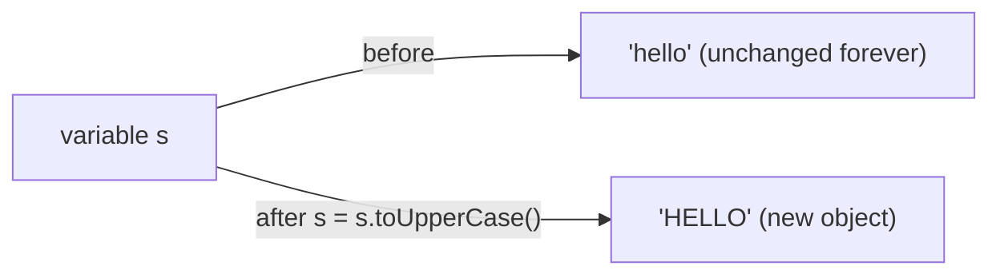

#### 7.6 Why is String immutable? (give at least 4 reasons)

1. **String pool safety** — many references share one literal; if one could modify it, all would change.
2. **Security** — strings are used for class names, file paths, URLs, DB connection strings, usernames; they can't be altered after validation.
3. **Thread safety** — immutable objects can be shared across threads without synchronization.
4. **Hash code caching** — the hash is computed once and cached in a field, making String a fast, reliable **HashMap key**.
5. **Class loading** — class names passed as strings can't be tampered with.

#### 7.7 Important String methods (cheat sheet)

```java
String s = "  Hello, World  ";
s.length();                  // 16
s.charAt(2);                 // 'H'
s.trim();                    // "Hello, World" (removes chars <= ' ')
s.strip();                   // Java 11, Unicode-aware trim
s.isEmpty();                 // false (length == 0?)
"   ".isBlank();             // true (Java 11)
s.toLowerCase(); s.toUpperCase();
s.contains("World");         // true
s.indexOf('o'); s.lastIndexOf('o');
s.substring(2, 7);           // "Hello" — [begin, end)
s.replace('l', 'L');         // all occurrences
s.split(",");                // regex-based split → String[]
String.join("-", "a", "b");  // "a-b"
"ab".repeat(3);              // "ababab" (Java 11)
"a\nb".lines();              // Stream<String> (Java 11)
s.startsWith("  He"); s.endsWith("  ");
"abc".compareTo("abd");      // negative (lexicographic)
s.equalsIgnoreCase("x");
s.toCharArray();             // char[] — very common in DSA
String.valueOf(42);          // "42"
"Hi %s, you are %d".formatted("Sam", 30);   // Java 15
```

**Text blocks (Java 15):**
```java
String json = """
    {
      "name": "Sam",
      "age": 30
    }
    """;
```

#### 🚀 7.8 Advanced internals

- **Compact Strings (Java 9):** internally a `byte[]` + a `coder` flag. Latin-1 strings use **1 byte/char** instead of 2 (before Java 9 it was `char[]`). Saves a lot of heap.
- **hashCode:** `s[0]*31^(n-1) + s[1]*31^(n-2) + ... + s[n-1]`. 31 is an odd prime and `31 * i == (i << 5) - i`, which the JIT can optimize. Cached in the `hash` field after first computation.
- **`+` in loops is O(n²):** each iteration copies the whole string. Use `StringBuilder`. (Since Java 9, a single `a + b + c` expression compiles to `invokedynamic` → `StringConcatFactory`, which is efficient — the loop problem remains.)
- **`substring` memory leak (old):** before Java 7u6, `substring` shared the original `char[]`, so a tiny substring could keep a huge array alive. Now it copies.
- **Passwords:** prefer `char[]` over `String` — you can wipe a `char[]` after use, but a String lingers in memory (and possibly the pool) until GC.
- **`switch` on String** (Java 7) uses `hashCode()` and then `equals()`.
- **G1 String deduplication** (`-XX:+UseStringDeduplication`) can share the backing arrays of equal strings at GC time; `-XX:StringTableSize` tunes the pool's hash table size.

#### 🎯 Interview questions

<details><summary>Q1. How many objects are created by `String s = new String("abc");`?</summary>

Up to two: one for the literal `"abc"` in the String pool (if it doesn't exist yet) and one new String on the heap from `new`. `s` refers to the heap one.

</details>

<details><summary>Q2. Where is the String pool located?</summary>

In the heap since Java 7 (it was in PermGen before that).

</details>

<details><summary>Q3. What does intern() do?</summary>

Returns the canonical pooled instance of the string: if an equal string exists in the pool it's returned, otherwise this string is added to the pool and returned.

</details>

<details><summary>Q4. Why is String immutable?</summary>

String pool sharing, security, thread safety, hashCode caching (good HashMap keys), and safe class loading.

</details>

<details><summary>Q5. Is `"Ja" + "va" == "Java"` true?</summary>

Yes — both operands are literals, so the compiler folds them into the constant `"Java"`, which is pooled. With a non-final variable it would be false.

</details>

<details><summary>Q6. Why is String concatenation in a loop slow?</summary>

Each `+=` creates a new String and copies all previous characters, giving O(n²) total work. Use a `StringBuilder`.

</details>

<!-- subtopic: d1_t1_s8 -->
### 8. `==` vs `.equals()` and StringBuilder vs StringBuffer

> **TL;DR:** `==` compares **references** (for objects) or **values** (for primitives). `.equals()` compares **logical content** if the class overrides it. `StringBuilder` and `StringBuffer` are mutable strings; `StringBuffer` is synchronized (thread-safe, slower), `StringBuilder` is not (faster — use it by default).

#### 8.1 `==` vs `.equals()`

| | `==` | `.equals()` |
|---|---|---|
| Type | Operator | Method of `Object` |
| Primitives | Compares values | N/A |
| Objects | Same object in memory? | Logically equal? (if overridden) |
| Default (Object class) | — | Same as `==` |
| Overridable | No | Yes (`String`, wrappers, collections, records override it) |
| Null | `null == null` is true | `null.equals(x)` → NPE |

```java
String a = new String("hi");
String b = new String("hi");
a == b;               // false — two objects
a.equals(b);          // true  — same characters

int x = 5, y = 5;
x == y;               // true — primitive values

StringBuilder s1 = new StringBuilder("hi");
StringBuilder s2 = new StringBuilder("hi");
s1.equals(s2);        // false! StringBuilder does NOT override equals
s1.toString().equals(s2.toString());   // true
s1.compareTo(s2) == 0;                 // true (Java 11+)
```

**Null-safe comparisons:**
```java
"admin".equals(role);          // ✅ literal first — no NPE if role is null
Objects.equals(a, b);          // ✅ handles nulls on both sides
role.equals("admin");          // 💥 NPE if role is null
```

Use `==` for: primitives, `enum` constants (singletons — safe and null-safe), and when you truly mean "same instance".

#### 8.2 The `equals()` contract

A correct `equals` must be:
1. **Reflexive:** `x.equals(x)` is true.
2. **Symmetric:** `x.equals(y)` ⇔ `y.equals(x)`.
3. **Transitive:** `x.equals(y)` and `y.equals(z)` ⇒ `x.equals(z)`.
4. **Consistent:** repeated calls return the same result if nothing changed.
5. **Non-null:** `x.equals(null)` is false.

#### 8.3 The `hashCode()` contract ⭐

- If `a.equals(b)` then `a.hashCode() == b.hashCode()` **must** hold.
- Equal hash codes do **not** imply equal objects (collisions are allowed).
- **Always override both together.** Otherwise `HashMap`/`HashSet` break.

```java
public class Employee {
    private final String id;
    private final String name;

    public Employee(String id, String name) { this.id = id; this.name = name; }

    @Override
    public boolean equals(Object o) {
        if (this == o) return true;                       // 1. same reference
        if (!(o instanceof Employee other)) return false; // 2. type check (+ null check) — Java 16 pattern
        return id.equals(other.id) && name.equals(other.name);   // 3. compare significant fields
    }

    @Override
    public int hashCode() {
        return Objects.hash(id, name);                    // same fields as equals
    }
}
```

What breaks if you override `equals` but not `hashCode`:
```java
Set<Employee> set = new HashSet<>();
set.add(new Employee("1", "Asha"));
set.contains(new Employee("1", "Asha"));   // false! different default hashCodes → different buckets
```

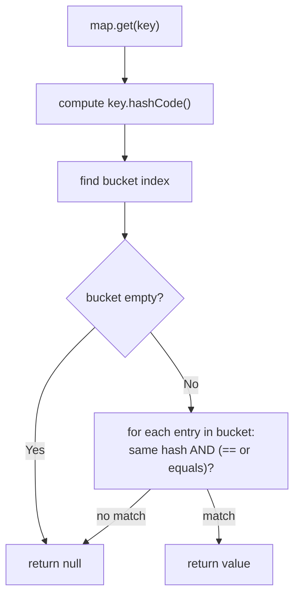

**`instanceof` vs `getClass()` in equals:** `getClass() != o.getClass()` is strict (subclasses are never equal); `instanceof` allows subclasses but can break symmetry if a subclass adds fields. Common advice: use `instanceof` and make the class `final`, or use `getClass()`. **Records** generate a correct `equals`/`hashCode` automatically.

🚀 **Consistency with compareTo:** `new BigDecimal("1.0").equals(new BigDecimal("1.00"))` is **false** (different scale) but `compareTo` returns 0. So a `HashSet` keeps both while a `TreeSet` keeps one.

#### 8.4 StringBuilder vs StringBuffer vs String

| | `String` | `StringBuilder` | `StringBuffer` |
|---|---|---|---|
| Mutability | Immutable | Mutable | Mutable |
| Thread-safe | Yes (immutable) | ❌ No | ✅ Yes (`synchronized` methods) |
| Speed | Slow for repeated edits | **Fastest** | Slower (lock overhead) |
| Since | 1.0 | **Java 5** | 1.0 |
| `equals` overridden | Yes | No | No |
| Use when | Fixed text, keys, constants | Building strings in one thread (99% of cases) | Shared mutable buffer across threads (rare) |

```java
// ❌ O(n²): creates a new String every iteration
String result = "";
for (int i = 0; i < 10_000; i++) result += i;

// ✅ O(n): appends into one growing buffer
StringBuilder sb = new StringBuilder();
for (int i = 0; i < 10_000; i++) sb.append(i);
String result2 = sb.toString();
```

#### 8.5 StringBuilder API

```java
StringBuilder sb = new StringBuilder("hello");
sb.append(" world");          // "hello world"
sb.insert(0, ">> ");          // ">> hello world"
sb.replace(0, 3, "");         // "hello world"
sb.delete(5, 11);             // "hello"
sb.deleteCharAt(0);           // "ello"
sb.reverse();                 // "olle"  ← palindrome checks in DSA
sb.setCharAt(0, 'O');         // "Olle"
sb.charAt(1);                 // 'l'
sb.length();                  // 4
sb.setLength(0);              // clear it (reuse the buffer)
sb.indexOf("l");
```

#### 🚀 8.6 Internals

- Both extend `AbstractStringBuilder`, which holds a resizable array (`byte[]` since Java 9).
- Default capacity is **16**; `new StringBuilder("abc")` → 16 + 3. When full, it grows to roughly **(old × 2) + 2** and copies — so **appends are amortized O(1)**. If you know the final size, pre-size it: `new StringBuilder(10_000)`.
- `StringBuffer` synchronizes each method, but **compound operations are still not atomic** (e.g., `if (buf.length() > 0) buf.append(...)` can race). That's why it's rarely the right tool; usually you build strings in a single thread or use other concurrency mechanisms.
- The JIT can sometimes remove uncontended locks (lock elision), narrowing the gap — but `StringBuilder` remains the default choice.

#### 🎯 Interview questions

<details><summary>Q1. Difference between == and equals()?</summary>

`==` compares primitive values or object references (identity). `equals()` compares logical equality as defined by the class; `Object`'s default implementation is `==`, while `String`, wrappers, collections and records override it to compare content.

</details>

<details><summary>Q2. What happens if you override equals but not hashCode?</summary>

Equal objects may have different hash codes, so hash-based collections (HashMap/HashSet) put them in different buckets — lookups fail and duplicates appear.

</details>

<details><summary>Q3. StringBuilder vs StringBuffer?</summary>

Both mutable. StringBuffer's methods are synchronized (thread-safe, slower, since Java 1.0); StringBuilder isn't synchronized (faster, since Java 5). Use StringBuilder unless a buffer is truly shared between threads.

</details>

<details><summary>Q4. Does StringBuilder override equals()? How do you compare two builders?</summary>

No — it uses reference equality. Compare `sb1.toString().equals(sb2.toString())` or, since Java 11, `sb1.compareTo(sb2) == 0`.

</details>

<details><summary>Q5. Why can you safely compare enums with ==?</summary>

Each enum constant is a singleton per class loader, so identity equals logical equality. `==` is also null-safe and checked at compile time.

</details>

<details><summary>Q6. What is the default capacity of StringBuilder and how does it grow?</summary>

16 characters (or 16 + initial string length). When it overflows, capacity becomes about `old * 2 + 2` and the contents are copied, giving amortized O(1) appends.

</details>

<!-- topic: d1_t2 -->
## 🧮 DSA — Complexity Analysis & Setup

<!-- subtopic: d1_t2_s1 -->
### 9. Big-O Notation — what it means & how to calculate it

> **TL;DR:** Big-O describes how an algorithm's running time (or memory) **grows** as the input size `n` grows, ignoring constants and machine speed. It's an **upper bound** on growth.

#### 9.1 Why we need it

Measuring time in seconds depends on the machine, language, and input. Big-O lets us compare algorithms independent of hardware: "this one does ~n² operations, that one ~n log n" — for large `n`, the second always wins.

#### 9.2 Formal definitions

- **Big-O (upper bound):** `f(n) = O(g(n))` if there exist constants `c > 0` and `n₀` such that `f(n) ≤ c·g(n)` for all `n ≥ n₀`.
- **Big-Ω (lower bound):** `f(n) ≥ c·g(n)` for large `n`.
- **Big-Θ (tight bound):** both — `f` grows exactly like `g`.

Example: `f(n) = 3n² + 5n + 2`. Choose `c = 4`: `3n² + 5n + 2 ≤ 4n²` ⇔ `n² ≥ 5n + 2`, true for `n ≥ 6`. So `f(n) = O(n²)` (and in fact `Θ(n²)`).

> In interviews, "Big-O" usually means the **tight worst-case bound**. Saying linear search is O(n³) is technically true but useless.

#### 9.3 Best, average, worst case

| Case | Linear search for x in an array |
|---|---|
| Best | x is the first element → O(1) |
| Average | x is somewhere in the middle → O(n) |
| Worst | x is last or missing → O(n) |

Quicksort: average O(n log n), worst O(n²). HashMap get: average O(1), worst O(log n) in Java 8+ (tree bins). **Always state which case you mean.**

#### 9.4 The rules for calculating Big-O

1. **Drop constants:** `O(2n)` → `O(n)`; `O(500)` → `O(1)`.
2. **Drop lower-order terms:** `O(n² + n + 100)` → `O(n²)`.
3. **Sequential steps add:** loop of n, then loop of n → `O(n + n) = O(n)`.
4. **Nested steps multiply:** loop of n inside loop of n → `O(n²)`.
5. **Different inputs → different variables:** loop over `a` then `b` → `O(a + b)`; nested → `O(a · b)`. Don't call it O(n²)!
6. **Count the dominant operation** (comparisons, array accesses) and how many times it runs.

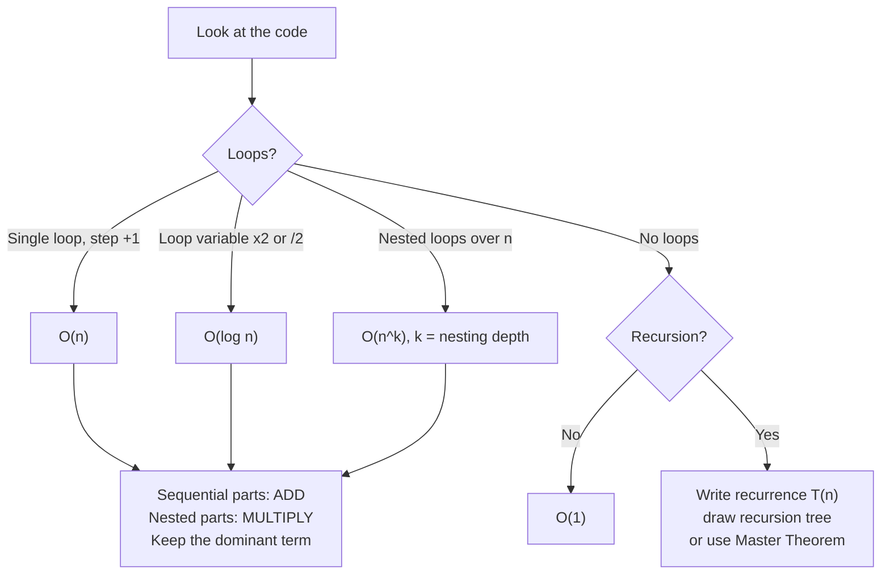

#### 9.5 Loop patterns (worked examples)

```java
// 1. O(n) — single loop
for (int i = 0; i < n; i++) { sum += i; }

// 2. O(n²) — nested loops
for (int i = 0; i < n; i++)
    for (int j = 0; j < n; j++) { count++; }

// 3. O(n²) — triangular nested loop: 0+1+2+...+(n-1) = n(n-1)/2
for (int i = 0; i < n; i++)
    for (int j = 0; j < i; j++) { count++; }

// 4. O(log n) — variable doubles (or halves) each step
for (int i = 1; i < n; i *= 2) { count++; }        // runs log₂(n) times

// 5. O(√n) — loop until i*i exceeds n
for (int i = 1; (long) i * i <= n; i++) { }        // e.g., primality check

// 6. O(n log n) — outer n, inner log n
for (int i = 0; i < n; i++)
    for (int j = 1; j < n; j *= 2) { }

// 7. O(a + b) vs O(a * b) — two different inputs
for (int x : arrA) { }   for (int y : arrB) { }    // O(a + b)
for (int x : arrA) for (int y : arrB) { }          // O(a * b)

// 8. TRICK: looks like O(n log n) but is O(n)
for (int i = n; i > 0; i /= 2)
    for (int j = 0; j < i; j++) { count++; }       // n + n/2 + n/4 + ... ≈ 2n → O(n)

// 9. Harmonic series → O(n log n)
for (int i = 1; i <= n; i++)
    for (int j = i; j <= n; j += i) { }            // n/1 + n/2 + ... + n/n = n·H(n) ≈ n ln n
```

#### 9.6 Recursion complexity

Write a **recurrence** and solve it (recursion tree or Master Theorem).

| Algorithm | Recurrence | Complexity |
|---|---|---|
| Factorial / linear recursion | T(n) = T(n-1) + O(1) | O(n) |
| Binary search | T(n) = T(n/2) + O(1) | O(log n) |
| Merge sort | T(n) = 2T(n/2) + O(n) | O(n log n) |
| Naive Fibonacci | T(n) = T(n-1) + T(n-2) + O(1) | O(2ⁿ) (tighter: ~O(1.618ⁿ)) |
| Subsets / permutations | — | O(2ⁿ · n) / O(n! · n) |

Rule of thumb for recursion: **time ≈ (number of calls) × (work per call)**; number of calls ≈ `branches^depth`.

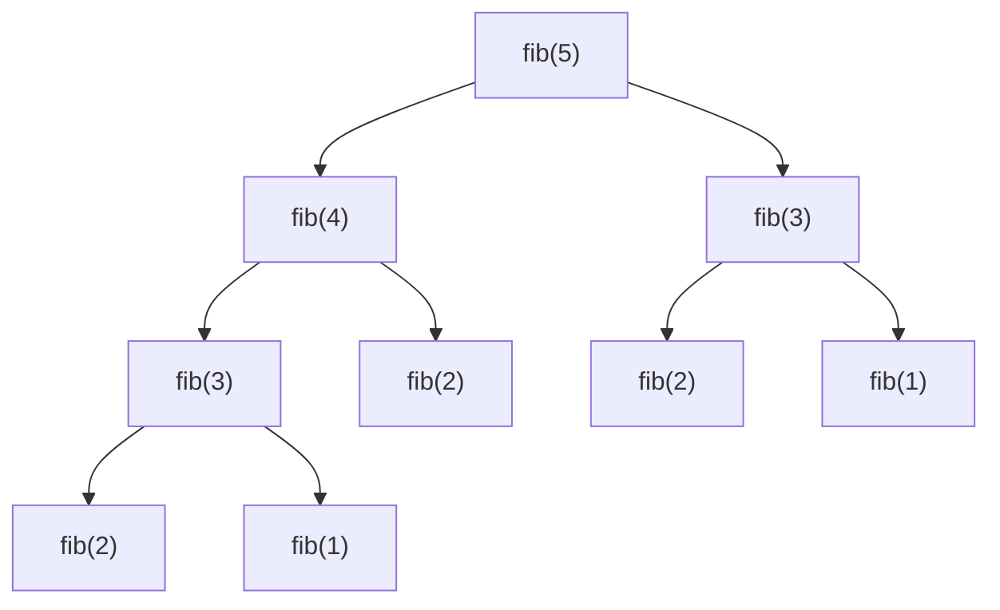
*Each call branches twice and depth is n → about 2ⁿ calls. Notice `fib(3)` and `fib(2)` are recomputed — memoization (DP) brings this down to O(n).*

🚀 **Master Theorem (for T(n) = a·T(n/b) + f(n)):** compare `f(n)` with `n^(log_b a)`:
1. `f(n)` smaller → `T(n) = Θ(n^(log_b a))` (leaves dominate). e.g., `T(n)=8T(n/2)+n²` → Θ(n³).
2. Same order → `T(n) = Θ(n^(log_b a) · log n)`. e.g., merge sort → Θ(n log n).
3. `f(n)` bigger → `T(n) = Θ(f(n))` (root dominates). e.g., `T(n)=2T(n/2)+n²` → Θ(n²).

#### 🚀 9.7 Amortized analysis

Some operations are occasionally expensive but cheap on average over a sequence. `ArrayList.add` is usually O(1), but when the internal array is full it copies everything (O(n)) into an array **1.5×** larger. Because resizes get exponentially rarer, the total cost of n adds is O(n) → **amortized O(1)** per add. Same idea for `StringBuilder.append` and `HashMap` resizing.

#### 9.8 Complexity of common Java operations (must know)

| Operation | Complexity |
|---|---|
| Array access `arr[i]` | O(1) |
| `ArrayList` get / set | O(1) |
| `ArrayList` add (end) | O(1) amortized |
| `ArrayList` add/remove at index / `contains` | O(n) |
| `LinkedList` addFirst / addLast / removeFirst | O(1) |
| `LinkedList` get(i) | O(n) |
| `HashMap` / `HashSet` get, put, contains, remove | O(1) average; O(log n) worst (Java 8+ treeified buckets) |
| `TreeMap` / `TreeSet` operations | O(log n) |
| `PriorityQueue` offer / poll | O(log n); peek O(1); contains O(n) |
| `ArrayDeque` push/pop/offer/poll at either end | O(1) |
| `Arrays.sort` / `Collections.sort` | O(n log n) |
| `String.charAt` | O(1) |
| `String.substring`, `+`, `toCharArray`, `equals` | O(n) |
| `String.indexOf(str)` | O(n·m) worst |

#### 9.9 Reading constraints → target complexity

Roughly **10⁸ simple operations per second** in Java. Use input size to guess the intended solution:

| n up to | Acceptable complexity | Typical techniques |
|---|---|---|
| ≤ 10–12 | O(n!) | permutations, brute force |
| ≤ 20–25 | O(2ⁿ) | subsets, bitmask |
| ≤ 500 | O(n³) | triple loops, Floyd–Warshall |
| ≤ 5,000 | O(n²) | nested loops, 2D DP |
| ≤ 10⁶ | O(n log n) | sorting, heaps, binary search |
| ≤ 10⁸ | O(n) | single pass, two pointers, hashing |
| > 10⁸ | O(log n) / O(1) | math, binary search on answer |

#### 🎯 Interview questions

<details><summary>Q1. What does O(n) actually mean?</summary>

The running time grows at most linearly with input size for large n — doubling n roughly doubles the work. Constants and lower-order terms are ignored.

</details>

<details><summary>Q2. Difference between Big-O, Big-Omega and Big-Theta?</summary>

O is an upper bound, Ω a lower bound, Θ a tight bound (both). Interviews usually say "Big-O" meaning the tight worst-case bound.

</details>

<details><summary>Q3. Is O(2n) different from O(n)?</summary>

No. Constants are dropped; both are O(n). Constants matter in practice but not asymptotically.

</details>

<details><summary>Q4. Complexity of iterating over two arrays of different sizes in nested loops?</summary>

O(a·b), not O(n²) — use separate variables for independent inputs.

</details>

<details><summary>Q5. What is amortized O(1)? Give an example.</summary>

The average cost per operation over a worst-case sequence of operations is constant, even though an individual operation may be expensive. Example: `ArrayList.add` with occasional resizing.

</details>

<!-- subtopic: d1_t2_s2 -->
### 10. Common Complexities — O(1), O(log n), O(n), O(n log n), O(n²) with examples

> **TL;DR:** From fastest to slowest: **O(1) < O(log n) < O(√n) < O(n) < O(n log n) < O(n²) < O(n³) < O(2ⁿ) < O(n!)**.

#### 10.1 Growth comparison

| n | O(1) | O(log n) | O(n) | O(n log n) | O(n²) | O(2ⁿ) |
|---|---|---|---|---|---|---|
| 10 | 1 | ~3 | 10 | ~33 | 100 | 1,024 |
| 100 | 1 | ~7 | 100 | ~664 | 10,000 | 1.27×10³⁰ |
| 1,000 | 1 | ~10 | 1,000 | ~9,966 | 10⁶ | ∞ (practically) |
| 10⁶ | 1 | ~20 | 10⁶ | ~2×10⁷ | 10¹² ❌ | ∞ |

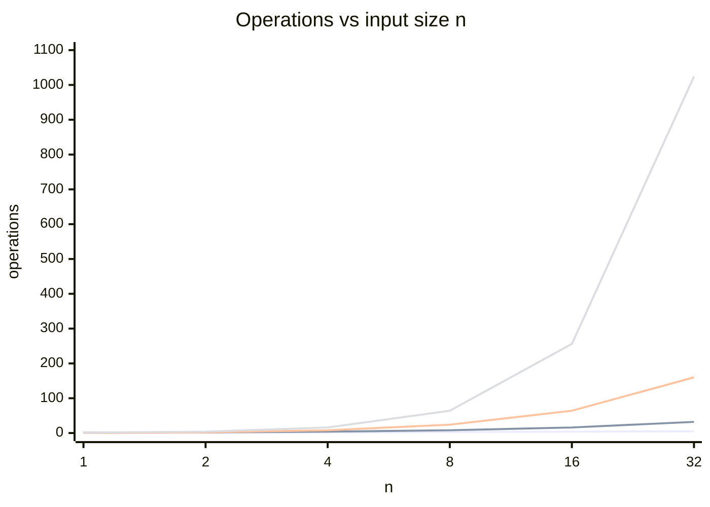
*Lines from bottom to top: O(log n), O(n), O(n log n), O(n²). The gap explodes as n grows.*

#### 10.2 O(1) — constant

Work doesn't depend on n.

```java
int first = arr[0];                     // array index
map.get(key);                           // HashMap (average)
stack.push(x); deque.pollFirst();
boolean even = (n & 1) == 0;            // bit trick
int sum1toN = n * (n + 1) / 2;          // formula instead of loop
```

#### 10.3 O(log n) — logarithmic

The problem size is **halved** (or divided by a constant) each step. log₂(10⁹) ≈ 30 — insanely fast.

```java
// Binary search on a SORTED array
int binarySearch(int[] arr, int target) {
    int lo = 0, hi = arr.length - 1;
    while (lo <= hi) {
        int mid = lo + (hi - lo) / 2;          // avoids int overflow of (lo + hi)
        if (arr[mid] == target) return mid;
        if (arr[mid] < target) lo = mid + 1;
        else hi = mid - 1;
    }
    return -1;
}

// Count digits of n — divide by 10 each step → O(log₁₀ n)
int digits(int n) { int c = 0; do { c++; n /= 10; } while (n != 0); return c; }
```

Also: TreeMap/TreeSet ops, heap insert/remove, fast exponentiation, GCD (Euclid).

#### 10.4 O(√n)

```java
boolean isPrime(int n) {
    if (n < 2) return false;
    for (int i = 2; (long) i * i <= n; i++)     // only up to √n
        if (n % i == 0) return false;
    return true;
}
```

Also: finding all divisors of n.

#### 10.5 O(n) — linear

Touch each element a constant number of times.

```java
int max(int[] arr) {
    int best = Integer.MIN_VALUE;
    for (int x : arr) best = Math.max(best, x);
    return best;
}
```

Also: linear search, sum, counting with a HashMap, two-pointer techniques, Kadane's algorithm.

#### 10.6 O(n log n) — linearithmic

Typically "sort first" or divide-and-conquer that does linear work per level across log n levels.

```java
Arrays.sort(arr);   // then a single linear pass → total O(n log n)
```

Also: merge sort, heap sort, n insertions into a heap/TreeMap. **Lower bound: any comparison-based sort is Ω(n log n).**

#### 10.7 O(n²) — quadratic

Every pair of elements.

```java
// Brute-force "Two Sum": check every pair
for (int i = 0; i < n; i++)
    for (int j = i + 1; j < n; j++)
        if (arr[i] + arr[j] == target) return new int[]{i, j};
```

Also: bubble/selection/insertion sort, comparing all pairs. **Often the brute force you should mention first and then optimize** (Two Sum → O(n) with a HashMap).

#### 10.8 Exponential & factorial — O(2ⁿ), O(n!)

```java
// All subsets of an array → 2ⁿ subsets
void subsets(int[] a, int i, List<Integer> cur, List<List<Integer>> out) {
    if (i == a.length) { out.add(new ArrayList<>(cur)); return; }
    cur.add(a[i]); subsets(a, i + 1, cur, out);          // take
    cur.remove(cur.size() - 1); subsets(a, i + 1, cur, out);   // skip
}
```

Permutations → n!. Only feasible for tiny n (≤ 20 for 2ⁿ, ≤ 10 for n!).

#### 10.9 Same problem, different complexities (interview storytelling)

"Does the array contain a duplicate?"

| Approach | Time | Space |
|---|---|---|
| Compare every pair | O(n²) | O(1) |
| Sort, then check neighbours | O(n log n) | O(1)–O(log n) (sort's stack) |
| HashSet of seen elements | O(n) | O(n) |

> **Interview tip:** always present brute force → better → optimal, stating time **and** space for each, and mention the trade-off (time vs memory).

#### 🎯 Interview questions

<details><summary>Q1. Why is binary search O(log n)?</summary>

Each comparison halves the remaining search space: n → n/2 → n/4 … → 1, which takes log₂(n) steps.

</details>

<details><summary>Q2. What is the best possible time complexity for comparison-based sorting?</summary>

Ω(n log n). Non-comparison sorts (counting, radix, bucket) can be O(n + k) under restrictions on the input range.

</details>

<details><summary>Q3. Order these: n log n, n², log n, 2ⁿ, n, 1, n!</summary>

1 < log n < n < n log n < n² < 2ⁿ < n!

</details>

<details><summary>Q4. How do you reduce O(n²) Two Sum to O(n)?</summary>

Use a HashMap of value → index. For each element, check if `target - element` is already in the map. One pass, O(n) time, O(n) space.

</details>

<!-- subtopic: d1_t2_s3 -->
### 11. Space Complexity — auxiliary vs total, recursion stack

> **TL;DR:** Space complexity measures extra memory used as n grows. **Auxiliary space** = extra memory your algorithm allocates; **total space** = auxiliary + input. Recursion uses **stack space proportional to the recursion depth**.

#### 11.1 Auxiliary vs total space

| | Includes input? | Example: reverse an array in place |
|---|---|---|
| **Auxiliary** | No | O(1) — a couple of index variables |
| **Total** | Yes | O(n) — the input array itself |

In interviews, "space complexity" almost always means **auxiliary space**. Clarify if unsure.

```java
// O(1) auxiliary — in place
void reverse(int[] a) {
    for (int i = 0, j = a.length - 1; i < j; i++, j--) {
        int t = a[i]; a[i] = a[j]; a[j] = t;
    }
}

// O(n) auxiliary — new array
int[] reversedCopy(int[] a) {
    int[] r = new int[a.length];
    for (int i = 0; i < a.length; i++) r[i] = a[a.length - 1 - i];
    return r;
}
```

#### 11.2 What counts as space

- New arrays, lists, maps, sets, strings, StringBuilders → proportional to their size.
- A fixed number of primitive variables → O(1).
- **Recursion call stack** → O(max depth) frames.
- The output, if you have to build it, is often mentioned separately ("O(1) extra besides the output").

#### 11.3 Recursion and the call stack ⭐

Each recursive call pushes a **stack frame** (parameters, locals, return address). Space = **maximum depth**, not total number of calls.

```java
int factorial(int n) {
    if (n <= 1) return 1;          // base case
    return n * factorial(n - 1);   // depth n → O(n) stack space
}
```

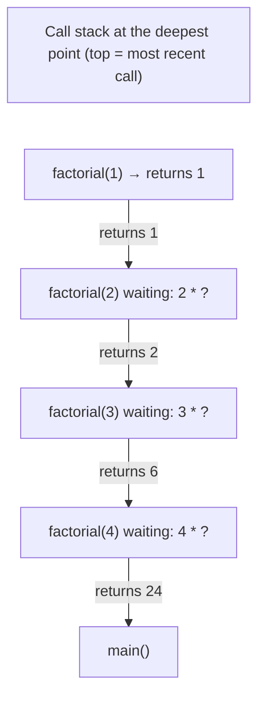

| Algorithm | Time | Space (auxiliary) |
|---|---|---|
| Iterative factorial | O(n) | O(1) |
| Recursive factorial | O(n) | O(n) stack |
| Naive recursive fib | O(2ⁿ) | **O(n)** — only one branch is on the stack at a time |
| Binary search (iterative) | O(log n) | O(1) |
| Binary search (recursive) | O(log n) | O(log n) |
| Merge sort | O(n log n) | O(n) temp arrays + O(log n) stack |
| Quick sort | O(n log n) avg | O(log n) avg stack, O(n) worst |
| DFS on a tree of height h | O(n) | O(h) — O(n) if skewed |
| BFS | O(V + E) | O(V) queue |

#### 🚀 11.4 Java-specific memory facts

- **Stack size per thread** is usually 512 KB–1 MB by default (`-Xss` to change). Deep recursion (~10⁴–10⁵ frames, depending on frame size) → **`StackOverflowError`**. For large n, convert recursion to iteration with an explicit `Deque` stack.
- Java does **not** do tail-call optimization — rewriting as tail recursion doesn't save stack space.
- `int[n]` ≈ 4n bytes (+ 16-byte header). `long[n]` ≈ 8n bytes. `boolean[n]` ≈ n bytes.
- `ArrayList<Integer>` of n elements ≈ 20n bytes (16-byte `Integer` + 4-byte reference) → **~5× an `int[]`**.
- A 256 MB memory limit holds about 64 million `int`s — handy for estimating if a DP table fits (e.g., `int[10⁴][10⁴]` = 400 MB ❌).
- Strings: `s.substring()`, `s + t`, `toCharArray()` all allocate O(n) new memory — easy to forget in space analysis.

#### 11.5 Time–space trade-offs

Often you can spend memory to save time:
- **Hashing:** Two Sum O(n²)/O(1) → O(n)/O(n).
- **Memoization / DP:** Fibonacci O(2ⁿ)/O(n) → O(n)/O(n) → O(n)/O(1) with two variables.
- **Prefix sums:** range-sum queries O(n) each → O(1) each after O(n) preprocessing and O(n) space.

#### 🎯 Interview questions

<details><summary>Q1. What is the space complexity of recursive factorial?</summary>

O(n), because n stack frames are alive at the deepest point. The iterative version is O(1).

</details>

<details><summary>Q2. Naive recursive Fibonacci is O(2ⁿ) time. Why is its space only O(n)?</summary>

Space depends on the maximum depth of the call stack, not the total number of calls. The deepest chain is fib(n) → fib(n-1) → … → fib(1), i.e., n frames.

</details>

<details><summary>Q3. Auxiliary space vs total space?</summary>

Auxiliary is the extra memory the algorithm uses; total also includes the input. Interviewers usually mean auxiliary.

</details>

<details><summary>Q4. How do you avoid StackOverflowError for deep recursion in Java?</summary>

Convert to iteration (explicit stack/queue), reduce depth (e.g., recurse on the smaller half), or increase `-Xss`. Java has no tail-call optimization.

</details>

<!-- subtopic: d1_t2_s4 -->
### 12. Setup + First Programs — Hello World, Swap Two Numbers

> **TL;DR:** Set up your JDK and a practice platform, understand every word of `public static void main(String[] args)`, and know all the ways (and traps) of swapping two numbers.

#### 12.1 Environment setup checklist

1. **Install a JDK** (17 or 21 LTS, or 25): `java -version` and `javac -version` should both work.
2. **IDE:** IntelliJ IDEA Community (best for Java) or VS Code with the Java extension pack.
3. **Accounts:** LeetCode (main), plus optionally HackerRank / GeeksforGeeks / Codeforces.
4. **A practice repo on GitHub** — commit each solution with the problem link and its complexity in a comment. Great for revision and your profile.

#### 12.2 Hello World — every word explained

```java
public class HelloWorld {
    public static void main(String[] args) {
        System.out.println("Hello, World!");
    }
}
```

| Part | Meaning |
|---|---|
| `public class HelloWorld` | Public class; file must be `HelloWorld.java` |
| `public` | JVM must be able to call `main` from outside |
| `static` | Called without creating an object |
| `void` | Returns nothing to the JVM (use `System.exit(code)` for exit codes) |
| `main` | The name the JVM looks for |
| `String[] args` | Command-line arguments (`java HelloWorld a b` → `args = ["a", "b"]`) |
| `System.out.println` | `System` class → static `out` field (`PrintStream`) → `println` method |

**Compile & run:**
```bash
javac HelloWorld.java     # → HelloWorld.class (bytecode)
java HelloWorld           # JVM loads the class, calls main
java HelloWorld.java      # Java 11+: compile + run a single file in one step
```

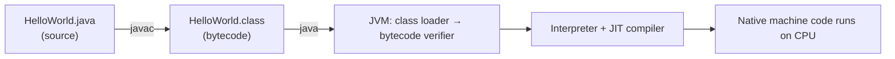

**Trivia interviewers like:**
- Valid variants: `public static void main(String... args)`, `static public void main(String[] a)`, `final String[] args`.
- `main` **can be overloaded**, but the JVM only calls the `String[]` version (in classic Java).
- Java 25 (JEP 512) allows **compact source files and instance main methods** for small programs: `void main() { IO.println("Hello"); }` — great for scripts, but in interviews write the classic form.
- "Write once, run anywhere": the bytecode is platform-independent; the JVM is platform-specific.
- **JDK** = JRE + dev tools (javac, jdb, jar...). **JRE** = JVM + core libraries. **JVM** = runs bytecode.

#### 12.3 Swap two numbers — all approaches

**1. With a temp variable (✅ the one to use)**
```java
int a = 5, b = 10;
int temp = a;
a = b;
b = temp;          // a = 10, b = 5
```
Clear, works for any type, no edge cases.

**2. Arithmetic (no extra variable)**
```java
a = a + b;   // a = 15
b = a - b;   // b = 5
a = a - b;   // a = 10
```
Interesting fact: even if `a + b` overflows, this still works for `int`/`long` in Java, because integer arithmetic wraps around (mod 2³²) consistently. It does **not** work reliably for `double` (precision loss). Multiplication/division variant fails with 0.

**3. XOR (no extra variable)**
```java
a = a ^ b;
b = a ^ b;   // (a^b)^b = a
a = a ^ b;   // (a^b)^a = b
```
Works because `x ^ x = 0` and `x ^ 0 = x`. ⚠️ **Trap:** if both refer to the **same memory location** (e.g., `swap(arr, i, j)` with `i == j`), the value becomes **0**. Fix: `if (i != j)`.

**4. One-liner trick (don't use in real code)**
```java
b = a + b - (a = b);    // evaluates left-to-right: uses old a, then assigns a = b
```

#### 12.4 Why you can't write `swap(int a, int b)` in Java ⭐

```java
static void swap(int a, int b) {     // a and b are COPIES
    int t = a; a = b; b = t;         // only the copies are swapped
}
int x = 1, y = 2;
swap(x, y);
System.out.println(x + " " + y);     // still "1 2"
```

Java is pass-by-value (see section 1.5). Ways around it:

```java
// ✅ Swap elements inside an array (the array object is shared)
static void swap(int[] arr, int i, int j) {
    int t = arr[i]; arr[i] = arr[j]; arr[j] = t;
}

// ✅ Return the swapped values
static int[] swapped(int a, int b) { return new int[]{b, a}; }
```

`swap(arr, i, j)` is the most-used helper in DSA (sorting, reversing, permutations, partitioning). Memorize it.

#### 12.5 How to approach any DSA problem (use this every day)

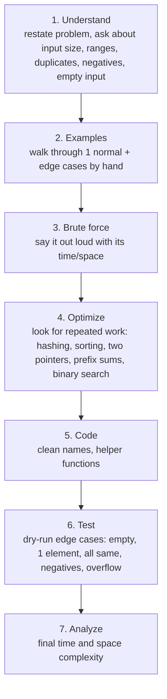

#### 12.6 Java DSA toolkit (things you'll use daily)

```java
int[] arr = new int[n];                    // zero-filled
Arrays.fill(arr, -1);
Arrays.sort(arr);                          // ascending
int[] copy = Arrays.copyOf(arr, n);
System.out.println(Arrays.toString(arr));  // debug print "[1, 2, 3]"

Integer[] boxed = {3, 1, 2};
Arrays.sort(boxed, Collections.reverseOrder());   // descending needs wrapper type

long big = (long) a * b;                   // cast BEFORE multiplying to avoid int overflow
int mid = lo + (hi - lo) / 2;              // overflow-safe midpoint
char c = s.charAt(i); int digit = c - '0'; int idx = c - 'a';
```

**Fast I/O** (for HackerRank/Codeforces style, where you read input yourself — `Scanner` is slow for big inputs):
```java
import java.io.*;
import java.util.*;

public class Main {
    public static void main(String[] args) throws IOException {
        BufferedReader br = new BufferedReader(new InputStreamReader(System.in));
        PrintWriter out = new PrintWriter(new BufferedWriter(new OutputStreamWriter(System.out)));
        int n = Integer.parseInt(br.readLine().trim());
        StringTokenizer st = new StringTokenizer(br.readLine());
        long sum = 0;
        for (int i = 0; i < n; i++) sum += Long.parseLong(st.nextToken());
        out.println(sum);
        out.flush();
    }
}
```

On LeetCode you only implement the method of a given `Solution` class — no `main`, no input parsing.

#### 12.7 Practice set for today (Easy — focus on complexity analysis)

| # | Problem | Idea | Target |
|---|---|---|---|
| 1 | LeetCode 2235 — Add Two Integers | Warm-up, platform familiarity | O(1) |
| 2 | LeetCode 1480 — Running Sum of 1d Array | Prefix sum in place | O(n) / O(1) |
| 3 | LeetCode 1672 — Richest Customer Wealth | Nested loops over a 2D grid | O(m·n) / O(1) |
| 4 | LeetCode 412 — Fizz Buzz | Loop + conditions, string building | O(n) |
| 5 | LeetCode 1342 — Number of Steps to Reduce a Number to Zero | Halving → logarithmic | O(log n) |
| 6 | LeetCode 9 — Palindrome Number | Reverse half the digits, no String | O(log₁₀ n) / O(1) |
| ⭐ | LeetCode 7 — Reverse Integer (stretch, Medium) | Overflow detection | O(log₁₀ n) |

**Worked solution — Running Sum (1480):**
```java
class Solution {
    public int[] runningSum(int[] nums) {
        for (int i = 1; i < nums.length; i++) {
            nums[i] += nums[i - 1];        // each prefix builds on the previous one
        }
        return nums;                       // Time O(n), auxiliary space O(1) (in place)
    }
}
```

**Worked solution — Palindrome Number (9):**
```java
class Solution {
    public boolean isPalindrome(int x) {
        // negatives aren't palindromes; numbers ending in 0 aren't either (except 0)
        if (x < 0 || (x % 10 == 0 && x != 0)) return false;
        int reversedHalf = 0;
        while (x > reversedHalf) {                 // reverse only half → no overflow risk
            reversedHalf = reversedHalf * 10 + x % 10;
            x /= 10;
        }
        // even length: x == reversedHalf; odd length: drop the middle digit
        return x == reversedHalf || x == reversedHalf / 10;
    }   // Time O(log₁₀ n) — number of digits, Space O(1)
}
```

**Mini Java experiments to run today (connect Java ↔ DSA):**
1. Print `Integer a = 127, b = 127` and `128` comparisons — verify the cache.
2. Compare `"Ja" + "va" == "Java"` vs runtime concatenation.
3. Time a loop doing `s += i` vs `sb.append(i)` for n = 100,000 using `System.nanoTime()` — see O(n²) vs O(n) with your own eyes.
4. Write the Parent/Child static/instance block program and predict the output before running it.

#### 🎯 Interview questions

<details><summary>Q1. Why is main static and public?</summary>

Public so the JVM (outside the class) can access it; static so it can be called without an instance of the class.

</details>

<details><summary>Q2. Can you swap two ints using a method in Java?</summary>

Not two separate primitive variables — Java passes copies. You can swap elements inside an array or object, or return the swapped values.

</details>

<details><summary>Q3. What's the risk of XOR swap?</summary>

If both operands are the same location (e.g., `arr[i]` and `arr[j]` with `i == j`), the value becomes 0. It's also less readable and not faster on modern JVMs.

</details>

<details><summary>Q4. JDK vs JRE vs JVM?</summary>

JVM executes bytecode; JRE = JVM + standard libraries (to run programs); JDK = JRE + development tools like javac and jar (to build programs).

</details>

---

## 📝 Day 1 Revision Cheat Sheet

| Topic | Remember this |
|---|---|
| Class vs object | Blueprint vs heap instance; variables hold **references** |
| Default constructor | Only if **no** constructor is written; body is `super()` |
| `this` | Current object; `this(...)` must be first; not in static context |
| Access | private < default < protected < public; protected across packages only via inheritance |
| Override + access | Can widen, never narrow |
| Init order | Static (P→C, once) → per object: P blocks → P ctor → C blocks → C ctor |
| Constructors | Never call overridable methods inside them |
| `static` | One copy per class; static methods are hidden, not overridden |
| Holder singleton | Lazy + thread-safe via class-init guarantee |
| `final` | Variable once, method no override, class no extend; final ref ≠ immutable object |
| Wrappers | `==` on wrappers is a bug; cache -128..127; unboxing null → NPE |
| String | Immutable, pooled literals, heap pool since Java 7, `new String` = up to 2 objects |
| equals/hashCode | Override both; equal objects ⇒ equal hash codes |
| StringBuilder | Default choice; StringBuffer only for shared mutable buffers |
| Big-O | Drop constants & lower terms; add sequential, multiply nested; different inputs → different variables |
| Logs | Halving each step → O(log n) |
| Recursion space | O(max depth), not O(number of calls) |
| Constraints | n ≤ 10⁵–10⁶ → aim for O(n log n) or better |

### ⚡ Rapid-fire self-test (answer in under 10 seconds each)

1. `Integer x = 1000, y = 1000; x == y`? → **false**
2. Does `final List<String> l` allow `l.add("a")`? → **yes**
3. Output of `A ref = new B(); ref.staticMethod();` → **A's version**
4. Can a top-level class be `protected`? → **no**
5. Where is the String pool in Java 8? → **heap**
6. Is `StringBuilder` thread-safe? → **no**
7. Complexity of `for (i = 1; i < n; i *= 3)`? → **O(log n)**
8. Space of recursive binary search? → **O(log n)**
9. What does the compiler insert if a constructor has no `this()`/`super()`? → **`super()`**
10. `new Long(5).equals(5)`? → **false** (5 is an Integer)
