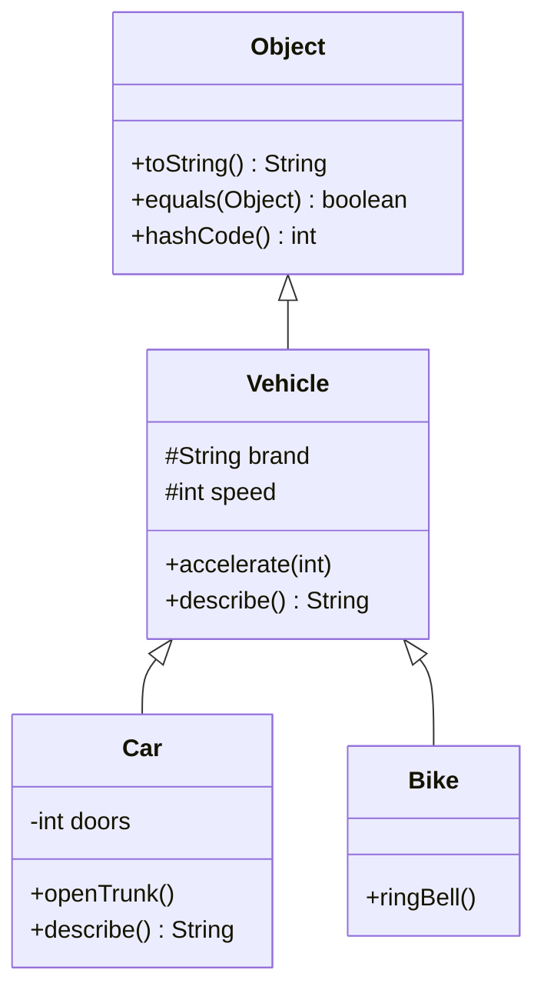
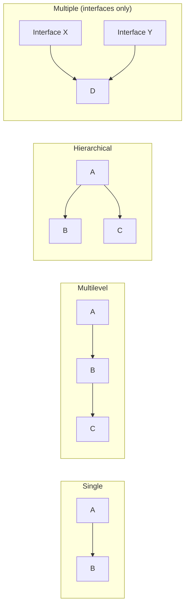
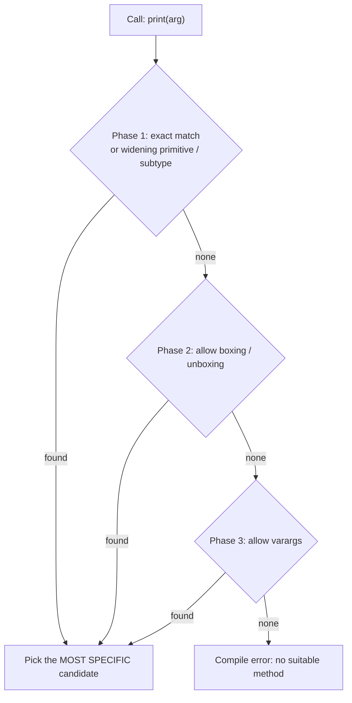
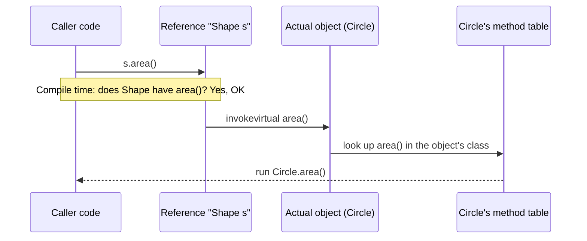
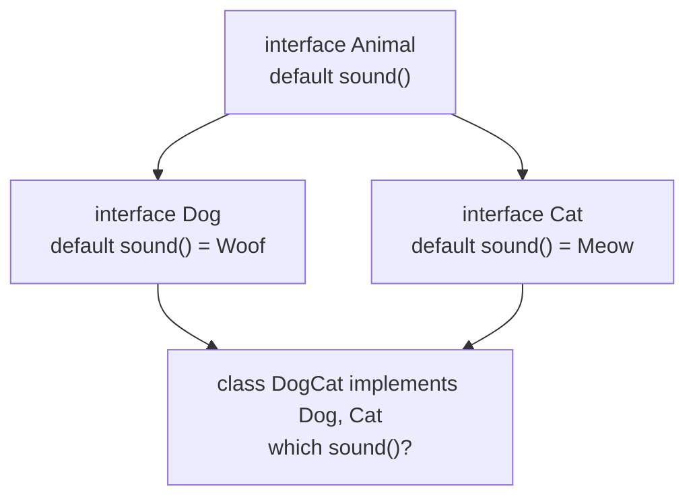
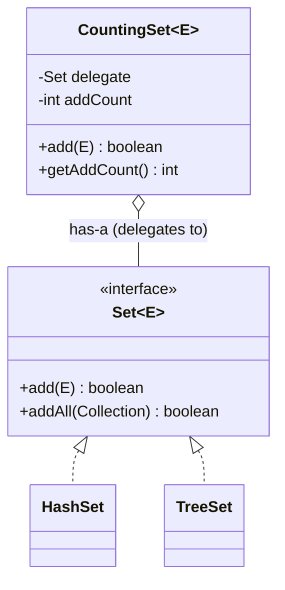
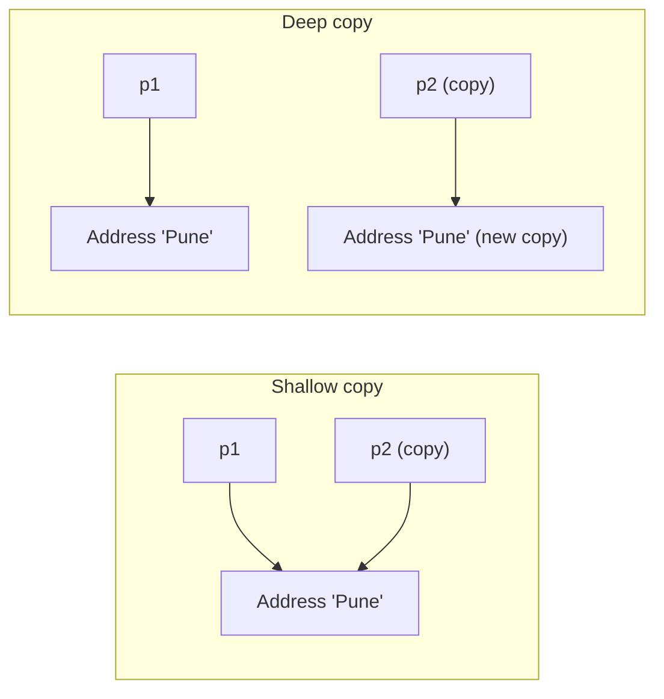
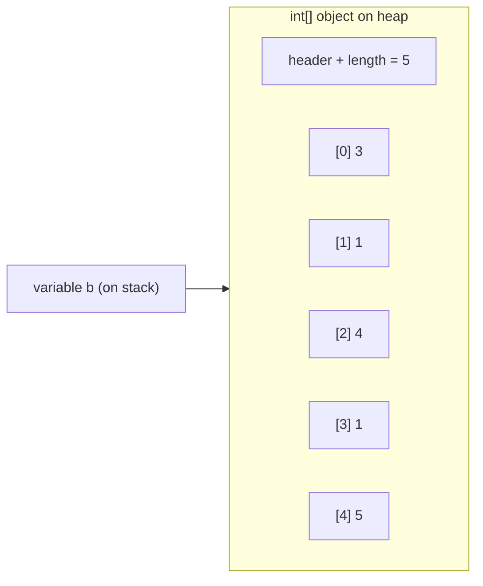
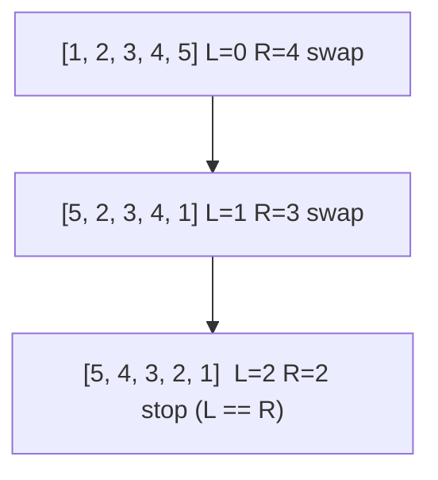
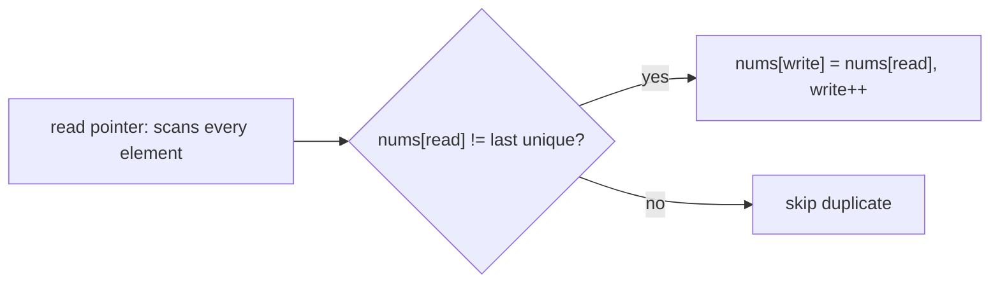

# Day 2 — OOP Deep Dive: Inheritance, Polymorphism, Abstraction & the Object Class

> **How to use these notes:** each section maps to one checklist item. Read the concept, run the code, study the diagram, then test yourself with the collapsible questions. Items marked 🚀 are the senior-level details that make a 2–3 YOE answer stand out.

**Today's goal:** explain exactly how Java decides *which* method runs (compile time vs runtime), when to use an abstract class vs an interface, how the diamond problem is solved, why composition usually beats inheritance, and what every class gets from `Object`. On the DSA side: master arrays — memory layout, the Java array API, and the first in-place patterns (two pointers, read/write pointer).

<!-- topic: d2_t1 -->
## ☕ Java — Inheritance, Polymorphism & Object Class

<!-- subtopic: d2_t1_s1 -->
### 1. Inheritance — `extends`, IS-A, single inheritance, the Object class

> **TL;DR:** Inheritance lets a class (**subclass/child**) reuse and specialise another class (**superclass/parent**) using `extends`. It models an **IS-A** relationship. A Java class can extend **only one** class, and every class ultimately extends `java.lang.Object`.

#### 1.1 Basic syntax

```java
class Vehicle {                                   // superclass
    protected String brand;
    protected int speed;

    Vehicle(String brand) { this.brand = brand; }

    void accelerate(int delta) { speed += delta; }
    String describe() { return brand + " moving at " + speed; }
}

class Car extends Vehicle {                       // subclass: Car IS-A Vehicle
    private final int doors;

    Car(String brand, int doors) {
        super(brand);                             // must initialise the parent part first
        this.doors = doors;
    }

    void openTrunk() { System.out.println("Trunk open"); }   // new behaviour

    @Override
    String describe() {                           // specialised behaviour
        return super.describe() + " with " + doors + " doors";
    }
}
```



#### 1.2 What a subclass inherits

| Member | Inherited? |
|---|---|
| `public` / `protected` fields and methods | ✅ Yes |
| Package-private members | ✅ Only if the subclass is in the **same package** |
| `private` members | ❌ Not accessible (they still exist inside the object, used via inherited public/protected methods) |
| Constructors | ❌ Never inherited — called with `super(...)` |
| Static members | Accessible through the subclass name, but they belong to the parent class (hiding, not overriding) |
| Initializer blocks | ❌ Not inherited, but they run as part of the parent's construction |

#### 1.3 The `super` keyword

| Use | Example |
|---|---|
| Call the parent constructor | `super(brand);` (first statement) |
| Call the parent version of an overridden method | `super.describe()` |
| Access a hidden parent field | `super.name` |

#### 1.4 Types of inheritance



- **Single, multilevel, hierarchical** — allowed with classes.
- **Multiple inheritance of classes** — ❌ not allowed (`class C extends A, B` is a compile error). This avoids ambiguity about which parent's state/method to use.
- **Multiple inheritance of type** — ✅ through interfaces: `class C implements X, Y`.

#### 1.5 Upcasting, downcasting and `instanceof`

```java
Vehicle v = new Car("Tesla", 4);   // upcasting: implicit and always safe (Car IS-A Vehicle)
v.accelerate(10);                  // ✅ Vehicle methods available
// v.openTrunk();                  ❌ compile error: the reference type Vehicle doesn't have it

if (v instanceof Car c) {          // pattern matching for instanceof (Java 16+)
    c.openTrunk();                 // downcast done safely
}

Vehicle b = new Bike("Hero");
Car wrong = (Car) b;               // 💥 ClassCastException at runtime
```

> **Rule:** the **reference type** decides what you're *allowed to call* (compile time). The **object type** decides *which implementation runs* (runtime).

#### 1.6 Every class extends `Object`

If you write no `extends`, the compiler makes the class extend `Object`. That's why every object has `toString()`, `equals()`, `hashCode()`, `getClass()` — see section 9.

#### 🚀 1.7 Fields are NOT polymorphic (field hiding)

Methods are dispatched at runtime, but **fields are resolved by the reference type** at compile time.

```java
class Parent { String name = "Parent"; String getName() { return name; } }
class Child extends Parent { String name = "Child"; @Override String getName() { return name; } }

Parent p = new Child();
System.out.println(p.name);       // "Parent" — field chosen by reference type
System.out.println(p.getName());  // "Child"  — method chosen by object type
```

A `Child` object actually has **two** `name` fields. Avoid re-declaring fields with the same name — keep fields private and use methods.

#### ⚠️ Common pitfalls
- Forgetting `super(...)` when the parent has no no-arg constructor (compile error).
- Using inheritance only to reuse code when there's no real IS-A relationship (see section 8).
- Deep hierarchies (5+ levels) — hard to understand and change.

#### 🎯 Interview questions

<details><summary>Q1. Why doesn't Java support multiple inheritance of classes?</summary>

To avoid ambiguity (the diamond problem with state): if two parents have the same field or method, which one should the child use? Java allows multiple inheritance of *type* via interfaces, where (until Java 8) there was no implementation to conflict.

</details>

<details><summary>Q2. Are private members inherited?</summary>

They exist inside the subclass object (the parent part is fully built), but the subclass cannot access them directly. They're used indirectly through inherited public/protected methods.

</details>

<details><summary>Q3. What is the difference between upcasting and downcasting?</summary>

Upcasting (child → parent reference) is implicit and always safe. Downcasting (parent → child reference) needs an explicit cast and can throw `ClassCastException`; check with `instanceof` first.

</details>

<details><summary>Q4. `Parent p = new Child(); p.field` — whose field?</summary>

The parent's. Fields are resolved by the reference type at compile time; only instance methods are polymorphic.

</details>

<!-- subtopic: d2_t1_s2 -->
### 2. Method Overloading — compile-time polymorphism

> **TL;DR:** Overloading = **same method name, different parameter list** in the same class (or inherited). The compiler picks the method at **compile time** based on the argument types. Changing only the return type is **not** overloading.

#### 2.1 Valid overloads

```java
class Printer {
    void print(int x)            { System.out.println("int " + x); }
    void print(double x)         { System.out.println("double " + x); }
    void print(String s)         { System.out.println("String " + s); }
    void print(String s, int n)  { System.out.println(s.repeat(n)); }
    void print(int n, String s)  { System.out.println(n + s); }   // order of types matters
    void print(int... xs)        { System.out.println("varargs " + xs.length); }
}
```

What can differ: **number**, **type**, or **order** of parameters. What alone is NOT enough: return type, parameter names, access modifier, `throws` clause, `static`.

```java
int  sum(int a, int b) { return a + b; }
// long sum(int a, int b) { ... }   ❌ compile error: already defined (only return type differs)
```

#### 2.2 How the compiler chooses (overload resolution)

The compiler tries phases in order and stops at the first phase that finds a match:



```java
static void f(long x)    { System.out.println("long"); }
static void f(Integer x) { System.out.println("Integer"); }
static void f(int... x)  { System.out.println("varargs"); }

f(5);        // "long"     — widening (phase 1) beats boxing (phase 2)
byte b = 1;
f(b);        // "long"     — byte widens to long
```

#### 2.3 Classic `null` puzzles

```java
static void m(Object o) { System.out.println("Object"); }
static void m(String s) { System.out.println("String"); }
m(null);     // "String" — String is more specific than Object

static void n(String s)  { }
static void n(Integer i) { }
// n(null);  ❌ ambiguous — neither is more specific than the other
n((String) null);   // ✅ cast to choose
```

#### 2.4 Overloading facts

- You **can** overload `static` methods, `main`, constructors, and `final` methods.
- Overloads can be spread across a class hierarchy (a subclass can add an overload of a parent method).
- Because the choice is made at compile time using the **declared** type, overloading is **not** polymorphic at runtime:

```java
static void show(Object o) { System.out.println("Object"); }
static void show(String s) { System.out.println("String"); }

Object o = "hello";
show(o);     // "Object" — the declared type is Object, even though it holds a String
```

#### 🎯 Interview questions

<details><summary>Q1. Can we overload by changing only the return type?</summary>

No. The compiler identifies a call by name and argument types; two methods differing only by return type would be ambiguous, so it's a compile error.

</details>

<details><summary>Q2. Why is overloading called compile-time (static) polymorphism?</summary>

Because the compiler selects the exact overload using the static (declared) types of the arguments. Nothing about the runtime object type changes which overload is called.

</details>

<details><summary>Q3. Which wins: widening, boxing or varargs?</summary>

Widening first, then boxing/unboxing, then varargs.

</details>

<details><summary>Q4. Can we overload the main method?</summary>

Yes, but the JVM only calls `public static void main(String[] args)` as the entry point. Other overloads are ordinary methods.

</details>

<!-- subtopic: d2_t1_s3 -->
### 3. Method Overriding — runtime polymorphism

> **TL;DR:** Overriding = a subclass provides its **own implementation** of an inherited instance method with the **same signature**. The JVM picks the implementation based on the **actual object** at **runtime** (dynamic dispatch).

#### 3.1 Example

```java
abstract class Shape {
    abstract double area();
    void print() { System.out.println(getClass().getSimpleName() + " area = " + area()); }
}

class Circle extends Shape {
    private final double r;
    Circle(double r) { this.r = r; }
    @Override double area() { return Math.PI * r * r; }
}

class Square extends Shape {
    private final double side;
    Square(double side) { this.side = side; }
    @Override double area() { return side * side; }
}

List<Shape> shapes = List.of(new Circle(1), new Square(2));
for (Shape s : shapes) s.print();     // each object runs ITS OWN area()
```

This is the heart of polymorphism: code written against `Shape` works for every current and future subclass (the **Open/Closed** principle you'll see on Day 10).

#### 3.2 Overriding rules (must memorize)

| Rule | Detail |
|---|---|
| Same name + same parameter types | Otherwise it's an overload, not an override |
| Return type | Same, or a **subtype** (covariant return, Java 5+). Primitives must match exactly |
| Access modifier | Same or **wider** (protected → public ✅, public → protected ❌) |
| Checked exceptions | May throw **fewer / narrower** checked exceptions, never new or broader ones. Unchecked exceptions: anything |
| Must be an instance method | `static` → hiding; `final` → cannot override; `private` → not inherited |
| `@Override` | Optional but always use it — the compiler errors if you're not actually overriding |

```java
class Animal {
    protected Animal reproduce() throws IOException { return new Animal(); }
}
class Dog extends Animal {
    @Override
    public Dog reproduce() { return new Dog(); }   // ✅ wider access, covariant return, no checked exception
}
```

#### 3.3 Why `@Override` matters

```java
class Point {
    int x, y;
    public boolean equals(Point other) { ... }   // ⚠️ OVERLOAD, not override! (parameter is Point, not Object)
}
// HashSet/HashMap call equals(Object) → still uses Object's identity equals → bugs
// With @Override the compiler would have caught it immediately.
```

#### 3.4 How dynamic dispatch works



The compiler emits `invokevirtual`; at runtime the JVM uses the object's class (via a **virtual method table**, or inline caches after JIT) to find the most specific implementation.

#### 3.5 Overloading vs overriding

| | Overloading | Overriding |
|---|---|---|
| Where | Same class (or subclass adds one) | Subclass |
| Signature | Different parameters | Same parameters |
| Return type | Anything | Same or covariant |
| Binding | Compile time (static) | Runtime (dynamic) |
| `static` / `private` / `final` | Can be overloaded | Cannot be overridden |
| Polymorphism type | Compile-time | Runtime |

#### 🎯 Interview questions

<details><summary>Q1. Can an overriding method throw a broader checked exception?</summary>

No. It may throw the same, narrower, or no checked exceptions. Otherwise code written against the parent type (which only handles the parent's exceptions) would break.

</details>

<details><summary>Q2. What is a covariant return type?</summary>

An overriding method may return a subtype of the parent's return type, e.g. parent returns `Animal`, child returns `Dog`. Used heavily by `clone()` overrides and builders.

</details>

<details><summary>Q3. Can you reduce visibility while overriding?</summary>

No — only keep it or widen it, otherwise substituting the child for the parent could fail at the call site.

</details>

<details><summary>Q4. How does the JVM know which overridden method to call?</summary>

Dynamic dispatch: `invokevirtual` looks up the method in the runtime class of the object (conceptually via the vtable), so the most specific override runs.

</details>

<!-- subtopic: d2_t1_s4 -->
### 4. What Cannot Be Overridden — static, final, private (and constructors)

> **TL;DR:** Only **non-static, non-final, non-private, inherited instance methods** can be overridden. Static methods are **hidden**, final methods are **locked**, private methods are **invisible**, constructors are **not inherited**.

| Member | Override? | What happens instead |
|---|---|---|
| `static` method | ❌ | **Method hiding**: chosen by reference type at compile time |
| `final` method | ❌ | Compile error if you try |
| `private` method | ❌ | Subclass method with the same name is a **new, unrelated** method |
| Constructor | ❌ | Not inherited at all |
| Fields | ❌ | **Field hiding** (section 1.7) |

#### 4.1 Static method hiding

```java
class A { static String who() { return "A"; } }
class B extends A { static String who() { return "B"; } }   // hides, doesn't override

A ref = new B();
System.out.println(ref.who());   // "A" — static call bound to the reference type A
// @Override static String who() would be a COMPILE ERROR
```

Rules: an instance method can't hide a static one and vice versa (compile error). A `static final` method can't even be hidden.

#### 4.2 Private methods — the classic trick question

```java
class Parent {
    private void greet() { System.out.println("Parent greet"); }
    public void callGreet() { greet(); }          // calls Parent's PRIVATE greet — no dispatch
}
class Child extends Parent {
    public void greet() { System.out.println("Child greet"); }   // brand-new method
}

new Child().callGreet();   // prints "Parent greet"
```

Private methods are bound at compile time (`invokespecial`/nest access), so `callGreet()` always calls `Parent.greet()`. If `greet()` were `protected`, it would print "Child greet".

#### 4.3 Final methods

```java
class Account {
    public final void audit() { /* must not be changed by subclasses */ }
}
class Savings extends Account {
    // public void audit() { }   ❌ cannot override the final method
}
```

Why: protect invariants and security-sensitive logic; the template method itself is often `final`.

#### 🎯 Interview questions

<details><summary>Q1. Can we override a static method?</summary>

No. Declaring the same static method in a subclass hides the parent's. The call is resolved at compile time from the reference type, so there's no runtime polymorphism.

</details>

<details><summary>Q2. A parent's public method calls a private method; the child declares a method with the same name. Which runs?</summary>

The parent's private method. Private methods aren't inherited or overridden, so there's no dynamic dispatch.

</details>

<details><summary>Q3. Can we override a constructor?</summary>

No. Constructors aren't inherited. A subclass declares its own and chains with `super(...)`.

</details>

<!-- subtopic: d2_t1_s5 -->
### 5. Abstract Classes

> **TL;DR:** An **abstract class** is a partially-built class: it can't be instantiated, may contain **abstract methods** (no body) that subclasses must implement, and can also hold **state, constructors and concrete methods**. Use it when related classes share code *and* state.

#### 5.1 Example — Template Method pattern

```java
public abstract class PaymentProcessor {
    private final AuditLog audit;                        // shared state

    protected PaymentProcessor(AuditLog audit) {        // constructor — runs via super(...)
        this.audit = audit;
    }

    // Template method: fixed algorithm, final so subclasses can't break the order
    public final Receipt pay(Order order) {
        validate(order);
        Receipt r = charge(order);                      // the step that varies
        audit.record(r);
        return r;
    }

    private void validate(Order order) {
        if (order.amount() <= 0) throw new IllegalArgumentException("amount must be > 0");
    }

    protected abstract Receipt charge(Order order);    // subclasses MUST implement
}

public class UpiProcessor extends PaymentProcessor {
    public UpiProcessor(AuditLog audit) { super(audit); }
    @Override protected Receipt charge(Order order) { /* call UPI gateway */ return new Receipt(); }
}
```

#### 5.2 Rules

- `abstract class` **cannot be instantiated** (`new PaymentProcessor()` ❌) — but anonymous subclasses can be created.
- **Can have constructors** (called from subclasses), instance/static fields, concrete methods, static methods, even `main`.
- Can have **zero** abstract methods (still non-instantiable — used to force subclassing).
- If a class has **any** abstract method, the class **must** be abstract.
- A concrete subclass must implement **all** inherited abstract methods, otherwise it must be abstract too.
- Abstract methods **cannot** be `private`, `static` or `final` (all would prevent overriding).
- An abstract class **cannot** be `final`.

#### 5.3 Abstract class vs interface (the big comparison)

| | Abstract class | Interface |
|---|---|---|
| Instantiable | No | No |
| State (instance fields) | ✅ Yes | ❌ Only `public static final` constants |
| Constructors | ✅ Yes | ❌ No |
| Method kinds | abstract + concrete, any access | abstract, `default`, `static`, `private` (Java 9) |
| Multiple inheritance | ❌ A class extends one | ✅ A class implements many |
| Access of methods | any | `public` (except private helpers) |
| Relationship | "is a kind of" (shared identity) | "can do" (capability / contract) |
| Typical use | Base class with shared state/logic (Template Method), skeletal implementations like `AbstractList` | Contracts: `Comparable`, `Runnable`, `List`, repository/service interfaces |

> **Rule of thumb:** start with an **interface**. Add an abstract class (often implementing that interface) only when implementations need shared **state** or a lot of shared code. The JDK does exactly this: `List` (interface) + `AbstractList` (skeleton) + `ArrayList` (concrete).

#### 🎯 Interview questions

<details><summary>Q1. Can an abstract class have a constructor? Why, if it can't be instantiated?</summary>

Yes. It initializes the abstract class's own fields and runs when a subclass calls `super(...)` during object creation.

</details>

<details><summary>Q2. Can an abstract class have no abstract methods?</summary>

Yes. It still can't be instantiated — useful to prevent direct use and force subclassing (e.g., `HttpServlet`).

</details>

<details><summary>Q3. Since Java 8 interfaces have default methods — why still use abstract classes?</summary>

Interfaces can't hold instance state or constructors, and their methods are public. When implementations need shared mutable state, protected helpers, or constructor logic, an abstract class is still the right tool.

</details>

<details><summary>Q4. Why can't an abstract method be private, static or final?</summary>

Abstract methods exist to be overridden. Private methods aren't inherited, static methods aren't overridden (hidden), and final methods can't be overridden — all contradict "must be implemented by a subclass".

</details>

<!-- subtopic: d2_t1_s6 -->
### 6. Interfaces — default, static and private methods, multiple implementation

> **TL;DR:** An **interface** is a contract. Since Java 8 it can also contain **default** methods (inherited implementation) and **static** helper methods; since Java 9, **private** methods. A class can implement **many** interfaces, and an interface can **extend many** interfaces.

#### 6.1 What can go inside an interface

```java
public interface Notifier {
    int MAX_RETRIES = 3;                        // implicitly public static final

    void send(String to, String message);       // implicitly public abstract

    default void sendAll(List<String> recipients, String message) {   // Java 8: inherited behaviour
        recipients.forEach(r -> sendWithRetry(r, message));
    }

    static Notifier noop() {                    // Java 8: factory/helper, called as Notifier.noop()
        return (to, msg) -> { };
    }

    private void sendWithRetry(String to, String message) {           // Java 9: shared helper
        for (int i = 0; i < MAX_RETRIES; i++) {
            try { send(to, message); return; } catch (RuntimeException e) { /* retry */ }
        }
    }
}

class EmailNotifier implements Notifier {
    @Override public void send(String to, String message) { /* SMTP */ }
}
```

| Member | Modifiers (implicit) | Inherited by implementing class? |
|---|---|---|
| Constant | `public static final` | ✅ (accessible) |
| Abstract method | `public abstract` | Must implement |
| `default` method | `public` | ✅ can be overridden |
| `static` method | `public` (or private) | ❌ **not inherited** — call `Notifier.noop()` |
| `private` method | `private` | ❌ internal helper only |

#### 6.2 Why default methods were added

To **evolve interfaces without breaking existing implementations**. Java 8 added `forEach`, `stream()`, `removeIf()` to `Collection`/`Iterable` — without default methods every custom `List` in the world would have stopped compiling.

#### 6.3 Multiple implementation and interface inheritance

```java
interface Readable  { String read(); }
interface Writable  { void write(String s); }
interface ReadWrite extends Readable, Writable { }    // interface extends MANY interfaces

class FileChannel implements ReadWrite, AutoCloseable {   // class implements MANY
    public String read() { return ""; }
    public void write(String s) { }
    public void close() { }
}
```

#### 6.4 Special kinds of interfaces
- **Functional interface** — exactly one abstract method (`Runnable`, `Comparator`, `Function`). Target of lambdas (Day 5).
- **Marker interface** — no methods (`Serializable`, `Cloneable`) (Day 3).
- **Sealed interface** (Java 17) — restricts implementers: `sealed interface Shape permits Circle, Square {}`.

#### ⚠️ Pitfalls
- Default methods **cannot** override `Object` methods (`equals`, `hashCode`, `toString`) — compile error.
- Static interface methods are not inherited: `EmailNotifier.noop()` doesn't compile.
- Adding a default method to a widely-used interface can still break classes that already have a method with the same signature but a different return type.

#### 🎯 Interview questions

<details><summary>Q1. Why were default methods introduced?</summary>

To add new methods to existing interfaces (e.g., `Collection.stream()`) without breaking all existing implementations — backward-compatible interface evolution.

</details>

<details><summary>Q2. Are static interface methods inherited by implementing classes?</summary>

No. They must be called with the interface name, e.g. `Comparator.naturalOrder()`.

</details>

<details><summary>Q3. Can an interface have private methods?</summary>

Yes, since Java 9 — to share code between default (or static) methods without exposing it.

</details>

<details><summary>Q4. Can a default method override equals() or hashCode()?</summary>

No, it's a compile error. A class always inherits these from `Object`, and the "class wins" rule would make such defaults useless.

</details>

<!-- subtopic: d2_t1_s7 -->
### 7. The Diamond Problem — how Java resolves it

> **TL;DR:** If a class inherits the **same default method** from two interfaces, Java refuses to guess: the class **must override** it, and may call a specific parent with `InterfaceName.super.method()`.

#### 7.1 The problem



```java
interface Dog { default String sound() { return "Woof"; } }
interface Cat { default String sound() { return "Meow"; } }

class DogCat implements Dog, Cat {
    // ❌ without this override: "class DogCat inherits unrelated defaults for sound()"
    @Override
    public String sound() {
        return Dog.super.sound() + " / " + Cat.super.sound();   // pick or combine explicitly
    }
}
```

#### 7.2 The three resolution rules (in order)

1. **Class wins:** a method declared in the class or any **superclass** beats any interface default.
2. **More specific interface wins:** if `B extends A` and both define the default, `B`'s version is used.
3. **Otherwise ambiguous:** the class must override and choose (`X.super.m()`).

```java
class Base { public String sound() { return "Base"; } }
class Mixed extends Base implements Dog, Cat { }   // ✅ compiles — rule 1: Base.sound() wins
new Mixed().sound();                               // "Base"

interface Puppy extends Dog { default String sound() { return "Yip"; } }
class Pet implements Dog, Puppy { }                // ✅ rule 2: Puppy is more specific
new Pet().sound();                                 // "Yip"
```

#### 7.3 Why classes still can't have the diamond

Interfaces carry **no instance state**, so combining behaviours is manageable. With classes, two parents could each bring a field with the same name and different values — that's the hard version of the diamond problem that Java avoids completely.

#### 🎯 Interview questions

<details><summary>Q1. How does Java solve the diamond problem with default methods?</summary>

The compiler forces the implementing class to override the conflicting method (unless a superclass method or a more specific interface already resolves it). Inside the override you can call `Interface.super.method()`.

</details>

<details><summary>Q2. A superclass method and an interface default have the same signature. Which wins?</summary>

The class method ("class wins" rule).

</details>

<details><summary>Q3. What does `X.super.method()` mean?</summary>

Call interface `X`'s default implementation of `method()`. It's only allowed for direct superinterfaces of the current class or interface.

</details>

<!-- subtopic: d2_t1_s8 -->
### 8. Composition vs Inheritance — prefer composition

> **TL;DR:** **Inheritance** = "is-a" and tightly couples the child to the parent's implementation. **Composition** = "has-a": hold a reference to another object and delegate to it. "Favor composition over inheritance" (Gang of Four, Effective Java) because it's more flexible and less fragile.

#### 8.1 The fragile base class problem (Effective Java's famous example)

```java
// Goal: count how many elements were ever added
public class CountingSet<E> extends HashSet<E> {
    private int addCount = 0;

    @Override public boolean add(E e) { addCount++; return super.add(e); }

    @Override public boolean addAll(Collection<? extends E> c) {
        addCount += c.size();
        return super.addAll(c);          // HashSet.addAll() internally calls add() for each element!
    }
    public int getAddCount() { return addCount; }
}

CountingSet<String> s = new CountingSet<>();
s.addAll(List.of("a", "b", "c"));
s.getAddCount();   // 6, not 3 💥 — we depended on a hidden implementation detail of HashSet
```

#### 8.2 The composition fix (wrapper / decorator)

```java
public class CountingSet<E> {
    private final Set<E> delegate;       // HAS-A Set
    private int addCount = 0;

    public CountingSet(Set<E> delegate) { this.delegate = delegate; }

    public boolean add(E e) { addCount++; return delegate.add(e); }
    public boolean addAll(Collection<? extends E> c) {
        addCount += c.size();
        return delegate.addAll(c);       // whatever addAll does internally doesn't affect us
    }
    public boolean contains(Object o) { return delegate.contains(o); }
    public int getAddCount() { return addCount; }
}

new CountingSet<>(new HashSet<>());      // works with ANY Set implementation, swappable at runtime
new CountingSet<>(new TreeSet<>());
```



#### 8.3 Comparison

| | Inheritance | Composition |
|---|---|---|
| Relationship | IS-A | HAS-A |
| Coupling | Tight — child depends on parent internals | Loose — depends only on the public API |
| Change behaviour at runtime | ❌ fixed at compile time | ✅ swap the delegate |
| Reuse from multiple sources | ❌ one parent | ✅ hold many components |
| Testing | Harder to isolate | Easy to mock the component |
| Encapsulation | Weakened (protected members, overrides) | Preserved |

#### 8.4 When inheritance IS appropriate
- A genuine, stable **is-a** relationship that also satisfies the **Liskov Substitution Principle** (Day 10).
- The parent was **designed and documented for extension** (e.g., `AbstractList`, frameworks' base classes).
- Both classes are under your control (same package/module).

Real-world composition everywhere: Spring services **have** repositories (dependency injection is composition), Strategy pattern (`Comparator` passed to `sort`), decorators (`BufferedReader` wraps a `Reader`).

#### 🎯 Interview questions

<details><summary>Q1. Why prefer composition over inheritance?</summary>

Inheritance exposes the subclass to the parent's implementation details (fragile base class), fixes behaviour at compile time and allows only one parent. Composition depends only on public APIs, can be changed at runtime, combines multiple components and is easier to test.

</details>

<details><summary>Q2. Give a real example of the fragile base class problem.</summary>

Extending `HashSet` to count additions by overriding both `add` and `addAll` double-counts, because `HashSet.addAll` calls `add` internally.

</details>

<details><summary>Q3. Is dependency injection composition or inheritance?</summary>

Composition — a bean holds references to its collaborators (has-a) and delegates to them.

</details>

<!-- subtopic: d2_t4_s1 -->
### 9. The Object Class — what every class inherits

> **TL;DR:** `java.lang.Object` is the root of every class. It gives every object: `toString()`, `equals()`, `hashCode()`, `getClass()`, `clone()`, `wait()/notify()/notifyAll()`, and the deprecated `finalize()`.

#### 9.1 All Object methods

| Method | Default behaviour | Override? |
|---|---|---|
| `String toString()` | `getClass().getName() + "@" + Integer.toHexString(hashCode())` → `Car@1b6d3586` | ✅ Almost always (logging, debugging) |
| `boolean equals(Object o)` | `this == o` (identity) | ✅ For value objects |
| `int hashCode()` | Identity hash (not necessarily a memory address) | ✅ Whenever you override `equals` |
| `Class<?> getClass()` | Runtime class of the object | ❌ `final` |
| `Object clone()` | Field-by-field shallow copy, `protected`, needs `Cloneable` | ⚠️ Rarely (section 10) |
| `void wait()`, `wait(long)`, `wait(long,int)` | Release the monitor and wait | ❌ `final` |
| `void notify()`, `notifyAll()` | Wake waiting threads | ❌ `final` |
| `void finalize()` | Called by GC before reclaiming (unpredictable) | ❌ Deprecated (Java 9), for removal (Java 18) |

#### 9.2 toString — always override for value classes

```java
public class Employee {
    private final String id;
    private final String name;
    private final double salary;
    // ...
    @Override
    public String toString() {
        return "Employee{id='" + id + "', name='" + name + "'}";   // don't print secrets (salary, passwords)
    }
}
```

`System.out.println(obj)`, string concatenation and loggers call `toString()` automatically. Records generate it for you.

#### 9.3 equals and hashCode (recap from Day 1, section 8)

- Equal objects **must** have equal hash codes. Override both together (`Objects.equals`, `Objects.hash`).
- `HashMap`, `HashSet` and `contains()` rely on them — Day 12 shows the internals.

#### 9.4 getClass vs instanceof

```java
Object o = new Car("BMW", 4);
o.getClass();                        // class Car — exact runtime class
o.getClass() == Vehicle.class;       // false
o instanceof Vehicle;                // true — checks IS-A (including subclasses)
```

#### 9.5 wait / notify (preview of Day 8)

They live on `Object` because **every object can be a lock (monitor)**. They must be called while holding that object's lock (inside `synchronized`), otherwise `IllegalMonitorStateException`.

#### 🎯 Interview questions

<details><summary>Q1. Name the methods of the Object class.</summary>

`toString`, `equals`, `hashCode`, `getClass`, `clone`, `wait` (3 overloads), `notify`, `notifyAll`, `finalize` (deprecated).

</details>

<details><summary>Q2. Why are wait/notify defined in Object rather than Thread?</summary>

Because any object can be used as a monitor (lock). Threads wait on and notify a specific lock object, not on a thread.

</details>

<details><summary>Q3. What does the default toString print?</summary>

The fully qualified class name, `@`, and the hex identity hash code, e.g. `com.app.Car@1b6d3586`.

</details>

<details><summary>Q4. Is the default hashCode the memory address?</summary>

Not necessarily. It's an identity hash generated by the JVM (often a random/thread-local value stored in the object header). Objects can move in memory during GC while their identity hash stays the same.

</details>

<!-- subtopic: d2_t4_s2 -->
### 10. clone() — shallow vs deep copy, and why clone() is "broken"

> **TL;DR:** `Object.clone()` makes a **shallow** field-by-field copy without calling a constructor, and only works if the class implements the **`Cloneable`** marker interface. It has many design flaws, so prefer **copy constructors** or **static factory methods**.

#### 10.1 Shallow vs deep copy

```java
class Address { String city; Address(String c) { city = c; } }

class Person implements Cloneable {
    String name;
    Address address;                                   // mutable reference field

    Person(String name, Address address) { this.name = name; this.address = address; }

    @Override
    public Person clone() {                            // public + covariant return
        try {
            return (Person) super.clone();             // SHALLOW copy
        } catch (CloneNotSupportedException e) {
            throw new AssertionError(e);               // can't happen — we implement Cloneable
        }
    }
}

Person p1 = new Person("Asha", new Address("Pune"));
Person p2 = p1.clone();
p2.address.city = "Delhi";
System.out.println(p1.address.city);   // "Delhi" 💥 both share the same Address object
```



**Deep copy** — also copy every mutable object reachable from the fields:

```java
@Override
public Person clone() {
    try {
        Person copy = (Person) super.clone();
        copy.address = new Address(address.city);   // copy mutable state too
        return copy;
    } catch (CloneNotSupportedException e) {
        throw new AssertionError(e);
    }
}
```

| | Shallow copy | Deep copy |
|---|---|---|
| Primitives & immutables (`String`, `Integer`) | Copied | Copied |
| References to mutable objects | **Shared** | **New copies** |
| Cost | Cheap | More expensive (walks the object graph) |
| Risk | Changes leak between copies | Must handle cycles, every nested type |

#### 10.2 How Object.clone() works
- It's `protected native` in `Object`. If the class doesn't implement `Cloneable` → `CloneNotSupportedException`.
- It allocates a new object of the **same runtime class** and copies fields bit-for-bit. **No constructor runs.**
- Arrays override it publicly: `int[] copy = arr.clone();` works and is the easiest way to copy an array (still shallow for object arrays).

#### 10.3 Why clone() is considered broken (Effective Java, Item 13)
1. `Cloneable` has **no `clone()` method** — the marker changes the behaviour of a protected method in another class (weird design).
2. **No constructor is called** → constructor invariants/validation are bypassed.
3. Conflicts with **`final` fields**: you can't reassign a final field in `clone()` to deep-copy it.
4. Throws a **checked** `CloneNotSupportedException` that callers must handle.
5. Requires casting and careful handling in every subclass.

#### 10.4 Preferred alternatives

```java
public class Person {
    private final String name;
    private final Address address;

    public Person(String name, Address address) { this.name = name; this.address = address; }

    // Copy constructor
    public Person(Person other) {
        this(other.name, new Address(other.address.city));   // explicit deep copy, final fields OK
    }

    // Static factory
    public static Person copyOf(Person other) { return new Person(other); }
}
```

Others: immutable objects (no copying needed at all), records, `List.copyOf(...)`, `new ArrayList<>(list)` (shallow), serialization-based deep copy (slow, last resort).

#### 🎯 Interview questions

<details><summary>Q1. Difference between shallow and deep copy?</summary>

A shallow copy duplicates the object's fields but shares any referenced mutable objects. A deep copy also duplicates every mutable object reachable from it, so the copies are fully independent.

</details>

<details><summary>Q2. What happens if you call clone() on a class that doesn't implement Cloneable?</summary>

`Object.clone()` throws `CloneNotSupportedException`.

</details>

<details><summary>Q3. Is a constructor called during clone()?</summary>

No. `Object.clone()` creates the copy natively and copies fields directly.

</details>

<details><summary>Q4. Why do many developers avoid clone()?</summary>

Cloneable has no clone method, constructors are bypassed, final fields can't be deep-copied, it throws a checked exception and needs casts. Copy constructors or static factories are clearer and safer.

</details>

<!-- topic: d2_t2 -->
## 🧮 DSA — Arrays: Basics & Easy Problems

<!-- subtopic: d2_t2_s1 -->
### 11. Array Basics — declaration, initialization, memory layout, indexing

> **TL;DR:** An array is a **fixed-size, contiguous** block of elements of one type. Access by index is **O(1)** because the address is computed directly: `base + index × elementSize`. In Java, arrays are **objects** on the heap with a `length` field.

#### 11.1 Declaring and creating arrays

```java
int[] a = new int[5];                 // [0, 0, 0, 0, 0] — default values
int[] b = {3, 1, 4, 1, 5};            // array literal (only in a declaration)
int[] c = new int[]{3, 1, 4};         // anonymous array (usable anywhere, e.g. as an argument)
String[] names = new String[3];       // [null, null, null]
int d[] = new int[2];                 // legal C-style, but prefer int[] d

System.out.println(b.length);         // 5 — a FIELD, not a method (String uses length())
```

Default values follow the field rules from Day 1: `0`, `0.0`, `false`, `'\u0000'`, `null`.

#### 11.2 Memory layout



- Elements sit **next to each other** in memory → `arr[i]` = base address + `i × 4` bytes (for `int`). That's why random access is O(1) and why arrays are **cache-friendly** (the CPU loads neighbouring elements together).
- An `int[]` stores the numbers themselves. An `Integer[]` or `String[]` stores **references**; the objects live elsewhere on the heap.
- Arrays have a fixed size. Inserting/deleting in the middle means **shifting** elements → O(n). `ArrayList` is a resizable array built on top (Day 11).

#### 11.3 Indexing and bounds

```java
int[] arr = {10, 20, 30};
arr[0];          // 10 — 0-indexed
arr[arr.length - 1];   // 30 — last element
arr[3];          // 💥 ArrayIndexOutOfBoundsException: Index 3 out of bounds for length 3
```

Java checks every access (unlike C), which prevents memory corruption.

#### 11.4 Multi-dimensional arrays

```java
int[][] grid = new int[3][4];         // 3 rows, 4 columns
grid[1][2] = 7;
int rows = grid.length, cols = grid[0].length;

int[][] jagged = new int[3][];        // rows can have different lengths
jagged[0] = new int[1];
jagged[1] = new int[5];
```

A 2D array in Java is an **array of arrays** (each row is a separate object), not one contiguous block.

#### 11.5 Iterating

```java
for (int i = 0; i < arr.length; i++) { System.out.println(i + " -> " + arr[i]); }   // need the index
for (int x : arr) { System.out.println(x); }                                         // just values
for (int i = arr.length - 1; i >= 0; i--) { }                                        // backwards
```

⚠️ Changing the loop variable in a for-each loop doesn't change the array: `for (int x : arr) x = 0;` does nothing.

#### 11.6 The `java.util.Arrays` toolkit

```java
int[] a = {5, 2, 9, 1};
Arrays.toString(a);                   // "[5, 2, 9, 1]" — printing arr directly shows "[I@6d06d69c"
Arrays.sort(a);                       // [1, 2, 5, 9] — O(n log n)
Arrays.binarySearch(a, 5);            // 2 — array must be sorted
Arrays.fill(a, -1);                   // all -1
int[] copy = Arrays.copyOf(a, 6);     // copy, padding with 0s
int[] part = Arrays.copyOfRange(a, 1, 3);   // [from, to)
Arrays.equals(a, copy);               // compare contents (a == copy compares references!)
Arrays.stream(a).sum();               // streams on arrays
Arrays.deepToString(grid);            // print 2D arrays
System.arraycopy(src, 0, dest, 0, n); // fastest bulk copy
int[] cl = a.clone();                 // shallow copy
```

#### 11.7 Array vs ArrayList

| | Array | ArrayList |
|---|---|---|
| Size | Fixed | Grows automatically |
| Primitives | ✅ `int[]` | ❌ needs `Integer` (boxing) |
| Length | `arr.length` | `list.size()` |
| Memory | Compact | Extra object per element + overhead |
| Use in DSA | When size is known, speed matters | When size changes |

#### 🎯 Interview questions

<details><summary>Q1. Why is array access O(1)?</summary>

Elements are stored contiguously with a fixed size, so the address of element i is computed directly as base + i × elementSize — no traversal needed.

</details>

<details><summary>Q2. What does printing an array directly show?</summary>

Something like `[I@6d06d69c` — the type code and identity hash, because arrays don't override `toString()`. Use `Arrays.toString(arr)`.

</details>

<details><summary>Q3. Is a 2D array in Java contiguous?</summary>

No. It's an array of references to separate row arrays (which may even have different lengths — jagged arrays).

</details>

<!-- subtopic: d2_t2_s2 -->
### 12. Find the Largest Element in an Array

> **Problem:** given an integer array, return its maximum element. 🔗 Practice variants: [LeetCode 414 — Third Maximum Number](https://leetcode.com/problems/third-maximum-number/), [LeetCode 1672 — Richest Customer Wealth](https://leetcode.com/problems/richest-customer-wealth/).

#### Approach 1 — Sort (overkill)
Sort, return the last element. **O(n log n)** time — wasteful for one value.

#### Approach 2 — Single pass ✅

Keep a "best so far" and update it while scanning.

```java
public static int largest(int[] arr) {
    if (arr == null || arr.length == 0) throw new IllegalArgumentException("empty array");
    int max = arr[0];                       // start with a real element, not 0
    for (int i = 1; i < arr.length; i++) {
        if (arr[i] > max) max = arr[i];
    }
    return max;
}   // Time O(n), Space O(1)
```

**Dry run** `[3, 9, -2, 9, 5]`: max = 3 → 9 → 9 → 9 → 9. Answer **9**.

> ⚠️ Starting with `max = 0` breaks for all-negative arrays like `[-5, -2]` (would return 0). Start with `arr[0]` or `Integer.MIN_VALUE`.

#### Follow-up: second largest (very common)

```java
public static int secondLargest(int[] arr) {
    int first = Integer.MIN_VALUE, second = Integer.MIN_VALUE;
    boolean found = false;
    for (int x : arr) {
        if (x > first) {
            second = first;                 // old max becomes second
            first = x;
        } else if (x > second && x != first) {
            second = x;                     // strictly between second and first
        }
    }
    for (int x : arr) if (x == second && second != first) found = true;
    if (!found) throw new IllegalArgumentException("no distinct second largest");
    return second;
}   // One logical pass, O(n) time, O(1) space
```

Edge cases to mention: empty array, single element, all equal (no second largest), negatives, duplicates of the max.

Java one-liners (fine to mention, but write the loop in interviews): `Arrays.stream(arr).max().getAsInt()`.

<!-- subtopic: d2_t2_s3 -->
### 13. Reverse an Array (in place)

> **Problem:** reverse the elements of an array without using another array. 🔗 [LeetCode 344 — Reverse String](https://leetcode.com/problems/reverse-string/) is the same problem on `char[]`.

#### Two pointers ✅

Swap the outermost pair, move both pointers inward, stop when they meet.

```java
public static void reverse(int[] arr) {
    int left = 0, right = arr.length - 1;
    while (left < right) {
        int tmp = arr[left];
        arr[left] = arr[right];
        arr[right] = tmp;
        left++;
        right--;
    }
}   // Time O(n) — n/2 swaps, Space O(1)
```



Works for both even and odd lengths (the middle element stays put).

#### Variants you'll meet
- **Reverse a sub-range** `[l, r]` — same loop with given bounds. Used in **Rotate Array** ([LeetCode 189](https://leetcode.com/problems/rotate-array/)): reverse all, reverse first k, reverse the rest.
- **Recursive version** — `reverse(arr, l + 1, r - 1)` after swapping; O(n) stack space (Day 7 recursion).
- `Collections.reverse(list)` for lists.

<!-- subtopic: d2_t2_s4 -->
### 14. Check if an Array is Sorted

> **Problem:** return `true` if the array is sorted in non-decreasing order. 🔗 Variant: [LeetCode 1752 — Check if Array Is Sorted and Rotated](https://leetcode.com/problems/check-if-array-is-sorted-and-rotated/).

#### Compare neighbours ✅

```java
public static boolean isSorted(int[] arr) {
    for (int i = 1; i < arr.length; i++) {
        if (arr[i] < arr[i - 1]) return false;    // a "drop" means not sorted
    }
    return true;                                   // empty and single-element arrays are sorted
}   // Time O(n), Space O(1), exits early on the first violation
```

Strictly increasing? Use `<=` instead of `<`.

#### Variant — sorted and rotated (LC 1752)

A sorted array rotated by k has **at most one** "drop" (including the wrap-around from last to first).

```java
public boolean check(int[] nums) {
    int drops = 0, n = nums.length;
    for (int i = 0; i < n; i++) {
        if (nums[i] > nums[(i + 1) % n]) drops++;   // % n compares last with first
    }
    return drops <= 1;
}   // O(n) time, O(1) space
```

<!-- subtopic: d2_t2_s5 -->
### 15. Remove Duplicates from Sorted Array (LeetCode 26)

> **Problem:** given a sorted array, remove duplicates **in place** so each value appears once, and return the number of unique elements `k`. The first `k` positions must hold the unique values in order. 🔗 [LeetCode 26](https://leetcode.com/problems/remove-duplicates-from-sorted-array/)

#### Brute force
Copy unique values into a `LinkedHashSet` or a new array → O(n) extra space. Not allowed ("in place").

#### Read/write pointer ✅

Because the array is **sorted**, duplicates are adjacent. Keep a **write** pointer for the next unique slot and a **read** pointer that scans.

```java
public int removeDuplicates(int[] nums) {
    if (nums.length == 0) return 0;
    int write = 1;                              // nums[0] is always unique
    for (int read = 1; read < nums.length; read++) {
        if (nums[read] != nums[write - 1]) {    // new value found
            nums[write] = nums[read];
            write++;
        }
    }
    return write;                               // count of unique elements
}   // Time O(n), Space O(1)
```

**Dry run** `[1, 1, 2, 2, 2, 3]`:

| read | nums[read] | nums[write-1] | action | array (first `write` = uniques) | write |
|---|---|---|---|---|---|
| 1 | 1 | 1 | skip | [1, …] | 1 |
| 2 | 2 | 1 | copy | [1, 2, …] | 2 |
| 3 | 2 | 2 | skip | | 2 |
| 4 | 2 | 2 | skip | | 2 |
| 5 | 3 | 2 | copy | [1, 2, 3, …] | 3 |

Returns **3**.



> **Pattern unlocked: read/write (fast/slow) pointers.** The same idea solves Remove Element (LC 27), Move Zeroes (Day 3), and Remove Duplicates II (LC 80 — compare with `nums[write - 2]` to allow two copies).

---

## 📝 Day 2 Revision Cheat Sheet

| Topic | Remember this |
|---|---|
| Inheritance | `extends` one class; IS-A; constructors not inherited; `super(...)` first |
| Fields vs methods | Fields resolved by reference type; methods by object type |
| Overloading | Same name, different params; compile-time; widening → boxing → varargs |
| Overriding | Same signature; covariant return; same or wider access; no broader checked exceptions; runtime |
| Can't override | static (hidden), final, private (new method), constructors |
| Abstract class | State + constructors + abstract/concrete methods; one parent |
| Interface | Contract; default/static (8), private (9); many per class |
| Diamond | Class wins → more specific interface wins → else override and use `X.super.m()` |
| Composition | HAS-A + delegation; avoids fragile base class; prefer it |
| Object | toString, equals, hashCode, getClass, clone, wait/notify, finalize |
| clone() | Shallow, no constructor, needs Cloneable; prefer copy constructors |
| Arrays | Contiguous, O(1) access, fixed size, `length` field, `Arrays` utilities |
| Patterns | Best-so-far scan, two pointers from both ends, read/write pointers |

### ⚡ Rapid-fire self-test

1. `Parent p = new Child(); p.staticMethod()` runs whose version? → **Parent's**
2. Can an overriding method be `private` if the parent's is `protected`? → **No**
3. `void f(long)` vs `void f(Integer)`, call `f(5)` → **long**
4. Can an interface have a constructor? → **No**
5. Two interfaces with the same default method — what must the class do? → **Override it**
6. Does `clone()` call a constructor? → **No**
7. Default `toString()` output? → **ClassName@hexHash**
8. Time complexity of removing duplicates from a sorted array in place? → **O(n), O(1) space**
9. `int[] a = {1,2}; int[] b = {1,2}; a == b`? → **false** (use `Arrays.equals`)
10. Safe starting value for "find max"? → **arr[0] (or Integer.MIN_VALUE)**
