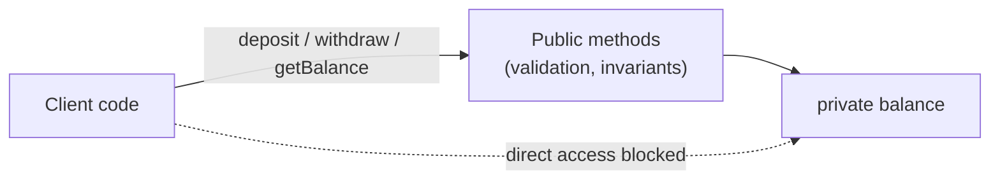
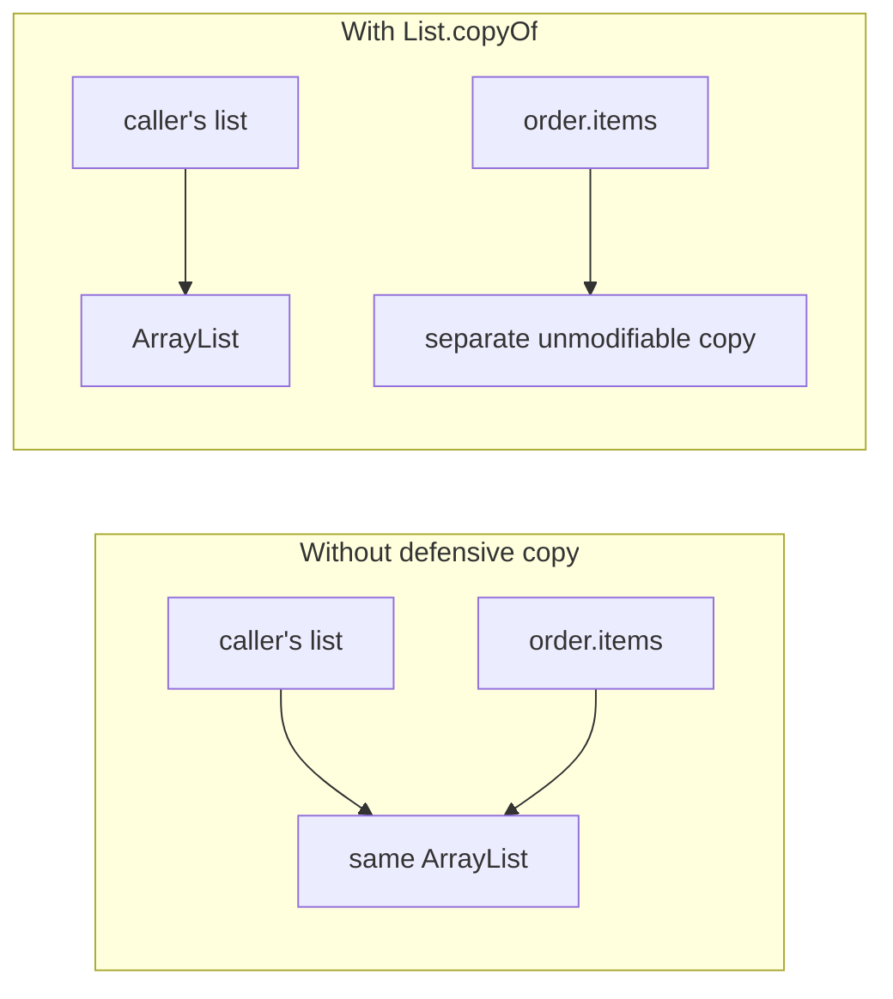
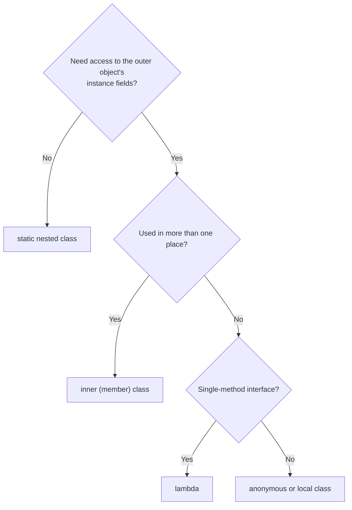
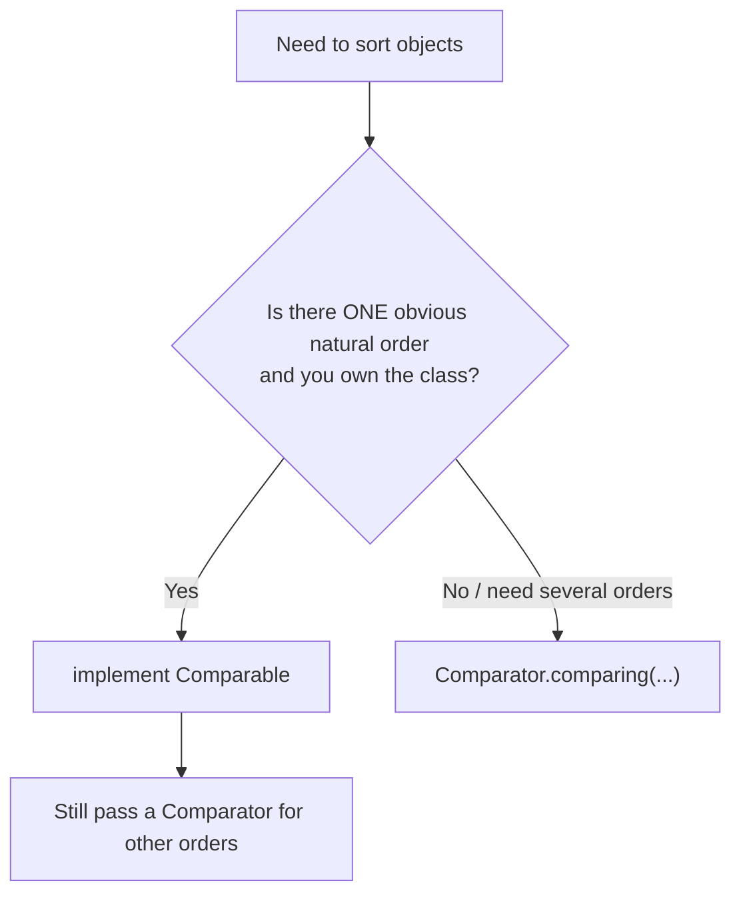
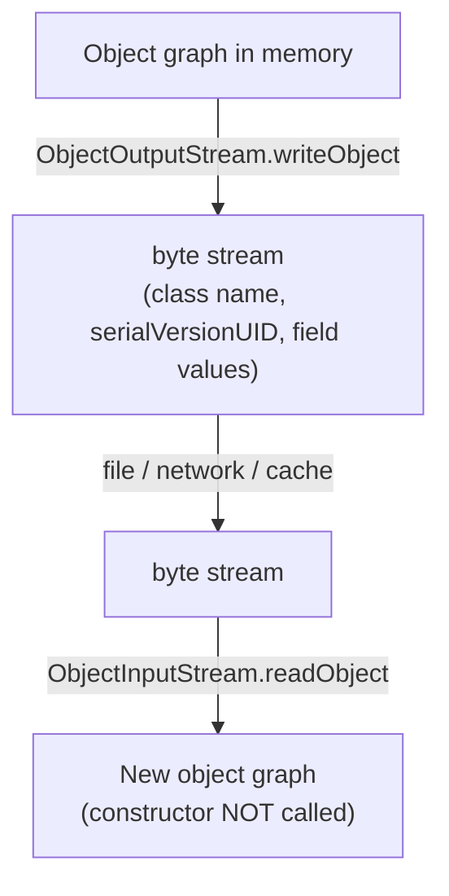
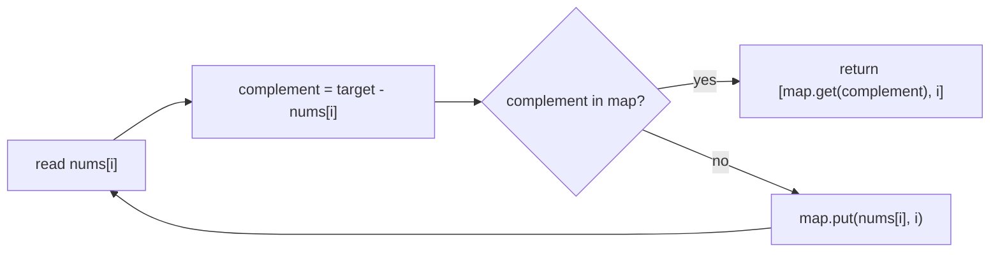
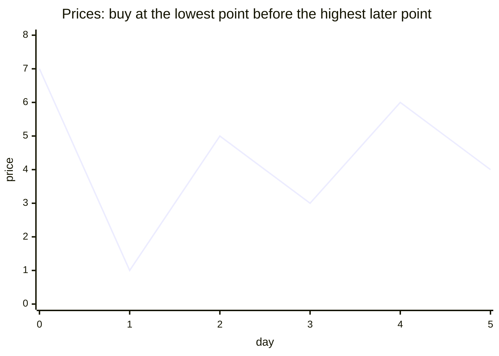
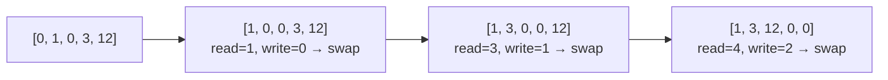

# Day 3 — OOP Advanced: Encapsulation, Immutability, Enums & Comparators

> **How to use these notes:** each section maps to one checklist item. Run the code, study the diagrams, then test yourself with the collapsible questions. 🚀 marks senior-level details.

**Today's goal:** design classes that protect their own state (encapsulation, immutability), pick the right kind of nested class, use enums properly, sort anything with `Comparable`/`Comparator`, and explain how Java serialization works (and why modern code avoids it). On the DSA side: the two most useful array tricks — **hashing for O(1) lookups** and **tracking the best value so far**.

<!-- topic: d3_t1 -->
## ☕ Java — Encapsulation & Advanced OOP

<!-- subtopic: d3_t1_s1 -->
### 1. Encapsulation — private fields, getters/setters, JavaBean conventions

> **TL;DR:** Encapsulation = **hide the internal state** and expose only controlled operations. Fields are `private`; the outside world goes through methods that can **validate**, **protect invariants** and **change implementation** without breaking callers.

#### 1.1 Without vs with encapsulation

```java
// ❌ No encapsulation — anyone can break the object
public class BankAccount {
    public double balance;
}
account.balance = -1_000_000;            // invalid state, nobody can stop it

// ✅ Encapsulated
public class BankAccount {
    private double balance;              // hidden

    public double getBalance() { return balance; }

    public void deposit(double amount) {
        if (amount <= 0) throw new IllegalArgumentException("amount must be positive");
        balance += amount;
    }

    public void withdraw(double amount) {
        if (amount > balance) throw new IllegalStateException("insufficient funds");
        balance -= amount;
    }
    // No setBalance() — balance can only change through valid operations
}
```



#### 1.2 Benefits
1. **Validation & invariants** — the object can never enter an invalid state.
2. **Change freely** — store `balance` as `BigDecimal` or in paise tomorrow; callers don't change.
3. **Read-only / write-only** fields — provide only a getter (or only a setter).
4. **Easier debugging** — one place where state changes.
5. **Thread-safety** — you control access, so you can add synchronization later.

#### 1.3 JavaBean conventions (used by Spring, Jackson, JPA, JSP)

| Convention | Example |
|---|---|
| `private` fields | `private String name;` |
| Public **no-arg** constructor | `public User() {}` |
| Getter `getX()` | `public String getName()` |
| Boolean getter `isX()` | `public boolean isActive()` |
| Setter `setX(value)` | `public void setName(String name)` |
| (Optionally) `Serializable` | `implements Serializable` |

Frameworks discover properties by these names via reflection — e.g. Jackson turns `getName()` into the JSON field `"name"`.

#### 1.4 Getters can still leak state ⚠️

```java
public class Team {
    private final List<String> members = new ArrayList<>();
    public List<String> getMembers() { return members; }    // ❌ caller can do team.getMembers().clear()
}

// ✅ Return an unmodifiable view or a copy
public List<String> getMembers() { return Collections.unmodifiableList(members); }
public List<String> getMembers() { return List.copyOf(members); }
```

#### 🚀 1.5 Beyond getters and setters
- **"Tell, don't ask":** prefer `account.withdraw(100)` over `account.setBalance(account.getBalance() - 100)`. Generating a getter + setter for every field is *not* real encapsulation — it just makes private fields public with extra steps.
- **Lombok** (`@Getter`, `@Setter`, `@Data`) reduces boilerplate; `@Data` generates setters and `equals`/`hashCode` for all fields — be careful with JPA entities.
- **Records** (Java 16) — encapsulated, immutable data carriers with accessors (`user.name()`), no setters.

#### 🎯 Interview questions

<details><summary>Q1. What is encapsulation and why is it useful?</summary>

Bundling data with the methods that operate on it and hiding the data behind a controlled interface. It protects invariants (validation), lets the implementation change without breaking callers, and localises state changes.

</details>

<details><summary>Q2. Is a class with private fields and public getters/setters for all of them well encapsulated?</summary>

Not really. Unrestricted setters allow any state. Good encapsulation exposes meaningful operations that keep the object valid, and avoids leaking mutable internals through getters.

</details>

<details><summary>Q3. What are the JavaBean conventions?</summary>

Private fields, a public no-arg constructor, `getX`/`isX` getters, `setX` setters, and optionally `Serializable`. Frameworks use them to discover properties via reflection.

</details>

<!-- subtopic: d3_t1_s2 -->
### 2. Immutable Classes — final class, final fields, no setters, defensive copies

> **TL;DR:** An immutable object's state **never changes after construction**. Recipe: `final` class, `private final` fields, no setters, **defensive copies** of mutable inputs and outputs, and "modifier" methods that **return new objects**.

#### 2.1 The recipe

```java
public final class Order {                                   // 1. can't be subclassed
    private final String id;                                 // 2. private final fields
    private final List<String> items;
    private final LocalDate createdOn;                       //    LocalDate is already immutable

    public Order(String id, List<String> items, LocalDate createdOn) {
        this.id = Objects.requireNonNull(id);
        this.items = List.copyOf(items);                     // 3. defensive copy IN
        this.createdOn = createdOn;
    }

    public String getId() { return id; }                     // 4. getters only
    public List<String> getItems() { return items; }         // 5. List.copyOf is already unmodifiable
    public LocalDate getCreatedOn() { return createdOn; }

    public Order withItem(String item) {                     // 6. "change" = new object
        List<String> copy = new ArrayList<>(items);
        copy.add(item);
        return new Order(id, copy, createdOn);
    }
}
```

#### 2.2 Why defensive copies matter

```java
List<String> list = new ArrayList<>(List.of("pen"));
Order o = new Order("1", list, LocalDate.now());
list.add("hacked");                  // without the copy in the constructor, o.getItems() would change!
```



Old `java.util.Date` is **mutable** — a common trap. Use `java.time` types (`LocalDate`, `Instant`), which are immutable.

#### 2.3 Benefits of immutability
- **Thread-safe** without locks — share freely between threads.
- **Safe HashMap keys / HashSet elements** — the hash code can't change after insertion.
- **Easy to reason about** — no "who changed this?" bugs; can cache freely (String's hash cache).
- **Failure atomicity** — an exception never leaves the object half-modified.

Costs: more objects created (usually cheap thanks to fast allocation/GC); for many fields use a **builder**.

#### 2.4 Records (Java 16+) — immutability with almost no code

```java
public record Money(BigDecimal amount, String currency) {
    public Money {                                   // compact constructor: validation
        Objects.requireNonNull(amount);
        if (amount.signum() < 0) throw new IllegalArgumentException("negative");
    }
    public Money add(Money other) { return new Money(amount.add(other.amount), currency); }
}
```

Records are final with private final fields, a canonical constructor, accessors, `equals`/`hashCode`/`toString`. They're **shallowly** immutable — still copy mutable components (`List.copyOf`) in the compact constructor.

#### 🚀 2.5 Advanced
- **`BigInteger` and `BigDecimal` are not `final`** — a historical mistake. A malicious subclass could be mutable, so security-sensitive code defensively copies them.
- **Final field semantics (JMM):** after the constructor completes, other threads see correctly initialised final fields without synchronization — as long as `this` didn't escape during construction.
- **Effectively immutable** objects (never modified after publication) are also safe if published safely.

#### 🎯 Interview questions

<details><summary>Q1. How do you create an immutable class?</summary>

Make the class final, fields private final, no setters, initialise everything in the constructor, defensively copy mutable inputs and never expose mutable internals (copy or wrap on the way out), and have "modifiers" return new instances.

</details>

<details><summary>Q2. Why are immutable objects thread-safe?</summary>

Their state can't change after construction, so there are no writes to race on; final-field semantics guarantee other threads see the initialised values.

</details>

<details><summary>Q3. Are records fully immutable?</summary>

Shallowly. Their fields are final, but if a component is a mutable object (like an ArrayList), its contents can still change unless you copy it in the compact constructor.

</details>

<details><summary>Q4. Name immutable classes in the JDK.</summary>

`String`, wrapper classes (`Integer`, `Long`...), `LocalDate`/`LocalDateTime`/`Instant`, `BigDecimal`/`BigInteger` (effectively; not final), `List.of(...)` results, `Optional`.

</details>

<!-- subtopic: d3_t1_s6 -->
### 3. Inner Classes — static nested, inner, local, anonymous

> **TL;DR:** Java has four kinds of nested classes. **Static nested** = no link to an outer object (most common, e.g. builders). **Inner** = tied to an outer instance. **Local** = declared inside a method. **Anonymous** = unnamed, one-off implementation (largely replaced by lambdas).

#### 3.1 The four kinds

```java
public class Outer {
    private int value = 10;
    private static int count = 0;

    // 1. Static nested class
    static class StaticNested {
        void show() { System.out.println(count); }        // only static members of Outer
    }

    // 2. Inner (member) class — holds a hidden reference Outer.this
    class Inner {
        int value = 20;
        void show() {
            System.out.println(value);                    // 20 (Inner's)
            System.out.println(Outer.this.value);         // 10 (Outer's)
        }
    }

    void method() {
        int local = 5;                                    // effectively final

        // 3. Local class — visible only inside this method
        class Local {
            void show() { System.out.println(local + value); }
        }
        new Local().show();

        // 4. Anonymous class — declare and instantiate in one expression
        Runnable r = new Runnable() {
            @Override public void run() { System.out.println("anonymous " + local); }
        };
        r.run();
    }
}

Outer.StaticNested a = new Outer.StaticNested();          // no Outer needed
Outer outer = new Outer();
Outer.Inner b = outer.new Inner();                        // needs an Outer instance
```

#### 3.2 Comparison

| | Static nested | Inner | Local | Anonymous |
|---|---|---|---|---|
| Needs an outer instance | ❌ | ✅ | ✅ (if in an instance method) | ✅ (if in an instance method) |
| Access outer instance fields | ❌ (only via a reference) | ✅ | ✅ | ✅ |
| Access local variables | — | — | effectively final only | effectively final only |
| Has a name / reusable | ✅ | ✅ | inside the method | ❌ one-off |
| Typical use | Builder, Node in LinkedList, helper types | Iterators over the outer's data | Rare | Event listeners, one-off comparators (pre-Java 8) |



#### 3.3 Real examples
- `HashMap.Node`, `LinkedList.Node` — **static** nested classes.
- `ArrayList.Itr` — an **inner** class (the iterator needs the list's array and `modCount`).
- Builder pattern — `new Pizza.Builder().size(12).build()` (static nested).

#### 3.4 Anonymous class vs lambda

| | Anonymous class | Lambda |
|---|---|---|
| Can implement | Any interface or abstract class, multiple methods | Only functional interfaces (one abstract method) |
| `this` refers to | The anonymous object | The enclosing instance |
| Can have state (fields) | ✅ | ❌ |
| Compiled to | A separate `.class` file (`Outer$1.class`) | `invokedynamic` — no extra class file |

#### ⚠️ Pitfalls
- **Memory leaks:** inner and anonymous classes keep the outer object alive (`Outer.this`). An inner listener registered in a long-lived registry keeps the whole outer object in memory. Prefer static nested classes.
- Serialising inner classes is strongly discouraged (synthetic fields, compiler-specific).

#### 🎯 Interview questions

<details><summary>Q1. Difference between a static nested class and an inner class?</summary>

A static nested class has no reference to an outer instance and is created independently. An inner class holds an implicit `Outer.this` reference, can access the outer's instance members, and needs an outer object to be created (`outer.new Inner()`).

</details>

<details><summary>Q2. Why must local variables used in local/anonymous classes be effectively final?</summary>

The class captures a copy of the value. If the variable could change afterwards, the copy and the original would disagree.

</details>

<details><summary>Q3. What does `this` mean inside a lambda vs an anonymous class?</summary>

In a lambda, `this` is the enclosing class instance. In an anonymous class, `this` is the anonymous class instance itself.

</details>

<!-- subtopic: d3_t1_s8 -->
### 4. Enums — constants with behaviour

> **TL;DR:** An `enum` is a type with a **fixed set of instances**. Enums can have fields, constructors, methods, and even per-constant behaviour. They're type-safe (unlike `int` constants), work in `switch`, and are the best way to build a singleton.

#### 4.1 Why not int constants?

```java
// ❌ int constants: no type safety, no namespace, meaningless when printed
public static final int STATUS_ACTIVE = 1;
public static final int STATUS_BLOCKED = 2;
setStatus(42);          // compiles!

// ✅ enum
public enum Status { ACTIVE, BLOCKED, DELETED }
setStatus(Status.ACTIVE);   // only valid values compile
```

#### 4.2 Fields, constructors and methods

```java
public enum Planet {
    MERCURY(3.303e+23, 2.4397e6),
    EARTH(5.976e+24, 6.37814e6);                 // ← semicolon needed before members

    private final double mass;                   // fields
    private final double radius;

    Planet(double mass, double radius) {         // constructor is implicitly private
        this.mass = mass;
        this.radius = radius;
    }

    public double surfaceGravity() {             // methods
        return 6.67300E-11 * mass / (radius * radius);
    }
}

for (Planet p : Planet.values()) {                       // all constants, in declaration order
    System.out.println(p + " " + p.ordinal() + " " + p.surfaceGravity());
}
Planet e = Planet.valueOf("EARTH");                      // name → constant (IllegalArgumentException if bad)
```

Built-in methods: `values()`, `valueOf(String)`, `name()`, `ordinal()`, `compareTo()` (by ordinal), `toString()` (defaults to the name).

#### 4.3 Constant-specific behaviour (strategy per constant)

```java
public enum Operation {
    PLUS("+")  { public int apply(int a, int b) { return a + b; } },
    MINUS("-") { public int apply(int a, int b) { return a - b; } },
    TIMES("*") { public int apply(int a, int b) { return a * b; } };

    private final String symbol;
    Operation(String symbol) { this.symbol = symbol; }
    public abstract int apply(int a, int b);        // each constant must implement
}

Operation.PLUS.apply(2, 3);   // 5
```

Enums can also **implement interfaces** (but can't extend classes — they already extend `java.lang.Enum`).

#### 4.4 Enums in switch

```java
String label = switch (status) {          // switch expression (Java 14+)
    case ACTIVE  -> "Active";
    case BLOCKED -> "Blocked";
    case DELETED -> "Deleted";
};                                         // exhaustive: compiler checks every constant is handled
```

#### 4.5 EnumSet and EnumMap

```java
EnumSet<Status> visible = EnumSet.of(Status.ACTIVE, Status.BLOCKED);   // stored as a bit vector
EnumSet<Status> all = EnumSet.allOf(Status.class);

EnumMap<Status, Integer> counts = new EnumMap<>(Status.class);         // array indexed by ordinal
counts.merge(Status.ACTIVE, 1, Integer::sum);
```

Both are much faster and more compact than `HashSet`/`HashMap` for enum keys, and iterate in declaration order.

#### 4.6 Enum singleton (Effective Java's recommended singleton)

```java
public enum IdGenerator {
    INSTANCE;
    private final AtomicLong next = new AtomicLong();
    public long nextId() { return next.incrementAndGet(); }
}
IdGenerator.INSTANCE.nextId();
```

Thread-safe initialization (class loading), and safe against **reflection** (can't instantiate enums reflectively) and **serialization** (deserialization returns the same constant).

#### ⚠️ Pitfalls
- **Don't persist `ordinal()`** — reordering or inserting constants silently corrupts stored data. In JPA use `@Enumerated(EnumType.STRING)`.
- `valueOf` is case-sensitive and throws for unknown names.
- Compare enums with `==` (safe, null-safe, compile-time checked).

#### 🎯 Interview questions

<details><summary>Q1. Can an enum have a constructor? Can it be public?</summary>

Yes, but it's always private (implicitly). Constants are created by the JVM when the enum class is initialized; you can't call `new` on an enum.

</details>

<details><summary>Q2. Can an enum extend a class or implement interfaces?</summary>

It can implement interfaces but can't extend a class, because every enum already extends `java.lang.Enum`.

</details>

<details><summary>Q3. Why is an enum the best way to implement a singleton?</summary>

The JVM guarantees one instance per constant, initialization is thread-safe, and enums are protected against creating extra instances via reflection or deserialization.

</details>

<details><summary>Q4. Why is storing an enum's ordinal in a database dangerous?</summary>

Ordinals depend on declaration order. Adding or reordering constants changes them, silently mapping old rows to the wrong values. Store the name instead.

</details>

<!-- subtopic: d14_t1_s8 -->
### 5. Comparable vs Comparator — sorting anything

> **TL;DR:** **`Comparable<T>`** defines a class's **natural order** inside the class (`compareTo`). **`Comparator<T>`** defines **any number of external orders** (`compare`), usually built with `Comparator.comparing(...).thenComparing(...)`.

#### 5.1 Comparable — natural ordering

```java
public class Employee implements Comparable<Employee> {
    private final String name;
    private final int age;
    private final double salary;
    // constructor, getters...

    @Override
    public int compareTo(Employee other) {
        return Integer.compare(this.age, other.age);      // natural order: by age
    }
}

List<Employee> list = new ArrayList<>(employees);
Collections.sort(list);                                   // uses compareTo
list.sort(null);                                          // same
TreeSet<Employee> sorted = new TreeSet<>(list);           // TreeSet/TreeMap/PriorityQueue use it too
```

**Contract of `compareTo` (and `compare`):** returns **negative** if this < other, **zero** if equal, **positive** if greater. It must be antisymmetric and transitive, and it's strongly recommended to be **consistent with equals** (`compareTo == 0` ⇔ `equals`).

JDK classes with natural order: `String` (lexicographic), `Integer` and wrappers, `LocalDate`, `BigDecimal`, enums (by ordinal).

#### 5.2 Comparator — external, multiple orders

```java
Comparator<Employee> bySalaryDesc = Comparator.comparingDouble(Employee::getSalary).reversed();
Comparator<Employee> byNameThenAge = Comparator.comparing(Employee::getName)
                                               .thenComparingInt(Employee::getAge);
Comparator<Employee> byDeptNullsLast =
        Comparator.comparing(Employee::getDept, Comparator.nullsLast(Comparator.naturalOrder()));

employees.sort(bySalaryDesc);
employees.stream().sorted(byNameThenAge).toList();
new PriorityQueue<>(Comparator.comparingInt(Employee::getAge));        // min-heap by age
new TreeMap<String, Integer>(String.CASE_INSENSITIVE_ORDER);

// Old style (still useful to understand):
Collections.sort(employees, new Comparator<Employee>() {
    @Override public int compare(Employee a, Employee b) { return a.getName().compareTo(b.getName()); }
});
// Lambda:
employees.sort((a, b) -> a.getName().compareTo(b.getName()));
```

Useful factory methods: `comparing`, `comparingInt/Long/Double` (avoid boxing), `thenComparing`, `reversed`, `naturalOrder`, `reverseOrder`, `nullsFirst`, `nullsLast`, `Map.Entry.comparingByValue()`.

#### 5.3 Comparison

| | Comparable | Comparator |
|---|---|---|
| Package | `java.lang` | `java.util` |
| Method | `compareTo(T o)` | `compare(T a, T b)` |
| Where defined | Inside the class being sorted | Separate object / lambda |
| Number of orders | One (natural) | Unlimited |
| Modify the class? | Yes | No — works for classes you don't own |
| Used by | `Collections.sort(list)`, `TreeSet()`, `Arrays.sort(objs)` | `list.sort(cmp)`, `new TreeSet<>(cmp)`, `stream.sorted(cmp)` |



#### 5.4 The subtraction bug ⚠️

```java
// ❌ Overflows for large values: Integer.MIN_VALUE - 1 wraps to a huge positive number
public int compare(Integer a, Integer b) { return a - b; }

// ✅ Always use Integer.compare / Long.compare / Double.compare
public int compare(Integer a, Integer b) { return Integer.compare(a, b); }
```

#### 🚀 5.5 Consistency with equals matters

`TreeSet`/`TreeMap` treat `compare(a, b) == 0` as **duplicates**, ignoring `equals`:

```java
Set<Employee> set = new TreeSet<>(Comparator.comparing(Employee::getAge));
set.add(new Employee("Asha", 30));
set.add(new Employee("Ravi", 30));      // NOT added — same age means "equal" to the TreeSet
set.size();                              // 1 😱
```

Fix: add tie-breakers (`.thenComparing(Employee::getName).thenComparing(Employee::getId)`).

#### 🎯 Interview questions

<details><summary>Q1. Difference between Comparable and Comparator?</summary>

Comparable defines a single natural order inside the class (`compareTo`). Comparator is an external strategy (`compare`) — you can have many and use them for classes you can't modify.

</details>

<details><summary>Q2. Why shouldn't you write `return a - b;` in a comparator?</summary>

Integer subtraction can overflow and flip the sign for large or negative values, giving wrong orderings. Use `Integer.compare(a, b)`.

</details>

<details><summary>Q3. How do you sort by salary descending, then name ascending?</summary>

`Comparator.comparingDouble(Employee::getSalary).reversed().thenComparing(Employee::getName)`.

</details>

<details><summary>Q4. What happens if compareTo is inconsistent with equals in a TreeSet?</summary>

Elements that compare as 0 are treated as duplicates and dropped, even if `equals` says they're different.

</details>

<!-- subtopic: d3_t1_s7 -->
### 6. Marker Interfaces — Serializable, Cloneable, RandomAccess

> **TL;DR:** A **marker interface** has **no methods**. Implementing it "tags" a class with a capability that some other code checks with `instanceof`.

| Marker | Who checks it | Effect |
|---|---|---|
| `Serializable` | `ObjectOutputStream` | Allows Java serialization; otherwise `NotSerializableException` |
| `Cloneable` | `Object.clone()` | Allows field-by-field copy; otherwise `CloneNotSupportedException` |
| `RandomAccess` | Collections algorithms (e.g. `Collections.binarySearch`, `shuffle`) | Signals fast `get(i)` → use index loops instead of iterators |
| `java.rmi.Remote` | RMI | Marks remotely callable objects |

```java
// How the JDK uses RandomAccess (simplified)
if (list instanceof RandomAccess) {
    for (int i = 0; i < list.size(); i++) process(list.get(i));    // ArrayList: O(1) get
} else {
    for (Iterator<E> it = list.iterator(); it.hasNext(); ) process(it.next());   // LinkedList
}
```

#### Marker interface vs marker annotation

| | Marker interface | Marker annotation (`@Entity`, `@Deprecated`) |
|---|---|---|
| Defines a **type** | ✅ — methods can require it (`void save(Serializable s)`) → compile-time checking | ❌ |
| Can be applied to | Classes/interfaces only | Methods, fields, parameters, packages... |
| Read via | `instanceof` | Reflection |

Effective Java (Item 41): use a marker interface when you want a type that methods can accept; otherwise use an annotation.

#### 🎯 Interview questions

<details><summary>Q1. What is a marker interface? Give examples.</summary>

An interface with no methods used to signal a capability, checked via `instanceof`: `Serializable`, `Cloneable`, `RandomAccess`, `Remote`.

</details>

<details><summary>Q2. Why does ArrayList implement RandomAccess but LinkedList doesn't?</summary>

ArrayList supports O(1) indexed access; LinkedList's `get(i)` is O(n). Generic algorithms check `RandomAccess` to choose index-based loops or iterators.

</details>

<!-- subtopic: d3_t1_s4 -->
### 7. The `transient` Keyword

> **TL;DR:** A `transient` field is **skipped by Java serialization**. After deserialization it has its **default value** (`null`, `0`, `false`).

```java
public class UserSession implements Serializable {
    private static final long serialVersionUID = 1L;

    private String username;                     // serialized
    private transient String password;           // NOT serialized — security
    private transient Connection dbConnection;   // NOT serialized — not serializable anyway
    private transient int cachedHash;            // NOT serialized — can be recomputed
}

// after writing and reading back:
// username = "asha", password = null, dbConnection = null, cachedHash = 0
```

When to use `transient`:
1. **Sensitive data** — passwords, tokens.
2. **Non-serializable fields** — `Thread`, `Connection`, `InputStream`, loggers.
3. **Derived/cached values** — recompute after deserialization (in `readObject` or lazily).

Facts:
- `static` fields are never serialized anyway (they belong to the class), so `static transient` is redundant.
- A `final transient` field ends up with its default value after deserialization and can't be reassigned normally — avoid this combination (or restore via `readResolve`).
- JPA's `@Transient` is a **different thing**: it excludes a field from **database** persistence, not from Java serialization.

#### 🎯 Interview questions

<details><summary>Q1. What value does a transient field have after deserialization?</summary>

Its type's default value: null for references, 0 for numbers, false for boolean — unless custom `readObject` logic restores it.

</details>

<details><summary>Q2. Difference between the transient keyword and JPA's @Transient?</summary>

`transient` excludes a field from Java serialization; `@Transient` excludes it from being mapped to a database column.

</details>

<!-- subtopic: d3_t1_s5 -->
### 8. Serialization — Serializable vs Externalizable, serialVersionUID, custom hooks

> **TL;DR:** Serialization converts an object graph into a **byte stream** (to save to disk or send over the network); deserialization rebuilds it. In Java you opt in with `Serializable`. Version it with `serialVersionUID`. Modern systems mostly use **JSON/Protobuf** instead because Java serialization is fragile and a **security risk**.

#### 8.1 Basic usage

```java
public class Employee implements Serializable {
    private static final long serialVersionUID = 1L;    // version of the class's serialized form
    private String name;
    private int age;
    private Address address;                             // Address must be Serializable too!
}

// Serialize
try (ObjectOutputStream out = new ObjectOutputStream(new FileOutputStream("emp.ser"))) {
    out.writeObject(employee);
}

// Deserialize
try (ObjectInputStream in = new ObjectInputStream(new FileInputStream("emp.ser"))) {
    Employee e = (Employee) in.readObject();
}
```



#### 8.2 Rules
- Every non-transient, non-static field's type must be serializable, otherwise **`NotSerializableException`** at runtime.
- Deserialization **does not call the class's constructor**. It calls the **no-arg constructor of the first non-serializable superclass** (e.g., `Object`) and then sets the fields directly.
- Object references and **cycles** are preserved (each object is written once).

#### 8.3 serialVersionUID

- A `long` identifying the version of the class. On deserialization, the stream's UID must match the current class's UID, else **`InvalidClassException`**.
- If you don't declare it, the JVM **computes one from the class structure** — adding a method or field changes it and breaks old data. **Always declare it explicitly.**
- Compatible changes (adding a field) can keep the same UID — new fields get defaults when reading old data.

#### 8.4 Custom serialization hooks

```java
public class Account implements Serializable {
    private static final long serialVersionUID = 1L;
    private String owner;
    private transient String secret;

    @Serial
    private void writeObject(ObjectOutputStream out) throws IOException {
        out.defaultWriteObject();                      // write normal fields
        out.writeObject(encrypt(secret));              // custom handling
    }

    @Serial
    private void readObject(ObjectInputStream in) throws IOException, ClassNotFoundException {
        in.defaultReadObject();
        this.secret = decrypt((String) in.readObject());
        if (owner == null) throw new InvalidObjectException("owner required");   // validate!
    }

    @Serial
    private Object readResolve() { return this; }      // replace the deserialized object (e.g., singletons)
}
```

`@Serial` (Java 14) is an optional annotation that lets the compiler check these signatures.

#### 8.5 Externalizable

```java
public class Point implements Externalizable {
    private int x, y;
    public Point() { }                                 // REQUIRED public no-arg constructor
    @Override public void writeExternal(ObjectOutput out) throws IOException { out.writeInt(x); out.writeInt(y); }
    @Override public void readExternal(ObjectInput in) throws IOException { x = in.readInt(); y = in.readInt(); }
}
```

| | Serializable | Externalizable |
|---|---|---|
| Methods to implement | None (marker) | `writeExternal`, `readExternal` |
| Control | Automatic (+ optional hooks) | Full manual control |
| Constructor on read | Not called (first non-serializable parent's no-arg is) | **Public no-arg constructor is called** |
| transient | Respected | Irrelevant — you write what you want |
| Performance | Slower (reflection, metadata) | Can be faster/smaller |

#### 🚀 8.6 Security and modern practice
- Deserializing untrusted bytes can execute code through **gadget chains** in libraries on the classpath — the root of many critical CVEs. Never deserialize untrusted data with `ObjectInputStream`; if unavoidable, use **`ObjectInputFilter`** (Java 9) allow-lists.
- Singletons break on deserialization unless you implement `readResolve()` (or use an enum).
- Records are serialized via their **canonical constructor**, so validation still runs — safer.
- In Spring/microservices you'll use **JSON (Jackson)**, **Protobuf/Avro** (Kafka), not Java serialization.

#### 🎯 Interview questions

<details><summary>Q1. What is serialVersionUID and what happens if you don't declare it?</summary>

It's the version number of a class's serialized form. If you don't declare it, the JVM computes one from the class structure, so harmless changes (like adding a method) can make old serialized data fail with InvalidClassException.

</details>

<details><summary>Q2. Is the constructor called during deserialization?</summary>

Not for Serializable classes — only the no-arg constructor of the first non-serializable superclass runs. For Externalizable, the public no-arg constructor is called.

</details>

<details><summary>Q3. What if a field's type isn't Serializable?</summary>

Serialization throws NotSerializableException — unless the field is transient or handled in custom writeObject/readObject.

</details>

<details><summary>Q4. How do you keep a singleton a singleton across deserialization?</summary>

Implement `readResolve()` returning the existing instance, or use an enum singleton.

</details>

<details><summary>Q5. Why is Java serialization considered dangerous?</summary>

Deserializing attacker-controlled bytes can instantiate arbitrary classes and trigger gadget chains leading to remote code execution. Use data formats like JSON, or filter with ObjectInputFilter.

</details>

<!-- topic: d3_t2 -->
## 🧮 DSA — Arrays: Two Sum & Easy Patterns

> **Patterns today:** (1) **Hashing** — trade O(n) memory for O(1) lookups. (2) **Best-so-far** — remember the best value seen while scanning once. (3) **Read/write pointer** (from Day 2). (4) **Carry from the right** for digit arrays.

<!-- subtopic: d3_t2_s1 -->
### 9. Two Sum (LeetCode 1)

> **Problem:** given `nums` and `target`, return the **indices** of the two numbers that add up to `target`. Exactly one solution exists; you can't use the same element twice. 🔗 [LeetCode 1](https://leetcode.com/problems/two-sum/)

#### Approach 1 — Brute force: check every pair

```java
public int[] twoSum(int[] nums, int target) {
    for (int i = 0; i < nums.length; i++)
        for (int j = i + 1; j < nums.length; j++)
            if (nums[i] + nums[j] == target) return new int[]{i, j};
    return new int[0];
}   // Time O(n²), Space O(1)
```

#### Approach 2 — Sort + two pointers
O(n log n), but sorting loses the original indices (you'd have to sort index pairs). Good to mention; better for "return the values" or for **Two Sum II** (already sorted, Day 6).

#### Approach 3 — HashMap, one pass ✅

For each number `x`, the partner we need is `target - x` (the **complement**). Store every number we've seen with its index; check the map before inserting.

```java
public int[] twoSum(int[] nums, int target) {
    Map<Integer, Integer> seen = new HashMap<>();     // value → index
    for (int i = 0; i < nums.length; i++) {
        int complement = target - nums[i];
        if (seen.containsKey(complement)) {
            return new int[]{seen.get(complement), i};
        }
        seen.put(nums[i], i);                         // insert AFTER checking → never pairs with itself
    }
    return new int[0];
}   // Time O(n), Space O(n)
```

**Dry run** `nums = [2, 7, 11, 15], target = 9`:

| i | nums[i] | complement | seen before | result |
|---|---|---|---|---|
| 0 | 2 | 7 | {} | put 2→0 |
| 1 | 7 | 2 | {2:0} | found → **[0, 1]** |



Edge cases: duplicates like `[3, 3], target 6` work because we check before inserting; negative numbers work.

> **Interview script:** "Brute force is O(n²). The repeated work is searching for the complement, so I'll store seen values in a HashMap for O(1) lookups — O(n) time, O(n) space."

<!-- subtopic: d3_t2_s2 -->
### 10. Contains Duplicate (LeetCode 217)

> **Problem:** return `true` if any value appears at least twice. 🔗 [LeetCode 217](https://leetcode.com/problems/contains-duplicate/)

| Approach | Time | Space |
|---|---|---|
| Compare all pairs | O(n²) | O(1) |
| Sort, compare neighbours | O(n log n) | O(1)–O(log n) (sort stack); modifies input |
| HashSet ✅ | O(n) | O(n) |

```java
public boolean containsDuplicate(int[] nums) {
    Set<Integer> seen = new HashSet<>();
    for (int x : nums) {
        if (!seen.add(x)) return true;      // add() returns false if x was already present
    }
    return false;
}

// Sorting alternative (O(1) extra space if modifying input is OK)
public boolean containsDuplicateSorted(int[] nums) {
    Arrays.sort(nums);
    for (int i = 1; i < nums.length; i++) if (nums[i] == nums[i - 1]) return true;
    return false;
}
```

💡 `Set.add` returning a boolean saves a separate `contains` call. Mention the **time vs space trade-off** between the two approaches. Follow-up: [Contains Duplicate II (LC 219)](https://leetcode.com/problems/contains-duplicate-ii/) — duplicates within distance k → HashMap of last index or a sliding window set.

<!-- subtopic: d3_t2_s3 -->
### 11. Best Time to Buy and Sell Stock (LeetCode 121)

> **Problem:** `prices[i]` is the price on day i. Buy once and sell once **later** to maximize profit; return 0 if no profit is possible. 🔗 [LeetCode 121](https://leetcode.com/problems/best-time-to-buy-and-sell-stock/)

#### Brute force
Try every buy day `i` and sell day `j > i` → O(n²).

#### Best-so-far ✅

If I sell today, the best buy day is the **cheapest price seen before today**. Track that minimum while scanning.

```java
public int maxProfit(int[] prices) {
    int minPrice = Integer.MAX_VALUE;
    int best = 0;
    for (int price : prices) {
        if (price < minPrice) {
            minPrice = price;                         // better day to buy
        } else {
            best = Math.max(best, price - minPrice);  // sell today
        }
    }
    return best;
}   // Time O(n), Space O(1)
```

**Dry run** `[7, 1, 5, 3, 6, 4]`:

| price | minPrice | profit if sold today | best |
|---|---|---|---|
| 7 | 7 | — | 0 |
| 1 | 1 | — | 0 |
| 5 | 1 | 4 | 4 |
| 3 | 1 | 2 | 4 |
| 6 | 1 | **5** | 5 |
| 4 | 1 | 3 | 5 |



> **Pattern:** "answer for position i depends on the best of everything before i" → keep a running min/max. This is the seed of **Kadane's algorithm** (Day 10) and many DP problems. Variants: Stock II (LC 122, multiple transactions → sum all upward moves), Stock III/IV (Hard, DP).

<!-- subtopic: d3_t2_s4 -->
### 12. Move Zeroes (LeetCode 283)

> **Problem:** move all `0`s to the end **in place**, keeping the relative order of non-zero elements. 🔗 [LeetCode 283](https://leetcode.com/problems/move-zeroes/)

#### Approach 1 — Write pointer, then fill zeros

```java
public void moveZeroes(int[] nums) {
    int write = 0;
    for (int x : nums) {
        if (x != 0) nums[write++] = x;        // compact non-zeros to the front
    }
    while (write < nums.length) nums[write++] = 0;   // fill the rest with zeros
}   // O(n) time, O(1) space
```

#### Approach 2 — Swap (fewer writes when there are few zeros) ✅

```java
public void moveZeroes(int[] nums) {
    int write = 0;                              // next position for a non-zero
    for (int read = 0; read < nums.length; read++) {
        if (nums[read] != 0) {
            if (read != write) {                // skip pointless self-swaps
                int tmp = nums[write];
                nums[write] = nums[read];
                nums[read] = tmp;
            }
            write++;
        }
    }
}   // O(n) time, O(1) space, each element moved at most once
```

**Dry run** `[0, 1, 0, 3, 12]` → swap(0,1) `[1,0,0,3,12]` → swap(1,3) `[1,3,0,0,12]` → swap(2,4) `[1,3,12,0,0]`.



Same read/write pointer pattern as Remove Duplicates (Day 2). Related: Sort Colors (Day 9) uses **three** pointers.

<!-- subtopic: d3_t2_s5 -->
### 13. Plus One (LeetCode 66)

> **Problem:** a non-negative integer is stored as an array of digits (most significant first). Add one and return the resulting digits. 🔗 [LeetCode 66](https://leetcode.com/problems/plus-one/)

You can't convert to `int`/`long` — the array may have 100 digits (overflow). Simulate addition with a **carry**, from the right.

```java
public int[] plusOne(int[] digits) {
    for (int i = digits.length - 1; i >= 0; i--) {
        if (digits[i] < 9) {
            digits[i]++;            // no carry needed — done
            return digits;
        }
        digits[i] = 0;              // 9 + 1 = 10 → write 0, carry 1 to the left
    }
    int[] result = new int[digits.length + 1];   // all digits were 9: 999 → 1000
    result[0] = 1;                               // remaining entries already 0
    return result;
}   // Time O(n) worst case, Space O(1) except the all-9s case (O(n) new array)
```

| Input | Steps | Output |
|---|---|---|
| `[1, 2, 3]` | last digit 3 → 4 | `[1, 2, 4]` |
| `[1, 2, 9]` | 9 → 0, carry; 2 → 3 | `[1, 3, 0]` |
| `[9, 9, 9]` | all become 0 | `[1, 0, 0, 0]` |

> **Pattern:** digit-by-digit arithmetic with a carry — also used in Add Binary (LC 67), Add Two Numbers (linked lists, LC 2), Multiply Strings (LC 43).

---

## 📝 Day 3 Revision Cheat Sheet

| Topic | Remember this |
|---|---|
| Encapsulation | Private state + meaningful operations; validate; don't leak mutable internals |
| JavaBeans | private fields, no-arg constructor, getX/isX/setX |
| Immutable class | final class, private final fields, no setters, defensive copies in & out, return new objects |
| Records | Concise immutable carriers; validate in compact constructor; shallow immutability |
| Nested classes | Static nested (no outer ref) > inner (holds Outer.this) > local > anonymous; lambdas for SAMs |
| Enum | Fixed instances, private constructor, fields/methods, EnumSet/EnumMap, best singleton, don't store ordinal |
| Comparable | Natural order, `compareTo`, consistent with equals |
| Comparator | External orders; `comparing().thenComparing().reversed()`; never `a - b` |
| Marker interfaces | Serializable, Cloneable, RandomAccess — checked with instanceof |
| transient | Skipped by serialization → default value after reading |
| Serialization | serialVersionUID always; constructor not called; security risk → prefer JSON |
| DSA patterns | HashMap complement (Two Sum), HashSet seen (duplicates), running min (stock), read/write pointer (zeros), carry (plus one) |

### ⚡ Rapid-fire self-test

1. Can an enum constructor be public? → **No**
2. Best singleton implementation? → **Enum**
3. `Comparator.comparing(Emp::getAge)` in a TreeSet with two same-age employees → size? → **1**
4. What does `Set.add` return for an existing element? → **false**
5. Does deserialization call the class constructor? → **No** (Serializable)
6. What makes an inner class leak memory? → **Hidden reference to the outer object**
7. Two Sum optimal complexity? → **O(n) time, O(n) space**
8. Best time to buy/sell stock — what do you track? → **Minimum price so far**
9. Plus One for `[9,9]`? → **[1,0,0]**
10. Marker interface ArrayList has but LinkedList doesn't? → **RandomAccess**
