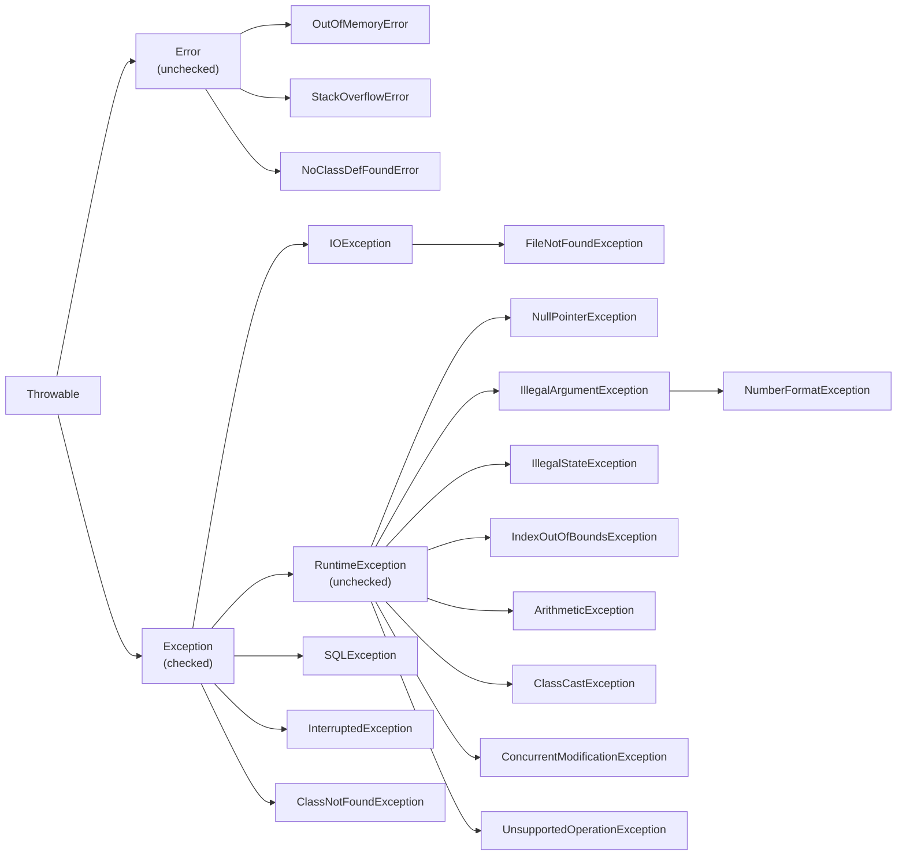
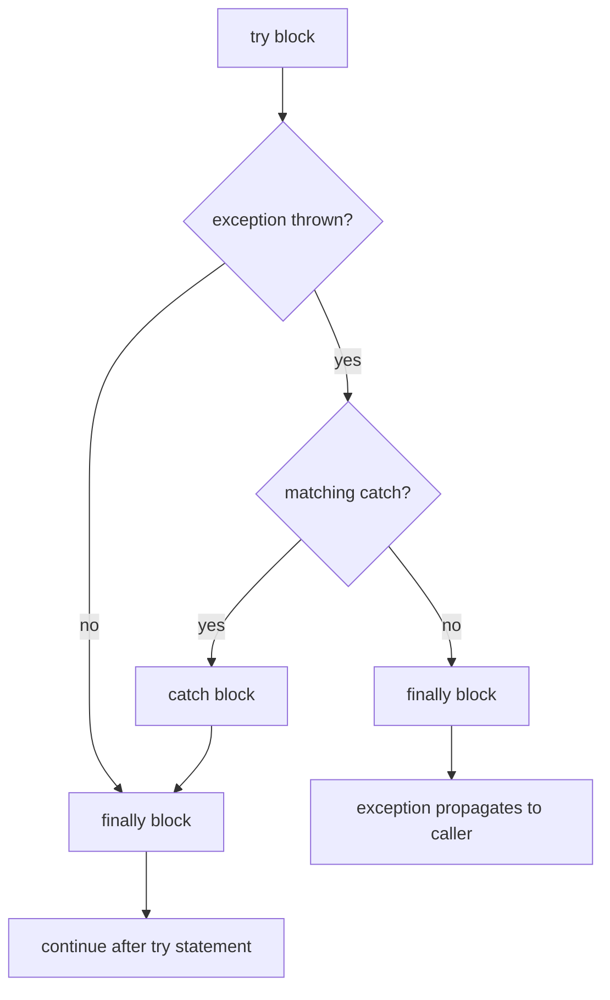
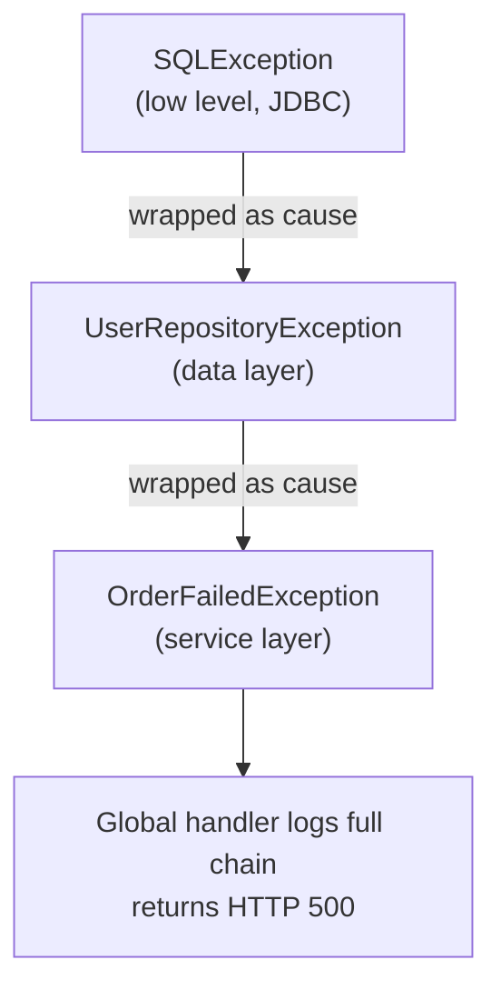
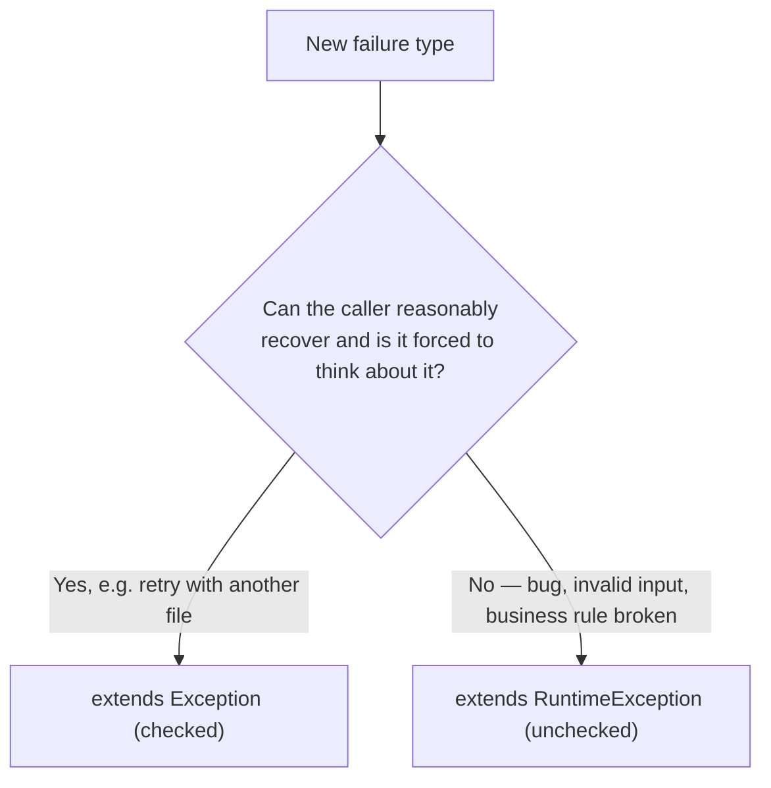
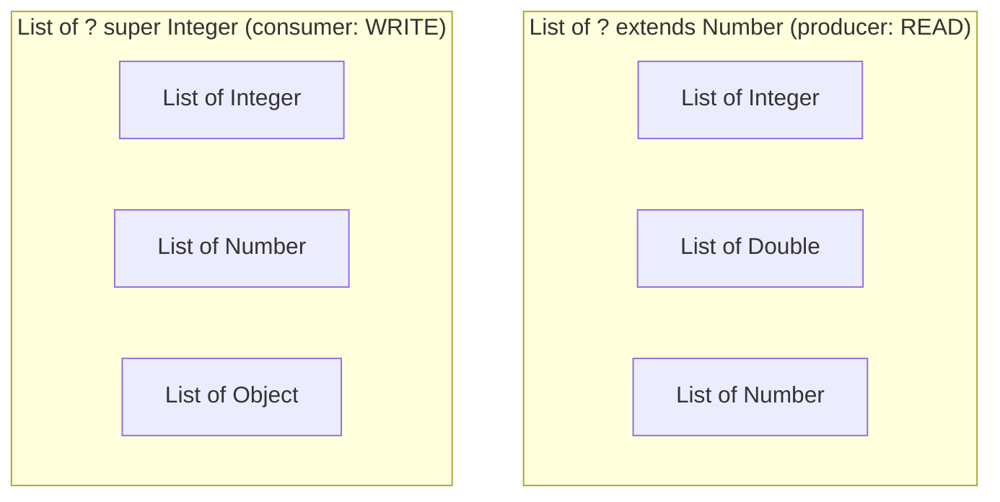
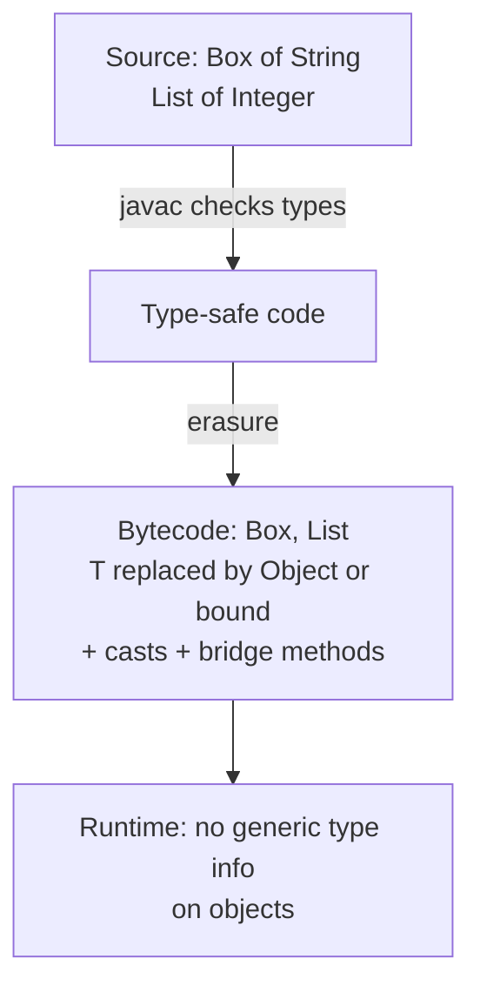
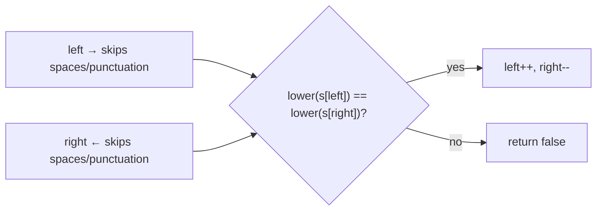
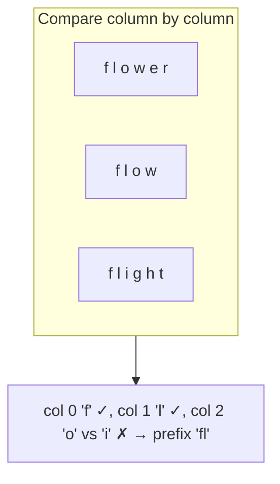

# Day 4 — Exception Handling & Generics

> **How to use these notes:** each section maps to one checklist item. Run the code, study the diagrams, then test yourself with the collapsible questions. 🚀 marks senior-level details.

**Today's goal:** handle errors like a production engineer (hierarchy, `finally` corner cases, try-with-resources, chaining, custom exceptions) and master generics — type parameters, bounds, wildcards with **PECS**, and **type erasure** with all its consequences. Generics come before lambdas (Day 5) and collections (Day 11) because both are built on them. On the DSA side: classic **string** problems with two pointers and frequency counting.

<!-- topic: d7_t1 -->
## ☕ Java — Exceptions & Generics

<!-- subtopic: d7_t1_s1 -->
### 1. The Exception Hierarchy — checked vs unchecked

> **TL;DR:** Everything throwable extends `Throwable`. **`Error`** = serious JVM problems you shouldn't catch. **`Exception`** = conditions an application might handle. **Checked** exceptions (subclasses of `Exception` but not `RuntimeException`) **must** be caught or declared; **unchecked** ones (`RuntimeException`, `Error`) need not be.



#### 1.1 Checked vs unchecked

| | Checked | Unchecked |
|---|---|---|
| Classes | `Exception` and subclasses, **except** `RuntimeException` | `RuntimeException` and subclasses, `Error` and subclasses |
| Compiler enforces handling | ✅ catch or declare with `throws` | ❌ |
| Represents | Recoverable conditions outside the program's control (file missing, network down) | Programming bugs (null, bad index, bad argument) or fatal JVM errors |
| Examples | `IOException`, `SQLException`, `InterruptedException` | `NullPointerException`, `IllegalArgumentException`, `ArithmeticException` |

```java
void readConfig() throws IOException {               // declare ("duck")
    Files.readString(Path.of("app.yml"));
}

void load() {
    try {
        readConfig();
    } catch (IOException e) {                         // or handle
        log.error("config missing, using defaults", e);
    }
}
```

#### 1.2 Error vs Exception
- **Errors** (`OutOfMemoryError`, `StackOverflowError`) mean the JVM is in trouble. Catching them is almost never right — the application usually can't recover reliably.
- **Catching `Throwable` or `Exception` broadly** hides bugs; catch the specific types you can handle.

#### 1.3 Confusing pairs interviewers love

| Pair | Difference |
|---|---|
| `ClassNotFoundException` vs `NoClassDefFoundError` | The first is **checked**, thrown when code *asks* to load a class by name (`Class.forName`) and it's missing. The second is an **Error**: the class was present at compile time but is missing/failed to initialize at runtime. |
| `throw` vs `throws` | `throw` actually throws an exception object; `throws` in a method signature declares what it may throw. |
| `IllegalArgumentException` vs `IllegalStateException` | Bad **input** vs object in the wrong **state** for this call (e.g., `iterator.remove()` twice). |

#### 🚀 1.4 The checked-exception debate
Effective Java recommends checked exceptions for recoverable conditions. Modern frameworks lean **unchecked**: Spring translates `SQLException` into unchecked `DataAccessException`, and checked exceptions don't play well with lambdas/streams. Most teams use unchecked domain exceptions plus a global handler (`@ControllerAdvice`).

Java 14 added **helpful NullPointerException messages** (on by default since Java 15): `Cannot invoke "String.length()" because "user.name" is null`.

#### 🎯 Interview questions

<details><summary>Q1. Difference between checked and unchecked exceptions?</summary>

Checked exceptions (Exception but not RuntimeException) must be caught or declared, and represent recoverable external problems. Unchecked exceptions (RuntimeException, Error) aren't enforced by the compiler and usually indicate bugs or fatal conditions.

</details>

<details><summary>Q2. Should you catch Error?</summary>

Generally no. Errors like OutOfMemoryError signal the JVM is in an unreliable state. At most, log at the top level and let the process fail/restart.

</details>

<details><summary>Q3. ClassNotFoundException vs NoClassDefFoundError?</summary>

ClassNotFoundException is a checked exception from explicit dynamic loading (Class.forName) when the class isn't found. NoClassDefFoundError is an Error when a class that existed at compile time can't be found or failed static initialization at runtime.

</details>

<!-- subtopic: d7_t1_s2 -->
### 2. try-catch-finally flow and try-with-resources

> **TL;DR:** `finally` runs whether or not an exception occurs (with very few exceptions). Prefer **try-with-resources** for anything that must be closed — it closes resources automatically, in reverse order, and keeps secondary exceptions as **suppressed**.

#### 2.1 Execution flow



Rules:
- Catch blocks are checked **top to bottom**; put **specific before general** (a subclass catch after its superclass is an "unreachable" compile error).
- `try` must have at least one `catch` or a `finally` (or be try-with-resources).

#### 2.2 When does finally NOT run?
- `System.exit()` / `Runtime.halt()` is called in try/catch.
- The JVM crashes or is killed (`kill -9`), or the machine loses power.
- The thread runs forever (infinite loop) or is a daemon thread killed at JVM shutdown.

#### 2.3 Tricky return cases ⭐

```java
static int test1() {
    try {
        return 1;
    } finally {
        System.out.println("finally runs before the method actually returns");
    }
}   // prints the message, returns 1

static int test2() {
    int x = 10;
    try {
        return x;          // the VALUE 10 is saved here
    } finally {
        x = 20;            // changing the variable doesn't change the saved return value
    }
}   // returns 10

static int test3() {
    try {
        throw new RuntimeException("boom");
    } finally {
        return 42;         // ⚠️ return in finally SWALLOWS the exception!
    }
}   // returns 42, exception lost — never do this
```

(For a mutable object, e.g. `return list;` and `list.add(...)` in finally, the caller **does** see the change — the saved value is the reference.)

#### 2.4 try-with-resources (Java 7+)

```java
// ❌ Old way: verbose and easy to get wrong
BufferedReader br = null;
try {
    br = new BufferedReader(new FileReader("data.txt"));
    return br.readLine();
} finally {
    if (br != null) br.close();       // close() can itself throw and hide the original exception
}

// ✅ try-with-resources
try (BufferedReader br = new BufferedReader(new FileReader("data.txt"));
     BufferedWriter bw = new BufferedWriter(new FileWriter("out.txt"))) {
    bw.write(br.readLine());
}   // bw closed first, then br (reverse order of declaration)

// Java 9+: an effectively final resource declared earlier can be used directly
BufferedReader reader = Files.newBufferedReader(path);
try (reader) { ... }
```

- Works with anything implementing **`AutoCloseable`** (`close() throws Exception`). `Closeable` (I/O, `close() throws IOException`) extends it.
- **Suppressed exceptions:** if the body throws and `close()` also throws, the body's exception is propagated and the close exception is attached: `e.getSuppressed()`. The old try/finally pattern would *lose* the original.

```java
class Resource implements AutoCloseable {
    @Override public void close() { System.out.println("closed"); }
}
try (Resource r = new Resource()) {
    System.out.println("using");
}   // "using", "closed"
```

#### 🎯 Interview questions

<details><summary>Q1. Does finally run if the try block has a return statement?</summary>

Yes. The return value is computed first, then finally runs, then the method returns (unless finally itself returns or throws, which overrides it).

</details>

<details><summary>Q2. What happens if finally has a return statement?</summary>

It overrides any earlier return and silently discards any exception being propagated. It's a serious anti-pattern.

</details>

<details><summary>Q3. What are suppressed exceptions?</summary>

In try-with-resources, if both the body and close() throw, the body's exception is thrown and the close exception is added to it as suppressed (`getSuppressed()`), so nothing is lost.

</details>

<details><summary>Q4. In what order are resources closed?</summary>

Reverse order of declaration — the last opened is closed first.

</details>

<!-- subtopic: d7_t1_s3 -->
### 3. Multi-catch and Exception Chaining

> **TL;DR:** Multi-catch (`catch (A | B e)`) handles several unrelated exceptions with one block. **Chaining** wraps a low-level exception as the **cause** of a higher-level one so you never lose the original stack trace.

#### 3.1 Multi-catch (Java 7+)

```java
try {
    Object o = Class.forName(name).getDeclaredConstructor().newInstance();
} catch (ClassNotFoundException | NoSuchMethodException e) {
    throw new ConfigException("bad plugin class: " + name, e);
} catch (ReflectiveOperationException e) {
    throw new ConfigException("cannot instantiate " + name, e);
}
```

Rules:
- The alternatives **can't be subclasses of each other** (`catch (IOException | FileNotFoundException e)` is a compile error — redundant).
- The catch parameter is implicitly **final** (can't reassign `e`).

#### 3.2 Exception chaining

```java
public User findUser(long id) {
    try {
        return jdbc.query("SELECT ...", id);
    } catch (SQLException e) {
        throw new UserRepositoryException("failed to load user " + id, e);   // e becomes the CAUSE
    }
}
```

The stack trace then shows both:
```
UserRepositoryException: failed to load user 42
    at UserRepository.findUser(...)
Caused by: java.sql.SQLException: connection refused
    at ...
```



APIs: `new X(message, cause)`, `getCause()`, `initCause(cause)` (for exceptions without a cause constructor).

#### 3.3 Precise rethrow (Java 7)

```java
void process() throws IOException, SQLException {
    try {
        doIo(); doSql();
    } catch (Exception e) {
        log.warn("failed", e);
        throw e;           // compiler knows e can only be IOException or SQLException
    }
}
```

#### ⚠️ Anti-patterns
- **Swallowing:** `catch (Exception e) { }` — silent failure.
- **Losing the cause:** `throw new MyException(e.getMessage());` — stack trace gone. Always pass `e`.
- **Log and throw:** logging and rethrowing at every layer floods logs with duplicates. Log once, at the boundary.

#### 🎯 Interview questions

<details><summary>Q1. Why can't multi-catch alternatives be related by inheritance?</summary>

Catching the superclass already covers the subclass, so listing both is redundant; the compiler rejects it.

</details>

<details><summary>Q2. What is exception chaining and why use it?</summary>

Wrapping a lower-level exception as the cause of a higher-level, more meaningful one. You get a layer-appropriate exception type while keeping the original stack trace for debugging.

</details>

<!-- subtopic: d7_t1_s4 -->
### 4. Custom Exceptions — design and best practices

> **TL;DR:** Create custom exceptions to express **domain-specific failures** (e.g., `InsufficientFundsException`). Extend `RuntimeException` for most application errors, `Exception` only when callers can and must recover. Always provide constructors with a **cause**.

#### 4.1 A well-designed custom exception

```java
public class InsufficientFundsException extends RuntimeException {
    private final String accountId;
    private final BigDecimal shortfall;

    public InsufficientFundsException(String accountId, BigDecimal shortfall) {
        super("Account " + accountId + " is short by " + shortfall);   // useful message
        this.accountId = accountId;
        this.shortfall = shortfall;
    }

    public InsufficientFundsException(String accountId, BigDecimal shortfall, Throwable cause) {
        super("Account " + accountId + " is short by " + shortfall, cause);
        this.accountId = accountId;
        this.shortfall = shortfall;
    }

    public String getAccountId() { return accountId; }
    public BigDecimal getShortfall() { return shortfall; }
}
```

Checklist:
- Name ends with `Exception`.
- Message includes **context** (ids, values) — not just "Error occurred".
- Constructors: `(message)`, `(message, cause)`; extra fields for data handlers need.
- Exceptions are `Serializable` — add `serialVersionUID` if you care about warnings.

#### 4.2 Checked or unchecked?



#### 4.3 Using them in Spring (preview)

```java
@RestControllerAdvice
public class ApiExceptionHandler {
    @ExceptionHandler(InsufficientFundsException.class)
    @ResponseStatus(HttpStatus.UNPROCESSABLE_ENTITY)
    public ErrorResponse handle(InsufficientFundsException e) {
        return new ErrorResponse("INSUFFICIENT_FUNDS", e.getMessage());
    }
}
```

#### 4.4 Best practices
1. **Fail fast:** validate inputs at the start (`Objects.requireNonNull`, `IllegalArgumentException`).
2. **Throw early, catch late:** throw where the problem is detected; catch where you can actually handle it.
3. **Don't use exceptions for control flow** — they're slow (stack-trace capture) and obscure logic.
4. **Prefer standard exceptions** when they fit (`IllegalArgumentException`, `IllegalStateException`, `UnsupportedOperationException`).
5. **Clean up** with try-with-resources.
6. **Document** with `@throws` in Javadoc.

🚀 Performance: most of an exception's cost is `fillInStackTrace()`. High-frequency "expected" exceptions can use the protected constructor `Exception(message, cause, enableSuppression, writableStackTrace)` with `writableStackTrace = false`.

#### 🎯 Interview questions

<details><summary>Q1. When would you create a custom checked exception vs unchecked?</summary>

Checked when the caller can reasonably recover and should be forced to handle it (rare in modern apps). Unchecked for programming errors, invalid input and business-rule violations — handled centrally.

</details>

<details><summary>Q2. Why shouldn't exceptions be used for normal control flow?</summary>

They're expensive (stack trace capture), hide the real logic, and prevent JIT optimizations. Use return values or Optional for expected outcomes.

</details>

<!-- subtopic: d7_t1_s5 -->
### 5. Generics — type parameters and bounded types

> **TL;DR:** Generics let classes and methods work with **any type while staying type-safe**. The compiler checks types and inserts casts for you. Use bounds (`<T extends Number>`) to restrict which types are allowed and to call their methods.

#### 5.1 Why generics

```java
// Before Java 5 (raw types)
List list = new ArrayList();
list.add("hello");
list.add(42);                           // nothing stops this
String s = (String) list.get(1);        // 💥 ClassCastException at RUNTIME

// With generics
List<String> names = new ArrayList<>();
names.add("hello");
// names.add(42);                       ❌ compile error — caught early
String first = names.get(0);            // no cast needed
```

Benefits: **compile-time type safety**, **no casts**, reusable algorithms (`Collections.sort` works for any `Comparable` type).

#### 5.2 Generic classes, interfaces and methods

```java
// Generic class
public class Box<T> {
    private T value;
    public Box(T value) { this.value = value; }
    public T get() { return value; }
}
Box<Integer> b = new Box<>(5);          // diamond operator <> (Java 7) infers Integer

// Multiple type parameters
public record Pair<K, V>(K key, V value) { }

// Generic interface
public interface Repository<T, ID> {
    Optional<T> findById(ID id);
    T save(T entity);
}

// Generic METHOD — type parameter declared before the return type
public static <T> List<T> listOf(T a, T b) { return List.of(a, b); }
List<String> l = listOf("x", "y");      // T inferred as String
Collections.<String>emptyList();        // explicit type argument (rarely needed)
```

Naming conventions: `T` type, `E` element, `K` key, `V` value, `N` number, `R` return type, `S, U` second/third types.

#### 5.3 Bounded type parameters

```java
// Upper bound: T must be Number or a subclass → we can call Number methods
public static <T extends Number> double sum(List<T> nums) {
    double total = 0;
    for (T n : nums) total += n.doubleValue();
    return total;
}

// Recursive bound: T must be comparable to itself → we can call compareTo
public static <T extends Comparable<T>> T max(List<T> items) {
    T best = items.get(0);
    for (T item : items) if (item.compareTo(best) > 0) best = item;
    return best;
}

// Multiple bounds: a class (at most one, must come first) & interfaces
public static <T extends Number & Comparable<T>> T clampedMax(T a, T b) { ... }
```

`extends` in a type bound means "extends **or implements**".

#### 5.4 Generics are invariant (unlike arrays)

```java
List<Integer> ints = new ArrayList<>();
// List<Number> nums = ints;          ❌ compile error: List<Integer> is NOT a List<Number>

// If it were allowed:
// nums.add(3.14);                    → a Double inside a List<Integer> — type safety broken

Number[] arr = new Integer[3];        // arrays ARE covariant — compiles...
arr[0] = 3.14;                        // 💥 ArrayStoreException at runtime
```

Wildcards (next section) are how you get flexible subtyping safely.

#### ⚠️ Pitfalls
- **Raw types** (`List list`) disable type checking — only exist for backward compatibility; avoid.
- **Primitives can't be type arguments:** `List<int>` ❌ → `List<Integer>` (boxing) or primitive specializations like `IntStream`.

#### 🎯 Interview questions

<details><summary>Q1. What problem do generics solve?</summary>

They provide compile-time type safety for reusable code, removing manual casts and moving ClassCastExceptions from runtime to compile time.

</details>

<details><summary>Q2. What is a bounded type parameter? Give an example.</summary>

A type parameter restricted to a type and its subtypes, e.g. `<T extends Comparable<T>>`, which lets the code call `compareTo` on T.

</details>

<details><summary>Q3. Is List&lt;Integer&gt; a subtype of List&lt;Number&gt;?</summary>

No. Generics are invariant; otherwise you could add a Double to a list of Integers. Use `List<? extends Number>` to accept both.

</details>

<!-- subtopic: d7_t1_s6 -->
### 6. Wildcards and PECS

> **TL;DR:** `?` means "some unknown type". **`? extends T`** — read T's out of it (**producer**). **`? super T`** — put T's into it (**consumer**). **PECS: Producer Extends, Consumer Super.**

#### 6.1 The three wildcards

```java
// Unbounded: any list, we only use Object methods / size
static void printAll(List<?> list) {
    for (Object o : list) System.out.println(o);
}

// Upper-bounded: a PRODUCER of Numbers — we READ from it
static double sum(List<? extends Number> nums) {
    double s = 0;
    for (Number n : nums) s += n.doubleValue();    // ✅ reading as Number is safe
    // nums.add(1);                                 ❌ can't add — it might be a List<Double>
    return s;
}
sum(List.of(1, 2, 3));          // List<Integer> ✅
sum(List.of(1.5, 2.5));         // List<Double>  ✅

// Lower-bounded: a CONSUMER of Integers — we WRITE into it
static void fill(List<? super Integer> sink) {
    sink.add(1);                                    // ✅ an Integer fits in List<Integer/Number/Object>
    sink.add(2);
    Object o = sink.get(0);                         // reading only gives Object
}
fill(new ArrayList<Integer>());  // ✅
fill(new ArrayList<Number>());   // ✅
fill(new ArrayList<Object>());   // ✅
```



#### 6.2 PECS in the JDK

```java
// java.util.Collections
public static <T> void copy(List<? super T> dest, List<? extends T> src)
//                          consumer ↑                producer ↑

// Comparator parameters are consumers of T:
public static <T> void sort(List<T> list, Comparator<? super T> c)
// → you can sort a List<Employee> with a Comparator<Person> (if Employee extends Person)
```

| You want to… | Use |
|---|---|
| Only **read** T values out of the structure | `? extends T` |
| Only **write** T values into it | `? super T` |
| Both read and write T | Exact type `T` (no wildcard) |
| Neither (size, clear, print) | `?` |

#### 6.3 Wildcard or type parameter?

```java
static void swapFirstTwo(List<?> list) {           // ❌ can't set elements of unknown type
    // list.set(0, list.get(1));                     compile error
    swapHelper(list);                               // ✅ "wildcard capture" via a generic helper
}
private static <T> void swapHelper(List<T> list) {
    T tmp = list.get(0);
    list.set(0, list.get(1));
    list.set(1, tmp);
}
```

Use a **type parameter** when you need to name the type (relate several parameters/return type or write into it); use a **wildcard** for flexible "accept anything compatible" parameters.

#### 🎯 Interview questions

<details><summary>Q1. Explain PECS.</summary>

Producer Extends, Consumer Super: if a parameter supplies T values to you, declare it `? extends T`; if it accepts T values from you, declare it `? super T`. Example: `Collections.copy(List<? super T> dest, List<? extends T> src)`.

</details>

<details><summary>Q2. Why can't you add to a List&lt;? extends Number&gt;?</summary>

The actual list might be a `List<Double>` or `List<Integer>`; the compiler can't know which type is safe to add (except null).

</details>

<details><summary>Q3. Difference between List&lt;?&gt; and List&lt;Object&gt;?</summary>

`List<?>` is a list of some unknown type — you can pass any List but can't add to it. `List<Object>` is specifically a list of Objects — you can add anything, but you can't pass a `List<String>` to it.

</details>

<!-- subtopic: d7_t1_s7 -->
### 7. Type Erasure — generics exist only at compile time

> **TL;DR:** The compiler checks generic types and then **erases** them: type parameters become their bound (or `Object`), casts are inserted, and **bridge methods** are generated. At runtime a `List<String>` and a `List<Integer>` are both just `List`.

#### 7.1 What the compiler does

```java
// You write:
public class Box<T> {
    private T value;
    public T get() { return value; }
}
Box<String> b = new Box<>("hi");
String s = b.get();

// After erasure (roughly):
public class Box {
    private Object value;               // T → Object (or its bound, e.g. Number)
    public Object get() { return value; }
}
Box b = new Box("hi");
String s = (String) b.get();            // cast inserted by the compiler
```



Why erasure? **Backward compatibility** — Java 5 generic code had to run with pre-generics libraries and the same JVM.

#### 7.2 Consequences (each is a common interview question)

```java
public <T> void demo(List<T> list, Object o) {
    // T t = new T();                       ❌ can't instantiate a type parameter
    // T[] arr = new T[10];                 ❌ can't create a generic array
    // if (o instanceof List<String>) {}    ❌ can't check a parameterized type (use List<?>)
    // static T cached;                     ❌ static fields can't use the class's T
}

class Overloads {
    // void process(List<String> l) {}
    // void process(List<Integer> l) {}     ❌ both erase to process(List) — "same erasure"
}

List<String> a = new ArrayList<>();
List<Integer> b = new ArrayList<>();
a.getClass() == b.getClass();               // true — both are ArrayList at runtime
```

Other limits: no primitive type arguments; can't `catch (T e)`; a generic class can't extend `Throwable`.

#### 7.3 Workarounds

```java
// Pass a Class<T> "type token"
public static <T> T create(Class<T> type) throws ReflectiveOperationException {
    return type.getDeclaredConstructor().newInstance();
}

// Or a factory
public static <T> List<T> fill(int n, Supplier<T> factory) {
    List<T> list = new ArrayList<>();
    for (int i = 0; i < n; i++) list.add(factory.get());
    return list;
}
fill(3, StringBuilder::new);

// Super type tokens keep full generic info (Jackson, Spring)
List<User> users = mapper.readValue(json, new TypeReference<List<User>>() {});
```

The anonymous subclass `new TypeReference<List<User>>() {}` records its generic superclass in class metadata, which **is** kept and readable via reflection.

#### 🚀 7.4 Bridge methods and heap pollution
- **Bridge methods:** `class Name implements Comparable<Name> { int compareTo(Name o) }` erases to `compareTo(Object)` in the interface, so the compiler generates a synthetic `compareTo(Object o) { return compareTo((Name) o); }` to keep polymorphism working.
- **Heap pollution:** a variable of a parameterized type refers to an object of the wrong type (via raw types or generic varargs). Generic varargs (`T... args`) create a generic array, hence the warnings; `@SafeVarargs` asserts the method is safe (used on `List.of`, `Arrays.asList`).
- What **is** kept at runtime: generic signatures of classes, fields and methods (readable via reflection) — just not on individual objects.

#### 🎯 Interview questions

<details><summary>Q1. What is type erasure?</summary>

The compiler removes generic type information after type checking, replacing type parameters with their bounds (or Object) and inserting casts. Runtime objects don't know their type arguments.

</details>

<details><summary>Q2. Why can't you write new T()?</summary>

After erasure T is just Object (or its bound) — the JVM doesn't know which class to instantiate. Pass a `Class<T>` or `Supplier<T>` instead.

</details>

<details><summary>Q3. Why can't two methods differ only by generic parameter types?</summary>

They'd have the same erased signature (e.g. both `process(List)`), which is a clash in bytecode.

</details>

<details><summary>Q4. How do libraries like Jackson know a List&lt;User&gt; type at runtime?</summary>

With super type tokens: an anonymous subclass of a generic class keeps its generic superclass type in class metadata, readable via `getGenericSuperclass()`.

</details>

<!-- subtopic: d7_t1_s9 -->
### 8. final vs finally vs finalize — and why finalize is deprecated

> **TL;DR:** Three unrelated things with similar names. `final` = can't change/override/extend. `finally` = cleanup block that always runs. `finalize()` = an old GC callback, **deprecated** (Java 9) and **deprecated for removal** (Java 18, JEP 421). Use try-with-resources or `Cleaner`.

| | `final` | `finally` | `finalize()` |
|---|---|---|---|
| What | Keyword (modifier) | Keyword (block) | Method of `Object` |
| Applies to | Variables, methods, classes | `try` statements | Objects, called by the GC |
| Purpose | Immutability / prevent override / prevent inheritance | Guaranteed cleanup | Last-chance cleanup before GC |
| Status | ✅ | ✅ (prefer try-with-resources for resources) | ❌ Deprecated |

#### Why finalize() is bad
1. **No guarantee when — or if — it runs** (GC timing is unpredictable; may never run before exit).
2. **Performance:** objects with finalizers take extra GC cycles to reclaim.
3. **Resurrection:** `finalize()` can store `this` somewhere, bringing the object back to life.
4. **Security:** finalizer attacks on partially constructed objects.
5. Exceptions thrown in `finalize()` are ignored.

#### Modern replacements

```java
// 1. Deterministic cleanup — the right answer 99% of the time
try (var conn = dataSource.getConnection()) { ... }

// 2. Safety net for native resources — java.lang.ref.Cleaner (Java 9)
public class NativeBuffer implements AutoCloseable {
    private static final Cleaner CLEANER = Cleaner.create();
    private final Cleaner.Cleanable cleanable;

    public NativeBuffer(long address) {
        // The cleanup action must NOT reference 'this', or the object can never become unreachable
        this.cleanable = CLEANER.register(this, new FreeMemory(address));
    }
    private record FreeMemory(long address) implements Runnable {
        public void run() { /* free native memory at address */ }
    }
    @Override public void close() { cleanable.clean(); }   // explicit close; Cleaner is the fallback
}
```

#### 🎯 Interview questions

<details><summary>Q1. Differentiate final, finally and finalize.</summary>

final is a modifier preventing reassignment/overriding/inheritance; finally is a block that always runs after try/catch for cleanup; finalize is a deprecated Object method the GC might call before reclaiming an object.

</details>

<details><summary>Q2. Why was finalize deprecated and what replaces it?</summary>

It's unpredictable, slow, allows object resurrection and has security problems. Use try-with-resources (AutoCloseable) for deterministic cleanup and Cleaner as a safety net.

</details>

<!-- topic: d4_t2 -->
## 🧮 DSA — Strings: Easy Problems

> **Java string toolkit for DSA**
> - `s.charAt(i)`, `s.length()`, `s.toCharArray()` (O(n) copy), `new String(chars)`, `String.valueOf(chars)`
> - `Character.isLetterOrDigit(c)`, `Character.isLetter(c)`, `Character.isDigit(c)`, `Character.toLowerCase(c)`
> - Index trick: `c - 'a'` maps `'a'..'z'` → `0..25` (works because `char` is a 16-bit number)
> - Build strings with `StringBuilder` (never `+=` in a loop — O(n²), see Day 1)
> - Strings are immutable: "in-place" problems give you a `char[]`

<!-- subtopic: d4_t2_s1 -->
### 9. Valid Palindrome (LeetCode 125)

> **Problem:** after converting uppercase to lowercase and removing all non-alphanumeric characters, does the string read the same forwards and backwards? 🔗 [LeetCode 125](https://leetcode.com/problems/valid-palindrome/)

#### Approach 1 — Clean, then compare
Build a cleaned lowercase string with a `StringBuilder` and compare it with its reverse → O(n) time, **O(n) extra space**.

```java
public boolean isPalindrome(String s) {
    StringBuilder sb = new StringBuilder();
    for (char c : s.toCharArray()) if (Character.isLetterOrDigit(c)) sb.append(Character.toLowerCase(c));
    String cleaned = sb.toString();
    return cleaned.equals(sb.reverse().toString());
}
```

#### Approach 2 — Two pointers, skip junk ✅

```java
public boolean isPalindrome(String s) {
    int left = 0, right = s.length() - 1;
    while (left < right) {
        while (left < right && !Character.isLetterOrDigit(s.charAt(left))) left++;    // skip non-alnum
        while (left < right && !Character.isLetterOrDigit(s.charAt(right))) right--;
        if (Character.toLowerCase(s.charAt(left)) != Character.toLowerCase(s.charAt(right))) {
            return false;
        }
        left++;
        right--;
    }
    return true;
}   // Time O(n), Space O(1)
```

**Dry run** `"A man, a plan, a canal: Panama"` → compares `a/a`, `m/m`, `a/a`, `n/n`, … all match → `true`. `"race a car"` → `r/r`, `a/a`, `c/c`, `e/a` ❌ → `false`.



Edge cases: empty string or only punctuation → `true`; the inner `left < right` checks prevent running past each other. Follow-up: [Valid Palindrome II (LC 680)](https://leetcode.com/problems/valid-palindrome-ii/) — allow deleting one character (Day 6).

<!-- subtopic: d4_t2_s2 -->
### 10. Valid Anagram (LeetCode 242)

> **Problem:** return `true` if `t` is an anagram of `s` (same characters with the same counts). 🔗 [LeetCode 242](https://leetcode.com/problems/valid-anagram/)

| Approach | Time | Space |
|---|---|---|
| Sort both, compare | O(n log n) | O(n) (char arrays) |
| `int[26]` counts ✅ | O(n) | O(1) — 26 is constant |
| `HashMap<Character, Integer>` | O(n) | O(k) distinct chars — needed for Unicode |

```java
public boolean isAnagram(String s, String t) {
    if (s.length() != t.length()) return false;      // quick reject
    int[] count = new int[26];
    for (int i = 0; i < s.length(); i++) {
        count[s.charAt(i) - 'a']++;                   // +1 for s
        count[t.charAt(i) - 'a']--;                   // -1 for t
    }
    for (int c : count) if (c != 0) return false;
    return true;
}

// Sorting version
public boolean isAnagramSort(String s, String t) {
    char[] a = s.toCharArray(), b = t.toCharArray();
    Arrays.sort(a);
    Arrays.sort(b);
    return Arrays.equals(a, b);
}

// Unicode follow-up
public boolean isAnagramUnicode(String s, String t) {
    if (s.length() != t.length()) return false;
    Map<Character, Integer> freq = new HashMap<>();
    for (char c : s.toCharArray()) freq.merge(c, 1, Integer::sum);
    for (char c : t.toCharArray()) {
        Integer n = freq.get(c);
        if (n == null || n == 0) return false;
        freq.put(c, n - 1);
    }
    return true;
}
```

> **Pattern: frequency counting.** `int[26]` for lowercase letters, `int[128]` for ASCII, `HashMap` for anything else. Used in Group Anagrams (Day 5), Ransom Note (Day 5), Permutation in String (Day 10).

<!-- subtopic: d4_t2_s3 -->
### 11. Reverse String (LeetCode 344)

> **Problem:** reverse a `char[]` **in place** with O(1) extra memory. 🔗 [LeetCode 344](https://leetcode.com/problems/reverse-string/)

Same two-pointer swap as reversing an array (Day 2):

```java
public void reverseString(char[] s) {
    for (int left = 0, right = s.length - 1; left < right; left++, right--) {
        char tmp = s[left];
        s[left] = s[right];
        s[right] = tmp;
    }
}   // Time O(n), Space O(1)
```

Related questions:
- **Reverse a `String`** (immutable): `new StringBuilder(str).reverse().toString()`, or convert to `char[]`, reverse, and build a new String. Can't be done truly in place.
- **Reverse Words in a String** ([LC 151](https://leetcode.com/problems/reverse-words-in-a-string/)): split on spaces, reverse the word order — or reverse the whole string, then reverse each word.
- **Recursive version** — swap ends and recurse inward (Day 7).

<!-- subtopic: d4_t2_s4 -->
### 12. Longest Common Prefix (LeetCode 14)

> **Problem:** find the longest prefix shared by all strings in an array (`""` if none). 🔗 [LeetCode 14](https://leetcode.com/problems/longest-common-prefix/)

#### Approach 1 — Vertical scanning ✅

Compare column by column: character `i` of the first string against character `i` of every other string.

```java
public String longestCommonPrefix(String[] strs) {
    if (strs == null || strs.length == 0) return "";
    String first = strs[0];
    for (int i = 0; i < first.length(); i++) {
        char c = first.charAt(i);
        for (int j = 1; j < strs.length; j++) {
            if (i == strs[j].length() || strs[j].charAt(i) != c) {
                return first.substring(0, i);       // mismatch or a string ran out
            }
        }
    }
    return first;                                    // the whole first string is the prefix
}   // Time O(S) where S = total characters (worst case), Space O(1) besides the output
```



#### Approach 2 — Sort, compare first and last
After sorting lexicographically, the first and last strings are the most different; their common prefix is everyone's common prefix. O(n·L·log n) for the sort.

```java
Arrays.sort(strs);
String a = strs[0], b = strs[strs.length - 1];
int i = 0;
while (i < a.length() && i < b.length() && a.charAt(i) == b.charAt(i)) i++;
return a.substring(0, i);
```

Other approaches: horizontal scanning (shrink the prefix with `startsWith`), divide and conquer, binary search on length, **Trie** (Day 30 — great when the same word list is queried many times).

<!-- subtopic: d4_t2_s5 -->
### 13. First Unique Character in a String (LeetCode 387)

> **Problem:** return the index of the first non-repeating character, or `-1`. 🔗 [LeetCode 387](https://leetcode.com/problems/first-unique-character-in-a-string/)

#### Two passes with a count array ✅

```java
public int firstUniqChar(String s) {
    int[] count = new int[26];
    for (int i = 0; i < s.length(); i++) count[s.charAt(i) - 'a']++;      // pass 1: count
    for (int i = 0; i < s.length(); i++) {
        if (count[s.charAt(i) - 'a'] == 1) return i;                       // pass 2: first with count 1
    }
    return -1;
}   // Time O(n), Space O(1) (26 counters)
```

**Dry run** `"loveleetcode"` → counts: l=2, o=2, v=1, e=4, … → scanning: `l`(2) `o`(2) `v`(1) ✅ → index **2**.

Why two passes and not one? A character's uniqueness is only known after seeing the whole string. Alternatives:
- `LinkedHashMap<Character, Integer>` keeps insertion order — iterate entries to find the first count of 1 (O(n), but more overhead).
- **Streaming follow-up** ("characters arrive one at a time; report the first unique so far"): keep counts plus a queue (or a `LinkedHashSet` of currently-unique chars), popping from the front while the front's count > 1.

---

## 📝 Day 4 Revision Cheat Sheet

| Topic | Remember this |
|---|---|
| Hierarchy | Throwable → Error / Exception → RuntimeException; checked = Exception minus RuntimeException |
| Checked | Must catch or declare; recoverable external problems |
| finally | Always runs (except exit/crash); return in finally swallows exceptions; saved return value isn't changed by finally |
| try-with-resources | AutoCloseable; closes in reverse order; suppressed exceptions |
| Multi-catch | `A \| B`, not related by inheritance, parameter is final |
| Chaining | `new X(msg, cause)` — never lose the original stack trace |
| Custom exceptions | Context in message, (msg, cause) constructors, usually unchecked |
| Generics | Compile-time safety, no casts; `<T extends Bound>`; invariant |
| PECS | Producer `? extends`, Consumer `? super` |
| Erasure | No `new T()`, no `T[]`, no `instanceof List<String>`, same-erasure overload clash; use Class/Supplier tokens |
| finalize | Deprecated → try-with-resources + Cleaner |
| String DSA | Two pointers (palindrome, reverse), `int[26]` counts (anagram, unique char), column scan (prefix) |

### ⚡ Rapid-fire self-test

1. Is `NumberFormatException` checked? → **No** (extends IllegalArgumentException)
2. `try { return x; } finally { x = 20; }` with x = 10 returns? → **10**
3. Which resource closes first in try-with-resources? → **The last declared**
4. `catch (IOException | Exception e)` — compiles? → **No**
5. `List<Integer>` assignable to `List<? extends Number>`? → **Yes**
6. `List<Integer>` assignable to `List<Number>`? → **No**
7. Can you `add(5)` to `List<? super Integer>`? → **Yes**
8. `new ArrayList<String>().getClass() == new ArrayList<Integer>().getClass()`? → **true**
9. Space complexity of Valid Anagram with `int[26]`? → **O(1)**
10. First unique character in `"aabb"`? → **-1**
