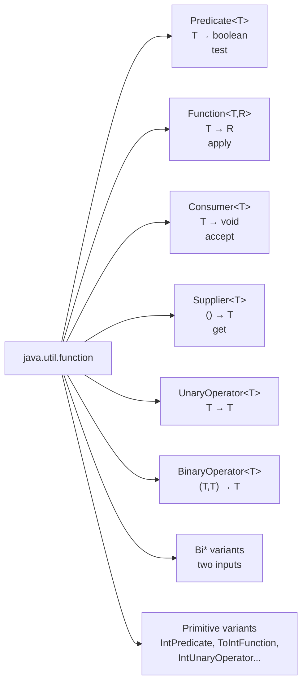
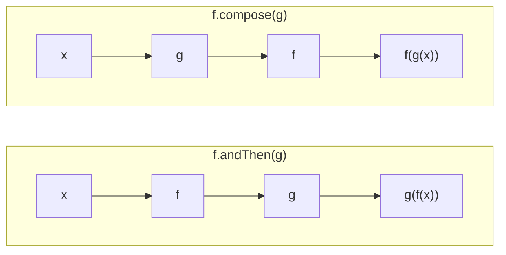
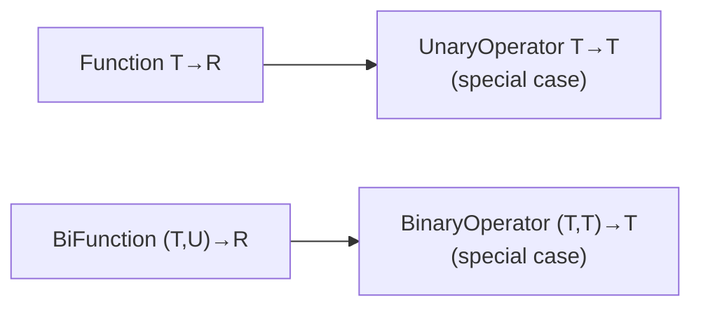
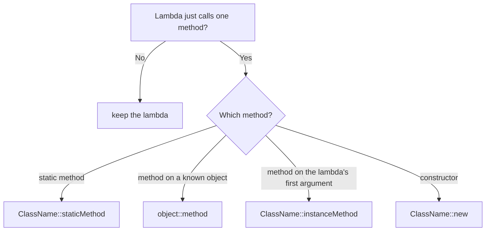
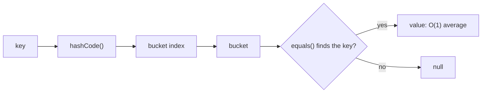
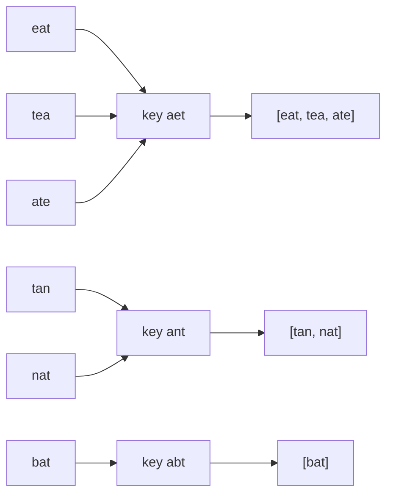
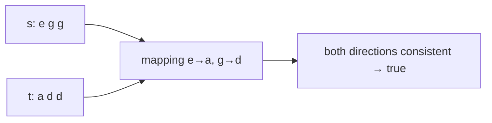

# Day 5 — Java 8: Lambdas, Functional Interfaces & Method References

> **How to use these notes:** each section maps to one checklist item. Run the code, study the diagrams, then test yourself with the collapsible questions. 🚀 marks senior-level details.

**Today's goal:** write lambdas fluently, know exactly what a functional interface is, use the core `java.util.function` interfaces (`Predicate`, `Function`, `Consumer`, `Supplier`, and their two-argument and operator variants) including how to **compose** them, and convert lambdas to all four kinds of **method references**. This is the foundation for Streams (Day 6). On the DSA side: the **HashMap patterns** for strings — frequency maps, grouping by a key, and bijection (one-to-one) mapping.

<!-- topic: d4_t1 -->
## ☕ Java 8 — Lambdas & Functional Interfaces

<!-- subtopic: d4_t1_s1 -->
### 1. Lambda Syntax and Effectively-Final Captures

> **TL;DR:** A lambda is an **anonymous function**: `(parameters) -> expression` or `(parameters) -> { statements; }`. It can be used wherever a **functional interface** is expected. It may read local variables only if they are **effectively final**.

#### 1.1 From anonymous class to lambda

```java
// Java 7: anonymous class
Comparator<String> byLength = new Comparator<String>() {
    @Override
    public int compare(String a, String b) {
        return Integer.compare(a.length(), b.length());
    }
};

// Java 8: lambda — same behaviour
Comparator<String> byLength2 = (a, b) -> Integer.compare(a.length(), b.length());

// Even better: a comparator factory + method reference (section 7)
Comparator<String> byLength3 = Comparator.comparingInt(String::length);
```

#### 1.2 All syntax forms

```java
Runnable r          = () -> System.out.println("no params");
Consumer<String> c  = s -> System.out.println(s);                 // one param: parentheses optional
Consumer<String> c2 = (String s) -> System.out.println(s);        // explicit type
BinaryOperator<Integer> add = (a, b) -> a + b;                    // expression body: value returned
BinaryOperator<Integer> addVerbose = (a, b) -> {                  // block body: needs return
    int sum = a + b;
    return sum;
};
BiFunction<Integer, Integer, Integer> v = (var a, var b) -> a + b; // Java 11: var (allows annotations)
```

Rules: either all parameter types are declared or none; a block body needs `return` for non-void results.

#### 1.3 Target typing

A lambda has **no type of its own** — its type comes from the context (the **target type**), which must be a functional interface:

```java
Runnable r = () -> {};                         // target type Runnable
Callable<String> call = () -> "done";          // target type Callable
// Object o = () -> {};                        ❌ Object is not a functional interface
Object o = (Runnable) () -> {};                // ✅ cast provides the target
```

The same lambda text can mean different things: `() -> "x"` can be a `Supplier<String>` or a `Callable<String>`.

#### 1.4 Capturing variables — effectively final

```java
String prefix = "Hello, ";                     // never reassigned → effectively final
Function<String, String> greet = name -> prefix + name;   // ✅ captured

int count = 0;
// list.forEach(x -> count++);                 ❌ count is modified → not effectively final

// Workarounds (use carefully — not thread-safe for parallel streams except Atomic*):
int[] counter = {0};
list.forEach(x -> counter[0]++);               // mutate an array element (reference stays final)
AtomicInteger atomic = new AtomicInteger();
list.forEach(x -> atomic.incrementAndGet());
long total = list.stream().count();            // ✅ best: use the stream API instead of side effects
```

Why? A lambda captures the **value** of the local variable (locals live on the stack and may be gone when the lambda runs later, possibly on another thread). Allowing changes would make the copy and the original disagree. **Fields** (`this.count`) and static fields can be modified — they live on the heap.

#### 1.5 Lambda vs anonymous class

| | Lambda | Anonymous class |
|---|---|---|
| Implements | Functional interfaces only | Any interface or abstract class |
| `this` | The **enclosing** instance | The anonymous object itself |
| State | No fields | Can have fields |
| Shadowing | Can't redeclare a local variable name from the enclosing scope | Can shadow |
| Compilation | `invokedynamic` + `LambdaMetafactory` — no extra `.class` file | `Outer$1.class` per anonymous class |

#### 🚀 1.6 How lambdas work under the hood
`javac` compiles the lambda body into a private synthetic method (`lambda$main$0`) and emits an **`invokedynamic`** instruction. On first execution, `LambdaMetafactory` generates (at runtime) a class implementing the functional interface that calls that method. Non-capturing lambdas are typically created once and reused (a singleton); capturing lambdas create a small object holding the captured values.

#### 🎯 Interview questions

<details><summary>Q1. What is a lambda expression?</summary>

An anonymous function — a concise implementation of a functional interface's single abstract method, e.g. `(a, b) -> a + b`.

</details>

<details><summary>Q2. Why must captured local variables be effectively final?</summary>

The lambda captures a copy of the value; if the variable could change, the copy and original would diverge, and concurrent access to stack variables would be unsafe.

</details>

<details><summary>Q3. What does `this` refer to inside a lambda?</summary>

The enclosing class instance — lambdas don't introduce a new scope for `this`, unlike anonymous classes.

</details>

<details><summary>Q4. Does each lambda create a .class file?</summary>

No. Lambdas use invokedynamic; the implementing class is spun up at runtime by LambdaMetafactory.

</details>

<!-- subtopic: d4_t1_s2 -->
### 2. @FunctionalInterface and SAM types

> **TL;DR:** A **functional interface** has **exactly one abstract method** (a **SAM** — Single Abstract Method). It may have any number of `default` and `static` methods. `@FunctionalInterface` is optional but makes the compiler enforce the rule.

#### 2.1 Defining one

```java
@FunctionalInterface
public interface Validator<T> {
    boolean validate(T value);                        // the single abstract method

    default Validator<T> and(Validator<T> other) {    // defaults are fine
        return v -> validate(v) && other.validate(v);
    }
    static <T> Validator<T> notNull() {               // statics are fine
        return Objects::nonNull;
    }
    // boolean other(T v);                            ❌ second abstract method → compile error with the annotation
}

Validator<String> notBlank = s -> !s.isBlank();
Validator<String> rule = Validator.<String>notNull().and(notBlank);
rule.validate("  ");   // false
```

#### 2.2 What counts toward "one abstract method"?
- `default` and `static` methods **don't** count.
- Abstract methods that match **public `Object` methods** (`equals`, `hashCode`, `toString`) **don't** count — every implementation already has them. That's why `Comparator` is functional even though it declares `boolean equals(Object)`.

#### 2.3 Pre-Java-8 interfaces that are functional
`Runnable` (`run`), `Callable<V>` (`call`), `Comparator<T>` (`compare`), `ActionListener`, `FileFilter`... all usable with lambdas without changes.

#### 2.4 The `java.util.function` package (43 interfaces)



| Interface | Signature | Typical use |
|---|---|---|
| `Predicate<T>` | `boolean test(T)` | `filter` |
| `Function<T,R>` | `R apply(T)` | `map` |
| `Consumer<T>` | `void accept(T)` | `forEach` |
| `Supplier<T>` | `T get()` | lazy values, factories, `orElseGet` |
| `UnaryOperator<T>` | `T apply(T)` | `replaceAll` |
| `BinaryOperator<T>` | `T apply(T, T)` | `reduce` |
| `BiFunction<T,U,R>` | `R apply(T, U)` | `Map.compute`, `merge` |
| `BiConsumer<T,U>` | `void accept(T, U)` | `Map.forEach` |
| `BiPredicate<T,U>` | `boolean test(T, U)` | two-argument checks |

**Primitive specializations** avoid boxing: `IntPredicate`, `IntFunction<R>`, `ToIntFunction<T>`, `IntUnaryOperator`, `IntBinaryOperator`, `IntSupplier`, `IntConsumer`, `ObjIntConsumer<T>`, and the `Long`/`Double` equivalents.

#### 2.5 Checked exceptions and lambdas ⚠️

None of the built-in interfaces declare checked exceptions, so this doesn't compile:

```java
// paths.forEach(p -> Files.readString(p));      ❌ unhandled IOException

// Options: handle inside, wrap in an unchecked exception, or define your own interface
paths.forEach(p -> {
    try { process(Files.readString(p)); }
    catch (IOException e) { throw new UncheckedIOException(e); }
});

@FunctionalInterface
interface ThrowingFunction<T, R> { R apply(T t) throws Exception; }
```

#### 🎯 Interview questions

<details><summary>Q1. What is a functional interface?</summary>

An interface with exactly one abstract method (ignoring default/static methods and public Object methods). It can be implemented with a lambda or method reference.

</details>

<details><summary>Q2. Is @FunctionalInterface required?</summary>

No. Any interface with one abstract method works with lambdas. The annotation documents intent and makes the compiler reject a second abstract method.

</details>

<details><summary>Q3. Why is Comparator a functional interface if it declares equals()?</summary>

Abstract methods that override public methods of Object don't count, because every implementation inherits them from Object.

</details>

<details><summary>Q4. Why do IntPredicate, ToIntFunction etc. exist?</summary>

To avoid autoboxing overhead when working with primitives.

</details>

<!-- subtopic: d4_t1_s3 -->
### 3. Predicate&lt;T&gt; — test, and, or, negate

> **TL;DR:** `Predicate<T>` = a **condition**: takes a `T`, returns `boolean`. Combine predicates with `and`, `or`, `negate`, `Predicate.not`, `Predicate.isEqual`. Used by `filter`, `removeIf`, `anyMatch`...

```java
Predicate<String> notEmpty = s -> !s.isEmpty();
Predicate<String> startsWithJ = s -> s.startsWith("J");
Predicate<String> longWord = s -> s.length() > 5;

notEmpty.test("Java");                            // true

Predicate<String> jAndLong = startsWithJ.and(longWord);       // both
Predicate<String> jOrLong = startsWithJ.or(longWord);         // either
Predicate<String> notJ = startsWithJ.negate();                // opposite
Predicate<String> notBlank = Predicate.not(String::isBlank);  // Java 11 — reads well with method refs
Predicate<String> isJava = Predicate.isEqual("Java");         // null-safe equals

List<String> langs = List.of("Java", "JavaScript", "Go", "Kotlin", "");
langs.stream().filter(jAndLong).toList();         // [JavaScript]
langs.stream().filter(Predicate.not(String::isEmpty)).toList();

List<String> mutable = new ArrayList<>(langs);
mutable.removeIf(String::isEmpty);                // Collection.removeIf takes a Predicate
```

`and`/`or` **short-circuit** like `&&`/`||`. Building rules from small predicates is a clean way to implement validation or search filters:

```java
Predicate<Employee> filter = e -> true;
if (dept != null)    filter = filter.and(e -> e.getDept().equals(dept));
if (minSalary > 0)   filter = filter.and(e -> e.getSalary() >= minSalary);
employees.stream().filter(filter).toList();
```

<!-- subtopic: d4_t1_s4 -->
### 4. Function&lt;T,R&gt; — apply, andThen, compose, identity

> **TL;DR:** `Function<T,R>` = a **transformation** from `T` to `R`. Chain with `andThen` (this first, then the next) or `compose` (the other first, then this). Used by `map`, `Collectors.groupingBy`, `computeIfAbsent`...

```java
Function<String, Integer> length = String::length;
Function<Integer, Integer> doubleIt = n -> n * 2;

length.apply("Java");                              // 4

Function<String, Integer> lengthThenDouble = length.andThen(doubleIt);
lengthThenDouble.apply("Java");                    // 8   — length first, then double

Function<Integer, Integer> plusOne = n -> n + 1;
plusOne.compose(doubleIt).apply(5);                // 11  — doubleIt FIRST, then plusOne: (5*2)+1
plusOne.andThen(doubleIt).apply(5);                // 12  — plusOne FIRST, then doubleIt: (5+1)*2

Function<String, String> same = Function.identity();   // x -> x, handy in toMap(identity(), ...)
```



Real uses:

```java
List<String> names = employees.stream().map(Employee::getName).toList();      // Function in map
Map<String, List<Employee>> byDept = employees.stream()
        .collect(Collectors.groupingBy(Employee::getDept));                     // Function as classifier
cache.computeIfAbsent(userId, id -> userRepository.load(id));                  // Function as loader
```

<!-- subtopic: d4_t1_s5 -->
### 5. Consumer&lt;T&gt; and Supplier&lt;T&gt;

> **TL;DR:** **Consumer** takes a value and returns nothing (a **side effect**: print, save, send). **Supplier** takes nothing and returns a value (a **factory / lazy value**).

#### 5.1 Consumer

```java
Consumer<String> print = System.out::println;
Consumer<String> log = s -> logger.info("processed {}", s);

print.andThen(log).accept("order-42");       // runs print, then log

List.of("a", "b").forEach(print);            // Iterable.forEach(Consumer)
optionalUser.ifPresent(u -> emailService.sendWelcome(u));
```

#### 5.2 Supplier — laziness

```java
Supplier<LocalDateTime> now = LocalDateTime::now;
Supplier<List<String>> listFactory = ArrayList::new;

// orElse evaluates its argument ALWAYS; orElseGet only when needed
User u1 = findUser(id).orElse(createGuestUser());            // createGuestUser() runs even if found ⚠️
User u2 = findUser(id).orElseGet(() -> createGuestUser());   // runs only if empty ✅

// Lazy log messages: the expensive string is only built if DEBUG is enabled
logger.debug(() -> "state dump: " + expensiveDump());        // java.util.logging / Log4j2 style

Map<String, List<String>> map = new HashMap<>();
map.computeIfAbsent("key", k -> new ArrayList<>()).add("v");

Stream.generate(() -> UUID.randomUUID().toString()).limit(3).toList();   // Supplier as a generator
```

#### 5.3 When to use which

| You need to… | Use |
|---|---|
| Check a condition | `Predicate<T>` |
| Convert A to B | `Function<A, B>` |
| Do something with a value, no result | `Consumer<T>` |
| Produce a value on demand / defer creation | `Supplier<T>` |
| Run code with no input and no output | `Runnable` |
| Produce a value and possibly throw a checked exception | `Callable<V>` |

<!-- subtopic: d4_t1_s6 -->
### 6. Two-Argument Variants and Operators

> **TL;DR:** `BiFunction<T,U,R>`, `BiConsumer<T,U>`, `BiPredicate<T,U>` take **two inputs**. `UnaryOperator<T>` is a `Function<T,T>`; `BinaryOperator<T>` is a `BiFunction<T,T,T>` — same type in and out.

```java
BiFunction<String, Integer, String> repeat = (s, n) -> s.repeat(n);
repeat.apply("ab", 3);                                   // "ababab"
repeat.andThen(String::toUpperCase).apply("ab", 2);      // "ABAB" (BiFunction has andThen, not compose)

BiConsumer<String, Integer> printEntry = (k, v) -> System.out.println(k + "=" + v);
Map.of("a", 1, "b", 2).forEach(printEntry);              // Map.forEach(BiConsumer)

BiPredicate<String, Integer> hasLength = (s, n) -> s.length() == n;

UnaryOperator<String> trim = String::trim;
List<String> names = new ArrayList<>(List.of(" asha ", " ravi "));
names.replaceAll(trim);                                  // List.replaceAll(UnaryOperator)

BinaryOperator<Integer> sum = Integer::sum;
int total = Stream.of(1, 2, 3).reduce(0, sum);           // reduce(identity, BinaryOperator)
BinaryOperator<Integer> bigger = BinaryOperator.maxBy(Comparator.naturalOrder());
bigger.apply(3, 7);                                      // 7
```

Map APIs built on these (very common in real code and in DSA):

```java
Map<String, Integer> freq = new HashMap<>();
freq.merge("java", 1, Integer::sum);                     // merge(key, value, BiFunction remapper)
freq.compute("java", (k, v) -> v == null ? 1 : v + 1);   // compute(key, BiFunction)
freq.computeIfPresent("java", (k, v) -> v > 1 ? v - 1 : null);   // returning null REMOVES the entry
freq.replaceAll((k, v) -> v * 10);                       // replaceAll(BiFunction)
```



<!-- subtopic: d4_t1_s7 -->
### 7. Method References — the four kinds

> **TL;DR:** A method reference (`Class::method`) is shorthand for a lambda that **just calls an existing method**. There are four kinds: **static**, **bound instance** (a specific object), **unbound instance** (an arbitrary object of a type), and **constructor**.

| Kind | Syntax | Equivalent lambda |
|---|---|---|
| Static method | `Integer::parseInt` | `s -> Integer.parseInt(s)` |
| Instance method of a **particular** object (bound) | `System.out::println`, `myList::add` | `x -> System.out.println(x)` |
| Instance method of an **arbitrary** object of a type (unbound) | `String::toUpperCase` | `s -> s.toUpperCase()` |
| Unbound with two params | `String::compareToIgnoreCase` | `(a, b) -> a.compareToIgnoreCase(b)` |
| Constructor | `ArrayList::new` | `() -> new ArrayList<>()` |
| Array constructor | `int[]::new` | `n -> new int[n]` |

```java
Function<String, Integer> parse = Integer::parseInt;              // static
Consumer<String> printer = System.out::println;                    // bound (System.out is fixed)
Function<String, String> upper = String::toUpperCase;              // unbound: first arg becomes the receiver
Comparator<String> ci = String::compareToIgnoreCase;               // unbound, (a, b) -> a.method(b)
Supplier<List<String>> newList = ArrayList::new;                   // constructor
Function<Integer, int[]> newArray = int[]::new;                    // array constructor
String[] arr = list.stream().toArray(String[]::new);

BiFunction<String, Integer, Character> charAt = String::charAt;    // (s, i) -> s.charAt(i)
```



#### ⚠️ Bound references evaluate the receiver immediately

```java
String prefix = null;
Predicate<String> p1 = s -> prefix.equals(s);      // NPE only when p1.test() is called
Predicate<String> p2 = prefix::equals;             // 💥 NPE right here, when the reference is created
```

Prefer method references when they're clearer (`String::length`); keep a lambda when it reads better or needs extra logic (`s -> s.length() > 3`).

#### 🎯 Interview questions

<details><summary>Q1. What are the four kinds of method references?</summary>

Static (`Integer::parseInt`), bound instance (`obj::method`, e.g. `System.out::println`), unbound instance of an arbitrary object (`String::toUpperCase`, where the first lambda parameter is the receiver), and constructor (`ArrayList::new`, `int[]::new`).

</details>

<details><summary>Q2. What does String::compareToIgnoreCase mean as a Comparator?</summary>

`(a, b) -> a.compareToIgnoreCase(b)` — the first parameter becomes the receiver, the second is the argument.

</details>

<details><summary>Q3. Difference between `x -> obj.m(x)` and `obj::m` if obj is null?</summary>

The lambda evaluates `obj` when it runs (NPE at call time). The bound method reference evaluates `obj` when the reference is created (immediate NPE).

</details>

<!-- subtopic: d4_t1_s8 -->
### 8. Practice — 5 lambdas you must be able to write

> **TL;DR:** Write these from memory. They cover sorting, filtering, transforming, map operations and threads — the patterns that show up in coding rounds and code reviews.

Setup:

```java
record Employee(String name, String dept, double salary, int age) { }

List<Employee> emps = new ArrayList<>(List.of(
    new Employee("Asha", "Eng", 120_000, 29),
    new Employee("Ravi", "Eng", 95_000, 34),
    new Employee("Meera", "HR", 70_000, 41),
    new Employee("Kabir", "Sales", 95_000, 26)
));
```

**1. Sort by salary descending, then by name**
```java
emps.sort(Comparator.comparingDouble(Employee::salary).reversed()
                    .thenComparing(Employee::name));
// Asha(120k), Kabir(95k), Ravi(95k), Meera(70k)
```

**2. Filter: engineers earning more than 100k**
```java
List<Employee> seniorEng = emps.stream()
        .filter(e -> e.dept().equals("Eng"))
        .filter(e -> e.salary() > 100_000)
        .toList();                                      // [Asha]
```

**3. Transform: uppercase names, comma-separated**
```java
String names = emps.stream()
        .map(Employee::name)
        .map(String::toUpperCase)
        .collect(Collectors.joining(", "));             // "ASHA, KABIR, RAVI, MEERA"
```

**4. Mutate collections in place with functional interfaces**
```java
emps.removeIf(e -> e.age() > 40);                       // Predicate
List<String> tags = new ArrayList<>(List.of(" java ", " spring "));
tags.replaceAll(String::trim);                          // UnaryOperator
Map<String, Integer> headcount = new HashMap<>();
emps.forEach(e -> headcount.merge(e.dept(), 1, Integer::sum));   // Consumer + BiFunction
headcount.forEach((dept, n) -> System.out.println(dept + ": " + n));   // BiConsumer
```

**5. Runnable / Callable with an executor**
```java
ExecutorService pool = Executors.newFixedThreadPool(2);
pool.submit(() -> System.out.println("runs on " + Thread.currentThread().getName()));  // Runnable
Future<Integer> f = pool.submit(() -> 6 * 7);                                           // Callable<Integer>
System.out.println(f.get());                                                            // 42
pool.shutdown();
```

**Bonus — custom functional interface + composition**
```java
@FunctionalInterface
interface TriFunction<A, B, C, R> { R apply(A a, B b, C c); }

TriFunction<Integer, Integer, Integer, Integer> volume = (l, w, h) -> l * w * h;
volume.apply(2, 3, 4);                                  // 24

Function<Double, Double> withTax = p -> p * 1.18;
Function<Double, Double> withDiscount = p -> p * 0.9;
Function<Double, Double> finalPrice = withDiscount.andThen(withTax);
finalPrice.apply(100.0);                                // ≈ 106.2 (use BigDecimal for real money)
```

<!-- topic: d5_t2 -->
## 🧮 DSA — Strings & HashMap Patterns

<!-- subtopic: d5_t2_s1 -->
### 9. HashMap Fundamentals for DSA

> **TL;DR:** `HashMap` gives **average O(1)** insert, lookup and delete by key. In DSA it's used for **counting**, **"have I seen this?"**, **value → index**, and **grouping**. Know the modern API (`getOrDefault`, `merge`, `computeIfAbsent`) to write these in one line.

#### 9.1 Core operations

```java
Map<String, Integer> map = new HashMap<>();
map.put("apple", 3);                       // insert / overwrite, returns previous value or null
map.get("apple");                          // 3
map.get("kiwi");                           // null — key absent
map.containsKey("apple");                  // true
map.getOrDefault("kiwi", 0);               // 0 — avoids null checks
map.putIfAbsent("pear", 1);                // only if absent
map.remove("apple");
map.size(); map.isEmpty();

for (Map.Entry<String, Integer> e : map.entrySet()) {        // iterate keys + values (most efficient)
    System.out.println(e.getKey() + " -> " + e.getValue());
}
map.forEach((k, v) -> System.out.println(k + " -> " + v));   // Java 8
for (String key : map.keySet()) { }
for (int value : map.values()) { }
```

#### 9.2 The four DSA idioms

```java
// 1. Frequency count
Map<Character, Integer> freq = new HashMap<>();
for (char c : s.toCharArray()) freq.merge(c, 1, Integer::sum);
// equivalent: freq.put(c, freq.getOrDefault(c, 0) + 1);

// 2. Seen before?
Set<Integer> seen = new HashSet<>();
if (!seen.add(x)) { /* duplicate */ }

// 3. Value → index (Two Sum, Day 3)
Map<Integer, Integer> indexOf = new HashMap<>();
indexOf.put(nums[i], i);

// 4. Grouping by a key
Map<String, List<String>> groups = new HashMap<>();
groups.computeIfAbsent(key, k -> new ArrayList<>()).add(word);
```

#### 9.3 Complexity and choosing a map

| | `HashMap` | `LinkedHashMap` | `TreeMap` |
|---|---|---|---|
| get / put | O(1) avg | O(1) avg | O(log n) |
| Iteration order | None | Insertion (or access) order | Sorted by key |
| Use when | Default | Order matters (LRU cache) | Need sorted keys, floor/ceiling |



#### ⚠️ Pitfalls
- `int count = map.get(key);` → **NPE** if the key is missing (unboxing null, Day 1). Use `getOrDefault`.
- Keys must have correct `equals`/`hashCode` (Day 1) and must not be mutated after insertion.
- For lowercase letters an `int[26]` array is faster and lighter than `HashMap<Character, Integer>`.
- Worst case can degrade (many collisions); since Java 8 a crowded bucket becomes a red-black tree → O(log n). Internals on Day 12.

<!-- subtopic: d5_t2_s2 -->
### 10. Group Anagrams (LeetCode 49)

> **Problem:** group the strings that are anagrams of each other. 🔗 [LeetCode 49](https://leetcode.com/problems/group-anagrams/)
> Example: `["eat","tea","tan","ate","nat","bat"]` → `[["eat","tea","ate"], ["tan","nat"], ["bat"]]`

Idea: give every word a **canonical key** that's identical for all its anagrams, then group by the key with a HashMap.

#### Approach 1 — Sorted string as the key ✅

```java
public List<List<String>> groupAnagrams(String[] strs) {
    Map<String, List<String>> groups = new HashMap<>();
    for (String s : strs) {
        char[] chars = s.toCharArray();
        Arrays.sort(chars);
        String key = new String(chars);                              // "eat" → "aet"
        groups.computeIfAbsent(key, k -> new ArrayList<>()).add(s);
    }
    return new ArrayList<>(groups.values());
}   // Time O(n · k log k), Space O(n · k) — n words, max length k
```



#### Approach 2 — Character counts as the key (no sorting)

```java
public List<List<String>> groupAnagrams(String[] strs) {
    Map<String, List<String>> groups = new HashMap<>();
    for (String s : strs) {
        int[] count = new int[26];
        for (char c : s.toCharArray()) count[c - 'a']++;
        String key = Arrays.toString(count);                          // e.g. "[1, 0, 0, 0, 1, ...]"
        groups.computeIfAbsent(key, k -> new ArrayList<>()).add(s);
    }
    return new ArrayList<>(groups.values());
}   // Time O(n · k) (+26 per word), Space O(n · k)
```

Stream version (nice to mention):
```java
return new ArrayList<>(Arrays.stream(strs)
        .collect(Collectors.groupingBy(s -> {
            char[] c = s.toCharArray();
            Arrays.sort(c);
            return new String(c);
        })).values());
```

> **Pattern: canonical key + grouping.** The same idea solves "group shifted strings", "find duplicate files by content", and grouping employees by department.

<!-- subtopic: d5_t2_s3 -->
### 11. Ransom Note (LeetCode 383)

> **Problem:** can `ransomNote` be built from the letters of `magazine`? Each magazine letter can be used once. 🔗 [LeetCode 383](https://leetcode.com/problems/ransom-note/)

Count what the magazine offers, then "spend" letters for the note.

```java
public boolean canConstruct(String ransomNote, String magazine) {
    if (ransomNote.length() > magazine.length()) return false;   // quick reject
    int[] available = new int[26];
    for (char c : magazine.toCharArray()) available[c - 'a']++;
    for (char c : ransomNote.toCharArray()) {
        if (--available[c - 'a'] < 0) return false;              // used more than we have
    }
    return true;
}   // Time O(m + n), Space O(1)
```

**Dry run** note `"aab"`, magazine `"baa"` → available a=2, b=1 → spend a (1), a (0), b (0) → `true`. Note `"aa"`, magazine `"ab"` → a=1 → spend a (0), a (-1) → `false`.

With a HashMap (for arbitrary characters):
```java
Map<Character, Integer> available = new HashMap<>();
for (char c : magazine.toCharArray()) available.merge(c, 1, Integer::sum);
for (char c : ransomNote.toCharArray()) {
    int left = available.getOrDefault(c, 0);
    if (left == 0) return false;
    available.put(c, left - 1);
}
return true;
```

<!-- subtopic: d5_t2_s4 -->
### 12. Isomorphic Strings (LeetCode 205)

> **Problem:** two strings are isomorphic if characters of `s` can be replaced to get `t`, where the mapping is **one-to-one**: each character maps to exactly one character, and no two characters map to the same one (a character may map to itself). 🔗 [LeetCode 205](https://leetcode.com/problems/isomorphic-strings/)
> `"egg"`/`"add"` → true; `"foo"`/`"bar"` → false (o→a and o→r); `"badc"`/`"baba"` → false (b→b and d→b collide).

A single map `s → t` isn't enough — it misses two different `s` characters mapping to the same `t` character. Check **both directions**.

#### Approach 1 — Two maps ✅

```java
public boolean isIsomorphic(String s, String t) {
    if (s.length() != t.length()) return false;
    Map<Character, Character> sToT = new HashMap<>();
    Map<Character, Character> tToS = new HashMap<>();
    for (int i = 0; i < s.length(); i++) {
        char a = s.charAt(i), b = t.charAt(i);
        Character mappedB = sToT.putIfAbsent(a, b);    // returns existing mapping or null
        Character mappedA = tToS.putIfAbsent(b, a);
        if ((mappedB != null && mappedB != b) || (mappedA != null && mappedA != a)) return false;
    }
    return true;
}   // Time O(n), Space O(k) distinct characters
```

> Note: `mappedB != b` compares a `Character` with a primitive `char`, so Java **unboxes** and compares values — safe. Comparing two `Character` objects with `!=` would compare references and only work by luck for cached values 0–127 (Day 1). Interviewers like it when you can explain this.

#### Approach 2 — Last-seen positions (array, no maps)

Two strings are isomorphic iff, at every index, both characters were **last seen at the same position**.

```java
public boolean isIsomorphic(String s, String t) {
    int[] lastS = new int[256], lastT = new int[256];        // 0 means "not seen"
    for (int i = 0; i < s.length(); i++) {
        char a = s.charAt(i), b = t.charAt(i);
        if (lastS[a] != lastT[b]) return false;              // patterns diverge
        lastS[a] = i + 1;                                    // store i+1 so 0 can mean "unseen"
        lastT[b] = i + 1;
    }
    return true;
}   // Time O(n), Space O(1)
```



<!-- subtopic: d5_t2_s5 -->
### 13. Word Pattern (LeetCode 290)

> **Problem:** does string `s` (space-separated words) follow `pattern`? There must be a **bijection** between pattern letters and words. 🔗 [LeetCode 290](https://leetcode.com/problems/word-pattern/)
> `"abba"`, `"dog cat cat dog"` → true. `"abba"`, `"dog dog dog dog"` → false (a and b both → dog).

Same as Isomorphic Strings, but one side is **words**:

```java
public boolean wordPattern(String pattern, String s) {
    String[] words = s.split(" ");
    if (words.length != pattern.length()) return false;        // counts must match
    Map<Character, String> charToWord = new HashMap<>();
    Map<String, Character> wordToChar = new HashMap<>();
    for (int i = 0; i < words.length; i++) {
        char c = pattern.charAt(i);
        String w = words[i];
        String existingWord = charToWord.putIfAbsent(c, w);
        Character existingChar = wordToChar.putIfAbsent(w, c);
        if (existingWord != null && !existingWord.equals(w)) return false;   // equals() for Strings!
        if (existingChar != null && existingChar != c) return false;
    }
    return true;
}   // Time O(n + total word length), Space O(number of distinct words)
```

**Dry run** `"abba"`, `"dog cat cat dog"`:

| i | char | word | charToWord | wordToChar | ok? |
|---|---|---|---|---|---|
| 0 | a | dog | a→dog | dog→a | ✅ |
| 1 | b | cat | b→cat | cat→b | ✅ |
| 2 | b | cat | exists, same | exists, same | ✅ |
| 3 | a | dog | exists, same | exists, same | ✅ → **true** |

⚠️ Use `.equals()` to compare the words — `==` compares references (Day 1) and would fail for words created by `split`.

> **Pattern: bijection = two maps (or one map + a set of used values).** Appears in isomorphic strings, word pattern, and "find and replace pattern" (LC 890).

---

## 📝 Day 5 Revision Cheat Sheet

| Topic | Remember this |
|---|---|
| Lambda | `(params) -> body`; typed by its target functional interface |
| Captures | Locals must be effectively final; fields can change |
| `this` in lambda | Enclosing instance (not the lambda) |
| Functional interface | One abstract method; defaults/statics/Object methods don't count |
| Predicate | `test`; `and`, `or`, `negate`, `Predicate.not` |
| Function | `apply`; `f.andThen(g)` = g(f(x)); `f.compose(g)` = f(g(x)); `identity()` |
| Consumer / Supplier | Side effect / lazy value (`orElseGet`, `computeIfAbsent`) |
| Bi* & operators | Two inputs; `UnaryOperator` T→T; `BinaryOperator` (T,T)→T, used by `reduce` |
| Primitive variants | `IntPredicate`, `ToIntFunction`... avoid boxing |
| Method refs | Static, bound (`obj::m`), unbound (`Type::m`), constructor (`Type::new`) |
| Checked exceptions | Not allowed by built-in functional interfaces — wrap or define your own |
| HashMap idioms | `merge(k,1,Integer::sum)`, `getOrDefault`, `computeIfAbsent(k, x -> new ArrayList<>())` |
| DSA patterns | Canonical key grouping (anagrams), spend counts (ransom note), two-way maps for bijection |

### ⚡ Rapid-fire self-test

1. `plusOne.compose(doubleIt).apply(5)` with +1 and ×2? → **11**
2. Is `Runnable` a functional interface? → **Yes**
3. Method reference for `s -> s.length()`? → **String::length**
4. Kind of reference is `System.out::println`? → **Bound instance**
5. Which interface does `List.replaceAll` take? → **UnaryOperator**
6. `orElse` vs `orElseGet` — which is lazy? → **orElseGet**
7. Can a lambda throw `IOException` inside `forEach`? → **No, not without handling/wrapping**
8. Group Anagrams key for `"tea"`? → **"aet"**
9. Why two maps for isomorphic strings? → **To enforce one-to-one in both directions**
10. Compare words in Word Pattern with? → **equals()**
