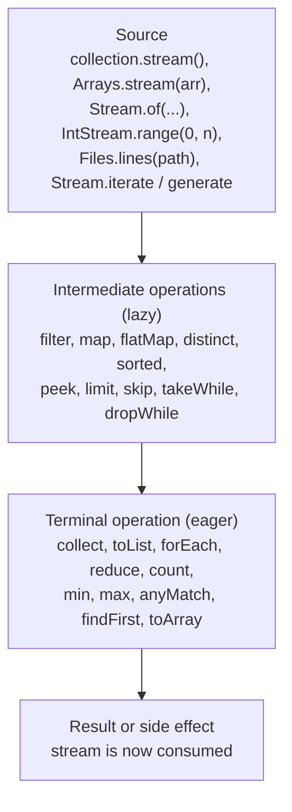
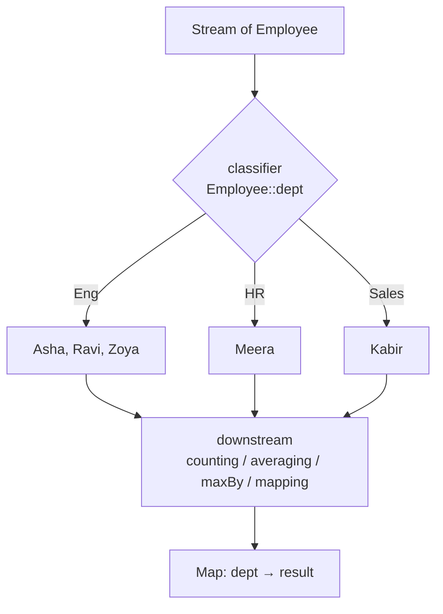
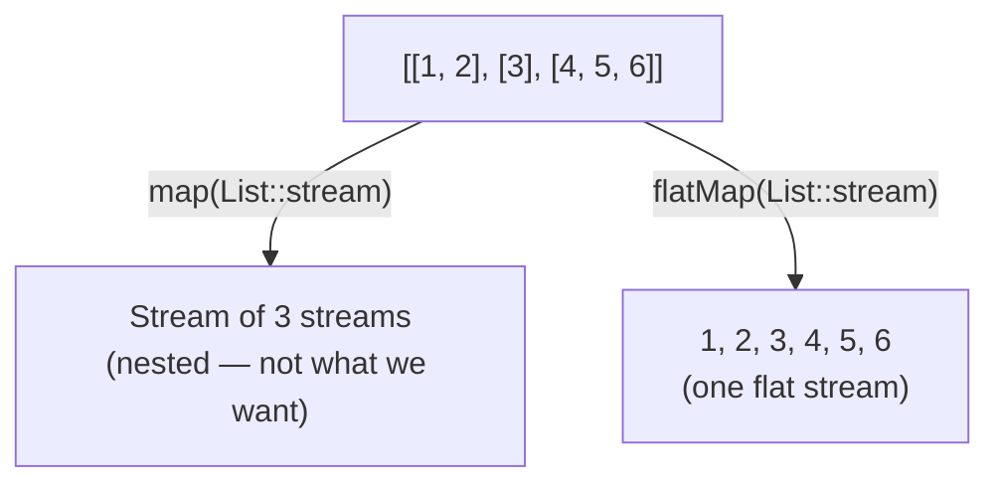
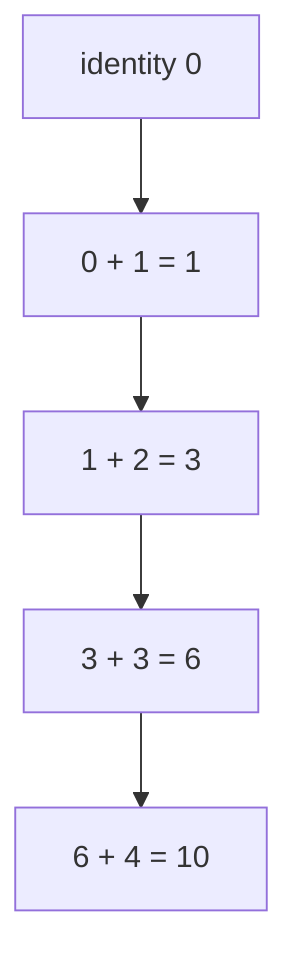
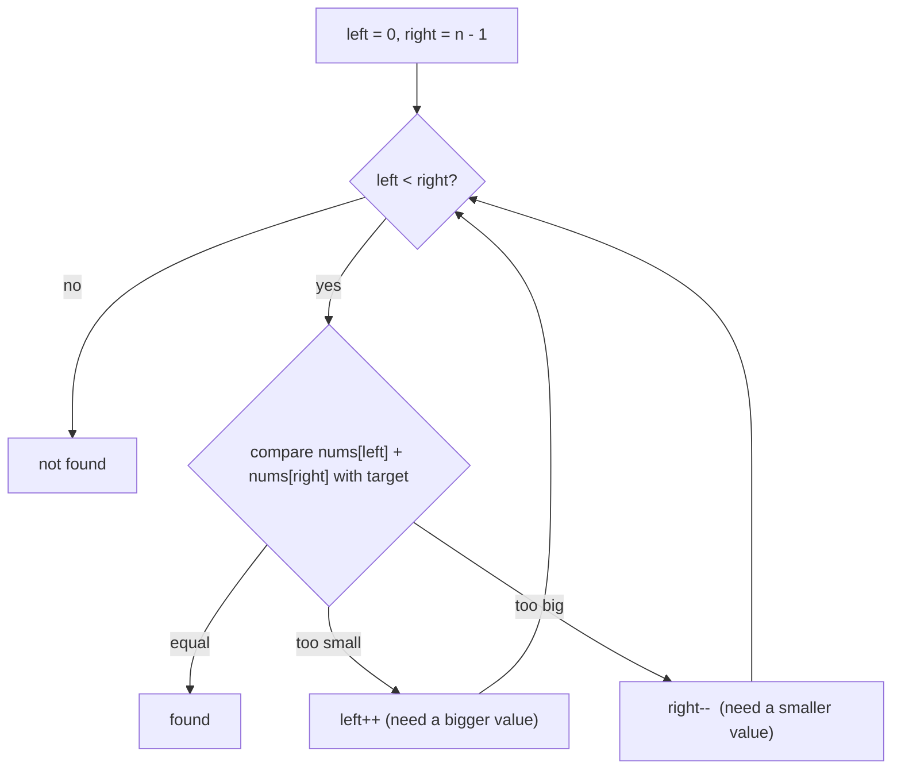
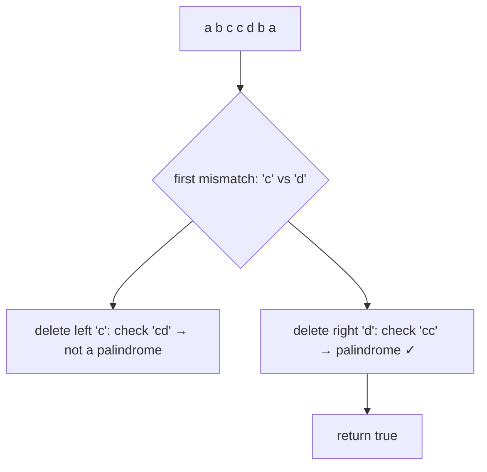
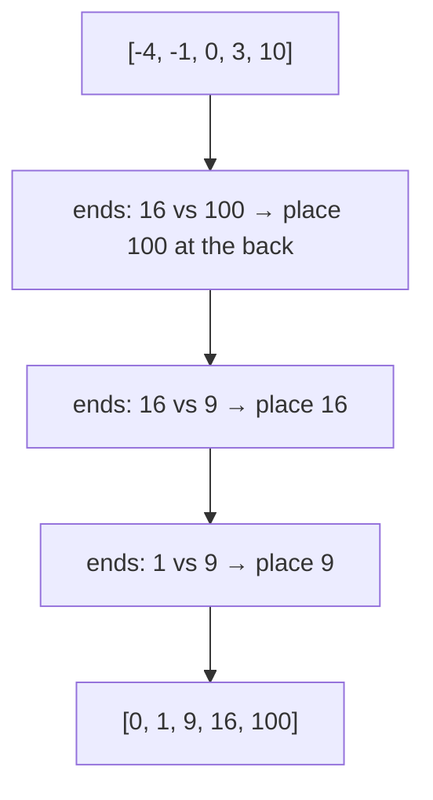

# Day 6 — Java 8: Stream API Deep Dive & Collectors

> **How to use these notes:** each section maps to one checklist item. Run the code, study the diagrams, then test yourself with the collapsible questions. 🚀 marks senior-level details.

**Today's goal:** understand how a stream pipeline actually executes (laziness, stateless vs stateful operations, short-circuiting), use every common intermediate and terminal operation, and master `Collectors` — `toMap`, `groupingBy` with downstream collectors, `partitioningBy` — well enough to solve the classic "employee" stream questions in an interview. On the DSA side: the **converging two-pointer** pattern on sorted data.

All examples use this data:

```java
record Employee(String name, String dept, double salary, int age, List<String> skills) { }

List<Employee> emps = List.of(
    new Employee("Asha",  "Eng",   120_000, 29, List.of("Java", "Kafka")),
    new Employee("Ravi",  "Eng",    95_000, 34, List.of("Java", "Spring")),
    new Employee("Meera", "HR",     70_000, 41, List.of("Hiring")),
    new Employee("Kabir", "Sales",  95_000, 26, List.of("Negotiation", "CRM")),
    new Employee("Zoya",  "Eng",   150_000, 38, List.of("Go", "Kafka"))
);
```

<!-- topic: d5_t1 -->
## ☕ Java 8 — Streams & Collectors

<!-- subtopic: d5_t1_s1 -->
### 1. Stream Pipeline Basics — source → intermediate → terminal, lazy evaluation

> **TL;DR:** A stream is a **pipeline of operations over a sequence of elements**. It has a **source**, zero or more **intermediate** operations (lazy, return a new stream) and exactly one **terminal** operation (triggers the work and produces a result). Streams don't store data and can be consumed **only once**.

#### 1.1 Anatomy

```java
List<String> result = emps.stream()                  // 1. source
        .filter(e -> e.salary() > 90_000)            // 2. intermediate (lazy)
        .map(Employee::name)                         //    intermediate (lazy)
        .sorted()                                    //    intermediate (lazy, stateful)
        .toList();                                   // 3. terminal → runs everything
// [Asha, Kabir, Ravi, Zoya]
```



#### 1.2 Laziness — nothing happens until the terminal operation

```java
Stream<String> s = emps.stream()
        .filter(e -> { System.out.println("filter " + e.name()); return e.salary() > 100_000; })
        .map(e -> { System.out.println("map " + e.name()); return e.name(); });
System.out.println("pipeline built, nothing printed yet");
s.findFirst();
```

Output:
```
pipeline built, nothing printed yet
filter Asha
map Asha
```

Two important observations:
1. Elements flow through the pipeline **one at a time, vertically** (filter → map for Asha, then the next element), not "filter everything, then map everything".
2. `findFirst` **short-circuits** — after Asha matches, the rest are never processed.

#### 1.3 Streams are single-use

```java
Stream<Employee> stream = emps.stream();
stream.count();
// stream.count();          💥 IllegalStateException: stream has already been operated upon or closed
Supplier<Stream<Employee>> fresh = emps::stream;   // need it twice? create a new stream each time
```

#### 1.4 Collections vs streams

| | Collection | Stream |
|---|---|---|
| Stores elements | ✅ | ❌ — a view/pipeline over a source |
| Evaluation | Eager | Lazy |
| Traversal | Many times | Once |
| Iteration | External (`for` loop) | Internal (the library loops) |
| Modifies the source | Can | Never (should not) |
| Infinite | ❌ | ✅ (`Stream.iterate`, `generate` + `limit`) |

#### 1.5 Creating streams

```java
Stream.of("a", "b", "c");
Arrays.stream(new int[]{3, 1, 2});                 // IntStream
IntStream.range(0, 5);                             // 0..4
IntStream.rangeClosed(1, 5);                       // 1..5
Stream.iterate(1, x -> x * 2).limit(5);            // 1, 2, 4, 8, 16
Stream.iterate(1, x -> x < 100, x -> x * 3);       // Java 9: with a stop condition
Stream.generate(Math::random).limit(3);
"hello".chars();                                   // IntStream of char codes
map.entrySet().stream();
try (Stream<String> lines = Files.lines(path)) { } // I/O streams must be closed
```

#### 🚀 1.6 Stateless vs stateful operations

| Stateless (process each element independently) | Stateful (need to see other elements) |
|---|---|
| `filter`, `map`, `flatMap`, `peek` | `sorted`, `distinct`, `limit`, `skip` |

Stateful operations may buffer the whole stream (`sorted` must see everything before emitting the first element) and are more expensive, especially in parallel. **Order matters for performance:** `filter` before `sorted`/`map` to shrink the data early.

#### 🎯 Interview questions

<details><summary>Q1. What are intermediate and terminal operations?</summary>

Intermediate operations (filter, map, sorted...) return a new stream and are lazy. A terminal operation (collect, forEach, count...) triggers processing of the whole pipeline and produces a result or side effect. A pipeline has exactly one terminal operation.

</details>

<details><summary>Q2. What does "streams are lazy" mean?</summary>

Intermediate operations only describe the computation. Nothing runs until a terminal operation is invoked, and then only as many elements as needed are processed (enabling short-circuiting and infinite streams).

</details>

<details><summary>Q3. Can you reuse a stream?</summary>

No. After a terminal operation the stream is consumed; using it again throws IllegalStateException. Create a new stream from the source.

</details>

<!-- subtopic: d5_t1_s2 -->
### 2. Intermediate Operations — filter, map, flatMap, distinct, sorted, peek, limit, skip

> **TL;DR:** `filter` keeps elements, `map` transforms one-to-one, `flatMap` transforms one-to-many and flattens, `distinct` removes duplicates (using `equals`), `sorted` orders, `peek` observes (for debugging), `limit`/`skip` slice.

```java
emps.stream().filter(e -> e.dept().equals("Eng"));                  // Asha, Ravi, Zoya
emps.stream().map(Employee::salary);                                // Stream<Double>
emps.stream().mapToDouble(Employee::salary);                        // DoubleStream — no boxing
emps.stream().flatMap(e -> e.skills().stream());                    // all skills (with duplicates)
emps.stream().flatMap(e -> e.skills().stream()).distinct();         // unique skills
emps.stream().sorted(Comparator.comparingDouble(Employee::salary).reversed());
emps.stream().map(Employee::name).sorted();                         // natural order
emps.stream().skip(1).limit(2);                                     // 2nd and 3rd elements (pagination)
emps.stream().peek(e -> log.debug("saw {}", e)).count();            // debugging only
```

| Operation | Signature (simplified) | Notes |
|---|---|---|
| `filter` | `Predicate<T>` | Keeps matching elements |
| `map` | `Function<T,R>` | One in, one out |
| `mapToInt/Long/Double` | `ToIntFunction<T>`... | Returns a primitive stream (`sum`, `average`) |
| `flatMap` | `Function<T, Stream<R>>` | One in, zero or more out, flattened |
| `distinct` | — | Uses `equals`/`hashCode`; stateful |
| `sorted()` / `sorted(cmp)` | `Comparator<T>` | Stateful; stable for ordered streams |
| `peek` | `Consumer<T>` | Side-effect hook; may not run (see below) |
| `limit(n)` / `skip(n)` | — | Short-circuiting / slicing |
| `takeWhile` / `dropWhile` (Java 9) | `Predicate<T>` | Take/drop while the condition holds, then stop/start |
| `mapMulti` (Java 16) | `BiConsumer<T, Consumer<R>>` | Imperative alternative to flatMap |
| `boxed()` | — | `IntStream` → `Stream<Integer>` |

```java
Stream.of(1, 2, 3, 10, 4).takeWhile(n -> n < 5).toList();   // [1, 2, 3]   — stops at 10
Stream.of(1, 2, 3, 10, 4).dropWhile(n -> n < 5).toList();   // [10, 4]
```

#### ⚠️ peek gotcha
`peek` is for debugging. Since Java 9, `count()` may **skip executing the pipeline** when it can compute the size directly from the source, so code inside `peek` might never run:

```java
List.of(1, 2, 3).stream().peek(System.out::println).count();   // may print nothing!
```

Never put business logic in `peek`.

#### 🎯 Interview questions

<details><summary>Q1. Difference between map and flatMap?</summary>

`map` transforms each element into exactly one element (`Stream<T>` → `Stream<R>`). `flatMap` transforms each element into a stream and flattens them into one stream — used for one-to-many mappings like `List<List<T>>` → `Stream<T>`.

</details>

<details><summary>Q2. How does distinct() decide duplicates?</summary>

Using `equals()` and `hashCode()` of the elements, like a HashSet. For custom objects you must override both.

</details>

<details><summary>Q3. Why shouldn't you rely on peek()?</summary>

It's meant for debugging; it may not run at all if the terminal operation can short-circuit or compute the result without traversal (e.g. count() on a sized source).

</details>

<!-- subtopic: d5_t1_s3 -->
### 3. Terminal Operations — collect, forEach, count, reduce, toArray, min, max

> **TL;DR:** Terminal operations run the pipeline and produce a **value** (`count`, `min`, `reduce`, `collect`), a **collection** (`toList`, `toArray`, `collect`), or a **side effect** (`forEach`).

```java
long n = emps.stream().filter(e -> e.age() > 30).count();                        // 3
Optional<Employee> richest = emps.stream().max(Comparator.comparingDouble(Employee::salary));   // Zoya
Optional<Employee> youngest = emps.stream().min(Comparator.comparingInt(Employee::age));        // Kabir
double total = emps.stream().mapToDouble(Employee::salary).sum();                // 530000.0
OptionalDouble avg = emps.stream().mapToDouble(Employee::salary).average();      // 106000.0
DoubleSummaryStatistics stats = emps.stream().mapToDouble(Employee::salary).summaryStatistics();
stats.getMax(); stats.getMin(); stats.getAverage(); stats.getCount();

String[] names = emps.stream().map(Employee::name).toArray(String[]::new);
List<String> list = emps.stream().map(Employee::name).toList();                 // Java 16
emps.stream().map(Employee::name).forEach(System.out::println);
emps.stream().map(Employee::name).forEachOrdered(System.out::println);          // keeps order in parallel
```

#### toList() vs collect(Collectors.toList())

| | `stream.toList()` (Java 16) | `collect(Collectors.toList())` | `collect(Collectors.toUnmodifiableList())` (Java 10) |
|---|---|---|---|
| Mutability | **Unmodifiable** | Unspecified (an `ArrayList` in practice) | Unmodifiable |
| Nulls | Allowed | Allowed | ❌ NPE |

Use `toList()` by default; use `Collectors.toCollection(ArrayList::new)` if you really need a mutable list.

#### forEach is a side effect — prefer collecting

```java
// ❌ Mutating external state from a stream (breaks in parallel, unclear)
List<String> out = new ArrayList<>();
emps.stream().map(Employee::name).forEach(out::add);

// ✅ Let the stream build the result
List<String> out2 = emps.stream().map(Employee::name).toList();
```

<!-- subtopic: d5_t1_s4 -->
### 4. Collectors — toList, toSet, toMap, joining, counting

> **TL;DR:** `collect(Collector)` is the Swiss-army terminal operation. The `Collectors` class provides ready-made collectors; `toMap` needs care with **duplicate keys** and **null values**.

```java
Set<String> depts = emps.stream().map(Employee::dept).collect(Collectors.toSet());     // {Eng, HR, Sales}
TreeSet<String> sorted = emps.stream().map(Employee::dept)
        .collect(Collectors.toCollection(TreeSet::new));                                // any collection

String csv = emps.stream().map(Employee::name).collect(Collectors.joining(", "));      // "Asha, Ravi, ..."
String json = emps.stream().map(Employee::name)
        .collect(Collectors.joining("\", \"", "[\"", "\"]"));                            // ["Asha", "Ravi", ...]

long count = emps.stream().collect(Collectors.counting());                              // 5 (mostly used downstream)
```

#### toMap — the three forms

```java
// 1. keyMapper, valueMapper
Map<String, Double> salaryByName = emps.stream()
        .collect(Collectors.toMap(Employee::name, Employee::salary));

// 2. Duplicate keys → IllegalStateException! Provide a merge function
Map<String, Double> maxSalaryByDept = emps.stream()
        .collect(Collectors.toMap(Employee::dept, Employee::salary, Math::max));
// {Eng=150000.0, HR=70000.0, Sales=95000.0}

// 3. Choose the map type (e.g., keep insertion order or sort keys)
Map<String, Double> ordered = emps.stream()
        .collect(Collectors.toMap(Employee::name, Employee::salary, (a, b) -> a, LinkedHashMap::new));

// Index objects by id
Map<String, Employee> byName = emps.stream()
        .collect(Collectors.toMap(Employee::name, Function.identity()));
```

| Pitfall | What happens | Fix |
|---|---|---|
| Two elements map to the same key | `IllegalStateException: Duplicate key` | Pass a merge function `(a, b) -> ...` |
| Value mapper returns `null` | `NullPointerException` (uses `HashMap.merge`) | Filter nulls or use `groupingBy` / a loop |
| Need a specific map type | Default is `HashMap` (no order) | 4-arg form with `TreeMap::new` / `LinkedHashMap::new` |

<!-- subtopic: d5_t1_s5 -->
### 5. Collectors.groupingBy — the most asked stream question

> **TL;DR:** `groupingBy(classifier)` builds a `Map<K, List<T>>`. Add a **downstream collector** to compute something per group (count, sum, average, max, mapped values), and optionally a **map factory** (`TreeMap::new`).

```java
// 1. Basic: employees per department
Map<String, List<Employee>> byDept = emps.stream()
        .collect(Collectors.groupingBy(Employee::dept));
// {Eng=[Asha, Ravi, Zoya], HR=[Meera], Sales=[Kabir]}

// 2. Count per department
Map<String, Long> countByDept = emps.stream()
        .collect(Collectors.groupingBy(Employee::dept, Collectors.counting()));
// {Eng=3, HR=1, Sales=1}

// 3. Average salary per department
Map<String, Double> avgSalary = emps.stream()
        .collect(Collectors.groupingBy(Employee::dept, Collectors.averagingDouble(Employee::salary)));
// {Eng=121666.67, HR=70000.0, Sales=95000.0}

// 4. Total salary per department
Map<String, Double> totalSalary = emps.stream()
        .collect(Collectors.groupingBy(Employee::dept, Collectors.summingDouble(Employee::salary)));

// 5. Highest-paid employee per department
Map<String, Optional<Employee>> topPaid = emps.stream()
        .collect(Collectors.groupingBy(Employee::dept,
                 Collectors.maxBy(Comparator.comparingDouble(Employee::salary))));

// 5b. Same, but without Optional in the map
Map<String, Employee> topPaid2 = emps.stream()
        .collect(Collectors.toMap(Employee::dept, Function.identity(),
                 BinaryOperator.maxBy(Comparator.comparingDouble(Employee::salary))));

// 6. Names per department (mapping downstream)
Map<String, List<String>> namesByDept = emps.stream()
        .collect(Collectors.groupingBy(Employee::dept,
                 Collectors.mapping(Employee::name, Collectors.toList())));

// 7. Sorted keys + multi-level grouping
Map<String, Map<Boolean, List<Employee>>> nested = emps.stream()
        .collect(Collectors.groupingBy(Employee::dept, TreeMap::new,
                 Collectors.partitioningBy(e -> e.age() > 30)));
```



Useful downstream collectors: `counting`, `summingInt/Long/Double`, `averagingX`, `minBy`/`maxBy`, `mapping`, `filtering` (Java 9), `flatMapping` (Java 9), `toSet`, `joining`, `collectingAndThen`, `reducing`, `summarizingDouble`.

```java
// collectingAndThen: unwrap the Optional from maxBy
Map<String, String> topName = emps.stream().collect(Collectors.groupingBy(Employee::dept,
        Collectors.collectingAndThen(
            Collectors.maxBy(Comparator.comparingDouble(Employee::salary)),
            opt -> opt.map(Employee::name).orElse("-"))));
```

#### 🎯 Interview questions

<details><summary>Q1. Count employees per department using streams.</summary>

`emps.stream().collect(Collectors.groupingBy(Employee::dept, Collectors.counting()))` → `Map<String, Long>`.

</details>

<details><summary>Q2. How do you get the highest-paid employee in each department?</summary>

`groupingBy(Employee::dept, maxBy(comparingDouble(Employee::salary)))` gives `Map<String, Optional<Employee>>`; or `toMap(Employee::dept, identity(), BinaryOperator.maxBy(...))` gives `Map<String, Employee>` directly.

</details>

<details><summary>Q3. How do you make groupingBy return a sorted map?</summary>

Use the 3-argument form with a map factory: `groupingBy(classifier, TreeMap::new, downstream)`.

</details>

<!-- subtopic: d5_t1_s6 -->
### 6. Collectors.partitioningBy — split into true/false

> **TL;DR:** `partitioningBy(predicate)` is a special `groupingBy` with a `boolean` key. The result **always contains both keys** `true` and `false`, even if one group is empty.

```java
Map<Boolean, List<Employee>> highEarners = emps.stream()
        .collect(Collectors.partitioningBy(e -> e.salary() >= 100_000));
// {false=[Ravi, Meera, Kabir], true=[Asha, Zoya]}

Map<Boolean, Long> counts = emps.stream()
        .collect(Collectors.partitioningBy(e -> e.age() > 30, Collectors.counting()));
// {false=2, true=3}

Map<Boolean, List<Integer>> evenOdd = IntStream.rangeClosed(1, 10).boxed()
        .collect(Collectors.partitioningBy(n -> n % 2 == 0));
```

| | `partitioningBy` | `groupingBy` |
|---|---|---|
| Key type | `Boolean` | Anything |
| Groups | Exactly 2, both always present | As many as distinct keys; only non-empty groups |
| Classifier | `Predicate<T>` | `Function<T, K>` |

<!-- subtopic: d5_t1_s7 -->
### 7. flatMap — flattening nested data

> **TL;DR:** `flatMap` maps each element to a **stream** and concatenates all those streams into one. Use it for `List<List<T>>`, one-to-many relationships, or splitting strings into words.

```java
// 1. Flatten a list of lists
List<List<Integer>> nested = List.of(List.of(1, 2), List.of(3), List.of(4, 5, 6));
List<Integer> flat = nested.stream().flatMap(List::stream).toList();     // [1, 2, 3, 4, 5, 6]

// 2. One-to-many: all distinct skills in the company
Set<String> skills = emps.stream()
        .flatMap(e -> e.skills().stream())
        .collect(Collectors.toCollection(TreeSet::new));                  // [CRM, Go, Hiring, Java, Kafka, ...]

// 3. Word frequency across sentences
List<String> lines = List.of("java is fun", "java streams are fun");
Map<String, Long> wordCount = lines.stream()
        .flatMap(line -> Arrays.stream(line.split("\\s+")))
        .collect(Collectors.groupingBy(Function.identity(), Collectors.counting()));
// {java=2, is=1, fun=2, streams=1, are=1}

// 4. Optional + flatMap: drop empties (Java 9 Optional.stream())
List<String> emails = users.stream()
        .map(User::findEmail)              // Stream<Optional<String>>
        .flatMap(Optional::stream)         // only present values
        .toList();
```



<!-- subtopic: d5_t1_s8 -->
### 8. reduce — combining elements into one value

> **TL;DR:** `reduce` repeatedly combines elements with an **associative** function. Forms: `reduce(identity, accumulator)` → value; `reduce(accumulator)` → `Optional`; `reduce(identity, accumulator, combiner)` → for type changes / parallel.

```java
int sum = Stream.of(1, 2, 3, 4).reduce(0, Integer::sum);                // 10  (identity 0)
int product = Stream.of(1, 2, 3, 4).reduce(1, (a, b) -> a * b);         // 24  (identity 1)
Optional<Integer> max = Stream.of(3, 9, 2).reduce(Integer::max);        // Optional[9] (no identity → Optional)
String concat = Stream.of("a", "b", "c").reduce("", String::concat);    // "abc" (fine for small data)

// 3-arg form: accumulate into a different type (sum of salaries as double)
double total = emps.stream().reduce(0.0,
        (acc, e) -> acc + e.salary(),       // accumulator: (Double, Employee) → Double
        Double::sum);                       // combiner: merges partial results in parallel
```



Rules for correct (and parallel-safe) reduction:
- The function must be **associative**: `(a op b) op c == a op (b op c)`. Subtraction isn't — `reduce(0, (a, b) -> a - b)` gives different results in parallel.
- The **identity** must satisfy `identity op x == x` (0 for +, 1 for ×, "" for concat).

Prefer specialised operations when they exist: `mapToInt(...).sum()`, `max(...)`, `Collectors.joining()` (much faster than reducing strings — `String::concat` in reduce is O(n²)).

<!-- subtopic: d5_t1_s9 -->
### 9. Short-Circuiting Operations — findFirst, findAny, anyMatch, allMatch, noneMatch

> **TL;DR:** These terminal operations **stop as soon as the answer is known**, so they can work on huge or even infinite streams. Watch the **empty-stream** results: `allMatch` and `noneMatch` return `true` on an empty stream.

```java
boolean anyRich   = emps.stream().anyMatch(e -> e.salary() > 140_000);   // true  — stops at Zoya
boolean allAdults = emps.stream().allMatch(e -> e.age() >= 18);           // true  — must check all
boolean noneInFin = emps.stream().noneMatch(e -> e.dept().equals("Finance"));   // true

Optional<Employee> firstEng = emps.stream().filter(e -> e.dept().equals("Eng")).findFirst();   // Asha
Optional<Employee> anyEng   = emps.parallelStream().filter(e -> e.dept().equals("Eng")).findAny();  // any one

// Works on infinite streams because it short-circuits
int firstSquareOver1000 = IntStream.iterate(1, i -> i + 1)
        .map(i -> i * i)
        .filter(sq -> sq > 1000)
        .findFirst().getAsInt();                                          // 1024
```

| Operation | Returns | Stops when | Empty stream result |
|---|---|---|---|
| `anyMatch(p)` | boolean | First match | `false` |
| `allMatch(p)` | boolean | First non-match | `true` (vacuous truth) |
| `noneMatch(p)` | boolean | First match | `true` |
| `findFirst()` | `Optional<T>` | First element | `Optional.empty()` |
| `findAny()` | `Optional<T>` | Any element (faster in parallel) | `Optional.empty()` |
| `limit(n)` (intermediate) | Stream | After n elements | — |

#### 🎯 Interview questions

<details><summary>Q1. findFirst vs findAny?</summary>

findFirst returns the first element in encounter order. findAny may return any element — in parallel streams it avoids the cost of coordinating order, so it can be faster. Sequentially they usually behave the same.

</details>

<details><summary>Q2. What does allMatch return on an empty stream?</summary>

true (vacuous truth). noneMatch also returns true; anyMatch returns false.

</details>

<details><summary>Q3. Classic: find the second highest salary with streams.</summary>

`emps.stream().map(Employee::salary).distinct().sorted(Comparator.reverseOrder()).skip(1).findFirst()` → Optional containing 120000.0.

</details>

#### 🧪 Practice — classic stream interview programs

```java
// 1. Frequency of each character in a string
Map<Character, Long> freq = "programming".chars()
        .mapToObj(c -> (char) c)
        .collect(Collectors.groupingBy(Function.identity(), LinkedHashMap::new, Collectors.counting()));

// 2. First non-repeated character
Optional<Character> firstUnique = freq.entrySet().stream()
        .filter(e -> e.getValue() == 1).map(Map.Entry::getKey).findFirst();       // 'p'

// 3. Duplicate elements in a list
Set<Integer> seen = new HashSet<>();
Set<Integer> dups = Stream.of(1, 2, 3, 2, 4, 1).filter(n -> !seen.add(n)).collect(Collectors.toSet());   // [1, 2]

// 4. Department with the highest average salary
String topDept = emps.stream()
        .collect(Collectors.groupingBy(Employee::dept, Collectors.averagingDouble(Employee::salary)))
        .entrySet().stream()
        .max(Map.Entry.comparingByValue())
        .map(Map.Entry::getKey).orElseThrow();                                   // "Eng"

// 5. Sort a map by value descending
LinkedHashMap<String, Long> sortedByCount = freq.entrySet().stream()
        .sorted(Map.Entry.<Character, Long>comparingByValue().reversed())
        .collect(Collectors.toMap(e -> String.valueOf(e.getKey()), Map.Entry::getValue,
                 (a, b) -> a, LinkedHashMap::new));
```

(Note #3 uses a stateful lambda — fine sequentially, not in parallel. A cleaner version: `groupingBy(identity(), counting())` then filter counts > 1.)

<!-- topic: d6_t2 -->
## 🧮 DSA — Two Pointers: Easy

<!-- subtopic: d6_t2_s1 -->
### 10. The Two-Pointer Pattern — converging pointers on sorted data

> **TL;DR:** Put one pointer at each **end** and move them **toward each other**, using the sorted order to decide which pointer to move. Each step discards possibilities, so the whole search is **O(n)** instead of O(n²).

#### 10.1 Why it works

In a **sorted** array, if `nums[left] + nums[right]` is **too small**, every pair using `nums[left]` with anything left of `right` is even smaller — so `left` can never be part of the answer: move `left` right. If the sum is **too big**, symmetric argument: move `right` left.



#### 10.2 The family of two-pointer patterns

| Variant | Pointers | Examples |
|---|---|---|
| **Converging** (today) | Both ends → middle | Two Sum II, Valid Palindrome, Container With Most Water, 3Sum |
| **Same direction (read/write)** | Slow + fast from the start | Remove Duplicates, Move Zeroes (Days 2–3) |
| **Two arrays** | One pointer per array | Merge Sorted Array, intersection of sorted arrays |
| **Fast/slow on linked lists** | 1 step vs 2 steps | Middle of list, cycle detection (Day 12–13) |
| **Sliding window** | Both move right, window between them | Day 10 |

Template:

```java
int left = 0, right = arr.length - 1;
while (left < right) {
    if (condition met) { /* record answer */ }
    if (need bigger)  left++;
    else              right--;
}
```

Signals that two pointers may apply: the input is **sorted** (or can be sorted), you need **pairs/triplets**, you must work **in place**, or the problem is about **palindromes**.

<!-- subtopic: d6_t2_s2 -->
### 11. Two Sum II — Input Array Is Sorted (LeetCode 167)

> **Problem:** `numbers` is sorted ascending. Return the **1-indexed** positions of the two numbers adding to `target`. Use only O(1) extra space. 🔗 [LeetCode 167](https://leetcode.com/problems/two-sum-ii-input-array-is-sorted/)

```java
public int[] twoSum(int[] numbers, int target) {
    int left = 0, right = numbers.length - 1;
    while (left < right) {
        int sum = numbers[left] + numbers[right];
        if (sum == target) return new int[]{left + 1, right + 1};   // 1-indexed
        if (sum < target) left++;       // need a bigger sum
        else right--;                   // need a smaller sum
    }
    return new int[]{-1, -1};
}   // Time O(n), Space O(1)
```

**Dry run** `numbers = [2, 7, 11, 15], target = 9`: `2 + 15 = 17` (too big, right--) → `2 + 11 = 13` (right--) → `2 + 7 = 9` ✅ → `[1, 2]`.

Compare with Two Sum I (Day 3): unsorted → HashMap O(n)/O(n). Sorted → two pointers O(n)/**O(1)**. Binary-searching the complement for each element also works: O(n log n).

⚠️ Overflow: if values can be near `Integer.MAX_VALUE`, compute the sum as `long`.

<!-- subtopic: d6_t2_s3 -->
### 12. Valid Palindrome II (LeetCode 680)

> **Problem:** return `true` if `s` can be a palindrome after deleting **at most one** character. 🔗 [LeetCode 680](https://leetcode.com/problems/valid-palindrome-ii/)

Brute force: try deleting each character and check → O(n²).

Two pointers ✅: move inward while characters match. At the **first mismatch**, we must delete either `s[left]` or `s[right]` — check if **either** remaining substring is a palindrome.

```java
public boolean validPalindrome(String s) {
    int left = 0, right = s.length() - 1;
    while (left < right) {
        if (s.charAt(left) != s.charAt(right)) {
            return isPalindrome(s, left + 1, right)      // delete s[left]
                || isPalindrome(s, left, right - 1);     // or delete s[right]
        }
        left++;
        right--;
    }
    return true;                                         // already a palindrome
}

private boolean isPalindrome(String s, int l, int r) {
    while (l < r) {
        if (s.charAt(l++) != s.charAt(r--)) return false;
    }
    return true;
}   // Time O(n) — at most ~2 extra scans, Space O(1)
```



**Dry run** `"abca"`: a=a ✅ → `b` vs `c` ❌ → delete `b` → `"ca"` ❌; delete `c` → `"b"` ✅ → `true`.

<!-- subtopic: d6_t2_s4 -->
### 13. Merge Sorted Array (LeetCode 88)

> **Problem:** `nums1` has length `m + n`: the first `m` elements are real, the last `n` are zeros (space). Merge sorted `nums2` (length `n`) into `nums1` **in place**, sorted. 🔗 [LeetCode 88](https://leetcode.com/problems/merge-sorted-array/)

Merging from the **front** would overwrite unread `nums1` elements. Merging from the **back** fills the empty space first — nothing is ever overwritten before it's read.

```java
public void merge(int[] nums1, int m, int[] nums2, int n) {
    int i = m - 1;          // last real element of nums1
    int j = n - 1;          // last element of nums2
    int write = m + n - 1;  // last slot of nums1
    while (j >= 0) {                                  // once nums2 is used up, nums1's rest is already in place
        if (i >= 0 && nums1[i] > nums2[j]) {
            nums1[write--] = nums1[i--];
        } else {
            nums1[write--] = nums2[j--];
        }
    }
}   // Time O(m + n), Space O(1)
```

**Dry run** `nums1 = [1, 2, 3, 0, 0, 0], m = 3; nums2 = [2, 5, 6], n = 3`:

| i | j | compare | nums1 |
|---|---|---|---|
| 2 (3) | 2 (6) | 6 bigger | [1, 2, 3, 0, 0, **6**] |
| 2 (3) | 1 (5) | 5 bigger | [1, 2, 3, 0, **5**, 6] |
| 2 (3) | 0 (2) | 3 bigger | [1, 2, 3, **3**, 5, 6] |
| 1 (2) | 0 (2) | equal → take nums2 | [1, 2, **2**, 3, 5, 6] |
| j = -1 | | stop | [1, 2, 2, 3, 5, 6] ✅ |

> The "merge two sorted sequences" step is the heart of **merge sort** (Day 8) and **Merge Two Sorted Lists** (Day 12).

<!-- subtopic: d6_t2_s5 -->
### 14. Squares of a Sorted Array (LeetCode 977)

> **Problem:** given a sorted array (may contain negatives), return the squares, sorted. 🔗 [LeetCode 977](https://leetcode.com/problems/squares-of-a-sorted-array/)

Naive: square everything, then sort → O(n log n).

Two pointers ✅: the **largest square** is always at one of the two **ends** (most negative or most positive). Fill the result from the back.

```java
public int[] sortedSquares(int[] nums) {
    int n = nums.length;
    int[] result = new int[n];
    int left = 0, right = n - 1;
    for (int write = n - 1; write >= 0; write--) {
        int l = nums[left] * nums[left];
        int r = nums[right] * nums[right];
        if (l > r) {
            result[write] = l;
            left++;
        } else {
            result[write] = r;
            right--;
        }
    }
    return result;
}   // Time O(n), Space O(n) for the output (O(1) extra)
```

**Dry run** `[-4, -1, 0, 3, 10]` → compare 16 vs 100 → 100 → 16 vs 9 → 16 → 1 vs 9 → 9 → 1 vs 0 → 1 → 0 → result `[0, 1, 9, 16, 100]`.



---

## 📝 Day 6 Revision Cheat Sheet

| Topic | Remember this |
|---|---|
| Pipeline | Source → lazy intermediates → one terminal; single use; vertical, element-by-element processing |
| Stateful ops | sorted, distinct, limit, skip — filter early |
| map vs flatMap | One-to-one vs one-to-many + flatten |
| peek | Debugging only; may not run (count optimization) |
| toList() | Java 16, unmodifiable; `Collectors.toList()` is mutable in practice |
| toMap | Duplicate key → IllegalStateException (add merge fn); null value → NPE |
| groupingBy | `Map<K, List<T>>`; downstream: counting, averagingX, summingX, maxBy, mapping; `TreeMap::new` |
| partitioningBy | Boolean keys, both always present |
| reduce | Associative function + true identity; prefer sum/joining |
| Short-circuit | anyMatch/findFirst/limit stop early; allMatch on empty = true |
| Two pointers | Sorted + pairs → converge from both ends, O(n) |
| Back-to-front | Merge in place and squares: fill from the end |

### ⚡ Rapid-fire self-test

1. Is `sorted()` stateless? → **No, stateful**
2. What does `toMap` do with duplicate keys and no merge function? → **Throws IllegalStateException**
3. `partitioningBy` on a stream where nothing matches — keys? → **Both true and false**
4. Identity for multiplication in reduce? → **1**
5. `IntStream.range(0, 5)` includes 5? → **No**
6. Can a stream be reused after `count()`? → **No**
7. Which is safer in parallel — findFirst or findAny? → **Both safe; findAny is faster**
8. Two Sum II complexity? → **O(n) time, O(1) space**
9. Merge Sorted Array — why from the back? → **Avoid overwriting unread elements**
10. Squares of sorted array — where is the largest square? → **At one of the two ends**
