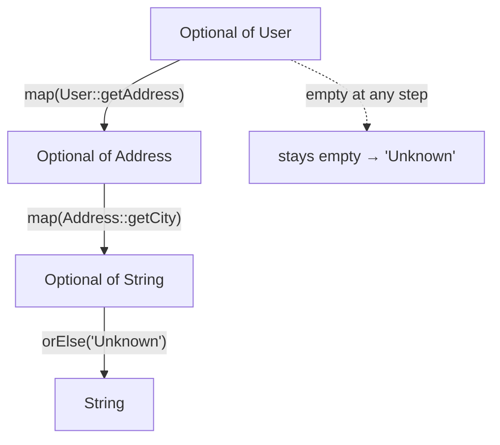
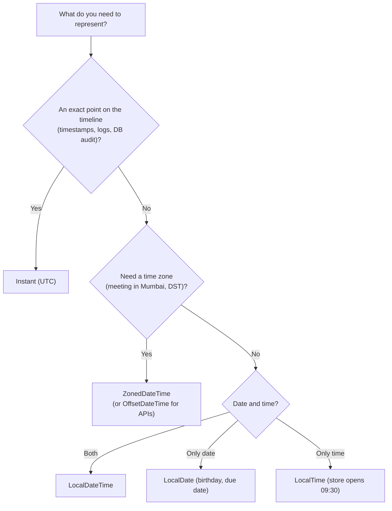
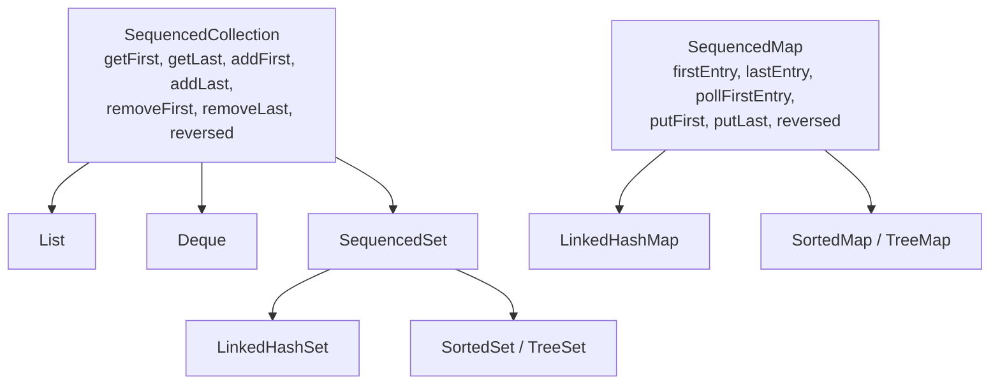
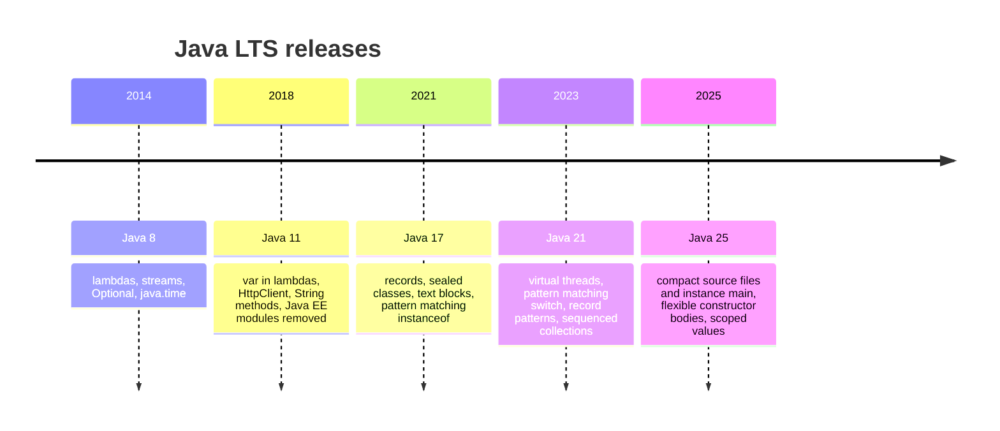
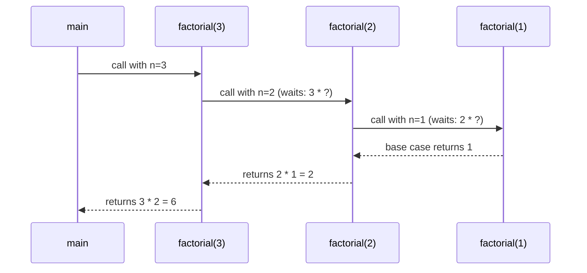
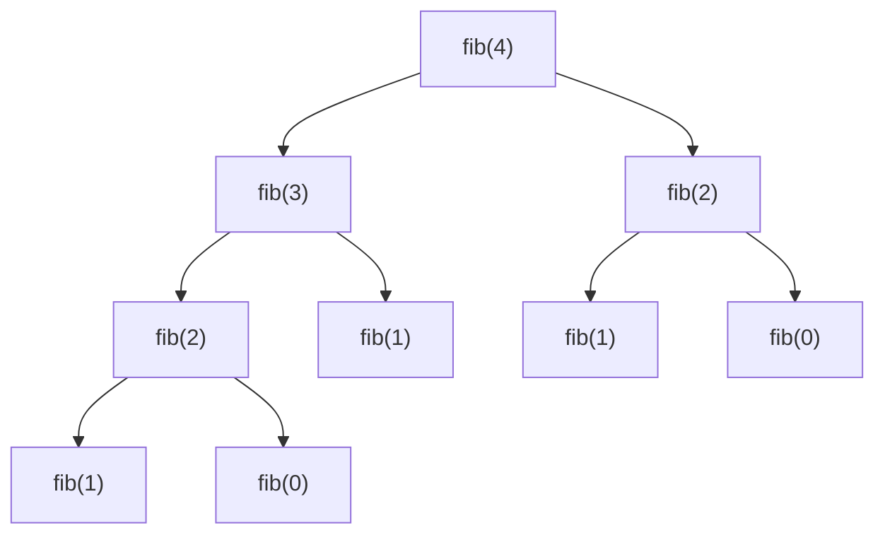
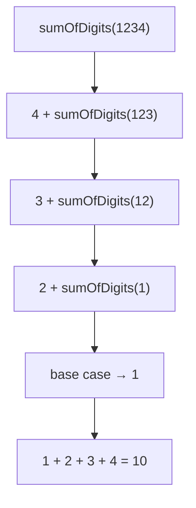

# Day 7 — Optional, Date/Time API & Modern Java (10 → 21)

> **How to use these notes:** each section maps to one checklist item. Run the code, study the diagrams, then test yourself with the collapsible questions. 🚀 marks senior-level details.

**Today's goal:** use `Optional` the way it was designed (and avoid its traps), handle dates and times correctly with `java.time`, and be fluent in the modern Java features interviewers expect in 2026 — `var`, records, sealed types, text blocks, switch expressions, pattern matching and Java 21's sequenced collections — plus a clear story about the LTS releases. On the DSA side: **recursion fundamentals**, the foundation for sorting (Day 8), trees, backtracking and DP.

<!-- topic: d6_t1 -->
## ☕ Java 8+ — Optional, Date/Time & Modern Java

<!-- subtopic: d6_t1_s1 -->
### 1. Optional&lt;T&gt; — creating and unwrapping

> **TL;DR:** `Optional<T>` is a container that **may or may not hold a value**. It makes "no result" explicit in a method's **return type**, forcing callers to handle absence instead of getting a surprise `NullPointerException`.

#### 1.1 Creating

```java
Optional<String> a = Optional.of("Java");          // value must be non-null — of(null) throws NPE
Optional<String> b = Optional.ofNullable(maybe);   // empty if maybe == null
Optional<String> c = Optional.empty();             // explicitly empty
```

#### 1.2 Unwrapping — choose the right method

```java
Optional<User> user = repo.findById(42);

user.isPresent();                       // true/false
user.isEmpty();                         // Java 11

user.get();                             // ⚠️ NoSuchElementException if empty — avoid
user.orElseThrow();                     // Java 10: same as get(), but the name is honest
user.orElseThrow(() -> new UserNotFoundException(42));   // ✅ the usual choice in services

user.orElse(User.GUEST);                // default value (argument is ALWAYS evaluated)
user.orElseGet(() -> createGuest());    // default computed lazily — only if empty
user.or(() -> repo.findByEmail(mail));  // Java 9: fall back to another Optional

user.ifPresent(u -> sendWelcome(u));                              // act if present
user.ifPresentOrElse(this::sendWelcome, () -> log.warn("none"));  // Java 9
```

#### 1.3 orElse vs orElseGet ⭐

```java
String name = Optional.of("Asha").orElse(expensiveLookup());       // expensiveLookup() RUNS anyway!
String name2 = Optional.of("Asha").orElseGet(() -> expensiveLookup());   // never runs here
```

Use `orElse` for constants/cheap values; `orElseGet` when the default is expensive or has side effects (DB call, object creation).

#### 1.4 How to use Optional — and how not to

| ✅ Do | ❌ Don't |
|---|---|
| Use as a **method return type** when "no result" is normal (`findById`) | Use as a **field** type (not `Serializable`, adds overhead) |
| Return `Optional.empty()` | **Return `null` from a method declared to return Optional** |
| Chain with `map`/`filter`/`orElseThrow` | Call `get()` without checking |
| Return empty collections instead of `Optional<List<T>>` | Use `Optional` for **method parameters** (callers must wrap) |
| `OptionalInt`/`OptionalDouble` for primitives | Use `Optional` in performance-critical tight loops |

```java
// ❌ Pointless: just a verbose null check
if (opt.isPresent()) { return opt.get().getName(); } else { return "unknown"; }
// ✅
return opt.map(User::getName).orElse("unknown");
```

#### 🎯 Interview questions

<details><summary>Q1. Difference between Optional.of and Optional.ofNullable?</summary>

`of` requires a non-null value and throws NPE for null. `ofNullable` returns an empty Optional for null.

</details>

<details><summary>Q2. orElse vs orElseGet?</summary>

orElse always evaluates its argument, even if a value is present. orElseGet takes a Supplier and calls it only when the Optional is empty — use it for expensive defaults.

</details>

<details><summary>Q3. Why shouldn't Optional be used for fields or parameters?</summary>

It was designed for return types. As a field it isn't Serializable and adds memory overhead; as a parameter it forces callers to wrap values and still allows passing null.

</details>

<!-- subtopic: d6_t1_s2 -->
### 2. Optional Chaining — map, flatMap, filter

> **TL;DR:** Treat Optional like a stream of zero or one element: `map` transforms the value if present, `flatMap` is for functions that **already return an Optional**, `filter` keeps the value only if it matches.

```java
Optional<User> user = repo.findById(id);

Optional<String> city = user
        .map(User::getAddress)          // Optional<Address> (empty if user empty OR address null)
        .map(Address::getCity);         // Optional<String>

Optional<String> email = user
        .flatMap(User::findEmail);      // findEmail returns Optional<String> → flatMap avoids Optional<Optional<String>>

Optional<User> adult = user.filter(u -> u.getAge() >= 18);

Stream<User> asStream = user.stream();  // Java 9: 0 or 1 element — great with flatMap in streams
```



| Method | Function returns | Result |
|---|---|---|
| `map(f)` | a plain value `R` (null allowed → empty) | `Optional<R>` |
| `flatMap(f)` | `Optional<R>` | `Optional<R>` (not nested) |
| `filter(p)` | boolean | same Optional or empty |

`map` automatically turns a `null` result into `Optional.empty()` — that's what makes chains null-safe.

<!-- subtopic: d6_t1_s3 -->
### 3. Code Pattern — replacing nested null checks

> **TL;DR:** `Optional.ofNullable(user).map(User::getEmail).orElse("N/A")` replaces a pyramid of `if (x != null)` checks with a readable pipeline.

```java
// ❌ Before: nested null checks
String getCity(Order order) {
    if (order != null) {
        Customer c = order.getCustomer();
        if (c != null) {
            Address a = c.getAddress();
            if (a != null && a.getCity() != null) {
                return a.getCity().toUpperCase();
            }
        }
    }
    return "UNKNOWN";
}

// ✅ After
String getCity(Order order) {
    return Optional.ofNullable(order)
            .map(Order::getCustomer)
            .map(Customer::getAddress)
            .map(Address::getCity)
            .map(String::toUpperCase)
            .orElse("UNKNOWN");
}

// Email with a default
String email = Optional.ofNullable(user).map(User::getEmail).orElse("N/A");

// Service layer: 404 when missing
public UserDto getUser(long id) {
    return repo.findById(id)                          // Spring Data returns Optional
            .map(mapper::toDto)
            .orElseThrow(() -> new ResponseStatusException(HttpStatus.NOT_FOUND, "user " + id));
}
```

⚠️ Don't wrap just to unwrap in the same line for simple cases — `x != null ? x : default` or `Objects.requireNonNullElse(x, default)` (Java 9) is fine too.

<!-- subtopic: d6_t1_s5 -->
### 4. Date/Time API — LocalDate, LocalTime, LocalDateTime, ZonedDateTime, Instant

> **TL;DR:** `java.time` (Java 8, JSR-310) replaced the broken `Date`/`Calendar`. All its classes are **immutable and thread-safe**. Pick the class by what you need: a calendar date, a wall-clock time, a time zone, or an exact instant.

#### 4.1 Why the old API was replaced

| `java.util.Date` / `Calendar` problems | `java.time` fix |
|---|---|
| Mutable — shared dates get modified | Immutable |
| `SimpleDateFormat` **not thread-safe** | `DateTimeFormatter` is thread-safe |
| Months start at 0 (January = 0) | `Month.JANUARY` = 1 |
| `Date` mixes date + time + implicit timezone | Separate types for each concept |
| Years offset from 1900 | Real years |

#### 4.2 Choosing the type



```java
LocalDate today = LocalDate.now();                       // 2026-11-01
LocalDate birthday = LocalDate.of(1998, Month.MARCH, 14);
LocalTime opens = LocalTime.of(9, 30);
LocalDateTime meeting = LocalDateTime.of(2026, 11, 3, 15, 0);
ZonedDateTime inMumbai = meeting.atZone(ZoneId.of("Asia/Kolkata"));
ZonedDateTime inNewYork = inMumbai.withZoneSameInstant(ZoneId.of("America/New_York"));
Instant now = Instant.now();                             // 2026-11-01T09:12:44.123Z

// Immutable: every "change" returns a new object
LocalDate nextWeek = today.plusWeeks(1);                 // today is unchanged
LocalDate firstOfMonth = today.withDayOfMonth(1);
LocalDate lastOfMonth = today.with(TemporalAdjusters.lastDayOfMonth());
boolean before = birthday.isBefore(today);
DayOfWeek dow = today.getDayOfWeek();
boolean leap = today.isLeapYear();
```

#### 4.3 Practical rules for backend work
- **Store and transmit timestamps in UTC** (`Instant`, or `OffsetDateTime` with `Z`). Convert to a user's zone only for display.
- In JPA/Hibernate 6, `Instant`, `LocalDate`, `LocalDateTime`, `OffsetDateTime` map directly to SQL types.
- Use `Clock` injection for testable time: `LocalDate.now(clock)`.
- Legacy interop: `date.toInstant()`, `Date.from(instant)`.

#### 🎯 Interview questions

<details><summary>Q1. Why was java.time introduced?</summary>

The old Date/Calendar API was mutable, not thread-safe (SimpleDateFormat), confusing (0-based months, 1900 offsets) and mixed concepts. java.time is immutable, thread-safe and has clear types for each concept.

</details>

<details><summary>Q2. LocalDateTime vs ZonedDateTime vs Instant?</summary>

LocalDateTime is a date and time without a zone (not a point on the timeline). ZonedDateTime adds a time zone with DST rules. Instant is an exact point on the UTC timeline — ideal for timestamps.

</details>

<details><summary>Q3. How should timestamps be stored in a database?</summary>

In UTC (Instant / TIMESTAMP WITH TIME ZONE or a UTC-normalized timestamp), converting to local zones only at the presentation layer.

</details>

<!-- subtopic: d6_t1_s6 -->
### 5. Duration vs Period, and DateTimeFormatter

> **TL;DR:** **`Duration`** = an amount of **time** (seconds/nanos — hours, minutes). **`Period`** = an amount of **calendar date** (years, months, days). Format and parse with the immutable, thread-safe **`DateTimeFormatter`**.

```java
Duration d = Duration.between(LocalTime.of(9, 0), LocalTime.of(17, 30));   // PT8H30M
d.toMinutes();                                                             // 510
Duration timeout = Duration.ofSeconds(30);

Period p = Period.between(LocalDate.of(1998, 3, 14), LocalDate.of(2026, 11, 1));   // P28Y7M18D
p.getYears();                                                              // 28 → age

long days = ChronoUnit.DAYS.between(LocalDate.of(2026, 1, 1), LocalDate.of(2026, 11, 1));  // 304
```

| | `Duration` | `Period` |
|---|---|---|
| Measures | Time-based amount | Date-based amount |
| Units | Seconds + nanoseconds (days = exactly 24h) | Years, months, days |
| Works with | `Instant`, `LocalTime`, `LocalDateTime` | `LocalDate` |
| ISO format | `PT8H30M` | `P1Y2M3D` |

🚀 **DST difference:** in a zone with daylight saving, `zdt.plus(Period.ofDays(1))` keeps the same wall-clock time (may be 23 or 25 hours later), while `zdt.plus(Duration.ofDays(1))` adds exactly 24 hours (wall-clock time may shift).

#### Formatting and parsing

```java
DateTimeFormatter f = DateTimeFormatter.ofPattern("dd-MM-yyyy HH:mm");
String text = meeting.format(f);                                   // "03-11-2026 15:00"
LocalDateTime parsed = LocalDateTime.parse("03-11-2026 15:00", f);

LocalDate iso = LocalDate.parse("2026-11-01");                     // ISO-8601 by default
String isoText = Instant.now().toString();                         // 2026-11-01T09:12:44Z
DateTimeFormatter.ISO_LOCAL_DATE;                                  // built-in constants

// Define formatters once as constants — they're thread-safe (unlike SimpleDateFormat)
private static final DateTimeFormatter INVOICE_DATE = DateTimeFormatter.ofPattern("d MMM uuuu", Locale.ENGLISH);
```

⚠️ Pattern letters are case-sensitive: `MM` = month, `mm` = minutes; `HH` = 0–23 hour, `hh` = 1–12; `yyyy` = year-of-era vs `uuuu` = proleptic year (safer with strict resolving). Parsing an invalid string throws `DateTimeParseException`.

<!-- subtopic: d6_t1_s7 -->
### 6. Java 10–11 — var, new String methods, Files.readString/writeString

> **TL;DR:** **`var`** (Java 10) lets the compiler infer the type of **local variables**. Java 11 (LTS) added handy **String** methods, **`Files.readString/writeString`**, the standard **`HttpClient`**, and running single-file programs with `java File.java`.

#### 6.1 var — local variable type inference (Java 10)

```java
var list = new ArrayList<String>();          // ArrayList<String>
var map = new HashMap<String, List<Order>>();
for (var entry : map.entrySet()) { }         // Map.Entry<String, List<Order>>
try (var in = Files.newBufferedReader(path)) { }
BiFunction<Integer, Integer, Integer> add = (var x, var y) -> x + y;   // Java 11: var in lambda params
```

| `var` is allowed | `var` is NOT allowed |
|---|---|
| Local variables **with an initializer** | Fields, method parameters, return types |
| for / for-each loop variables | `var x;` (no initializer) |
| try-with-resources | `var x = null;` (type can't be inferred) |
| Lambda parameters (Java 11) | Array initializers: `var a = {1, 2};` |

`var` is **not dynamic typing** — the type is fixed at compile time. Use it when the type is obvious from the right-hand side; avoid it when it hides important information (`var result = service.process();`). `var` is a *reserved type name*, not a keyword — you can still have a variable named `var`.

#### 6.2 Java 11 String methods

```java
"   ".isBlank();                     // true  (isEmpty() would be false)
"  hi  ".strip();               // "hi"  — Unicode-aware (trim() only removes chars <= ' ')
"  hi ".stripLeading();              // "hi "
"  hi ".stripTrailing();             // "  hi"
"a\nb\nc".lines().count();           // 3 — Stream<String>
"ab".repeat(3);                      // "ababab"
```

#### 6.3 Files and HTTP (Java 11)

```java
String content = Files.readString(Path.of("config.json"));
Files.writeString(Path.of("out.txt"), "hello", StandardOpenOption.CREATE);

HttpClient client = HttpClient.newHttpClient();                   // java.net.http — HTTP/2, async
HttpRequest req = HttpRequest.newBuilder(URI.create("https://api.example.com/users/1")).build();
HttpResponse<String> res = client.send(req, HttpResponse.BodyHandlers.ofString());
client.sendAsync(req, HttpResponse.BodyHandlers.ofString())
      .thenApply(HttpResponse::body);                             // CompletableFuture (Day 9)
```

Other Java 9–11 additions worth naming: `List.of/Set.of/Map.of` (9), JShell (9), modules (9), `Optional.isEmpty` (11), `Predicate.not` (11), `Collection.toArray(IntFunction)` (11), removal of Java EE/CORBA modules from the JDK (11).

<!-- subtopic: d6_t1_s8 -->
### 7. Java 14–17 — Records, Sealed Classes, Text Blocks, Pattern Matching for instanceof

> **TL;DR:** **Records** (16) = concise immutable data carriers. **Sealed classes** (17) = restrict which classes may extend a type. **Text blocks** (15) = multi-line string literals. **Pattern matching for `instanceof`** (16) = test and cast in one step.

#### 7.1 Records

```java
public record Point(int x, int y) {
    public Point {                                     // compact canonical constructor
        if (x < 0 || y < 0) throw new IllegalArgumentException("negative");
    }
    public double distanceToOrigin() { return Math.sqrt(x * x + y * y); }
    public static Point origin() { return new Point(0, 0); }
}

Point p = new Point(3, 4);
p.x();                         // accessor (not getX())
p.equals(new Point(3, 4));     // true — generated equals/hashCode/toString
System.out.println(p);         // Point[x=3, y=4]
```

Records are implicitly `final`, fields are `private final`, they can implement interfaces, have static fields/methods and extra methods, but **cannot extend a class** (they extend `java.lang.Record`) and **can't declare instance fields** beyond the components. Great for DTOs, API responses, map keys, value objects. Not suitable for JPA entities (need mutability, no-arg constructor, proxies).

#### 7.2 Sealed classes and interfaces

```java
public sealed interface Shape permits Circle, Square, Rectangle { }

public record Circle(double r) implements Shape { }               // records are implicitly final
public record Square(double side) implements Shape { }
public non-sealed class Rectangle implements Shape { }           // reopens the hierarchy

// public class Triangle implements Shape { }                    ❌ not in the permits list
```

Each permitted subclass must be `final`, `sealed` or `non-sealed`. Sealed hierarchies model **closed sets of variants** (payment types, API results, AST nodes) and enable **exhaustive switch** without `default` (section 9).

#### 7.3 Text blocks

```java
String json = """
        {
          "name": "Asha",
          "skills": ["Java", "Kafka"]
        }
        """;                                   // indentation relative to the closing """ is stripped

String sql = """
        SELECT id, name
        FROM employees
        WHERE dept = ?
        """;
String oneLine = """
        a very long line that \
        continues here""";                     // \ joins lines; \s keeps a trailing space
```

#### 7.4 Pattern matching for instanceof

```java
// Before
if (obj instanceof String) {
    String s = (String) obj;
    System.out.println(s.length());
}

// Java 16
if (obj instanceof String s && !s.isBlank()) {     // s is in scope where the match is certain
    System.out.println(s.length());
}

// Great in equals()
@Override public boolean equals(Object o) {
    return o instanceof Point other && x == other.x && y == other.y;
}
```

Also in this era: **helpful NullPointerException messages** (14, default in 15), **switch expressions** (14, next section), ZGC/Shenandoah production-ready (15), strong encapsulation of JDK internals (16/17).

<!-- subtopic: d6_t1_s9 -->
### 8. Switch Expressions (Java 14+)

> **TL;DR:** `switch` can now **return a value**, uses **arrow labels** with **no fall-through**, allows **multiple labels per case**, and uses **`yield`** to return from a block. The compiler checks **exhaustiveness** for enums (and sealed types).

```java
// Old statement switch: fall-through bugs, verbose
String type;
switch (day) {
    case SATURDAY:
    case SUNDAY:
        type = "Weekend";
        break;                            // forget this and you fall through
    default:
        type = "Weekday";
}

// Switch expression
String type2 = switch (day) {
    case SATURDAY, SUNDAY -> "Weekend";               // multiple labels
    case MONDAY, TUESDAY, WEDNESDAY, THURSDAY, FRIDAY -> "Weekday";
};                                                    // no default needed: all enum constants covered

int letters = switch (day) {
    case MONDAY, FRIDAY, SUNDAY -> 6;
    case TUESDAY -> 7;
    default -> {                                      // block: use yield to return a value
        int len = day.toString().length();
        yield len;
    }
};
```

| | Old `switch` statement | Switch expression / arrow form |
|---|---|---|
| Returns a value | ❌ | ✅ |
| Fall-through | Default behaviour (needs `break`) | None with `->` |
| Multiple labels | Stacked cases | `case A, B ->` |
| Exhaustiveness check | ❌ | ✅ for expressions (enums, sealed types) |
| Return from a block | `break` | `yield` |

`yield` is a context-sensitive keyword. The arrow form can also be used as a statement (`switch (x) { case 1 -> doA(); }`).

<!-- subtopic: d7_t4_s1 -->
### 9. Java 21 (LTS) — pattern matching for switch, record patterns, sequenced collections

> **TL;DR:** Java 21 lets `switch` match on **types** with **guards** (`when`) and **null**, deconstruct records with **record patterns**, and gives ordered collections a common API: **`getFirst/getLast/reversed`**. (Virtual threads, also Java 21, are on Day 9.)

#### 9.1 Pattern matching for switch

```java
static String describe(Object obj) {
    return switch (obj) {
        case null                      -> "null!";                 // null handled explicitly (no NPE)
        case Integer i when i > 100    -> "big int " + i;          // guard with 'when'
        case Integer i                 -> "int " + i;
        case String s when s.isBlank() -> "blank string";
        case String s                  -> "string of length " + s.length();
        case int[] arr                 -> "int array of " + arr.length;
        default                        -> "something else: " + obj;
    };
}
```

Order matters: a more general case before a more specific one is a compile error ("dominated" label).

#### 9.2 Record patterns + sealed types = exhaustive, cast-free code

```java
sealed interface Shape permits Circle, Square, Rect { }
record Circle(double r) implements Shape { }
record Square(double side) implements Shape { }
record Rect(double w, double h) implements Shape { }

static double area(Shape shape) {
    return switch (shape) {                              // no default: compiler knows all 3 subtypes
        case Circle(double r)           -> Math.PI * r * r;     // deconstruct the record
        case Square(double s)           -> s * s;
        case Rect(double w, double h)   -> w * h;
    };
}

// Nested record patterns
record Point(int x, int y) { }
record Line(Point start, Point end) { }
if (obj instanceof Line(Point(var x1, var y1), Point(var x2, var y2))) {
    System.out.println("length² = " + ((x2 - x1) * (x2 - x1) + (y2 - y1) * (y2 - y1)));
}
```

If you add a new `Shape` subtype, every exhaustive switch stops compiling until you handle it — the compiler finds all the places to update. (Java 22 also finalized **unnamed patterns** `_` for components you don't need: `case Rect(var w, _)`.)

#### 9.3 Sequenced collections

Before Java 21, getting the last element differed for every type (`list.get(list.size() - 1)`, `deque.getLast()`, `sortedSet.last()`, iterating a `LinkedHashSet`...). Now there's a common interface:



```java
List<Integer> list = new ArrayList<>(List.of(1, 2, 3));
list.getFirst();               // 1
list.getLast();                // 3
list.addFirst(0);              // [0, 1, 2, 3]
list.reversed();               // [3, 2, 1, 0] — a reversed VIEW, not a copy

LinkedHashMap<String, Integer> lhm = new LinkedHashMap<>();
lhm.put("a", 1); lhm.put("b", 2);
lhm.firstEntry();              // a=1
lhm.lastEntry();               // b=2
lhm.putFirst("z", 0);          // moves/inserts at the front
```

Immutable lists (`List.of`) throw `UnsupportedOperationException` for `addFirst` etc., like any mutation.

#### 🎯 Interview questions

<details><summary>Q1. What does pattern matching for switch add?</summary>

You can switch on any object type with type patterns (`case String s`), guards (`when`), record deconstruction and explicit `case null`, and the compiler checks exhaustiveness for sealed hierarchies.

</details>

<details><summary>Q2. How do sealed interfaces and records work together?</summary>

A sealed interface lists its permitted record implementations, so a switch over it can be exhaustive without a default, and record patterns deconstruct each variant — similar to algebraic data types in functional languages.

</details>

<details><summary>Q3. What are sequenced collections?</summary>

Java 21 interfaces (SequencedCollection, SequencedSet, SequencedMap) giving ordered collections uniform methods: getFirst, getLast, addFirst, addLast, removeFirst, removeLast and reversed().

</details>

<!-- subtopic: d7_t4_s2 -->
### 10. LTS Releases — 8, 11, 17, 21, 25 and how to talk about upgrading

> **TL;DR:** Java ships a release every **6 months**; every 2 years one is a **Long-Term Support** release that companies standardise on. Know the headline features of each LTS and why teams upgrade.



| LTS | Year | Headline features | Notes |
|---|---|---|---|
| **8** | 2014 | Lambdas, streams, `Optional`, `java.time`, default methods, CompletableFuture | Huge legacy footprint |
| **11** | 2018 | `var` in lambdas, `HttpClient`, String/Files methods, single-file launch, ZGC (experimental) | Java EE & CORBA removed from the JDK (JAXB etc. now dependencies) |
| **17** | 2021 | Records, sealed classes, text blocks, `instanceof` patterns, switch expressions, helpful NPEs | **Minimum for Spring Boot 3**; strong encapsulation of JDK internals |
| **21** | 2023 | **Virtual threads**, pattern matching for switch, record patterns, sequenced collections, generational ZGC | Most common target in 2026 |
| **25** | 2025 | Compact source files and instance `main` (`void main() { IO.println("hi"); }`), flexible constructor bodies (statements before `super(...)`), scoped values, module import declarations, compact object headers | Newest LTS |

#### How to talk about an upgrade in an interview (e.g., "we moved from 8 to 17/21")

1. **Why:** security patches/support, performance (GC improvements, startup), modern language features, framework requirements (Spring Boot 3 needs 17+).
2. **What broke / what we changed:**
   - `javax.*` → `jakarta.*` packages (Spring Boot 3 / Jakarta EE 9+).
   - Removed modules (JAXB, JAX-WS) added back as Maven dependencies.
   - Libraries using JDK internals failed under strong encapsulation → upgraded them or temporarily used `--add-opens`.
   - Updated build plugins, Lombok/Mockito/ByteBuddy versions, Docker base images.
3. **How:** `jdeps` to find internal API usage, upgrade in steps, run the full test suite, canary deploy, compare GC/latency metrics.
4. **Result:** e.g., "lower p99 latency after switching to G1/generational ZGC, adopted records for DTOs, virtual threads for an I/O-heavy service".

<!-- topic: d7_t3 -->
## 🧮 DSA — Recursion Fundamentals

<!-- subtopic: d7_t3_s1 -->
### 11. Recursion Basics — base case, recursive case, the call stack

> **TL;DR:** A recursive function **calls itself on a smaller input** until it reaches a **base case** it can answer directly. Each call gets its **own stack frame** (parameters + locals). Missing or unreachable base cases cause **`StackOverflowError`**.

#### 11.1 The two parts

```java
static int factorial(int n) {
    if (n <= 1) return 1;              // BASE CASE: smallest problem, answered directly
    return n * factorial(n - 1);       // RECURSIVE CASE: shrink the problem, trust the recursion
}
```

Checklist for every recursive function:
1. **Base case(s)** — when to stop.
2. **Progress** — every call moves toward a base case (n - 1, smaller array range, shorter string).
3. **Combine** — how the result of the smaller call builds this call's result.

> **"Leap of faith":** assume `factorial(n - 1)` returns the right answer and only think about one level: "if I know (n-1)!, then n! = n × (n-1)!".

#### 11.2 What happens on the call stack



The stack grows on the way **down** (calls) and shrinks on the way **up** (returns). Work written **after** the recursive call runs during the way up.

#### 11.3 StackOverflowError

```java
static int broken(int n) {
    return n * broken(n - 1);          // no base case → infinite recursion
}
// Exception in thread "main" java.lang.StackOverflowError
```

The default thread stack (typically 512 KB–1 MB, `-Xss`) allows roughly **10⁴–10⁵ frames** depending on frame size. Deep recursion on big inputs (e.g., a 10⁶-node linked list) must be converted to iteration.

#### 11.4 Recursion vs iteration

| | Recursion | Iteration |
|---|---|---|
| Readability | Natural for trees, divide & conquer, backtracking | Natural for simple loops |
| Space | O(depth) stack | Usually O(1) |
| Risk | StackOverflowError | None |
| Speed | Call overhead | Slightly faster |

Every recursion can be rewritten iteratively with an explicit stack (`Deque<Integer>`).

<!-- subtopic: d7_t3_s2 -->
### 12. Recursion Trees and Complexity — head vs tail recursion

> **TL;DR:** **Time ≈ (number of calls) × (work per call)**; **space = maximum depth** of the call stack. Draw the **recursion tree**: branching factor `b`, depth `d` → about `b^d` calls.

#### 12.1 Linear recursion (one call per level)

`factorial(n)`: n calls × O(1) work → **O(n) time**, **O(n) space** (n frames deep).

#### 12.2 Branching recursion

```java
static int fib(int n) {
    if (n <= 1) return n;
    return fib(n - 1) + fib(n - 2);    // two calls per level
}
```



Branching factor 2, depth n → **O(2ⁿ) time** (tighter: O(φⁿ) ≈ 1.618ⁿ), but **O(n) space** — only one path from root to leaf is on the stack at a time. Note `fib(2)` is computed twice — **overlapping subproblems** — the signal for memoization/DP (Day 25).

#### 12.3 Common recurrences

| Pattern | Recurrence | Time | Space |
|---|---|---|---|
| Linear (factorial, sum of array) | T(n) = T(n−1) + O(1) | O(n) | O(n) |
| Halving (binary search, fast power) | T(n) = T(n/2) + O(1) | O(log n) | O(log n) |
| Two branches (naive fib) | T(n) = T(n−1) + T(n−2) + O(1) | O(2ⁿ) | O(n) |
| Divide & conquer (merge sort) | T(n) = 2T(n/2) + O(n) | O(n log n) | O(n) |

#### 12.4 Head vs tail recursion

```java
// HEAD recursion: recursive call first, work after it (on the way up)
static void printUp(int n) {
    if (n == 0) return;
    printUp(n - 1);
    System.out.println(n);              // prints 1, 2, ..., n
}

// TAIL recursion: the recursive call is the LAST action
static void printDown(int n) {
    if (n == 0) return;
    System.out.println(n);              // prints n, ..., 1
    printDown(n - 1);
}

// Tail-recursive factorial with an accumulator
static long fact(int n, long acc) {
    if (n <= 1) return acc;
    return fact(n - 1, acc * n);        // nothing left to do after the call
}
```

Some languages (Scala, Kotlin `tailrec`, Scheme) turn tail calls into loops (**TCO**). **The JVM/Java does not** — tail recursion still uses O(n) stack in Java. If depth is a concern, write a loop.

<!-- subtopic: d7_t3_s3 -->
### 13. Warm-ups — Print 1→N and N→1, Factorial, Sum of Digits

> **TL;DR:** These tiny problems train the three skills: choosing the base case, making progress, and deciding whether work happens **before** (way down) or **after** (way up) the recursive call.

```java
// Print N → 1 (work BEFORE the call)
static void printNTo1(int n) {
    if (n == 0) return;                 // base case
    System.out.print(n + " ");
    printNTo1(n - 1);
}   // printNTo1(5) → 5 4 3 2 1

// Print 1 → N (work AFTER the call — head recursion)
static void print1ToN(int n) {
    if (n == 0) return;
    print1ToN(n - 1);
    System.out.print(n + " ");
}   // print1ToN(5) → 1 2 3 4 5

// Factorial — use long: 13! already overflows int, 21! overflows long
static long factorial(int n) {
    if (n < 0) throw new IllegalArgumentException("n must be >= 0");
    if (n <= 1) return 1;
    return n * factorial(n - 1);
}   // O(n) time, O(n) space

// Sum of digits: 1234 → 1 + 2 + 3 + 4 = 10
static int sumOfDigits(int n) {
    n = Math.abs(n);
    if (n < 10) return n;               // single digit
    return n % 10 + sumOfDigits(n / 10);
}   // O(log₁₀ n) time and space — one call per digit

// Bonus: sum of an array using an index (no copying)
static int sum(int[] arr, int i) {
    if (i == arr.length) return 0;
    return arr[i] + sum(arr, i + 1);
}
```



<!-- subtopic: d7_t3_s4 -->
### 14. Reverse String & Valid Palindrome — recursively with two indices

> **TL;DR:** Recurse on **index ranges** (`left`, `right`) instead of creating substrings. `s.substring()` copies characters, turning an O(n) recursion into **O(n²)** time and memory.

```java
// Reverse a char[] in place (LeetCode 344, recursive version)
static void reverse(char[] s, int left, int right) {
    if (left >= right) return;                    // base case: 0 or 1 characters left
    char tmp = s[left];
    s[left] = s[right];
    s[right] = tmp;
    reverse(s, left + 1, right - 1);              // shrink from both ends
}
// call: reverse(chars, 0, chars.length - 1)       — O(n) time, O(n) stack

// Palindrome check
static boolean isPalindrome(String s, int left, int right) {
    if (left >= right) return true;               // met in the middle
    if (s.charAt(left) != s.charAt(right)) return false;
    return isPalindrome(s, left + 1, right - 1);
}

// ❌ Substring version — correct but O(n²) because each call copies the string
static boolean isPalindromeSlow(String s) {
    if (s.length() <= 1) return true;
    return s.charAt(0) == s.charAt(s.length() - 1) && isPalindromeSlow(s.substring(1, s.length() - 1));
}
```

For LeetCode 125's rules (ignore non-alphanumerics, case-insensitive), add the skip logic from Day 4 in each call.

<!-- subtopic: d7_t3_s5 -->
### 15. Power of Two & Fibonacci — notice the repeated work

> **TL;DR:** Power of Two shows **halving** recursion (O(log n)). Fibonacci shows **exponential** branching with repeated subproblems — fixing it with a cache is your first taste of **dynamic programming**. 🔗 [LeetCode 231](https://leetcode.com/problems/power-of-two/), [LeetCode 509](https://leetcode.com/problems/fibonacci-number/)

#### Power of Two (LC 231)

```java
public boolean isPowerOfTwo(int n) {
    if (n <= 0) return false;
    if (n == 1) return true;                  // 2⁰
    if (n % 2 != 0) return false;             // odd and > 1 → not a power of two
    return isPowerOfTwo(n / 2);
}   // O(log n) time and space

// Bit trick (Day 17): a power of two has exactly one 1-bit
public boolean isPowerOfTwoBits(int n) {
    return n > 0 && (n & (n - 1)) == 0;
}   // O(1)
```

#### Fibonacci (LC 509) — from exponential to linear

```java
// 1. Plain recursion: O(2ⁿ) time, O(n) space
public int fib(int n) {
    if (n <= 1) return n;
    return fib(n - 1) + fib(n - 2);
}

// 2. Memoization (top-down DP): cache each answer — O(n) time, O(n) space
public int fibMemo(int n) { return fibMemo(n, new int[n + 1]); }
private int fibMemo(int n, int[] memo) {
    if (n <= 1) return n;
    if (memo[n] != 0) return memo[n];                 // already computed
    return memo[n] = fibMemo(n - 1, memo) + fibMemo(n - 2, memo);
}

// 3. Iterative (bottom-up) with two variables: O(n) time, O(1) space
public int fibIter(int n) {
    if (n <= 1) return n;
    int prev = 0, curr = 1;
    for (int i = 2; i <= n; i++) {
        int next = prev + curr;
        prev = curr;
        curr = next;
    }
    return curr;
}
```

| Version | Calls for fib(30) | Time | Space |
|---|---|---|---|
| Plain recursion | ~2.7 million | O(2ⁿ) | O(n) |
| Memoized | ~59 | O(n) | O(n) |
| Iterative | — | O(n) | O(1) |

> **Takeaway for later:** recursion + overlapping subproblems → memoize. That one idea is most of Dynamic Programming (Days 25–27).

---

## 📝 Day 7 Revision Cheat Sheet

| Topic | Remember this |
|---|---|
| Optional | Return types only; `orElseThrow(supplier)` in services; never return null Optional |
| orElse vs orElseGet | Eager vs lazy default |
| map vs flatMap | Plain value vs function already returning Optional |
| java.time | Immutable & thread-safe; Instant for timestamps (UTC), LocalDate for dates, ZonedDateTime for zones |
| Duration vs Period | Time-based vs date-based; DST behaves differently |
| DateTimeFormatter | Thread-safe, define as constants; `MM` month vs `mm` minute |
| var | Local variables with initializer only; still static typing |
| Java 11 | isBlank, strip, lines, repeat, Files.readString, HttpClient |
| Records | Final, private final fields, accessors, equals/hashCode/toString; no extending classes |
| Sealed | `permits`; subclasses final / sealed / non-sealed; enables exhaustive switch |
| Switch expressions | Arrow, no fall-through, multiple labels, `yield` |
| Java 21 | Pattern matching switch (`when`, `case null`), record patterns, sequenced collections, virtual threads |
| LTS | 8, 11, 17, 21, 25 — Spring Boot 3 needs 17+ |
| Recursion | Base case + progress + combine; time ≈ calls × work; space = depth; no TCO in Java |
| Fibonacci | 2ⁿ → memo O(n) → iterative O(1) space |

### ⚡ Rapid-fire self-test

1. `Optional.of(null)` → **NullPointerException**
2. Which Optional method is lazy: orElse or orElseGet? → **orElseGet**
3. Type for an exact timestamp in UTC? → **Instant**
4. Is `SimpleDateFormat` thread-safe? → **No**
5. Can `var` be used for a field? → **No**
6. Can a record extend a class? → **No**
7. Keyword to return a value from a switch block? → **yield**
8. Java 21 method to get the last element of any List? → **getLast()**
9. Space complexity of naive recursive Fibonacci? → **O(n)**
10. Does Java optimize tail recursion? → **No**
