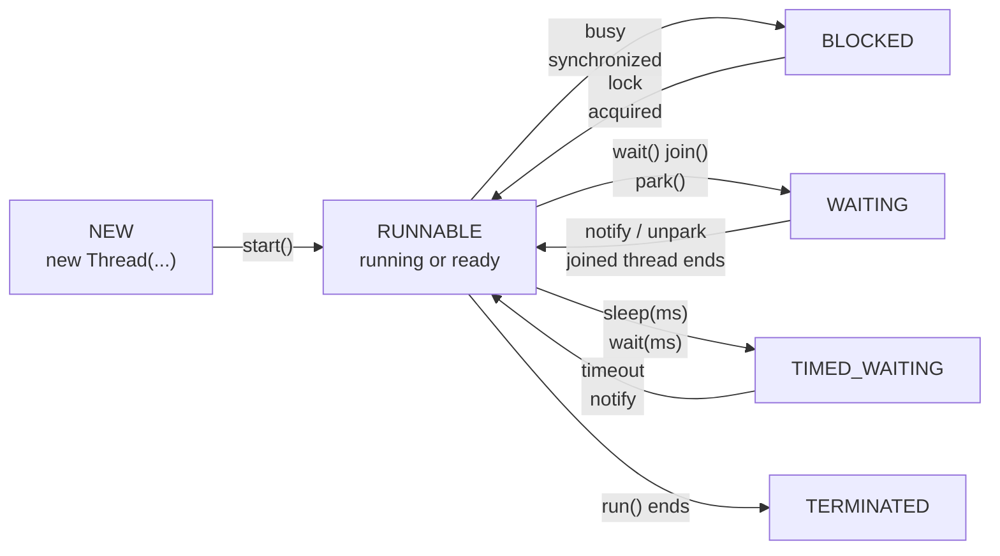
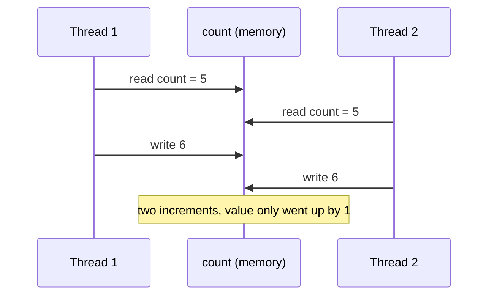
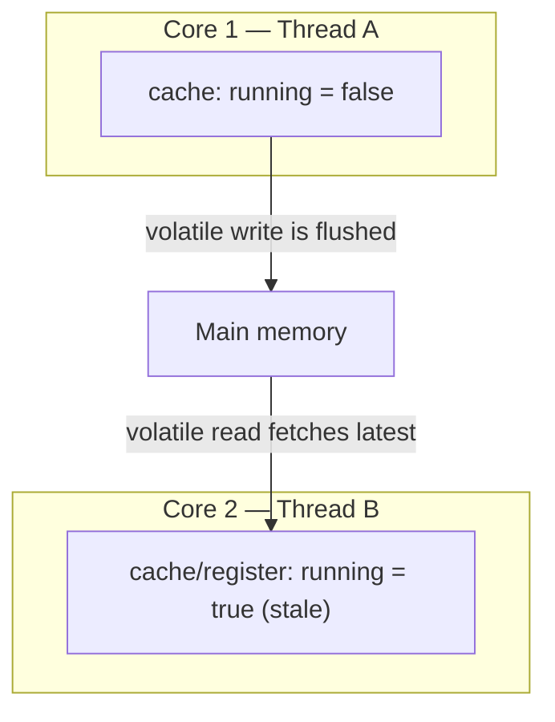
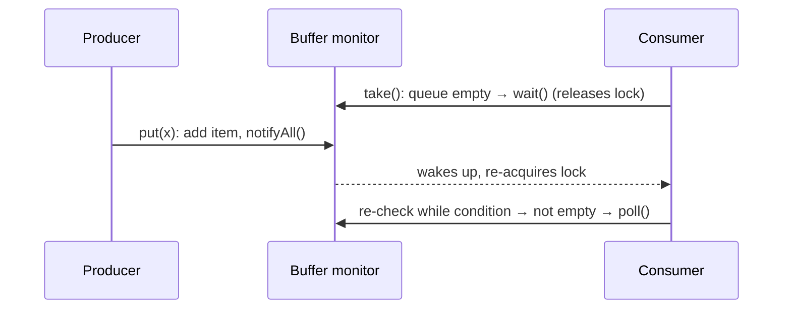
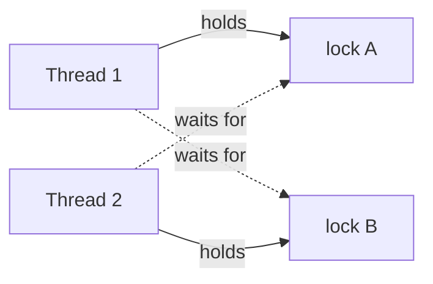
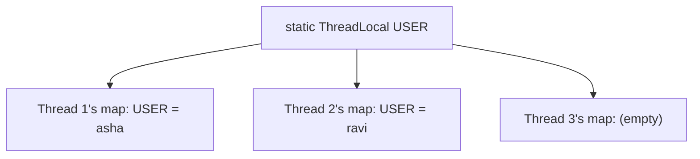
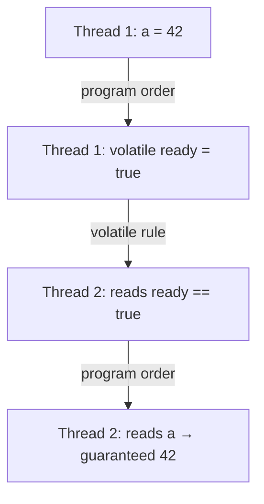
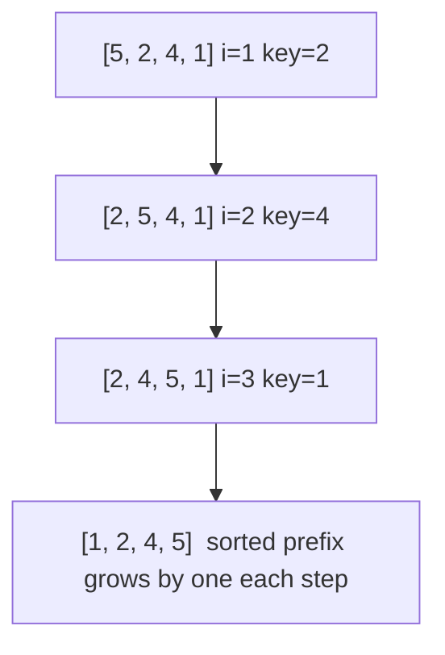
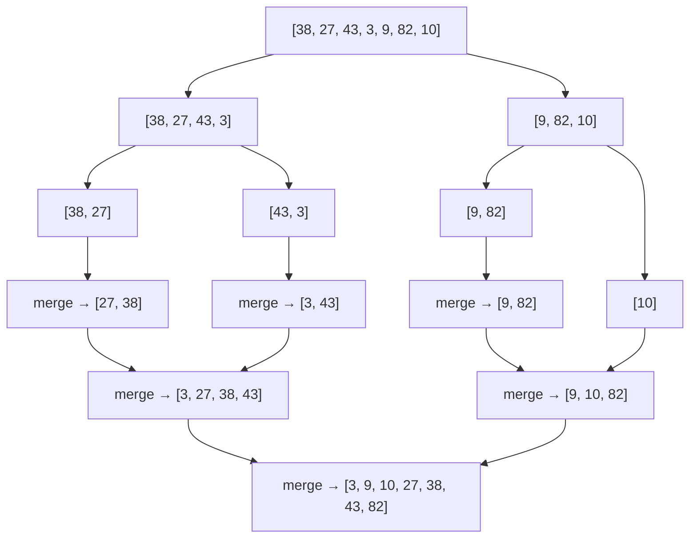
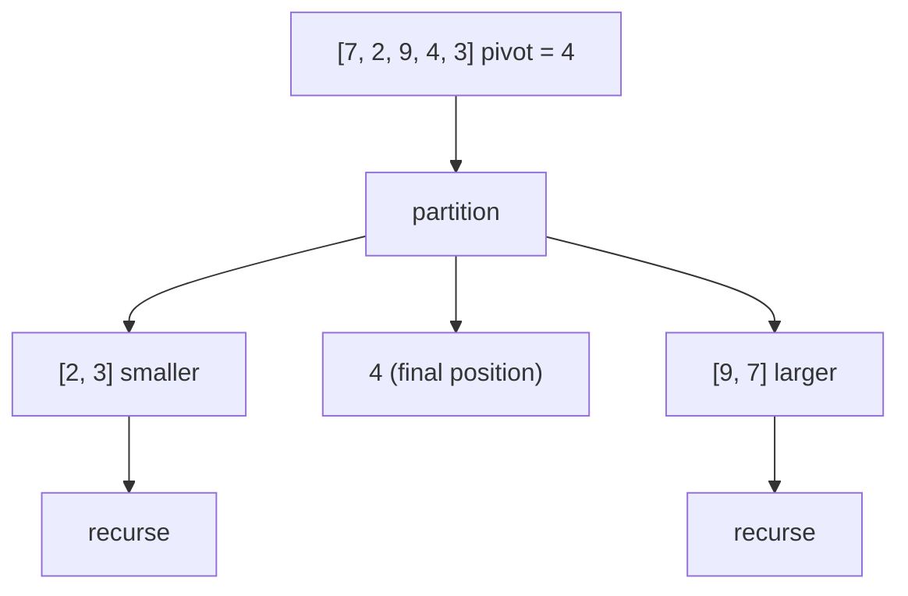

# Day 8 — Multithreading: Thread Basics & Synchronization

> **How to use these notes:** each section maps to one checklist item. Run the code, study the diagrams, then test yourself with the collapsible questions. 🚀 marks senior-level details.

**Today's goal:** explain the thread lifecycle, create threads correctly, protect shared state with `synchronized` and `volatile`, coordinate threads with `wait/notify`, recognise and prevent deadlocks, use `ThreadLocal` safely in thread pools, and — the part that separates senior answers — explain the **Java Memory Model** and **happens-before**. On the DSA side: **sorting algorithms** from bubble sort to merge sort and quick sort, and how Java sorts internally.

<!-- topic: d8_t1 -->
## ☕ Java — Multithreading Basics

<!-- subtopic: d8_t1_s1 -->
### 1. Thread Lifecycle — NEW, RUNNABLE, BLOCKED, WAITING, TIMED_WAITING, TERMINATED

> **TL;DR:** A Java thread is always in one of six states (`Thread.State`). It's **NEW** until `start()`, **RUNNABLE** while running or ready to run, **BLOCKED** waiting for a monitor lock, **WAITING / TIMED_WAITING** while waiting for another thread or a timeout, and **TERMINATED** when `run()` finishes.



| State | Meaning | Caused by |
|---|---|---|
| `NEW` | Created, not started | `new Thread(r)` |
| `RUNNABLE` | Running **or ready to run** (Java doesn't separate them); also while blocked in OS I/O | `start()` |
| `BLOCKED` | Waiting to acquire a **monitor** (`synchronized`) held by another thread | Entering a contended `synchronized` block |
| `WAITING` | Waiting **indefinitely** for another thread's action | `wait()`, `join()`, `LockSupport.park()` (used by `ReentrantLock`) |
| `TIMED_WAITING` | Waiting with a timeout | `sleep(ms)`, `wait(ms)`, `join(ms)`, `parkNanos` |
| `TERMINATED` | Finished | `run()` returned or threw |

```java
Thread t = new Thread(() -> {
    try { Thread.sleep(500); } catch (InterruptedException e) { Thread.currentThread().interrupt(); }
});
System.out.println(t.getState());   // NEW
t.start();
Thread.sleep(100);
System.out.println(t.getState());   // TIMED_WAITING
t.join();
System.out.println(t.getState());   // TERMINATED
```

Notes:
- A thread waiting on a `ReentrantLock` shows **WAITING** (it parks), not BLOCKED — BLOCKED is only for `synchronized` monitors. Useful when reading thread dumps.
- A terminated thread **can't be restarted** — `start()` twice throws `IllegalThreadStateException`.

#### 🎯 Interview questions

<details><summary>Q1. Difference between BLOCKED and WAITING?</summary>

BLOCKED: trying to enter a synchronized block/method whose monitor another thread holds. WAITING: voluntarily waiting for another thread's action (wait(), join(), park()) with no timeout.

</details>

<details><summary>Q2. Can you call start() twice on a thread?</summary>

No — the second call throws IllegalThreadStateException. A thread runs at most once; create a new Thread or use an executor.

</details>

<!-- subtopic: d8_t1_s2 -->
### 2. Creating Threads — Thread vs Runnable vs Callable

> **TL;DR:** Define the **task** with `Runnable` (no result) or `Callable<T>` (returns a value, can throw checked exceptions); run it on a `Thread` or, better, an **executor** (Day 9). Always call **`start()`**, never `run()` directly.

```java
// 1. Extend Thread (least flexible: uses up your one superclass)
class Worker extends Thread {
    @Override public void run() { System.out.println("worker on " + getName()); }
}
new Worker().start();

// 2. Implement Runnable (separates task from thread) — lambda since Java 8
Runnable task = () -> System.out.println("runnable on " + Thread.currentThread().getName());
Thread t = new Thread(task, "my-worker");
t.start();

// 3. Callable<T> — returns a value; needs an executor (or FutureTask)
Callable<Integer> compute = () -> 6 * 7;
ExecutorService pool = Executors.newSingleThreadExecutor();
Future<Integer> f = pool.submit(compute);
System.out.println(f.get());        // 42 — blocks until done
pool.shutdown();

// 4. Java 21: thread builders (platform and virtual)
Thread vt = Thread.ofVirtual().name("vt-1").start(task);
Thread pt = Thread.ofPlatform().daemon(true).start(task);
```

| | `extends Thread` | `Runnable` | `Callable<T>` |
|---|---|---|---|
| Returns a value | ❌ | ❌ | ✅ `T` via `Future` |
| Checked exceptions | ❌ | ❌ | ✅ `throws Exception` |
| Still can extend another class | ❌ | ✅ | ✅ |
| Works with executors | (it's a Runnable) | ✅ `execute`/`submit` | ✅ `submit`/`invokeAll` |
| Recommended | ❌ | ✅ | ✅ |

#### start() vs run() ⭐

```java
Thread t = new Thread(() -> System.out.println(Thread.currentThread().getName()));
t.run();     // prints "main"     — just a normal method call on the CURRENT thread
t.start();   // prints "Thread-0" — new call stack, runs concurrently
```

#### Other basics
- `t.join()` — wait for `t` to finish. `t.join(1000)` — wait at most 1 s.
- **Daemon threads** (`setDaemon(true)` before `start`) don't keep the JVM alive; the JVM exits when only daemons remain (GC, background housekeeping). `finally` blocks in daemon threads may not run at shutdown.
- Name your threads (`new Thread(task, "order-consumer-1")` or a `ThreadFactory`) — invaluable in logs and thread dumps.

<!-- subtopic: d8_t1_s3 -->
### 3. synchronized — monitors, method vs block

> **TL;DR:** `synchronized` gives **mutual exclusion** (one thread at a time in the critical section) **and visibility** (changes made inside are seen by the next thread that acquires the same lock). Every object has an **intrinsic lock (monitor)**; `synchronized` methods lock `this` (or the `Class` object if static).

#### 3.1 The race condition

```java
class Counter {
    private int count = 0;
    void increment() { count++; }      // NOT atomic: read → add → write
    int get() { return count; }
}

Counter c = new Counter();
Runnable r = () -> { for (int i = 0; i < 100_000; i++) c.increment(); };
Thread t1 = new Thread(r), t2 = new Thread(r);
t1.start(); t2.start(); t1.join(); t2.join();
System.out.println(c.get());           // usually LESS than 200000 — lost updates
```



#### 3.2 Three ways to synchronize

```java
class Counter {
    private int count = 0;
    private final Object lock = new Object();

    synchronized void increment() { count++; }        // 1. instance method → locks 'this'

    static synchronized void log() { }                // 2. static method → locks Counter.class

    void incrementBlock() {
        // ... non-critical work outside the lock ...
        synchronized (lock) {                         // 3. block → locks a chosen object
            count++;
        }
    }
    synchronized int get() { return count; }          // reads need the lock too (visibility)
}
```

| | Synchronized method | Synchronized block |
|---|---|---|
| Lock | `this` (or `Class` for static) | Any object you choose |
| Scope | Whole method | Only the critical section — less contention |
| Encapsulation | Lock (`this`) is public — outsiders can lock it too | Private lock object can't be misused |

#### 3.3 Properties of intrinsic locks
- **Reentrant:** a thread holding a lock can enter other `synchronized` code on the same lock (otherwise a synchronized method calling another would deadlock itself).
- **Visibility + ordering:** unlocking a monitor *happens-before* every later lock of the same monitor (section 9).
- Waiting threads are **BLOCKED** and **can't be interrupted** or time out (use `ReentrantLock` for that — Day 9).
- Static and instance synchronized methods use **different** locks — they don't exclude each other.

#### ⚠️ Pitfalls
- Don't lock on **String literals** or **boxed Integers** (shared/cached across the JVM) or on objects you reassign.
- Locking only the **writer** isn't enough — readers need the same lock (or `volatile`) to see the latest value.
- Keep critical sections small; never do I/O or call unknown code while holding a lock (deadlock risk).

#### 🎯 Interview questions

<details><summary>Q1. What does a synchronized instance method lock on? A static one?</summary>

Instance: the object instance (`this`). Static: the `Class` object (e.g., `Counter.class`). They're different locks.

</details>

<details><summary>Q2. Is count++ thread-safe?</summary>

No. It's read-modify-write (three steps), so concurrent increments can be lost. Use synchronized, AtomicInteger or LongAdder.

</details>

<details><summary>Q3. What does "reentrant" mean for synchronized?</summary>

A thread already holding a monitor can acquire it again (e.g., one synchronized method calling another on the same object) without deadlocking itself; the lock tracks a hold count.

</details>

<!-- subtopic: d8_t1_s4 -->
### 4. volatile — visibility without locking

> **TL;DR:** A `volatile` field is always read from and written to **main memory** semantics: a write by one thread is **visible** to subsequent reads by other threads, and it prevents certain **reorderings**. It does **not** make compound operations like `count++` atomic.

#### 4.1 The visibility problem

```java
class Worker implements Runnable {
    private boolean running = true;               // ❌ not volatile
    public void stop() { running = false; }
    @Override public void run() {
        while (running) { /* busy work */ }       // may loop forever: the JIT can hoist the read out of the loop
    }
}

// ✅ fix
private volatile boolean running = true;
```

Each CPU core has caches and the JIT can keep values in registers; without a happens-before relationship, one thread may **never** see another thread's write.



#### 4.2 What volatile guarantees — and doesn't

| Guarantee | volatile | synchronized |
|---|---|---|
| Visibility of the latest write | ✅ | ✅ |
| Prevents reordering around the access | ✅ | ✅ |
| Atomic read-modify-write (`x++`, check-then-act) | ❌ | ✅ |
| Mutual exclusion | ❌ | ✅ |
| Blocking | Never | Can block |
| Atomic reads/writes of `long`/`double` | ✅ (otherwise may tear on 32-bit JVMs) | ✅ |

#### 4.3 When to use volatile
- **Status flags** (`running`, `shutdownRequested`) written by one thread, read by others.
- **Publishing an immutable object** reference (`volatile Config current;` then replace the whole object).
- The **double-checked locking** singleton (section 9).

For counters use `AtomicInteger`/`LongAdder` (Day 9); for multi-field invariants use locks.

<!-- subtopic: d8_t1_s5 -->
### 5. wait(), notify(), notifyAll() — inter-thread communication

> **TL;DR:** `wait()` makes the current thread **release the monitor and sleep** until another thread calls `notify()`/`notifyAll()` on the **same object**. Always call them **inside `synchronized`** on that object, and always wait **in a `while` loop** checking the condition (spurious wakeups).

#### 5.1 Bounded buffer (producer–consumer) with wait/notify

```java
public class BoundedBuffer<T> {
    private final Queue<T> queue = new ArrayDeque<>();
    private final int capacity;

    public BoundedBuffer(int capacity) { this.capacity = capacity; }

    public synchronized void put(T item) throws InterruptedException {
        while (queue.size() == capacity) {     // WHILE, not if
            wait();                            // releases the lock, waits
        }
        queue.add(item);
        notifyAll();                           // wake consumers
    }

    public synchronized T take() throws InterruptedException {
        while (queue.isEmpty()) {
            wait();
        }
        T item = queue.poll();
        notifyAll();                           // wake producers
        return item;
    }
}
```



#### 5.2 Rules
1. Must hold the object's monitor → otherwise **`IllegalMonitorStateException`**.
2. `wait()` **releases** the lock; when woken it must **re-acquire** it before continuing.
3. **Spurious wakeups** can happen (and another thread may have taken the item first) → always re-check the condition in a `while` loop.
4. `notify()` wakes **one arbitrary** waiting thread; `notifyAll()` wakes **all**. Prefer `notifyAll()` when threads wait for different conditions (as above — producers and consumers share one monitor), otherwise you can wake the wrong kind of thread and stall.

In real code use higher-level tools: `BlockingQueue` (Day 15), `CountDownLatch`, `Semaphore`, `Condition` (Day 9). But interviewers still ask you to write this.

<!-- subtopic: d8_t1_s6 -->
### 6. Deadlock — causes, detection, prevention

> **TL;DR:** A deadlock is two or more threads each **holding a lock the other needs**, waiting forever. Prevent it with a **global lock ordering**, **timeouts** (`tryLock`), and by not holding locks while calling unknown code. Detect it with **thread dumps** (`jstack`).

#### 6.1 Classic deadlock

```java
Object lockA = new Object(), lockB = new Object();

Thread t1 = new Thread(() -> {
    synchronized (lockA) {
        sleep(50);
        synchronized (lockB) { System.out.println("t1 got both"); }
    }
});
Thread t2 = new Thread(() -> {
    synchronized (lockB) {               // opposite order!
        sleep(50);
        synchronized (lockA) { System.out.println("t2 got both"); }
    }
});
t1.start(); t2.start();                  // both hang forever
```



#### 6.2 The four necessary (Coffman) conditions
1. **Mutual exclusion** — resources can't be shared.
2. **Hold and wait** — a thread holds one lock while waiting for another.
3. **No preemption** — locks can't be taken away.
4. **Circular wait** — a cycle of threads each waiting for the next.

Break **any one** and deadlock is impossible.

#### 6.3 Prevention techniques

```java
// 1. Global lock ordering (breaks circular wait) — e.g., always lock the lower account id first
void transfer(Account from, Account to, BigDecimal amount) {
    Account first = from.id() < to.id() ? from : to;
    Account second = first == from ? to : from;
    synchronized (first) {
        synchronized (second) {
            from.withdraw(amount);
            to.deposit(amount);
        }
    }
}

// 2. tryLock with timeout (breaks hold-and-wait / no-preemption) — Day 9
if (lockA.tryLock(100, TimeUnit.MILLISECONDS)) {
    try {
        if (lockB.tryLock(100, TimeUnit.MILLISECONDS)) {
            try { /* work */ } finally { lockB.unlock(); }
        }
    } finally { lockA.unlock(); }
}   // on failure: back off and retry (with random jitter to avoid livelock)
```

3. Hold locks for the shortest time; avoid nested locks; don't call external/overridable methods while holding a lock.
4. Use higher-level concurrency utilities (`ConcurrentHashMap`, queues) that don't expose locks.

#### 6.4 Detection
- `jstack <pid>` (or `jcmd <pid> Thread.print`) prints **"Found one Java-level deadlock"** with the threads and locks involved.
- Programmatically: `ManagementFactory.getThreadMXBean().findDeadlockedThreads()`.
- In production: thread dumps from APM tools, VisualVM, JFR (Day 17).

#### Related liveness problems

| Problem | What happens |
|---|---|
| **Deadlock** | Threads wait forever, no progress |
| **Livelock** | Threads keep reacting to each other (e.g., both back off and retry in lockstep) but make no progress |
| **Starvation** | A thread never gets CPU or a lock because others are always preferred (unfair locks, priorities) |

<!-- subtopic: d8_t1_s7 -->
### 7. ThreadLocal&lt;T&gt; — per-thread variables

> **TL;DR:** `ThreadLocal` gives **each thread its own independent copy** of a value — no sharing, so no synchronization needed. Used for per-request context. In **thread pools you must call `remove()`**, or values leak between requests and cause memory leaks.

```java
public class RequestContext {
    private static final ThreadLocal<String> USER = new ThreadLocal<>();
    public static void setUser(String user) { USER.set(user); }
    public static String getUser() { return USER.get(); }
    public static void clear() { USER.remove(); }
}

// e.g., in a servlet filter:
try {
    RequestContext.setUser(jwt.getSubject());
    chain.doFilter(request, response);       // any code on this thread can call RequestContext.getUser()
} finally {
    RequestContext.clear();                  // ⚠️ essential with pooled threads
}

// Per-thread instances of non-thread-safe objects
private static final ThreadLocal<SimpleDateFormat> FORMAT =
        ThreadLocal.withInitial(() -> new SimpleDateFormat("yyyy-MM-dd"));   // (or just use DateTimeFormatter)
```



How it works: each `Thread` has a `ThreadLocalMap`; the `ThreadLocal` object is the key (held weakly), the value is held strongly. If a pooled thread lives forever and you never call `remove()`, the value stays reachable → **memory leak** and **data bleeding into the next request** (user A seeing user B's context).

Where Spring uses it: `SecurityContextHolder` (current authenticated user), `TransactionSynchronizationManager` (current transaction/connection), `RequestContextHolder`, MDC in logging (trace ids).

🚀 Variants and modern alternatives:
- `InheritableThreadLocal` — child threads copy the parent's value at creation (doesn't work well with pools).
- With **virtual threads** (millions of them), large ThreadLocal values multiply memory use. **Scoped values** (`ScopedValue`, final in Java 25) are the immutable, bounded-lifetime replacement.

<!-- subtopic: d8_t1_s8 -->
### 8. Thread.sleep() vs Object.wait(), yield, priorities, interruption

> **TL;DR:** `sleep()` pauses the current thread **without releasing locks**. `wait()` **releases the monitor** and waits for a notification. `yield()` and priorities are only **hints** to the scheduler.

| | `Thread.sleep(ms)` | `obj.wait()` |
|---|---|---|
| Defined in | `Thread` (static) | `Object` (instance) |
| Releases the lock | ❌ No | ✅ Yes (the monitor of `obj`) |
| Must hold a lock | ❌ | ✅ — inside `synchronized(obj)` |
| Wakes up when | Time elapses (or interrupt) | `notify`/`notifyAll`, timeout, interrupt, spurious wakeup |
| Purpose | Pause / delay | Wait for a condition (coordination) |
| State | TIMED_WAITING | WAITING (or TIMED_WAITING with timeout) |

#### yield and priority
- `Thread.yield()` — hints that the current thread is willing to give up the CPU. The scheduler may ignore it. Rarely useful.
- `setPriority(1..10)` — mapped to OS priorities differently per platform; don't rely on it for correctness.

#### Interruption — the cooperative cancellation mechanism

```java
Thread worker = new Thread(() -> {
    while (!Thread.currentThread().isInterrupted()) {
        try {
            processNextItem();
            Thread.sleep(1000);                      // blocking calls throw InterruptedException
        } catch (InterruptedException e) {
            Thread.currentThread().interrupt();      // ✅ restore the flag (it was cleared by the exception)
            break;                                   // and exit
        }
    }
});
worker.start();
worker.interrupt();                                  // politely ask it to stop
```

Never swallow `InterruptedException` silently — either rethrow it or restore the interrupt flag so callers (like executor shutdown) know a cancellation was requested.

<!-- subtopic: d8_t4_s1 -->
### 9. The Java Memory Model — happens-before, reordering, safe publication

> **TL;DR:** The JMM defines **when a write by one thread is guaranteed to be visible to a read by another**. Without a **happens-before** relationship, the compiler, JIT and CPU may **reorder** operations and threads may see **stale or half-initialized** data. `synchronized`, `volatile`, `final`, thread start/join and concurrency utilities create happens-before edges.

#### 9.1 Reordering is real

```java
int a = 0; boolean ready = false;          // shared, NOT volatile

// Thread 1                               // Thread 2
a = 42;                                   if (ready) {
ready = true;                                 System.out.println(a);   // can print 0!
                                          }
```

The compiler/CPU may reorder Thread 1's writes (they're independent within that thread), or Thread 2 may see `ready` from memory but a stale `a` from cache. Making `ready` **volatile** fixes it: the write to `a` happens-before the volatile write of `ready`, which happens-before Thread 2's volatile read.

#### 9.2 Happens-before rules (memorize the main ones)

| Rule | Guarantee |
|---|---|
| **Program order** | Each action in a thread happens-before later actions in the same thread |
| **Monitor lock** | Unlocking a monitor happens-before every later lock of the **same** monitor |
| **Volatile** | A write to a volatile field happens-before every later read of that field |
| **Thread start** | `t.start()` happens-before any action in thread `t` |
| **Thread join** | All actions in `t` happen-before another thread returns from `t.join()` |
| **Final fields** | Correctly constructed object's final fields are visible after the constructor finishes |
| **Transitivity** | If A hb B and B hb C, then A hb C |
| Concurrency utilities | e.g., putting into a `BlockingQueue` / `ConcurrentHashMap` hb taking/getting it; `Future` completion hb `get()` |



#### 9.3 Safe publication

An object is **safely published** (other threads see its fully initialized state) if its reference is stored:
- in a `volatile` field or an `AtomicReference`,
- in a `final` field of a properly constructed object,
- in a field guarded by a lock,
- into a thread-safe collection (`ConcurrentHashMap`, `BlockingQueue`),
- or by a static initializer (class initialization is thread-safe).

**Immutable objects** (all fields `final`, no `this` escape) are safe even if published without synchronization.

#### 9.4 Double-checked locking singleton ⭐

```java
public final class ConfigService {
    private static volatile ConfigService instance;      // volatile is REQUIRED

    private ConfigService() { /* expensive init */ }

    public static ConfigService getInstance() {
        ConfigService local = instance;                  // one volatile read in the common path
        if (local == null) {                             // 1st check: no locking once initialized
            synchronized (ConfigService.class) {
                local = instance;
                if (local == null) {                     // 2nd check: another thread may have created it
                    instance = local = new ConfigService();
                }
            }
        }
        return local;
    }
}
```

**Why `volatile`?** `instance = new ConfigService()` is roughly: (1) allocate memory, (2) run the constructor, (3) assign the reference. Without volatile, (2) and (3) can be reordered, so another thread could see a **non-null reference to a not-yet-constructed object** at the first check and use it. The volatile write prevents that reordering and publishes the object safely.

Simpler alternatives that are also lazy and thread-safe: the **holder-class idiom** (Day 1) or an **enum singleton** (Day 3).

#### 🎯 Interview questions

<details><summary>Q1. What is happens-before?</summary>

A JMM guarantee that the effects of one action are visible to and ordered before another. Key edges: program order, monitor unlock→lock, volatile write→read, thread start, thread join, and transitivity.

</details>

<details><summary>Q2. Why does double-checked locking need volatile?</summary>

Object construction and reference assignment can be reordered; without volatile another thread can see a non-null reference to a partially constructed object. Volatile forbids that reordering and safely publishes the instance.

</details>

<details><summary>Q3. What is safe publication?</summary>

Making an object's reference available to other threads in a way that guarantees they also see its fully initialized state — via volatile, final fields, locks, thread-safe collections or static initialization.

</details>

<!-- topic: d8_t3 -->
## 🧮 DSA — Sorting Algorithms

> **Key vocabulary:** **Stable** = equal elements keep their original relative order (important when sorting by one key after another). **In-place** = O(1) (or O(log n)) extra memory. **Comparison sort lower bound:** any comparison-based sort needs Ω(n log n) comparisons in the worst case.

<!-- subtopic: d8_t3_s1 -->
### 10. Elementary Sorts — Bubble, Selection, Insertion

> **TL;DR:** All three are **O(n²)** and in place. **Bubble** swaps adjacent out-of-order pairs; **Selection** repeatedly picks the minimum; **Insertion** inserts each element into the sorted prefix — and is **fast on nearly-sorted or small data** (that's why real libraries use it for small subarrays).

#### Bubble sort

```java
static void bubbleSort(int[] a) {
    for (int pass = 0; pass < a.length - 1; pass++) {
        boolean swapped = false;
        for (int i = 0; i < a.length - 1 - pass; i++) {   // last 'pass' elements are already in place
            if (a[i] > a[i + 1]) {
                int t = a[i]; a[i] = a[i + 1]; a[i + 1] = t;
                swapped = true;
            }
        }
        if (!swapped) return;                               // already sorted → O(n) best case
    }
}
```

#### Selection sort

```java
static void selectionSort(int[] a) {
    for (int i = 0; i < a.length - 1; i++) {
        int min = i;
        for (int j = i + 1; j < a.length; j++) {
            if (a[j] < a[min]) min = j;                     // find the smallest in the unsorted part
        }
        int t = a[i]; a[i] = a[min]; a[min] = t;            // one swap per pass
    }
}
```

#### Insertion sort

```java
static void insertionSort(int[] a) {
    for (int i = 1; i < a.length; i++) {
        int key = a[i];
        int j = i - 1;
        while (j >= 0 && a[j] > key) {                      // shift bigger elements right
            a[j + 1] = a[j];
            j--;
        }
        a[j + 1] = key;                                     // drop key into its place
    }
}
```



| Algorithm | Best | Average | Worst | Space | Stable | Notes |
|---|---|---|---|---|---|---|
| Bubble | O(n) (with early exit) | O(n²) | O(n²) | O(1) | ✅ | Teaching only |
| Selection | O(n²) | O(n²) | O(n²) | O(1) | ❌ | Minimum number of swaps (n−1) |
| Insertion | **O(n)** | O(n²) | O(n²) | O(1) | ✅ | Great for small / nearly sorted input; online |

Why insertion sort is fast on nearly-sorted data: the inner loop runs once per **inversion** (out-of-order pair). Few inversions → close to O(n). Java's TimSort and dual-pivot quicksort switch to insertion sort for small ranges (≈ under 32–47 elements).

<!-- subtopic: d50_t2_s1 -->
### 11. Merge Sort — divide, sort, merge

> **TL;DR:** Split the array in half, sort each half recursively, **merge** the two sorted halves. Always **O(n log n)**, **stable**, but needs **O(n) extra space**. Ideal for linked lists, external sorting (data on disk) and when stability matters.

```java
static void mergeSort(int[] a) {
    if (a.length < 2) return;
    mergeSort(a, new int[a.length], 0, a.length - 1);
}

private static void mergeSort(int[] a, int[] tmp, int lo, int hi) {
    if (lo >= hi) return;                         // 0 or 1 element: already sorted
    int mid = lo + (hi - lo) / 2;
    mergeSort(a, tmp, lo, mid);                   // sort left half
    mergeSort(a, tmp, mid + 1, hi);               // sort right half
    if (a[mid] <= a[mid + 1]) return;             // optimization: halves already in order
    merge(a, tmp, lo, mid, hi);
}

private static void merge(int[] a, int[] tmp, int lo, int mid, int hi) {
    System.arraycopy(a, lo, tmp, lo, hi - lo + 1);
    int i = lo, j = mid + 1;
    for (int k = lo; k <= hi; k++) {
        if (i > mid)               a[k] = tmp[j++];       // left exhausted
        else if (j > hi)           a[k] = tmp[i++];       // right exhausted
        else if (tmp[j] < tmp[i])  a[k] = tmp[j++];       // strictly smaller → take right
        else                       a[k] = tmp[i++];       // ties take LEFT → stable
    }
}
```



**Complexity:** log₂ n levels, each level merges n elements in total → **O(n log n)** in best, average and worst case. Recurrence: T(n) = 2T(n/2) + O(n). **Space:** O(n) temp array + O(log n) stack.

Uses: sorting linked lists (no random access needed, O(1) extra space with pointer merging — [LC 148](https://leetcode.com/problems/sort-list/)), counting inversions, external merge sort for huge files, `Arrays.sort(Object[])` (TimSort is a merge-sort hybrid).

<!-- subtopic: d50_t2_s2 -->
### 12. Quick Sort — partition around a pivot

> **TL;DR:** Pick a **pivot**, **partition** so smaller elements go left and larger go right, then recursively sort both sides. **O(n log n) average**, **O(n²) worst case** (bad pivots), in place (O(log n) stack), **not stable**. Usually the fastest in practice thanks to cache-friendly in-place work.

```java
static void quickSort(int[] a, int lo, int hi) {
    if (lo >= hi) return;
    int p = partition(a, lo, hi);
    quickSort(a, lo, p - 1);
    quickSort(a, p + 1, hi);
}

// Lomuto partition with a RANDOM pivot (avoids worst case on sorted input)
private static int partition(int[] a, int lo, int hi) {
    int r = lo + ThreadLocalRandom.current().nextInt(hi - lo + 1);
    swap(a, r, hi);                                   // move pivot to the end
    int pivot = a[hi];
    int i = lo;                                       // a[lo..i-1] < pivot
    for (int j = lo; j < hi; j++) {
        if (a[j] < pivot) swap(a, i++, j);
    }
    swap(a, i, hi);                                   // pivot to its final position
    return i;
}

private static void swap(int[] a, int i, int j) { int t = a[i]; a[i] = a[j]; a[j] = t; }
```



#### Pivot strategies

| Strategy | Effect |
|---|---|
| First/last element | O(n²) on already sorted input ❌ |
| **Random** | Expected O(n log n) for any input ✅ |
| **Median-of-three** (first, middle, last) | Good in practice, cheap |
| **3-way partition** (Dutch National Flag) | Handles many duplicates in O(n) per level — see Sort Colors (Day 9) |
| Dual pivot (Java) | Two pivots, three partitions — fewer comparisons on average |

#### Merge sort vs quick sort

| | Merge sort | Quick sort |
|---|---|---|
| Worst case | O(n log n) | O(n²) (rare with random pivot) |
| Extra space | O(n) | O(log n) stack |
| Stable | ✅ | ❌ |
| Cache performance | Good | Better (in place) |
| Best for | Linked lists, stability, external data | Arrays of primitives in memory |

**Quickselect** (same partition, recurse into one side only) finds the k-th smallest element in **O(n) average** — used for Kth Largest Element (Day 21).

<!-- subtopic: d8_t3_s2 -->
### 13. How Java Sorts — Arrays.sort, Collections.sort, comparators

> **TL;DR:** `Arrays.sort(int[])` (primitives) uses **dual-pivot quicksort** (not stable — doesn't matter for primitives). `Arrays.sort(Object[])`, `Collections.sort` and `List.sort` use **TimSort** — a **stable** merge/insertion hybrid, O(n log n) worst case and O(n) on already sorted data.

```java
int[] nums = {5, 3, 9, 1};
Arrays.sort(nums);                                   // dual-pivot quicksort → [1, 3, 5, 9]
Arrays.sort(nums, 1, 3);                             // sort a range [1, 3)

Integer[] boxed = {5, 3, 9, 1};
Arrays.sort(boxed, Collections.reverseOrder());      // descending needs objects (Comparator)

List<Employee> emps = new ArrayList<>(list);
Collections.sort(emps);                              // Comparable (natural order) — TimSort
emps.sort(Comparator.comparing(Employee::dept)
                    .thenComparing(Employee::salary, Comparator.reverseOrder()));

int[][] intervals = {{5, 6}, {1, 3}, {2, 4}};
Arrays.sort(intervals, (x, y) -> Integer.compare(x[0], y[0]));   // sort 2D array by first column

String[] words = {"banana", "Apple", "cherry"};
Arrays.sort(words, String.CASE_INSENSITIVE_ORDER);

Arrays.parallelSort(bigArray);                       // splits work across the ForkJoinPool
```

| API | Algorithm | Stable | Worst case |
|---|---|---|---|
| `Arrays.sort(primitive[])` | Dual-pivot quicksort (+ insertion sort for small ranges; heap sort fallback in modern JDKs) | ❌ | O(n log n) |
| `Arrays.sort(Object[])`, `Collections.sort`, `List.sort`, `stream.sorted()` | TimSort | ✅ | O(n log n) |
| `Arrays.parallelSort` | Parallel merge sort | ✅ for objects | O(n log n) |

Why stability matters: sort employees by name, then **stable**-sort by department → within each department, names stay alphabetical. (Or just use `thenComparing`.)

⚠️ Comparators must be consistent and never use `a - b` (overflow — Day 3). An inconsistent comparator can make TimSort throw `IllegalArgumentException: Comparison method violates its general contract!`.

<!-- subtopic: d50_t2_s4 -->
### 14. Largest Number (LeetCode 179) — custom comparator sort

> **Problem:** given non-negative integers, arrange them to form the **largest number**, returned as a string. `[3, 30, 34, 5, 9]` → `"9534330"`. 🔗 [LeetCode 179](https://leetcode.com/problems/largest-number/)

Sorting by numeric value or plain string order fails: `"30" > "3"` lexicographically, but `"3" + "30" = "330"` beats `"30" + "3" = "303"`.

**Key insight:** put `a` before `b` if `a + b > b + a` (as strings). This ordering is transitive, so sorting with it is valid.

```java
public String largestNumber(int[] nums) {
    String[] strs = new String[nums.length];
    for (int i = 0; i < nums.length; i++) strs[i] = String.valueOf(nums[i]);

    Arrays.sort(strs, (a, b) -> (b + a).compareTo(a + b));   // descending by concatenation

    if (strs[0].equals("0")) return "0";                     // all zeros: "000" → "0"

    StringBuilder sb = new StringBuilder();
    for (String s : strs) sb.append(s);
    return sb.toString();
}   // Time O(n log n · k) where k = digit length (string compares), Space O(n · k)
```

**Dry run** comparisons: `"9" vs "5"`: `"95" > "59"` → 9 first. `"3" vs "30"`: `"330" > "303"` → 3 first. `"34" vs "3"`: `"343" > "334"` → 34 first. Result order `9, 5, 34, 3, 30` → `"9534330"`.

> **Pattern:** when the order between two items depends on how they **combine**, compare the two combinations directly. Edge case to always mention: leading zeros.

<!-- subtopic: d8_t3_s3 -->
### 15. Sort an Array (LeetCode 912) — implement it yourself

> **Problem:** sort an integer array in ascending order in **O(n log n)** time without using built-in sort functions. 🔗 [LeetCode 912](https://leetcode.com/problems/sort-an-array/)

Merge sort is the safe choice (guaranteed O(n log n); the test cases include inputs that break naive quicksort):

```java
class Solution {
    public int[] sortArray(int[] nums) {
        int[] tmp = new int[nums.length];
        mergeSort(nums, tmp, 0, nums.length - 1);
        return nums;
    }

    private void mergeSort(int[] a, int[] tmp, int lo, int hi) {
        if (hi - lo < 16) {                           // small ranges: insertion sort is faster
            insertionSort(a, lo, hi);
            return;
        }
        int mid = lo + (hi - lo) / 2;
        mergeSort(a, tmp, lo, mid);
        mergeSort(a, tmp, mid + 1, hi);
        if (a[mid] <= a[mid + 1]) return;             // already ordered
        System.arraycopy(a, lo, tmp, lo, hi - lo + 1);
        int i = lo, j = mid + 1;
        for (int k = lo; k <= hi; k++) {
            if (i > mid) a[k] = tmp[j++];
            else if (j > hi) a[k] = tmp[i++];
            else if (tmp[j] < tmp[i]) a[k] = tmp[j++];
            else a[k] = tmp[i++];
        }
    }

    private void insertionSort(int[] a, int lo, int hi) {
        for (int i = lo + 1; i <= hi; i++) {
            int key = a[i], j = i - 1;
            while (j >= lo && a[j] > key) { a[j + 1] = a[j]; j--; }
            a[j + 1] = key;
        }
    }
}   // Time O(n log n), Space O(n)
```

Alternatives worth mentioning:
- **Heap sort** — O(n log n) worst case, O(1) space, not stable (Day 21).
- **Counting sort** — O(n + k) when values are in a small range k (LC 912 has values in [−5·10⁴, 5·10⁴], so counting sort also works: offset by 50 000).
- **Randomized quicksort with 3-way partition** — fast in practice, handles duplicates.

---

## 📝 Day 8 Revision Cheat Sheet

| Topic | Remember this |
|---|---|
| States | NEW → RUNNABLE ↔ BLOCKED / WAITING / TIMED_WAITING → TERMINATED |
| Creating | Runnable / Callable + executor; `start()` not `run()`; can't start twice |
| synchronized | Mutual exclusion + visibility; method locks `this` / Class; reentrant; private lock objects |
| volatile | Visibility + ordering, NOT atomicity; flags, safe publication, DCL |
| wait/notify | Inside synchronized; wait releases the lock; `while` loop; prefer notifyAll |
| Deadlock | 4 conditions; lock ordering, tryLock timeouts; detect with jstack |
| ThreadLocal | Per-thread value; always `remove()` in pools; Spring security/tx context |
| sleep vs wait | sleep keeps locks; wait releases; restore interrupt flag |
| JMM | happens-before: program order, unlock→lock, volatile write→read, start, join, transitivity |
| DCL singleton | Needs volatile (reordering of construction and assignment) |
| Elementary sorts | O(n²); insertion sort O(n) on nearly sorted, stable |
| Merge sort | O(n log n) always, stable, O(n) space |
| Quick sort | O(n log n) avg, O(n²) worst, in place, unstable; random pivot |
| Java | primitives → dual-pivot quicksort; objects → TimSort (stable) |
| Largest Number | Compare `b + a` vs `a + b`; all-zeros edge case |

### ⚡ Rapid-fire self-test

1. State of a thread waiting to enter a synchronized block? → **BLOCKED**
2. Does `sleep()` release locks? → **No**
3. Does `volatile` make `count++` atomic? → **No**
4. What exception when calling `wait()` without holding the lock? → **IllegalMonitorStateException**
5. Simplest deadlock prevention? → **Always acquire locks in the same global order**
6. What must you do with ThreadLocal in a thread pool? → **remove() in finally**
7. Which sort does `Collections.sort` use? → **TimSort (stable)**
8. Quick sort worst case and when? → **O(n²), consistently bad pivots (e.g., sorted input with first/last pivot)**
9. Is merge sort stable? → **Yes**
10. Largest Number for `[0, 0]`? → **"0"**
