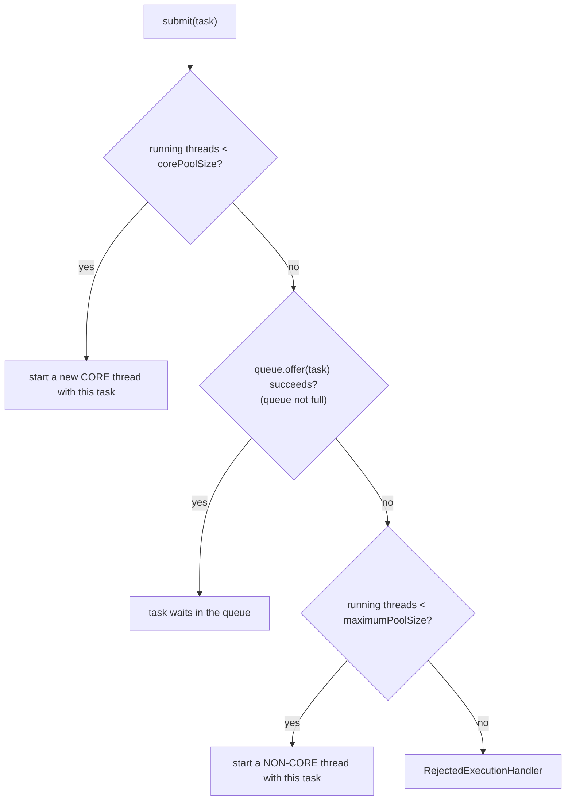
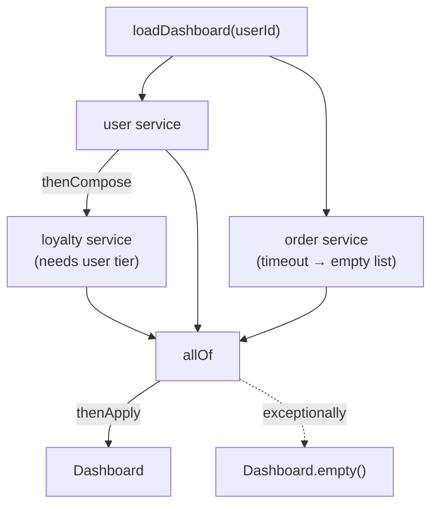
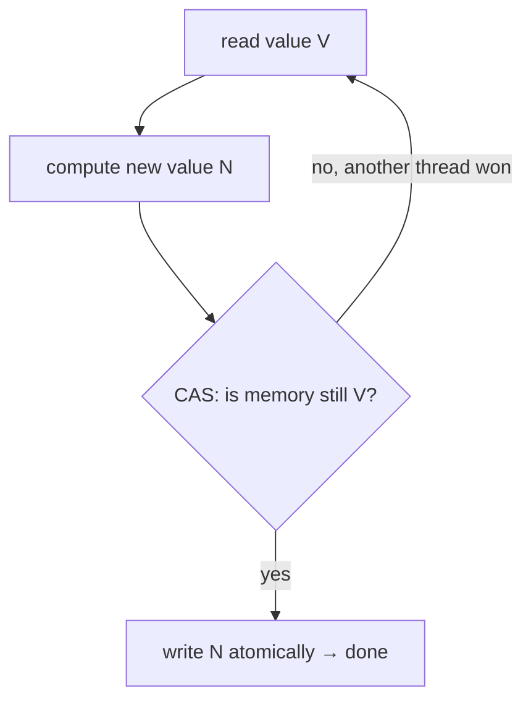
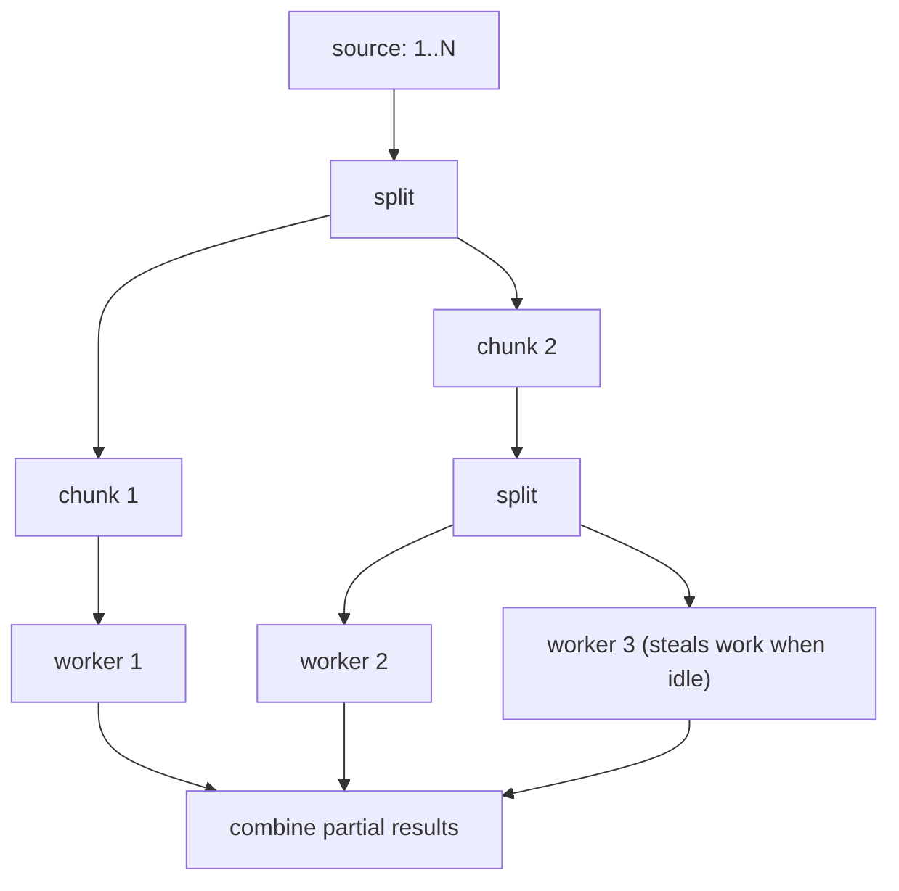
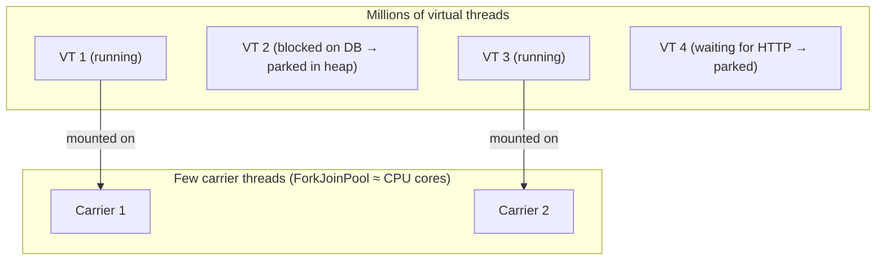
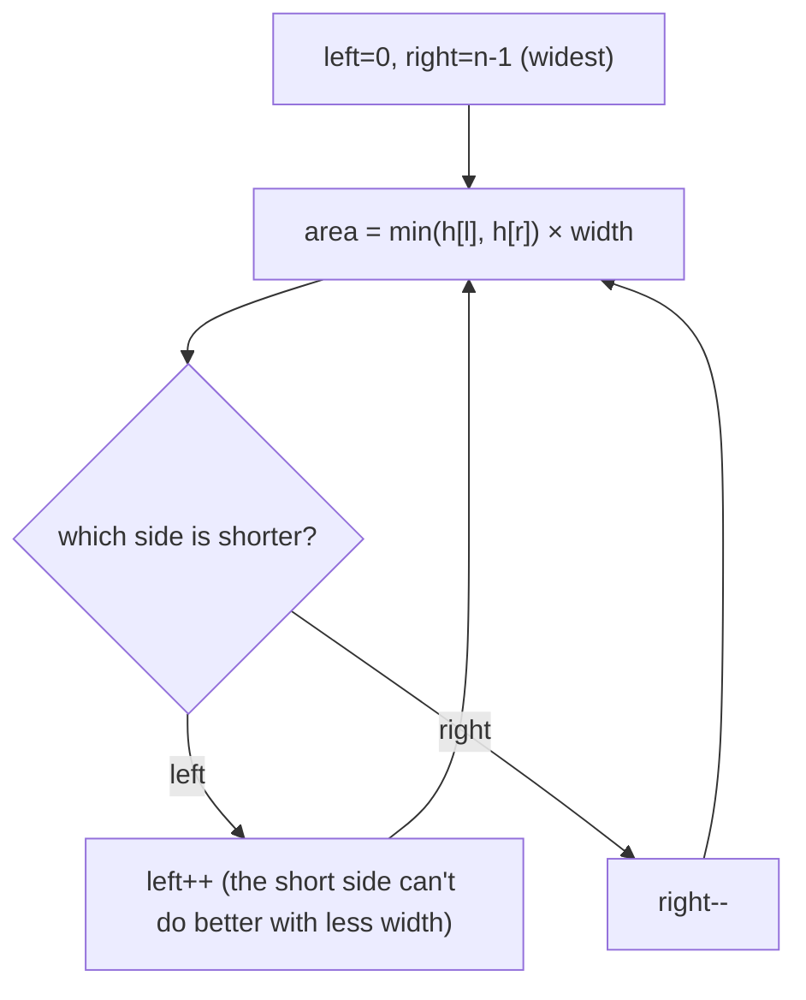
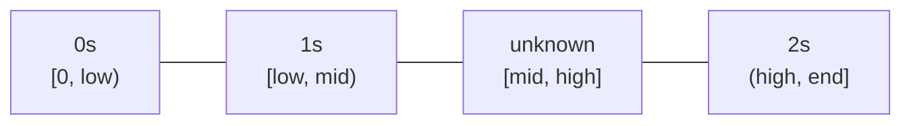
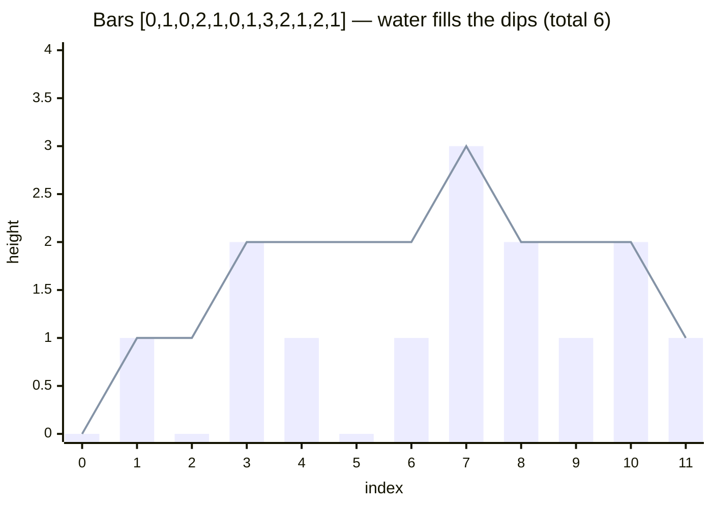

# Day 9 — Concurrency: Executors, Thread Pools, Locks, CompletableFuture & Virtual Threads

> **How to use these notes:** each section maps to one checklist item. Run the code, study the diagrams, then test yourself with the collapsible questions. 🚀 marks senior-level details.

**Today's goal:** stop creating raw threads. Use executors and **understand `ThreadPoolExecutor` internals** (the #1 concurrency interview question for backend roles), compose async work with **`CompletableFuture`**, pick the right lock (`ReentrantLock`, `ReadWriteLock`, `StampedLock`) or lock-free tool (atomics, `LongAdder`), use the coordination utilities (`CountDownLatch`, `CyclicBarrier`, `Semaphore`), know when parallel streams help, and explain **virtual threads** (Java 21). On the DSA side: medium **two-pointer** problems, including the famous 3Sum and Trapping Rain Water.

<!-- topic: d9_t1 -->
## ☕ Java — Advanced Concurrency

<!-- subtopic: d9_t1_s1 -->
### 1. ExecutorService — thread pools and shutdown

> **TL;DR:** An **executor** separates *what* to run (tasks) from *how* it runs (threads). Thread pools **reuse** threads, **limit** concurrency and give you **futures**. Always **shut executors down**.

#### 1.1 Why not `new Thread()` per task?
- Creating platform threads is expensive (OS thread, ~1 MB stack).
- Unbounded thread creation under load → memory exhaustion, context-switch storms.
- No result handling, no lifecycle management, no queueing.

#### 1.2 Factory methods in `Executors`

```java
ExecutorService fixed     = Executors.newFixedThreadPool(4);          // 4 threads, unbounded queue
ExecutorService cached    = Executors.newCachedThreadPool();           // grows without limit, idle threads die after 60s
ExecutorService single    = Executors.newSingleThreadExecutor();      // 1 thread, tasks run in order
ScheduledExecutorService scheduler = Executors.newScheduledThreadPool(2);
ExecutorService stealing  = Executors.newWorkStealingPool();           // ForkJoinPool, parallelism = cores
ExecutorService virtual   = Executors.newVirtualThreadPerTaskExecutor();   // Java 21 (section 10)

scheduler.schedule(() -> cleanup(), 10, TimeUnit.SECONDS);                     // once, after a delay
scheduler.scheduleAtFixedRate(() -> poll(), 0, 5, TimeUnit.SECONDS);           // every 5 s from start times
scheduler.scheduleWithFixedDelay(() -> poll(), 0, 5, TimeUnit.SECONDS);        // 5 s after each run ends
```

| Factory | Threads | Queue | Danger |
|---|---|---|---|
| `newFixedThreadPool(n)` | exactly n | **Unbounded** `LinkedBlockingQueue` | Queue grows forever under overload → OOM |
| `newCachedThreadPool()` | 0 → **unbounded** | `SynchronousQueue` (no storage) | Thread explosion under load |
| `newSingleThreadExecutor()` | 1 | Unbounded | Same as fixed |
| `newScheduledThreadPool(n)` | n core | Delay queue | — |

> In production code, many teams (and Alibaba's Java guidelines) **forbid the `Executors` factories** and construct a `ThreadPoolExecutor` explicitly with a **bounded queue** and a rejection policy (next section).

#### 1.3 Submitting work

```java
executor.execute(runnable);                       // fire-and-forget, exceptions go to the thread's handler
Future<?> f1 = executor.submit(runnable);         // exceptions captured in the Future
Future<Integer> f2 = executor.submit(callable);
List<Future<Integer>> all = executor.invokeAll(List.of(c1, c2, c3));   // wait for all
Integer fastest = executor.invokeAny(List.of(c1, c2, c3));             // first successful result
```

⚠️ With `submit`, an exception thrown by the task is **silently stored** in the Future — you only see it when calling `get()`. With `execute`, it reaches the thread's `UncaughtExceptionHandler` (logged).

#### 1.4 Shutting down

```java
executor.shutdown();                                   // no new tasks; queued tasks still run
if (!executor.awaitTermination(30, TimeUnit.SECONDS)) {
    List<Runnable> neverRan = executor.shutdownNow();  // interrupts running tasks, returns queued ones
}

// Java 19+: ExecutorService is AutoCloseable — close() = shutdown + await termination
try (ExecutorService ex = Executors.newFixedThreadPool(4)) {
    ex.submit(task1);
    ex.submit(task2);
}   // waits here for both tasks
```

| `shutdown()` | `shutdownNow()` |
|---|---|
| Stops accepting new tasks | Stops accepting new tasks |
| Lets running **and queued** tasks finish | **Interrupts** running tasks, **drains** the queue |
| Returns immediately (use `awaitTermination` to wait) | Returns the list of tasks that never started |

Forgetting to shut down non-daemon pools keeps the JVM alive. In Spring, define executors as beans — Spring shuts them down with the context.

<!-- subtopic: d9_t4_s1 -->
### 2. ThreadPoolExecutor Internals — core, max, queue, rejection ⭐

> **TL;DR:** A new task goes to: **(1)** a new **core** thread if fewer than `corePoolSize` exist; else **(2)** the **queue**; if the queue is full, **(3)** a new **non-core** thread up to `maximumPoolSize`; if that's also maxed, **(4)** the **rejection policy**. Non-core threads die after `keepAliveTime` idle.

#### 2.1 The constructor

```java
ThreadPoolExecutor pool = new ThreadPoolExecutor(
        4,                                        // corePoolSize — kept alive even when idle
        16,                                       // maximumPoolSize — upper bound on threads
        60, TimeUnit.SECONDS,                     // keepAliveTime for threads above core
        new ArrayBlockingQueue<>(500),            // BOUNDED work queue
        Thread.ofPlatform().name("order-worker-", 0).factory(),   // named threads (Java 21 builder)
        new ThreadPoolExecutor.CallerRunsPolicy() // what to do when saturated
);
pool.allowCoreThreadTimeOut(true);                // optionally let core threads time out too
pool.prestartAllCoreThreads();                    // optionally start core threads eagerly
```

#### 2.2 How a task is handled



⚠️ **Common misconception:** the pool does **not** grow to `maximumPoolSize` before queueing. It fills the **queue first**. With an **unbounded** queue (`LinkedBlockingQueue()`), the queue never fills, so `maximumPoolSize` is **never used** — that's exactly what `newFixedThreadPool` does.

#### 2.3 Queue choices

| Queue | Behaviour |
|---|---|
| `ArrayBlockingQueue(n)` | Bounded FIFO — recommended; gives back-pressure |
| `LinkedBlockingQueue()` | Unbounded by default — max pool size becomes meaningless, OOM risk |
| `SynchronousQueue` | No capacity: hand off directly to a thread or create one (cached pool) |
| `PriorityBlockingQueue` | Tasks ordered by priority (unbounded) |

#### 2.4 Rejection policies

| Policy | On saturation |
|---|---|
| `AbortPolicy` (**default**) | Throws `RejectedExecutionException` |
| `CallerRunsPolicy` | The **submitting thread runs the task** itself → natural back-pressure (slows down producers) |
| `DiscardPolicy` | Silently drops the task ⚠️ |
| `DiscardOldestPolicy` | Drops the oldest queued task, retries the new one |
| Custom | Log + metric, persist to a retry table, return HTTP 429/503 |

#### 2.5 Sizing the pool

| Workload | Rule of thumb |
|---|---|
| **CPU-bound** (calculations, compression) | threads ≈ **number of cores** (maybe +1) — more threads only add context switching |
| **I/O-bound** (DB, HTTP calls) | threads ≈ **cores × (1 + wait time / compute time)** (from *Java Concurrency in Practice*) |

Example: 8 cores, each request waits 90 ms on the DB and computes 10 ms → 8 × (1 + 90/10) = **80 threads**. Then load-test and watch: queue size, active count, rejection count, latency. For heavily I/O-bound work in Java 21+, **virtual threads** (section 10) often replace this tuning.

#### 🎯 Interview questions

<details><summary>Q1. Explain how ThreadPoolExecutor handles a new task.</summary>

Below corePoolSize it creates a core thread. Otherwise it tries to enqueue. If the queue is full and threads are below maximumPoolSize, it creates a non-core thread. If both are at capacity, it applies the RejectedExecutionHandler.

</details>

<details><summary>Q2. Why is Executors.newFixedThreadPool risky in production?</summary>

It uses an unbounded LinkedBlockingQueue: under sustained overload, tasks pile up without limit, increasing latency and eventually causing OutOfMemoryError, with no rejection signal.

</details>

<details><summary>Q3. What does CallerRunsPolicy do and why is it useful?</summary>

When the pool is saturated, the thread that submitted the task runs it itself. This slows down the producer, providing natural back-pressure instead of dropping tasks or throwing.

</details>

<details><summary>Q4. How would you size a thread pool for I/O-bound work?</summary>

Roughly cores × (1 + wait/compute ratio), then validate with load testing and metrics (queue depth, latency, CPU). For Java 21+, consider virtual threads.

</details>

<!-- subtopic: d9_t1_s2 -->
### 3. Future&lt;T&gt; — results of async tasks, and its limitations

> **TL;DR:** A `Future` represents a result that will be available later. `get()` **blocks** until it's ready. You can check `isDone()`, `cancel()` and use timeouts — but you **can't chain, combine or react** to completion. That's why `CompletableFuture` exists.

```java
ExecutorService pool = Executors.newFixedThreadPool(2);
Future<String> future = pool.submit(() -> {
    Thread.sleep(1000);
    return "report ready";
});

// ... do other work meanwhile ...

future.isDone();                                   // false (probably)
String result = future.get(2, TimeUnit.SECONDS);   // blocks up to 2 s → TimeoutException if late
// future.get();                                   // blocks forever if the task hangs ⚠️
future.cancel(true);                               // true = interrupt if running
future.isCancelled();
```

Exceptions: if the task threw, `get()` throws **`ExecutionException`** wrapping it (`e.getCause()`). Other exceptions: `InterruptedException`, `TimeoutException`, `CancellationException`.

#### Limitations of Future
1. `get()` blocks — no callbacks ("when done, do X").
2. Can't **chain** dependent steps or **combine** several futures (except `invokeAll`).
3. Can't complete it manually or set a fallback value on error.
4. Exception handling only via try/catch around `get()`.

<!-- subtopic: d9_t1_s3 -->
### 4. CompletableFuture — non-blocking async pipelines

> **TL;DR:** `CompletableFuture<T>` is a Future you can **chain** (`thenApply`, `thenCompose`), **combine** (`thenCombine`, `allOf`), **react to** (`thenAccept`), and **recover from** (`exceptionally`, `handle`) — without blocking threads. **Pass your own executor** for I/O work.

#### 4.1 Creating

```java
ExecutorService io = Executors.newFixedThreadPool(20);   // dedicated pool for blocking I/O

CompletableFuture<User> userF = CompletableFuture.supplyAsync(() -> userClient.get(id), io);
CompletableFuture<Void> logF  = CompletableFuture.runAsync(() -> audit.log(id), io);
CompletableFuture<String> done = CompletableFuture.completedFuture("cached");
```

⚠️ Without an executor, `supplyAsync` uses the **common ForkJoinPool** (≈ cores − 1 threads, shared with parallel streams). Blocking I/O there starves everything else.

#### 4.2 The core operations

| Method | Input → output | Like |
|---|---|---|
| `thenApply(fn)` | T → U (transform) | `map` |
| `thenAccept(consumer)` | T → void | `forEach` |
| `thenRun(runnable)` | ignores T | — |
| `thenCompose(fn)` | T → `CompletableFuture<U>` (dependent async call) | `flatMap` |
| `thenCombine(other, bifn)` | (T, U) → V when **both** complete | zip |
| `allOf(cf...)` | wait for all → `CompletableFuture<Void>` | — |
| `anyOf(cf...)` | first to complete → `CompletableFuture<Object>` | — |
| `exceptionally(fn)` | Throwable → fallback T | catch |
| `handle(bifn)` | (T, Throwable) → U (always runs) | catch + map |
| `whenComplete(biconsumer)` | side effect, keeps result | finally |
| `orTimeout` / `completeOnTimeout` (Java 9) | timeout handling | — |

Each has an `...Async` variant that runs the callback on a pool instead of the completing thread.

#### 4.3 Real example — aggregate data from 3 services in parallel

```java
public CompletableFuture<Dashboard> loadDashboard(long userId) {
    CompletableFuture<User> user = CompletableFuture
            .supplyAsync(() -> userService.get(userId), io);

    CompletableFuture<List<Order>> orders = CompletableFuture
            .supplyAsync(() -> orderService.recent(userId), io)
            .completeOnTimeout(List.of(), 500, TimeUnit.MILLISECONDS);     // degrade gracefully

    CompletableFuture<Integer> points = user
            .thenCompose(u -> CompletableFuture.supplyAsync(() -> loyalty.points(u.tier()), io));  // depends on user

    return CompletableFuture.allOf(user, orders, points)
            .thenApply(v -> new Dashboard(user.join(), orders.join(), points.join()))   // join() won't block: all done
            .exceptionally(ex -> {
                log.error("dashboard failed for {}", userId, ex);
                return Dashboard.empty();
            });
}
```



Total latency ≈ the **slowest path** (user → loyalty), not the sum of all calls.

#### 4.4 join() vs get()
- `get()` throws checked `ExecutionException`/`InterruptedException`.
- `join()` throws unchecked `CompletionException` — nicer inside lambdas.
- Both **block** — use them only at the edge (or after `allOf` completes).

#### 🎯 Interview questions

<details><summary>Q1. thenApply vs thenCompose?</summary>

thenApply transforms the result with a synchronous function (T → U). thenCompose is for a function that itself returns a CompletableFuture (`T → CompletableFuture<U>`), flattening it — use it to chain dependent async calls.

</details>

<details><summary>Q2. How do you run three independent calls in parallel and combine the results?</summary>

Start each with supplyAsync on an I/O executor, then `CompletableFuture.allOf(a, b, c).thenApply(v -> combine(a.join(), b.join(), c.join()))`. For two futures, thenCombine.

</details>

<details><summary>Q3. Which thread pool does supplyAsync use by default and why does it matter?</summary>

The common ForkJoinPool, sized for CPU work and shared JVM-wide (also used by parallel streams). Blocking I/O there can starve other tasks, so pass a dedicated executor.

</details>

<!-- subtopic: d9_t1_s4 -->
### 5. ReentrantLock vs synchronized

> **TL;DR:** `ReentrantLock` does what `synchronized` does, plus: **try with timeout**, **interruptible** waiting, optional **fairness**, and **multiple condition queues**. The cost: you must **unlock in `finally`** yourself.

```java
private final ReentrantLock lock = new ReentrantLock();   // new ReentrantLock(true) = fair

public void transfer() {
    lock.lock();
    try {
        // critical section
    } finally {
        lock.unlock();            // ALWAYS in finally — otherwise an exception leaves it locked forever
    }
}

public boolean tryTransfer() throws InterruptedException {
    if (lock.tryLock(200, TimeUnit.MILLISECONDS)) {       // give up after 200 ms (deadlock avoidance)
        try { /* work */ return true; }
        finally { lock.unlock(); }
    }
    return false;
}

lock.lockInterruptibly();          // waiting can be cancelled with interrupt()
```

#### Conditions — multiple wait-sets on one lock

```java
class BoundedBuffer<T> {
    private final Queue<T> q = new ArrayDeque<>();
    private final int capacity;
    private final ReentrantLock lock = new ReentrantLock();
    private final Condition notFull = lock.newCondition();
    private final Condition notEmpty = lock.newCondition();

    BoundedBuffer(int capacity) { this.capacity = capacity; }

    void put(T item) throws InterruptedException {
        lock.lock();
        try {
            while (q.size() == capacity) notFull.await();
            q.add(item);
            notEmpty.signal();          // wake ONE consumer — no need for signalAll
        } finally { lock.unlock(); }
    }

    T take() throws InterruptedException {
        lock.lock();
        try {
            while (q.isEmpty()) notEmpty.await();
            T item = q.poll();
            notFull.signal();           // wake ONE producer
            return item;
        } finally { lock.unlock(); }
    }
}
```

Compare with Day 8's `wait/notifyAll` version: separate conditions let us wake exactly the right kind of thread.

| | `synchronized` | `ReentrantLock` |
|---|---|---|
| Acquire/release | Automatic (block scope) | Manual `lock()` / `unlock()` in finally |
| Try without blocking / timeout | ❌ | ✅ `tryLock()`, `tryLock(t, unit)` |
| Interruptible wait | ❌ | ✅ `lockInterruptibly()` |
| Fairness option | ❌ | ✅ (slower; FIFO-ish order) |
| Condition queues | One (`wait/notify`) | Many (`newCondition()`) |
| Introspection | ❌ | `isLocked()`, `getQueueLength()`, `getHoldCount()` |
| Reentrant | ✅ | ✅ |
| Forget to release? | Impossible | Possible ⚠️ |

Use `synchronized` for simple cases (less error-prone, well optimized); use `ReentrantLock` when you need its extra features. (Before Java 24, `synchronized` **pinned virtual threads** to their carrier during blocking; JEP 491 in Java 24 removed most of that limitation.)

<!-- subtopic: d9_t1_s5 -->
### 6. ReadWriteLock and StampedLock — for read-heavy data

> **TL;DR:** **`ReentrantReadWriteLock`** allows **many readers at once** but only **one writer** (and no readers while writing). **`StampedLock`** (Java 8) adds **optimistic reads** that don't lock at all — fastest for read-mostly data, but not reentrant and trickier to use.

```java
class PriceCache {
    private final Map<String, BigDecimal> prices = new HashMap<>();
    private final ReadWriteLock rw = new ReentrantReadWriteLock();

    BigDecimal get(String sku) {
        rw.readLock().lock();                    // many threads can hold the read lock together
        try { return prices.get(sku); }
        finally { rw.readLock().unlock(); }
    }

    void put(String sku, BigDecimal price) {
        rw.writeLock().lock();                   // exclusive
        try { prices.put(sku, price); }
        finally { rw.writeLock().unlock(); }
    }
}
```

- **Downgrading** (hold write → acquire read → release write) is allowed. **Upgrading** read → write is **not** (deadlocks if two readers try).
- Worth it only when reads vastly outnumber writes and the critical section isn't tiny. For a map, `ConcurrentHashMap` (Day 13) is usually better.

```java
class Point {
    private double x, y;
    private final StampedLock sl = new StampedLock();

    double distanceFromOrigin() {
        long stamp = sl.tryOptimisticRead();     // no lock — just a version stamp
        double cx = x, cy = y;
        if (!sl.validate(stamp)) {               // a write happened meanwhile → fall back to a real read lock
            stamp = sl.readLock();
            try { cx = x; cy = y; }
            finally { sl.unlockRead(stamp); }
        }
        return Math.sqrt(cx * cx + cy * cy);
    }

    void move(double dx, double dy) {
        long stamp = sl.writeLock();
        try { x += dx; y += dy; }
        finally { sl.unlockWrite(stamp); }
    }
}
```

| | `ReentrantReadWriteLock` | `StampedLock` |
|---|---|---|
| Concurrent readers | ✅ | ✅ |
| Optimistic (lock-free) reads | ❌ | ✅ |
| Reentrant | ✅ | ❌ |
| Conditions | ✅ (write lock) | ❌ |
| Complexity | Moderate | High |

<!-- subtopic: d9_t1_s6 -->
### 7. Atomic Classes, CAS and LongAdder

> **TL;DR:** `AtomicInteger`, `AtomicLong`, `AtomicReference`... provide **lock-free thread-safe** operations using the CPU's **Compare-And-Swap (CAS)** instruction. Under very high contention for counters, **`LongAdder`** is faster because it spreads updates across cells.

#### 7.1 Atomic operations

```java
AtomicInteger counter = new AtomicInteger();
counter.incrementAndGet();                         // ++counter, atomically
counter.getAndIncrement();                         // counter++
counter.addAndGet(5);
counter.compareAndSet(10, 0);                      // set to 0 only if currently 10
counter.updateAndGet(x -> x * 2);                  // function must be side-effect free (may be retried)
counter.accumulateAndGet(3, Math::max);

AtomicReference<Config> config = new AtomicReference<>(initial);
config.set(newConfig);                             // safe publication of an immutable object
config.updateAndGet(c -> c.withTimeout(30));
```

#### 7.2 How CAS works

```java
// What incrementAndGet() conceptually does:
int incrementAndGet() {
    while (true) {
        int current = get();                       // read
        int next = current + 1;                    // compute
        if (compareAndSet(current, next)) {        // CPU instruction: write only if still 'current'
            return next;                           // success
        }
        // another thread changed it → retry (no blocking, no lock)
    }
}
```



- **Lock-free:** threads never block; a failed CAS just retries. Great under low/moderate contention.
- **ABA problem:** value changes A → B → A between your read and CAS; the CAS wrongly succeeds. Matters for lock-free data structures; fix with `AtomicStampedReference` (value + version).

#### 7.3 LongAdder for hot counters

```java
LongAdder requests = new LongAdder();
requests.increment();          // threads update different internal cells → little contention
long total = requests.sum();   // adds up the cells (not an atomic snapshot while updates continue)
```

| | `AtomicLong` | `LongAdder` |
|---|---|---|
| Under heavy contention | Many CAS retries → slow | Fast (striped cells) |
| Read the exact current value | ✅ `get()` | `sum()` (approximate during concurrent updates) |
| Memory | One long | More (cells) |
| Use for | Sequence numbers, CAS logic | Metrics, statistics counters |

`ConcurrentHashMap<String, LongAdder>` + `computeIfAbsent(k, x -> new LongAdder()).increment()` is the classic concurrent frequency counter.

<!-- subtopic: d9_t1_s7 -->
### 8. CountDownLatch, CyclicBarrier, Semaphore

> **TL;DR:** **CountDownLatch** = wait until N events happen (one-shot). **CyclicBarrier** = N threads wait for **each other**, then all continue (reusable). **Semaphore** = limit how many threads use a resource at once (permits).

#### CountDownLatch — "wait until N things are done"

```java
CountDownLatch ready = new CountDownLatch(3);
for (String svc : List.of("db", "cache", "kafka")) {
    pool.submit(() -> {
        connect(svc);
        ready.countDown();                 // one event done
    });
}
ready.await(10, TimeUnit.SECONDS);         // main thread waits until the count reaches 0
System.out.println("all dependencies ready, starting server");
```

#### CyclicBarrier — "everyone meet here, then continue"

```java
CyclicBarrier barrier = new CyclicBarrier(4, () -> System.out.println("phase complete, merging results"));
for (int i = 0; i < 4; i++) {
    pool.submit(() -> {
        for (int phase = 0; phase < 3; phase++) {
            computeChunk(phase);
            barrier.await();               // wait for the other 3 workers; barrier then resets
        }
        return null;
    });
}
```

#### Semaphore — "at most N at a time"

```java
Semaphore permits = new Semaphore(10);     // e.g., the partner API allows 10 concurrent calls
void callPartner() throws InterruptedException {
    permits.acquire();                     // blocks if all 10 permits are taken
    try {
        partnerClient.call();
    } finally {
        permits.release();
    }
}
```

| | CountDownLatch | CyclicBarrier | Semaphore |
|---|---|---|---|
| Purpose | Wait for N events | N threads wait for each other | Limit concurrent access |
| Who waits | One or more waiters; workers don't wait | All parties wait | Threads acquiring permits |
| Reusable | ❌ one-shot | ✅ resets automatically | ✅ |
| Count changes | `countDown()` only decreases | Fixed parties | `acquire`/`release` |
| Typical use | Startup checks, tests, "wait for all tasks" | Parallel phases/simulations | Rate/concurrency limiting, connection pools |

(`Phaser` is a flexible, reusable combination of latch and barrier with dynamic parties.)

<!-- subtopic: d9_t1_s8 -->
### 9. Parallel Streams — ForkJoinPool and when to use them

> **TL;DR:** `parallelStream()` splits the data and processes chunks on the **common ForkJoinPool** (work-stealing). It helps only for **large, CPU-bound, easily splittable** workloads with **no shared mutable state**. For I/O or small data it's usually slower.

```java
long primes = LongStream.rangeClosed(2, 5_000_000)
        .parallel()
        .filter(Primes::isPrime)            // CPU-heavy, independent per element → good fit
        .count();
```



| ✅ Good fit | ❌ Bad fit |
|---|---|
| Large data (≈ 10k+ elements, measure!) | Small collections — splitting overhead dominates |
| CPU-bound work per element | Blocking I/O (DB/HTTP calls) — starves the common pool |
| `ArrayList`, arrays, `IntStream.range` (split evenly) | `LinkedList`, `Stream.iterate`, I/O sources (split poorly) |
| Stateless, associative operations | Order-dependent ops (`findFirst`, `limit`, `sorted`) on large data |
| No shared mutable state | Updating a shared `ArrayList`/`HashMap` from lambdas |

```java
// ❌ Race condition: ArrayList isn't thread-safe
List<Integer> out = new ArrayList<>();
IntStream.range(0, 10_000).parallel().forEach(out::add);   // lost elements or ArrayIndexOutOfBoundsException

// ✅ Let the stream collect
List<Integer> safe = IntStream.range(0, 10_000).parallel().boxed().toList();
```

The common pool has **(cores − 1)** threads by default and is shared by every parallel stream and default `CompletableFuture` in the JVM. Running a parallel stream inside a custom `ForkJoinPool` (`pool.submit(() -> list.parallelStream()...)`) works but relies on an implementation detail — prefer explicit executors for isolation.

<!-- subtopic: d9_t4_s2 -->
### 10. Virtual Threads (Java 21)

> **TL;DR:** Virtual threads are **lightweight threads managed by the JVM**, not the OS. You can have **millions**. When a virtual thread blocks on I/O, it **unmounts** from its carrier (platform) thread, freeing it for others. They make simple **thread-per-request blocking code scale** like async code — but they don't make CPU-bound work faster.

#### 10.1 Using them

```java
// One virtual thread per task — don't pool virtual threads
try (ExecutorService ex = Executors.newVirtualThreadPerTaskExecutor()) {
    IntStream.range(0, 10_000).forEach(i ->
        ex.submit(() -> {
            Thread.sleep(Duration.ofSeconds(1));      // blocking is fine — the carrier is released
            return httpClient.fetch("/items/" + i);
        }));
}   // 10,000 concurrent blocking tasks finish in ~1 s with a handful of OS threads

Thread vt = Thread.startVirtualThread(() -> System.out.println("hello"));
Thread.ofVirtual().name("worker-", 0).start(task);
```

Spring Boot 3.2+: `spring.threads.virtual.enabled=true` runs request handling (Tomcat), `@Async` and more on virtual threads.

#### 10.2 How they work



- A virtual thread's stack lives on the **heap** as small chunks; mounting/unmounting is cheap.
- Blocking JDK APIs (sockets, `sleep`, locks, `BlockingQueue`) were rewritten to **park** the virtual thread instead of blocking the OS thread.

#### 10.3 Platform vs virtual threads

| | Platform thread | Virtual thread |
|---|---|---|
| Managed by | OS | JVM |
| Memory | ~1 MB stack reserved | A few KB, grows as needed |
| How many | Thousands | Millions |
| Creation cost | Expensive → pool them | Cheap → **one per task, never pool** |
| Blocking I/O | Ties up the OS thread | Unmounts; carrier is reused |
| CPU-bound speed | Same | Same (no faster) |

#### 10.4 Pitfalls
- **Pinning:** a virtual thread can't unmount while running **native code**, and (before **Java 24**, JEP 491) while inside a **`synchronized`** block. Long blocking inside `synchronized` on Java 21 pins the carrier and kills scalability → use `ReentrantLock` there, or upgrade.
- **Don't pool** virtual threads, and don't use them to limit concurrency — use a **`Semaphore`** to protect a scarce resource (e.g., DB connections).
- **ThreadLocal** works but each of a million threads gets its own copy → memory; prefer **ScopedValue** (Java 25) for request context.
- Downstream limits still apply: 10,000 virtual threads can still exhaust a 20-connection DB pool.

#### 🎯 Interview questions

<details><summary>Q1. What problem do virtual threads solve?</summary>

Thread-per-request servers are limited by expensive OS threads that sit idle while blocked on I/O. Virtual threads are cheap and unmount when blocking, so simple blocking code can handle massive concurrency without reactive/async complexity.

</details>

<details><summary>Q2. Do virtual threads make CPU-bound code faster?</summary>

No. They improve throughput for I/O-bound workloads. CPU-bound work is still limited by the number of cores.

</details>

<details><summary>Q3. What is pinning?</summary>

When a virtual thread can't unmount from its carrier while blocked — e.g., inside a synchronized block (before Java 24) or native frames — tying up the carrier thread and reducing scalability.

</details>

<details><summary>Q4. Should you pool virtual threads?</summary>

No. Create one per task. To limit access to a resource, use a Semaphore or the resource's own pool.

</details>

<!-- topic: d15_t2 -->
## 🧮 DSA — Two Pointers: Medium

<!-- subtopic: d15_t2_s1 -->
### 11. 3Sum (LeetCode 15)

> **Problem:** return all **unique** triplets `[a, b, c]` with `a + b + c = 0`. 🔗 [LeetCode 15](https://leetcode.com/problems/3sum/)

Brute force: three loops + a set to dedupe → O(n³).

**Sort + fix one + two pointers** ✅: sort; for each index `i`, find pairs in `i+1..n-1` summing to `-nums[i]` with Two Sum II (Day 6). Skip duplicates to keep triplets unique.

```java
public List<List<Integer>> threeSum(int[] nums) {
    Arrays.sort(nums);
    List<List<Integer>> result = new ArrayList<>();
    for (int i = 0; i < nums.length - 2; i++) {
        if (nums[i] > 0) break;                              // smallest is positive → no more triplets
        if (i > 0 && nums[i] == nums[i - 1]) continue;       // skip duplicate first numbers
        int left = i + 1, right = nums.length - 1;
        while (left < right) {
            int sum = nums[i] + nums[left] + nums[right];
            if (sum == 0) {
                result.add(List.of(nums[i], nums[left], nums[right]));
                while (left < right && nums[left] == nums[left + 1]) left++;     // skip duplicate seconds
                while (left < right && nums[right] == nums[right - 1]) right--;  // skip duplicate thirds
                left++;
                right--;
            } else if (sum < 0) {
                left++;
            } else {
                right--;
            }
        }
    }
    return result;
}   // Time O(n²) (sort is O(n log n)), Space O(1) extra (ignoring output and sort stack)
```

**Dry run** `[-1, 0, 1, 2, -1, -4]` → sorted `[-4, -1, -1, 0, 1, 2]`:
- `i=0 (-4)`: need +4 → no pair.
- `i=1 (-1)`: need +1 → `(-1, 2)` ✅ `[-1,-1,2]`; then `(0, 1)` ✅ `[-1,0,1]`.
- `i=2 (-1)`: duplicate of previous → skip.
- Result `[[-1,-1,2], [-1,0,1]]`.

> Generalizes to **kSum**: sort, fix k−2 elements with loops/recursion, two pointers for the last two → O(n^(k−1)). See 3Sum Closest (LC 16), 4Sum (LC 18).

<!-- subtopic: d15_t2_s2 -->
### 12. Container With Most Water (LeetCode 11)

> **Problem:** `height[i]` are vertical lines. Pick two lines that, with the x-axis, hold the most water. Area = `min(h[l], h[r]) × (r − l)`. 🔗 [LeetCode 11](https://leetcode.com/problems/container-with-most-water/)

Brute force: all pairs → O(n²).

**Two pointers, move the shorter line** ✅: start with the widest container. The area is limited by the **shorter** line; moving the taller one inward can only reduce width without raising the limit, so it can never help. Move the shorter one.

```java
public int maxArea(int[] height) {
    int left = 0, right = height.length - 1, best = 0;
    while (left < right) {
        int h = Math.min(height[left], height[right]);
        best = Math.max(best, h * (right - left));
        if (height[left] < height[right]) left++;
        else right--;
    }
    return best;
}   // Time O(n), Space O(1)
```



**Example** `[1,8,6,2,5,4,8,3,7]` → best is lines at index 1 (8) and 8 (7): `min(8,7) × 7 = 49`.

<!-- subtopic: d15_t2_s3 -->
### 13. Sort Colors — Dutch National Flag (LeetCode 75)

> **Problem:** sort an array of `0`s, `1`s and `2`s **in place, in one pass**, without a library sort. 🔗 [LeetCode 75](https://leetcode.com/problems/sort-colors/)

Simple alternative: count 0s/1s/2s then overwrite (two passes). The one-pass solution uses **three pointers**:
- `[0, low)` = 0s, `[low, mid)` = 1s, `[mid, high]` = unknown, `(high, end]` = 2s.

```java
public void sortColors(int[] nums) {
    int low = 0, mid = 0, high = nums.length - 1;
    while (mid <= high) {
        switch (nums[mid]) {
            case 0 -> swap(nums, low++, mid++);    // 0 goes to the front
            case 1 -> mid++;                        // 1 stays in the middle
            case 2 -> swap(nums, mid, high--);      // 2 goes to the back; DON'T advance mid — check swapped-in value
        }
    }
}
private void swap(int[] a, int i, int j) { int t = a[i]; a[i] = a[j]; a[j] = t; }
// Time O(n), one pass; Space O(1)
```



**Dry run** `[2, 0, 2, 1, 1, 0]`:

| low | mid | high | nums[mid] | action | array |
|---|---|---|---|---|---|
| 0 | 0 | 5 | 2 | swap mid/high, high-- | [0, 0, 2, 1, 1, 2] |
| 0 | 0 | 4 | 0 | swap low/mid, both++ | [0, 0, 2, 1, 1, 2] |
| 1 | 1 | 4 | 0 | swap, both++ | [0, 0, 2, 1, 1, 2] |
| 2 | 2 | 4 | 2 | swap mid/high, high-- | [0, 0, 1, 1, 2, 2] |
| 2 | 2 | 3 | 1 | mid++ | |
| 2 | 3 | 3 | 1 | mid++ → stop | **[0, 0, 1, 1, 2, 2]** |

> This **3-way partition** is exactly what quicksort uses to handle many duplicate keys efficiently (Day 8).

<!-- subtopic: d15_t2_s4 -->
### 14. Trapping Rain Water (LeetCode 42) — Hard

> **Problem:** given bar heights, how much rain water is trapped between the bars? 🔗 [LeetCode 42](https://leetcode.com/problems/trapping-rain-water/)

**Key fact:** water above bar `i` = `min(maxLeft[i], maxRight[i]) − height[i]` (if positive).

#### Approach 1 — Prefix/suffix max arrays: O(n) time, O(n) space

```java
public int trap(int[] h) {
    int n = h.length;
    if (n == 0) return 0;
    int[] maxLeft = new int[n], maxRight = new int[n];
    maxLeft[0] = h[0];
    for (int i = 1; i < n; i++) maxLeft[i] = Math.max(maxLeft[i - 1], h[i]);
    maxRight[n - 1] = h[n - 1];
    for (int i = n - 2; i >= 0; i--) maxRight[i] = Math.max(maxRight[i + 1], h[i]);
    int water = 0;
    for (int i = 0; i < n; i++) water += Math.min(maxLeft[i], maxRight[i]) - h[i];
    return water;
}
```

#### Approach 2 — Two pointers: O(n) time, O(1) space ✅

Move from both ends, keeping `leftMax` and `rightMax`. If `leftMax < rightMax`, the water at `left` is decided by `leftMax` (the right side is guaranteed to have something at least as tall), so process `left`; otherwise process `right`.

```java
public int trap(int[] h) {
    int left = 0, right = h.length - 1;
    int leftMax = 0, rightMax = 0, water = 0;
    while (left < right) {
        leftMax = Math.max(leftMax, h[left]);
        rightMax = Math.max(rightMax, h[right]);
        if (leftMax < rightMax) {
            water += leftMax - h[left];      // bounded by leftMax
            left++;
        } else {
            water += rightMax - h[right];    // bounded by rightMax
            right--;
        }
    }
    return water;
}
```

**Example** `[0,1,0,2,1,0,1,3,2,1,2,1]` → **6** units.



*Bars are the heights; the line is the water level `min(maxLeft, maxRight)`. The gap between them is trapped water.* (A monotonic-stack solution also exists — Day 33.)

<!-- subtopic: d15_t2_s5 -->
### 15. Longest Substring Without Repeating Characters (LeetCode 3) — sliding window intro

> **Problem:** length of the longest substring with all distinct characters. `"abcabcbb"` → 3 (`"abc"`). 🔗 [LeetCode 3](https://leetcode.com/problems/longest-substring-without-repeating-characters/)

This is a **same-direction two-pointer** problem — a **sliding window** `[left, right]` that always contains distinct characters. Expand `right`; when a duplicate enters, jump `left` past the previous occurrence.

```java
public int lengthOfLongestSubstring(String s) {
    int[] lastIndex = new int[128];                 // last position + 1 of each ASCII char (0 = unseen)
    int best = 0, left = 0;
    for (int right = 0; right < s.length(); right++) {
        char c = s.charAt(right);
        left = Math.max(left, lastIndex[c]);        // jump left past the previous c (never move left backwards)
        best = Math.max(best, right - left + 1);
        lastIndex[c] = right + 1;
    }
    return best;
}   // Time O(n), Space O(1) (128 slots) — use a HashMap<Character,Integer> for full Unicode
```

**Dry run** `"abcabcbb"`:

| right | char | left | window | best |
|---|---|---|---|---|
| 0 | a | 0 | a | 1 |
| 1 | b | 0 | ab | 2 |
| 2 | c | 0 | abc | 3 |
| 3 | a | 1 | bca | 3 |
| 4 | b | 2 | cab | 3 |
| 5 | c | 3 | abc | 3 |
| 6 | b | 5 | cb | 3 |
| 7 | b | 7 | b | 3 |

Why `Math.max(left, ...)`? In `"abba"`, when the final `a` arrives its previous index is 0, but `left` has already moved to 2 — moving back would include the duplicate `b`.

> Tomorrow (Day 10) generalizes this into the **sliding window template**.

---

## 📝 Day 9 Revision Cheat Sheet

| Topic | Remember this |
|---|---|
| Executors | Reuse threads; always shutdown (or try-with-resources, Java 19+); submit hides exceptions until get() |
| TPE task flow | core threads → queue → max threads → rejection |
| Unbounded queue | Max pool size never used; OOM risk (newFixedThreadPool) |
| Rejection | Abort (default), CallerRuns (back-pressure), Discard, DiscardOldest |
| Sizing | CPU: ≈ cores; I/O: cores × (1 + wait/compute) |
| Future | Blocking get, no chaining |
| CompletableFuture | thenApply (map), thenCompose (flatMap), thenCombine, allOf, exceptionally/handle; pass an I/O executor |
| ReentrantLock | tryLock, lockInterruptibly, fairness, Conditions; unlock in finally |
| RW / Stamped | Many readers one writer; optimistic reads (not reentrant) |
| Atomics | CAS retry loop, lock-free; ABA → AtomicStampedReference; LongAdder for hot counters |
| Latch / Barrier / Semaphore | Wait for N events / N threads meet / limit N concurrent |
| Parallel streams | Large CPU-bound splittable data, no shared state; common pool |
| Virtual threads | Cheap, unmount on blocking I/O; don't pool; pinning in synchronized before Java 24 |
| DSA | 3Sum = sort + fix + two pointers + skip dups; container = move shorter; Dutch flag = 3 pointers; rain water = min(maxL, maxR) − h |

### ⚡ Rapid-fire self-test

1. Core = 2, max = 10, queue capacity = 100, 5 tasks submitted at once — how many threads? → **2** (the rest queue)
2. Default rejection policy? → **AbortPolicy**
3. `thenCompose` is like which stream operation? → **flatMap**
4. Default pool for `supplyAsync`? → **Common ForkJoinPool**
5. Can `synchronized` wait with a timeout? → **No — use tryLock**
6. Can you upgrade a read lock to a write lock in ReentrantReadWriteLock? → **No**
7. Which is reusable: CountDownLatch or CyclicBarrier? → **CyclicBarrier**
8. Should you pool virtual threads? → **No**
9. 3Sum time complexity? → **O(n²)**
10. Trapping Rain Water with two pointers — extra space? → **O(1)**
