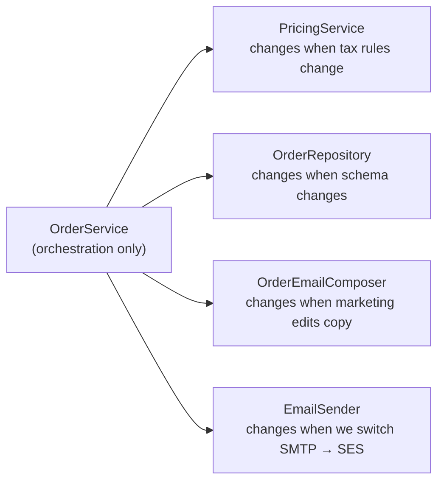
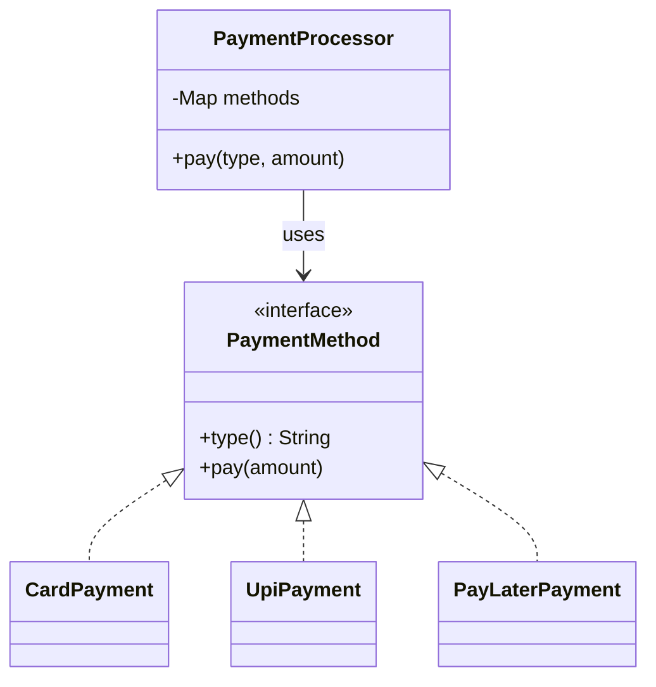
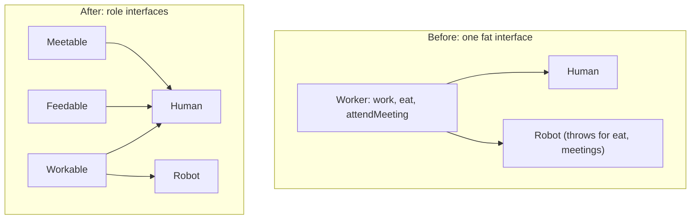
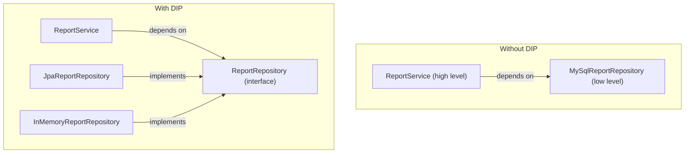
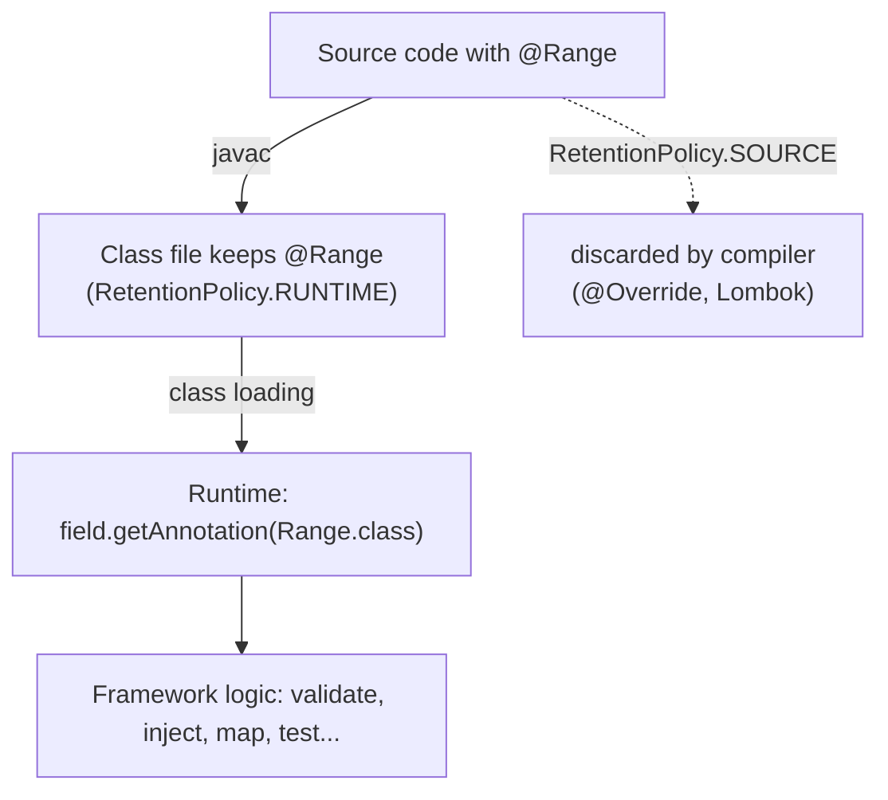
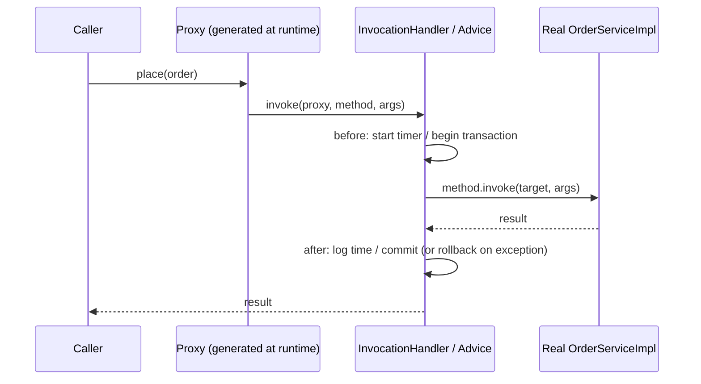
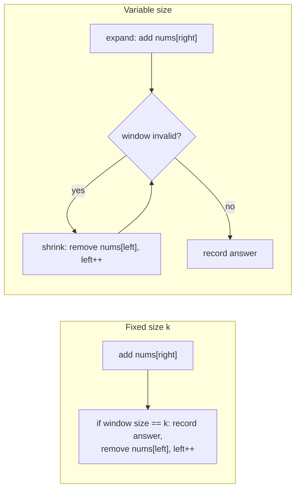
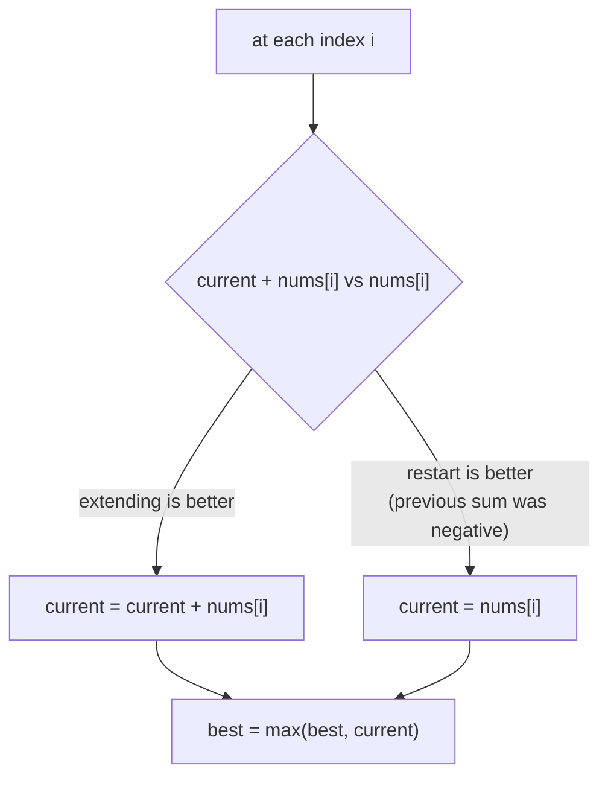

# Day 10 — SOLID Principles, Reflection & Annotations + Phase 1 Review

> **How to use these notes:** each section maps to one checklist item. Run the code, study the diagrams, then test yourself with the collapsible questions. 🚀 marks senior-level details.

**Today's goal:** explain each SOLID principle with a **before/after** example (not just the acronym), understand **reflection**, **annotations** and **dynamic proxies** — the machinery behind Spring, Hibernate, Jackson and JUnit — and finish Phase 1 with a rapid-fire review. On the DSA side: the **sliding window** template (fixed and variable) and **Kadane's algorithm**.

<!-- topic: d10_t1 -->
## ☕ Java — SOLID, Reflection & Annotations

> **SOLID** (Robert C. Martin): five design principles that keep object-oriented code easy to change. Interviewers ask "explain with an example from your project" — prepare one real example per letter.

<!-- subtopic: d10_t1_s1 -->
### 1. S — Single Responsibility Principle

> **TL;DR:** A class should have **one reason to change** — it should serve **one actor** (one group of stakeholders). If a class changes for billing rules *and* for email formatting *and* for SQL schema changes, split it.

```java
// ❌ "God class": business rules + persistence + notification + formatting
public class OrderService {
    public void placeOrder(Order order) {
        if (order.items().isEmpty()) throw new IllegalArgumentException("empty");
        double total = order.items().stream().mapToDouble(Item::price).sum() * 1.18;   // pricing rules
        jdbc.update("INSERT INTO orders ...", order.id(), total);                       // SQL
        String html = "<h1>Thanks!</h1><p>Total: " + total + "</p>";                    // presentation
        smtp.send(order.email(), "Order placed", html);                                  // email transport
    }
}
```

```java
// ✅ Each class has one job; OrderService orchestrates
public class PricingService     { Money totalFor(Order o) { ... } }
public class OrderRepository    { void save(Order o, Money total) { ... } }
public class OrderEmailComposer { Email confirmation(Order o, Money total) { ... } }
public class EmailSender        { void send(Email e) { ... } }

public class OrderService {
    private final PricingService pricing;
    private final OrderRepository repo;
    private final OrderEmailComposer composer;
    private final EmailSender sender;
    // constructor injection...

    public void placeOrder(Order order) {
        Money total = pricing.totalFor(order);
        repo.save(order, total);
        sender.send(composer.confirmation(order, total));
    }
}
```



Benefits: smaller classes, easier tests (mock one collaborator), changes are isolated, fewer merge conflicts. Warning signs: classes named `*Manager`/`*Util` with 2,000 lines, many unrelated dependencies, "and" in the description of what the class does.

Don't overdo it: SRP is about **reasons to change**, not "one method per class".

<!-- subtopic: d10_t1_s2 -->
### 2. O — Open/Closed Principle

> **TL;DR:** Software entities should be **open for extension, closed for modification**: add new behaviour by **adding new code** (a new class), not by editing a growing `if/else`/`switch` in existing, tested code. Usually achieved with **polymorphism / the Strategy pattern**.

```java
// ❌ Every new payment method means editing this class (and re-testing everything)
public class PaymentProcessor {
    public void pay(String type, BigDecimal amount) {
        if (type.equals("CARD")) { /* card logic */ }
        else if (type.equals("UPI")) { /* upi logic */ }
        else if (type.equals("WALLET")) { /* wallet logic */ }
        // next month: else if ("PAYLATER") ...
    }
}
```

```java
// ✅ Strategy: new payment types are new classes; the processor never changes
public interface PaymentMethod {
    String type();
    void pay(BigDecimal amount);
}

@Component public class CardPayment implements PaymentMethod { public String type() { return "CARD"; } public void pay(BigDecimal a) { ... } }
@Component public class UpiPayment  implements PaymentMethod { public String type() { return "UPI"; }  public void pay(BigDecimal a) { ... } }

@Service
public class PaymentProcessor {
    private final Map<String, PaymentMethod> methods;

    public PaymentProcessor(List<PaymentMethod> all) {             // Spring injects every implementation
        this.methods = all.stream().collect(Collectors.toMap(PaymentMethod::type, m -> m));
    }

    public void pay(String type, BigDecimal amount) {
        PaymentMethod m = methods.get(type);
        if (m == null) throw new IllegalArgumentException("unsupported: " + type);
        m.pay(amount);
    }
}
// Adding PayLater = one new @Component class. Zero edits to PaymentProcessor.
```



Other OCP tools: Template Method (Day 2), decorators, event listeners, plug-in registries, sealed types + exhaustive switch (when the set of variants is intentionally closed).

<!-- subtopic: d10_t1_s3 -->
### 3. L — Liskov Substitution Principle

> **TL;DR:** Objects of a subtype must be usable **anywhere the parent type is expected** without breaking correctness. A subclass may not **strengthen preconditions**, **weaken postconditions**, or violate the parent's **invariants**.

#### 3.1 The Rectangle–Square problem

```java
class Rectangle {
    protected int width, height;
    void setWidth(int w)  { width = w; }
    void setHeight(int h) { height = h; }
    int area() { return width * height; }
}

class Square extends Rectangle {                  // "a square IS-A rectangle" — mathematically...
    @Override void setWidth(int w)  { width = w; height = w; }
    @Override void setHeight(int h) { width = h; height = h; }
}

// Client code written for Rectangle:
void resize(Rectangle r) {
    r.setWidth(5);
    r.setHeight(4);
    assert r.area() == 20;                        // 💥 fails for Square (area = 16)
}
```

`Square` changes the behaviour callers rely on (setting the height doesn't change the width). It's an IS-A relationship mathematically but **not behaviourally**.

**Fixes:** don't relate them by inheritance; make shapes **immutable** (`new Rectangle(5, 4)`, `new Square(4)`) with a common `Shape` interface exposing only `area()`.

#### 3.2 LSP checklist for overrides

| Rule | Violation example |
|---|---|
| Don't **strengthen preconditions** (accept at least what the parent accepts) | Parent accepts any amount; child throws for amounts > 1000 |
| Don't **weaken postconditions** (guarantee at least what the parent guarantees) | Parent's `sort()` returns sorted data; child returns partially sorted |
| Keep **invariants** | Square's width = height breaks Rectangle's independent sides |
| No **new unchecked surprises** | `UnsupportedOperationException` from methods the parent type promises |
| History constraint | An immutable parent must not get a mutable subclass |

Real JDK example: `List.of(...)` returns a `List` whose `add()` throws `UnsupportedOperationException` — a pragmatic, documented LSP compromise ("optional operations"). Classic textbook example: `Bird.fly()` with a `Penguin` subclass → model `FlyingBird` separately.

<!-- subtopic: d10_t1_s4 -->
### 4. I — Interface Segregation Principle

> **TL;DR:** Clients should not be forced to depend on methods they don't use. Prefer **several small, focused interfaces** over one "fat" interface.

```java
// ❌ Fat interface
public interface Worker {
    void work();
    void eat();
    void attendMeeting();
}
public class Robot implements Worker {
    public void work() { ... }
    public void eat() { throw new UnsupportedOperationException(); }            // forced, meaningless
    public void attendMeeting() { throw new UnsupportedOperationException(); }
}
```

```java
// ✅ Role interfaces
public interface Workable  { void work(); }
public interface Feedable  { void eat(); }
public interface Meetable  { void attendMeeting(); }

public class Human implements Workable, Feedable, Meetable { ... }
public class Robot implements Workable { ... }
```



Real-world examples:
- Spring Data: `CrudRepository` → `PagingAndSortingRepository` → `JpaRepository` — choose the smallest one you need.
- JDK: `Readable`, `Closeable`, `AutoCloseable`, `Comparable`, `Runnable` — tiny, focused interfaces.
- Microservices: separate **read** and **write** service interfaces (CQRS-style) so a reporting client doesn't depend on mutation methods.

ISP also reduces recompilation and mocking pain: a test double only implements the few methods it needs.

<!-- subtopic: d10_t1_s5 -->
### 5. D — Dependency Inversion Principle

> **TL;DR:** **High-level modules** (business logic) should not depend on **low-level modules** (DB, HTTP, files). **Both should depend on abstractions** (interfaces), and the abstraction is owned by the high-level side. Dependency **injection** is the usual way to wire it.

```java
// ❌ High-level policy hard-wired to low-level details
public class ReportService {
    private final MySqlReportRepository repo = new MySqlReportRepository();   // concrete + created inside
    private final ArrayList<String> cache = new ArrayList<>();               // concrete collection type
}
```

```java
// ✅ Depend on abstractions, receive them from outside
public interface ReportRepository { List<Report> findByMonth(YearMonth m); }   // owned by the business layer

public class ReportService {
    private final ReportRepository repo;          // abstraction
    private final List<String> cache;             // List, not ArrayList

    public ReportService(ReportRepository repo) { // constructor injection
        this.repo = repo;
        this.cache = new ArrayList<>();
    }
}

public class JpaReportRepository implements ReportRepository { ... }       // low-level detail plugs in
public class InMemoryReportRepository implements ReportRepository { ... }  // for tests
```



| Term | Meaning |
|---|---|
| **DIP** (principle) | Depend on abstractions, not concretions |
| **IoC** (Inversion of Control) | A framework controls object creation and the flow, calling your code |
| **DI** (Dependency Injection) | A technique: dependencies are passed in (constructor/setter/field) instead of created inside |
| **Spring IoC container** | Implements DI: creates beans and injects them (Day 19) |

Prefer **constructor injection**: dependencies are explicit, fields can be `final`, objects are always fully initialized, and tests can pass fakes without Spring.

#### 🎯 SOLID interview questions

<details><summary>Q1. Explain SRP with an example.</summary>

A class should have one reason to change. E.g., an OrderService that computes prices, writes SQL and sends emails changes for tax rules, schema changes and email copy — split into PricingService, OrderRepository and EmailSender, with OrderService orchestrating.

</details>

<details><summary>Q2. How does the Strategy pattern relate to OCP?</summary>

Each variant (payment method, discount rule) is a separate implementation of an interface; new variants are added as new classes without modifying the code that uses the interface.

</details>

<details><summary>Q3. Why does Square extending Rectangle violate LSP?</summary>

Code relying on Rectangle's behaviour (independent width and height) breaks with a Square: setting the height also changes the width, so area expectations fail. The subtype isn't substitutable.

</details>

<details><summary>Q4. Difference between DIP, IoC and DI?</summary>

DIP is the design principle (depend on abstractions). IoC is the general idea of a framework controlling creation/flow. DI is the concrete technique of passing dependencies in, which Spring's IoC container performs.

</details>

<!-- subtopic: d10_t4_s1 -->
### 6. Reflection — inspecting and using classes at runtime

> **TL;DR:** Reflection (`java.lang.reflect`) lets code **inspect classes at runtime** — fields, methods, constructors, annotations — and **call them dynamically**, even private ones (`setAccessible(true)`). Frameworks depend on it; application code should rarely need it.

#### 6.1 Getting a Class object

```java
Class<?> c1 = Employee.class;                         // compile-time literal
Class<?> c2 = employee.getClass();                    // from an instance (runtime type)
Class<?> c3 = Class.forName("com.app.Employee");      // by name (loads + initializes the class)
```

#### 6.2 Inspecting and invoking

```java
Class<?> clazz = Employee.class;

clazz.getSimpleName();                                // "Employee"
clazz.getSuperclass();                                // class java.lang.Object
clazz.getInterfaces();
Modifier.isFinal(clazz.getModifiers());

Field[] publicFields = clazz.getFields();             // public fields, INCLUDING inherited
Field[] allDeclared  = clazz.getDeclaredFields();     // all fields of THIS class (any access), not inherited

Field salary = clazz.getDeclaredField("salary");
salary.setAccessible(true);                           // bypass 'private' (subject to module rules)
double value = (double) salary.get(employee);
salary.set(employee, 150_000.0);

Method raise = clazz.getDeclaredMethod("raise", double.class);
raise.setAccessible(true);
raise.invoke(employee, 10.0);                         // employee.raise(10.0)

Constructor<?> ctor = clazz.getDeclaredConstructor(String.class, double.class);
Object e2 = ctor.newInstance("Asha", 120_000.0);
```

| Method | Returns |
|---|---|
| `getFields()` / `getMethods()` | **public** members, including inherited ones |
| `getDeclaredFields()` / `getDeclaredMethods()` | **all** members declared in this class (private too), **not** inherited |

#### 6.3 Who uses reflection
- **Spring:** scanning `@Component` classes, constructor/field injection, calling `@PostConstruct`, `@RequestMapping` handler methods.
- **Hibernate/JPA:** reading/writing entity fields, instantiating entities via the no-arg constructor.
- **Jackson:** discovering getters/fields to serialize to JSON.
- **JUnit:** finding and invoking `@Test` methods.

#### 6.4 Costs and risks

| Concern | Detail |
|---|---|
| Performance | Slower than direct calls (lookups, access checks, boxing); much improved in modern JDKs (core reflection is built on method handles since Java 18), and frameworks cache `Method`/`Field` objects |
| Safety | No compile-time checking — typos fail at runtime |
| Encapsulation | Breaks `private`; Java 9+ modules block deep reflection into JDK internals unless `--add-opens` |
| Refactoring | Renaming a field silently breaks string-based lookups |
| Security | Can be abused to modify state the class tries to protect |

`MethodHandle`/`VarHandle` (`java.lang.invoke`) are faster, JIT-friendly alternatives used by modern libraries.

<!-- subtopic: d10_t4_s2 -->
### 7. Annotations — built-in, custom, retention, target, runtime processing

> **TL;DR:** Annotations are **metadata** attached to code. **`@Retention`** decides how long they live (source / class file / runtime) and **`@Target`** where they can be placed. Runtime-retained annotations can be read via reflection — that's how `@Autowired`, `@Entity`, `@Test` work.

#### 7.1 Built-in annotations

| Annotation | Purpose |
|---|---|
| `@Override` | Compiler checks the method really overrides something |
| `@Deprecated(since = "2.0", forRemoval = true)` | Marks API as obsolete; compiler warns users |
| `@SuppressWarnings("unchecked")` | Silences specific compiler warnings |
| `@FunctionalInterface` | Compiler checks exactly one abstract method (Day 5) |
| `@SafeVarargs` | Asserts a generic varargs method is safe (Day 4) |

#### 7.2 Meta-annotations (annotations on annotations)

| Meta-annotation | Values / meaning |
|---|---|
| `@Retention` | `SOURCE` (discarded by the compiler: `@Override`, Lombok), `CLASS` (in the .class file, not available at runtime — the default), `RUNTIME` (readable via reflection: Spring, JPA, JUnit) |
| `@Target` | `TYPE`, `METHOD`, `FIELD`, `PARAMETER`, `CONSTRUCTOR`, `ANNOTATION_TYPE`, `TYPE_USE`, ... |
| `@Inherited` | Class-level annotation is inherited by subclasses |
| `@Documented` | Appears in Javadoc |
| `@Repeatable` | Can be applied more than once |

#### 7.3 Writing and processing a custom annotation

```java
@Retention(RetentionPolicy.RUNTIME)                 // must be RUNTIME to read it via reflection
@Target(ElementType.FIELD)
public @interface Range {
    int min() default 0;                            // elements: primitives, String, Class, enums,
    int max() default Integer.MAX_VALUE;            // other annotations, or arrays of these
    String message() default "value out of range";
}

public class CreateUserRequest {
    @Range(min = 18, max = 120, message = "age must be 18-120")
    private int age;
    // ...
}

// A tiny validator — the same idea as Jakarta Bean Validation (@Min, @Max, @NotBlank)
public static List<String> validate(Object obj) throws IllegalAccessException {
    List<String> errors = new ArrayList<>();
    for (Field f : obj.getClass().getDeclaredFields()) {
        Range r = f.getAnnotation(Range.class);
        if (r == null) continue;
        f.setAccessible(true);
        int value = f.getInt(obj);
        if (value < r.min() || value > r.max()) errors.add(f.getName() + ": " + r.message());
    }
    return errors;
}
```



#### 7.4 Compile-time annotation processing
Annotation processors run **inside `javac`** and can generate code: **Lombok** (`@Getter`, `@Builder` — modifies the AST), **MapStruct** (generates mappers), Dagger, Immutables. No runtime reflection cost.

<!-- subtopic: d10_t4_s3 -->
### 8. Dynamic Proxies — JDK Proxy vs CGLIB, the basis of Spring AOP

> **TL;DR:** A **proxy** is an object that stands in for another and **intercepts method calls** to add behaviour (transactions, logging, security, caching) around them. **JDK dynamic proxies** implement **interfaces**; **CGLIB/ByteBuddy** proxies **subclass** the target class. Spring AOP (`@Transactional`, `@Cacheable`, `@Async`) is built on these.

#### 8.1 A JDK dynamic proxy that times every call

```java
public interface OrderService { Order place(Order o); }

public class OrderServiceImpl implements OrderService {
    public Order place(Order o) { /* business logic */ return o; }
}

@SuppressWarnings("unchecked")
public static <T> T timed(T target, Class<T> iface) {
    InvocationHandler handler = (proxy, method, args) -> {
        long start = System.nanoTime();
        try {
            return method.invoke(target, args);                    // call the real object
        } finally {
            System.out.printf("%s took %d µs%n", method.getName(), (System.nanoTime() - start) / 1000);
        }
    };
    return (T) Proxy.newProxyInstance(iface.getClassLoader(), new Class<?>[]{iface}, handler);
}

OrderService service = timed(new OrderServiceImpl(), OrderService.class);
service.place(order);       // "place took 523 µs"
```



#### 8.2 JDK Proxy vs CGLIB

| | JDK dynamic proxy | CGLIB / ByteBuddy |
|---|---|---|
| How | Generates a class **implementing the interfaces** | Generates a **subclass** of the target class |
| Requires | The target implements an interface; callers use the interface type | A non-final class with a constructor it can call |
| Can't proxy | Methods not in an interface | **`final` classes, `final`/`private`/`static` methods** |
| Spring | Used when `proxyTargetClass=false` and an interface exists | **Spring Boot's default** (`proxyTargetClass=true` since Boot 2.0) |

#### 8.3 The famous Spring proxy pitfalls

```java
@Service
public class PaymentService {

    public void payAll(List<Payment> payments) {
        for (Payment p : payments) {
            pay(p);                      // ⚠️ SELF-INVOCATION: calls this.pay(), NOT the proxy
        }                                //    → @Transactional on pay() is IGNORED here
    }

    @Transactional
    public void pay(Payment p) { ... }

    @Transactional
    private void refund(Payment p) { ... }   // ⚠️ private: can't be overridden by the proxy → no transaction
}
```

- **Self-invocation** bypasses the proxy (the call never leaves the object). Fixes: move the method to another bean, inject the bean into itself (`@Lazy`), or use `TransactionTemplate`.
- **Private / final / static methods** can't be intercepted by CGLIB.
- `@Transactional` rolls back only for **unchecked** exceptions by default (`rollbackFor = Exception.class` to include checked ones) — Day 22.

#### 🎯 Reflection, annotations & proxies — interview questions

<details><summary>Q1. getDeclaredMethods vs getMethods?</summary>

getMethods returns public methods including inherited ones. getDeclaredMethods returns all methods declared in that class (any access level) but not inherited ones.

</details>

<details><summary>Q2. What are the retention policies?</summary>

SOURCE (discarded at compile time), CLASS (stored in the class file but not available via reflection — the default), RUNTIME (available via reflection at runtime).

</details>

<details><summary>Q3. Why doesn't @Transactional work when a method calls another @Transactional method in the same class?</summary>

Spring applies transactions through a proxy around the bean. An internal call uses `this`, not the proxy, so the interception (and the transaction) is skipped.

</details>

<details><summary>Q4. JDK dynamic proxy vs CGLIB?</summary>

JDK proxies implement interfaces and can only intercept interface methods. CGLIB creates a subclass at runtime, works without interfaces, but can't proxy final classes or final/private/static methods. Spring Boot uses CGLIB by default.

</details>

<!-- subtopic: d10_t1_s8 -->
### 9. Phase 1 Rapid-Fire Review — explain from memory

> **How to use:** cover the answers, say each answer **out loud** in 2–3 sentences (as you would in an interview), then check. Anything you hesitate on → add it to "What I Missed" and revisit that day's notes.

#### OOP (Days 1–3)
<details><summary>1. Pass-by-value or reference?</summary>

Always by value; for objects the value is a reference, so you can mutate the object but not rebind the caller's variable.

</details>

<details><summary>2. Order of initialization with inheritance?</summary>

Static blocks parent → child (once); then per object: parent instance initializers + constructor, then child initializers + constructor.

</details>

<details><summary>3. Overloading vs overriding?</summary>

Overloading: same name, different parameters, chosen at compile time. Overriding: same signature in a subclass, chosen at runtime by the object's type.

</details>

<details><summary>4. Abstract class vs interface (Java 8+)?</summary>

Abstract classes have state, constructors and single inheritance; interfaces define contracts with default/static/private methods and multiple inheritance, no instance state.

</details>

<details><summary>5. equals/hashCode contract?</summary>

Equal objects must have equal hash codes; override both together or hash-based collections break.

</details>

<details><summary>6. How to make an immutable class?</summary>

Final class, private final fields, no setters, defensive copies in and out, return new objects for changes.

</details>

<details><summary>7. Integer cache?</summary>

Integer.valueOf caches -128..127, so `==` works there by accident; always use equals for wrappers.

</details>

<details><summary>8. Comparable vs Comparator?</summary>

Natural order inside the class vs external, multiple orders; never use subtraction in compare.

</details>

#### Exceptions & Generics (Day 4)
<details><summary>9. Checked vs unchecked?</summary>

Checked (Exception minus RuntimeException) must be caught or declared; unchecked (RuntimeException, Error) need not be.

</details>

<details><summary>10. try-with-resources?</summary>

Auto-closes AutoCloseable resources in reverse order; close exceptions become suppressed exceptions.

</details>

<details><summary>11. PECS?</summary>

Producer extends, consumer super — `? extends T` to read, `? super T` to write.

</details>

<details><summary>12. Type erasure consequences?</summary>

No `new T()`, no `T[]`, no `instanceof List<String>`, no overloads that differ only by type argument.

</details>

#### Java 8+ (Days 5–7)
<details><summary>13. Functional interface?</summary>

Exactly one abstract method; target of lambdas and method references.

</details>

<details><summary>14. map vs flatMap?</summary>

One-to-one transform vs one-to-many with flattening (also for Optional-returning functions).

</details>

<details><summary>15. groupingBy count per department?</summary>

`collect(groupingBy(Employee::dept, counting()))`.

</details>

<details><summary>16. orElse vs orElseGet?</summary>

orElse evaluates the default eagerly; orElseGet lazily via a Supplier.

</details>

<details><summary>17. Records and sealed classes?</summary>

Records are immutable data carriers with generated accessors/equals/hashCode/toString; sealed types restrict subclasses and enable exhaustive switches.

</details>

#### Concurrency (Days 8–9)
<details><summary>18. synchronized vs volatile?</summary>

synchronized gives mutual exclusion and visibility; volatile gives visibility and ordering but no atomicity.

</details>

<details><summary>19. Why does DCL need volatile?</summary>

To prevent another thread from seeing a reference to a partially constructed object due to reordering.

</details>

<details><summary>20. ThreadPoolExecutor task flow?</summary>

Core threads → queue → extra threads up to max → rejection policy.

</details>

<details><summary>21. thenApply vs thenCompose?</summary>

Synchronous transform vs chaining a function that returns another CompletableFuture.

</details>

<details><summary>22. How to prevent deadlock?</summary>

Consistent lock ordering, tryLock with timeouts, small critical sections, no nested locks.

</details>

<details><summary>23. Virtual threads — when useful?</summary>

High-concurrency I/O-bound workloads; they unmount while blocked. Not faster for CPU-bound work; don't pool them.

</details>

#### Design (Day 10)
<details><summary>24. Explain SOLID in one line each.</summary>

One reason to change; extend without modifying; subtypes substitutable; small client-specific interfaces; depend on abstractions.

</details>

<details><summary>25. How does Spring implement @Transactional?</summary>

With a proxy (CGLIB by default) that begins/commits/rolls back around the method call — so self-invocation and private methods aren't intercepted.

</details>

<!-- topic: d16_t2 -->
## 🧮 DSA — Sliding Window

<!-- subtopic: d16_t2_s1 -->
### 10. The Sliding Window Template — fixed vs variable size

> **TL;DR:** For problems about **contiguous subarrays/substrings**, keep a window `[left, right]` and **update its state incrementally** as it slides, instead of recomputing every window. Turns O(n·k) or O(n²) into **O(n)**.



#### Fixed-size template

```java
int windowState = 0, best = Integer.MIN_VALUE;
for (int right = 0; right < n; right++) {
    windowState += nums[right];                    // add the new element
    if (right >= k - 1) {                          // window has k elements
        best = Math.max(best, windowState);        // record
        windowState -= nums[right - k + 1];        // remove the element leaving the window
    }
}
```

#### Variable-size template

```java
int left = 0;
for (int right = 0; right < n; right++) {
    add(nums[right]);                              // expand
    while (windowIsInvalid()) {                    // shrink until valid again
        remove(nums[left]);
        left++;
    }
    best = Math.max(best, right - left + 1);       // longest valid window
    // (for "shortest window satisfying X": record inside the while loop, before shrinking)
}
```

**When to think "sliding window":** contiguous subarray/substring + "longest / shortest / maximum sum / contains all / at most K distinct". Requires that adding an element and removing an element can be done incrementally, and (for variable windows) that validity is **monotonic** — shrinking a valid window keeps it valid (e.g., non-negative numbers for sums).

Examples: today's problems, Longest Substring Without Repeating Characters (Day 9), Fruit Into Baskets, Max Consecutive Ones III, Minimum Window Substring (Hard), Sliding Window Maximum (Hard, with a deque — Day 33).

<!-- subtopic: d16_t2_s2 -->
### 11. Maximum Sum Subarray of Size K (fixed window)

> **Problem:** find the maximum sum of any contiguous subarray of exactly `k` elements. 🔗 Practice: [LeetCode 643 — Maximum Average Subarray I](https://leetcode.com/problems/maximum-average-subarray-i/) (same idea, divide by k).

Brute force: sum every window → O(n·k). Sliding window: reuse the previous sum → **O(n)**.

```java
public static int maxSumOfK(int[] nums, int k) {
    if (k <= 0 || k > nums.length) throw new IllegalArgumentException("invalid k");
    int windowSum = 0;
    for (int i = 0; i < k; i++) windowSum += nums[i];        // first window
    int best = windowSum;
    for (int right = k; right < nums.length; right++) {
        windowSum += nums[right] - nums[right - k];          // slide: add new, drop old
        best = Math.max(best, windowSum);
    }
    return best;
}   // Time O(n), Space O(1)
```

**Dry run** `[2, 1, 5, 1, 3, 2], k = 3`:

| window | sum |
|---|---|
| [2, 1, 5] | 8 |
| [1, 5, 1] | 8 − 2 + 1 = 7 |
| [5, 1, 3] | 7 − 1 + 3 = 9 ✅ |
| [1, 3, 2] | 9 − 5 + 2 = 6 |

Answer **9**.

<!-- subtopic: d16_t2_s3 -->
### 12. Minimum Size Subarray Sum (LeetCode 209) — variable window

> **Problem:** given **positive** integers and `target`, return the minimal length of a contiguous subarray with sum **≥ target** (0 if none). 🔗 [LeetCode 209](https://leetcode.com/problems/minimum-size-subarray-sum/)

Expand right until the sum is big enough, then shrink from the left as long as it stays ≥ target, recording the length each time.

```java
public int minSubArrayLen(int target, int[] nums) {
    int left = 0, sum = 0, best = Integer.MAX_VALUE;
    for (int right = 0; right < nums.length; right++) {
        sum += nums[right];                          // expand
        while (sum >= target) {                      // valid → try to shrink
            best = Math.min(best, right - left + 1);
            sum -= nums[left++];
        }
    }
    return best == Integer.MAX_VALUE ? 0 : best;
}   // Time O(n) — each index enters and leaves the window once; Space O(1)
```

**Dry run** `target = 7, nums = [2, 3, 1, 2, 4, 3]`:
- grow to `[2,3,1,2]` sum 8 ≥ 7 → len 4; shrink → `[3,1,2]` sum 6.
- add 4 → `[3,1,2,4]` sum 10 → len 4; shrink → `[1,2,4]` 7 → len 3; shrink → `[2,4]` 6.
- add 3 → `[2,4,3]` 9 → len 3; shrink → `[4,3]` 7 → **len 2**; shrink → `[3]`.
- Answer **2** (`[4, 3]`).

⚠️ Works because all numbers are **positive** (removing an element always decreases the sum). With negatives, use **prefix sums + a monotonic deque** (LC 862, Hard).

<!-- subtopic: d16_t2_s4 -->
### 13. Permutation in String (LeetCode 567) — frequency map + window

> **Problem:** return `true` if `s2` contains a **permutation** of `s1` as a substring. `s1 = "ab", s2 = "eidbaooo"` → true (`"ba"`). 🔗 [LeetCode 567](https://leetcode.com/problems/permutation-in-string/)

A permutation = same characters with the same counts (an anagram, Day 4) and the **same length**. So slide a **fixed window of size `s1.length()`** over `s2`, keeping letter counts, and compare.

```java
public boolean checkInclusion(String s1, String s2) {
    int k = s1.length();
    if (k > s2.length()) return false;
    int[] need = new int[26], window = new int[26];
    for (int i = 0; i < k; i++) {
        need[s1.charAt(i) - 'a']++;
        window[s2.charAt(i) - 'a']++;
    }
    if (Arrays.equals(need, window)) return true;
    for (int right = k; right < s2.length(); right++) {
        window[s2.charAt(right) - 'a']++;               // char entering
        window[s2.charAt(right - k) - 'a']--;           // char leaving
        if (Arrays.equals(need, window)) return true;   // 26 comparisons → O(1)
    }
    return false;
}   // Time O(26 · n) = O(n), Space O(1)
```

🚀 Optimization: track a `matches` counter (how many of the 26 letters currently have equal counts) and update it in O(1) per slide instead of comparing arrays — the same trick powers **Find All Anagrams in a String** (LC 438) and **Minimum Window Substring** (LC 76).

<!-- subtopic: d16_t2_s5 -->
### 14. Maximum Subarray — Kadane's Algorithm (LeetCode 53)

> **Problem:** find the contiguous subarray (at least one element) with the largest sum. `[-2,1,-3,4,-1,2,1,-5,4]` → **6** (`[4,-1,2,1]`). 🔗 [LeetCode 53](https://leetcode.com/problems/maximum-subarray/)

Brute force: all subarrays → O(n²) (O(n³) if you re-sum).

**Kadane's insight:** the best subarray **ending at index i** either extends the best subarray ending at `i − 1`, or **starts fresh** at `i` — whichever is larger. A negative running sum only hurts, so drop it.

```java
public int maxSubArray(int[] nums) {
    int current = nums[0];                 // best sum of a subarray ending here
    int best = nums[0];
    for (int i = 1; i < nums.length; i++) {
        current = Math.max(nums[i], current + nums[i]);   // extend or restart
        best = Math.max(best, current);
    }
    return best;
}   // Time O(n), Space O(1)
```

**Dry run** `[-2, 1, -3, 4, -1, 2, 1, -5, 4]`:

| i | nums[i] | current = max(nums[i], current + nums[i]) | best |
|---|---|---|---|
| 0 | −2 | −2 | −2 |
| 1 | 1 | max(1, −1) = 1 | 1 |
| 2 | −3 | max(−3, −2) = −2 | 1 |
| 3 | 4 | max(4, 2) = **4** (restart) | 4 |
| 4 | −1 | 3 | 4 |
| 5 | 2 | 5 | 5 |
| 6 | 1 | **6** | 6 |
| 7 | −5 | 1 | 6 |
| 8 | 4 | 5 | **6** |



Why it's both **greedy** and **DP**: `dp[i] = max(nums[i], dp[i−1] + nums[i])` is a 1-D DP recurrence, and we only keep the previous value (O(1) space). Initialising with `nums[0]` (not 0) correctly handles all-negative arrays (answer = the largest element).

Follow-ups: return the subarray indices (track where `current` restarts), Maximum Product Subarray (LC 152 — track min and max because negatives flip), circular version (LC 918), and divide-and-conquer O(n log n) solution.

---

## 📝 Day 10 Revision Cheat Sheet

| Topic | Remember this |
|---|---|
| SRP | One reason to change / one actor; split God classes; orchestrator + focused collaborators |
| OCP | Add new classes, don't edit if/else chains; Strategy + Spring list injection |
| LSP | Subtypes substitutable; no stronger preconditions / weaker postconditions; Rectangle–Square |
| ISP | Small role interfaces; no `UnsupportedOperationException` stubs |
| DIP | Depend on abstractions owned by the high-level module; constructor injection |
| Reflection | `getDeclared*` = all own members; `get*` = public incl. inherited; setAccessible; cache lookups |
| Annotations | Retention SOURCE / CLASS (default) / RUNTIME; @Target; read via `getAnnotation` |
| Proxies | JDK = interfaces; CGLIB = subclass (Boot default); no final/private; self-invocation bypasses proxy |
| Sliding window | Contiguous + incremental state; fixed: add right, drop right−k; variable: expand, shrink while invalid |
| Kadane | `current = max(x, current + x)`; start with nums[0] |

### ⚡ Rapid-fire self-test

1. Which SOLID principle does a `switch` on payment type usually violate? → **Open/Closed**
2. Square extends Rectangle breaks which principle? → **Liskov Substitution**
3. A `Robot` throwing `UnsupportedOperationException` from `eat()` points to which principle? → **Interface Segregation**
4. Default `@Retention` policy? → **CLASS**
5. Retention needed for Spring to see your annotation? → **RUNTIME**
6. Can CGLIB proxy a final method? → **No**
7. `getDeclaredFields()` includes inherited fields? → **No**
8. Minimum Size Subarray Sum works with negative numbers? → **No (needs positives)**
9. Kadane on `[-3, -1, -2]`? → **-1**
10. Sliding window time complexity? → **O(n) — each element enters and leaves once**
