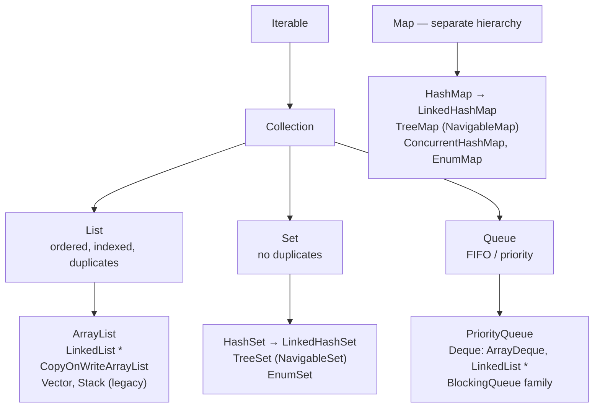
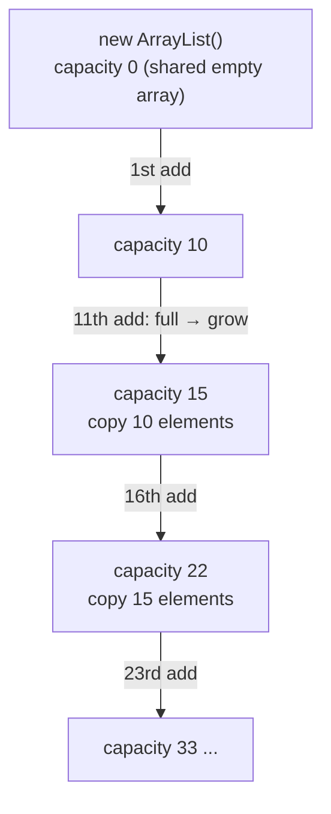
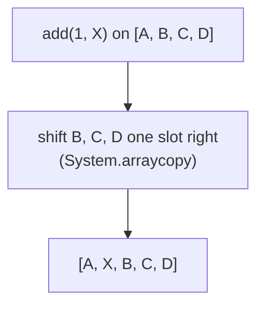
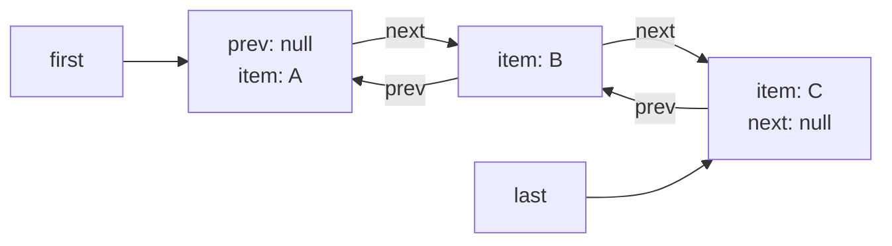
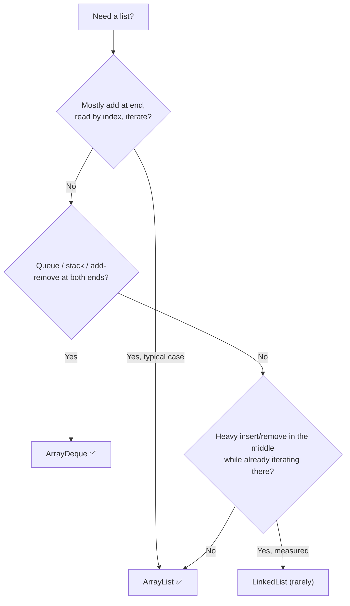
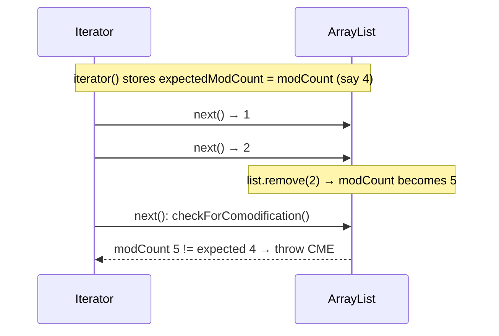
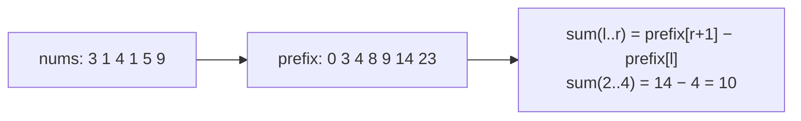
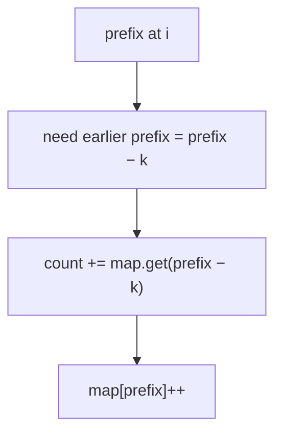
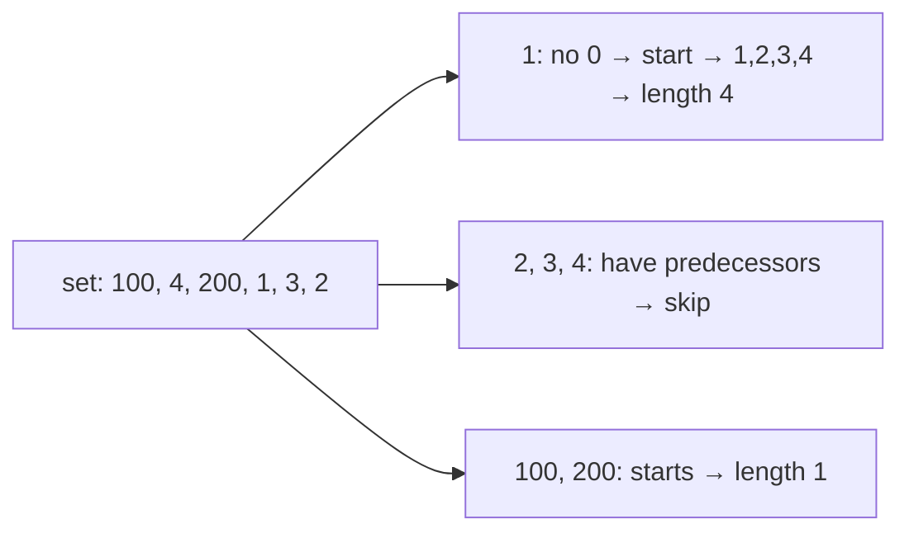

# Day 11 — ArrayList & LinkedList: Internals, Performance & Thread-Safety

> **How to use these notes:** each section maps to one checklist item. Run the code, study the diagrams, then test yourself with the collapsible questions. 🚀 marks senior-level details.

**Today's goal:** start Phase 2 (Collections) with a solid map of the **Collection hierarchy**, then go inside **ArrayList** and **LinkedList** — how they store data, how they grow, what each operation costs, and which one to pick. Then the classic traps: `ConcurrentModificationException`, `Arrays.asList` vs `List.of`, `subList` views, and thread-safe list options. On the DSA side: **prefix sums**, and prefix sums combined with a **HashMap** — one of the most reused patterns in interviews.

<!-- topic: d11_t1 -->
## ☕ Collections — List Implementations

<!-- subtopic: d11_t1_s1 -->
### 1. The Collection Hierarchy

> **TL;DR:** `Iterable` → `Collection` → `List` / `Set` / `Queue` (→ `Deque`). **`Map` is a separate hierarchy** (it's not a `Collection`). Java 21 added **Sequenced** interfaces for ordered collections.



\* `LinkedList` implements both `List` and `Deque`.

| Interface | Key properties | Main implementations |
|---|---|---|
| `List` | Ordered, indexed, duplicates allowed | `ArrayList`, `LinkedList`, `CopyOnWriteArrayList` |
| `Set` | No duplicates | `HashSet`, `LinkedHashSet`, `TreeSet` |
| `Queue` / `Deque` | Process elements in an order (FIFO, LIFO, priority) | `ArrayDeque`, `PriorityQueue`, `LinkedList` |
| `Map` | Key → value, unique keys | `HashMap`, `LinkedHashMap`, `TreeMap`, `ConcurrentHashMap` |

Why `Map` isn't a `Collection`: a map's elements are **pairs**, and operations like `add(E)` don't make sense. You can still get collection *views*: `keySet()`, `values()`, `entrySet()`.

**`Collection` vs `Collections`:** `Collection` is the root interface; `Collections` is a utility class with static methods (`sort`, `unmodifiableList`, `synchronizedList`, `emptyList`...). Similarly `Arrays` for arrays.

<!-- subtopic: d17_t1_s4 -->
### 2. Iterable vs Iterator, and ListIterator

> **TL;DR:** **`Iterable`** = "can give you an iterator" (enables the for-each loop). **`Iterator`** = the cursor that walks the elements (`hasNext`, `next`, `remove`). **`ListIterator`** adds **backwards** traversal, `set`, `add` and index info for lists.

```java
List<String> names = new ArrayList<>(List.of("Asha", "Ravi", "Meera"));

// for-each is compiled into an Iterator loop
for (String n : names) { System.out.println(n); }
// ≈
for (Iterator<String> it = names.iterator(); it.hasNext(); ) {
    String n = it.next();
    System.out.println(n);
}

// Iterator.remove — the SAFE way to remove while iterating
Iterator<String> it = names.iterator();
while (it.hasNext()) {
    if (it.next().startsWith("R")) it.remove();
}

// ListIterator — both directions, modify in place
ListIterator<String> li = names.listIterator(names.size());   // start at the end
while (li.hasPrevious()) {
    int idx = li.previousIndex();
    String s = li.previous();
    li.set(s.toUpperCase());                                   // replace current element
}
```

| | `Iterable` | `Iterator` | `ListIterator` |
|---|---|---|---|
| Role | Source of iterators | Forward cursor | Bidirectional cursor for lists |
| Key methods | `iterator()`, `forEach()`, `spliterator()` | `hasNext()`, `next()`, `remove()` | + `hasPrevious()`, `previous()`, `set()`, `add()`, `nextIndex()` |
| Enables | for-each loop | — | — |

#### Making your own class iterable

```java
public class Range implements Iterable<Integer> {
    private final int start, end;
    public Range(int start, int end) { this.start = start; this.end = end; }

    @Override
    public Iterator<Integer> iterator() {
        return new Iterator<>() {
            private int current = start;
            @Override public boolean hasNext() { return current < end; }
            @Override public Integer next() {
                if (!hasNext()) throw new NoSuchElementException();
                return current++;
            }
        };
    }
}

for (int i : new Range(1, 4)) System.out.print(i + " ");   // 1 2 3
```

<!-- subtopic: d11_t1_s2 -->
### 3. ArrayList Internals — dynamic array, capacity, growth

> **TL;DR:** An `ArrayList` wraps an **`Object[] elementData`** plus a `size`. A no-arg `ArrayList` starts with a shared **empty array** and allocates **capacity 10 on the first add**. When full, it grows to **1.5×** (`old + old >> 1`) and **copies** everything with `Arrays.copyOf`.

```java
// Simplified from the JDK
public class ArrayList<E> {
    transient Object[] elementData;       // the backing array
    private int size;                     // number of elements actually stored

    public boolean add(E e) {
        modCount++;                       // structural change counter (for fail-fast iterators)
        if (size == elementData.length) elementData = grow(size + 1);
        elementData[size++] = e;
        return true;
    }

    private Object[] grow(int minCapacity) {
        int oldCapacity = elementData.length;
        int newCapacity = oldCapacity + (oldCapacity >> 1);   // 1.5x
        // (first add on a default list: capacity becomes 10)
        return elementData = Arrays.copyOf(elementData, Math.max(newCapacity, minCapacity));
    }
}
```



Capacity vs size:

```java
List<Integer> list = new ArrayList<>(1000);   // capacity 1000 allocated, size 0
list.size();                                  // 0
// list.get(5);                               💥 IndexOutOfBoundsException — capacity isn't size
```

Tuning methods (on `ArrayList`, not the `List` interface):
- `new ArrayList<>(expectedSize)` — **presize** when you know the size → no repeated copying.
- `ensureCapacity(n)` — grow once before a big batch of adds.
- `trimToSize()` — shrink capacity to the current size to free memory.

Other facts: allows `null` and duplicates; implements `RandomAccess`; not thread-safe; `elementData` is `transient` because `ArrayList` serializes only the used part via custom `writeObject`.

<!-- subtopic: d11_t1_s3 -->
### 4. ArrayList Time Complexity

> **TL;DR:** Index access is **O(1)**. Adding at the **end** is **amortized O(1)**. Inserting/removing in the **middle** shifts elements → **O(n)**. Searching (`contains`, `indexOf`, `remove(Object)`) is **O(n)**.

| Operation | Complexity | Why |
|---|---|---|
| `get(i)`, `set(i, x)` | O(1) | Direct array index |
| `add(x)` (end) | **Amortized O(1)** | Occasional O(n) copy when growing; averages out (Day 1, amortized analysis) |
| `add(i, x)` | O(n − i) | `System.arraycopy` shifts the tail right |
| `remove(i)` | O(n − i) | Shifts the tail left |
| `remove(Object)` | O(n) | Linear search + shift |
| `contains(x)`, `indexOf(x)` | O(n) | Linear search using `equals` |
| `size()`, `isEmpty()` | O(1) | Stored field |
| Iterate all | O(n) | Very cache-friendly |



⚠️ **Removing many elements in a loop** by index is O(n²). Use `removeIf(...)` — it compacts in a single O(n) pass.

<!-- subtopic: d11_t1_s4 -->
### 5. LinkedList — doubly-linked list, List and Deque

> **TL;DR:** `LinkedList` stores elements in **nodes** with `prev` and `next` pointers, keeping references to the **first** and **last** node. Adding/removing at either **end is O(1)**; **`get(i)` is O(n)** (it walks from the nearer end). It implements both **`List`** and **`Deque`**.

```java
// Simplified node structure from the JDK
private static class Node<E> {
    E item;
    Node<E> next;
    Node<E> prev;
}
transient Node<E> first;
transient Node<E> last;
transient int size;
```



| Operation | Complexity |
|---|---|
| `addFirst`, `addLast`, `removeFirst`, `removeLast`, `peekFirst/Last` | O(1) |
| `get(i)`, `set(i, x)` | O(n) — walks from the closer end (≤ n/2 steps) |
| `add(i, x)`, `remove(i)` | O(n) to find the position, then O(1) to relink |
| Insert/remove **via a `ListIterator` already at the position** | O(1) |
| `contains` | O(n) |

```java
LinkedList<String> ll = new LinkedList<>();
ll.add("B");            // List method → addLast
ll.addFirst("A");       // Deque methods
ll.addLast("C");
ll.peekFirst();         // "A"
ll.pollLast();          // "C"
ll.push("Z");           // stack-style: addFirst
ll.pop();               // removeFirst → "Z"
```

⚠️ The classic anti-pattern:

```java
for (int i = 0; i < linkedList.size(); i++) {
    linkedList.get(i);          // O(n) each → O(n²) total!
}
// ✅ use for-each / Iterator, which follows the links: O(n)
```

<!-- subtopic: d11_t1_s5 -->
### 6. ArrayList vs LinkedList — which to choose

> **TL;DR:** Use **`ArrayList` almost always**. Its contiguous memory is cache-friendly and memory-efficient; even "insert in the middle" is often faster in practice than LinkedList's pointer chasing. For queue/stack behaviour use **`ArrayDeque`**, not `LinkedList`.

| | `ArrayList` | `LinkedList` |
|---|---|---|
| Structure | Resizable array | Doubly-linked nodes |
| `get(i)` | **O(1)** | O(n) |
| Add/remove at end | Amortized O(1) | O(1) |
| Add/remove at front | O(n) | **O(1)** |
| Insert in middle | O(n) shift (fast `arraycopy`) | O(n) to find + O(1) relink |
| Memory per element | ~4 bytes (reference) + spare capacity | ~24 bytes node (header + 3 refs) + reference |
| CPU cache locality | ✅ Excellent (contiguous) | ❌ Poor (nodes scattered on the heap) |
| `RandomAccess` | ✅ | ❌ |
| Also a `Deque` | ❌ | ✅ |



> Joshua Bloch, who wrote `LinkedList`: "Does anyone actually use LinkedList? I wrote it, and I never use it."

<!-- subtopic: d11_t1_s6 -->
### 7. Thread-Safe Lists — synchronizedList vs CopyOnWriteArrayList vs Vector

> **TL;DR:** `ArrayList` isn't thread-safe. **`Collections.synchronizedList`** wraps every method in a lock (iteration still needs manual locking). **`CopyOnWriteArrayList`** copies the whole array on every write — perfect for **read-mostly** lists (listeners, config). **`Vector`** is legacy — avoid.

```java
// 1. Synchronized wrapper
List<String> syncList = Collections.synchronizedList(new ArrayList<>());
syncList.add("a");                         // each call is synchronized
synchronized (syncList) {                  // ⚠️ iteration must be manually synchronized
    for (String s : syncList) process(s);
}

// 2. Copy-on-write
List<Listener> listeners = new CopyOnWriteArrayList<>();
listeners.add(l);                          // copies the array (O(n)) under a lock
for (Listener l : listeners) l.onEvent(e); // iterates a SNAPSHOT — never throws CME, no locking
```

| | `Vector` | `Collections.synchronizedList` | `CopyOnWriteArrayList` |
|---|---|---|---|
| Locking | Every method `synchronized` | Wrapper locks every method | Writes lock + copy; **reads lock-free** |
| Iteration | Fail-fast, needs external lock | Fail-fast, **needs external lock** | Snapshot, safe, no CME |
| Write cost | O(1) amortized | O(1) amortized | **O(n)** (full copy) |
| Best for | Nothing new (legacy, Java 1.0) | Occasional shared access, write-heavy | Many reads, rare writes |
| Growth | 2× | (from ArrayList) 1.5× | Exact (copy per write) |

⚠️ Even synchronized lists don't make **compound actions** atomic:

```java
if (!syncList.contains(x)) syncList.add(x);     // ❌ race between contains and add
synchronized (syncList) {                        // ✅ lock around the compound action
    if (!syncList.contains(x)) syncList.add(x);
}
```

For producer/consumer use a `BlockingQueue` (Day 15); for a concurrent set of keys use `ConcurrentHashMap.newKeySet()`.

<!-- subtopic: d11_t1_s7 -->
### 8. ConcurrentModificationException — fail-fast vs fail-safe iterators

> **TL;DR:** Most collection iterators are **fail-fast**: if the collection is **structurally modified** (add/remove) during iteration by anything other than the iterator itself, the next `next()` throws **`ConcurrentModificationException`**. It's detected with a **`modCount`** counter. Concurrent collections use **fail-safe / weakly consistent** iterators instead.

```java
List<Integer> nums = new ArrayList<>(List.of(1, 2, 3, 4));
for (Integer n : nums) {
    if (n % 2 == 0) nums.remove(n);     // 💥 ConcurrentModificationException
}
```

How it's detected:



Despite the name, it's usually **single-threaded** code modifying a list inside its own for-each loop.

#### Fixes

```java
// 1. Iterator.remove — updates expectedModCount
Iterator<Integer> it = nums.iterator();
while (it.hasNext()) if (it.next() % 2 == 0) it.remove();

// 2. removeIf (Java 8) — cleanest, O(n)
nums.removeIf(n -> n % 2 == 0);

// 3. Build a new list
List<Integer> odds = nums.stream().filter(n -> n % 2 != 0).toList();

// 4. Index loop going BACKWARDS (removal doesn't shift unvisited elements)
for (int i = nums.size() - 1; i >= 0; i--) if (nums.get(i) % 2 == 0) nums.remove(i);

// 5. A concurrent collection whose iterators don't fail
List<Integer> cow = new CopyOnWriteArrayList<>(nums);
for (Integer n : cow) if (n % 2 == 0) cow.remove(n);   // iterates a snapshot
```

| | Fail-fast | Fail-safe / weakly consistent |
|---|---|---|
| Collections | `ArrayList`, `HashMap`, `HashSet`, `LinkedList` | `CopyOnWriteArrayList` (snapshot), `ConcurrentHashMap` (weakly consistent) |
| Modification during iteration | Throws CME (best effort) | Allowed |
| Sees modifications? | — | Snapshot: no. Weakly consistent: may or may not |
| Overhead | None | Copying (COW) or more complex structures |

🚀 Trick question: removing the **second-to-last** element inside a for-each loop over an `ArrayList` does **not** throw — after removal `size` shrinks, `hasNext()` returns false, and the check in `next()` never runs. Fail-fast is "best effort", never something to rely on.

<!-- subtopic: d11_t1_s8 -->
### 9. Arrays.asList() vs List.of()

> **TL;DR:** **`Arrays.asList`** is a **fixed-size view backed by the array**: `set` works (and writes through to the array), `add`/`remove` throw. **`List.of`** (Java 9) is **fully immutable** and **rejects nulls**.

```java
String[] arr = {"a", "b", "c"};
List<String> view = Arrays.asList(arr);
view.set(0, "z");               // ✅ allowed — and arr[0] is now "z" too (backed by the array)
// view.add("d");               💥 UnsupportedOperationException (fixed size)
// view.remove(0);              💥 UnsupportedOperationException

List<String> imm = List.of("a", "b", "c");
// imm.set(0, "z");             💥 UnsupportedOperationException (immutable)
// List.of("a", null);          💥 NullPointerException
// imm.contains(null);          💥 NullPointerException (!)

List<String> mutable = new ArrayList<>(List.of("a", "b"));   // ✅ need a mutable copy? wrap it
```

| | `Arrays.asList(...)` | `List.of(...)` | `new ArrayList<>(...)` |
|---|---|---|---|
| Add / remove | ❌ | ❌ | ✅ |
| `set` | ✅ (writes through to array) | ❌ | ✅ |
| Nulls | ✅ | ❌ NPE | ✅ |
| Backed by the array | ✅ | ❌ (copy) | ❌ (copy) |
| Since | 1.2 | 9 | 1.2 |

⚠️ Primitive array trap:

```java
int[] nums = {1, 2, 3};
List<int[]> wrong = Arrays.asList(nums);          // a list with ONE element: the int[] itself
wrong.size();                                     // 1
List<Integer> right = Arrays.stream(nums).boxed().toList();   // [1, 2, 3]
```

<!-- subtopic: d11_t1_s9 -->
### 10. subList() Returns a View

> **TL;DR:** `list.subList(from, to)` does **not copy** — it's a **view** of the range `[from, to)`. Changes through the view affect the original and vice versa. A **structural change to the original** makes the view invalid (CME on next use). Copy it if you need an independent list.

```java
List<Integer> list = new ArrayList<>(List.of(0, 1, 2, 3, 4, 5));
List<Integer> sub = list.subList(1, 4);     // [1, 2, 3] — a view

sub.set(0, 100);                            // list → [0, 100, 2, 3, 4, 5]
sub.clear();                                // list → [0, 4, 5]   ← handy: remove a range in one call

List<Integer> sub2 = list.subList(0, 2);
list.add(99);                               // structural change to the ORIGINAL
// sub2.size();                             💥 ConcurrentModificationException

List<Integer> independent = new ArrayList<>(list.subList(0, 2));   // ✅ copy
```

Memory gotcha: a small `subList` keeps the **entire** original list reachable. If you store it long-term, copy it.

<!-- topic: d11_t3 -->
## 🧮 DSA — Prefix Sum & Hashing Patterns

<!-- subtopic: d11_t3_s1 -->
### 11. The Prefix Sum Pattern

> **TL;DR:** Precompute `prefix[i] = nums[0] + … + nums[i−1]` (with `prefix[0] = 0`). Then **any range sum** `nums[l..r]` = `prefix[r + 1] − prefix[l]` in **O(1)**. Combine with a **HashMap of earlier prefix sums** to count/find subarrays with a target sum in O(n).

```java
int[] nums = {3, 1, 4, 1, 5, 9};
int[] prefix = new int[nums.length + 1];          // size n + 1, prefix[0] = 0
for (int i = 0; i < nums.length; i++) prefix[i + 1] = prefix[i] + nums[i];
// prefix = [0, 3, 4, 8, 9, 14, 23]

int sum = prefix[5] - prefix[2];                  // nums[2..4] = 4 + 1 + 5 = 10
```



The `n + 1` size with a leading 0 avoids special-casing ranges that start at index 0.

**The HashMap extension:** a subarray `(j, i]` has sum `k` exactly when `prefix[i] − prefix[j] = k`, i.e. `prefix[j] = prefix[i] − k`. While scanning, look up how many earlier prefixes equal `currentPrefix − k`.

| Problem shape | Tool |
|---|---|
| Many range-sum queries on a static array | Prefix array |
| Count / find subarrays with sum = k (negatives allowed) | Prefix sum + HashMap |
| Longest subarray with sum = k / equal 0s and 1s | Prefix sum + HashMap of **first index** |
| Subarray sum divisible by k | HashMap of `prefix % k` |
| 2D region sums | 2D prefix (LC 304) |
| Product of everything except i | Prefix product × suffix product |

Compare with sliding window (Day 10): sliding window needs **non-negative** numbers for sum problems; prefix + HashMap works with **negatives** too.

<!-- subtopic: d11_t3_s2 -->
### 12. Running Sum (LC 1480) & Find Pivot Index (LC 724)

> 🔗 [LeetCode 1480](https://leetcode.com/problems/running-sum-of-1d-array/) — return the running sum array. 🔗 [LeetCode 724](https://leetcode.com/problems/find-pivot-index/) — return the leftmost index where the sum of elements to the left equals the sum to the right.

```java
// Running sum — the prefix array itself, built in place
public int[] runningSum(int[] nums) {
    for (int i = 1; i < nums.length; i++) nums[i] += nums[i - 1];
    return nums;
}   // O(n) time, O(1) extra space

// Pivot index — left sum vs (total − left − nums[i])
public int pivotIndex(int[] nums) {
    int total = 0;
    for (int x : nums) total += x;
    int left = 0;
    for (int i = 0; i < nums.length; i++) {
        if (left == total - left - nums[i]) return i;   // right sum = total − left − current
        left += nums[i];
    }
    return -1;
}   // O(n) time, O(1) space
```

**Dry run (pivot)** `[1, 7, 3, 6, 5, 6]`, total = 28: i=0 left 0 vs 27; i=1 1 vs 20; i=2 8 vs 17; **i=3 11 vs 11 ✅** → 3.

<!-- subtopic: d11_t3_s3 -->
### 13. Range Sum Query — Immutable (LC 303)

> **Problem:** design a class answering many `sumRange(left, right)` queries on a fixed array. 🔗 [LeetCode 303](https://leetcode.com/problems/range-sum-query-immutable/)

```java
class NumArray {
    private final int[] prefix;

    public NumArray(int[] nums) {
        prefix = new int[nums.length + 1];
        for (int i = 0; i < nums.length; i++) prefix[i + 1] = prefix[i] + nums[i];
    }   // O(n) preprocessing

    public int sumRange(int left, int right) {
        return prefix[right + 1] - prefix[left];
    }   // O(1) per query
}
```

Trade-off: O(n) extra memory for O(1) queries instead of O(n) per query. With `q` queries: O(n + q) instead of O(n·q).

Follow-ups: **2D** version (LC 304) — `sum = P[r2+1][c2+1] − P[r1][c2+1] − P[r2+1][c1] + P[r1][c1]` (inclusion–exclusion). **Mutable** array with updates (LC 307) → Fenwick tree / segment tree, O(log n) per update and query.

<!-- subtopic: d29_t2_s1 -->
### 14. Product of Array Except Self (LC 238)

> **Problem:** return `answer[i]` = product of all elements except `nums[i]`, in O(n), **without division**. 🔗 [LeetCode 238](https://leetcode.com/problems/product-of-array-except-self/)

`answer[i]` = (product of everything **left** of i) × (product of everything **right** of i).

```java
public int[] productExceptSelf(int[] nums) {
    int n = nums.length;
    int[] answer = new int[n];
    answer[0] = 1;
    for (int i = 1; i < n; i++) answer[i] = answer[i - 1] * nums[i - 1];   // prefix products

    int suffix = 1;
    for (int i = n - 1; i >= 0; i--) {
        answer[i] *= suffix;                                                // × suffix product
        suffix *= nums[i];
    }
    return answer;
}   // Time O(n), Space O(1) extra (the output array doesn't count)
```

**Dry run** `[1, 2, 3, 4]`: prefix pass → `[1, 1, 2, 6]`; suffix pass (suffix = 1, 4, 12, 24) → `[24, 12, 8, 6]`.

Why no division? Division fails with zeros (and the problem forbids it). This approach handles zeros naturally.

<!-- subtopic: d29_t2_s3 -->
### 15. Subarray Sum Equals K (LC 560)

> **Problem:** count contiguous subarrays whose sum equals `k`. Numbers can be **negative**. 🔗 [LeetCode 560](https://leetcode.com/problems/subarray-sum-equals-k/)

Sliding window fails with negatives. Brute force all subarrays → O(n²). **Prefix sum + HashMap** ✅:

```java
public int subarraySum(int[] nums, int k) {
    Map<Integer, Integer> countOfPrefix = new HashMap<>();
    countOfPrefix.put(0, 1);                   // empty prefix — counts subarrays starting at index 0
    int prefix = 0, count = 0;
    for (int x : nums) {
        prefix += x;
        count += countOfPrefix.getOrDefault(prefix - k, 0);   // earlier prefixes that make sum k
        countOfPrefix.merge(prefix, 1, Integer::sum);        // record AFTER looking up
    }
    return count;
}   // Time O(n), Space O(n)
```

**Dry run** `nums = [1, 2, 3], k = 3`:

| x | prefix | prefix − k | found | map after |
|---|---|---|---|---|
| — | 0 | — | — | {0:1} |
| 1 | 1 | −2 | 0 | {0:1, 1:1} |
| 2 | 3 | 0 | **1** (`[1,2]`) | {0:1, 1:1, 3:1} |
| 3 | 6 | 3 | **1** (`[3]`) | {…, 6:1} |

Answer **2**.



⚠️ The seed `{0: 1}` is essential — without it you miss subarrays starting at index 0.

<!-- subtopic: d29_t2_s2 -->
### 16. Longest Consecutive Sequence (LC 128)

> **Problem:** length of the longest run of consecutive integers (in value, any order) in an unsorted array, in **O(n)**. `[100, 4, 200, 1, 3, 2]` → 4 (`1, 2, 3, 4`). 🔗 [LeetCode 128](https://leetcode.com/problems/longest-consecutive-sequence/)

Sorting gives O(n log n). The O(n) trick: put everything in a **HashSet**, and only start counting from numbers that are the **start** of a sequence (`x − 1` not in the set).

```java
public int longestConsecutive(int[] nums) {
    Set<Integer> set = new HashSet<>();
    for (int x : nums) set.add(x);
    int best = 0;
    for (int x : set) {
        if (set.contains(x - 1)) continue;        // not a start — some earlier number will count it
        int length = 1;
        while (set.contains(x + length)) length++;
        best = Math.max(best, length);
    }
    return best;
}   // Time O(n): each number is visited by the inner while loop at most once overall; Space O(n)
```



Why it's O(n) even with a nested loop: the `while` only runs from sequence **starts**, so across the whole outer loop every element is counted once. (Iterate the **set**, not `nums`, to avoid repeated work on duplicates.)

---

## 📝 Day 11 Revision Cheat Sheet

| Topic | Remember this |
|---|---|
| Hierarchy | Iterable → Collection → List/Set/Queue(Deque); Map separate |
| Iterator | for-each uses it; `it.remove()` is the safe removal; ListIterator goes both ways + set/add |
| ArrayList | Object[] + size; capacity 10 on first add; grows 1.5×; presize when known |
| ArrayList costs | get O(1), add end amortized O(1), middle O(n), contains O(n) |
| LinkedList | Doubly linked, ends O(1), get(i) O(n), also a Deque; poor cache locality |
| Choice | ArrayList by default; ArrayDeque for stacks/queues |
| Thread-safe lists | synchronizedList (lock iteration manually), CopyOnWriteArrayList (read-heavy), Vector legacy |
| CME | modCount check; fix with Iterator.remove / removeIf / copy |
| asList vs of | Fixed-size view (set ok, writes through) vs immutable (no nulls) |
| subList | View, not a copy; original structural change → CME |
| Prefix sum | `prefix[r+1] − prefix[l]`; seed `{0:1}` for counting with a map |
| LC 238 | Prefix product × suffix product, no division |
| LC 128 | HashSet, count only from sequence starts |

### ⚡ Rapid-fire self-test

1. Is `Map` a `Collection`? → **No**
2. ArrayList growth factor? → **1.5×**
3. Capacity of `new ArrayList<>()` before any add? → **0 (empty array); 10 after the first add**
4. `LinkedList.get(i)` complexity? → **O(n)**
5. Safest way to remove matching elements while iterating? → **removeIf / Iterator.remove**
6. `Arrays.asList(arr).add(x)`? → **UnsupportedOperationException**
7. `List.of("a").contains(null)`? → **NullPointerException**
8. Which list never throws CME during iteration? → **CopyOnWriteArrayList**
9. Subarray Sum Equals K — why seed the map with `{0:1}`? → **To count subarrays starting at index 0**
10. Range sum `nums[2..5]` with prefix array? → **prefix[6] − prefix[2]**
