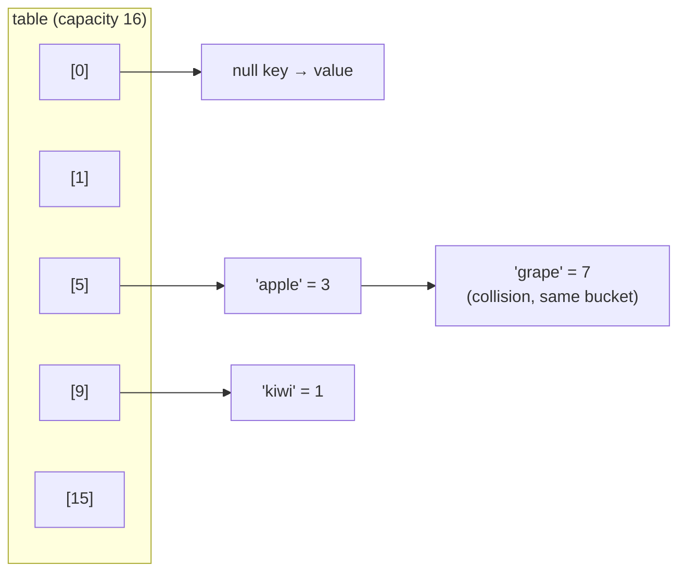
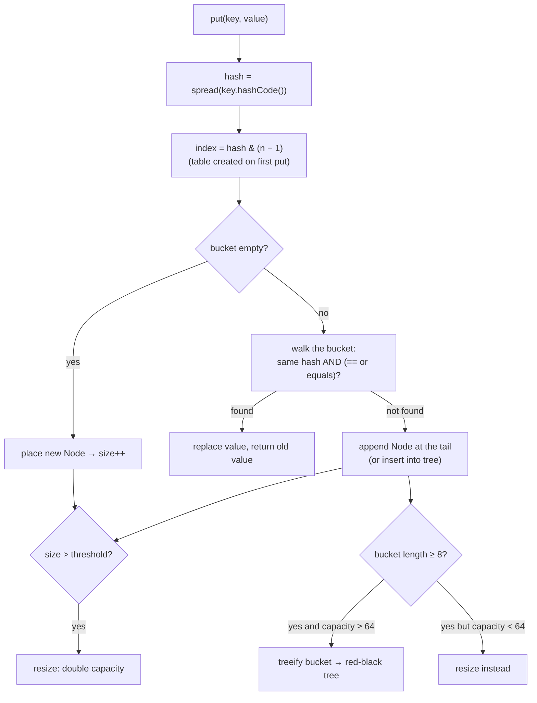
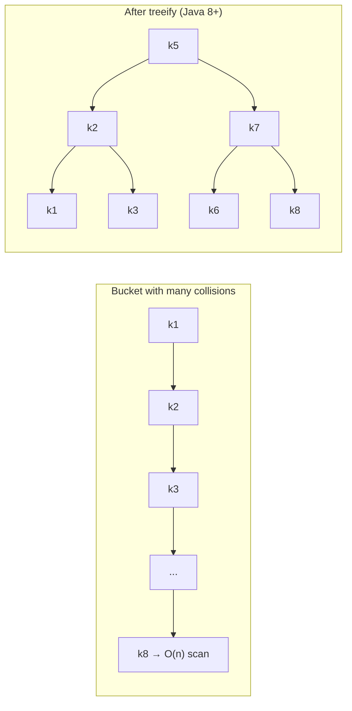
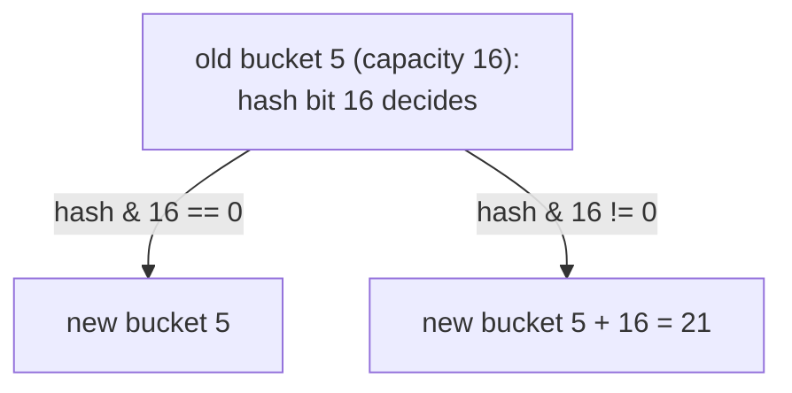
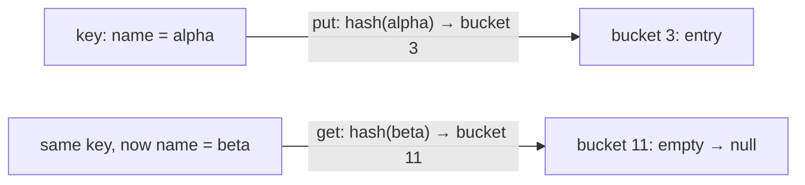
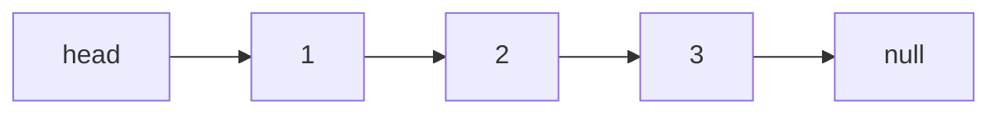
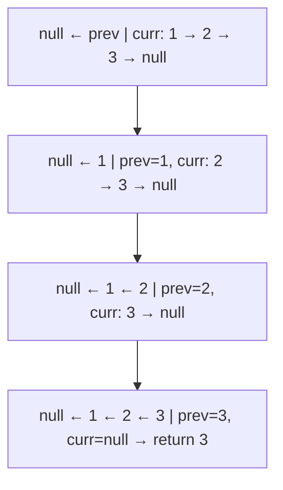
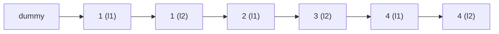

# Day 12 — HashMap Internals: The Most Asked Collection Topic

> **How to use these notes:** each section maps to one checklist item. Run the code, study the diagrams, then test yourself with the collapsible questions. 🚀 marks senior-level details.

**Today's goal:** be able to whiteboard exactly what happens inside `HashMap.put()` and `get()` — hashing, bucket index, collisions, treeification, resizing — and explain the contracts and traps around keys (equals/hashCode, mutable keys, nulls). Then compare HashMap with LinkedHashMap and TreeMap. On the DSA side: **singly linked lists** — the pointer manipulation patterns (dummy node, prev/curr/next, slow/fast) that every LL problem uses.

<!-- topic: d12_t1 -->
## ☕ Collections — HashMap Deep Dive

<!-- subtopic: d12_t1_s1 -->
### 1. HashMap Internals — buckets, hashing, index calculation

> **TL;DR:** A `HashMap` is an **array of buckets** (`Node<K,V>[] table`). Each key's `hashCode()` is **spread** (`h ^ (h >>> 16)`) and turned into a bucket **index = `hash & (capacity − 1)`**. Capacity is always a **power of two** (default **16**). Each bucket holds a linked list (or a red-black tree) of entries.

#### 1.1 Data structures

```java
// Simplified from java.util.HashMap (Java 8+)
transient Node<K,V>[] table;          // the buckets — allocated lazily on the first put
transient int size;                   // number of key-value mappings
int threshold;                        // resize when size > threshold (= capacity × loadFactor)
final float loadFactor;               // default 0.75

static class Node<K,V> implements Map.Entry<K,V> {
    final int hash;                   // cached spread hash of the key
    final K key;
    V value;
    Node<K,V> next;                   // next node in the same bucket (chaining)
}
```



#### 1.2 From key to bucket

```java
static final int hash(Object key) {
    int h;
    return (key == null) ? 0 : (h = key.hashCode()) ^ (h >>> 16);   // mix high bits into low bits
}
int index = (table.length - 1) & hash;    // same as hash % capacity, because capacity is a power of 2
```

Why the XOR with `h >>> 16`? With 16 buckets only the **lowest 4 bits** decide the index. Many hash codes differ only in their high bits; spreading them reduces collisions.

Why power-of-two capacity? `hash & (n − 1)` is a fast replacement for `%`, and resizing can split buckets cheaply (section 4). `new HashMap<>(100)` actually gets capacity **128** (next power of two).

#### 1.3 put() and get() flow



```java
Map<String, Integer> stock = new HashMap<>();
stock.put("apple", 3);        // returns null (no previous value)
stock.put("apple", 5);        // returns 3 — key exists, value replaced
stock.get("apple");           // 5: hash → index → walk bucket comparing hash then equals
stock.get("banana");          // null
```

`get` compares the **cached hash first** (cheap int comparison), then `==`, then `equals()` — so `equals` is only called on true hash matches.

#### 🎯 Interview questions

<details><summary>Q1. How does HashMap find the bucket for a key?</summary>

It calls key.hashCode(), spreads it with `h ^ (h >>> 16)`, and computes `index = hash & (capacity − 1)`. Capacity is a power of two, so this equals hash mod capacity.

</details>

<details><summary>Q2. What is the default capacity and when is the table allocated?</summary>

16 buckets with load factor 0.75. The table is allocated lazily on the first put.

</details>

<details><summary>Q3. Why must the capacity be a power of two?</summary>

So `hash & (n − 1)` can replace the slower modulo, and so resizing can split each bucket into "stay" and "move by oldCapacity" groups using a single bit.

</details>

<!-- subtopic: d12_t1_s2 -->
### 2. Collisions — chaining and treeification

> **TL;DR:** Different keys can land in the same bucket (**collision**). HashMap chains them in a **linked list**. Since Java 8, when one bucket reaches **8** entries **and** the table has at least **64** buckets, the list becomes a **red-black tree** (O(log n) lookups). It turns back into a list when it shrinks to **6**.

```java
// Two different strings with the same hashCode — a real collision
"Aa".hashCode();   // 2112
"BB".hashCode();   // 2112
```

| Constant | Value | Meaning |
|---|---|---|
| `TREEIFY_THRESHOLD` | 8 | Convert a bucket's list to a tree when it gets this long |
| `MIN_TREEIFY_CAPACITY` | 64 | …but only if the table has ≥ 64 buckets; otherwise **resize** instead |
| `UNTREEIFY_THRESHOLD` | 6 | Convert back to a list when a tree bucket shrinks to this size (on resize) |



Why the hysteresis (8 vs 6)? To avoid flipping between list and tree repeatedly when a bucket's size hovers around the threshold.

Tree nodes are ordered by hash, then by `compareTo` if keys implement `Comparable`, then by a tie-breaker. **Comparable keys give the best treeified performance.**

🚀 History: Java 7 inserted new nodes at the **head** of the chain; during concurrent resizing (an illegal but common misuse) this could create a **cycle** → `get()` looping forever at 100% CPU. Java 8 inserts at the **tail** and preserves order during resize — still not thread-safe, though (use `ConcurrentHashMap`).

Treeification also defends against **hash-flooding DoS attacks** (many crafted keys with the same hash), capping the damage at O(log n).

<!-- subtopic: d12_t1_s3 -->
### 3. The hashCode() + equals() Contract

> **TL;DR:** HashMap finds the bucket with `hashCode()` and the exact key with `equals()`. **Equal objects must have equal hash codes.** Override **both**, using the **same fields**. A constant or poor hashCode is legal but turns the map into a slow list.

```java
public final class EmployeeId {
    private final String company;
    private final int number;

    public EmployeeId(String company, int number) { this.company = company; this.number = number; }

    @Override public boolean equals(Object o) {
        return o instanceof EmployeeId other
                && number == other.number
                && company.equals(other.company);
    }

    @Override public int hashCode() {
        return Objects.hash(company, number);       // or 31 * company.hashCode() + number
    }
}
// Or simply: public record EmployeeId(String company, int number) {}
```

What goes wrong:

| Mistake | Result |
|---|---|
| Override `equals` but not `hashCode` | Equal keys go to different buckets → `get` returns `null`, duplicates in `HashSet` |
| Override `hashCode` but not `equals` | Same bucket, but identity `equals` → never matches a different instance |
| `hashCode()` returns a constant | Everything in one bucket → O(n) (or O(log n) treeified) |
| `equals(EmployeeId o)` instead of `equals(Object o)` | Overload, not override — HashMap never calls it (Day 2) |

Good hashCode properties: consistent while the object is unchanged, uses the same fields as `equals`, spreads values well. `String`, wrappers and records already do this.

<!-- subtopic: d12_t1_s4 -->
### 4. Load Factor and Resizing (Rehashing)

> **TL;DR:** **Load factor** (default **0.75**) = how full the table may get before growing. When `size > capacity × loadFactor` (the **threshold**), the table **doubles** and every entry moves to its new bucket. Resizing is O(n), so **presize** maps when you know the size.

```
capacity 16 × 0.75 = threshold 12 → the 13th entry triggers a resize to 32 (threshold 24)
```

Why 0.75? A trade-off: a lower load factor wastes memory but has fewer collisions; a higher one saves memory but makes chains longer. 0.75 gives short expected chains (statistically, a bucket having 8 entries is extremely rare with a decent hash).

#### How Java 8 rehashes cleverly

When capacity doubles from `n` to `2n`, an entry's new index is either the **same** index or **index + n**, depending on one bit: `hash & oldCapacity`. So each bucket splits into a "low" and a "high" list **without recomputing hashes**, preserving relative order.



#### Presizing

```java
int expected = 10_000;
Map<String, User> users = new HashMap<>((int) (expected / 0.75f) + 1);   // avoid ~10 resizes
Map<String, User> users21 = HashMap.newHashMap(expected);               // Java 19+: does the math for you
```

⚠️ The constructor argument is an initial **capacity**, not "number of entries without resizing". `new HashMap<>(16)` holding 16 entries still resizes at the 13th (threshold 12). `HashMap.newHashMap(n)` (Java 19) means "room for n mappings" and does the division for you.

<!-- subtopic: d12_t1_s5 -->
### 5. Time Complexity — average vs worst case

> **TL;DR:** `get`/`put`/`remove`/`containsKey` are **O(1) on average**. The worst case (all keys in one bucket) is **O(n)** in Java 7 and **O(log n)** in Java 8+ thanks to treeification.

| Operation | Average | Worst (Java 7) | Worst (Java 8+) |
|---|---|---|---|
| `get`, `put`, `remove`, `containsKey` | O(1) | O(n) | O(log n) (tree bucket) |
| `containsValue` | O(n) | O(n) | O(n) — scans everything |
| Iteration | O(capacity + size) | | |
| Resize | O(n), amortized O(1) per put | | |

Iteration cost depends on **capacity**, not just size: a map that once held a million entries and was then cleared still iterates over its huge (empty) table. Create a new map instead of `clear()` in that case.

<!-- subtopic: d12_t1_s6 -->
### 6. Null Handling in Maps

> **TL;DR:** `HashMap` allows **one null key** (stored in bucket 0) and **any number of null values**. `ConcurrentHashMap` and `Hashtable` allow **neither**. `TreeMap` allows **null values** but **not a null key** when using natural ordering.

```java
Map<String, String> hm = new HashMap<>();
hm.put(null, "x");            // ✅ hash(null) = 0 → bucket 0
hm.put("k", null);            // ✅
hm.get("missing");            // null
hm.get("k");                  // null — ambiguous! use containsKey to tell them apart
hm.containsKey("k");          // true

new ConcurrentHashMap<String, String>().put(null, "x");    // 💥 NPE
new ConcurrentHashMap<String, String>().put("k", null);    // 💥 NPE
new TreeMap<String, String>().put(null, "x");              // 💥 NPE (compareTo on null)
new TreeMap<String, String>().put("k", null);              // ✅
```

| | Null key | Null values |
|---|---|---|
| `HashMap` / `LinkedHashMap` | ✅ one | ✅ |
| `TreeMap` | ❌ with natural ordering (✅ only with a null-tolerant Comparator) | ✅ |
| `Hashtable` | ❌ | ❌ |
| `ConcurrentHashMap` | ❌ | ❌ |
| `Map.of(...)` | ❌ | ❌ |

**Why does ConcurrentHashMap forbid nulls?** In a concurrent map, `get(k) == null` must unambiguously mean "absent". With nulls allowed you'd need `containsKey` + `get`, and another thread could change the map between the two calls.

<!-- subtopic: d12_t1_s7 -->
### 7. Mutable Keys — the lost-entry bug

> **TL;DR:** If a key's fields used in `hashCode()` change **after** it's inserted, the entry sits in the bucket of its **old** hash. Lookups compute the **new** hash, look in the wrong bucket, and the entry is **unreachable** (yet still occupies memory). Keys should be **immutable**.

```java
class MutableKey {
    String name;
    MutableKey(String name) { this.name = name; }
    @Override public boolean equals(Object o) { return o instanceof MutableKey m && name.equals(m.name); }
    @Override public int hashCode() { return name.hashCode(); }
}

Map<MutableKey, String> map = new HashMap<>();
MutableKey key = new MutableKey("alpha");
map.put(key, "value");

key.name = "beta";                            // mutate AFTER insertion
map.get(key);                                 // null — looks in "beta"'s bucket
map.get(new MutableKey("alpha"));             // null — right bucket, but equals fails ("beta" != "alpha")
map.size();                                   // 1 — the entry is stranded (memory leak)
```



Rules: use immutable keys (`String`, wrappers, records with immutable fields, enums). Never use mutable collections (`List`) as keys unless you never mutate them.

<!-- subtopic: d12_t1_s8 -->
### 8. HashMap vs LinkedHashMap vs TreeMap

> **TL;DR:** **HashMap** — fastest, no order. **LinkedHashMap** — HashMap + a doubly-linked list through the entries → **insertion order** (or **access order** for LRU caches). **TreeMap** — red-black tree → **sorted keys**, O(log n), navigation methods.

| | `HashMap` | `LinkedHashMap` | `TreeMap` |
|---|---|---|---|
| Structure | Hash table | Hash table + doubly-linked entry list | Red-black tree |
| Order | None (may change on resize) | Insertion order, or access order | Sorted by key (natural or Comparator) |
| get/put | O(1) avg | O(1) avg | O(log n) |
| Null key | ✅ | ✅ | ❌ (natural ordering) |
| Memory | Lowest | + 2 pointers per entry | Tree node per entry |
| Extra features | — | `removeEldestEntry` (LRU), Java 21 `firstEntry`/`lastEntry` | `floorKey`, `ceilingKey`, `headMap`, `subMap`, `firstKey`... |
| Use when | Default | Need predictable order / LRU cache | Need sorted keys / range queries |

```java
Map<String, Integer> h = new HashMap<>();        // order unpredictable
Map<String, Integer> l = new LinkedHashMap<>();  // order you inserted
Map<String, Integer> t = new TreeMap<>();        // alphabetical keys
for (Map<String, Integer> m : List.of(h, l, t)) {
    m.put("banana", 2); m.put("apple", 1); m.put("cherry", 3);
}
// l → {banana=2, apple=1, cherry=3}
// t → {apple=1, banana=2, cherry=3}
```

LRU caches and TreeMap navigation are covered in depth on Day 13.

<!-- subtopic: d12_t1_s9 -->
### 9. Iterating a Map — entrySet vs keySet + get

> **TL;DR:** Iterate **`entrySet()`** (or `forEach`) when you need keys **and** values — one pass, no extra lookups. `keySet()` + `get()` does a **second hash lookup** per key.

```java
Map<String, Integer> scores = Map.of("asha", 91, "ravi", 78);

// ✅ entrySet — key and value together
for (Map.Entry<String, Integer> e : scores.entrySet()) {
    System.out.println(e.getKey() + " = " + e.getValue());
}

// ✅ Java 8 forEach with a BiConsumer
scores.forEach((name, score) -> System.out.println(name + " = " + score));

// ⚠️ keySet + get — an extra lookup per key (fine for small maps, wasteful in hot paths)
for (String name : scores.keySet()) {
    System.out.println(name + " = " + scores.get(name));
}

// Only values / only keys
int total = scores.values().stream().mapToInt(Integer::intValue).sum();

// Remove while iterating — use the iterator or removeIf on a view
Map<String, Integer> mutable = new HashMap<>(scores);
mutable.entrySet().removeIf(e -> e.getValue() < 80);
mutable.values().removeIf(v -> v < 80);

// Update values in place
mutable.replaceAll((name, score) -> score + 5);
for (Map.Entry<String, Integer> e : mutable.entrySet()) e.setValue(e.getValue() * 2);   // setValue is allowed
```

⚠️ Calling `map.put(newKey, ...)` or `map.remove(key)` while iterating a `HashMap` → `ConcurrentModificationException` (Day 11). Modify values with `setValue`/`replaceAll`, remove with the iterator or `removeIf`.

#### 🎯 HashMap interview questions

<details><summary>Q1. Walk me through HashMap.put().</summary>

Compute the spread hash, find the index with `hash & (n − 1)` (creating the table on first use). If the bucket is empty, place a node. Otherwise walk the bucket: if a node has the same hash and equal key, replace the value; else append a node (or insert into the tree). If the bucket reaches 8 nodes, treeify (or resize if capacity < 64). Finally, if size exceeds the threshold, resize to double capacity.

</details>

<details><summary>Q2. What happens when two keys have the same hashCode?</summary>

They land in the same bucket and are chained (linked list, or red-black tree when the bucket is large). `equals` distinguishes them during lookup.

</details>

<details><summary>Q3. Why is the load factor 0.75?</summary>

A time/space trade-off: it keeps expected chain lengths very short while not wasting too much memory on empty buckets.

</details>

<details><summary>Q4. Is HashMap thread-safe? What can go wrong?</summary>

No. Concurrent puts can lose updates, corrupt internal structure, or (in Java 7) create a cycle during resize causing infinite loops. Use ConcurrentHashMap.

</details>

<details><summary>Q5. Why should HashMap keys be immutable?</summary>

If fields used in hashCode change after insertion, the entry stays in the old bucket and can no longer be found, effectively leaking it.

</details>

<!-- topic: d7_t2 -->
## 🧮 DSA — Linked List: Easy

<!-- subtopic: d7_t2_s1 -->
### 10. Singly Linked List — nodes, traversal, insertion

> **TL;DR:** A singly linked list is a chain of **nodes**, each holding a value and a `next` reference; you hold only the **head**. Traversal is O(n), insert/delete at the head is O(1). Use a **dummy (sentinel) node** to avoid special-casing the head.

```java
// LeetCode's definition
public class ListNode {
    int val;
    ListNode next;
    ListNode(int val) { this.val = val; }
    ListNode(int val, ListNode next) { this.val = val; this.next = next; }
}
```



```java
// Traverse
for (ListNode cur = head; cur != null; cur = cur.next) System.out.print(cur.val + " ");

// Length
int length(ListNode head) { int n = 0; for (ListNode c = head; c != null; c = c.next) n++; return n; }

// Insert at head — O(1)
ListNode insertHead(ListNode head, int val) { return new ListNode(val, head); }

// Insert at tail — O(n) without a tail pointer
ListNode insertTail(ListNode head, int val) {
    ListNode node = new ListNode(val);
    if (head == null) return node;
    ListNode cur = head;
    while (cur.next != null) cur = cur.next;
    cur.next = node;
    return head;
}

// Delete first node with value — dummy node removes the "is it the head?" special case
ListNode delete(ListNode head, int val) {
    ListNode dummy = new ListNode(0, head);
    ListNode prev = dummy;
    while (prev.next != null && prev.next.val != val) prev = prev.next;
    if (prev.next != null) prev.next = prev.next.next;      // unlink
    return dummy.next;
}
```

| Linked list vs array | Linked list | Array |
|---|---|---|
| Access by index | O(n) | O(1) |
| Insert/delete at front | O(1) | O(n) |
| Insert/delete after a known node | O(1) | O(n) |
| Memory | Extra pointer per node, scattered | Contiguous |

**Core techniques for every LL problem:** dummy node, `prev/curr/next` rewiring, slow/fast pointers, two-pass length counting, and drawing the pointers on paper before coding.

<!-- subtopic: d7_t2_s2 -->
### 11. Reverse Linked List (LeetCode 206)

> **Problem:** reverse a singly linked list and return the new head. 🔗 [LeetCode 206](https://leetcode.com/problems/reverse-linked-list/)

#### Iterative — prev / curr / next ✅

```java
public ListNode reverseList(ListNode head) {
    ListNode prev = null, curr = head;
    while (curr != null) {
        ListNode next = curr.next;   // 1. save the rest of the list
        curr.next = prev;            // 2. reverse this pointer
        prev = curr;                 // 3. move prev forward
        curr = next;                 // 4. move curr forward
    }
    return prev;                     // prev is the new head
}   // Time O(n), Space O(1)
```



#### Recursive

```java
public ListNode reverseRecursive(ListNode head) {
    if (head == null || head.next == null) return head;   // empty or last node = new head
    ListNode newHead = reverseRecursive(head.next);       // reverse the rest
    head.next.next = head;                                // the next node now points back to me
    head.next = null;                                     // I become the tail
    return newHead;
}   // Time O(n), Space O(n) recursion stack
```

Variants: Reverse Linked List II (reverse positions `left..right`, LC 92), Reverse Nodes in k-Group (LC 25, Hard), Palindrome Linked List (Day 13).

<!-- subtopic: d7_t2_s3 -->
### 12. Middle of the Linked List (LeetCode 876) — slow & fast pointers

> **Problem:** return the middle node; for an even length return the **second** middle. 🔗 [LeetCode 876](https://leetcode.com/problems/middle-of-the-linked-list/)

Two passes (count, then walk n/2) works. One pass: **slow moves 1 step, fast moves 2** — when fast reaches the end, slow is in the middle.

```java
public ListNode middleNode(ListNode head) {
    ListNode slow = head, fast = head;
    while (fast != null && fast.next != null) {
        slow = slow.next;
        fast = fast.next.next;
    }
    return slow;
}   // Time O(n), Space O(1)
```

| List | slow stops at | Why |
|---|---|---|
| 1 → 2 → 3 → 4 → 5 | 3 | fast ends on the last node |
| 1 → 2 → 3 → 4 → 5 → 6 | 4 (second middle) | fast becomes null |

To get the **first** middle for even lengths (needed when splitting a list for merge sort), use `while (fast.next != null && fast.next.next != null)`.

> The **tortoise and hare** idea also detects cycles (Day 13) and finds the "nth from the end" style positions.

<!-- subtopic: d7_t2_s4 -->
### 13. Merge Two Sorted Lists (LeetCode 21)

> **Problem:** merge two sorted lists into one sorted list by **splicing nodes**. 🔗 [LeetCode 21](https://leetcode.com/problems/merge-two-sorted-lists/)

```java
public ListNode mergeTwoLists(ListNode l1, ListNode l2) {
    ListNode dummy = new ListNode(0);        // dummy head: no special case for the first node
    ListNode tail = dummy;
    while (l1 != null && l2 != null) {
        if (l1.val <= l2.val) {               // <= keeps it stable
            tail.next = l1;
            l1 = l1.next;
        } else {
            tail.next = l2;
            l2 = l2.next;
        }
        tail = tail.next;
    }
    tail.next = (l1 != null) ? l1 : l2;      // attach the leftover — already sorted
    return dummy.next;
}   // Time O(m + n), Space O(1) (reuses nodes)
```



*`l1 = 1→2→4`, `l2 = 1→3→4` → `1→1→2→3→4→4`.*

Recursive version: `if (l1.val <= l2.val) { l1.next = merge(l1.next, l2); return l1; }` — elegant, but O(m + n) stack.

This merge is the building block of **Sort List** (merge sort on a linked list, LC 148) and **Merge k Sorted Lists** (heap, Day 21).

<!-- subtopic: d7_t2_s5 -->
### 14. Remove Duplicates from Sorted List (LeetCode 83)

> **Problem:** delete duplicates so each value appears once; the list is sorted. 🔗 [LeetCode 83](https://leetcode.com/problems/remove-duplicates-from-sorted-list/)

Duplicates are adjacent. If the next node has the same value, **skip it** (don't advance); otherwise advance.

```java
public ListNode deleteDuplicates(ListNode head) {
    ListNode cur = head;
    while (cur != null && cur.next != null) {
        if (cur.val == cur.next.val) {
            cur.next = cur.next.next;     // unlink the duplicate; stay on cur to check the new next
        } else {
            cur = cur.next;
        }
    }
    return head;
}   // Time O(n), Space O(1)
```

**Dry run** `1 → 1 → 2 → 3 → 3`: cur=1, next 1 → skip → `1 → 2 → 3 → 3`; cur=1, next 2 → advance; cur=2 → advance; cur=3, next 3 → skip → `1 → 2 → 3`.

Variant: **Remove Duplicates II** (LC 82) — remove **all** nodes that have duplicates (`1→2→3→3→4→4→5` → `1→2→5`). Needs a **dummy** node because the head itself may be removed.

---

## 📝 Day 12 Revision Cheat Sheet

| Topic | Remember this |
|---|---|
| Structure | `Node<K,V>[] table`, nodes cache the hash; table created lazily |
| Index | `hash = h ^ (h >>> 16)`; `index = hash & (n − 1)`; capacity power of two, default 16 |
| Collisions | Chain at the tail; treeify at 8 if capacity ≥ 64 (else resize); untreeify at 6 |
| Contract | equal ⇒ same hashCode; override both; same fields |
| Resize | threshold = capacity × 0.75; doubles; entries stay or move by oldCapacity |
| Complexity | O(1) avg; worst O(n) Java 7, O(log n) Java 8+ |
| Nulls | HashMap: 1 null key + null values; CHM/Hashtable: none; TreeMap: null values only |
| Mutable keys | Changing hash fields after put strands the entry |
| HashMap / Linked / Tree | none / insertion-or-access order / sorted, O(log n) |
| Iteration | entrySet or forEach; remove via iterator/removeIf |
| LL patterns | dummy node, prev/curr/next, slow/fast, attach leftovers |

### ⚡ Rapid-fire self-test

1. `new HashMap<>(100)` real capacity? → **128**
2. When is a bucket treeified? → **8+ nodes and table capacity ≥ 64**
3. Resize threshold for capacity 32? → **24**
4. Bucket index of a null key? → **0**
5. Can ConcurrentHashMap store a null value? → **No**
6. Faster way to iterate keys and values? → **entrySet() / forEach**
7. Worst-case get in Java 8+? → **O(log n)**
8. Reverse a linked list — space complexity (iterative)? → **O(1)**
9. Middle of `1→2→3→4` with the standard loop? → **3 (second middle)**
10. Why use a dummy node? → **Avoid special-casing the head**
