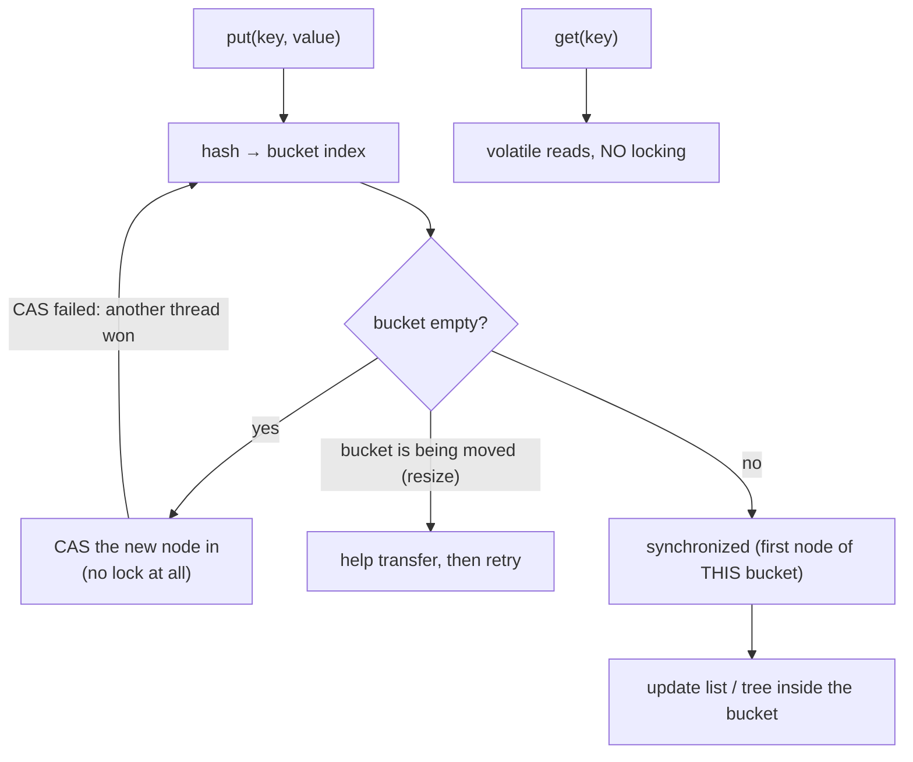
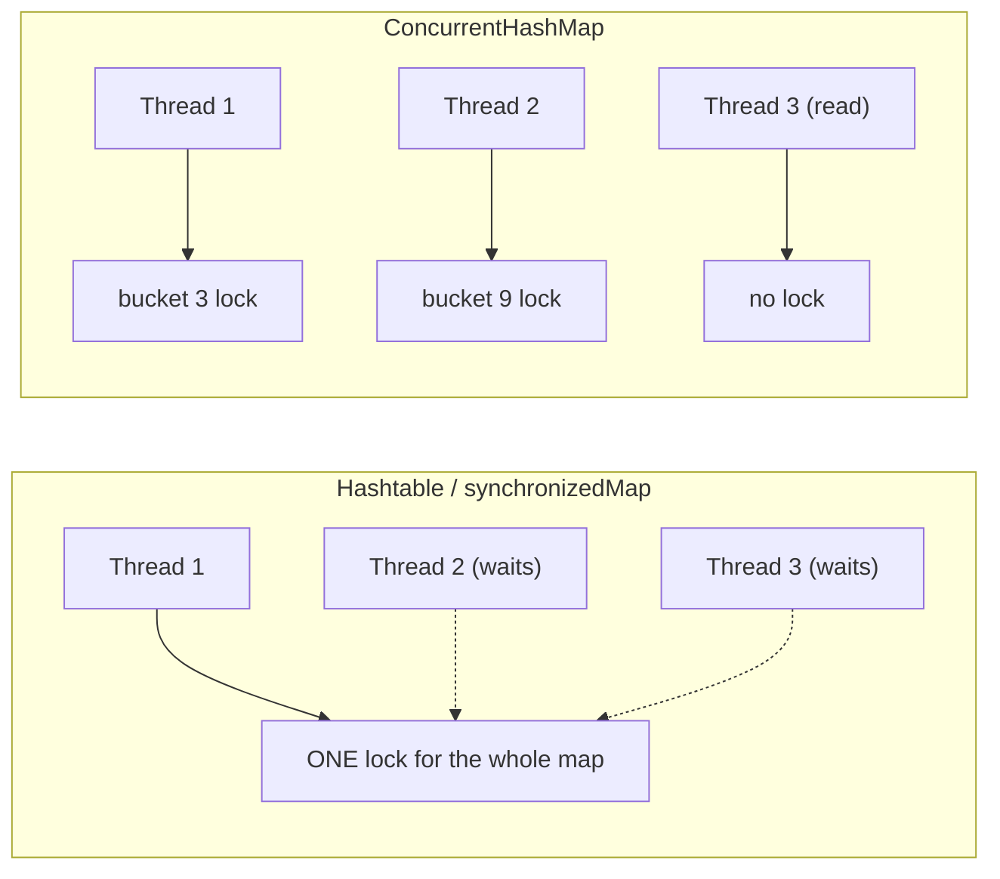
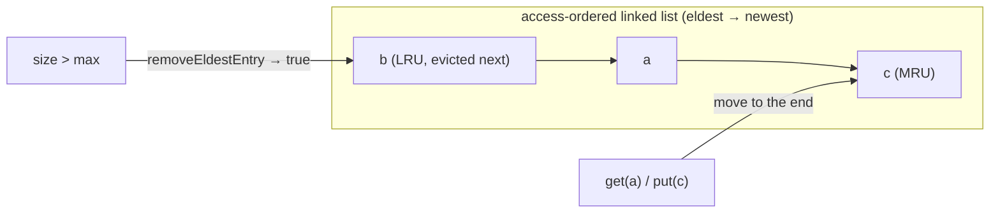
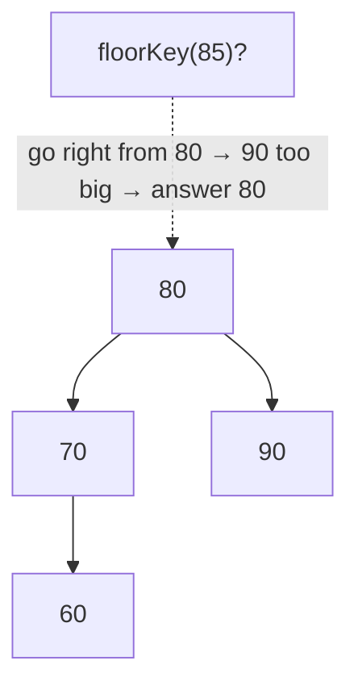
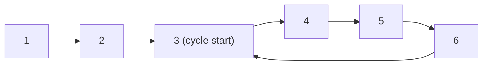
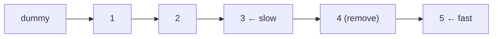
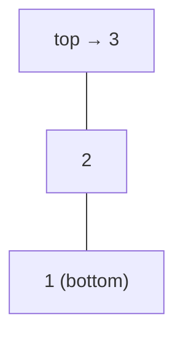
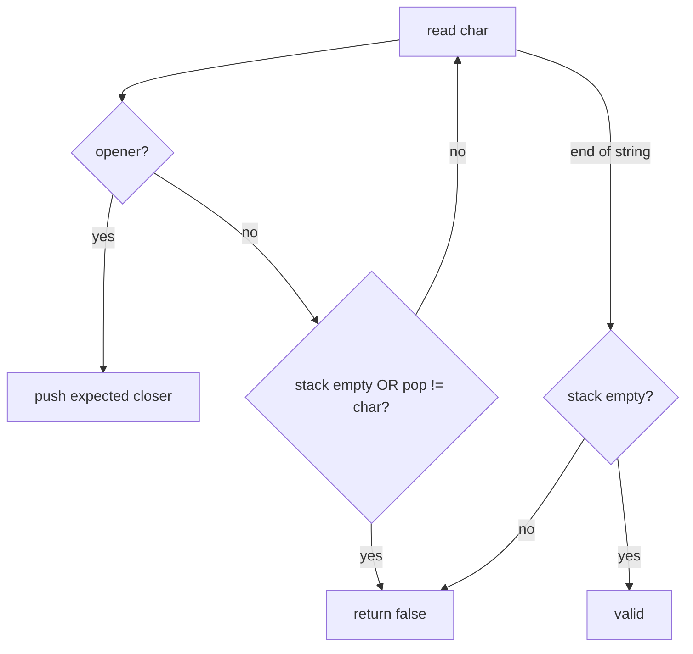

# Day 13 — ConcurrentHashMap, LRU Cache & Advanced Map Operations

> **How to use these notes:** each section maps to one checklist item. Run the code, study the diagrams, then test yourself with the collapsible questions. 🚀 marks senior-level details.

**Today's goal:** explain how `ConcurrentHashMap` achieves thread-safety without one big lock (and how it differs from `Hashtable` and `synchronizedMap`), use the atomic map operations (`computeIfAbsent`, `compute`, `merge`) fluently, build an **LRU cache** with `LinkedHashMap`, and know when to reach for `WeakHashMap`, `EnumMap` and `TreeMap`. On the DSA side: medium linked-list problems (cycle detection, nth from end, palindrome) and the first **stack** problems.

<!-- topic: d13_t1 -->
## ☕ Collections — Concurrent Maps & Advanced Operations

<!-- subtopic: d13_t1_s1 -->
### 1. ConcurrentHashMap — how it stays thread-safe and fast

> **TL;DR:** Java 8+ `ConcurrentHashMap` (CHM) uses the same table-of-buckets design as HashMap, but: **reads are lock-free** (volatile reads), inserting into an **empty bucket uses CAS**, and updating a non-empty bucket **locks only that bucket's first node** (`synchronized`). Many threads can write to different buckets at the same time. **No null keys or values.**



Key facts:
- **Lock granularity:** per bucket (Java 8+). Java 7 used **segments** (16 `ReentrantLock`-based sub-maps, `concurrencyLevel`).
- **Resizing** is done **cooperatively**: threads that encounter a bucket being moved help transfer it (forwarding nodes).
- **Size** is tracked with striped counters (like `LongAdder`); `size()` / `mappingCount()` are estimates while updates happen concurrently.
- **Iterators are weakly consistent:** never throw `ConcurrentModificationException`, may or may not reflect concurrent updates.
- **Atomic compound operations:** `putIfAbsent`, `computeIfAbsent`, `compute`, `merge`, `replace(k, old, new)` are atomic **per key**.

```java
ConcurrentHashMap<String, LongAdder> hits = new ConcurrentHashMap<>();
hits.computeIfAbsent("/home", k -> new LongAdder()).increment();   // thread-safe counter per key

// ❌ NOT atomic even on CHM — check-then-act across two calls
if (!map.containsKey(k)) map.put(k, v);
// ✅ atomic
map.putIfAbsent(k, v);
```

⚠️ The function passed to `computeIfAbsent`/`compute` runs **while that bucket is locked**: keep it short, don't do I/O, and **never modify the same map** inside it (can deadlock or throw `IllegalStateException: Recursive update`).

Bulk parallel operations (Java 8): `forEach(parallelismThreshold, ...)`, `search`, `reduce`. Concurrent set: `ConcurrentHashMap.newKeySet()`.

<!-- subtopic: d13_t1_s2 -->
### 2. HashMap vs Hashtable vs synchronizedMap vs ConcurrentHashMap

> **TL;DR:** **HashMap** isn't thread-safe. **Hashtable** and **`Collections.synchronizedMap`** lock the **whole map** for every operation (one thread at a time). **ConcurrentHashMap** allows concurrent reads and writes to different buckets. Use **CHM** for shared maps; Hashtable is legacy.

| | `HashMap` | `Hashtable` | `Collections.synchronizedMap` | `ConcurrentHashMap` |
|---|---|---|---|---|
| Thread-safe | ❌ | ✅ | ✅ | ✅ |
| Locking | — | Whole map (`synchronized` methods) | Whole map (wrapper mutex) | Per bucket + CAS; lock-free reads |
| Concurrent throughput | — | Poor | Poor | High |
| Null key / values | ✅ / ✅ | ❌ / ❌ | Same as wrapped map | ❌ / ❌ |
| Iteration | Fail-fast | Fail-fast (Enumeration not) | Fail-fast, **must lock manually** | Weakly consistent, no CME |
| Atomic compound ops | — | — | — (lock yourself) | ✅ computeIfAbsent, merge... |
| Since | 1.2 | 1.0 (legacy) | 1.2 | 1.5 |



<!-- subtopic: d13_t1_s3 -->
### 3. getOrDefault, putIfAbsent, computeIfAbsent

> **TL;DR:** `getOrDefault` reads with a fallback. `putIfAbsent` inserts only if the key is missing. **`computeIfAbsent`** inserts a **lazily computed** value only if missing and **returns the current value** — the go-to for caches and multimaps.

```java
Map<String, Integer> stock = new HashMap<>(Map.of("apple", 3));
stock.getOrDefault("kiwi", 0);                   // 0 — nothing inserted

stock.putIfAbsent("apple", 99);                  // returns 3, map unchanged
stock.putIfAbsent("kiwi", 5);                    // returns null, inserts kiwi=5

// Multimap: group items by key
Map<String, List<String>> byDept = new HashMap<>();
byDept.computeIfAbsent("Eng", k -> new ArrayList<>()).add("Asha");   // creates the list once
byDept.computeIfAbsent("Eng", k -> new ArrayList<>()).add("Ravi");   // reuses it

// Cache / memoization
Map<Integer, BigInteger> memo = new HashMap<>();
BigInteger fib(int n) {
    if (n < 2) return BigInteger.valueOf(n);
    BigInteger cached = memo.get(n);
    if (cached != null) return cached;
    BigInteger result = fib(n - 1).add(fib(n - 2));
    memo.put(n, result);
    return result;
}
```

| Method | If key absent | If key present | Returns |
|---|---|---|---|
| `getOrDefault(k, d)` | returns `d`, no insert | value | value or default |
| `putIfAbsent(k, v)` | inserts `v` (eagerly created) | no change | previous value or `null` |
| `computeIfAbsent(k, fn)` | inserts `fn(k)` (**lazy**) — unless `fn` returns `null` | no change, `fn` not called | the current (existing or new) value |
| `computeIfPresent(k, fn)` | nothing | replaces with `fn(k, v)`; `null` **removes** | new value or `null` |

⚠️ The memo example above deliberately doesn't use `memo.computeIfAbsent(n, k -> fib(k-1).add(fib(k-2)))` — **recursive `computeIfAbsent` on the same `HashMap` throws `ConcurrentModificationException`** (Java 9+), since the map is modified during the computation.

<!-- subtopic: d13_t1_s4 -->
### 4. compute() and merge() — atomic read-modify-write

> **TL;DR:** `compute(k, (k, old) -> new)` recomputes a key's value from its old value (or `null`). `merge(k, v, fn)` inserts `v` if absent, otherwise combines old and new with `fn`. **Returning `null` removes the entry.** On `ConcurrentHashMap` both are atomic per key.

```java
Map<String, Integer> freq = new HashMap<>();

// Word frequency in one line
for (String w : "to be or not to be".split(" ")) {
    freq.merge(w, 1, Integer::sum);          // absent → 1, present → old + 1
}
// {to=2, be=2, or=1, not=1}

// Same with compute (more general: you see the key and old value)
freq.compute("to", (k, v) -> v == null ? 1 : v + 1);

// Decrement and remove when it hits zero (returning null deletes)
freq.computeIfPresent("or", (k, v) -> v > 1 ? v - 1 : null);

// merge with a list value: accumulate
Map<String, List<String>> tags = new HashMap<>();
tags.merge("java", new ArrayList<>(List.of("lang")), (old, add) -> { old.addAll(add); return old; });
```

| | `compute` | `merge` |
|---|---|---|
| Function receives | key, old value (may be `null`) | old value, the given value |
| Absent key | `fn(k, null)` | inserts the given value directly |
| Return `null` | removes the key | removes the key |
| Best for | General updates | Counting, accumulating |

On a plain `HashMap` these are just convenient; on `ConcurrentHashMap` they're the **correct** way to update concurrently (a `get` followed by `put` would race).

<!-- subtopic: d13_t1_s5 -->
### 5. LRU Cache with LinkedHashMap

> **TL;DR:** `new LinkedHashMap<>(capacity, 0.75f, true)` keeps entries in **access order** (most recently used last). Override **`removeEldestEntry`** to evict the least-recently-used entry when the size exceeds the limit. That's a complete LRU cache in ~10 lines.

```java
public class LruCache<K, V> extends LinkedHashMap<K, V> {
    private final int maxSize;

    public LruCache(int maxSize) {
        super(16, 0.75f, true);              // accessOrder = true: get() moves the entry to the end
        this.maxSize = maxSize;
    }

    @Override
    protected boolean removeEldestEntry(Map.Entry<K, V> eldest) {
        return size() > maxSize;             // called after every put; true → evict the eldest (LRU)
    }
}

LruCache<String, String> cache = new LruCache<>(2);
cache.put("a", "1");
cache.put("b", "2");
cache.get("a");                  // a becomes most recent: order b, a
cache.put("c", "3");             // exceeds 2 → evicts b (least recently used)
cache.keySet();                  // [a, c]
```



How it works: `LinkedHashMap` threads a **doubly-linked list** through all entries. With `accessOrder = true`, `get`/`put` of an existing key move that entry to the tail; the head is always the least recently used.

⚠️ Not thread-safe — wrap with `Collections.synchronizedMap(...)` for simple cases. In production use **Caffeine** (or Spring's `@Cacheable` backed by Caffeine/Redis) for concurrency, size/time-based eviction and stats.

Interview follow-up: implement LRU **without** LinkedHashMap → `HashMap<K, Node>` + your own doubly-linked list, O(1) get/put (LeetCode 146, Day 32).

<!-- subtopic: d13_t1_s6 -->
### 6. WeakHashMap — keys that don't prevent garbage collection

> **TL;DR:** In a `WeakHashMap`, keys are held by **weak references**. When no **strong** reference to a key exists anywhere else, the GC can collect it and the entry **disappears automatically**. Used to attach metadata to objects without causing memory leaks.

```java
Map<Object, String> metadata = new WeakHashMap<>();
Object session = new Object();
metadata.put(session, "user=asha");
session = null;                      // no more strong references to the key
System.gc();                         // (only a hint)
// eventually: metadata.size() == 0 — the entry was removed after the key was collected
```

#### Java reference types

| Reference | Collected when | Typical use |
|---|---|---|
| **Strong** (normal) | Never while reachable | Everything |
| **Soft** (`SoftReference`) | Only when memory is low | Memory-sensitive caches |
| **Weak** (`WeakReference`) | At the next GC once only weakly reachable | `WeakHashMap`, canonicalizing maps, listeners |
| **Phantom** (`PhantomReference`) | After finalization, `get()` always null | Cleanup tracking (`Cleaner`, Day 4) |

⚠️ Pitfalls:
- **String literals / interned strings and small boxed Integers** as keys are always strongly reachable (pool/cache) → never removed.
- If the **value strongly references its key**, the entry never goes away (leak).
- Uses `equals`/`hashCode`, not identity — two equal keys share an entry.
- It's **not** a good general cache: entries vanish as soon as the key is unreachable, regardless of how useful the value is. Use Caffeine with weak/soft values or size limits.

<!-- subtopic: d13_t1_s7 -->
### 7. EnumMap — the right map for enum keys

> **TL;DR:** `EnumMap` stores values in an **array indexed by the enum's ordinal**. No hashing, no collisions, compact, O(1), iterates in **declaration order**. Always use it (and `EnumSet`) for enum keys.

```java
enum Status { NEW, PAID, SHIPPED, DELIVERED }

Map<Status, Integer> counts = new EnumMap<>(Status.class);
for (Order o : orders) counts.merge(o.status(), 1, Integer::sum);
// iteration order: NEW, PAID, SHIPPED, DELIVERED (declaration order), not hash order

Map<Status, List<Order>> byStatus = orders.stream()
        .collect(Collectors.groupingBy(Order::status, () -> new EnumMap<>(Status.class), Collectors.toList()));
```

| | `HashMap<Status, V>` | `EnumMap<Status, V>` |
|---|---|---|
| Storage | Hash table of nodes | `Object[]` indexed by ordinal |
| Speed | O(1) with hashing | O(1), faster (array index) |
| Memory | Node per entry | One array |
| Order | Unpredictable | Declaration order |
| Null keys | One allowed | ❌ |

<!-- subtopic: d13_t1_s8 -->
### 8. TreeMap — sorted map and navigation

> **TL;DR:** `TreeMap` is a **red-black tree** (self-balancing BST): keys are **sorted** (natural order or a `Comparator`), operations are **O(log n)**, and it implements **`NavigableMap`**: find the nearest key below/above a value, take ranges (`headMap`, `tailMap`, `subMap`), first/last entries.

```java
TreeMap<Integer, String> grades = new TreeMap<>(Map.of(90, "A", 80, "B", 70, "C", 60, "D"));

grades.firstKey();                 // 60
grades.lastEntry();                // 90=A
grades.floorKey(85);               // 80  — greatest key ≤ 85
grades.ceilingKey(85);             // 90  — smallest key ≥ 85
grades.lowerKey(80);               // 70  — strictly less
grades.higherKey(80);              // 90  — strictly greater
grades.floorEntry(85).getValue();  // "B" — score 85 → grade B

grades.headMap(80);                // {60=D, 70=C}         keys < 80 (exclusive)
grades.tailMap(80);                // {80=B, 90=A}         keys ≥ 80 (inclusive)
grades.subMap(65, true, 85, true); // {70=C, 80=B}
grades.descendingMap();            // {90=A, 80=B, 70=C, 60=D}
grades.pollFirstEntry();           // removes and returns 60=D
```

| Method | Returns |
|---|---|
| `floorKey(k)` | greatest key **≤ k** |
| `ceilingKey(k)` | smallest key **≥ k** |
| `lowerKey(k)` | greatest key **< k** |
| `higherKey(k)` | smallest key **> k** |
| `headMap(k)` / `tailMap(k)` | keys < k / keys ≥ k (views) |
| `firstEntry` / `lastEntry` / `pollFirstEntry` | min / max / remove min |



Classic uses: **time-based lookups** ("value at or before timestamp t" — LC 981 Time Based Key-Value Store), **grade/tax brackets**, **booking calendars** (check `floorEntry` / `ceilingEntry` for overlaps — LC 729), **leaderboards**, **order books** (price levels). Thread-safe sorted alternative: `ConcurrentSkipListMap` (Day 15).

Keys must be `Comparable` (or supply a `Comparator`), and `compareTo == 0` means "same key" — the same trap as TreeSet (Day 3, Day 14).

<!-- topic: d8_t2 -->
## 🧮 DSA — Linked List: Medium & Stacks Intro

<!-- subtopic: d8_t2_s1 -->
### 9. Linked List Cycle — Floyd's Tortoise and Hare (LeetCode 141 / 142)

> **Problem:** does the list contain a cycle? (Follow-up: where does the cycle start?) 🔗 [LeetCode 141](https://leetcode.com/problems/linked-list-cycle/), [LeetCode 142](https://leetcode.com/problems/linked-list-cycle-ii/)

HashSet of visited nodes → O(n) space. **Floyd's algorithm** → O(1) space: slow moves 1, fast moves 2. If there's a cycle, fast **laps** slow and they meet; if not, fast reaches `null`.

```java
public boolean hasCycle(ListNode head) {
    ListNode slow = head, fast = head;
    while (fast != null && fast.next != null) {
        slow = slow.next;
        fast = fast.next.next;
        if (slow == fast) return true;      // compare references, not values
    }
    return false;
}   // Time O(n), Space O(1)

// Follow-up: start of the cycle
public ListNode detectCycle(ListNode head) {
    ListNode slow = head, fast = head;
    while (fast != null && fast.next != null) {
        slow = slow.next;
        fast = fast.next.next;
        if (slow == fast) {                 // meeting point found
            ListNode p = head;
            while (p != slow) {             // move both one step at a time
                p = p.next;
                slow = slow.next;
            }
            return p;                       // they meet at the cycle start
        }
    }
    return null;
}
```



**Why the second phase works:** let `a` = distance head → cycle start, `b` = start → meeting point, `c` = cycle length. When they meet, fast travelled twice as far as slow: `2(a + b) = a + b + k·c` ⇒ `a = k·c − b`. So walking `a` steps from the head and `a` steps from the meeting point lands both pointers on the cycle start.

<!-- subtopic: d8_t2_s2 -->
### 10. Remove Nth Node From End of List (LeetCode 19)

> **Problem:** remove the n-th node from the end in **one pass**. 🔗 [LeetCode 19](https://leetcode.com/problems/remove-nth-node-from-end-of-list/)

Two passes: count length L, remove node L − n + 1. One pass ✅: move `fast` **n steps ahead**, then move both until `fast` reaches the last node — `slow` is just **before** the node to remove. A **dummy** node handles removing the head.

```java
public ListNode removeNthFromEnd(ListNode head, int n) {
    ListNode dummy = new ListNode(0, head);
    ListNode fast = dummy, slow = dummy;
    for (int i = 0; i < n; i++) fast = fast.next;      // gap of n nodes
    while (fast.next != null) {
        fast = fast.next;
        slow = slow.next;
    }
    slow.next = slow.next.next;                        // unlink the target
    return dummy.next;
}   // Time O(L), Space O(1)
```

**Dry run** `1→2→3→4→5`, n = 2: fast moves to 2; then both move until fast = 5 → slow = 3 → unlink 4 → `1→2→3→5`.



<!-- subtopic: d8_t2_s3 -->
### 11. Palindrome Linked List (LeetCode 234)

> **Problem:** is the list a palindrome? Target O(n) time, **O(1) space**. 🔗 [LeetCode 234](https://leetcode.com/problems/palindrome-linked-list/)

Copying values to an array → O(n) space. O(1) space ✅: **find the middle** (slow/fast), **reverse the second half** (Day 12), **compare** both halves, then (good practice) **restore** the list.

```java
public boolean isPalindrome(ListNode head) {
    if (head == null || head.next == null) return true;

    ListNode slow = head, fast = head;                     // 1. end of first half
    while (fast.next != null && fast.next.next != null) {
        slow = slow.next;
        fast = fast.next.next;
    }

    ListNode secondHead = reverse(slow.next);              // 2. reverse second half
    ListNode p1 = head, p2 = secondHead;
    boolean result = true;
    while (p2 != null) {                                   // 3. compare
        if (p1.val != p2.val) { result = false; break; }
        p1 = p1.next;
        p2 = p2.next;
    }
    slow.next = reverse(secondHead);                       // 4. restore the input
    return result;
}

private ListNode reverse(ListNode head) {
    ListNode prev = null;
    while (head != null) { ListNode next = head.next; head.next = prev; prev = head; head = next; }
    return prev;
}   // Time O(n), Space O(1)
```

`1→2→2→1` → first half `1→2`, reversed second half `1→2` → equal → `true`. For odd lengths the middle node stays in the first half and is simply not compared.

<!-- subtopic: d8_t2_s4 -->
### 12. Stack Basics — LIFO, and why ArrayDeque beats Stack

> **TL;DR:** A **stack** is **Last-In-First-Out**: `push` adds on top, `pop` removes the top, `peek` looks at it — all O(1). In Java use **`Deque<Integer> stack = new ArrayDeque<>()`**, not the legacy `Stack` class.

```java
Deque<Integer> stack = new ArrayDeque<>();
stack.push(1);          // [1]
stack.push(2);          // [2, 1] — top is 2
stack.push(3);          // [3, 2, 1]
stack.peek();           // 3 (no removal)
stack.pop();            // 3
stack.isEmpty();        // false
// stack.pop() on empty → NoSuchElementException; poll()/peek() return null instead
```



| | `java.util.Stack` | `ArrayDeque` (as a stack) |
|---|---|---|
| Since | 1.0 (legacy) | 1.6 |
| Extends | `Vector` → every method `synchronized` (slow) | — (unsynchronized, fast) |
| Exposes | `get(i)`, `add(i, x)`… — can break LIFO discipline | Only deque operations |
| Iteration order | Bottom → top | Top → bottom |
| Nulls | Allowed | ❌ Not allowed |
| Recommendation | ❌ Avoid | ✅ Use `Deque` interface |

Where stacks appear: undo/redo, browser back button, **function call stack**, expression evaluation and parsing, **matching brackets**, DFS (iterative), **monotonic stacks** (next greater element — Day 14).

<!-- subtopic: d8_t2_s5 -->
### 13. Valid Parentheses (LeetCode 20)

> **Problem:** given a string of `()[]{}`, is every bracket closed by the same type in the correct order? 🔗 [LeetCode 20](https://leetcode.com/problems/valid-parentheses/)

Push openers; on a closer, the top of the stack must be its matching opener.

```java
public boolean isValid(String s) {
    if (s.length() % 2 != 0) return false;                  // quick reject
    Deque<Character> stack = new ArrayDeque<>();
    for (char c : s.toCharArray()) {
        switch (c) {
            case '(' -> stack.push(')');                      // push the EXPECTED closer — simplifies matching
            case '[' -> stack.push(']');
            case '{' -> stack.push('}');
            default -> {
                if (stack.isEmpty() || stack.pop() != c) return false;
            }
        }
    }
    return stack.isEmpty();                                   // leftovers = unclosed openers
}   // Time O(n), Space O(n)
```

**Dry run** `"{[()]}"`: push `}`, `]`, `)` → pop `)` ✓, `]` ✓, `}` ✓ → empty → `true`. `"([)]"`: push `)`, `]` → read `)` but top is `]` → `false`.



Edge cases: `"("` (leftover), `")"` (pop from empty), `""` (valid). Follow-ups: Minimum Remove to Make Valid Parentheses (LC 1249), Longest Valid Parentheses (LC 32, Hard), Generate Parentheses (LC 22, backtracking).

---

## 📝 Day 13 Revision Cheat Sheet

| Topic | Remember this |
|---|---|
| CHM | CAS for empty buckets, per-bucket `synchronized`, lock-free reads, cooperative resize, no nulls, weakly consistent iterators |
| vs Hashtable / synchronizedMap | Those lock the whole map; CHM scales |
| Atomic ops | putIfAbsent, computeIfAbsent, compute, merge — atomic per key on CHM; keep functions short, don't touch the map inside |
| computeIfAbsent | Lazy create; returns current value; null result → not inserted |
| merge | `merge(k, 1, Integer::sum)` counting; return null → remove |
| LRU | `LinkedHashMap(cap, 0.75f, true)` + `removeEldestEntry(size() > max)`; Caffeine in production |
| WeakHashMap | Entry removed when key is only weakly reachable; not a general cache |
| EnumMap | Array by ordinal, fastest for enum keys, declaration order |
| TreeMap | Red-black tree, O(log n), floor/ceiling/lower/higher, head/tail/subMap |
| Floyd | slow 1, fast 2; meet ⇒ cycle; restart one from head to find the start |
| Nth from end | gap of n with dummy node |
| Palindrome LL | middle + reverse second half + compare + restore |
| Stack | `Deque` + `ArrayDeque`; never `Stack` |

### ⚡ Rapid-fire self-test

1. Does `ConcurrentHashMap.get()` take a lock? → **No**
2. Java 7 CHM used what? → **Segments (lock striping)**
3. `merge("a", 1, Integer::sum)` on an empty map → value? → **1**
4. Constructor flag that makes LinkedHashMap access-ordered? → **true (3rd argument)**
5. `TreeMap.floorKey(85)` with keys 60, 70, 80, 90? → **80**
6. Is `headMap(k)` inclusive of k? → **No**
7. Does WeakHashMap compare keys by identity? → **No — equals/hashCode**
8. Floyd's algorithm space complexity? → **O(1)**
9. Why a dummy node in Remove Nth From End? → **The head itself may be removed**
10. Stack class to avoid? → **java.util.Stack**
