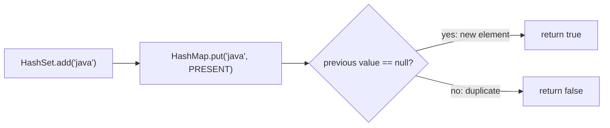
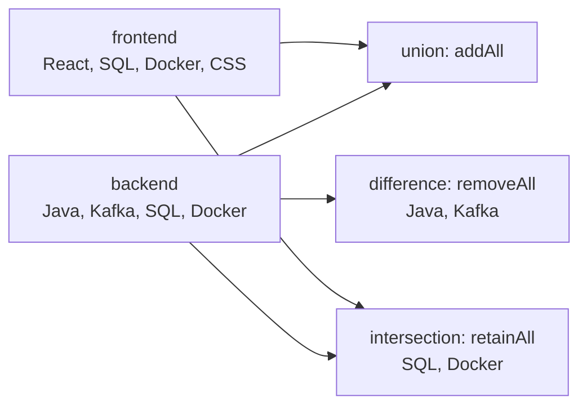
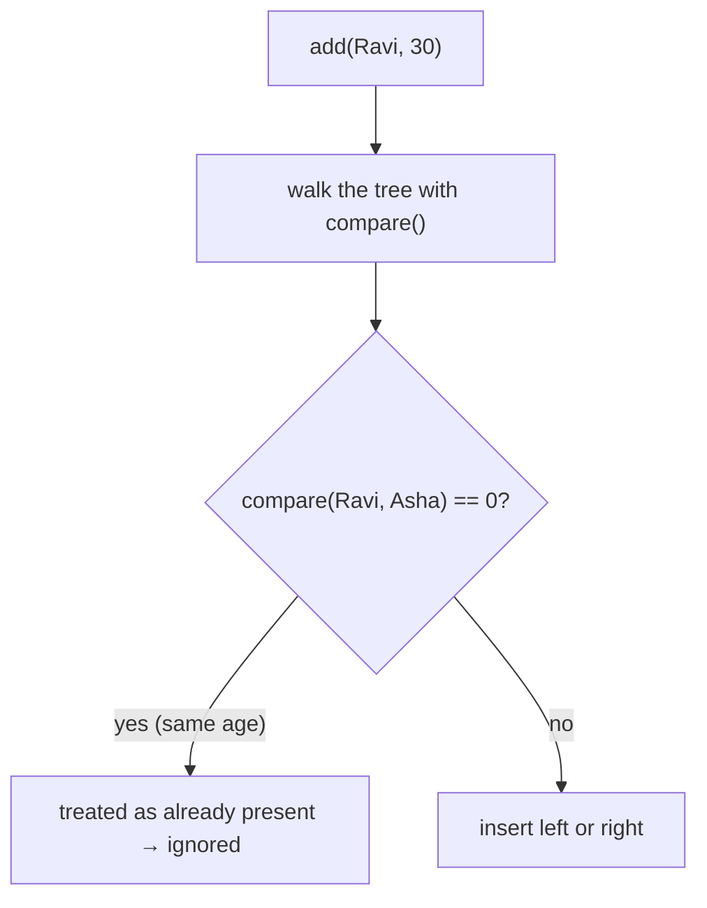
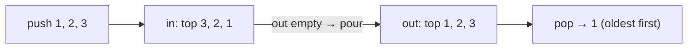
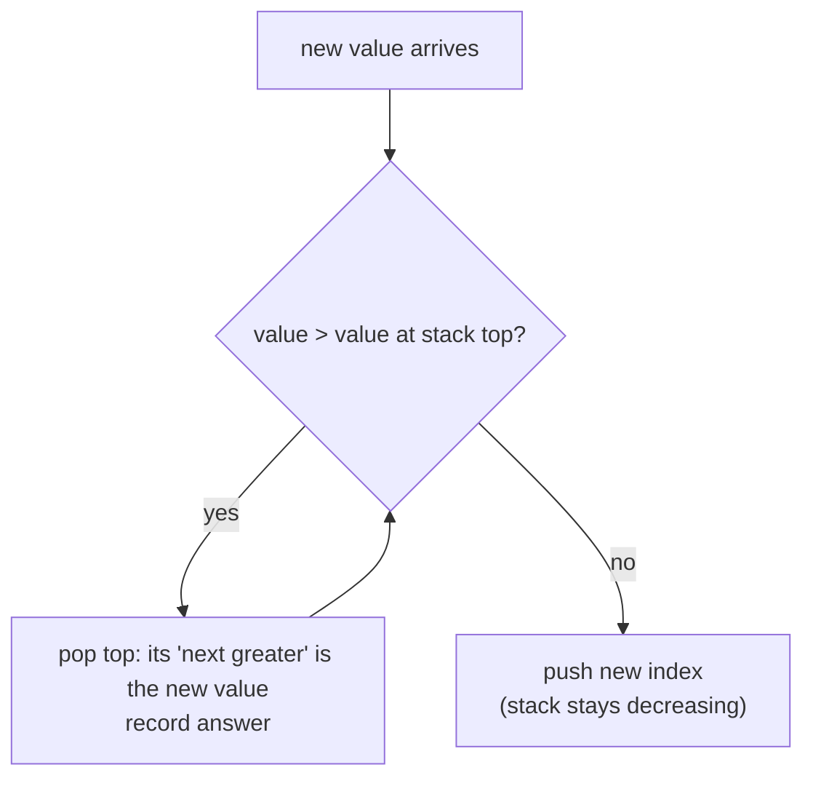

# Day 14 — HashSet, TreeSet & Set Operations

> **How to use these notes:** each section maps to one checklist item. Run the code, study the diagrams, then test yourself with the collapsible questions. 🚀 marks senior-level details.

**Today's goal:** know how each `Set` is implemented (hint: on top of a `Map`), choose between `HashSet`, `LinkedHashSet` and `TreeSet`, do set algebra without corrupting your inputs, avoid the TreeSet comparator trap, and use `NavigableSet` navigation. On the DSA side: **stack design problems** and the **monotonic stack** — the pattern behind "next greater / next warmer / previous smaller" questions.

<!-- topic: d14_t1 -->
## ☕ Collections — Sets

<!-- subtopic: d14_t1_s1 -->
### 1. HashSet Internals — a HashMap in disguise

> **TL;DR:** `HashSet<E>` is backed by a **`HashMap<E, Object>`**: each element is a **key**, and every value is the same dummy object `PRESENT`. So everything you learned about HashMap (hashing, buckets, load factor, equals/hashCode, treeification) applies. `add`, `remove`, `contains` are **O(1) on average**.

```java
// Simplified from java.util.HashSet
public class HashSet<E> {
    private transient HashMap<E, Object> map;
    private static final Object PRESENT = new Object();

    public HashSet() { map = new HashMap<>(); }

    public boolean add(E e)          { return map.put(e, PRESENT) == null; }   // null → wasn't there before
    public boolean remove(Object o)  { return map.remove(o) == PRESENT; }
    public boolean contains(Object o){ return map.containsKey(o); }
    public int size()                { return map.size(); }
    public Iterator<E> iterator()    { return map.keySet().iterator(); }
}
```



Consequences:
- **`add` returns `false` for duplicates** — a free duplicate check (section 5 of Day 16).
- Elements need correct **`equals` + `hashCode`**, and must not be mutated after insertion (Day 12's mutable-key bug).
- Allows **one `null`**. Iteration order is unpredictable.
- Same for the others: `LinkedHashSet` → `LinkedHashMap`, `TreeSet` → `TreeMap`.

<!-- subtopic: d14_t1_s2 -->
### 2. HashSet vs LinkedHashSet vs TreeSet

> **TL;DR:** **HashSet** — fastest, no order. **LinkedHashSet** — keeps **insertion order**. **TreeSet** — keeps elements **sorted**, O(log n), with navigation methods.

| | `HashSet` | `LinkedHashSet` | `TreeSet` |
|---|---|---|---|
| Backed by | `HashMap` | `LinkedHashMap` | `TreeMap` (red-black tree) |
| Order | None | Insertion order | Sorted (natural or `Comparator`) |
| add / remove / contains | O(1) avg | O(1) avg | O(log n) |
| Null | ✅ one | ✅ one | ❌ (natural ordering) |
| Equality used | `equals` + `hashCode` | `equals` + `hashCode` | **`compareTo` / `compare`** |
| Extra API | — | Java 21 `getFirst`/`getLast`/`reversed` | `first`, `last`, `floor`, `ceiling`, `headSet`, ... |
| Use when | Default membership tests | Unique items in arrival order | Sorted unique items, range queries |

```java
List<String> input = List.of("kiwi", "apple", "mango", "apple", "banana");
new HashSet<>(input);         // e.g. [banana, kiwi, apple, mango] — no guaranteed order
new LinkedHashSet<>(input);   // [kiwi, apple, mango, banana]  — first occurrence order
new TreeSet<>(input);         // [apple, banana, kiwi, mango]  — sorted
```

<!-- subtopic: d14_t1_s3 -->
### 3. Remove Duplicates While Preserving Order

> **TL;DR:** `new ArrayList<>(new LinkedHashSet<>(list))` or `list.stream().distinct().toList()` — both O(n) and keep the **first occurrence** order.

```java
List<Integer> nums = List.of(3, 1, 3, 2, 1, 4);

List<Integer> a = new ArrayList<>(new LinkedHashSet<>(nums));   // [3, 1, 2, 4]
List<Integer> b = nums.stream().distinct().toList();            // [3, 1, 2, 4] (distinct keeps encounter order)

// Sorted unique
List<Integer> c = new ArrayList<>(new TreeSet<>(nums));         // [1, 2, 3, 4]

// Unique by a property (e.g., keep the first employee per email)
Set<String> seen = new HashSet<>();
List<Employee> uniqueByEmail = employees.stream()
        .filter(e -> seen.add(e.email()))                       // add() is false for repeats
        .toList();
```

| Approach | Time | Keeps order |
|---|---|---|
| Nested loops / `list.contains` checks | O(n²) | ✅ |
| `new HashSet<>(list)` | O(n) | ❌ |
| `LinkedHashSet` / `distinct()` | O(n) | ✅ |
| `TreeSet` | O(n log n) | Sorted |

<!-- subtopic: d14_t1_s4 -->
### 4. Set Operations — union, intersection, difference

> **TL;DR:** `addAll` = **union**, `retainAll` = **intersection**, `removeAll` = **difference**. They **modify the set they're called on**, so work on a **copy** if you need the originals.

```java
Set<String> backend = Set.of("Java", "Kafka", "SQL", "Docker");
Set<String> frontend = Set.of("React", "SQL", "Docker", "CSS");

Set<String> union = new HashSet<>(backend);
union.addAll(frontend);                 // [Java, Kafka, SQL, Docker, React, CSS]

Set<String> common = new HashSet<>(backend);
common.retainAll(frontend);             // [SQL, Docker]

Set<String> onlyBackend = new HashSet<>(backend);
onlyBackend.removeAll(frontend);        // [Java, Kafka]

// Symmetric difference (in exactly one set)
Set<String> symDiff = new HashSet<>(union);
symDiff.removeAll(common);              // [Java, Kafka, React, CSS]

boolean isSubset = backend.containsAll(Set.of("Java", "SQL"));   // true
boolean disjoint = Collections.disjoint(backend, Set.of("Go"));   // true — no common elements
```



⚠️ `Set.of(...)` is immutable — calling `retainAll` on it directly throws `UnsupportedOperationException`. Always copy into a `HashSet` first. Stream alternative: `backend.stream().filter(frontend::contains).collect(toSet())`.

🚀 Performance: `a.removeAll(b)` iterates the **smaller** side in some implementations and calls `contains` on the other — if `b` is a `List`, `contains` is O(n) → O(n·m). Convert the argument to a `HashSet` for large inputs.

<!-- subtopic: d14_t1_s5 -->
### 5. The TreeSet Comparator Trap — compareTo == 0 means duplicate

> **TL;DR:** `TreeSet` (and `TreeMap`) decide equality **only with `compareTo` / `compare`**, ignoring `equals`. If your comparator returns 0 for two different objects, the second one is **silently dropped**.

```java
record Employee(String name, int age) { }

Set<Employee> byAge = new TreeSet<>(Comparator.comparingInt(Employee::age));
byAge.add(new Employee("Asha", 30));
byAge.add(new Employee("Ravi", 30));    // compare → 0 → treated as a duplicate → NOT added
byAge.size();                           // 1 😱

byAge.contains(new Employee("Someone else", 30));   // true! — any 30-year-old "is in" the set

// ✅ Fix: add tie-breakers until the ordering is consistent with equals
Set<Employee> fixed = new TreeSet<>(Comparator.comparingInt(Employee::age)
                                              .thenComparing(Employee::name));
```



Same trap with `new BigDecimal("1.0")` and `new BigDecimal("1.00")`: different by `equals`, equal by `compareTo` → one element in a `TreeSet`, two in a `HashSet`. Rule: make comparators **consistent with equals**, or document clearly when they aren't.

<!-- subtopic: d14_t1_s6 -->
### 6. NavigableSet — floor, ceiling, lower, higher, poll, descending

> **TL;DR:** `TreeSet` implements `NavigableSet`: find the **closest element** below/above a value in O(log n), take **range views**, and **poll** the min or max. This is what makes TreeSet a powerful DSA tool.

```java
TreeSet<Integer> ts = new TreeSet<>(List.of(10, 20, 30, 40, 50));

ts.first();               // 10
ts.last();                // 50
ts.floor(25);             // 20   greatest ≤ 25
ts.ceiling(25);           // 30   smallest ≥ 25
ts.lower(20);             // 10   strictly <
ts.higher(20);            // 30   strictly >
ts.floor(5);              // null — nothing ≤ 5

ts.headSet(30);           // [10, 20]          < 30
ts.tailSet(30);           // [30, 40, 50]      ≥ 30
ts.subSet(15, 45);        // [20, 30, 40]      [15, 45)
ts.descendingSet();       // [50, 40, 30, 20, 10]

ts.pollFirst();           // removes and returns 10
ts.pollLast();            // removes and returns 50
```

DSA uses:
- **"Closest value" questions:** nearest available seat/meeting slot/price → `floor` / `ceiling`.
- **Sliding window with order statistics:** keep the window in a `TreeSet`/`TreeMap` to get min/max or the closest value (Contains Duplicate III, LC 220).
- **Ordered unique scheduling:** next free ID = `ceiling(candidate)`.

All range views are **live views** backed by the original set.

<!-- subtopic: d14_t1_s7 -->
### 7. CopyOnWriteArraySet and Other Concurrent Sets

> **TL;DR:** `CopyOnWriteArraySet` is backed by a `CopyOnWriteArrayList`: **every write copies the array**, reads and iteration need no locks and never throw CME. Great for **small, read-mostly** sets like event listeners. For large concurrent sets use **`ConcurrentHashMap.newKeySet()`** (unordered) or **`ConcurrentSkipListSet`** (sorted).

```java
Set<EventListener> listeners = new CopyOnWriteArraySet<>();
listeners.add(auditListener);              // copies the array — fine, listeners rarely change
for (EventListener l : listeners) l.onEvent(e);   // snapshot iteration, no locking, safe during adds

Set<String> activeSessions = ConcurrentHashMap.newKeySet();   // high-concurrency membership set
Set<Integer> sortedIds = new ConcurrentSkipListSet<>();        // concurrent + sorted, O(log n)
```

| | `CopyOnWriteArraySet` | `ConcurrentHashMap.newKeySet()` | `ConcurrentSkipListSet` | `Collections.synchronizedSet` |
|---|---|---|---|---|
| contains | **O(n)** (array scan) | O(1) | O(log n) | O(1) |
| Writes | O(n) copy | O(1) | O(log n) | O(1) + global lock |
| Order | Insertion | None | Sorted | Depends on wrapped set |
| Iteration | Snapshot | Weakly consistent | Weakly consistent | Must lock manually |
| Best for | Few elements, many reads | General concurrent set | Concurrent sorted set | Low contention |

<!-- topic: d9_t2 -->
## 🧮 DSA — Stacks & Queues

<!-- subtopic: d9_t2_s1 -->
### 8. Min Stack (LeetCode 155)

> **Problem:** design a stack supporting `push`, `pop`, `top` and `getMin` — **all O(1)**. 🔗 [LeetCode 155](https://leetcode.com/problems/min-stack/)

Keep a second stack where each entry is **the minimum at that depth**.

```java
class MinStack {
    private final Deque<Integer> stack = new ArrayDeque<>();
    private final Deque<Integer> mins = new ArrayDeque<>();   // mins.peek() = min of the whole stack

    public void push(int val) {
        stack.push(val);
        mins.push(mins.isEmpty() ? val : Math.min(val, mins.peek()));
    }
    public void pop()    { stack.pop(); mins.pop(); }       // both shrink together
    public int top()     { return stack.peek(); }
    public int getMin()  { return mins.peek(); }
}   // all O(1); Space O(n)
```

| Operation | stack | mins | getMin |
|---|---|---|---|
| push 5 | [5] | [5] | 5 |
| push 3 | [3, 5] | [3, 5] | 3 |
| push 7 | [7, 3, 5] | [3, 3, 5] | 3 |
| pop | [3, 5] | [3, 5] | 3 |
| pop | [5] | [5] | 5 |

Space optimization: push onto `mins` only when `val <= mins.peek()` and pop from it only when the popped value equals `mins.peek()` (the `<=` handles duplicates of the minimum). Or store `int[]{val, minSoFar}` pairs in one stack.

<!-- subtopic: d9_t2_s2 -->
### 9. Implement Queue using Stacks (LeetCode 232)

> **Problem:** implement a FIFO queue using only two stacks. 🔗 [LeetCode 232](https://leetcode.com/problems/implement-queue-using-stacks/)

Use an **in** stack for pushes and an **out** stack for pops. Only when `out` is empty, pour everything from `in` into `out` — this reverses the order, putting the oldest element on top.

```java
class MyQueue {
    private final Deque<Integer> in = new ArrayDeque<>();
    private final Deque<Integer> out = new ArrayDeque<>();

    public void push(int x) { in.push(x); }

    public int pop()  { moveIfNeeded(); return out.pop(); }
    public int peek() { moveIfNeeded(); return out.peek(); }
    public boolean empty() { return in.isEmpty() && out.isEmpty(); }

    private void moveIfNeeded() {
        if (out.isEmpty()) {
            while (!in.isEmpty()) out.push(in.pop());   // reverse once
        }
    }
}   // push O(1); pop/peek amortized O(1) — each element is moved at most once
```



**Why amortized O(1):** each element is pushed onto `in` once, moved to `out` once, and popped once — 3 operations per element over its lifetime, even though a single `pop` can occasionally cost O(n). (Reverse problem: Stack using Queues, LC 225.)

<!-- subtopic: d9_t2_s3 -->
### 10. Evaluate Reverse Polish Notation (LeetCode 150)

> **Problem:** evaluate an expression in **postfix** notation, e.g. `["2","1","+","3","*"]` = `(2 + 1) * 3 = 9`. Division truncates toward zero. 🔗 [LeetCode 150](https://leetcode.com/problems/evaluate-reverse-polish-notation/)

Numbers are pushed; an operator pops **two** operands, applies itself, and pushes the result. The **first popped is the right operand**.

```java
public int evalRPN(String[] tokens) {
    Deque<Integer> stack = new ArrayDeque<>();
    for (String t : tokens) {
        switch (t) {
            case "+" -> stack.push(stack.pop() + stack.pop());
            case "*" -> stack.push(stack.pop() * stack.pop());
            case "-" -> { int b = stack.pop(), a = stack.pop(); stack.push(a - b); }   // order matters
            case "/" -> { int b = stack.pop(), a = stack.pop(); stack.push(a / b); }   // Java / truncates toward zero ✓
            default  -> stack.push(Integer.parseInt(t));
        }
    }
    return stack.pop();
}   // Time O(n), Space O(n)
```

**Dry run** `["4","13","5","/","+"]`: push 4, 13, 5 → `/`: 13 / 5 = 2 → push 2 → `+`: 4 + 2 = **6**.

Why RPN matters: no parentheses or precedence rules needed — compilers and calculators convert infix to postfix (Shunting-yard algorithm) and evaluate it with a stack. Related: Basic Calculator I/II (LC 224 Hard / 227).

<!-- subtopic: d9_t2_s4 -->
### 11. Daily Temperatures (LeetCode 739) — the monotonic stack

> **Problem:** for each day, how many days until a **warmer** temperature? 0 if never. `[73,74,75,71,69,72,76,73]` → `[1,1,4,2,1,1,0,0]`. 🔗 [LeetCode 739](https://leetcode.com/problems/daily-temperatures/)

Brute force: for each day scan forward → O(n²).

**Monotonic stack** ✅: keep a stack of **indices of days still waiting** for a warmer day; their temperatures are **decreasing** from bottom to top. When today is warmer than the top, today is the answer for that day — pop it and record the distance. Keep popping while today is warmer.

```java
public int[] dailyTemperatures(int[] temps) {
    int[] answer = new int[temps.length];
    Deque<Integer> stack = new ArrayDeque<>();                     // indices, decreasing temperatures
    for (int i = 0; i < temps.length; i++) {
        while (!stack.isEmpty() && temps[i] > temps[stack.peek()]) {
            int prev = stack.pop();
            answer[prev] = i - prev;                               // found prev's warmer day
        }
        stack.push(i);                                             // today waits for its warmer day
    }
    return answer;                                                 // indices left in the stack keep 0
}   // Time O(n) — each index pushed and popped once; Space O(n)
```

**Dry run** (first part):

| i | temp | stack before (temps) | action | answer updates |
|---|---|---|---|---|
| 0 | 73 | [] | push 0 | |
| 1 | 74 | [73] | 74 > 73 → pop 0 | ans[0] = 1 |
| 2 | 75 | [74] | pop 1 | ans[1] = 1 |
| 3 | 71 | [75] | push | |
| 4 | 69 | [75, 71] | push | |
| 5 | 72 | [75, 71, 69] | pop 4 (69), pop 3 (71); 72 < 75 stop | ans[4] = 1, ans[3] = 2 |
| 6 | 76 | [75, 72] | pop 5, pop 2 | ans[5] = 1, ans[2] = 4 |



> **Monotonic stack template** — "for each element, find the next/previous greater/smaller element" in O(n). Decreasing stack → next **greater**; increasing stack → next **smaller**. Used in Next Greater Element (next), Largest Rectangle in Histogram (Day 33), Trapping Rain Water (stack version), Online Stock Span, Sum of Subarray Minimums.

<!-- subtopic: d9_t2_s5 -->
### 12. Next Greater Element I (LeetCode 496)

> **Problem:** `nums1` is a subset of `nums2` (distinct values). For each `x` in `nums1`, find the first greater element to the **right of x in `nums2`**, or −1. 🔗 [LeetCode 496](https://leetcode.com/problems/next-greater-element-i/)

Run the monotonic stack over `nums2` once, storing each value's next greater element in a **HashMap**; then answer `nums1` with lookups.

```java
public int[] nextGreaterElement(int[] nums1, int[] nums2) {
    Map<Integer, Integer> nextGreater = new HashMap<>();
    Deque<Integer> stack = new ArrayDeque<>();                 // values, decreasing
    for (int x : nums2) {
        while (!stack.isEmpty() && x > stack.peek()) {
            nextGreater.put(stack.pop(), x);
        }
        stack.push(x);
    }
    int[] result = new int[nums1.length];
    for (int i = 0; i < nums1.length; i++) {
        result[i] = nextGreater.getOrDefault(nums1[i], -1);   // values left on the stack have none
    }
    return result;
}   // Time O(n + m), Space O(n)
```

**Example** `nums1 = [4,1,2], nums2 = [1,3,4,2]`: stack pass → `1→3`, `3→4`, `4` and `2` have none → result `[-1, 3, -1]`.

Variants:
- **Next Greater Element II** (LC 503) — circular array: loop `i` from 0 to `2n − 1` using `nums[i % n]`, store indices.
- **Previous** greater/smaller: scan left-to-right and read the stack top **after** popping, or scan right-to-left.

---

## 📝 Day 14 Revision Cheat Sheet

| Topic | Remember this |
|---|---|
| HashSet | HashMap keys + PRESENT value; add returns false for duplicates |
| Set choice | Hash (fast) / LinkedHash (insertion order) / Tree (sorted, O(log n)) |
| Dedupe keeping order | `new LinkedHashSet<>(list)` or `distinct()` |
| Set algebra | addAll / retainAll / removeAll — on a COPY |
| TreeSet trap | compare == 0 ⇒ duplicate; add tie-breakers |
| NavigableSet | floor ≤, ceiling ≥, lower <, higher >; head/tail/subSet views; pollFirst/Last |
| Concurrent sets | COW set (small, read-mostly), CHM.newKeySet(), ConcurrentSkipListSet (sorted) |
| Min Stack | Parallel stack of running minimums |
| Queue via stacks | in/out stacks; pour only when out is empty; amortized O(1) |
| RPN | Push numbers; operator pops b then a; a op b |
| Monotonic stack | Decreasing stack → next greater; each index pushed/popped once → O(n) |

### ⚡ Rapid-fire self-test

1. What value does HashSet store in its HashMap? → **A dummy PRESENT object**
2. Set that keeps insertion order? → **LinkedHashSet**
3. Does TreeSet use equals() to detect duplicates? → **No — compareTo/compare**
4. `ts.ceiling(25)` on {10, 20, 30}? → **30**
5. `Set.of("a").retainAll(...)`? → **UnsupportedOperationException**
6. contains() complexity of CopyOnWriteArraySet? → **O(n)**
7. Min Stack getMin complexity? → **O(1)**
8. In RPN, for "a b -", which is popped first? → **b**
9. Daily Temperatures stack holds what? → **Indices of days waiting for a warmer day**
10. Monotonic stack overall complexity? → **O(n)**
