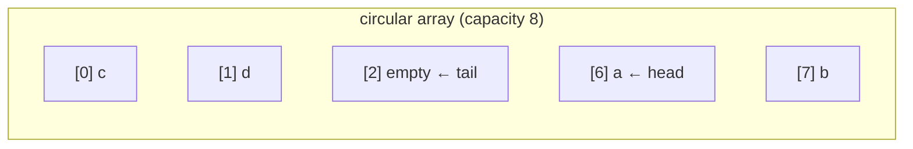
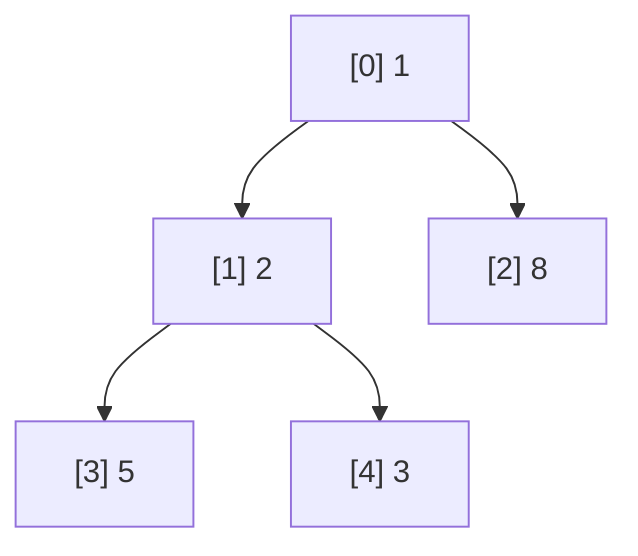
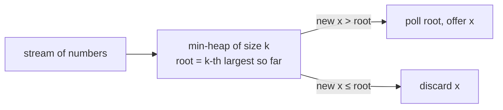
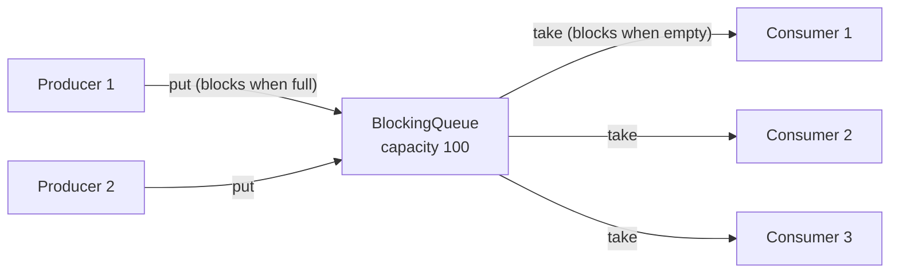
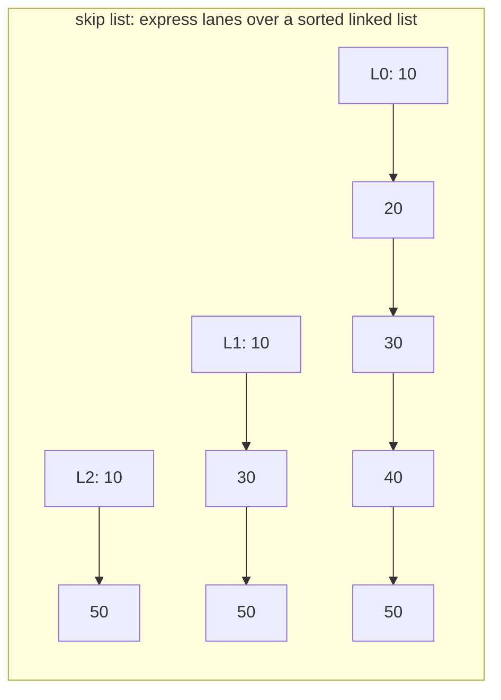
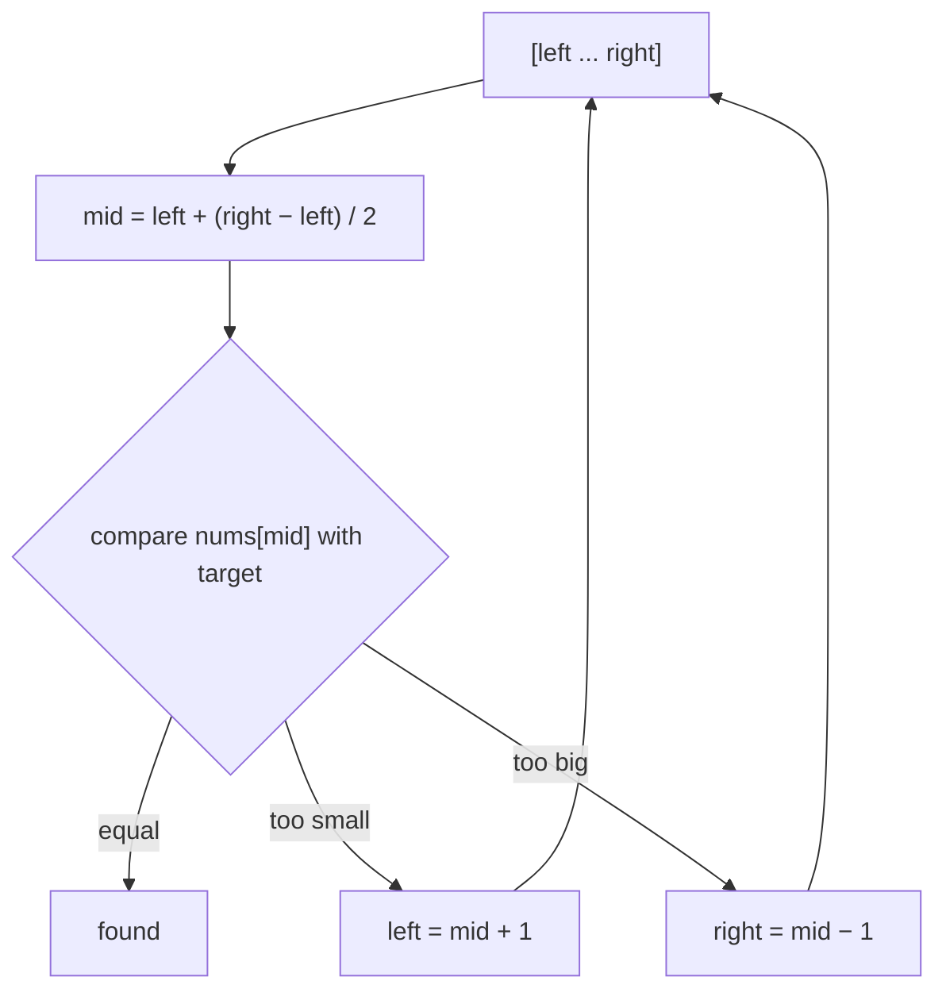
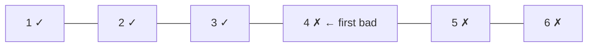

# Day 15 — Queue, Deque, PriorityQueue & BlockingQueue

> **How to use these notes:** each section maps to one checklist item. Run the code, study the diagrams, then test yourself with the collapsible questions. 🚀 marks senior-level details.

**Today's goal:** master the queue family: the `Queue` method pairs, `ArrayDeque` as both stack and queue, **`PriorityQueue` as a binary heap** (and its iteration trap), **`BlockingQueue`** for producer–consumer systems, and the lock-free concurrent queues and sorted maps. On the DSA side: **binary search** — a template you'll reuse for dozens of problems, with the off-by-one details explained.

<!-- topic: d15_t1 -->
## ☕ Collections — Queue & Deque

<!-- subtopic: d15_t1_s1 -->
### 1. The Queue Interface — two flavours of every operation

> **TL;DR:** `Queue` offers each operation in two forms: one that **throws** an exception when it can't act, and one that **returns a special value** (`false`/`null`). Prefer `offer` / `poll` / `peek` in normal code.

| Operation | Throws exception | Returns special value |
|---|---|---|
| Insert | `add(e)` → `IllegalStateException` if full | `offer(e)` → `false` if full |
| Remove head | `remove()` → `NoSuchElementException` if empty | `poll()` → `null` if empty |
| Examine head | `element()` → `NoSuchElementException` if empty | `peek()` → `null` if empty |

```java
Queue<String> q = new ArrayDeque<>();
q.offer("a");
q.offer("b");
q.peek();      // "a" — FIFO: oldest first
q.poll();      // "a"
q.poll();      // "b"
q.poll();      // null — empty, no exception
// q.remove(); // 💥 NoSuchElementException
```

Because `poll()` uses `null` to mean "empty", most queues **don't allow null elements** (`ArrayDeque`, `PriorityQueue`, concurrent queues). `LinkedList` allows them — another reason to avoid it as a queue.


<!-- subtopic: d15_t1_s2 -->
### 2. ArrayDeque — the best stack AND queue

> **TL;DR:** `ArrayDeque` is a **resizable circular array** with `head` and `tail` indices. Adding/removing at **both ends is amortized O(1)**, no node allocation, cache-friendly. Use it for **stacks** (instead of `Stack`) and **queues** (instead of `LinkedList`). No nulls, not thread-safe.

```java
Deque<Integer> dq = new ArrayDeque<>();

// As a QUEUE (FIFO): add at the tail, remove from the head
dq.offerLast(1); dq.offerLast(2);
dq.pollFirst();               // 1

// As a STACK (LIFO): push/pop work on the head
dq.push(10);                  // = addFirst
dq.pop();                     // = removeFirst → 10

// Both ends
dq.offerFirst(0); dq.offerLast(9);
dq.peekFirst(); dq.peekLast();
dq.pollLast();
```

| Deque method | Stack equivalent | Queue equivalent |
|---|---|---|
| `addFirst` / `offerFirst` | `push` | — |
| `removeFirst` / `pollFirst` | `pop` | `remove` / `poll` |
| `peekFirst` | `peek` | `peek` |
| `addLast` / `offerLast` | — | `add` / `offer` |



*Indices wrap around, so adding at the front doesn't shift anything — `head` just moves backwards modulo the capacity. When full, the array doubles.*

| | `ArrayDeque` | `LinkedList` | `Stack` |
|---|---|---|---|
| Structure | Circular array | Doubly-linked nodes | Synchronized `Vector` |
| Ends | Amortized O(1) | O(1) but allocates a node each time | O(1) at top only |
| Memory / cache | ✅ Compact | ❌ 24+ bytes per node | OK |
| Null elements | ❌ | ✅ | ✅ |
| Use as | Stack + queue + deque ✅ | Rarely | Never |

Also used for **BFS** (queue of nodes, Day 19) and the **monotonic deque** for Sliding Window Maximum (Day 33).

<!-- subtopic: d15_t1_s3 -->
### 3. PriorityQueue — a binary heap

> **TL;DR:** `PriorityQueue` always gives you the **smallest** element first (a **min-heap** by natural order). `offer`/`poll` are **O(log n)**, `peek` is **O(1)**. It's an array-based **binary heap**. For a **max-heap** pass `Collections.reverseOrder()`. ⚠️ **Iterating it does NOT return sorted order.**

#### 3.1 Usage

```java
PriorityQueue<Integer> minHeap = new PriorityQueue<>();
minHeap.addAll(List.of(5, 1, 8, 3, 2));
minHeap.peek();     // 1
minHeap.poll();     // 1, then 2, 3, 5, 8 on later polls

PriorityQueue<Integer> maxHeap = new PriorityQueue<>(Collections.reverseOrder());
maxHeap.addAll(List.of(5, 1, 8, 3, 2));
maxHeap.poll();     // 8

System.out.println(minHeap);   // e.g. [2, 3, 8, 5] — heap ORDER in the array, not sorted!
```

#### 3.2 How the heap works

A complete binary tree stored in an array: for index `i`, children are at `2i + 1` and `2i + 2`, the parent at `(i − 1) / 2`. **Heap property:** every parent ≤ its children → the root (`queue[0]`) is the minimum.



*Array form: `[1, 2, 8, 5, 3]`. Each parent is ≤ its children, but siblings aren't ordered.*

| Operation | How | Cost |
|---|---|---|
| `offer(x)` | Put at the end, **sift up** (swap with parent while smaller) | O(log n) |
| `poll()` | Take the root, move the last element to the root, **sift down** | O(log n) |
| `peek()` | Read `queue[0]` | O(1) |
| `remove(Object)`, `contains` | Linear search | O(n) |
| `new PriorityQueue<>(collection)` | Bottom-up **heapify** | O(n) |
| Iteration / `toString` | Array order — **not sorted** | O(n) |

To get sorted output, **poll repeatedly** (that's heap sort, O(n log n)). Not thread-safe (use `PriorityBlockingQueue`), no nulls, unbounded (grows like ArrayList).

<!-- subtopic: d15_t1_s4 -->
### 4. PriorityQueue with a Custom Comparator — Top-K and scheduling

> **TL;DR:** Pass a `Comparator` to order by any field: `new PriorityQueue<>(Comparator.comparingInt(Task::priority))`. The famous **Top-K** trick: keep a **min-heap of size k** — the root is the k-th largest, anything smaller is discarded.

```java
record Task(String name, int priority, Instant createdAt) { }

// Lowest priority number first; ties broken by creation time
PriorityQueue<Task> tasks = new PriorityQueue<>(
        Comparator.comparingInt(Task::priority).thenComparing(Task::createdAt));

tasks.offer(new Task("email", 3, Instant.now()));
tasks.offer(new Task("payment", 1, Instant.now()));
tasks.poll().name();      // "payment"

// Max-heap by a field
PriorityQueue<Task> urgentLast = new PriorityQueue<>(Comparator.comparingInt(Task::priority).reversed());

// Arrays: min-heap of [distance, nodeId] pairs (Dijkstra, Day 31)
PriorityQueue<int[]> pq = new PriorityQueue<>((a, b) -> Integer.compare(a[0], b[0]));
```

#### Top-K largest with a size-k min-heap

```java
public static List<Integer> topK(int[] nums, int k) {
    PriorityQueue<Integer> heap = new PriorityQueue<>();      // min-heap
    for (int x : nums) {
        heap.offer(x);
        if (heap.size() > k) heap.poll();                     // drop the smallest → keep k largest
    }
    return new ArrayList<>(heap);                             // the k largest (unordered)
}   // O(n log k) time, O(k) space — better than sorting (n log n) when k ≪ n
```



⚠️ Never use `(a, b) -> a - b` for big or negative values (overflow) — use `Integer.compare` / `Comparator.comparingInt` (Day 3).

<!-- subtopic: d15_t1_s5 -->
### 5. BlockingQueue — queues that wait

> **TL;DR:** A `BlockingQueue` adds operations that **block**: `put()` waits while the queue is **full**, `take()` waits while it's **empty**. It's thread-safe and the backbone of producer–consumer designs and thread pools.

| Operation | Throws | Special value | **Blocks** | Times out |
|---|---|---|---|---|
| Insert | `add(e)` | `offer(e)` | **`put(e)`** | `offer(e, time, unit)` |
| Remove | `remove()` | `poll()` | **`take()`** | `poll(time, unit)` |
| Examine | `element()` | `peek()` | — | — |

| Implementation | Bounded? | Notes |
|---|---|---|
| `ArrayBlockingQueue(n)` | ✅ fixed | Array + **one lock** (optionally fair); predictable memory |
| `LinkedBlockingQueue(n)` | Optional (default `Integer.MAX_VALUE` ⚠️) | Linked nodes + **two locks** (put and take don't contend) — higher throughput |
| `SynchronousQueue` | Capacity **0** | Each `put` waits for a `take` — direct hand-off (cached thread pool) |
| `PriorityBlockingQueue` | Unbounded | Priority order (Day 16) |
| `DelayQueue` | Unbounded | Elements become available after a delay (Day 16) |
| `LinkedTransferQueue` | Unbounded | `transfer()` waits until a consumer receives it |

Always prefer a **bounded** queue in production — it provides **back-pressure** (producers slow down instead of memory growing without limit). That's the same lesson as `ThreadPoolExecutor` (Day 9), which uses a `BlockingQueue` internally.

<!-- subtopic: d15_t1_s6 -->
### 6. Producer–Consumer with BlockingQueue

> **TL;DR:** Producers `put()` work items, consumers `take()` them. The queue handles all the locking, waiting and signalling — no `synchronized`, `wait` or `notify` needed (compare with Day 8's hand-written version). Use a **poison pill** or interruption to stop consumers.

```java
public class OrderPipeline {
    private static final Order POISON = new Order("POISON");          // sentinel to stop consumers
    private final BlockingQueue<Order> queue = new ArrayBlockingQueue<>(100);   // bounded → back-pressure

    class Producer implements Runnable {
        public void run() {
            try {
                for (Order o : fetchOrders()) queue.put(o);           // blocks if 100 orders are waiting
                queue.put(POISON);                                     // one pill per consumer
            } catch (InterruptedException e) {
                Thread.currentThread().interrupt();
            }
        }
    }

    class Consumer implements Runnable {
        public void run() {
            try {
                while (true) {
                    Order o = queue.take();                            // blocks while empty
                    if (o == POISON) break;
                    process(o);
                }
            } catch (InterruptedException e) {
                Thread.currentThread().interrupt();
            }
        }
    }
}
```



Benefits: decouples producers from consumers, smooths bursts, bounds memory, and you can scale each side independently. At system scale the same idea becomes **message brokers** — Kafka, RabbitMQ, SQS (Days 35–42).

<!-- subtopic: d15_t1_s7 -->
### 7. ConcurrentLinkedQueue and ConcurrentSkipListMap

> **TL;DR:** **`ConcurrentLinkedQueue`** is an **unbounded, lock-free** (CAS-based) FIFO queue — fast, never blocks, but `size()` is O(n). **`ConcurrentSkipListMap`/`Set`** are the **concurrent sorted** map/set (skip lists), O(log n), the thread-safe alternatives to `TreeMap`/`TreeSet`.

```java
Queue<Event> events = new ConcurrentLinkedQueue<>();
events.offer(e);                          // CAS, never blocks
Event next = events.poll();               // null if empty — consumers must poll/spin or use a BlockingQueue

ConcurrentNavigableMap<Long, Order> byTime = new ConcurrentSkipListMap<>();
byTime.put(System.nanoTime(), order);
byTime.headMap(cutoff).clear();           // expire old entries, thread-safe
byTime.firstEntry();
```

| Need | Use |
|---|---|
| Thread-safe FIFO, consumers should **wait** | `ArrayBlockingQueue` / `LinkedBlockingQueue` |
| Thread-safe FIFO, **never block**, high throughput | `ConcurrentLinkedQueue` (and `ConcurrentLinkedDeque`) |
| Thread-safe **sorted** map / set | `ConcurrentSkipListMap` / `ConcurrentSkipListSet` |
| Thread-safe hash map | `ConcurrentHashMap` |



*Searches start on the top lane and drop down — expected O(log n) — and the structure can be updated with CAS on individual links, which is why it's used for concurrent sorted collections instead of a red-black tree.*

<!-- topic: d10_t2 -->
## 🧮 DSA — Binary Search: Easy

<!-- subtopic: d10_t2_s1 -->
### 8. The Binary Search Template

> **TL;DR:** On **sorted** (or **monotonic**) data, compare with the middle and discard half each step → **O(log n)**. Use `mid = left + (right − left) / 2` to avoid overflow. Two templates cover almost everything: **exact match** (`while left <= right`) and **find the first position where a condition becomes true** (`while left < right`).

#### Template 1 — find an exact value

```java
int left = 0, right = n - 1;
while (left <= right) {                       // search space [left, right] is non-empty
    int mid = left + (right - left) / 2;      // NOT (left + right) / 2 → can overflow int
    if (nums[mid] == target) return mid;
    if (nums[mid] < target) left = mid + 1;   // discard left half including mid
    else right = mid - 1;                     // discard right half including mid
}
return -1;                                    // left is now the insertion point
```

#### Template 2 — first index where `condition(i)` is true (lower bound)

```java
int left = 0, right = n;                      // answer can be n ("none")
while (left < right) {                        // search space [left, right)
    int mid = left + (right - left) / 2;
    if (condition(mid)) right = mid;          // mid could be the answer — keep it
    else left = mid + 1;                      // mid is not the answer
}
return left;                                  // first true (or n)
```



#### Avoiding infinite loops and off-by-ones

| Rule | Why |
|---|---|
| `while (left <= right)` pairs with `left = mid + 1` / `right = mid − 1` | Every iteration shrinks the range |
| `while (left < right)` pairs with `right = mid` / `left = mid + 1` | `mid` rounds down, so `left = mid + 1` always progresses |
| Never write `left = mid` with `mid = left + (right − left) / 2` | When `right = left + 1`, mid == left → infinite loop (use `mid = left + (right − left + 1) / 2` in that case) |
| Test on arrays of size 0, 1, 2 | Most bugs show up there |

**Where binary search applies:** sorted arrays, rotated sorted arrays, "first/last occurrence", and **"binary search on the answer"** — any yes/no question whose answer is monotonic (minimum speed, capacity, time — Day 16). Java: `Arrays.binarySearch`, `Collections.binarySearch` (Day 16).

<!-- subtopic: d10_t2_s2 -->
### 9. Binary Search (LeetCode 704)

> **Problem:** return the index of `target` in a sorted array of distinct integers, or −1. 🔗 [LeetCode 704](https://leetcode.com/problems/binary-search/)

```java
public int search(int[] nums, int target) {
    int left = 0, right = nums.length - 1;
    while (left <= right) {
        int mid = left + (right - left) / 2;
        if (nums[mid] == target) return mid;
        if (nums[mid] < target) left = mid + 1;
        else right = mid - 1;
    }
    return -1;
}   // Time O(log n), Space O(1)
```

**Dry run** `[-1, 0, 3, 5, 9, 12]`, target 9: `mid=2 (3)` < 9 → left=3; `mid=4 (9)` ✅ → 4. Target 2: `mid=2 (3)` > 2 → right=1; `mid=0 (-1)` < 2 → left=1; `mid=1 (0)` < 2 → left=2 > right → −1.

Recursive version uses O(log n) stack — iterative is preferred.

<!-- subtopic: d10_t2_s3 -->
### 10. Search Insert Position (LeetCode 35)

> **Problem:** return the index of `target`, or the index where it **would be inserted** to keep the array sorted. 🔗 [LeetCode 35](https://leetcode.com/problems/search-insert-position/)

The standard loop already computes this: when the loop ends without finding the target, **`left` is the insertion point** (the first index with a value > target).

```java
public int searchInsert(int[] nums, int target) {
    int left = 0, right = nums.length - 1;
    while (left <= right) {
        int mid = left + (right - left) / 2;
        if (nums[mid] == target) return mid;
        if (nums[mid] < target) left = mid + 1;
        else right = mid - 1;
    }
    return left;
}   // O(log n)
```

| nums = [1, 3, 5, 6] | target | answer |
|---|---|---|
| found | 5 | 2 |
| between | 2 | 1 |
| after the end | 7 | 4 |
| before the start | 0 | 0 |

This is exactly "lower bound": the first index with `nums[i] >= target`.

<!-- subtopic: d10_t2_s4 -->
### 11. First Bad Version (LeetCode 278)

> **Problem:** versions `1..n`; after the first bad version, all later ones are bad. Find the first bad one with the fewest calls to `isBadVersion(v)`. 🔗 [LeetCode 278](https://leetcode.com/problems/first-bad-version/)

This is Template 2: the condition `isBadVersion(v)` is `false false … false true true … true`. Find the **first true**.

```java
public int firstBadVersion(int n) {
    int left = 1, right = n;
    while (left < right) {
        int mid = left + (right - left) / 2;      // n can be 2^31 − 1 → (left + right) overflows!
        if (isBadVersion(mid)) right = mid;       // mid might be the first bad one
        else left = mid + 1;                      // first bad is after mid
    }
    return left;                                  // left == right == first bad
}   // O(log n) API calls
```



This "first true in a monotonic boolean sequence" shape is the most reusable binary search of all — it powers `git bisect`, finding the first failing build, and every "binary search on the answer" problem.

<!-- subtopic: d10_t2_s5 -->
### 12. Sqrt(x) (LeetCode 69)

> **Problem:** return `floor(sqrt(x))` without using `Math.sqrt` or `pow`. 🔗 [LeetCode 69](https://leetcode.com/problems/sqrtx/)

Search for the **largest** `m` with `m * m <= x`. Use **`long`** for `m * m` — `46341²` overflows `int`.

```java
public int mySqrt(int x) {
    if (x < 2) return x;
    int left = 1, right = x / 2;                  // for x ≥ 4, sqrt(x) ≤ x/2
    while (left <= right) {
        int mid = left + (right - left) / 2;
        long sq = (long) mid * mid;
        if (sq == x) return mid;
        if (sq < x) left = mid + 1;
        else right = mid - 1;
    }
    return right;                                 // right = largest m with m² < x (the floor)
}   // O(log x)
```

**Dry run** `x = 8`: range [1, 4] → mid 2 (4 < 8) → left 3 → mid 3 (9 > 8) → right 2 → loop ends → return **2**.

Why `right` at the end? When the loop exits, `right < left`, and `right` is the last value whose square was ≤ x. (Newton's method converges faster in practice: `r = (r + x / r) / 2`.)

---

## 📝 Day 15 Revision Cheat Sheet

| Topic | Remember this |
|---|---|
| Queue methods | add/remove/element throw; offer/poll/peek return false/null |
| ArrayDeque | Circular array, O(1) both ends; stack (push/pop) + queue (offer/poll); no nulls |
| PriorityQueue | Binary heap in an array; min first; offer/poll O(log n), peek O(1); iteration NOT sorted |
| Heap indexing | children 2i+1, 2i+2; parent (i−1)/2; heapify O(n) |
| Top-K | Min-heap of size k, O(n log k) |
| BlockingQueue | put/take block; ArrayBQ (one lock, bounded), LinkedBQ (two locks, default unbounded!), SynchronousQueue (hand-off) |
| Producer–consumer | Bounded BlockingQueue + poison pill / interrupt |
| Lock-free | ConcurrentLinkedQueue (size O(n)); ConcurrentSkipListMap/Set = concurrent TreeMap/TreeSet |
| Binary search | mid = left + (right − left) / 2; `<=` with ±1; `<` with right = mid |
| Lower bound | first index with nums[i] ≥ target = insertion point |
| Sqrt | largest m with m² ≤ x; use long |

### ⚡ Rapid-fire self-test

1. Which queue method returns null when empty? → **poll() / peek()**
2. Best class for a stack in Java? → **ArrayDeque**
3. Max-heap of Integers? → **new PriorityQueue<>(Collections.reverseOrder())**
4. Does iterating a PriorityQueue give sorted order? → **No**
5. Time to build a heap from n elements? → **O(n)**
6. Default capacity of `new LinkedBlockingQueue<>()`? → **Integer.MAX_VALUE (effectively unbounded)**
7. Queue with zero capacity? → **SynchronousQueue**
8. Thread-safe sorted map? → **ConcurrentSkipListMap**
9. Why `left + (right − left) / 2`? → **Avoid int overflow**
10. Search Insert Position when not found returns? → **left**
