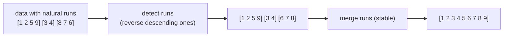
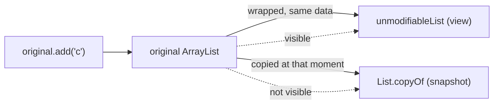
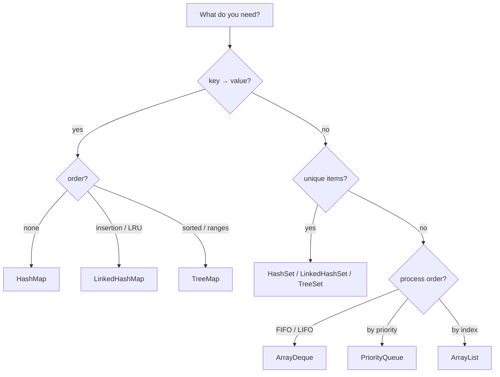
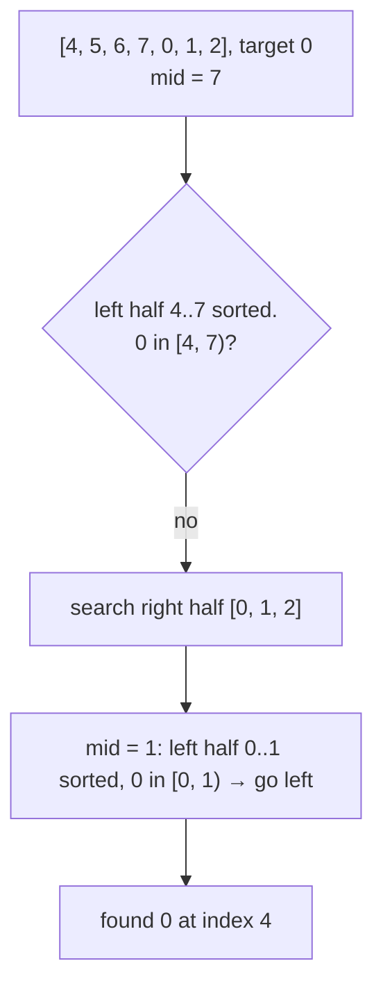
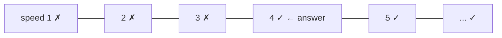
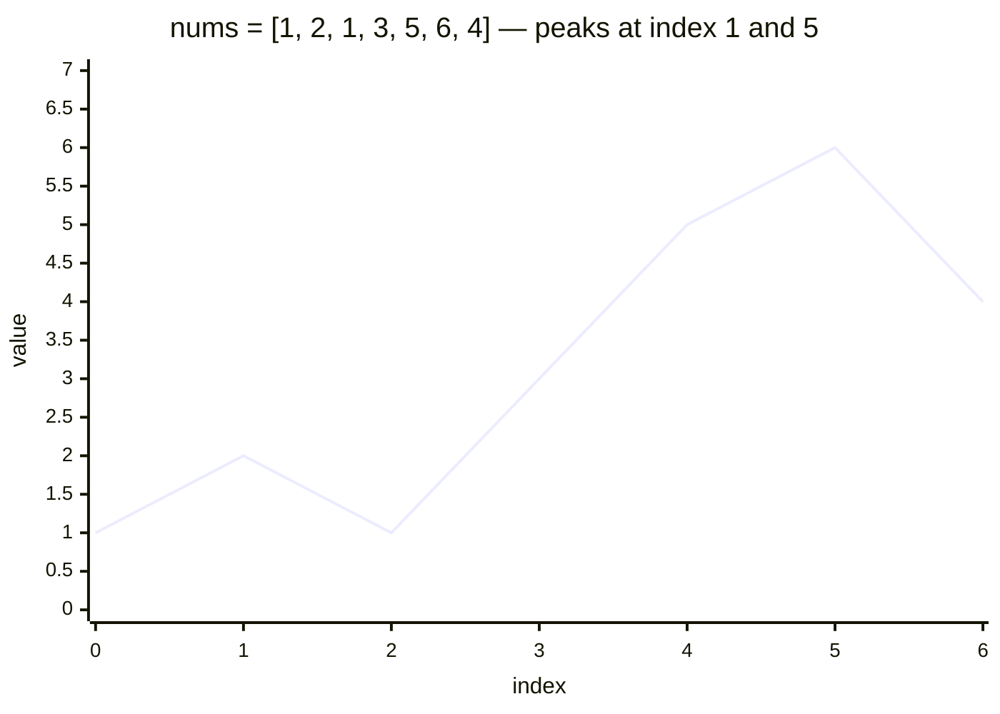

# Day 16 — Collections Utilities, Immutability & Advanced Collections

> **How to use these notes:** each section maps to one checklist item. Run the code, study the diagrams, then test yourself with the collapsible questions. 🚀 marks senior-level details.

**Today's goal:** use the `Collections` utility class and Java 9+ immutable collections correctly (views vs copies), apply the everyday collection idioms (duplicates, sort map by value, fast intersection), and know the specialised collections interviewers like to probe: **BitSet**, **IdentityHashMap**, **PriorityBlockingQueue / DelayQueue** — plus a pattern table mapping problems to collections. On the DSA side: **medium binary search** — first/last position, rotated arrays, peak finding and **binary search on the answer**.

<!-- topic: d16_t1 -->
## ☕ Collections — Utilities & Advanced

<!-- subtopic: d16_t1_s1 -->
### 1. Collections.sort() and List.sort() — TimSort

> **TL;DR:** `Collections.sort(list)` simply calls **`list.sort(null)`**, which sorts with **TimSort**: **stable**, O(n log n) worst case, **O(n) on already-sorted data**. `null` comparator = natural order (`Comparable`).

```java
List<String> names = new ArrayList<>(List.of("Ravi", "asha", "Meera"));
Collections.sort(names);                                   // [Meera, Ravi, asha] — uppercase sorts first
names.sort(String.CASE_INSENSITIVE_ORDER);                 // [asha, Meera, Ravi]
names.sort(Comparator.comparing(String::length).thenComparing(Comparator.naturalOrder()));
names.sort(null);                                          // natural order again
Collections.reverse(names);
Collections.shuffle(names);
```

How TimSort works (simplified): it finds already-sorted **runs** in the data, extends short runs with **binary insertion sort**, then **merges** runs like merge sort. Real data often has partial order, so it's frequently much faster than n log n.



Notes:
- `ArrayList.sort` sorts its internal array directly; the default `List.sort` copies to an array, sorts, and writes back.
- Sorting increments `modCount` → any open iterator becomes invalid (CME).
- An inconsistent comparator can cause `IllegalArgumentException: Comparison method violates its general contract!`.

<!-- subtopic: d16_t1_s2 -->
### 2. Collections.binarySearch()

> **TL;DR:** O(log n) search on a **sorted** list (sorted by the **same** comparator you pass). Returns the index if found; otherwise **`-(insertionPoint) - 1`** — always negative, so you can tell "found" from "not found" and still know where it would go.

```java
List<Integer> sorted = List.of(10, 20, 30, 40);
Collections.binarySearch(sorted, 30);     // 2
Collections.binarySearch(sorted, 25);     // -3  → insertion point = -(-3) - 1 = 2
Collections.binarySearch(sorted, 5);      // -1  → insertion point 0
Collections.binarySearch(sorted, 50);     // -5  → insertion point 4

// Insert while keeping the list sorted
List<Integer> list = new ArrayList<>(sorted);
int idx = Collections.binarySearch(list, 25);
if (idx < 0) list.add(-idx - 1, 25);      // [10, 20, 25, 30, 40]
```

Why `-(insertionPoint) - 1` and not just `-insertionPoint`? Because insertion point 0 would give `-0 = 0`, which looks like "found at index 0".

⚠️ If the list isn't sorted, the result is **undefined** (no exception). With duplicates, it returns **any** matching index. On a `LinkedList` it still works but each `get` is O(n) — the JDK switches to an iterator-based search for non-`RandomAccess` lists.

<!-- subtopic: d16_t1_s3 -->
### 3. Immutable Collections — List.of, Set.of, Map.of (Java 9+)

> **TL;DR:** `List.of`, `Set.of`, `Map.of` / `Map.ofEntries` create **truly immutable**, compact collections. **No nulls**, mutation throws `UnsupportedOperationException`, `Set.of`/`Map.of` **reject duplicates** and have **unspecified iteration order**.

```java
List<String> langs = List.of("Java", "Go", "Java");             // duplicates OK in a List
Set<String> tags = Set.of("backend", "java");
// Set.of("a", "a");                                            💥 IllegalArgumentException: duplicate element
Map<String, Integer> ports = Map.of("http", 80, "https", 443);   // up to 10 key-value pairs
Map<String, Integer> many = Map.ofEntries(Map.entry("ssh", 22), Map.entry("dns", 53));

// langs.add("Kotlin");                                         💥 UnsupportedOperationException
// List.of("a", null);                                          💥 NullPointerException
// ports.get(null);                                             💥 NullPointerException
```

| | `List.of` / `Set.of` / `Map.of` | `Collections.unmodifiableX` | `Collections.emptyList()` etc. |
|---|---|---|---|
| Mutable through another reference? | No — fully immutable | **Yes** — it's a view of the original | n/a |
| Nulls | ❌ | Whatever the original allows | — |
| Duplicates (Set/Map) | ❌ IllegalArgumentException | — | — |
| Iteration order (Set/Map) | **Unspecified, can change between JVM runs** | Original's order | — |
| Since | 9 | 1.2 | 1.5 |

Use them for constants, test data, method return values and DTO fields. Need a mutable version? `new ArrayList<>(List.of(...))`.

<!-- subtopic: d16_t1_s4 -->
### 4. unmodifiableList() vs List.copyOf() — view vs copy

> **TL;DR:** `Collections.unmodifiableList(list)` is a **read-only view**: you can't modify **through it**, but changes to the **original list show up**. `List.copyOf(list)` (Java 10) makes an **independent immutable snapshot**.

```java
List<String> original = new ArrayList<>(List.of("a", "b"));
List<String> view = Collections.unmodifiableList(original);
List<String> copy = List.copyOf(original);

original.add("c");
view;           // [a, b, c]  ← reflects the change!
copy;           // [a, b]     ← independent snapshot
// view.add("d");   💥 UnsupportedOperationException
```



| | `unmodifiableList` | `List.copyOf` |
|---|---|---|
| Copies data | ❌ O(1) | ✅ O(n) (returns the same instance if the input is already an immutable `List.of`) |
| Sees later changes to the source | ✅ | ❌ |
| Nulls | Allowed if source has them | ❌ NPE |
| Use for | Exposing internal state read-only (owner still mutates) | Defensive copies in immutable classes / records (Day 3) |

<!-- subtopic: d16_t1_s6 -->
### 5. Finding Duplicates with Set.add()

> **TL;DR:** `Set.add()` returns **`false`** if the element was already present — a one-line, O(n) duplicate detector. No `contains()` + `add()` double lookup needed.

```java
// First duplicate
public static Optional<Integer> firstDuplicate(List<Integer> nums) {
    Set<Integer> seen = new HashSet<>();
    for (int n : nums) if (!seen.add(n)) return Optional.of(n);
    return Optional.empty();
}

// All duplicates (each reported once)
Set<Integer> seen = new HashSet<>(), dups = new LinkedHashSet<>();
for (int n : nums) if (!seen.add(n)) dups.add(n);

// Stream version with counts
Map<Integer, Long> counts = nums.stream()
        .collect(Collectors.groupingBy(Function.identity(), Collectors.counting()));
List<Integer> repeated = counts.entrySet().stream()
        .filter(e -> e.getValue() > 1).map(Map.Entry::getKey).toList();
```

| Approach | Time | Space |
|---|---|---|
| Nested loops | O(n²) | O(1) |
| Sort then compare neighbours | O(n log n) | O(1) (modifies input) |
| `Set.add()` | **O(n)** | O(n) |
| Count array (small value range) | O(n) | O(range) |

<!-- subtopic: d16_t1_s7 -->
### 6. Sort a Map by Value

> **TL;DR:** Maps can't be sorted in place by value. Stream the **entries**, sort with `Map.Entry.comparingByValue()`, and collect into a **`LinkedHashMap`** (which keeps that order).

```java
Map<String, Integer> scores = Map.of("asha", 91, "ravi", 78, "meera", 85);

LinkedHashMap<String, Integer> byScoreDesc = scores.entrySet().stream()
        .sorted(Map.Entry.<String, Integer>comparingByValue().reversed())   // type witness needed for reversed()
        .collect(Collectors.toMap(
                Map.Entry::getKey, Map.Entry::getValue,
                (a, b) -> a,                       // merge fn (never used, keys are unique) — required for the 4-arg form
                LinkedHashMap::new));              // keeps the sorted order
// {asha=91, meera=85, ravi=78}

// Top 2 by value
List<String> top2 = scores.entrySet().stream()
        .sorted(Map.Entry.comparingByValue(Comparator.reverseOrder()))
        .limit(2).map(Map.Entry::getKey).toList();     // [asha, meera]

// Sort by value, then key for ties
Comparator<Map.Entry<String, Integer>> cmp = Map.Entry.<String, Integer>comparingByValue()
        .thenComparing(Map.Entry.comparingByKey());
```

⚠️ Collecting into a plain `HashMap` (the default `toMap`) **loses the order**. Sorting **by key** is simpler: `new TreeMap<>(map)`.

<!-- subtopic: d16_t1_s8 -->
### 7. Efficient Intersection — HashSet beats nested loops

> **TL;DR:** `listA.stream().filter(listB::contains)` is **O(n × m)** when `listB` is a `List`. Put one side into a **`HashSet`** first → **O(n + m)**.

```java
List<Integer> a = List.of(1, 2, 3, 4, 5);
List<Integer> b = List.of(4, 5, 6, 7);

// ❌ O(n × m): List.contains is a linear scan
List<Integer> slow = a.stream().filter(b::contains).toList();

// ✅ O(n + m)
Set<Integer> bSet = new HashSet<>(b);
List<Integer> fast = a.stream().filter(bSet::contains).toList();         // [4, 5]

// Or set algebra (Day 14)
Set<Integer> common = new HashSet<>(a);
common.retainAll(bSet);
```

| Inputs | Best approach | Time |
|---|---|---|
| Unsorted lists | HashSet of the **smaller** list, scan the other | O(n + m) |
| Both sorted | Two pointers (Day 6) | O(n + m), O(1) space |
| One tiny, one huge sorted | Binary search the huge one | O(small · log big) |
| With duplicate counts (LC 350) | `HashMap<value, count>` | O(n + m) |

<!-- subtopic: d17_t1_s1 -->
### 8. BitSet — a compact set of booleans

> **TL;DR:** `BitSet` stores flags as **bits inside a `long[]`** — 1 bit per value instead of 1 byte per `boolean` (8× smaller) or ~16+ bytes per boxed `Integer` in a `HashSet`. Supports fast bulk `and`/`or`/`xor`, `cardinality()`, `nextSetBit()`. Grows automatically.

```java
BitSet bits = new BitSet(100);
bits.set(3);
bits.set(10, 20);                 // range [10, 20)
bits.get(3);                      // true
bits.clear(15);
bits.flip(0);
bits.cardinality();               // number of 1-bits
bits.nextSetBit(4);               // 10
bits.stream().forEach(System.out::println);   // indices of set bits

BitSet other = new BitSet();
other.set(3); other.set(50);
bits.and(other);                  // intersection, word by word (64 bits at a time)
```

#### Sieve of Eratosthenes with BitSet

```java
public static BitSet primesUpTo(int n) {
    BitSet composite = new BitSet(n + 1);
    for (int i = 2; (long) i * i <= n; i++) {
        if (!composite.get(i)) {
            for (int j = i * i; j <= n; j += i) composite.set(j);
        }
    }
    BitSet primes = new BitSet(n + 1);
    primes.set(2, n + 1);
    primes.andNot(composite);     // primes = all − composites
    return primes;
}   // O(n log log n) time, n bits of memory
```

Uses: feature flags/permissions per user id, sieves, **Bloom filters** (k hash functions setting bits in a BitSet), visited sets for huge integer ranges, fast set operations on small integer universes. Not thread-safe.

<!-- subtopic: d17_t1_s2 -->
### 9. IdentityHashMap — keys compared by reference

> **TL;DR:** `IdentityHashMap` compares keys with **`==`** and hashes with **`System.identityHashCode`**, ignoring `equals`/`hashCode`. Two different-but-equal objects are **two different keys**. Used when **object identity** matters: graph traversal, deep copy/serialization, proxies.

```java
String a = new String("key");
String b = new String("key");          // equals(a) but a different object

Map<String, Integer> normal = new HashMap<>();
normal.put(a, 1); normal.put(b, 2);
normal.size();                          // 1 — b replaced a (equal keys)

Map<String, Integer> identity = new IdentityHashMap<>();
identity.put(a, 1); identity.put(b, 2);
identity.size();                        // 2 — different objects
```

Classic use — copying an object graph that may contain **cycles** or **shared references**:

```java
Node deepCopy(Node node, Map<Node, Node> copies) {     // copies = new IdentityHashMap<>()
    if (node == null) return null;
    Node existing = copies.get(node);
    if (existing != null) return existing;             // already copied this exact object
    Node copy = new Node(node.value);
    copies.put(node, copy);                            // register BEFORE recursing (handles cycles)
    for (Node n : node.neighbours) copy.neighbours.add(deepCopy(n, copies));
    return copy;
}
```

Why identity? If `Node.equals` compares values, two distinct nodes with the same value would be merged incorrectly. (LeetCode's Clone Graph, Day 23, uses the same idea with a regular HashMap because nodes don't override equals.) Internally it uses **linear probing** in a single array (keys and values alternate), not chaining. ⚠️ It deliberately violates the general `Map` contract — document why you use it.

<!-- subtopic: d17_t1_s5 -->
### 10. PriorityBlockingQueue and DelayQueue

> **TL;DR:** **`PriorityBlockingQueue`** = a thread-safe, **unbounded** priority queue whose `take()` blocks when empty. **`DelayQueue`** holds `Delayed` elements that can only be taken **after their delay expires** — for scheduling, retries and expiring entries.

```java
// Workers always process the highest-priority job next
BlockingQueue<Job> jobs = new PriorityBlockingQueue<>(64, Comparator.comparingInt(Job::priority));
jobs.put(new Job("refund", 1));         // never blocks (unbounded)
Job next = jobs.take();                 // blocks while empty

// Retry a failed message after a delay
record RetryTask(String messageId, long runAtMillis) implements Delayed {
    @Override public long getDelay(TimeUnit unit) {
        return unit.convert(runAtMillis - System.currentTimeMillis(), TimeUnit.MILLISECONDS);
    }
    @Override public int compareTo(Delayed o) {
        return Long.compare(getDelay(TimeUnit.MILLISECONDS), o.getDelay(TimeUnit.MILLISECONDS));
    }
}
DelayQueue<RetryTask> retries = new DelayQueue<>();
retries.put(new RetryTask("msg-42", System.currentTimeMillis() + 5_000));
RetryTask due = retries.take();          // blocks until 5 seconds have passed
```

| | `PriorityBlockingQueue` | `DelayQueue` |
|---|---|---|
| Order | Comparator / natural | By remaining delay |
| `take()` blocks when | Empty | Empty **or** no element's delay has expired |
| Bounded | ❌ (watch memory) | ❌ |
| Typical use | Priority job processing across threads | Retries with backoff, cache expiry, timeouts |

`ScheduledThreadPoolExecutor` (Day 9) uses its own delay queue internally — prefer it for "run X after Y" unless you need custom control.

<!-- subtopic: d17_t1_s6 -->
### 11. Collections Interview Patterns — which structure for which problem

> **TL;DR:** Interviews reward picking the right structure instantly. Memorize this table.

| Requirement | Collection | Why |
|---|---|---|
| Fast lookup by key / counting | `HashMap` | O(1) average |
| "Have I seen this?" | `HashSet` (`add` returns false) | O(1) average |
| Keep insertion order | `LinkedHashMap` / `LinkedHashSet` | Linked entries |
| **LRU cache** | `LinkedHashMap(accessOrder = true)` + `removeEldestEntry` | Access-ordered list (Day 13) |
| Sorted keys, **range / nearest** queries | `TreeMap` / `TreeSet` | floor / ceiling / subMap in O(log n) |
| **Top-K**, k-th largest, merging sorted streams | `PriorityQueue` (size-k heap) | O(n log k) |
| Scheduling by priority / time | `PriorityQueue` / `DelayQueue` | Heap order |
| Stack / queue / BFS / sliding window max | `ArrayDeque` | O(1) both ends |
| Producer–consumer between threads | Bounded `BlockingQueue` | Blocking + back-pressure |
| Shared map across threads | `ConcurrentHashMap` | Lock striping, atomic merge |
| Read-mostly shared list (listeners) | `CopyOnWriteArrayList` | Lock-free reads |
| Enum keys | `EnumMap` / `EnumSet` | Array / bit vector |
| Millions of boolean flags | `BitSet` | 1 bit each |
| Object identity, cyclic graphs | `IdentityHashMap` | `==` semantics |
| Immutable constants / defensive copies | `List.of`, `List.copyOf` | Safe to share |



<!-- topic: d11_t2 -->
## 🧮 DSA — Binary Search: Medium

<!-- subtopic: d11_t2_s1 -->
### 12. Find First and Last Position of Element (LeetCode 34)

> **Problem:** in a sorted array with duplicates, return `[first, last]` index of `target`, or `[-1, -1]`, in O(log n). 🔗 [LeetCode 34](https://leetcode.com/problems/find-first-and-last-position-of-element-in-sorted-array/)

Run binary search twice: **lower bound** (first index with `nums[i] >= target`) and **upper bound** (first index with `nums[i] > target`). The last occurrence is `upper − 1`.

```java
public int[] searchRange(int[] nums, int target) {
    int first = lowerBound(nums, target);
    if (first == nums.length || nums[first] != target) return new int[]{-1, -1};
    int last = lowerBound(nums, target + 1) - 1;          // first index > target, minus 1
    return new int[]{first, last};
}

// First index i with nums[i] >= target (nums.length if none)
private int lowerBound(int[] nums, int target) {
    int left = 0, right = nums.length;
    while (left < right) {
        int mid = left + (right - left) / 2;
        if (nums[mid] >= target) right = mid;
        else left = mid + 1;
    }
    return left;
}   // O(log n) total
```

**Example** `[5, 7, 7, 8, 8, 10]`, target 8: lowerBound(8) = 3, lowerBound(9) = 5 → `[3, 4]`.

(`target + 1` is safe here because LC 34's values are well within int range; otherwise write a separate `upperBound` with `>`.) Count of occurrences = `upper − lower`.

<!-- subtopic: d11_t2_s2 -->
### 13. Search in Rotated Sorted Array (LeetCode 33)

> **Problem:** a sorted array of distinct values was rotated (e.g., `[4,5,6,7,0,1,2]`). Find `target`'s index in O(log n). 🔗 [LeetCode 33](https://leetcode.com/problems/search-in-rotated-sorted-array/)

**Key insight:** split at `mid` — **at least one half is normally sorted**. Check if the target lies inside the sorted half's range; if yes go there, else go to the other half.

```java
public int search(int[] nums, int target) {
    int left = 0, right = nums.length - 1;
    while (left <= right) {
        int mid = left + (right - left) / 2;
        if (nums[mid] == target) return mid;

        if (nums[left] <= nums[mid]) {                       // left half [left..mid] is sorted
            if (nums[left] <= target && target < nums[mid]) right = mid - 1;
            else left = mid + 1;
        } else {                                             // right half [mid..right] is sorted
            if (nums[mid] < target && target <= nums[right]) left = mid + 1;
            else right = mid - 1;
        }
    }
    return -1;
}   // O(log n)
```



`<=` in `nums[left] <= nums[mid]` matters when `left == mid` (2-element ranges). With **duplicates** (LC 81), when `nums[left] == nums[mid] == nums[right]` you can't tell which half is sorted — shrink with `left++`, worst case O(n).

<!-- subtopic: d11_t2_s3 -->
### 14. Find Minimum in Rotated Sorted Array (LeetCode 153)

> **Problem:** return the minimum of a rotated sorted array of distinct values in O(log n). 🔗 [LeetCode 153](https://leetcode.com/problems/find-minimum-in-rotated-sorted-array/)

Compare `nums[mid]` with `nums[right]`:
- `nums[mid] > nums[right]` → the drop (minimum) is **to the right** of mid.
- otherwise → `mid..right` is sorted, the minimum is **at mid or to its left**.

```java
public int findMin(int[] nums) {
    int left = 0, right = nums.length - 1;
    while (left < right) {
        int mid = left + (right - left) / 2;
        if (nums[mid] > nums[right]) left = mid + 1;   // min is strictly right of mid
        else right = mid;                               // mid could be the min
    }
    return nums[left];
}   // O(log n)
```

**Dry run** `[3, 4, 5, 1, 2]`: mid=2 (5 > 2) → left=3; mid=3 (1 < 2) → right=3 → `nums[3]` = **1**.

Why compare with `right`, not `left`? Comparing with `nums[left]` can't distinguish "not rotated" from "rotated" in all cases; `nums[right]` always works. The index of the minimum = the **rotation count**. Variant with duplicates: LC 154 (Hard) — when `nums[mid] == nums[right]`, do `right--`.

<!-- subtopic: d11_t2_s4 -->
### 15. Koko Eating Bananas (LeetCode 875) — binary search on the answer

> **Problem:** piles of bananas; Koko eats at speed `k` bananas/hour, finishing one pile at most per hour (a pile of 7 at speed 3 takes 3 hours). Find the **minimum** `k` to finish within `h` hours. 🔗 [LeetCode 875](https://leetcode.com/problems/koko-eating-bananas/)

The answer space `1..max(piles)` is **monotonic**: if speed `k` works, every faster speed works too. So binary search for the **first speed that works** (Template 2), where "works" is checked in O(n).

```java
public int minEatingSpeed(int[] piles, int h) {
    int left = 1, right = 0;
    for (int p : piles) right = Math.max(right, p);   // speed max(piles) always works
    while (left < right) {
        int mid = left + (right - left) / 2;
        if (canFinish(piles, mid, h)) right = mid;    // works → try slower
        else left = mid + 1;                          // too slow
    }
    return left;
}

private boolean canFinish(int[] piles, int speed, int h) {
    long hours = 0;                                   // long: sum can exceed int
    for (int p : piles) hours += (p + speed - 1) / speed;   // ceil(p / speed) without floating point
    return hours <= h;
}   // Time O(n log max), Space O(1)
```



*Example `piles = [3, 6, 7, 11], h = 8` → answer **4**.*

> **"Binary search on the answer" recipe:** (1) define the range of possible answers, (2) write `feasible(x)` that is monotonic, (3) find the first feasible x. Same pattern: Capacity to Ship Packages (LC 1011), Split Array Largest Sum (LC 410), Minimum Days to Make Bouquets (LC 1482), Magnetic Force (LC 1552).

<!-- subtopic: d11_t2_s5 -->
### 16. Find Peak Element (LeetCode 162)

> **Problem:** a peak is strictly greater than its neighbours (`nums[-1] = nums[n] = −∞`). Return **any** peak's index in O(log n). 🔗 [LeetCode 162](https://leetcode.com/problems/find-peak-element/)

The array isn't sorted, but the **slope** tells us where a peak must exist: if `nums[mid] < nums[mid + 1]` we're going **uphill** → a peak exists to the **right**; otherwise one exists at `mid` or to the **left**.

```java
public int findPeakElement(int[] nums) {
    int left = 0, right = nums.length - 1;
    while (left < right) {
        int mid = left + (right - left) / 2;
        if (nums[mid] < nums[mid + 1]) left = mid + 1;   // uphill → peak on the right
        else right = mid;                                 // downhill → peak at mid or left
    }
    return left;
}   // O(log n)
```



Why it's guaranteed: walking uphill you either hit a peak or reach the end, where the virtual −∞ makes the last element a peak. Binary search keeps the half that **must** contain one. Lesson: binary search needs a **monotonic decision**, not necessarily a sorted array.

---

## 📝 Day 16 Revision Cheat Sheet

| Topic | Remember this |
|---|---|
| sort | `Collections.sort` → `list.sort(null)`; TimSort, stable, O(n) on sorted runs |
| binarySearch | Sorted input; not found → `-(insertionPoint) - 1` |
| Immutable | `List/Set/Map.of`: no nulls, Set/Map no duplicates, unspecified Set/Map order |
| View vs copy | `unmodifiableList` reflects source changes; `List.copyOf` is a snapshot |
| Duplicates | `if (!set.add(x))` |
| Sort map by value | entries → `sorted(comparingByValue())` → `toMap(..., LinkedHashMap::new)` |
| Intersection | HashSet of one side → O(n + m) |
| BitSet | 1 bit per flag in long[]; and/or/xor; sieve, Bloom filters |
| IdentityHashMap | `==` + identityHashCode; object graphs with cycles |
| PBQ / DelayQueue | Thread-safe priority / available after delay |
| Lower bound | first `nums[i] >= target`; last occurrence = lowerBound(target + 1) − 1 |
| Rotated search | One half is always sorted — check if target is inside it |
| Rotated min | compare mid with right |
| Answer search | Monotonic feasible(x) → first feasible |
| Peak | Follow the uphill side |

### ⚡ Rapid-fire self-test

1. Is TimSort stable? → **Yes**
2. `binarySearch([10,20,30], 25)` returns? → **-3**
3. `Set.of("a", "a")`? → **IllegalArgumentException**
4. Does an unmodifiable view reflect changes to the original? → **Yes**
5. Collector to keep sorted map order? → **LinkedHashMap::new in toMap**
6. Memory per flag in BitSet? → **1 bit**
7. IdentityHashMap compares keys with? → **==**
8. Rotated min — compare mid with left or right? → **right**
9. Koko — what's being binary searched? → **The eating speed (the answer)**
10. Does Find Peak need a sorted array? → **No — just the slope**
