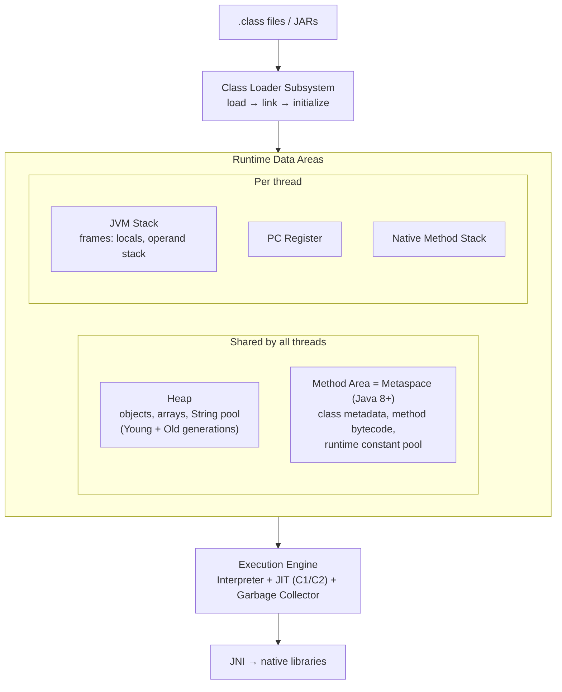
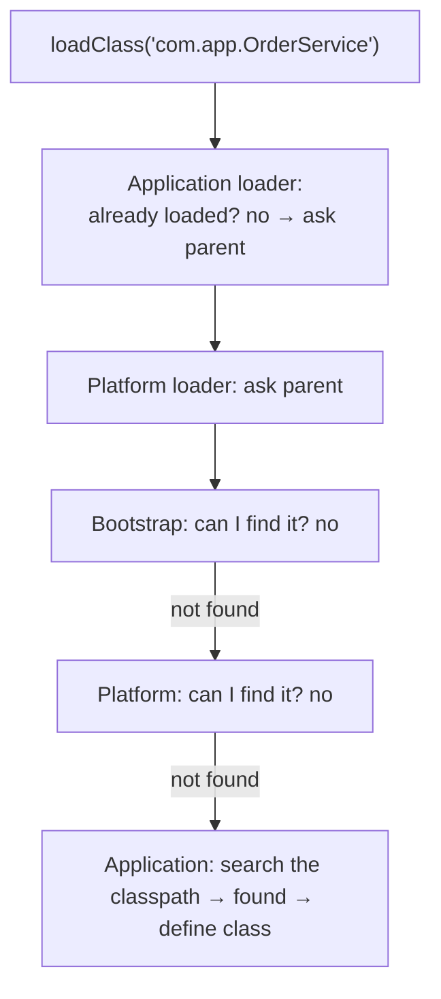
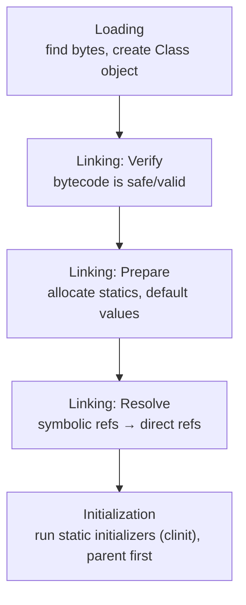
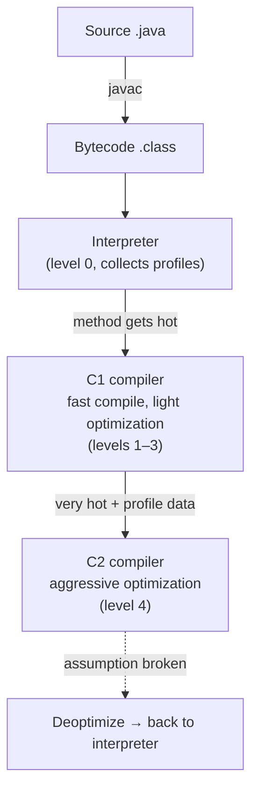
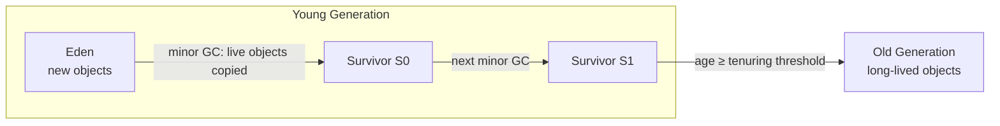
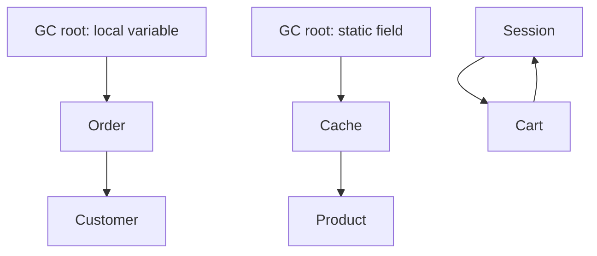
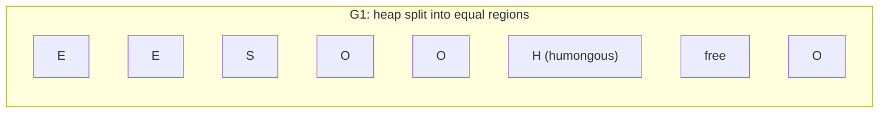
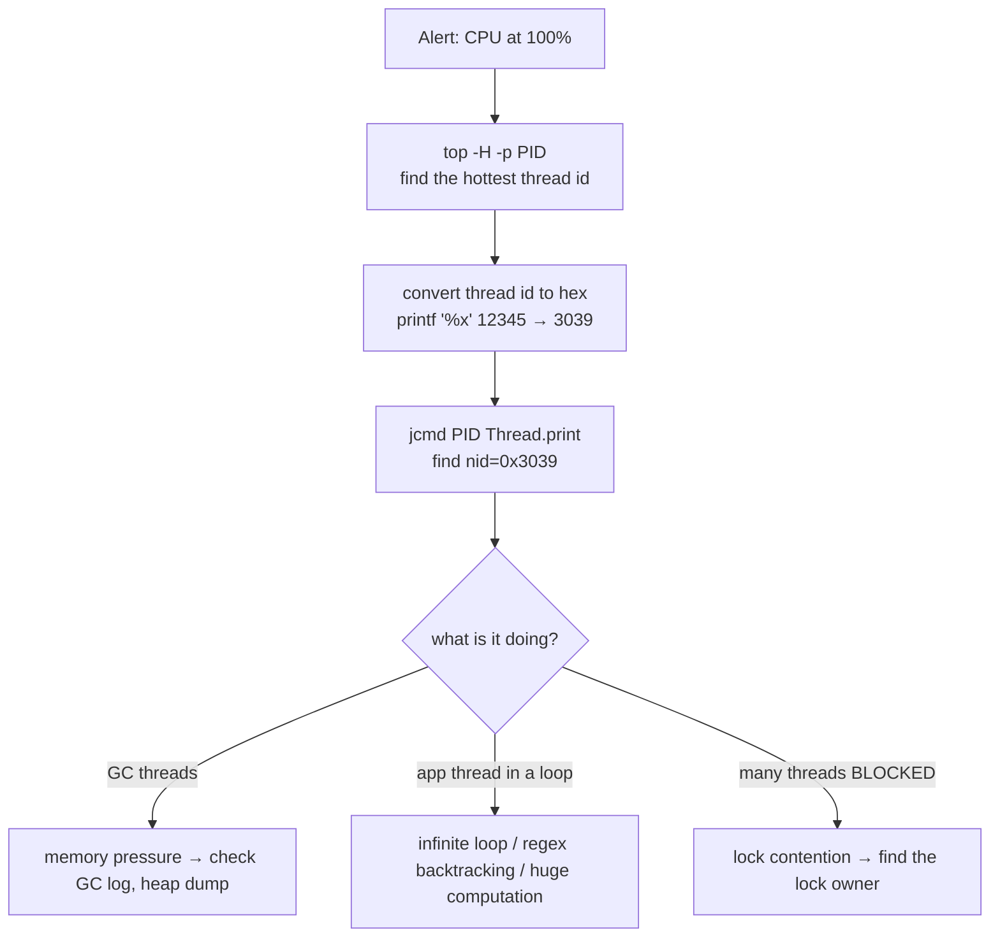
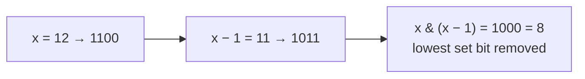
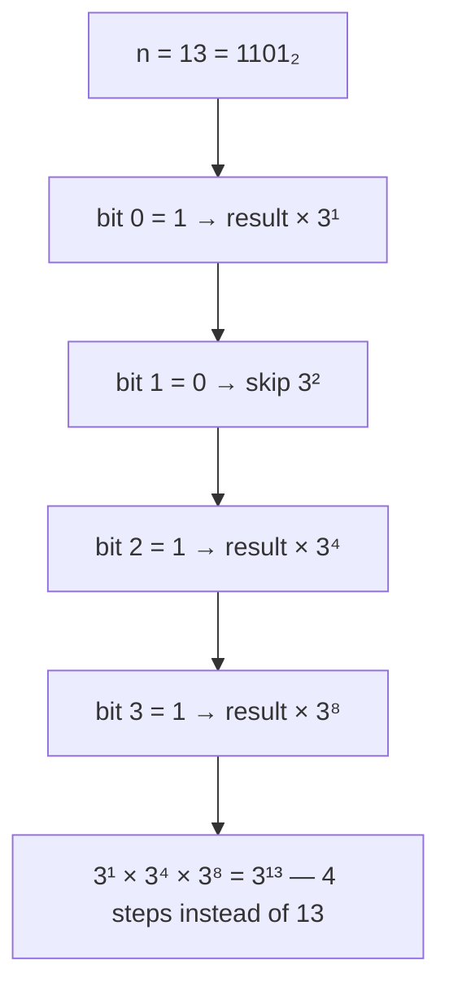

# Day 17 — JVM Internals: Class Loading, Memory, GC & Profiling

> **How to use these notes:** each section maps to one checklist item. Run the code, study the diagrams, then test yourself with the collapsible questions. 🚀 marks senior-level details.

**Today's goal:** draw the JVM architecture from memory, explain class loading and the delegation model, why Java "warms up" (JIT), how generational garbage collection works and which collector to choose, recognise memory leaks and each kind of `OutOfMemoryError`, and — the practical part — **diagnose a production problem** with thread dumps, heap dumps and JFR. On the DSA side: **bit manipulation** and fast exponentiation.

<!-- topic: d17_t4 -->
## ☕ Java — JVM Internals, GC & Performance

<!-- subtopic: d7_t1_s8 -->
### 1. JVM Architecture — runtime data areas

> **TL;DR:** The JVM has three parts: the **class loader subsystem** (loads `.class` files), the **runtime data areas** (memory), and the **execution engine** (interpreter, JIT compiler, garbage collector). Memory is split into **per-thread** areas (stack, PC register, native stack) and **shared** areas (heap, method area/Metaspace).



| Area | Shared? | Stores | Error when exhausted |
|---|---|---|---|
| **Heap** | Shared | All objects and arrays, String pool (since Java 7), static field values (with the Class object) | `OutOfMemoryError: Java heap space` |
| **Metaspace** (method area) | Shared | Class metadata, method code, constant pools — in **native memory** since Java 8 (replaced PermGen) | `OutOfMemoryError: Metaspace` |
| **JVM stack** | Per thread | One **frame** per method call: local variables (primitives + references), operand stack, return address | `StackOverflowError` |
| **PC register** | Per thread | Address of the current bytecode instruction | — |
| **Native method stack** | Per thread | Frames for native (C/C++) code | `StackOverflowError` / native errors |

Code-level view (Day 1 revisited):

```java
void process() {
    int count = 5;                     // primitive local → stack frame
    Order order = new Order();         // reference 'order' → stack; Order object → heap
    String s = "hello";                // literal → String pool (heap)
}                                      // frame popped; Order becomes unreachable → eligible for GC
```

**GC roots** — the starting points the GC uses to decide what's alive: local variables in active stack frames, static fields, active threads, JNI references, synchronization monitors. Anything not reachable from a root is garbage.

<!-- subtopic: d17_t4_s1 -->
### 2. Class Loading — loaders, delegation, and the three phases

> **TL;DR:** Classes are loaded **lazily** (on first use) by a hierarchy of class loaders — **Bootstrap → Platform → Application** — using **parent-first delegation**. Loading has three phases: **loading**, **linking** (verify, prepare, resolve) and **initialization** (static initializers).

#### 2.1 The class loader hierarchy

| Loader | Loads | Implemented in |
|---|---|---|
| **Bootstrap** | Core JDK modules (`java.base`: `java.lang`, `java.util`...) | Native code (shows as `null` in Java) |
| **Platform** (Java 9+; was "Extension") | Other JDK modules (`java.sql`, `java.xml`...) | Java |
| **Application / System** | Your classpath / module path (your code, libraries) | Java |
| Custom | Plugins, web apps, hot reload | You / frameworks |

```java
System.out.println(String.class.getClassLoader());          // null → Bootstrap
System.out.println(java.sql.Connection.class.getClassLoader()); // PlatformClassLoader
System.out.println(MyService.class.getClassLoader());       // AppClassLoader
```

#### 2.2 Parent delegation



Why delegate to the parent first?
1. **Security** — your code can't replace `java.lang.String` with a malicious version (the Bootstrap loader always wins).
2. **No duplicates** — a class is loaded once by the highest loader that can see it.

A class's identity at runtime is **(fully qualified name + defining class loader)**. The same class loaded by two loaders gives two different types → `ClassCastException: com.app.User cannot be cast to com.app.User` (classic in app servers and with Spring DevTools' restart loader).

Servlet containers (Tomcat) use **child-first** loaders per web app so each app can use its own library versions.

#### 2.3 The three phases



- **Initialization** runs on first **active use** (Day 1: `new`, static method call, non-constant static field access, `Class.forName`, subclass init). It's thread-safe — which is why the holder-class singleton works.
- `ClassNotFoundException` (checked) — explicit loading by name failed. `NoClassDefFoundError` — class was available at compile time but missing at runtime, or its static initializer failed earlier (Day 4).

<!-- subtopic: d17_t4_s2 -->
### 3. Execution Engine — interpreter, JIT and warm-up

> **TL;DR:** The JVM starts by **interpreting** bytecode, profiles which methods are **hot**, and the **JIT compiler** compiles them to optimized native code — first quickly with **C1**, then aggressively with **C2** (**tiered compilation**). That's why Java services are slower for the first seconds/minutes after start (**warm-up**).



Key JIT optimizations:

| Optimization | What it does |
|---|---|
| **Inlining** | Replaces a call with the method body (removes call overhead, enables further optimizations). Small methods and getters are effectively free |
| **Escape analysis** | Objects that never leave a method can be allocated on the stack or broken into scalars (no heap allocation, no GC) |
| Loop unrolling / range-check elimination | Faster loops |
| Dead code elimination, constant folding | Remove work whose result is unused or known |
| **Speculative optimization** | E.g., assumes a call site always sees one class (monomorphic); **deoptimizes** if that changes |

Practical consequences:
- **Benchmarks** must warm up — use **JMH**, never `System.nanoTime()` around a single call.
- Services should **warm up before taking full traffic** (readiness probes, gradual traffic shift).
- Startup improvements: **Class Data Sharing (CDS)**, the **AOT cache** (JDK 24+, Project Leyden), **GraalVM native images** (ahead-of-time compiled, instant start, used for serverless — with trade-offs on peak performance and reflection).

<!-- subtopic: d17_t4_s3 -->
### 4. Heap Generations — Eden, Survivor, Old and how GC works

> **TL;DR:** Most objects **die young** (the *weak generational hypothesis*). So the heap is split into a **Young generation** (Eden + two Survivor spaces), collected often and cheaply (**minor GC**), and an **Old generation** for long-lived objects, collected rarely (**major / full GC**). Objects that survive enough minor GCs are **promoted**.



Lifecycle of an object:
1. Allocated in **Eden** (very fast — bump-the-pointer inside a per-thread **TLAB**).
2. Eden fills → **minor GC**: live objects are **copied** to an empty Survivor space; Eden is wiped. Cost depends on **live** objects, not garbage.
3. Each survived minor GC increments the object's **age**; after the threshold (`-XX:MaxTenuringThreshold`, max 15) it's **promoted** to Old.
4. Old fills up → a major collection (concurrent marking in modern collectors; a stop-the-world **full GC** in the worst case).

How the GC decides what's garbage — **reachability**, not reference counting:



*`Session` and `Cart` reference each other but nothing reachable points to them → both are collected. Reference counting would leak this cycle; tracing GC doesn't.*

**Stop-the-world (STW)** pauses freeze application threads. Modern collectors do most work **concurrently** to keep pauses short.

<!-- subtopic: d10_t1_s6 -->
### 5. GC Algorithms and Key JVM Flags

> **TL;DR:** **G1** is the default (Java 9+) — balanced throughput and pause times (target ~200 ms). **ZGC** gives **sub-millisecond** pauses even on huge heaps (generational since Java 21). **Parallel** maximizes throughput for batch jobs. **Serial** for tiny heaps/containers.

| Collector | Flag | Strength | Pauses | Use for |
|---|---|---|---|---|
| Serial | `-XX:+UseSerialGC` | Simplest, single thread | Long, STW | Small heaps, 1-CPU containers, CLI tools |
| Parallel | `-XX:+UseParallelGC` | Max **throughput** (multi-threaded STW) | Medium–long | Batch jobs, data processing (default up to Java 8) |
| **G1** (default 9+) | `-XX:+UseG1GC` | Region-based, pause target (`-XX:MaxGCPauseMillis=200`), concurrent marking | Short, predictable | Most services |
| **ZGC** | `-XX:+UseZGC` | Concurrent compaction, colored pointers; generational since 21 (default mode from 23) | **< 1 ms**, independent of heap size | Latency-sensitive APIs, large heaps |
| Shenandoah | `-XX:+UseShenandoahGC` | Concurrent compaction | Very short | Low-latency (Red Hat builds) |



*G1 collects the regions with the most garbage first ("Garbage-First") to meet its pause target.*

#### Flags you should know

| Flag | Meaning |
|---|---|
| `-Xms2g` / `-Xmx2g` | Initial / maximum heap (set equal in servers to avoid resize pauses) |
| `-Xss512k` | Thread stack size |
| `-XX:MaxMetaspaceSize=256m` | Cap Metaspace (unbounded by default) |
| `-XX:MaxRAMPercentage=75` | Heap as % of **container** memory (better than fixed -Xmx in Kubernetes) |
| `-XX:+HeapDumpOnOutOfMemoryError -XX:HeapDumpPath=/dumps` | Capture evidence automatically |
| `-Xlog:gc*:file=gc.log` | Unified GC logging (Java 9+) |
| `-XX:MaxGCPauseMillis=100` | G1 pause-time goal |

Tuning approach: **measure first** (GC logs, JFR, latency percentiles), change one thing at a time, and remember that most "GC problems" are really **allocation or leak problems** in application code.

<!-- subtopic: d10_t1_s7 -->
### 6. Memory Leaks in Java

> **TL;DR:** Java has a GC, but you can still leak: a leak is an object that's **no longer needed but still reachable**. Classic causes: growing **static collections/caches**, unclosed resources, **ThreadLocals** in pools, listeners never removed, inner classes holding outer references, and mutable map keys.

| Leak source | Example | Fix |
|---|---|---|
| Static/unbounded caches | `static Map<String, Report> cache` that only grows | Bounded cache (Caffeine) with size/TTL eviction |
| Unclosed resources | Streams, JDBC connections, `ResultSet`s | try-with-resources |
| ThreadLocal in thread pools | Value set per request, never `remove()`d (Day 8) | `remove()` in `finally` |
| Listeners / callbacks | Registered on a long-lived bus, never unregistered | Unregister; weak listeners |
| Inner / anonymous classes | Hold `Outer.this` (Day 3) | Static nested classes |
| Mutable keys in HashMap | Entry stranded after key changes (Day 12) | Immutable keys |
| `subList` / `substring` (old) views | Small view keeps a huge backing array | Copy what you keep |
| Class loader leaks | Redeploying web apps; a static/ThreadLocal keeps the old loader → Metaspace grows | Clean up on undeploy |

```java
public class ReportService {
    private static final Map<String, byte[]> CACHE = new HashMap<>();   // ❌ grows forever

    public byte[] report(String id) {
        return CACHE.computeIfAbsent(id, this::generate);
    }
}
```

**Symptoms:** old-generation usage rises after every GC (a "sawtooth" whose floor keeps rising), GCs become more frequent and longer, finally `OutOfMemoryError`. **Diagnosis:** heap dump → Eclipse MAT → *dominator tree* / *leak suspects* → find what's retaining the memory and the path to a GC root.

<!-- subtopic: d17_t4_s4 -->
### 7. OutOfMemoryError Types (and StackOverflowError)

> **TL;DR:** The message after `OutOfMemoryError:` tells you **which memory** ran out — read it before doing anything else.

| Error | Meaning | Common causes | First steps |
|---|---|---|---|
| `Java heap space` | Heap can't fit a new object even after GC | Leak; heap too small; loading huge results into memory | Heap dump + MAT; check queries/pagination; increase `-Xmx` only if justified |
| `GC overhead limit exceeded` | >98% of time spent in GC recovering <2% heap (Parallel GC) | Almost-full heap, usually a leak | Same as heap space |
| `Metaspace` | Too much class metadata | Class loader leaks on redeploy; heavy dynamic proxy / bytecode generation | Check loaders/proxies; set `MaxMetaspaceSize` to fail fast |
| `unable to create native thread` | OS can't create more threads | Thread leak, unbounded pools, low `ulimit`/container limits | Thread dump; bound pools; consider virtual threads |
| `Direct buffer memory` | Off-heap `ByteBuffer.allocateDirect` limit | Netty/NIO buffers not released | `-XX:MaxDirectMemorySize`; check buffer release |
| `Requested array size exceeds VM limit` | Array larger than the JVM allows | Bug in size calculation | Fix the logic |
| `StackOverflowError` (not an OOM) | One thread's stack is full | Infinite/deep recursion, cyclic `toString`/`equals` (e.g., bidirectional JPA entities) | Read the repeating frames in the stack trace; iterate instead of recursing |

In Kubernetes, a container exceeding its memory limit is **OOMKilled** by the OS (exit code 137) — no Java `OutOfMemoryError` at all. Total JVM memory = heap + Metaspace + thread stacks + code cache + direct buffers + GC overhead, so leave headroom (`MaxRAMPercentage` around 70–75%).

<!-- subtopic: d17_t4_s5 -->
### 8. Diagnosing Production Issues — thread dumps, heap dumps, JFR

> **TL;DR:** **Thread dump** (`jstack`/`jcmd Thread.print`) for hangs, deadlocks and high CPU. **Heap dump** (`jcmd GC.heap_dump`, `-XX:+HeapDumpOnOutOfMemoryError`) + **Eclipse MAT** for memory leaks. **JFR + JDK Mission Control** for low-overhead continuous profiling. **VisualVM / async-profiler** for interactive analysis.

#### Toolbox

| Tool | Command | Use for |
|---|---|---|
| `jps` / `jcmd` | `jcmd` (lists JVMs) | Find the PID |
| Thread dump | `jcmd <pid> Thread.print` or `jstack <pid>` | Deadlocks, stuck threads, what's running |
| Heap dump | `jcmd <pid> GC.heap_dump /tmp/heap.hprof` (or `jmap -dump:live,format=b,file=heap.hprof <pid>`) | Memory leaks |
| Heap histogram | `jcmd <pid> GC.class_histogram` | Quick "which classes use the most memory" |
| JFR | `jcmd <pid> JFR.start duration=60s filename=rec.jfr` | CPU hotspots, allocations, locks, GC, I/O — ~1% overhead, safe in production |
| GC log | `-Xlog:gc*` | Pause times, frequency, heap after GC |
| Analysis UIs | Eclipse MAT, JDK Mission Control, VisualVM, async-profiler flame graphs | Investigation |

#### Playbook: high CPU in production



#### Reading a thread dump

```
"http-nio-8080-exec-7" #45 daemon prio=5 os_prio=0 tid=0x00007f... nid=0x3039 waiting for monitor entry
   java.lang.Thread.State: BLOCKED (on object monitor)
        at com.app.InventoryService.reserve(InventoryService.java:42)
        - waiting to lock <0x000000076b5f2a10> (a java.lang.Object)
        - locked by "http-nio-8080-exec-3"
```

Take **2–3 dumps a few seconds apart**: threads stuck on the same line in every dump are your problem. A deadlock section ("Found one Java-level deadlock") is printed automatically (Day 8).

#### Playbook: memory leak
1. Confirm with GC logs/metrics: heap-after-GC keeps rising.
2. Capture a heap dump (or let `HeapDumpOnOutOfMemoryError` do it).
3. Open in **Eclipse MAT** → *Leak Suspects* report → *Dominator Tree* → find the big retained set and its **path to GC roots** (e.g., a static `HashMap` in `ReportService`).
4. Fix the code, deploy, verify the trend flattens.

<!-- topic: d28_t2 -->
## 🧮 DSA — Bit Manipulation & Math

<!-- subtopic: d28_t2_s1 -->
### 9. Bitwise Operators and Tricks

> **TL;DR:** Integers are bits (two's complement). Bit operations are O(1) and enable elegant tricks: `x ^ x = 0`, `x & (x − 1)` clears the lowest set bit, `x & −x` isolates it, shifts multiply/divide by powers of two.

| Operator | Name | Example (5 = `0101`, 3 = `0011`) |
|---|---|---|
| `&` | AND (both 1) | `5 & 3 = 0001 = 1` |
| `\|` | OR (either 1) | `5 \| 3 = 0111 = 7` |
| `^` | XOR (different) | `5 ^ 3 = 0110 = 6` |
| `~` | NOT (flip all) | `~5 = -6` (two's complement: `~x = −x − 1`) |
| `<<` | Left shift | `5 << 1 = 10` (× 2) |
| `>>` | Arithmetic right shift (keeps sign) | `-8 >> 1 = -4` |
| `>>>` | Logical right shift (fills 0s) | `-8 >>> 1 = 2147483644` |

#### The trick sheet

```java
boolean isOdd      = (x & 1) == 1;
boolean bitIsSet   = (x >> i & 1) == 1;        // check bit i
int set            = x | (1 << i);             // set bit i
int cleared        = x & ~(1 << i);            // clear bit i
int toggled        = x ^ (1 << i);             // toggle bit i
int dropLowest     = x & (x - 1);              // remove the lowest 1-bit
int lowestBit      = x & -x;                   // keep only the lowest 1-bit
boolean powerOfTwo = x > 0 && (x & (x - 1)) == 0;
// XOR properties: a ^ a = 0, a ^ 0 = a, commutative and associative → pairs cancel out
```



Java helpers: `Integer.bitCount`, `Integer.toBinaryString`, `Integer.highestOneBit`, `Integer.numberOfTrailingZeros`, `Long` equivalents. Bitmasks also represent **subsets** (bit i set = item i included) — useful for small-n DP and enumerating all 2ⁿ subsets.

<!-- subtopic: d28_t2_s2 -->
### 10. Single Number (LeetCode 136)

> **Problem:** every element appears **twice** except one. Find it in O(n) time and **O(1)** space. 🔗 [LeetCode 136](https://leetcode.com/problems/single-number/)

XOR everything: pairs cancel (`a ^ a = 0`) and the single number remains (`0 ^ x = x`). Order doesn't matter (XOR is commutative and associative).

```java
public int singleNumber(int[] nums) {
    int result = 0;
    for (int x : nums) result ^= x;
    return result;
}   // O(n) time, O(1) space
```

**Dry run** `[4, 1, 2, 1, 2]`: `0^4 = 4`, `^1 = 5`, `^2 = 7`, `^1 = 6`, `^2 = 4` → **4**.

Variants: **Single Number II** (LC 137, others appear 3 times — count each bit mod 3), **Single Number III** (LC 260, two singles — XOR all, split by the lowest set bit of the result).

<!-- subtopic: d28_t2_s3 -->
### 11. Number of 1 Bits (LC 191) and Counting Bits (LC 338)

> 🔗 [LeetCode 191](https://leetcode.com/problems/number-of-1-bits/) — count set bits in one number. 🔗 [LeetCode 338](https://leetcode.com/problems/counting-bits/) — count set bits for every number `0..n`.

```java
// Brian Kernighan: each x & (x − 1) removes one set bit → loop runs once per 1-bit
public int hammingWeight(int n) {
    int count = 0;
    while (n != 0) {
        n &= n - 1;
        count++;
    }
    return count;
}   // O(number of set bits) ≤ 32
// Built-in: Integer.bitCount(n)
// Note: for "unsigned" inputs with the top bit set, n is negative — n != 0 still works,
// but a shifting loop must use >>> (not >>) or it never terminates.

// Counting Bits with DP: bits(i) = bits(i >> 1) + (i & 1)
public int[] countBits(int n) {
    int[] bits = new int[n + 1];
    for (int i = 1; i <= n; i++) {
        bits[i] = bits[i >> 1] + (i & 1);   // i without its last bit, plus that last bit
    }
    return bits;
}   // O(n) — no per-number bit loop
```

| i | binary | i >> 1 | bits[i >> 1] | i & 1 | bits[i] |
|---|---|---|---|---|---|
| 5 | 101 | 2 (10) | 1 | 1 | **2** |
| 6 | 110 | 3 (11) | 2 | 0 | **2** |
| 7 | 111 | 3 (11) | 2 | 1 | **3** |

Alternative recurrence: `bits[i] = bits[i & (i − 1)] + 1`.

<!-- subtopic: d28_t2_s4 -->
### 12. Missing Number (LeetCode 268)

> **Problem:** `nums` contains `n` distinct numbers from `0..n` — exactly one is missing. Find it in O(n) time, O(1) space. 🔗 [LeetCode 268](https://leetcode.com/problems/missing-number/)

```java
// 1. Sum formula (use long to be safe from overflow for large n)
public int missingNumberSum(int[] nums) {
    long n = nums.length;
    long expected = n * (n + 1) / 2;
    long actual = 0;
    for (int x : nums) actual += x;
    return (int) (expected - actual);
}

// 2. XOR — no overflow possible: XOR all indices 0..n and all values; everything pairs up except the missing one
public int missingNumber(int[] nums) {
    int xor = nums.length;                      // start with n (the index that has no slot)
    for (int i = 0; i < nums.length; i++) xor ^= i ^ nums[i];
    return xor;
}   // O(n) time, O(1) space
```

**Dry run (XOR)** `[3, 0, 1]`, n = 3: `3 ^ (0^3) ^ (1^0) ^ (2^1)` = pairs 3,3 / 0,0 / 1,1 cancel → **2**.

Other approaches: sort (O(n log n)), HashSet (O(n) space), cyclic sort (place each value at its index).

<!-- subtopic: d28_t2_s5 -->
### 13. Pow(x, n) (LeetCode 50) — fast exponentiation

> **Problem:** compute `xⁿ` for a double `x` and int `n` (possibly negative) in **O(log n)**. 🔗 [LeetCode 50](https://leetcode.com/problems/powx-n/)

Multiplying `x` n times is O(n) (n can be 2³¹). **Binary exponentiation**: `x¹⁰ = (x⁵)²`, `x⁵ = x · (x²)²`. Equivalently, walk the **bits of n**: square the base each step and multiply it into the result when the current bit is 1.

```java
public double myPow(double x, int n) {
    long exp = n;                       // long! -Integer.MIN_VALUE overflows int
    if (exp < 0) {
        x = 1 / x;
        exp = -exp;
    }
    double result = 1;
    while (exp > 0) {
        if ((exp & 1) == 1) result *= x;   // this bit contributes x^(2^k)
        x *= x;                            // x, x², x⁴, x⁸, ...
        exp >>= 1;
    }
    return result;
}   // O(log n) time, O(1) space
```

**Example** `x = 3, n = 13` (binary `1101`): bits from the right are 1, 0, 1, 1 → result = `3¹ · 3⁴ · 3⁸ = 3¹³`.



Recursive form: `pow(x, n) = half * half * (n odd ? x : 1)` where `half = pow(x, n / 2)` — O(log n) time and stack. The same idea gives **modular exponentiation** (`(a^b) mod m`, used in hashing and cryptography) and fast matrix power (Fibonacci in O(log n)).

---

## 📝 Day 17 Revision Cheat Sheet

| Topic | Remember this |
|---|---|
| Memory areas | Heap + Metaspace shared; stack, PC, native stack per thread |
| GC roots | Stack locals, statics, active threads, JNI refs, monitors |
| Class loaders | Bootstrap → Platform → Application; parent-first delegation; identity = name + loader |
| Phases | Load → link (verify, prepare, resolve) → initialize (static init, first active use) |
| JIT | Interpreter → C1 → C2 (tiered); inlining, escape analysis; deopt; warm-up matters |
| Generations | Eden → Survivor (age) → Old; minor GC copies live objects; tracing handles cycles |
| Collectors | G1 default (balanced), ZGC (<1 ms pauses), Parallel (throughput), Serial (tiny) |
| Flags | -Xms/-Xmx, -Xss, MaxMetaspaceSize, MaxRAMPercentage, HeapDumpOnOutOfMemoryError, -Xlog:gc* |
| Leaks | Reachable-but-useless: static caches, ThreadLocals, listeners, unclosed resources |
| OOM types | heap space, GC overhead, Metaspace, native thread, direct buffer; K8s OOMKilled = 137 |
| Diagnosis | jcmd Thread.print (CPU/locks), GC.heap_dump + MAT (leaks), JFR (profiling) |
| Bits | x & (x−1) drops lowest bit; x ^ x = 0; `>>>` for unsigned shifts |
| Pow | Binary exponentiation, O(log n); use long for n |

### ⚡ Rapid-fire self-test

1. Where are objects allocated? → **Heap (Eden first)**
2. What replaced PermGen in Java 8? → **Metaspace (native memory)**
3. Which loader loads `java.lang.String`? → **Bootstrap**
4. Why parent-first delegation? → **Security and no duplicate core classes**
5. Default GC since Java 9? → **G1**
6. GC with sub-millisecond pauses? → **ZGC**
7. Error for infinite recursion? → **StackOverflowError**
8. Tool for finding what retains a leaked object? → **Heap dump + Eclipse MAT**
9. `x & (x − 1)` for x = 12? → **8**
10. Why `long exp = n` in Pow(x, n)? → **Negating Integer.MIN_VALUE overflows int**
