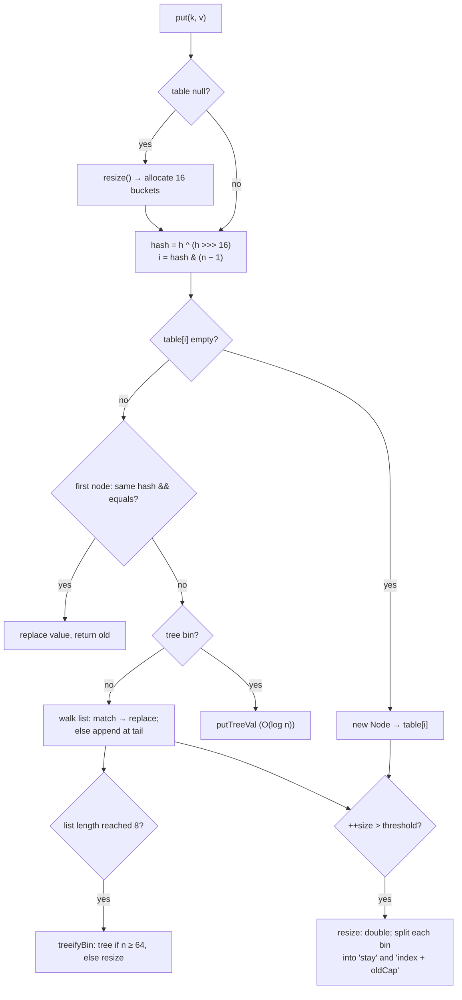
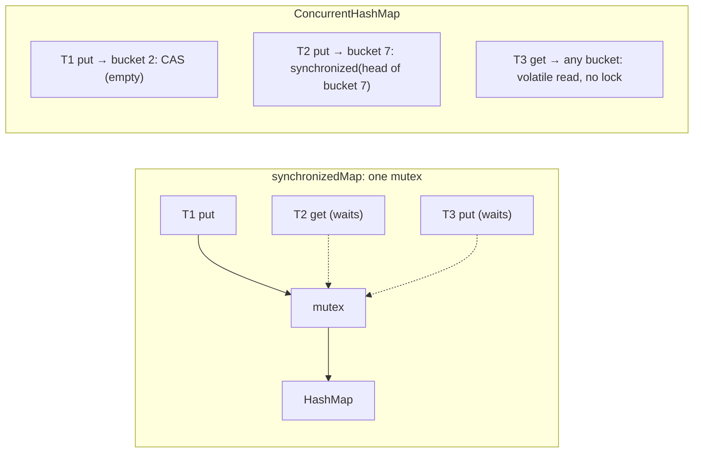
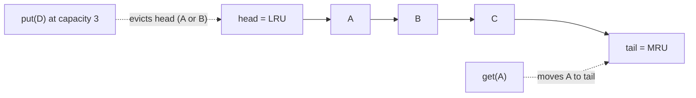
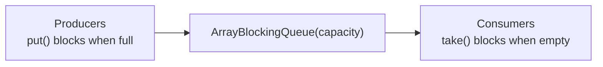
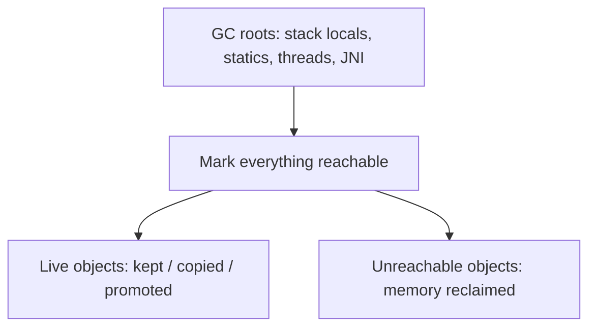
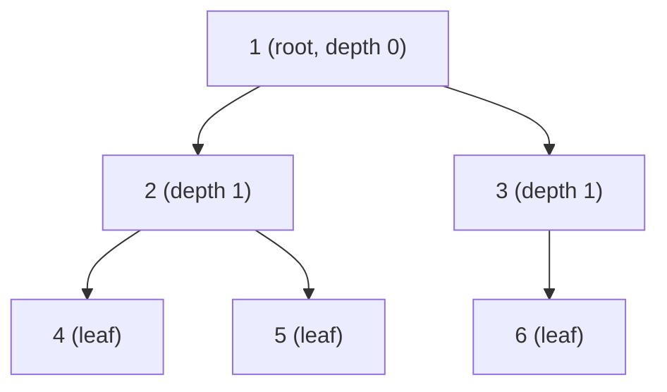
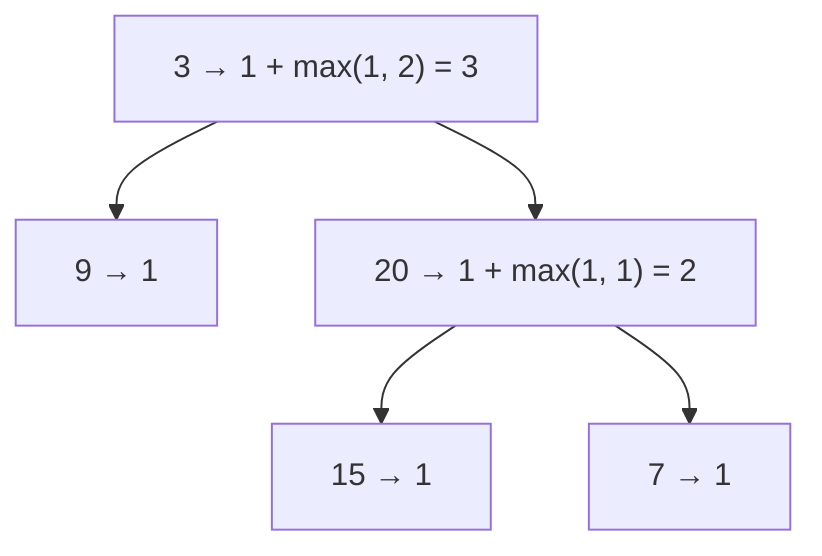
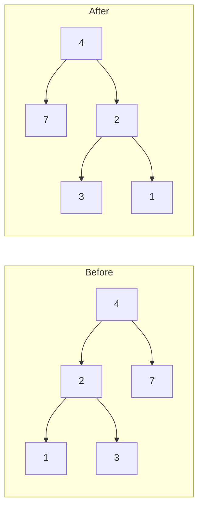
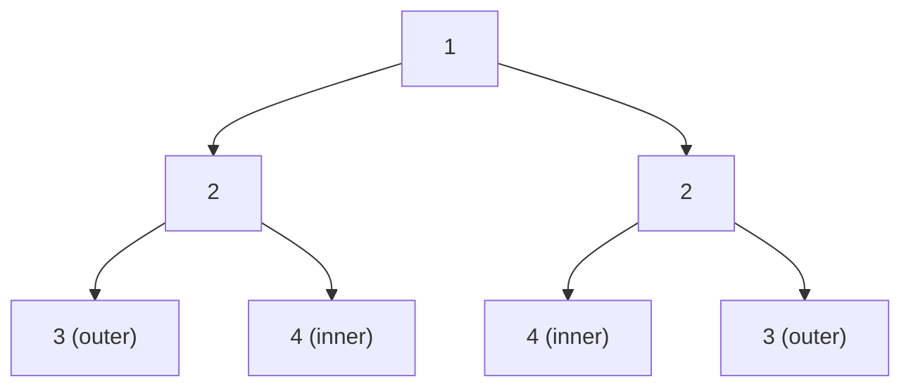

# Day 18 — Phase 2 Review: Collections & JVM Rapid-Fire + Trees Intro

> **How to use these notes:** today is a **review day**. For each whiteboard/explain item, first try to draw or explain it **out loud from memory** (as in an interview), then compare with the model answer here. Anything you get wrong → add it to "What I Missed". On the DSA side you start **binary trees** — the gateway to BSTs, heaps and graphs.

<!-- topic: d18_t1 -->
## ☕ Collections & JVM — Final Review

<!-- subtopic: d18_t1_s1 -->
### 1. Whiteboard: HashMap put/get flow

> **Goal:** draw this in under 3 minutes and narrate it. Full details: Day 12.



**Narration script:** "HashMap is an array of buckets. I spread the key's hashCode, AND it with capacity − 1 to get the index. Empty bucket → new node. Otherwise I compare cached hash, then reference, then equals — match means replace the value. No match: append to the chain; at 8 nodes the chain becomes a red-black tree if the table has at least 64 buckets. After inserting, if size exceeds capacity × 0.75, the table doubles and entries are redistributed. `get` follows the same path without inserting: O(1) average, O(log n) worst case in Java 8+."

<details><summary>Self-check: why compare the hash before calling equals?</summary>

Comparing two ints is far cheaper than equals; it filters out most non-matching keys in the same bucket, so equals runs only for likely matches.

</details>

<!-- subtopic: d18_t1_s2 -->
### 2. Whiteboard: ConcurrentHashMap vs Collections.synchronizedMap

> **Goal:** explain why CHM scales and synchronizedMap doesn't. Full details: Day 13.



| Point | `synchronizedMap` | `ConcurrentHashMap` |
|---|---|---|
| Lock | One mutex for everything | CAS for empty bins, per-bin lock otherwise, lock-free reads |
| Reads | Serialized with writes | Fully concurrent |
| Iteration | Must `synchronized(map)` manually, fail-fast | Weakly consistent, no CME, no lock |
| Compound actions | Lock manually | `putIfAbsent`, `compute`, `merge` are atomic |
| Nulls | Allowed (HashMap) | Not allowed (ambiguity of `get() == null`) |
| Resize | Single thread under the lock | Threads help transfer concurrently |

<details><summary>Self-check: is `if (!chm.containsKey(k)) chm.put(k, v)` thread-safe?</summary>

No — two threads can both pass the check. Use `chm.putIfAbsent(k, v)` or `computeIfAbsent`.

</details>

<!-- subtopic: d18_t1_s3 -->
### 3. Whiteboard: LinkedHashMap as an LRU Cache

> **Goal:** write it from memory in 2 minutes. Full details: Day 13.

```java
class LruCache<K, V> extends LinkedHashMap<K, V> {
    private final int capacity;
    LruCache(int capacity) {
        super(capacity, 0.75f, true);          // accessOrder = true
        this.capacity = capacity;
    }
    @Override
    protected boolean removeEldestEntry(Map.Entry<K, V> eldest) {
        return size() > capacity;
    }
}
```



Follow-ups the interviewer will ask:
- *Thread-safe?* No → `Collections.synchronizedMap(new LruCache<>(n))`, or Caffeine.
- *Without LinkedHashMap?* `HashMap<K, Node>` + doubly-linked list with dummy head/tail; `get` moves the node to the front; `put` adds at the front and evicts the tail — all O(1) (LC 146, Day 32).
- *TTL eviction?* Caffeine `expireAfterWrite`, or store timestamps and check on read.

<!-- subtopic: d18_t1_s4 -->
### 4. Explain: ArrayList vs LinkedList vs CopyOnWriteArrayList

> **Goal:** a 60-second answer with "when to use each". Full details: Day 11.

| | `ArrayList` | `LinkedList` | `CopyOnWriteArrayList` |
|---|---|---|---|
| Structure | Resizable array (grows 1.5×) | Doubly-linked nodes | Array copied on every write |
| get(i) | O(1) | O(n) | O(1) |
| Add at end | Amortized O(1) | O(1) | **O(n)** |
| Insert/remove at front | O(n) | O(1) | O(n) |
| Thread-safe | ❌ | ❌ | ✅ (lock-free reads) |
| Iterator | Fail-fast | Fail-fast | Snapshot (never CME) |
| Memory | Compact | ~24 bytes/node extra | Compact, but garbage on each write |
| Use when | **Default choice** | Rarely (prefer ArrayDeque for deque use) | Shared, read-mostly lists: listeners, config |

**Model answer:** "ArrayList is my default — O(1) index access and cache-friendly memory; appends are amortized O(1). LinkedList only wins for frequent insertions/removals at the ends or at an iterator position, and even then ArrayDeque is usually better. CopyOnWriteArrayList is for lists shared across threads that are read far more often than written, like event listeners: reads and iteration are lock-free and never throw ConcurrentModificationException, but every write copies the whole array."

<!-- subtopic: d18_t1_s5 -->
### 5. Explain: PriorityQueue for Top-K, BlockingQueue for Producer–Consumer

> **Goal:** connect the data structure to the use case. Full details: Day 15.

**PriorityQueue for Top-K:**

```java
// K most frequent words — min-heap of size k ordered by frequency
Map<String, Long> freq = words.stream().collect(groupingBy(identity(), counting()));
PriorityQueue<Map.Entry<String, Long>> heap = new PriorityQueue<>(Map.Entry.comparingByValue());
for (var e : freq.entrySet()) {
    heap.offer(e);
    if (heap.size() > k) heap.poll();          // evict the least frequent
}
// heap now holds the k most frequent — O(n log k)
```

"A min-heap of size k keeps the k largest seen so far: the root is the smallest of them, so anything smaller than the root is irrelevant. That's O(n log k) time and O(k) memory — great for streams where you can't sort everything."

**BlockingQueue for producer–consumer:**



"The queue does all synchronization: producers block when it's full (back-pressure), consumers block when it's empty (no busy-waiting). A bounded queue protects memory. ThreadPoolExecutor itself is a producer–consumer built on a BlockingQueue. Stop consumers with a poison pill or interruption."

<!-- subtopic: d18_t4_s1 -->
### 6. Explain: JVM memory areas, class loading and how GC decides what to collect

> **Goal:** a 2-minute structured explanation. Full details: Day 17.

**Model answer (memory):** "Each thread has its own stack of frames holding local primitives and references, plus a PC register. Shared memory is the heap — all objects, including the String pool — and Metaspace, which holds class metadata in native memory since Java 8."

**Model answer (class loading):** "Classes load lazily through Bootstrap, Platform and Application loaders using parent-first delegation, which prevents replacing core classes. Loading is followed by linking — verification, preparation of static fields with defaults, resolution — and then initialization, which runs static initializers on first active use."

**Model answer (GC):** "GC starts from roots — stack locals, static fields, active threads, JNI references — and marks everything reachable; the rest is garbage, so cycles aren't a problem. The heap is generational because most objects die young: Eden fills, a minor GC copies survivors to a survivor space, and objects that survive enough cycles get promoted to the old generation, which is collected less often. G1, the default, splits the heap into regions and collects the most garbage-heavy ones first to meet a pause target; ZGC does almost everything concurrently for sub-millisecond pauses."



<!-- subtopic: d18_t1_s6 -->
### 7. Rapid-fire: 15 Collections Questions Without Notes

> Answer each **out loud in under 30 seconds**, then reveal.

<details><summary>1. Difference between Collection and Collections?</summary>

Collection is the root interface for List/Set/Queue; Collections is a utility class of static helpers (sort, unmodifiableList, synchronizedMap...).

</details>

<details><summary>2. Why isn't Map a Collection?</summary>

Its elements are key-value pairs; operations like add(E) don't fit. It offers collection views instead (keySet, values, entrySet).

</details>

<details><summary>3. How does ArrayList grow?</summary>

Capacity 10 on first add, then 1.5× (old + old >> 1) by copying to a new array; appends are amortized O(1).

</details>

<details><summary>4. What causes ConcurrentModificationException?</summary>

Structurally modifying a collection while iterating it with a fail-fast iterator (modCount ≠ expectedModCount), usually in the same thread. Fix with Iterator.remove or removeIf.

</details>

<details><summary>5. Arrays.asList vs List.of?</summary>

asList: fixed-size view backed by the array, set allowed, nulls allowed. List.of: fully immutable, no nulls.

</details>

<details><summary>6. What happens when two keys collide in a HashMap?</summary>

Same bucket; chained in a linked list (tree when ≥ 8 and capacity ≥ 64); equals distinguishes them.

</details>

<details><summary>7. Why must you override hashCode when overriding equals?</summary>

Equal objects must produce equal hash codes or hash-based collections will look in the wrong bucket and fail to find them.

</details>

<details><summary>8. HashMap vs Hashtable?</summary>

Hashtable is legacy, fully synchronized, no nulls. HashMap is unsynchronized, allows one null key. For concurrency use ConcurrentHashMap.

</details>

<details><summary>9. How does HashSet work internally?</summary>

It's a HashMap whose keys are the set elements and whose values are a shared dummy PRESENT object.

</details>

<details><summary>10. TreeSet vs HashSet?</summary>

TreeSet is a sorted red-black tree, O(log n), uses compareTo for equality; HashSet is O(1) average, unordered, uses equals/hashCode.

</details>

<details><summary>11. How do you make a thread-safe list?</summary>

CopyOnWriteArrayList for read-heavy use, Collections.synchronizedList for general use (synchronize iteration manually), or a concurrent queue for producer-consumer.

</details>

<details><summary>12. What's a fail-safe iterator?</summary>

One that works on a snapshot or is weakly consistent (CopyOnWriteArrayList, ConcurrentHashMap) and never throws ConcurrentModificationException.

</details>

<details><summary>13. Why is ArrayDeque preferred over Stack and LinkedList?</summary>

Stack is synchronized legacy (extends Vector); LinkedList allocates a node per element. ArrayDeque is a compact circular array with O(1) operations at both ends.

</details>

<details><summary>14. How do you sort a Map by value?</summary>

Stream the entrySet, sort with Map.Entry.comparingByValue(), and collect into a LinkedHashMap to preserve order.

</details>

<details><summary>15. What is an LRU cache and how do you build one in Java?</summary>

A cache that evicts the least recently used entry when full. LinkedHashMap with accessOrder = true and removeEldestEntry returning size() > capacity.

</details>

<!-- topic: d12_t2 -->
## 🧮 DSA — Trees: Easy (Introduction)

<!-- subtopic: d12_t2_s1 -->
### 8. Binary Tree Fundamentals

> **TL;DR:** A binary tree is a hierarchy of nodes where each node has **at most two children** (`left`, `right`). Unlike a linked list (one `next`), trees branch — which is why so many tree algorithms are naturally **recursive**: solve for the left subtree, solve for the right subtree, combine.

```java
// LeetCode's definition
public class TreeNode {
    int val;
    TreeNode left, right;
    TreeNode(int val) { this.val = val; }
    TreeNode(int val, TreeNode left, TreeNode right) { this.val = val; this.left = left; this.right = right; }
}
```



| Term | Meaning (for the tree above) |
|---|---|
| Root | Top node (1) |
| Leaf | Node with no children (4, 5, 6) |
| Parent / child / sibling | 2 is the parent of 4 and 5; 4 and 5 are siblings |
| **Depth** of a node | Edges from the root down to it (depth of 4 = 2) |
| **Height** of a node | Edges on the longest path down to a leaf (height of root = 2) |
| Subtree | A node plus all its descendants |
| Level | All nodes at the same depth |

> Some sources (including LeetCode's "maximum depth") count **nodes** instead of edges: max depth of the tree above = 3. Clarify in interviews.

| Type | Definition |
|---|---|
| **Full** | Every node has 0 or 2 children |
| **Complete** | All levels full except possibly the last, which is filled left to right (heaps, Day 15) |
| **Perfect** | All internal nodes have 2 children, all leaves at the same level → 2^(h+1) − 1 nodes |
| **Balanced** | Heights of left and right subtrees differ by ≤ 1 at every node → height O(log n) |
| **Degenerate / skewed** | Every node has one child → basically a linked list, height O(n) |
| **Binary Search Tree** | left < node < right for every node (Day 19) |

| | Linked list | Binary tree |
|---|---|---|
| Links per node | 1 | 2 |
| Traversal | One way | Many orders (pre/in/post/level) |
| Search (balanced BST) | O(n) | O(log n) |
| Natural algorithm style | Iterative | Recursive |

Complexity facts: n nodes → n − 1 edges; a balanced tree's height is O(log n), a skewed tree's O(n). Recursive tree algorithms usually take **O(n) time** (visit each node once) and **O(h) space** (recursion depth = height).

<!-- subtopic: d12_t2_s2 -->
### 9. Tree Traversals — Preorder, Inorder, Postorder (recursive and iterative)

> **TL;DR:** Depth-first traversals differ only in **when you visit the node** relative to its subtrees: **Pre**order = node, left, right. **In**order = left, node, right (gives **sorted order in a BST**). **Post**order = left, right, node (children before parent — deletion, computing heights).

For the tree `1 (2 (4, 5), 3 (6))` above:

| Traversal | Order | Result | Typical use |
|---|---|---|---|
| Preorder | Node → Left → Right | 1, 2, 4, 5, 3, 6 | Copy/serialize a tree, print structure |
| Inorder | Left → Node → Right | 4, 2, 5, 1, 6, 3 | Sorted output of a BST, validate BST |
| Postorder | Left → Right → Node | 4, 5, 2, 6, 3, 1 | Delete/free a tree, compute sizes/heights bottom-up |
| Level order (BFS) | Level by level | 1, 2, 3, 4, 5, 6 | Shortest paths, per-level questions (Day 19) |

#### Recursive (all three differ by one line)

```java
void preorder(TreeNode n, List<Integer> out) {
    if (n == null) return;
    out.add(n.val);              // visit BEFORE children
    preorder(n.left, out);
    preorder(n.right, out);
}
void inorder(TreeNode n, List<Integer> out) {
    if (n == null) return;
    inorder(n.left, out);
    out.add(n.val);              // visit BETWEEN children
    inorder(n.right, out);
}
void postorder(TreeNode n, List<Integer> out) {
    if (n == null) return;
    postorder(n.left, out);
    postorder(n.right, out);
    out.add(n.val);              // visit AFTER children
}
```

#### Iterative (interviewers often ask for these)

```java
// Preorder: stack; push RIGHT first so LEFT is processed first
List<Integer> preorderIter(TreeNode root) {
    List<Integer> out = new ArrayList<>();
    if (root == null) return out;
    Deque<TreeNode> stack = new ArrayDeque<>();
    stack.push(root);
    while (!stack.isEmpty()) {
        TreeNode n = stack.pop();
        out.add(n.val);
        if (n.right != null) stack.push(n.right);
        if (n.left != null) stack.push(n.left);
    }
    return out;
}

// Inorder: go left as far as possible, then visit, then go right
List<Integer> inorderIter(TreeNode root) {
    List<Integer> out = new ArrayList<>();
    Deque<TreeNode> stack = new ArrayDeque<>();
    TreeNode cur = root;
    while (cur != null || !stack.isEmpty()) {
        while (cur != null) {              // push the left spine
            stack.push(cur);
            cur = cur.left;
        }
        cur = stack.pop();
        out.add(cur.val);                  // visit
        cur = cur.right;                   // then the right subtree
    }
    return out;
}

// Postorder: reverse of a "node, right, left" preorder
List<Integer> postorderIter(TreeNode root) {
    LinkedList<Integer> out = new LinkedList<>();
    if (root == null) return out;
    Deque<TreeNode> stack = new ArrayDeque<>();
    stack.push(root);
    while (!stack.isEmpty()) {
        TreeNode n = stack.pop();
        out.addFirst(n.val);               // prepend → reverses the order
        if (n.left != null) stack.push(n.left);
        if (n.right != null) stack.push(n.right);
    }
    return out;
}
```

All are O(n) time, O(h) space. 🚀 **Morris traversal** achieves O(1) extra space by temporarily threading right pointers to inorder predecessors.

Practice: [LC 144](https://leetcode.com/problems/binary-tree-preorder-traversal/), [LC 94](https://leetcode.com/problems/binary-tree-inorder-traversal/), [LC 145](https://leetcode.com/problems/binary-tree-postorder-traversal/).

<!-- subtopic: d12_t2_s3 -->
### 10. Maximum Depth of Binary Tree (LeetCode 104)

> **Problem:** return the number of **nodes** on the longest root-to-leaf path. 🔗 [LeetCode 104](https://leetcode.com/problems/maximum-depth-of-binary-tree/)

```java
// Recursive (postorder: children first, then combine)
public int maxDepth(TreeNode root) {
    if (root == null) return 0;                               // empty tree has depth 0
    return 1 + Math.max(maxDepth(root.left), maxDepth(root.right));
}   // O(n) time, O(h) space

// Iterative BFS: count levels
public int maxDepthBfs(TreeNode root) {
    if (root == null) return 0;
    Queue<TreeNode> q = new ArrayDeque<>(List.of(root));
    int depth = 0;
    while (!q.isEmpty()) {
        int levelSize = q.size();
        for (int i = 0; i < levelSize; i++) {
            TreeNode n = q.poll();
            if (n.left != null) q.offer(n.left);
            if (n.right != null) q.offer(n.right);
        }
        depth++;
    }
    return depth;
}   // O(n) time, O(width) space
```



> **The template for most tree problems:** "What do I need from my left and right subtrees, and how do I combine it?" Max depth: their depths → 1 + max. Min depth (LC 111) is a twist: a node with one child isn't a leaf, so take the non-null side.

<!-- subtopic: d12_t2_s4 -->
### 11. Invert Binary Tree (LeetCode 226)

> **Problem:** mirror the tree — swap every node's left and right children. 🔗 [LeetCode 226](https://leetcode.com/problems/invert-binary-tree/)

```java
public TreeNode invertTree(TreeNode root) {
    if (root == null) return null;
    TreeNode left = invertTree(root.left);       // invert the subtrees first (postorder) ...
    TreeNode right = invertTree(root.right);
    root.left = right;                           // ... then swap them
    root.right = left;
    return root;
}   // O(n) time, O(h) space

// Iterative with a queue (BFS) — swap children of each node as you visit it
public TreeNode invertIter(TreeNode root) {
    if (root == null) return null;
    Queue<TreeNode> q = new ArrayDeque<>(List.of(root));
    while (!q.isEmpty()) {
        TreeNode n = q.poll();
        TreeNode tmp = n.left; n.left = n.right; n.right = tmp;
        if (n.left != null) q.offer(n.left);
        if (n.right != null) q.offer(n.right);
    }
    return root;
}
```



Any traversal order works as long as every node's children get swapped exactly once.

<!-- subtopic: d12_t2_s5 -->
### 12. Same Tree (LC 100) and Symmetric Tree (LC 101)

> 🔗 [LeetCode 100](https://leetcode.com/problems/same-tree/) — are two trees identical in structure and values? 🔗 [LeetCode 101](https://leetcode.com/problems/symmetric-tree/) — is a tree a mirror of itself?

```java
// Same Tree: compare node by node
public boolean isSameTree(TreeNode p, TreeNode q) {
    if (p == null && q == null) return true;            // both empty
    if (p == null || q == null) return false;           // one empty
    return p.val == q.val
            && isSameTree(p.left, q.left)
            && isSameTree(p.right, q.right);
}   // O(n) time, O(h) space

// Symmetric Tree: the left subtree must mirror the right subtree
public boolean isSymmetric(TreeNode root) {
    return root == null || isMirror(root.left, root.right);
}
private boolean isMirror(TreeNode a, TreeNode b) {
    if (a == null && b == null) return true;
    if (a == null || b == null) return false;
    return a.val == b.val
            && isMirror(a.left, b.right)                 // outer pair
            && isMirror(a.right, b.left);                // inner pair
}
```



*Symmetric: compare outer with outer (3, 3) and inner with inner (4, 4).*

Symmetric is "Same Tree with crossed children". Iterative version: a queue of **pairs** `(a, b)`, pushing `(a.left, b.right)` and `(a.right, b.left)`. Related: Subtree of Another Tree (LC 572) = for each node, check `isSameTree(node, sub)`.

---

## 📝 Day 18 Revision Cheat Sheet

| Topic | Remember this |
|---|---|
| HashMap flow | spread hash → index → empty? place : compare hash/equals → replace or append → treeify at 8 (cap ≥ 64) → resize > 0.75 |
| CHM vs syncMap | Per-bin locks + CAS + lock-free reads vs one mutex |
| LRU | LinkedHashMap(cap, 0.75f, true) + removeEldestEntry |
| Lists | ArrayList default; LinkedList rarely; COW for read-mostly shared lists |
| Queues | Size-k min-heap for Top-K; bounded BlockingQueue for producer–consumer |
| JVM | Stacks per thread, heap + Metaspace shared; parent-first loading; reachability-based generational GC |
| Tree terms | Depth (from root), height (to deepest leaf), complete vs perfect vs balanced |
| Traversals | Pre (N L R), In (L N R → sorted in BST), Post (L R N), Level (BFS) |
| Recursion template | Get answers from left and right, combine at the node; O(n) time, O(h) space |
| Max depth | 1 + max(left, right) |
| Invert | Swap children at every node |
| Symmetric | Mirror check: outer with outer, inner with inner |

### ⚡ Rapid-fire self-test

1. Inorder traversal of a BST gives? → **Sorted order**
2. Height of a single node? → **0 (edges) — or depth 1 if counting nodes**
3. Traversal for deleting a tree safely? → **Postorder**
4. Max depth of an empty tree? → **0**
5. Space complexity of recursive DFS on a tree? → **O(h)**
6. Height of a balanced binary tree with n nodes? → **O(log n)**
7. In iterative preorder, which child is pushed first? → **Right (so left is popped first)**
8. Symmetric Tree compares which pairs? → **left.left with right.right, left.right with right.left**
9. Can ConcurrentHashMap store null keys? → **No**
10. LRU via LinkedHashMap — which flag? → **accessOrder = true**
