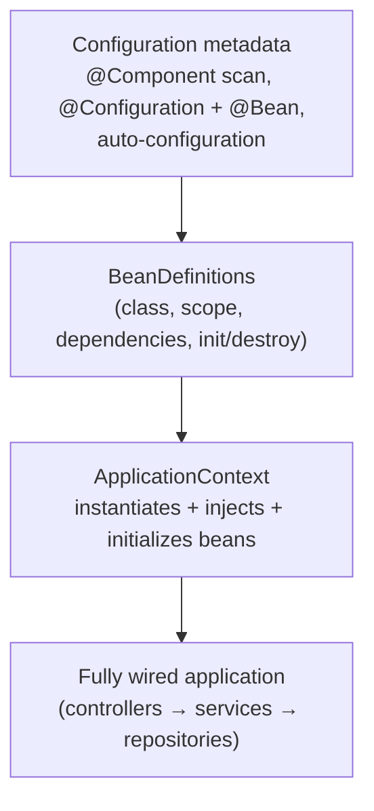
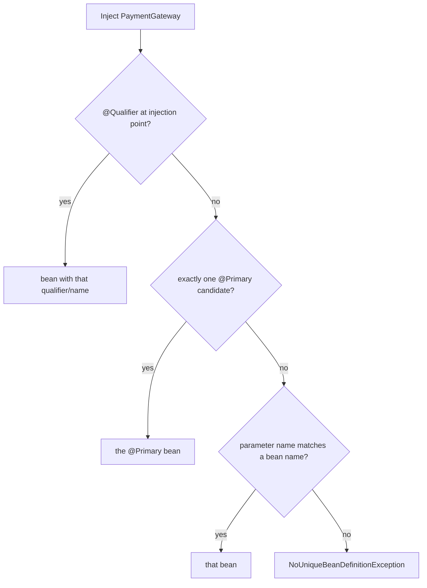
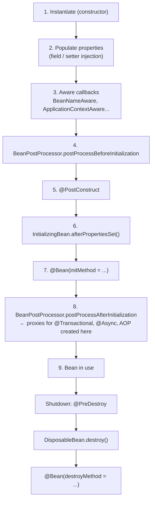
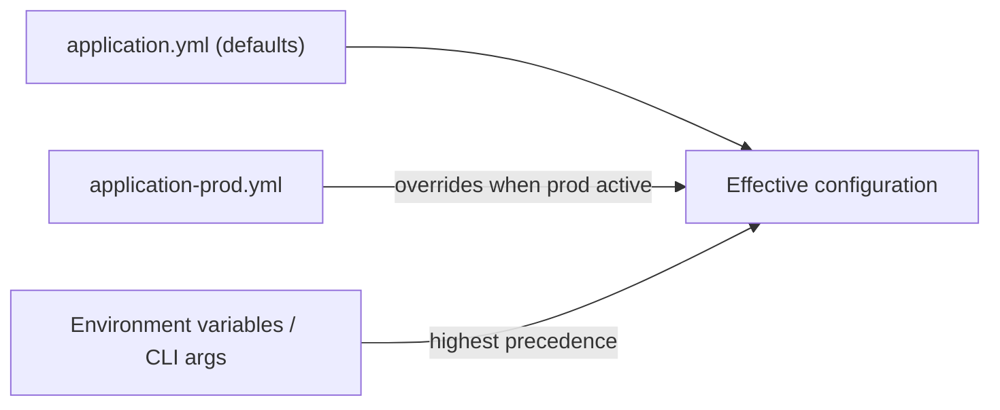
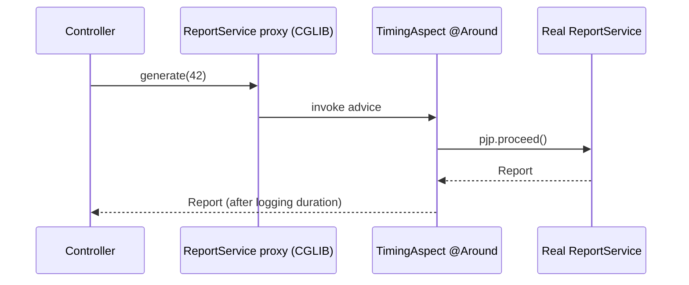
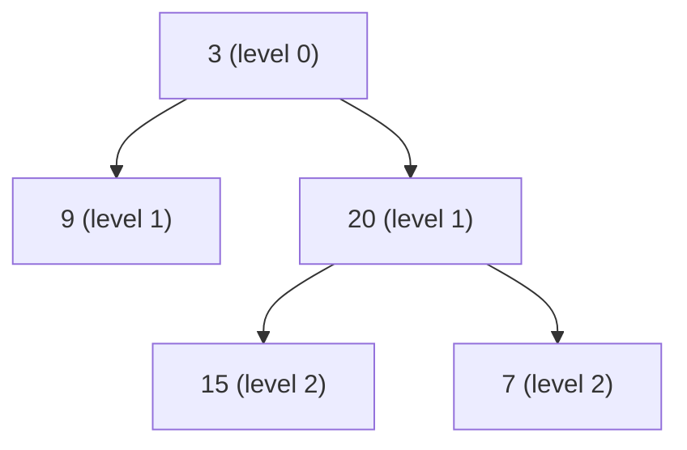
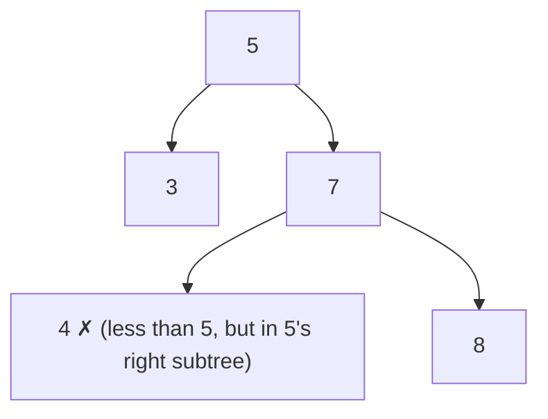
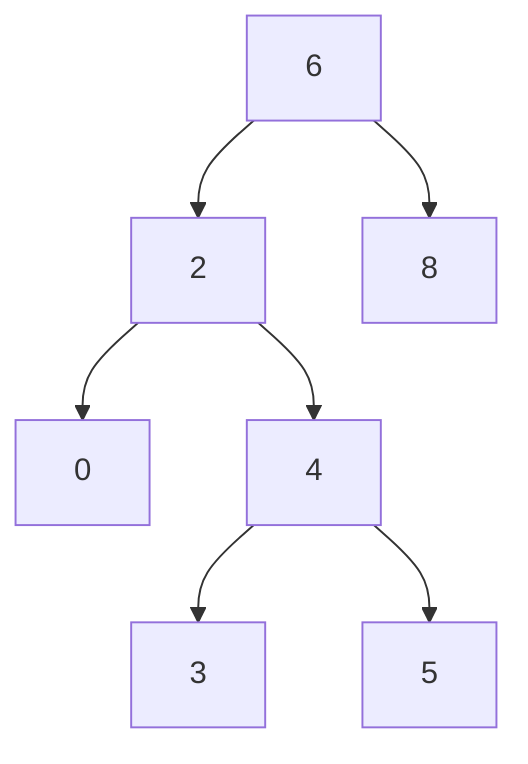
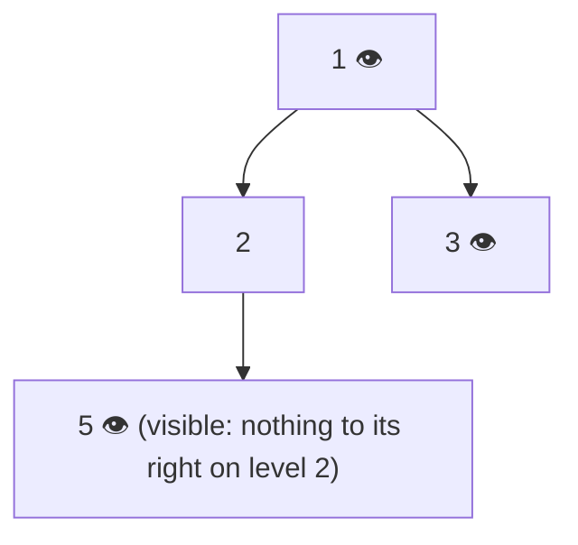

# Day 19 — Spring Core: IoC, Dependency Injection & Bean Lifecycle

> **How to use these notes:** each section maps to one checklist item. Run the code, study the diagrams, then test yourself with the collapsible questions. 🚀 marks senior-level details.

**Today's goal:** start Phase 3 (Spring Boot) with the foundation everything else depends on: the **IoC container**, how beans are discovered and **injected** (and why constructor injection wins), resolving **ambiguous beans**, **scopes**, the full **bean lifecycle**, **profiles/conditions**, and **AOP proxies**. On the DSA side: **level-order traversal (BFS)** and the first **Binary Search Tree** problems.

<!-- topic: d19_t1 -->
## 🌿 Spring — IoC & Dependency Injection

<!-- subtopic: d19_t1_s1 -->
### 1. The IoC Container — BeanFactory vs ApplicationContext

> **TL;DR:** **Inversion of Control** = your classes don't create their collaborators; the **Spring container** creates objects (**beans**), wires their dependencies, and manages their lifecycle. `BeanFactory` is the basic container (lazy). **`ApplicationContext`** extends it with eager singleton creation, events, i18n, resource loading and AOP integration — it's what you use (Spring Boot creates one for you).

```java
// Without IoC: the class controls creation → tight coupling, hard to test
public class OrderService {
    private final PaymentClient payments = new PaymentClient("https://pay.example.com");
}

// With IoC: dependencies are given to the class
@Service
public class OrderService {
    private final PaymentClient payments;
    public OrderService(PaymentClient payments) { this.payments = payments; }   // container injects it
}
```



| | `BeanFactory` | `ApplicationContext` |
|---|---|---|
| Singleton creation | Lazy (on first `getBean`) | **Eager at startup** → config errors fail fast |
| `BeanPostProcessor` registration | Manual | Automatic (needed for `@Autowired`, AOP, `@Transactional`) |
| Events (`ApplicationEvent`, `@EventListener`) | ❌ | ✅ |
| i18n (`MessageSource`), resource loading, environment/profiles | ❌ | ✅ |
| Use | Very constrained environments | **Always** in practice |

In Spring Boot: `SpringApplication.run(App.class, args)` returns a `ConfigurableApplicationContext` (e.g., `AnnotationConfigServletWebServerApplicationContext` for web apps).

<!-- subtopic: d19_t1_s2 -->
### 2. Stereotype Annotations — @Component, @Service, @Repository, @Controller

> **TL;DR:** All four mark a class as a **Spring-managed bean** discovered by **component scanning**. `@Service`, `@Repository`, `@Controller` are **specializations** of `@Component` that document the layer — and `@Repository` additionally enables **exception translation** (vendor SQL exceptions → Spring's `DataAccessException`).

| Annotation | Layer | Extra behaviour |
|---|---|---|
| `@Component` | Generic bean | — |
| `@Service` | Business logic | None today (semantic marker) — good place for `@Transactional` |
| `@Repository` | Data access | **Persistence exception translation** via `PersistenceExceptionTranslationPostProcessor` |
| `@Controller` | Web MVC (views) | Handler methods discovered by Spring MVC |
| `@RestController` | REST APIs | `@Controller` + `@ResponseBody` (Day 20) |
| `@Configuration` | Bean definitions via `@Bean` methods | CGLIB-enhanced so `@Bean` methods return singletons |

```java
@Repository
public class JdbcOrderRepository implements OrderRepository {
    // A vendor-specific SQLException thrown here is translated into e.g. DuplicateKeyException
}

@Configuration
public class HttpConfig {
    @Bean                                         // third-party class you can't annotate
    public RestClient paymentClient(@Value("${payments.url}") String url) {
        return RestClient.builder().baseUrl(url).build();
    }
}
```

`@Component` vs `@Bean`: use stereotypes for **your own** classes; use `@Bean` methods for **third-party** classes or when construction needs logic. Component scanning starts from the package of the `@SpringBootApplication` class and covers its sub-packages.

<!-- subtopic: d19_t1_s3 -->
### 3. Dependency Injection — constructor vs field vs setter

> **TL;DR:** Prefer **constructor injection**: dependencies are explicit and `final`, the object is always fully initialized, it's trivially testable without Spring, and circular dependencies surface immediately. If a class has **one constructor**, `@Autowired` is optional (Spring 4.3+).

```java
// ✅ Constructor injection (recommended)
@Service
public class CheckoutService {
    private final CartRepository carts;
    private final PaymentGateway payments;

    public CheckoutService(CartRepository carts, PaymentGateway payments) {   // no @Autowired needed
        this.carts = carts;
        this.payments = payments;
    }
}
// With Lombok: @RequiredArgsConstructor generates this constructor for final fields.

// ⚠️ Field injection — concise but hides dependencies, can't be final, needs reflection in tests
@Service
public class LegacyService {
    @Autowired private CartRepository carts;
}

// Setter injection — for genuinely optional or reconfigurable dependencies
@Service
public class ReportService {
    private Notifier notifier = Notifier.NOOP;
    @Autowired(required = false)
    public void setNotifier(Notifier notifier) { this.notifier = notifier; }
}
```

| | Constructor | Field | Setter |
|---|---|---|---|
| `final` fields / immutability | ✅ | ❌ | ❌ |
| Object always valid after creation | ✅ | ❌ (null until injected) | ❌ |
| Unit test without Spring | ✅ `new Service(mock)` | ❌ needs reflection / Spring | ✅ |
| Too many dependencies visible | ✅ (a long constructor = SRP smell) | Hidden | Hidden |
| Circular dependencies | Fail at startup (good) | Possible (hidden smell) | Possible |
| Optional dependencies | Via `Optional<T>` / `ObjectProvider<T>` | `required = false` | ✅ natural |

🚀 Circular dependencies (A needs B, B needs A) are **prohibited by default since Spring Boot 2.6**. Fix the design (extract a third bean, use events) rather than enabling `spring.main.allow-circular-references`.

<!-- subtopic: d19_t1_s4 -->
### 4. Resolving Ambiguity — @Primary, @Qualifier, @Resource

> **TL;DR:** If **more than one bean** matches a type, injection fails with `NoUniqueBeanDefinitionException`. Fix it with **`@Primary`** (the default choice), **`@Qualifier("name")`** (pick explicitly at the injection point), or by injecting **all** of them as a `List`/`Map`.

```java
public interface PaymentGateway { void charge(Money m); }

@Component("razorpay") @Primary
public class RazorpayGateway implements PaymentGateway { ... }

@Component("stripe")
public class StripeGateway implements PaymentGateway { ... }

@Service
public class CheckoutService {
    public CheckoutService(PaymentGateway defaultGateway,                         // → razorpay (@Primary)
                           @Qualifier("stripe") PaymentGateway internationalGateway) { ... }
}

@Service
public class PaymentRouter {
    private final Map<String, PaymentGateway> gateways;          // {"razorpay"=..., "stripe"=...}
    public PaymentRouter(Map<String, PaymentGateway> gateways) { this.gateways = gateways; }   // Strategy pattern (Day 10)
}
```



| | `@Autowired` (+ `@Qualifier`) | `@Resource` (Jakarta) | `@Inject` (Jakarta) |
|---|---|---|---|
| Resolves by | **Type** first, then qualifier / name | **Name** first, then type | Type (like `@Autowired`) |
| Origin | Spring | `jakarta.annotation` | `jakarta.inject` |
| Constructor injection | ✅ | ❌ (fields/setters only) | ✅ |

Custom qualifier annotations (`@International`) are cleaner than string names for larger codebases.

<!-- subtopic: d19_t1_s5 -->
### 5. Bean Scopes

> **TL;DR:** **singleton** (default) = one instance per container, shared by everyone → must be **stateless or thread-safe**. **prototype** = a new instance each time it's requested. Web scopes: **request**, **session**, **application**, **websocket**.

| Scope | Instances | Destroy callbacks | Notes |
|---|---|---|---|
| `singleton` (default) | One per `ApplicationContext` | ✅ | Shared across all threads/requests |
| `prototype` | New on every injection / `getBean` | ❌ Spring doesn't track it after creation | Stateful helpers |
| `request` | One per HTTP request | ✅ | Web apps |
| `session` | One per HTTP session | ✅ | User-specific state (cart) |
| `application` | One per `ServletContext` | ✅ | Like singleton, across contexts in one web app |
| `websocket` | One per WebSocket session | ✅ | — |

```java
@Component
@Scope(ConfigurableBeanFactory.SCOPE_PROTOTYPE)
public class ReportBuilder { private final StringBuilder sb = new StringBuilder(); }

@Component
@RequestScope                                     // = @Scope(value = "request", proxyMode = TARGET_CLASS)
public class RequestContext { private String correlationId; }
```

⚠️ **Singleton beans are shared by all request threads.** Never keep per-request mutable state in a field of a `@Service` (classic race condition). Use method locals, request scope, or `ThreadLocal`-based context.

#### The prototype-in-singleton problem

```java
@Service
public class InvoiceService {
    private final ReportBuilder builder;           // ❌ injected ONCE → the same prototype instance forever
    public InvoiceService(ReportBuilder builder) { this.builder = builder; }
}

@Service
public class InvoiceServiceFixed {
    private final ObjectProvider<ReportBuilder> builders;      // ✅ ask for a new one each time
    public InvoiceServiceFixed(ObjectProvider<ReportBuilder> builders) { this.builders = builders; }
    public byte[] build() { ReportBuilder b = builders.getObject(); /* fresh instance */ return null; }
}
```

Alternatives: `@Lookup` method injection, or a scoped proxy (`proxyMode = ScopedProxyMode.TARGET_CLASS`) — that's how a request-scoped bean can be injected into a singleton.

<!-- subtopic: d19_t1_s6 -->
### 6. Bean Lifecycle — from instantiation to destruction

> **TL;DR:** Instantiate → inject dependencies → `Aware` callbacks → `BeanPostProcessor` **before** init → **`@PostConstruct`** → `afterPropertiesSet()` → custom `initMethod` → `BeanPostProcessor` **after** init (**AOP proxies are created here**) → ready → on shutdown **`@PreDestroy`** → `destroy()` → custom `destroyMethod`.



```java
@Component
public class CacheWarmer implements InitializingBean, DisposableBean {
    private final ProductRepository repo;
    public CacheWarmer(ProductRepository repo) { this.repo = repo; }    // 1 (dependencies via constructor)

    @PostConstruct                                                       // 5 — preferred init hook
    void init() { System.out.println("dependencies injected, warm the cache"); }

    @Override public void afterPropertiesSet() { System.out.println("afterPropertiesSet"); }   // 6 (Spring-specific)

    @PreDestroy                                                          // preferred cleanup hook
    void shutdown() { System.out.println("flush and close"); }

    @Override public void destroy() { System.out.println("destroy"); }
}

@Bean(initMethod = "start", destroyMethod = "stop")                     // for third-party classes
public Scheduler scheduler() { return new Scheduler(); }
```

Rules:
- Use **`@PostConstruct`** for initialization that needs injected dependencies — they're **not** available in the constructor when using field injection.
- `@PreDestroy` runs on graceful shutdown for singletons — **not for prototypes**.
- `@PostConstruct`/`@PreDestroy` are `jakarta.annotation` (Spring Boot 3).
- Need to run something after the **whole** application has started? Use `ApplicationRunner` / `CommandLineRunner` or `@EventListener(ApplicationReadyEvent.class)`.

<!-- subtopic: d19_t1_s7 -->
### 7. @Profile and @Conditional — environment-specific beans

> **TL;DR:** **Profiles** activate groups of beans and config per environment (`dev`, `test`, `prod`): `@Profile("prod")` + `application-prod.yml` + `spring.profiles.active=prod`. **`@Conditional`** (and Boot's `@ConditionalOnProperty`, `@ConditionalOnClass`, `@ConditionalOnMissingBean`...) creates beans only when a condition holds — the engine behind auto-configuration (Day 20).

```java
@Configuration
public class StorageConfig {
    @Bean @Profile("dev")
    public FileStore localStore() { return new LocalDiskStore("/tmp/files"); }

    @Bean @Profile("prod")
    public FileStore s3Store(S3Client s3) { return new S3Store(s3, "prod-bucket"); }

    @Bean
    @ConditionalOnProperty(name = "features.audit.enabled", havingValue = "true")
    public AuditListener auditListener() { return new AuditListener(); }
}
```

```yaml
# application.yml — shared defaults
spring:
  application:
    name: order-service
server:
  port: 8080
---
# application-prod.yml — overrides when the "prod" profile is active
spring:
  datasource:
    url: jdbc:postgresql://prod-db:5432/orders
```

```bash
java -jar app.jar --spring.profiles.active=prod
# or: SPRING_PROFILES_ACTIVE=prod (environment variable — typical in Docker/Kubernetes)
```



Facts: `@Profile("!prod")` = all except prod; profile **groups** (`spring.profiles.group.prod=prod-db,prod-mq`); `@ActiveProfiles("test")` in tests. Keep **secrets** out of YAML — use environment variables / a secrets manager.

<!-- subtopic: d19_t1_s8 -->
### 8. Spring AOP — aspects, advice, pointcuts and proxies

> **TL;DR:** **Aspect-Oriented Programming** moves **cross-cutting concerns** (logging, timing, security, transactions, caching, retries) out of business code into **aspects**. Spring AOP implements aspects with **runtime proxies** (CGLIB by default in Boot, JDK proxies for interfaces) — so the Day 10 rules apply: **no self-invocation, no private/final methods**.

| Term | Meaning |
|---|---|
| **Aspect** | A class bundling cross-cutting logic (`@Aspect`) |
| **Join point** | A point in execution — in Spring AOP, always a **method execution** on a bean |
| **Pointcut** | An expression selecting join points (`execution(...)`, `@annotation(...)`, `within(...)`) |
| **Advice** | The code to run: `@Before`, `@AfterReturning`, `@AfterThrowing`, `@After` (finally), `@Around` |
| **Weaving** | Linking aspects to targets — Spring does it at runtime with proxies |

```java
@Retention(RetentionPolicy.RUNTIME)
@Target(ElementType.METHOD)
public @interface Timed { }

@Aspect
@Component
public class TimingAspect {
    private static final Logger log = LoggerFactory.getLogger(TimingAspect.class);

    @Around("@annotation(com.app.Timed)")                 // any bean method annotated @Timed
    public Object time(ProceedingJoinPoint pjp) throws Throwable {
        long start = System.nanoTime();
        try {
            return pjp.proceed();                         // call the real method
        } finally {
            log.info("{} took {} ms", pjp.getSignature().toShortString(),
                     (System.nanoTime() - start) / 1_000_000);
        }
    }

    @AfterThrowing(pointcut = "execution(* com.app.service..*(..))", throwing = "ex")
    public void logErrors(JoinPoint jp, Exception ex) {
        log.error("{} failed: {}", jp.getSignature(), ex.getMessage());
    }
}

@Service
public class ReportService {
    @Timed
    public Report generate(long id) { ... }               // timed transparently
}
```



| Advice | Runs | Can change the outcome? |
|---|---|---|
| `@Before` | Before the method | Only by throwing |
| `@AfterReturning` | After normal return | Can read the return value |
| `@AfterThrowing` | After an exception | Can't swallow it |
| `@After` | Always (like `finally`) | — |
| `@Around` | Wraps the call | ✅ can skip, retry, change args/result |

Built on AOP: `@Transactional`, `@Cacheable`, `@Async`, `@Retryable`, `@PreAuthorize`. Requires `spring-boot-starter-aop` for custom aspects. Spring AOP only intercepts **public methods on Spring beans called through the proxy**; full AspectJ weaving (compile/load time) has no such limits.

#### 🎯 Spring Core interview questions

<details><summary>Q1. What is IoC and what is DI?</summary>

IoC: the framework controls object creation and wiring instead of your code. DI: the technique — dependencies are supplied via constructors, setters or fields. Spring's ApplicationContext is an IoC container that performs DI.

</details>

<details><summary>Q2. Why prefer constructor injection?</summary>

Dependencies are explicit and final, objects are always fully initialized, classes are testable without Spring, and circular dependencies fail fast.

</details>

<details><summary>Q3. Is a singleton bean thread-safe?</summary>

Not automatically. One instance is shared by all threads, so it must be stateless or protect its mutable state.

</details>

<details><summary>Q4. How do you inject a prototype bean into a singleton so you get a new instance each time?</summary>

Inject an `ObjectProvider<T>` (or use @Lookup or a scoped proxy) and request the bean when needed; plain injection gives the same instance forever.

</details>

<details><summary>Q5. What does @Repository add over @Component?</summary>

Automatic translation of persistence exceptions into Spring's DataAccessException hierarchy.

</details>

<details><summary>Q6. Order of init callbacks?</summary>

@PostConstruct → InitializingBean.afterPropertiesSet() → custom init-method; BeanPostProcessors run before and after, with proxies created in postProcessAfterInitialization.

</details>

<!-- topic: d13_t2 -->
## 🧮 DSA — Trees: Level Order & BST

<!-- subtopic: d13_t2_s1 -->
### 9. Binary Tree Level Order Traversal (LeetCode 102) — BFS

> **Problem:** return node values level by level: `[[3], [9, 20], [15, 7]]`. 🔗 [LeetCode 102](https://leetcode.com/problems/binary-tree-level-order-traversal/)

BFS with a **queue**, processing exactly `queue.size()` nodes per round so each round is one level.

```java
public List<List<Integer>> levelOrder(TreeNode root) {
    List<List<Integer>> levels = new ArrayList<>();
    if (root == null) return levels;
    Queue<TreeNode> queue = new ArrayDeque<>();
    queue.offer(root);
    while (!queue.isEmpty()) {
        int size = queue.size();                 // nodes on the current level
        List<Integer> level = new ArrayList<>(size);
        for (int i = 0; i < size; i++) {
            TreeNode node = queue.poll();
            level.add(node.val);
            if (node.left != null) queue.offer(node.left);
            if (node.right != null) queue.offer(node.right);
        }
        levels.add(level);
    }
    return levels;
}   // Time O(n), Space O(w) — w = max width (up to n/2 for the last level)
```



| queue at start of round | size | level output |
|---|---|---|
| [3] | 1 | [3] |
| [9, 20] | 2 | [9, 20] |
| [15, 7] | 2 | [15, 7] |

> **BFS template variants:** zigzag (LC 103 — reverse every other level or use a deque), bottom-up (LC 107 — `addFirst` levels), averages per level (LC 637), right side view (below), minimum depth (LC 111 — BFS stops at the first leaf).

<!-- subtopic: d13_t2_s2 -->
### 10. Validate Binary Search Tree (LeetCode 98)

> **Problem:** is the tree a valid BST — every node's value strictly greater than **all** values in its left subtree and less than **all** in its right subtree? 🔗 [LeetCode 98](https://leetcode.com/problems/validate-binary-search-tree/)

⚠️ Checking only `left.val < node.val < right.val` is **wrong** — the constraint comes from **all ancestors**:



#### Approach 1 — pass down valid bounds ✅

```java
public boolean isValidBST(TreeNode root) {
    return valid(root, null, null);
}
private boolean valid(TreeNode node, Integer low, Integer high) {   // Integer (nullable) avoids MIN/MAX_VALUE edge cases
    if (node == null) return true;
    if ((low != null && node.val <= low) || (high != null && node.val >= high)) return false;
    return valid(node.left, low, node.val)        // left subtree: values < node.val
        && valid(node.right, node.val, high);     // right subtree: values > node.val
}   // O(n) time, O(h) space
```

#### Approach 2 — inorder must be strictly increasing

```java
private Integer prev = null;
public boolean isValidBSTInorder(TreeNode root) {
    if (root == null) return true;
    if (!isValidBSTInorder(root.left)) return false;
    if (prev != null && root.val <= prev) return false;   // not strictly increasing
    prev = root.val;
    return isValidBSTInorder(root.right);
}
```

Why `Integer`/`long` bounds and not `Integer.MIN_VALUE`? A node whose value **is** `Integer.MIN_VALUE` or `MAX_VALUE` would be wrongly rejected.

<!-- subtopic: d13_t2_s3 -->
### 11. Lowest Common Ancestor of a BST (LeetCode 235)

> **Problem:** find the lowest node that has both `p` and `q` as descendants (a node can be its own descendant). 🔗 [LeetCode 235](https://leetcode.com/problems/lowest-common-ancestor-of-a-binary-search-tree/)

Use the BST ordering: if both values are **smaller**, the LCA is in the left subtree; if both are **larger**, the right; otherwise the current node is where they **split** → it's the LCA.

```java
public TreeNode lowestCommonAncestor(TreeNode root, TreeNode p, TreeNode q) {
    TreeNode node = root;
    while (node != null) {
        if (p.val < node.val && q.val < node.val) node = node.left;
        else if (p.val > node.val && q.val > node.val) node = node.right;
        else return node;                          // split point (or equal to p or q)
    }
    return null;
}   // O(h) time, O(1) space
```



*`p = 2, q = 8` → they split at **6**. `p = 2, q = 4` → at 6 both are smaller, go left to 2 → 2 equals p, so the LCA is **2**.*

For a general binary tree (no ordering) see LC 236 on Day 20.

<!-- subtopic: d13_t2_s4 -->
### 12. Kth Smallest Element in a BST (LeetCode 230)

> **Problem:** return the k-th smallest value (1-indexed). 🔗 [LeetCode 230](https://leetcode.com/problems/kth-smallest-element-in-a-bst/)

Inorder traversal of a BST visits values in **sorted order** — stop at the k-th visit. Iterative inorder lets you stop early without traversing the rest.

```java
public int kthSmallest(TreeNode root, int k) {
    Deque<TreeNode> stack = new ArrayDeque<>();
    TreeNode cur = root;
    while (cur != null || !stack.isEmpty()) {
        while (cur != null) {             // go as far left as possible
            stack.push(cur);
            cur = cur.left;
        }
        cur = stack.pop();
        if (--k == 0) return cur.val;     // k-th node visited in sorted order
        cur = cur.right;
    }
    throw new IllegalArgumentException("k is larger than the number of nodes");
}   // O(h + k) time, O(h) space
```

Follow-up (frequent): *"the tree is modified often and kth-smallest is called often"* → store **subtree sizes** in each node; then at each node compare `k` with `leftSize + 1` and go left or right → O(h) per query (an **order-statistic tree**).

<!-- subtopic: d13_t2_s5 -->
### 13. Binary Tree Right Side View (LeetCode 199)

> **Problem:** return the values visible when looking at the tree from the right — the **last node of each level**. 🔗 [LeetCode 199](https://leetcode.com/problems/binary-tree-right-side-view/)

#### BFS: take the last node of each level

```java
public List<Integer> rightSideView(TreeNode root) {
    List<Integer> view = new ArrayList<>();
    if (root == null) return view;
    Queue<TreeNode> q = new ArrayDeque<>(List.of(root));
    while (!q.isEmpty()) {
        int size = q.size();
        for (int i = 0; i < size; i++) {
            TreeNode n = q.poll();
            if (i == size - 1) view.add(n.val);       // rightmost of this level
            if (n.left != null) q.offer(n.left);
            if (n.right != null) q.offer(n.right);
        }
    }
    return view;
}
```

#### DFS: visit right child first; the first node seen at each depth is visible

```java
public List<Integer> rightSideViewDfs(TreeNode root) {
    List<Integer> view = new ArrayList<>();
    dfs(root, 0, view);
    return view;
}
private void dfs(TreeNode node, int depth, List<Integer> view) {
    if (node == null) return;
    if (depth == view.size()) view.add(node.val);    // first node reached at this depth
    dfs(node.right, depth + 1, view);                // right before left
    dfs(node.left, depth + 1, view);
}   // both O(n) time
```



*Tree `[1, 2, 3, null, 5]` → view `[1, 3, 5]` — note 5 is a **left-side** node but still visible. That's why "just follow right pointers" is wrong.*

---

## 📝 Day 19 Revision Cheat Sheet

| Topic | Remember this |
|---|---|
| IoC / DI | Container creates and wires beans; ApplicationContext = BeanFactory + eager singletons, events, AOP |
| Stereotypes | @Component (+ @Service, @Repository with exception translation, @Controller); @Bean for third-party |
| Injection | Constructor (final, testable, fails fast) > setter (optional) > field |
| Ambiguity | @Primary default, @Qualifier explicit, inject List/Map for all; @Resource = by name |
| Scopes | singleton (shared → stateless!), prototype (no destroy callbacks), request/session; ObjectProvider for prototype-in-singleton |
| Lifecycle | instantiate → inject → Aware → BPP before → @PostConstruct → afterPropertiesSet → init-method → BPP after (proxies) → @PreDestroy → destroy |
| Profiles | @Profile + application-{profile}.yml + SPRING_PROFILES_ACTIVE |
| AOP | Aspect, pointcut, advice (@Around is most powerful); proxy limits: no self-calls, no private/final |
| BFS levels | Process `queue.size()` nodes per round |
| Validate BST | Pass (low, high) bounds or check inorder strictly increasing |
| LCA BST | Go left/right while both are on one side; split point = answer |
| Kth smallest | Inorder, stop at k |
| Right view | Last node per BFS level / first per depth in right-first DFS |

### ⚡ Rapid-fire self-test

1. Default bean scope? → **Singleton**
2. Is `@Autowired` needed on a single constructor? → **No (Spring 4.3+)**
3. Exception when two beans match one injection point? → **NoUniqueBeanDefinitionException**
4. Does Spring call @PreDestroy on prototype beans? → **No**
5. Where are AOP proxies created in the lifecycle? → **BeanPostProcessor after initialization**
6. Activate the prod profile via environment variable? → **SPRING_PROFILES_ACTIVE=prod**
7. Advice type that can skip the method call? → **@Around**
8. BFS uses which data structure? → **Queue**
9. Inorder of a BST is? → **Sorted ascending**
10. LCA in a BST — time complexity? → **O(h)**
