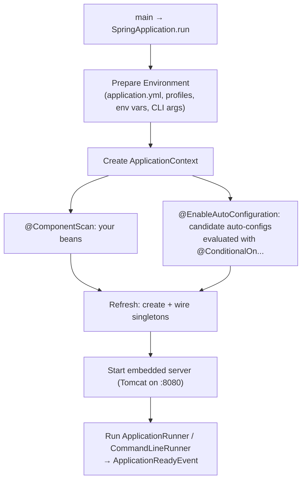
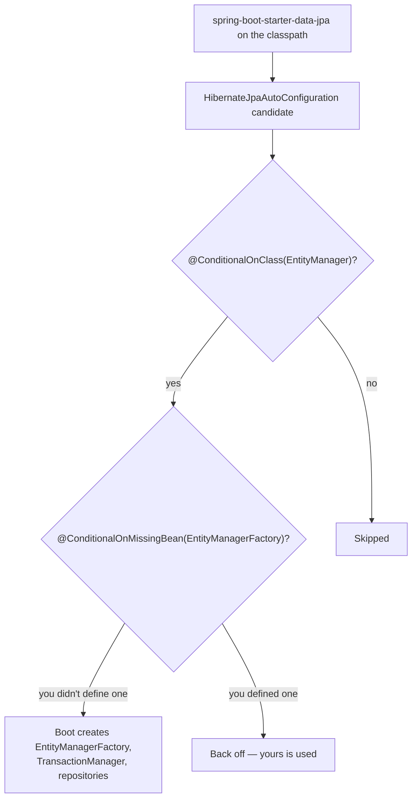
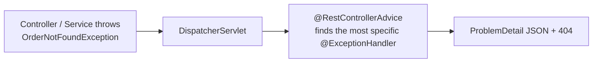
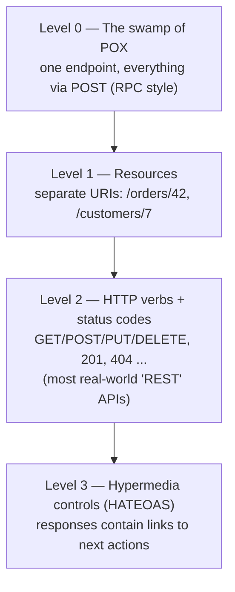
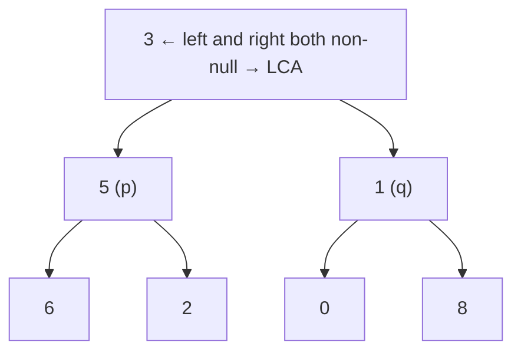
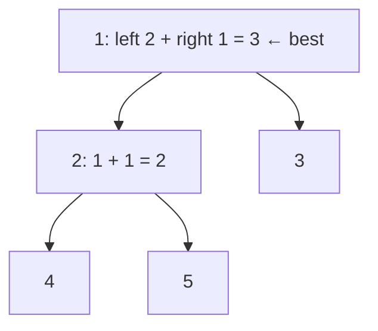
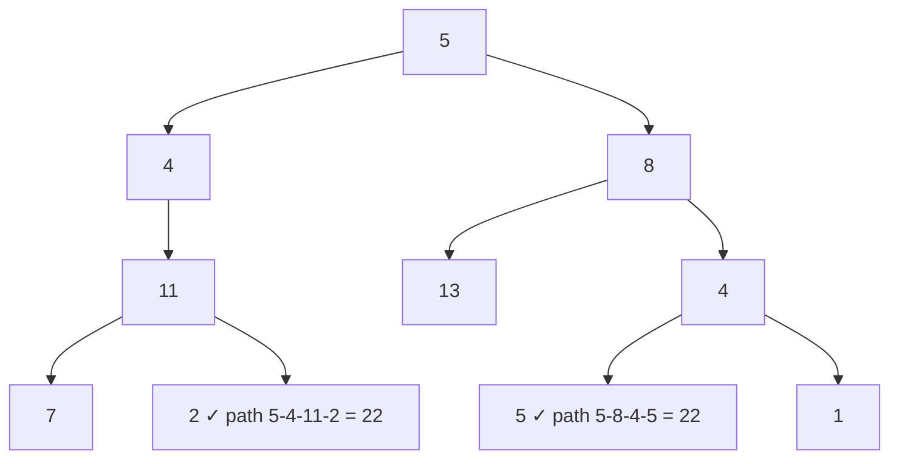
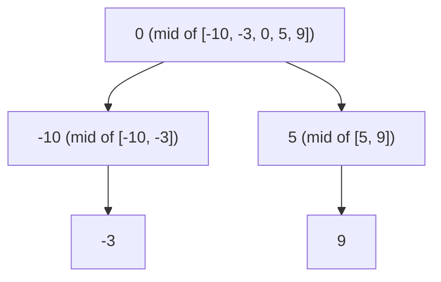
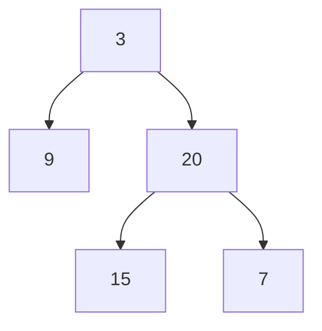

# Day 20 — Spring Boot Auto-Configuration & REST API Design

> **How to use these notes:** each section maps to one checklist item. Run the code, study the diagrams, then test yourself with the collapsible questions. 🚀 marks senior-level details.

**Today's goal:** explain what `@SpringBootApplication` and **auto-configuration** really do (and how to debug them), then build a production-quality **REST API**: correct HTTP methods and status codes, request binding, `ResponseEntity`, **Bean Validation**, **global exception handling** with a consistent error format, and an opinion on **API versioning** and REST maturity. On the DSA side: medium **tree** problems — LCA, diameter, path sums, building trees from arrays.

Running example: a simple Order API.

```java
public record OrderRequest(@NotBlank String customerId,
                           @NotEmpty List<@Valid OrderLine> lines) { }
public record OrderLine(@NotBlank String sku, @Min(1) @Max(100) int quantity) { }
public record OrderResponse(long id, String customerId, String status, BigDecimal total) { }
```

<!-- topic: d20_t1 -->
## 🌿 Spring Boot — Auto-Configuration & REST

<!-- subtopic: d20_t1_s1 -->
### 1. @SpringBootApplication — what it really is

> **TL;DR:** `@SpringBootApplication` = **`@SpringBootConfiguration`** (a `@Configuration`) + **`@EnableAutoConfiguration`** (load conditional auto-config classes) + **`@ComponentScan`** (scan this package and sub-packages for beans).

```java
@SpringBootApplication
public class OrderServiceApplication {
    public static void main(String[] args) {
        SpringApplication.run(OrderServiceApplication.class, args);
    }
}
```

| Part | Does |
|---|---|
| `@SpringBootConfiguration` / `@Configuration` | This class can declare `@Bean` methods |
| `@ComponentScan` | Finds `@Component`/`@Service`/`@Repository`/`@Controller` in **this package and below** |
| `@EnableAutoConfiguration` | Imports auto-configuration classes that create beans based on the classpath, properties and existing beans |



⚠️ Put the main class in the **root package** (`com.company.orders`). Beans in a sibling package (`com.company.shared`) won't be scanned unless you add `scanBasePackages`.

<!-- subtopic: d20_t1_s2 -->
### 2. How Auto-Configuration Works

> **TL;DR:** Boot ships hundreds of `@AutoConfiguration` classes listed in **`META-INF/spring/org.springframework.boot.autoconfigure.AutoConfiguration.imports`** (Boot 2.7+/3; Boot 2 used `spring.factories`). Each is guarded by **`@ConditionalOn…`** annotations, so it only applies when, e.g., a class is on the classpath and **you haven't defined the bean yourself**.

```java
// Simplified shape of a real auto-configuration (DataSourceAutoConfiguration)
@AutoConfiguration
@ConditionalOnClass({ DataSource.class, EmbeddedDatabaseType.class })   // JDBC on the classpath?
@EnableConfigurationProperties(DataSourceProperties.class)               // binds spring.datasource.*
public class DataSourceAutoConfiguration {

    @Bean
    @ConditionalOnMissingBean(DataSource.class)                          // back off if YOU defined one
    public DataSource dataSource(DataSourceProperties props) {
        return props.initializeDataSourceBuilder().build();              // HikariCP by default
    }
}
```

| Condition | Applies when |
|---|---|
| `@ConditionalOnClass` / `@ConditionalOnMissingClass` | A class is (not) on the classpath — i.e., a starter dependency is present |
| `@ConditionalOnBean` / **`@ConditionalOnMissingBean`** | A bean of that type does (not) exist — lets your beans **override** the defaults |
| `@ConditionalOnProperty` | A property has a value (`spring.cache.type=redis`) |
| `@ConditionalOnWebApplication` | It's a servlet/reactive web app |
| `@ConditionalOnResource` | A resource file exists |



**Starters** (`spring-boot-starter-web`, `-data-jpa`, `-security`, `-actuator`...) are just dependency bundles that put the right classes on the classpath and trigger these conditions.

Debugging and controlling it:
- `debug=true` (or `--debug`) prints the **Conditions Evaluation Report** — which auto-configs matched and why others didn't.
- Actuator `/actuator/conditions` and `/actuator/beans`.
- Exclude one: `@SpringBootApplication(exclude = DataSourceAutoConfiguration.class)` or `spring.autoconfigure.exclude=...`.
- Override by defining your own bean of the same type (thanks to `@ConditionalOnMissingBean`), or tune via properties.

🚀 Writing a **custom starter**: an `@AutoConfiguration` class with conditions + `@ConfigurationProperties`, registered in the `AutoConfiguration.imports` file, packaged as `acme-spring-boot-starter`. Common for shared company concerns (logging, auth clients, tracing).

<!-- subtopic: d20_t1_s3 -->
### 3. @RestController and HTTP Method Mappings

> **TL;DR:** `@RestController` = `@Controller` + `@ResponseBody`: return values are serialized (to JSON via Jackson) directly into the response body. Map handlers with `@GetMapping`, `@PostMapping`, `@PutMapping`, `@PatchMapping`, `@DeleteMapping` and use each HTTP method for its intended meaning.

```java
@RestController
@RequestMapping("/api/v1/orders")
public class OrderController {
    private final OrderService service;
    public OrderController(OrderService service) { this.service = service; }

    @GetMapping                       public List<OrderResponse> list() { ... }               // read collection
    @GetMapping("/{id}")              public OrderResponse get(@PathVariable long id) { ... }  // read one
    @PostMapping                      public ResponseEntity<OrderResponse> create(@Valid @RequestBody OrderRequest req) { ... }
    @PutMapping("/{id}")              public OrderResponse replace(@PathVariable long id, @Valid @RequestBody OrderRequest req) { ... }
    @PatchMapping("/{id}/status")     public OrderResponse updateStatus(@PathVariable long id, @RequestBody StatusChange change) { ... }
    @DeleteMapping("/{id}")
    @ResponseStatus(HttpStatus.NO_CONTENT)
    public void cancel(@PathVariable long id) { ... }
}
```

| Method | Meaning | Safe (no side effects) | Idempotent (repeat = same result) | Typical success status |
|---|---|---|---|---|
| GET | Read | ✅ | ✅ | 200 |
| POST | Create / non-idempotent action | ❌ | ❌ | **201 Created** (+ `Location`) |
| PUT | Replace the whole resource | ❌ | ✅ | 200 / 204 |
| PATCH | Partial update | ❌ | Not guaranteed | 200 / 204 |
| DELETE | Remove | ❌ | ✅ | **204 No Content** |

#### Status codes you must know

| Code | When |
|---|---|
| 200 OK | Successful read/update with a body |
| 201 Created | Resource created — include a `Location` header |
| 204 No Content | Success, no body (DELETE) |
| 400 Bad Request | Malformed request / validation failure |
| 401 Unauthorized | Not authenticated (missing/invalid token) |
| 403 Forbidden | Authenticated but not allowed |
| 404 Not Found | Resource doesn't exist |
| 409 Conflict | State conflict (duplicate, version clash) |
| 422 Unprocessable Entity | Valid syntax, business rule violated |
| 429 Too Many Requests | Rate limited |
| 500 / 502 / 503 / 504 | Server error / bad gateway / unavailable / gateway timeout |

URL design: **nouns, plural**, hierarchy for ownership (`/customers/{id}/orders`), query params for filtering/sorting/paging (`?status=PAID&sort=createdAt,desc&page=0&size=20`), no verbs in paths (`/orders/{id}/cancel` is an acceptable exception for actions).

<!-- subtopic: d20_t1_s4 -->
### 4. Request Binding — @PathVariable, @RequestParam, @RequestBody, @RequestHeader

> **TL;DR:** **`@PathVariable`** = part of the URL path (identity). **`@RequestParam`** = query string (filters, paging, optional). **`@RequestBody`** = JSON body → object (Jackson). **`@RequestHeader`** = HTTP headers.

```java
@GetMapping("/customers/{customerId}/orders")
public Page<OrderResponse> search(
        @PathVariable String customerId,                                   // /customers/C42/orders
        @RequestParam(required = false) String status,                     // ?status=PAID (optional)
        @RequestParam(defaultValue = "0") int page,                        // ?page=0
        @RequestParam(defaultValue = "20") @Max(100) int size,
        @RequestHeader(value = "X-Correlation-Id", required = false) String correlationId) {
    ...
}

@PostMapping("/orders")
public ResponseEntity<OrderResponse> create(@Valid @RequestBody OrderRequest request) { ... }

// Spring Data paging shortcut: ?page=0&size=20&sort=createdAt,desc
@GetMapping("/orders")
public Page<OrderResponse> list(Pageable pageable) { ... }
```

| Annotation | Source | Required by default | Example |
|---|---|---|---|
| `@PathVariable` | URI template `{id}` | ✅ | `/orders/42` |
| `@RequestParam` | Query string / form | ✅ (use `required = false` or `defaultValue`) | `?status=PAID` |
| `@RequestBody` | Body (JSON) | ✅ | `{"customerId": "C42", ...}` |
| `@RequestHeader` | Headers | ✅ | `X-Correlation-Id: abc` |
| `@ModelAttribute` | Query/form params bound into an object | — | Search filter objects |

Errors: missing required param → **400** (`MissingServletRequestParameterException`); wrong type (`/orders/abc` for a `long`) → **400** (`MethodArgumentTypeMismatchException`); malformed JSON → **400** (`HttpMessageNotReadableException`).

Use **DTOs/records** for request and response bodies — never expose JPA entities directly (lazy loading surprises, over-posting, leaking internal fields, tight coupling to the schema).

<!-- subtopic: d20_t1_s5 -->
### 5. ResponseEntity&lt;T&gt; — full control of the response

> **TL;DR:** Returning an object gives **200** with a JSON body. Return **`ResponseEntity<T>`** when you need to choose the **status code** and **headers**: `ok()`, `created(uri)`, `noContent()`, `notFound()`, `status(...)`.

```java
@PostMapping
public ResponseEntity<OrderResponse> create(@Valid @RequestBody OrderRequest req) {
    OrderResponse created = service.create(req);
    URI location = ServletUriComponentsBuilder.fromCurrentRequest()
            .path("/{id}").buildAndExpand(created.id()).toUri();   // /api/v1/orders/123
    return ResponseEntity.created(location).body(created);          // 201 + Location header
}

@GetMapping("/{id}")
public ResponseEntity<OrderResponse> get(@PathVariable long id) {
    return service.find(id)
            .map(ResponseEntity::ok)                                // 200
            .orElse(ResponseEntity.notFound().build());             // 404
}

@DeleteMapping("/{id}")
public ResponseEntity<Void> delete(@PathVariable long id) {
    service.delete(id);
    return ResponseEntity.noContent().build();                      // 204
}

@GetMapping("/{id}/invoice")
public ResponseEntity<byte[]> invoice(@PathVariable long id) {
    return ResponseEntity.ok()
            .header(HttpHeaders.CONTENT_DISPOSITION, "attachment; filename=invoice-" + id + ".pdf")
            .contentType(MediaType.APPLICATION_PDF)
            .eTag("\"v3\"")
            .body(service.invoicePdf(id));
}
```

Alternatives: `@ResponseStatus(HttpStatus.CREATED)` on the method for a fixed status; throwing exceptions handled globally (section 7) for error statuses — usually cleaner than building error `ResponseEntity`s in every controller.

<!-- subtopic: d20_t1_s6 -->
### 6. Bean Validation — @Valid with @NotNull, @NotBlank, @Size, @Email...

> **TL;DR:** Add `spring-boot-starter-validation`, put **Jakarta Bean Validation** annotations on your DTO fields, and mark the parameter with **`@Valid`**. Invalid `@RequestBody` → **`MethodArgumentNotValidException`** → 400. For `@PathVariable`/`@RequestParam` constraints, Spring 6.1+ validates them on controllers (→ `HandlerMethodValidationException`); older setups use `@Validated` on the class (→ `ConstraintViolationException`).

```java
public record CreateUserRequest(
        @NotBlank @Size(max = 50) String name,
        @NotBlank @Email String email,
        @NotNull @Min(18) @Max(120) Integer age,
        @Pattern(regexp = "^[6-9]\\d{9}$", message = "must be a valid 10-digit Indian mobile number") String phone,
        @NotEmpty List<@NotBlank String> roles,                 // container element validation
        @Valid @NotNull AddressDto address                      // cascade into nested objects
) { }

@PostMapping("/users")
public ResponseEntity<UserResponse> create(@Valid @RequestBody CreateUserRequest req) { ... }
```

| Annotation | Checks |
|---|---|
| `@NotNull` | Not `null` (empty string OK) |
| `@NotEmpty` | Not null **and** not empty (strings, collections, maps, arrays) |
| `@NotBlank` | Not null and contains at least one non-whitespace character (strings only) |
| `@Size(min, max)` | Length / collection size |
| `@Min`, `@Max`, `@Positive`, `@PositiveOrZero`, `@DecimalMin` | Numeric ranges |
| `@Email`, `@Pattern(regexp)` | Format |
| `@Past`, `@Future`, `@PastOrPresent` | Dates |
| `@Valid` | Cascade validation into a nested object / collection elements |

| Value | `@NotNull` | `@NotEmpty` | `@NotBlank` |
|---|---|---|---|
| `null` | ❌ | ❌ | ❌ |
| `""` | ✅ | ❌ | ❌ |
| `"   "` | ✅ | ✅ | ❌ |
| `"Asha"` | ✅ | ✅ | ✅ |

Beyond the basics: **custom constraints** (`@ValidPan` with a `ConstraintValidator`), **validation groups** (`OnCreate`, `OnUpdate`), cross-field validation with a class-level constraint. Validate **business rules** (stock available, user exists) in the service layer, not with annotations.

<!-- subtopic: d20_t1_s7 -->
### 7. Global Exception Handling — @RestControllerAdvice + @ExceptionHandler

> **TL;DR:** Centralize error handling in a **`@RestControllerAdvice`** class with **`@ExceptionHandler`** methods that map exceptions to **status codes** and a **consistent error body**. Spring 6 supports the standard **`ProblemDetail`** format (RFC 9457, formerly 7807).

```java
public class OrderNotFoundException extends RuntimeException {
    public OrderNotFoundException(long id) { super("Order " + id + " not found"); }
}

@RestControllerAdvice
public class GlobalExceptionHandler {
    private static final Logger log = LoggerFactory.getLogger(GlobalExceptionHandler.class);

    @ExceptionHandler(OrderNotFoundException.class)
    public ProblemDetail handleNotFound(OrderNotFoundException ex) {
        ProblemDetail pd = ProblemDetail.forStatusAndDetail(HttpStatus.NOT_FOUND, ex.getMessage());
        pd.setTitle("Order not found");
        return pd;                                                  // 404, application/problem+json
    }

    @ExceptionHandler(MethodArgumentNotValidException.class)
    public ProblemDetail handleValidation(MethodArgumentNotValidException ex) {
        ProblemDetail pd = ProblemDetail.forStatus(HttpStatus.BAD_REQUEST);
        pd.setTitle("Validation failed");
        Map<String, String> errors = new LinkedHashMap<>();
        ex.getBindingResult().getFieldErrors()
          .forEach(fe -> errors.put(fe.getField(), fe.getDefaultMessage()));
        pd.setProperty("errors", errors);                          // {"email": "must be a well-formed email address"}
        return pd;
    }

    @ExceptionHandler(Exception.class)                              // safety net
    public ProblemDetail handleUnexpected(Exception ex) {
        log.error("Unhandled error", ex);                           // log the stack trace ONCE, here
        return ProblemDetail.forStatusAndDetail(HttpStatus.INTERNAL_SERVER_ERROR,
                "Something went wrong");                            // never leak internals to clients
    }
}
```

Example response:

```json
{
  "type": "about:blank",
  "title": "Validation failed",
  "status": 400,
  "instance": "/api/v1/users",
  "errors": { "email": "must be a well-formed email address", "age": "must be greater than or equal to 18" }
}
```



Best practices: consistent body for **all** errors; include a correlation/trace id; don't expose stack traces or SQL messages; map domain exceptions to 4xx and unexpected ones to 500; use `ResponseStatusException` for quick one-offs; enable `spring.mvc.problemdetails.enabled=true` to get ProblemDetail for Spring's built-in exceptions.

<!-- subtopic: d20_t1_s8 -->
### 8. API Versioning, HATEOAS and the Richardson Maturity Model

> **TL;DR:** Version when you make **breaking changes**. The common strategies are **URI path** (`/api/v1/...` — simplest, most popular), **header** (`X-API-Version: 2`), and **media type** (`Accept: application/vnd.company.v2+json`). **HATEOAS** adds links to responses so clients can discover actions. The **Richardson Maturity Model** grades how RESTful an API is (levels 0–3).

#### Versioning strategies

| Strategy | Example | Pros | Cons |
|---|---|---|---|
| **URI path** | `/api/v2/orders` | Visible, easy to route/cache/test in a browser | URI changes per version |
| Query param | `/orders?version=2` | Easy | Easy to forget, messy caching |
| Custom header | `X-API-Version: 2` | Clean URIs | Invisible in browsers/logs, harder to cache |
| Media type | `Accept: application/vnd.acme.order.v2+json` | Most "RESTful", per-resource versions | Complex for clients and tooling |

```java
@RestController @RequestMapping("/api/v1/orders") class OrderControllerV1 { ... }
@RestController @RequestMapping("/api/v2/orders") class OrderControllerV2 { ... }

@GetMapping(value = "/orders/{id}", headers = "X-API-Version=2")
public OrderResponseV2 getV2(@PathVariable long id) { ... }
```

Avoid unnecessary versions: **additive changes** (new optional fields, new endpoints) are backward compatible — clients should ignore unknown fields. Break only when you must, support old versions for a deprecation period (`Deprecation`/`Sunset` headers), and communicate. (Spring Framework 7 / Spring Boot 4 add built-in API versioning support on request mappings.)

#### HATEOAS (Hypermedia as the Engine of Application State)

```json
{
  "id": 42,
  "status": "PAID",
  "_links": {
    "self":   { "href": "/api/v1/orders/42" },
    "cancel": { "href": "/api/v1/orders/42/cancel" },
    "items":  { "href": "/api/v1/orders/42/items" }
  }
}
```

The server tells the client what it can do next (e.g., `cancel` disappears once shipped). Spring support: `spring-boot-starter-hateoas` (`EntityModel`, `linkTo(methodOn(...))`). Common in public APIs and payment providers; many internal microservice APIs skip it.

#### Richardson Maturity Model



<!-- topic: d14_t2 -->
## 🧮 DSA — Trees: Medium Problems

<!-- subtopic: d14_t2_s1 -->
### 9. Lowest Common Ancestor of a Binary Tree (LeetCode 236)

> **Problem:** find the LCA of nodes `p` and `q` in a general binary tree (no BST ordering). Both exist in the tree. 🔗 [LeetCode 236](https://leetcode.com/problems/lowest-common-ancestor-of-a-binary-tree/)

Postorder recursion: each call returns `p` or `q` if found in that subtree (or `null`). The first node where **both** sides return non-null is the LCA. If a node **is** `p` or `q`, return it immediately (it's the LCA if the other is below it).

```java
public TreeNode lowestCommonAncestor(TreeNode root, TreeNode p, TreeNode q) {
    if (root == null || root == p || root == q) return root;
    TreeNode left = lowestCommonAncestor(root.left, p, q);
    TreeNode right = lowestCommonAncestor(root.right, p, q);
    if (left != null && right != null) return root;      // p and q on different sides → split here
    return left != null ? left : right;                  // pass up whichever side found something
}   // O(n) time, O(h) space
```



*`p = 5, q = 1` → LCA **3**. `p = 5, q = 4` (4 below 2 below 5) → the call at 5 returns 5 immediately → LCA **5**.*

Compare with LC 235 (BST, Day 19): there you can use values to choose a side in O(h); here you must search both sides. If nodes might be **missing** (LC 1644), you need to confirm both were actually found.

<!-- subtopic: d14_t2_s2 -->
### 10. Diameter of Binary Tree (LeetCode 543)

> **Problem:** the diameter is the number of **edges** on the longest path between **any** two nodes (it may not pass through the root). 🔗 [LeetCode 543](https://leetcode.com/problems/diameter-of-binary-tree/)

At each node, the longest path **through** it = `height(left) + height(right)` (in edges, using node-count heights). Compute heights bottom-up and track the best path in a field — the classic **"return one thing, record another"** pattern.

```java
private int best = 0;

public int diameterOfBinaryTree(TreeNode root) {
    height(root);
    return best;
}

// returns the height in NODES of this subtree, updates the global best path
private int height(TreeNode node) {
    if (node == null) return 0;
    int left = height(node.left);
    int right = height(node.right);
    best = Math.max(best, left + right);           // path through this node, in edges
    return 1 + Math.max(left, right);              // what the parent needs
}   // O(n) time, O(h) space
```



*Longest path `4 → 2 → 1 → 3` (or `5 → 2 → 1 → 3`) = **3 edges**.*

Same pattern: Binary Tree Maximum Path Sum (LC 124, Hard — return the best single downward path, record left + right + node), Longest Univalue Path (LC 687), Balanced Binary Tree (LC 110 — return height or −1 for "unbalanced").

<!-- subtopic: d14_t2_s3 -->
### 11. Path Sum II (LeetCode 113) — all root-to-leaf paths with a target sum

> **Problem:** return every root-to-leaf path whose values sum to `targetSum`. 🔗 [LeetCode 113](https://leetcode.com/problems/path-sum-ii/)

DFS while maintaining the **current path**; at a leaf with the right remaining sum, **copy** the path into the result. **Backtrack** (remove the last node) when returning.

```java
public List<List<Integer>> pathSum(TreeNode root, int targetSum) {
    List<List<Integer>> result = new ArrayList<>();
    dfs(root, targetSum, new ArrayList<>(), result);
    return result;
}

private void dfs(TreeNode node, int remaining, List<Integer> path, List<List<Integer>> result) {
    if (node == null) return;
    path.add(node.val);                                         // choose
    remaining -= node.val;
    if (node.left == null && node.right == null && remaining == 0) {
        result.add(new ArrayList<>(path));                      // COPY — path keeps changing
    } else {
        dfs(node.left, remaining, path, result);                // explore
        dfs(node.right, remaining, path, result);
    }
    path.remove(path.size() - 1);                               // un-choose (backtrack)
}   // O(n · h) time in the worst case (copying paths), O(h) extra space
```



⚠️ Two classic bugs: adding `path` itself instead of a **copy** (every result ends up empty), and forgetting to **remove** the last node after recursion. This choose → explore → un-choose structure is exactly **backtracking** (Day 24). Variants: Path Sum I (LC 112, boolean), Path Sum III (LC 437, any downward path — prefix sums + HashMap from Day 11!).

<!-- subtopic: d14_t2_s4 -->
### 12. Convert Sorted Array to Balanced BST (LeetCode 108)

> **Problem:** build a **height-balanced** BST from a sorted array. 🔗 [LeetCode 108](https://leetcode.com/problems/convert-sorted-array-to-binary-search-tree/)

Pick the **middle** element as the root (equal sizes on both sides → balanced), then build the left subtree from the left half and the right subtree from the right half.

```java
public TreeNode sortedArrayToBST(int[] nums) {
    return build(nums, 0, nums.length - 1);
}

private TreeNode build(int[] nums, int lo, int hi) {
    if (lo > hi) return null;
    int mid = lo + (hi - lo) / 2;
    TreeNode root = new TreeNode(nums[mid]);
    root.left = build(nums, lo, mid - 1);
    root.right = build(nums, mid + 1, hi);
    return root;
}   // O(n) time, O(log n) recursion depth
```



This is how you'd rebuild a balanced tree, and the reason sorted data inserted one-by-one into a plain BST is terrible (it degenerates into a linked list — why real libraries use **self-balancing** trees like the red-black trees inside `TreeMap`). Variant: from a sorted **linked list** (LC 109) — use slow/fast pointers to find the middle, or simulate inorder.

<!-- subtopic: d14_t2_s5 -->
### 13. Construct Binary Tree from Preorder and Inorder Traversal (LeetCode 105)

> **Problem:** given preorder and inorder traversals (unique values), rebuild the tree. 🔗 [LeetCode 105](https://leetcode.com/problems/construct-binary-tree-from-preorder-and-inorder-traversal/)

- **Preorder** = `root, [left subtree], [right subtree]` → the **first** element is the root.
- **Inorder** = `[left subtree], root, [right subtree]` → the root's position tells us **how many** nodes are on the left.

Use a **HashMap value → inorder index** for O(1) lookups and consume preorder with a moving index.

```java
private int preIdx = 0;
private Map<Integer, Integer> inorderIndex;

public TreeNode buildTree(int[] preorder, int[] inorder) {
    inorderIndex = new HashMap<>();
    for (int i = 0; i < inorder.length; i++) inorderIndex.put(inorder[i], i);
    return build(preorder, 0, inorder.length - 1);
}

private TreeNode build(int[] preorder, int inLo, int inHi) {
    if (inLo > inHi) return null;
    int rootVal = preorder[preIdx++];                 // next preorder value is this subtree's root
    TreeNode root = new TreeNode(rootVal);
    int mid = inorderIndex.get(rootVal);              // split point in inorder
    root.left = build(preorder, inLo, mid - 1);       // build LEFT first — preorder lists left before right
    root.right = build(preorder, mid + 1, inHi);
    return root;
}   // O(n) time, O(n) space (map + recursion)
```

**Dry run** `preorder = [3, 9, 20, 15, 7]`, `inorder = [9, 3, 15, 20, 7]`:

| step | root (from preorder) | inorder split | left part | right part |
|---|---|---|---|---|
| 1 | 3 | index 1 | [9] | [15, 20, 7] |
| 2 | 9 | — | leaf | — |
| 3 | 20 | index 3 | [15] | [7] |
| 4, 5 | 15, 7 | — | leaves | |



Why the inorder array is required: preorder alone doesn't tell you where the left subtree ends. (Variant: postorder + inorder, LC 106 — the root is the **last** element and you build the **right** subtree first.)

---

## 📝 Day 20 Revision Cheat Sheet

| Topic | Remember this |
|---|---|
| @SpringBootApplication | @Configuration + @EnableAutoConfiguration + @ComponentScan (root package!) |
| Auto-config | AutoConfiguration.imports (Boot 3) + @ConditionalOnClass / OnMissingBean / OnProperty; `--debug` report |
| Override defaults | Define your own bean or set properties; exclude auto-configs |
| HTTP | GET safe+idempotent, PUT/DELETE idempotent, POST neither; 201 + Location, 204 for delete |
| Binding | @PathVariable (identity), @RequestParam (filters), @RequestBody (JSON), @RequestHeader |
| ResponseEntity | ok / created(uri) / noContent / notFound / status + headers |
| Validation | starter-validation + @Valid; NotNull vs NotEmpty vs NotBlank; MethodArgumentNotValidException → 400 |
| Errors | @RestControllerAdvice + @ExceptionHandler → ProblemDetail; log once; no internals |
| Versioning | URI path most common; additive changes don't need a new version |
| RMM | 0 POX → 1 resources → 2 verbs/status → 3 hypermedia |
| LCA (binary tree) | Return p/q/null upward; both sides non-null → current node |
| Diameter | Return height, record left + right |
| Path Sum II | Choose, explore, un-choose; copy the path |
| Sorted array → BST | Middle as root, recurse on halves |
| Pre + In → tree | Preorder gives roots; inorder index map splits left/right |

### ⚡ Rapid-fire self-test

1. Which annotation enables auto-configuration? → **@EnableAutoConfiguration**
2. Condition that lets your own bean replace Boot's? → **@ConditionalOnMissingBean**
3. Status for a successful POST that created a resource? → **201 Created**
4. Is PUT idempotent? → **Yes**
5. Exception for an invalid @Valid @RequestBody? → **MethodArgumentNotValidException**
6. `@NotEmpty` on `"   "` passes? → **Yes (use @NotBlank)**
7. Annotation for a global exception handler in REST APIs? → **@RestControllerAdvice**
8. Richardson level with HATEOAS? → **Level 3**
9. Diameter counts nodes or edges? → **Edges**
10. In Pre + In construction, why build the left subtree first? → **Preorder lists the left subtree before the right**
