# Day 21 — Spring Data JPA: Entities, Relationships & the N+1 Problem

> **How to use these notes:** each section maps to one checklist item. Run the code, study the diagrams, then test yourself with the collapsible questions. 🚀 marks senior-level details.

**Today's goal:** map Java classes to tables with **JPA/Hibernate**, model relationships correctly (owning side vs `mappedBy`), understand **lazy loading** and the infamous **N+1 query problem** (and every way to fix it), write JPQL and native queries, paginate properly (offset vs keyset), know the repository hierarchy, and fetch only the data you need with **projections**. On the DSA side: **heaps / priority queues** — how they work inside, and four classic problems.

Running example: a small shop with customers, orders and order lines.

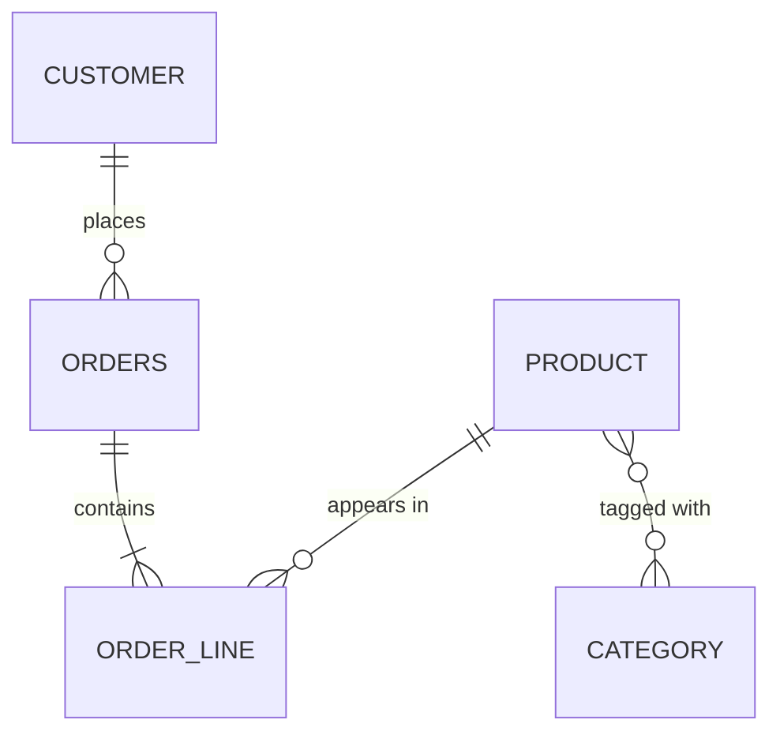

What JPA, Hibernate and Spring Data each are:

| Layer | What it is |
|---|---|
| **JPA** (Jakarta Persistence) | A **specification**: annotations (`@Entity`…), `EntityManager`, JPQL |
| **Hibernate** | The default **implementation** of JPA in Spring Boot (ORM: object ↔ relational mapping) |
| **Spring Data JPA** | A layer on top: you write **repository interfaces**, Spring generates the implementation |

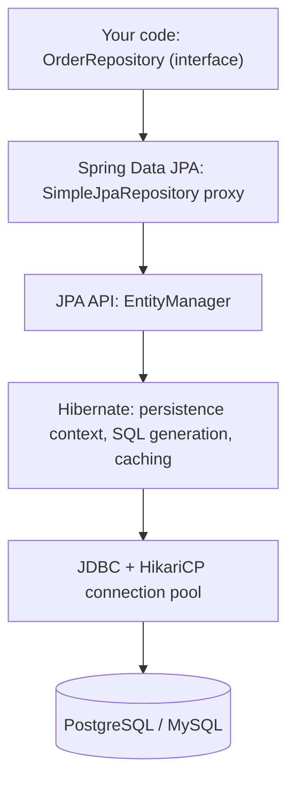

<!-- topic: d21_t1 -->
## 🌿 Spring Data JPA — Entities & Queries

<!-- subtopic: d21_t1_s1 -->
### 1. @Entity, @Table, @Id, @GeneratedValue — entity mapping

> **TL;DR:** `@Entity` marks a class as a persistent type mapped to a table. Every entity needs an `@Id`. `@GeneratedValue` lets the database or Hibernate assign the key: **IDENTITY** (auto-increment column), **SEQUENCE** (DB sequence, best performance), **AUTO** (provider chooses — avoid surprises, be explicit).

#### A complete entity

```java
@Entity
@Table(name = "customers",
       uniqueConstraints = @UniqueConstraint(name = "uk_customer_email", columnNames = "email"),
       indexes = @Index(name = "idx_customer_last_name", columnList = "last_name"))
public class Customer {

    @Id
    @GeneratedValue(strategy = GenerationType.SEQUENCE, generator = "customer_seq")
    @SequenceGenerator(name = "customer_seq", sequenceName = "customer_seq", allocationSize = 50)
    private Long id;

    @Column(name = "email", nullable = false, length = 255)
    private String email;

    @Column(name = "last_name", nullable = false)
    private String lastName;

    @Enumerated(EnumType.STRING)          // store "ACTIVE", not 0 — ORDINAL breaks when you reorder the enum
    @Column(nullable = false, length = 20)
    private CustomerStatus status = CustomerStatus.ACTIVE;

    @Column(name = "created_at", nullable = false, updatable = false)
    private Instant createdAt = Instant.now();

    @Transient                             // not persisted
    private String displayName;

    protected Customer() { }               // JPA needs a no-arg constructor (protected is fine)

    public Customer(String email, String lastName) {
        this.email = email;
        this.lastName = lastName;
    }
    // getters, business methods...
}
```

| Annotation | Purpose |
|---|---|
| `@Entity` | This class is persistent. Name defaults to the class name (used in JPQL) |
| `@Table(name = ...)` | Table name, schema, unique constraints, indexes (used by schema generation) |
| `@Id` | Primary key field |
| `@GeneratedValue` | How the key is generated |
| `@Column` | Column name, nullability, length, precision/scale, `updatable`/`insertable` |
| `@Enumerated(STRING)` | Store enums by name |
| `@Transient` | Exclude a field |
| `@Lob` | Large text/binary |
| `@Embedded` / `@Embeddable` | Value object (e.g., `Address`) flattened into the owner's table |
| `@Version` | Optimistic locking (Day 22) |

#### Entity rules

- Needs a **no-arg constructor** (public or protected) — Hibernate instantiates via reflection.
- The class and its persistent methods must **not be final** — Hibernate creates **proxy subclasses** for lazy loading.
- **Records can't be entities** (final, immutable, no no-arg constructor). Records are perfect for **DTOs/projections** though.
- Field access vs property access is decided by where you put `@Id` (on the field → field access; the usual choice).

#### ID generation strategies

| Strategy | How it works | Pros | Cons |
|---|---|---|---|
| `IDENTITY` | DB auto-increment column (`BIGSERIAL`, `AUTO_INCREMENT`) | Simple, natural on MySQL | Hibernate must run the INSERT **immediately** to learn the id → **JDBC insert batching is disabled** |
| `SEQUENCE` | DB sequence; with `allocationSize = 50` Hibernate reserves 50 ids per round trip (pooled optimizer) | Fastest; insert batching works | Needs sequence support (PostgreSQL, Oracle, SQL Server 2012+; MySQL has none) |
| `TABLE` | A table simulating a sequence | Portable | Slow, row-lock contention — avoid |
| `AUTO` (default) | Provider picks. Hibernate 6 picks a **sequence** (and emulates it with a table on MySQL) | Zero config | Surprising behaviour; be explicit |
| `UUID` (JPA 3.1) | `@GeneratedValue(strategy = GenerationType.UUID)` on a `UUID` field | Generate without DB; safe to expose | 16 bytes; random UUIDv4 fragments B-tree indexes (prefer time-ordered UUIDv7 if your stack supports it) |

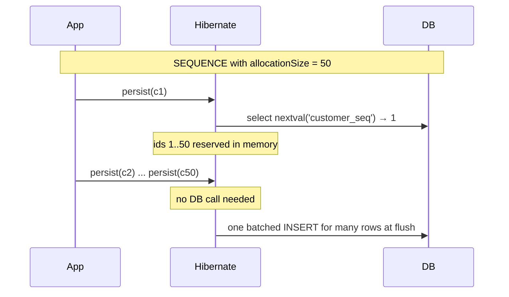

⚠️ The sequence's `INCREMENT BY` in the database must **match** `allocationSize`, otherwise you get duplicate keys or gaps. With Flyway, create sequences as `CREATE SEQUENCE customer_seq INCREMENT BY 50;`.

#### equals() and hashCode() on entities

Entities change identity during their life (the id is `null` until persisted), so the usual "generate from all fields" breaks `HashSet` membership.

```java
@Override
public boolean equals(Object o) {
    if (this == o) return true;
    if (!(o instanceof Customer other)) return false;   // instanceof, not getClass(): Hibernate proxies are subclasses
    return id != null && id.equals(other.getId());      // transient entities are only equal to themselves
}

@Override
public int hashCode() {
    return getClass().hashCode();                       // constant per class → stable before and after persist
}
```

Alternatives: use a **natural/business key** (e.g., an immutable `email` or an application-assigned UUID) for equality.

⚠️ **Lombok `@Data` on entities is a trap:** generated `equals`/`hashCode`/`toString` touch every field, including lazy collections → extra queries, `LazyInitializationException`, or infinite recursion across bidirectional links. Use `@Getter`/`@Setter` and write equality yourself.

🚀 **Schema generation:** `spring.jpa.hibernate.ddl-auto` = `create-drop` (default for embedded DBs), `update`, `validate`, `none`. In production use **`validate` or `none`** and manage the schema with **Flyway/Liquibase** (Day 22). `update` never drops columns, can't rename, and makes the schema depend on whichever version booted first.

<!-- subtopic: d21_t1_s2 -->
### 2. Relationships: @OneToOne, @OneToMany, @ManyToOne, @ManyToMany — owning side vs mappedBy

> **TL;DR:** In the database a relationship is **one foreign key column** (or a join table). In Java a bidirectional relationship has **two** references. JPA needs to know which side controls the FK: the **owning side** (the one with `@JoinColumn`, for one-to-many always the `@ManyToOne`). The other side declares **`mappedBy`** and is ignored when writing SQL.

#### Many-to-one / one-to-many (the most common pair)

```java
@Entity
@Table(name = "orders")
public class Order {
    @Id @GeneratedValue(strategy = GenerationType.SEQUENCE)
    private Long id;

    @ManyToOne(fetch = FetchType.LAZY, optional = false)   // OWNING side: holds the FK column
    @JoinColumn(name = "customer_id", nullable = false)
    private Customer customer;

    @OneToMany(mappedBy = "order",                         // INVERSE side: "see Order.lines' owner field 'order'"
               cascade = CascadeType.ALL,
               orphanRemoval = true)
    private List<OrderLine> lines = new ArrayList<>();

    // Helper methods keep BOTH sides in sync in memory
    public void addLine(OrderLine line) {
        lines.add(line);
        line.setOrder(this);
    }

    public void removeLine(OrderLine line) {
        lines.remove(line);
        line.setOrder(null);
    }
}

@Entity
public class OrderLine {
    @Id @GeneratedValue(strategy = GenerationType.SEQUENCE)
    private Long id;

    @ManyToOne(fetch = FetchType.LAZY, optional = false)
    @JoinColumn(name = "order_id")
    private Order order;

    @ManyToOne(fetch = FetchType.LAZY)
    @JoinColumn(name = "product_id")
    private Product product;

    private int quantity;
}
```

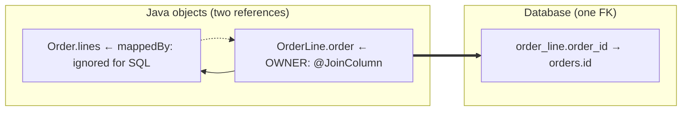

⚠️ **The classic bug:** you only call `order.getLines().add(line)` without setting `line.setOrder(order)`. The owning side is still `null`, so Hibernate writes `order_id = NULL` (or fails on NOT NULL). That's why helper methods exist.

#### All four mappings

| Mapping | DB shape | Default fetch | Notes |
|---|---|---|---|
| `@ManyToOne` | FK on this table | **EAGER** ⚠️ | Always set `fetch = LAZY` |
| `@OneToMany` | FK on the *other* table | LAZY | Use `mappedBy`. Unidirectional without `@JoinColumn` creates an extra **join table** |
| `@OneToOne` | FK on one side (or shared PK with `@MapsId`) | **EAGER** ⚠️ | The inverse (`mappedBy`) side of a one-to-one **can't be lazy** without bytecode enhancement — Hibernate must query to know whether it's null. Prefer unidirectional or `@MapsId` |
| `@ManyToMany` | Join table | LAZY | Use `Set`, not `List`. Prefer an explicit join **entity** once you need extra columns |

```java
// Many-to-many: Product ↔ Category via join table product_category
@Entity
public class Product {
    @Id @GeneratedValue private Long id;
    private String name;

    @ManyToMany
    @JoinTable(name = "product_category",
               joinColumns = @JoinColumn(name = "product_id"),
               inverseJoinColumns = @JoinColumn(name = "category_id"))
    private Set<Category> categories = new HashSet<>();
}

@Entity
public class Category {
    @Id @GeneratedValue private Long id;
    private String name;

    @ManyToMany(mappedBy = "categories")
    private Set<Product> products = new HashSet<>();
}
```

Why `Set` for many-to-many: with a `List` (a "bag"), removing one element makes Hibernate **delete all rows** for that owner from the join table and re-insert the rest.

When the link needs data (e.g., `addedAt`, `position`), model it as an entity: `Product ← ProductCategory → Category`, two `@ManyToOne`s.

#### Cascade and orphan removal

| Option | Meaning |
|---|---|
| `cascade = PERSIST` | Saving the parent saves new children |
| `cascade = MERGE` | Merging the parent merges children |
| `cascade = REMOVE` | Deleting the parent deletes children |
| `cascade = ALL` | All of the above + REFRESH + DETACH |
| `orphanRemoval = true` | A child **removed from the collection** is deleted |

Rule: cascade from **parent to child in a composition** (Order → OrderLine). **Never** cascade `REMOVE` on `@ManyToOne` (deleting an order would delete the customer!) or on `@ManyToMany` (deleting a product would delete shared categories).

#### JSON serialization trap

Returning entities from controllers with bidirectional links → Jackson recurses `Order → lines → order → lines …` (`StackOverflowError`), or triggers lazy loading outside a transaction. Fixes: return **DTOs** (best), or `@JsonManagedReference`/`@JsonBackReference`, or `@JsonIgnore`.

<!-- subtopic: d21_t1_s3 -->
### 3. FetchType.LAZY vs EAGER — the N+1 problem

> **TL;DR:** **LAZY** loads associated data only when you access it (through a proxy or a lazy collection). **EAGER** loads it immediately — always, even when you don't need it. The **N+1 problem**: 1 query loads N parents, then **N more queries** load each parent's association one by one. Detect it by logging SQL and counting queries.

#### How lazy loading works

```java
Order order = orderRepository.findById(1L).orElseThrow();
// SQL: select ... from orders where id = 1
// order.customer is a Hibernate PROXY (a subclass with only the id set)

String email = order.getCustomer().getEmail();
// SQL now: select ... from customers where id = ?   ← proxy initialized on first real access
```

`order.getCustomer().getId()` does **not** hit the database (the proxy already knows the id).

#### The N+1 problem, step by step

```java
@Transactional(readOnly = true)
public List<String> orderSummaries() {
    List<Order> orders = orderRepository.findAll();          // 1 query
    return orders.stream()
            .map(o -> o.getId() + " by " + o.getCustomer().getEmail())   // +1 query PER order
            .toList();
}
```

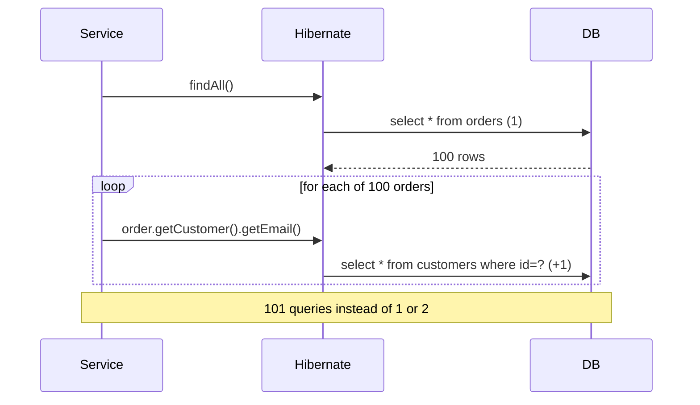

EAGER **doesn't fix** N+1 — with `findAll()` (a JPQL query), Hibernate loads the orders first and then fires a separate query per order to satisfy the eager association. EAGER just makes the extra queries **unavoidable**, even on screens that never show the customer.

**Rule:** map **everything as LAZY** and decide per use case what to fetch (section 4).

#### Detecting N+1

```yaml
spring:
  jpa:
    show-sql: true                    # prints SQL to stdout (quick and dirty)
    properties:
      hibernate:
        format_sql: true
        generate_statistics: true     # logs "N JDBC statements executed" per session
logging:
  level:
    org.hibernate.SQL: debug                      # SQL through the logger (preferred over show-sql)
    org.hibernate.orm.jdbc.bind: trace            # bound parameter values (Hibernate 6)
```

- Look for the **same SELECT repeated** with different ids.
- In tests, **assert the query count** (e.g., with datasource-proxy or Hibernate `Statistics.getPrepareStatementCount()`), so a regression fails the build.
- In production, APM tools (New Relic, Datadog, Hypersistence Optimizer) flag repeated queries per request.

#### LazyInitializationException and Open Session In View

```
org.hibernate.LazyInitializationException: could not initialize proxy [Customer#7] - no Session
```

You touched a lazy association **after the transaction/session closed** (e.g., in a controller, or in Jackson serialization).

Spring Boot enables **`spring.jpa.open-in-view=true` by default** (and logs a warning at startup): the session stays open for the entire HTTP request, so lazy loading "works" in controllers and views. The cost: N+1 queries hide in the web layer, and a DB connection may be held during view rendering. Many teams set it to **`false`** and fetch explicitly in the service layer.

<details><summary>Q. Does FetchType.EAGER solve N+1?</summary>

No. For JPQL queries such as `findAll()`, Hibernate runs the main query and then loads each eager association with extra queries — N+1 still happens, and now on every query. Use LAZY plus a fetch strategy per use case.

</details>

<!-- subtopic: d21_t1_s4 -->
### 4. N+1 solutions: JOIN FETCH, @EntityGraph, @BatchSize, @Fetch(SUBSELECT)

> **TL;DR:** Tell Hibernate **up front** what you need. **JOIN FETCH** / **@EntityGraph** load parent + association in **one** query. **@BatchSize** turns N queries into **N / batch** queries using `IN (...)`. **SUBSELECT** loads all collections for the previous query in **one** extra query. **DTO projections** skip entities entirely.

#### 1. JOIN FETCH in JPQL

```java
public interface OrderRepository extends JpaRepository<Order, Long> {

    @Query("select o from Order o join fetch o.customer where o.status = :status")
    List<Order> findWithCustomerByStatus(@Param("status") OrderStatus status);

    @Query("select o from Order o join fetch o.lines l join fetch l.product where o.id = :id")
    Optional<Order> findWithLinesAndProducts(@Param("id") Long id);
}
```

```sql
-- one query
select o.*, c.* from orders o join customers c on c.id = o.customer_id where o.status = ?
```

Pitfalls:

| Pitfall | What happens | Fix |
|---|---|---|
| Duplicate parents when fetching a collection | SQL returns one row per child | Hibernate 6 **de-duplicates automatically**; on Hibernate 5 add `select distinct` |
| Collection fetch + pagination | Warning `HHH90003004: firstResult/maxResults specified with collection fetch; applying in memory` — **loads ALL rows** then pages in memory | Page the parent ids first, then fetch by `id in :ids`; or use `@BatchSize` |
| Fetching **two `List`** collections | `MultipleBagFetchException` (and a Cartesian product even when it works) | Use `Set`, or fetch one collection per query, or `@BatchSize` |
| Inner vs outer | `join fetch` drops parents without children | Use `left join fetch` when the association may be empty |

#### 2. @EntityGraph — declarative fetch plan

```java
public interface OrderRepository extends JpaRepository<Order, Long> {

    @EntityGraph(attributePaths = {"customer", "lines", "lines.product"})
    Optional<Order> findById(Long id);                       // overrides the inherited method

    @EntityGraph(attributePaths = "customer")
    List<Order> findByStatus(OrderStatus status);            // works with derived queries too
}
```

Same SQL as `left join fetch`, but no JPQL needed, and you can reuse a named graph (`@NamedEntityGraph` on the entity). `EntityGraphType.FETCH` (default): listed attributes eager, others lazy. `LOAD`: listed eager, others use their mapping.

#### 3. @BatchSize — load lazy associations in batches

```java
@Entity
public class Order {
    @OneToMany(mappedBy = "order")
    @BatchSize(size = 50)
    private List<OrderLine> lines = new ArrayList<>();
}
```

```sql
select * from orders                                        -- 1
select * from order_line where order_id in (?, ?, ..., ?)   -- one per 50 orders
```

100 orders → **1 + 2 queries** instead of 101. Set it globally with `spring.jpa.properties.hibernate.default_batch_fetch_size=50` — a cheap safety net that plays well with pagination.

#### 4. @Fetch(FetchMode.SUBSELECT)

```java
@OneToMany(mappedBy = "order")
@Fetch(FetchMode.SUBSELECT)
private List<OrderLine> lines;
```

```sql
select * from orders where status = 'PAID'
select * from order_line where order_id in (select id from orders where status = 'PAID')
```

When the first collection is touched, Hibernate loads the collections for **all** orders from the original query at once → exactly **2 queries**. Only for collections.

#### Which one?

| Technique | Queries | Best for | Watch out |
|---|---|---|---|
| JOIN FETCH | 1 | A known use case needing the association | Pagination with collections, Cartesian products |
| @EntityGraph | 1 | Same, declaratively, on derived queries | Same as JOIN FETCH |
| @BatchSize / default_batch_fetch_size | 1 + N/size | Global safety net, paginated lists | Still several queries |
| SUBSELECT | 2 | Loading collections of a whole result set | Re-runs the original query as a subselect |
| DTO projection | 1 | Read-only screens / APIs | No managed entities to update |

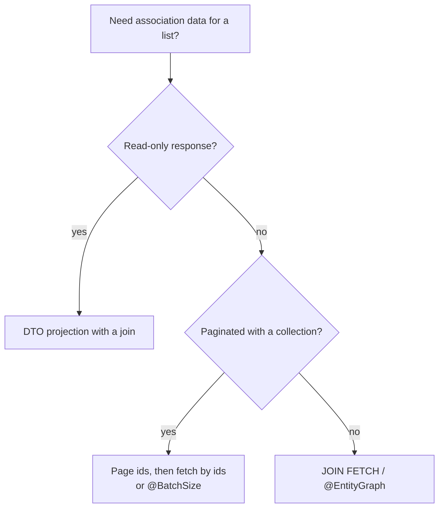

<!-- subtopic: d21_t1_s5 -->
### 5. JPQL vs native SQL — @Query with named parameters

> **TL;DR:** **JPQL** queries **entities and fields** (`from Order o where o.customer.email = :email`) and is portable across databases. **Native SQL** (`nativeQuery = true`) queries **tables and columns** and lets you use database-specific features. Always bind values with **parameters** (`:name`), never string concatenation.

#### Three ways to write a query in Spring Data

```java
public interface OrderRepository extends JpaRepository<Order, Long> {

    // 1) Derived query: parsed from the method name
    List<Order> findByStatusAndCreatedAtAfterOrderByCreatedAtDesc(OrderStatus status, Instant after);
    boolean existsByCustomerIdAndStatus(Long customerId, OrderStatus status);
    long countByStatus(OrderStatus status);

    // 2) JPQL with named parameters
    @Query("""
           select o from Order o
           where o.customer.email = :email
             and o.total >= :minTotal
           order by o.createdAt desc
           """)
    List<Order> findBigOrdersOf(@Param("email") String email, @Param("minTotal") BigDecimal minTotal);

    // 3) Native SQL (database-specific features)
    @Query(value = """
           select * from orders
           where created_at >= now() - interval '7 days'
           order by total desc
           limit :n
           """, nativeQuery = true)
    List<Order> topOrdersLastWeek(@Param("n") int n);
}
```

Since Java 8 with the `-parameters` compiler flag (on by default in Spring Boot builds), `@Param` can be omitted — but explicit names survive refactors and are clearer.

| | JPQL | Native SQL |
|---|---|---|
| Works on | Entity names and Java fields | Table and column names |
| Portability | Any database | Tied to one database dialect |
| Features | Joins via associations, `join fetch`, constructor expressions | Window functions, CTEs, JSONB, `ON CONFLICT`, hints, full-text |
| Result | Managed entities, DTOs | Entities, interface projections, `Object[]` |
| Checked at startup | Yes — invalid JPQL fails the app start | No — fails at runtime |

#### Positional vs named parameters

```java
@Query("select c from Customer c where c.lastName = ?1 and c.status = ?2")  // positional — fragile
@Query("select c from Customer c where c.lastName = :name and c.status = :status")  // named — preferred
```

#### Updates and deletes

```java
@Modifying(clearAutomatically = true, flushAutomatically = true)
@Transactional
@Query("update Order o set o.status = :status where o.createdAt < :before and o.status = 'PENDING'")
int expireOld(@Param("status") OrderStatus status, @Param("before") Instant before);
```

A bulk update goes **straight to the database** and bypasses the persistence context — entities already loaded keep stale values. `clearAutomatically = true` clears the context afterwards; `flushAutomatically = true` flushes pending changes first.

#### SQL injection — never concatenate

```java
// ❌ VULNERABLE: name = "x' or '1'='1"
em.createQuery("select c from Customer c where c.lastName = '" + name + "'");

// ✅ Parameters are sent separately from the SQL text
em.createQuery("select c from Customer c where c.lastName = :name", Customer.class)
  .setParameter("name", name);
```

Sorting by a user-provided column is a common hole: pass a `Sort` object (Spring Data validates property names for JPQL) or **whitelist** column names for native queries.

🚀 **Dynamic filters** (optional search criteria): use `JpaSpecificationExecutor` with `Specification` objects (type-safe Criteria API), Querydsl, or Query by Example — not string-building.

```java
public interface OrderRepository extends JpaRepository<Order, Long>, JpaSpecificationExecutor<Order> { }

static Specification<Order> hasStatus(OrderStatus s) {
    return (root, query, cb) -> s == null ? null : cb.equal(root.get("status"), s);
}
static Specification<Order> totalAtLeast(BigDecimal min) {
    return (root, query, cb) -> min == null ? null : cb.ge(root.get("total"), min);
}

List<Order> result = orderRepository.findAll(hasStatus(status).and(totalAtLeast(min)));
```

<!-- subtopic: d21_t1_s6 -->
### 6. Pagination: Pageable, Page&lt;T&gt;, Slice&lt;T&gt;, @PageableDefault — offset vs cursor

> **TL;DR:** Pass a `Pageable` (page number, size, sort) to a repository method. Return **`Page<T>`** when the client needs total counts (costs an extra `count(*)` query), **`Slice<T>`** when it only needs "is there a next page?" (fetches size + 1 rows). Offset pagination gets **slow on deep pages**; **cursor (keyset)** pagination stays fast.

```java
public interface OrderRepository extends JpaRepository<Order, Long> {
    Page<Order> findByStatus(OrderStatus status, Pageable pageable);
    Slice<Order> findByCustomerId(Long customerId, Pageable pageable);
}

// Service
Pageable pageable = PageRequest.of(0, 20, Sort.by(Sort.Direction.DESC, "createdAt").and(Sort.by("id")));
Page<Order> page = orderRepository.findByStatus(OrderStatus.PAID, pageable);

page.getContent();        // the 20 orders
page.getTotalElements();  // e.g. 1 342  (from select count(*))
page.getTotalPages();     // 68
page.hasNext();           // true
```

#### Controller binding

```java
@GetMapping("/orders")
public Page<OrderResponse> list(@RequestParam(required = false) OrderStatus status,
                                @PageableDefault(size = 20, sort = "createdAt",
                                                 direction = Sort.Direction.DESC) Pageable pageable) {
    return orderService.find(status, pageable).map(OrderResponse::from);
}
```

`GET /orders?page=2&size=50&sort=total,desc&sort=id,asc` binds automatically. Pages are **0-based** by default. Cap the size with `spring.data.web.pageable.max-page-size` (default 2000 — lower it).

🚀 Serializing `PageImpl` directly produces an unstable JSON shape (Spring Data 3.3 logs a warning). Return your own page DTO or enable `@EnableSpringDataWebSupport(pageSerializationMode = VIA_DTO)`.

| Return type | Extra count query | Knows total? | Use for |
|---|---|---|---|
| `Page<T>` | Yes | Yes | Numbered pagination UIs ("page 3 of 68") |
| `Slice<T>` | No (fetches size + 1) | No, only `hasNext()` | "Load more" / infinite scroll |
| `List<T>` with `Pageable` | No | No | Just a limited, sorted chunk |

⚠️ Always add a **unique tiebreaker** (e.g., `id`) to the sort. With `createdAt` alone, rows with equal timestamps can appear on two pages or none.

#### Offset vs cursor (keyset) pagination

```sql
-- OFFSET: the DB still reads and throws away 100 000 rows
select * from orders order by created_at desc, id desc limit 20 offset 100000;

-- KEYSET / cursor: jump straight to the position using the index
select * from orders
where (created_at, id) < (:lastCreatedAt, :lastId)
order by created_at desc, id desc
limit 20;
```

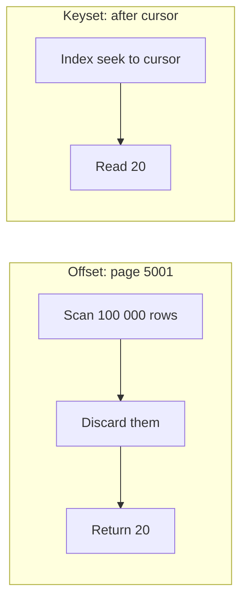

| | Offset (`page=5000`) | Cursor / keyset (`after=eyJpZCI6...`) |
|---|---|---|
| Deep page cost | O(offset + size) — slower and slower | O(size) with an index |
| Jump to page N | ✅ | ❌ (next/previous only) |
| Rows inserted while paging | Items shift → duplicates/skips | Stable |
| Total count | Easy (extra query) | Usually not provided |
| Used by | Admin tables | Feeds, APIs at scale (Twitter, Slack, Stripe) |

Spring Data 3.1+ supports keyset scrolling natively:

```java
Window<Order> findFirst20ByStatusOrderByCreatedAtDescIdDesc(OrderStatus status, ScrollPosition position);

Window<Order> first = repo.findFirst20ByStatusOrderByCreatedAtDescIdDesc(PAID, ScrollPosition.keyset());
Window<Order> next  = repo.findFirst20ByStatusOrderByCreatedAtDescIdDesc(PAID, first.positionAt(first.size() - 1));
```

The cursor sent to clients is usually the last row's sort keys, Base64-encoded so clients treat it as opaque.

<!-- subtopic: d21_t1_s7 -->
### 7. Repository hierarchy: CrudRepository → PagingAndSortingRepository → JpaRepository

> **TL;DR:** You declare an **interface**; Spring Data creates a proxy backed by **`SimpleJpaRepository`**. `CrudRepository` gives save/find/delete, `PagingAndSortingRepository` adds `Pageable`/`Sort`, and **`JpaRepository`** adds JPA-specific operations: `flush()`, `saveAndFlush()`, batch deletes, `getReferenceById()`, and `List` return types.

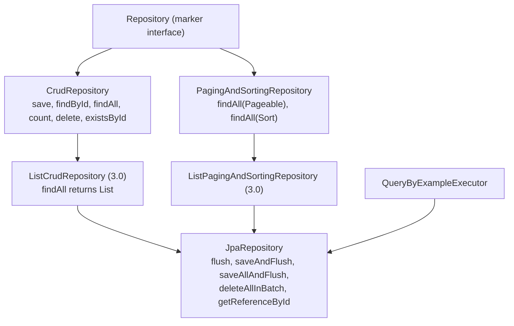

🚀 **Spring Data 3 change:** `PagingAndSortingRepository` **no longer extends** `CrudRepository`. If you extend only `PagingAndSortingRepository`, you lose `save()`. Most people just extend `JpaRepository`.

| Method | What it does |
|---|---|
| `save(entity)` | New → `persist`; existing → `merge` (returns the managed copy — **use the return value**) |
| `saveAll(list)` | Loops `save` in one transaction |
| `flush()` | Push pending SQL to the DB now (still inside the transaction — can be rolled back) |
| `saveAndFlush(e)` | Save, then flush — useful to surface constraint violations immediately |
| `deleteAllInBatch(list)` | One `delete ... where id in (...)` — **skips cascades and lifecycle callbacks** |
| `getReferenceById(id)` | Returns a **proxy without a query** (replaces deprecated `getOne`/`getById`) |
| `findById(id)` | Queries (or returns from the persistence context) — `Optional` |

```java
// getReferenceById: set a FK without loading the customer row
Order order = new Order();
order.setCustomer(customerRepository.getReferenceById(customerId));   // no SELECT
orderRepository.save(order);                                           // INSERT with customer_id
```

#### How save() decides "new or existing"

`SimpleJpaRepository.save()` calls `entityInformation.isNew(entity)`: new if the `@Version` field is null, otherwise if the **id is null** (or 0 for primitives).

⚠️ With **application-assigned ids** (e.g., you set a UUID yourself), `isNew` is false → `save()` calls **`merge`**, which first runs a **SELECT** to check existence. Fix: implement `Persistable<ID>` with your own `isNew()` (e.g., backed by a `@Transient boolean` flipped in `@PostPersist`/`@PostLoad`).

#### Transactions on repositories

`SimpleJpaRepository` is annotated `@Transactional(readOnly = true)` at class level, and write methods (`save`, `delete…`) are `@Transactional`. So a single repository call is already transactional — but **several calls in a service method need `@Transactional` on the service** to share one transaction (Day 22).

#### Batch inserts

```yaml
spring.jpa.properties.hibernate:
  jdbc.batch_size: 50
  order_inserts: true
  order_updates: true
```

Works with `SEQUENCE` ids, **not with `IDENTITY`** (Hibernate must insert row by row to get each generated key). For huge loads, consider `JdbcTemplate.batchUpdate` or `COPY` instead of JPA.

#### Custom repository implementations

```java
public interface OrderRepositoryCustom { List<Order> searchComplex(SearchCriteria c); }

class OrderRepositoryCustomImpl implements OrderRepositoryCustom {      // suffix "Impl" is required
    @PersistenceContext private EntityManager em;
    public List<Order> searchComplex(SearchCriteria c) { /* Criteria API / native */ }
}

public interface OrderRepository extends JpaRepository<Order, Long>, OrderRepositoryCustom { }
```

<!-- subtopic: d21_t1_s8 -->
### 8. Spring Data projections — interface-based and class-based (DTO)

> **TL;DR:** Loading full entities for a list screen wastes memory and columns and risks lazy loading. **Projections** fetch only the fields you need. **Interface projections** declare getters; **class-based (DTO) projections** use a record/class constructor. Both can generate a `SELECT` with just those columns.

#### Interface-based (closed) projection

```java
public interface OrderSummary {
    Long getId();
    BigDecimal getTotal();
    OrderStatus getStatus();
    String getCustomerEmail();            // nested property path: customer.email
}

public interface OrderRepository extends JpaRepository<Order, Long> {
    List<OrderSummary> findByStatus(OrderStatus status);
}
```

```sql
-- Only the needed columns (closed projection)
select o.id, o.total, o.status, c.email
from orders o left join customers c on c.id = o.customer_id
where o.status = ?
```

Spring creates a proxy implementing the interface. **Nested** projection interfaces are also supported (`CustomerView getCustomer()`).

**Open projections** use SpEL and can compute values, but Spring must load the **whole entity** — no SELECT optimisation:

```java
public interface CustomerView {
    @Value("#{target.firstName + ' ' + target.lastName}")
    String getFullName();
}
```

A **default method** in the interface is a cheaper way to compute derived values from closed-projection fields.

#### Class-based (DTO) projection

```java
public record OrderRow(Long id, BigDecimal total, String customerEmail) { }

public interface OrderRepository extends JpaRepository<Order, Long> {

    // JPQL constructor expression — fully qualified class name
    @Query("""
           select new com.shop.order.OrderRow(o.id, o.total, c.email)
           from Order o join o.customer c
           where o.status = :status
           """)
    List<OrderRow> findRows(@Param("status") OrderStatus status);

    // Derived query: Spring maps by constructor parameter names
    List<OrderRow> findByCustomerId(Long customerId);
}
```

DTOs are **not managed** — no dirty checking, no lazy loading, no accidental N+1. Perfect for read-only APIs.

#### Dynamic projections

```java
<T> List<T> findByStatus(OrderStatus status, Class<T> type);

repo.findByStatus(PAID, OrderSummary.class);
repo.findByStatus(PAID, OrderRow.class);
repo.findByStatus(PAID, Order.class);          // full entity
```

| | Entity | Interface projection | DTO / record |
|---|---|---|---|
| Columns fetched | All | Only getters (closed) | Only constructor args |
| Managed (dirty checking) | ✅ | ❌ | ❌ |
| Can update & save | ✅ | ❌ | ❌ |
| Native query support | ✅ | ✅ (aliases must match getter names) | ❌ via `new` (map manually / `@SqlResultSetMapping`) |
| Best for | Writes, business logic | Quick read views | Read APIs, reports |

💡 **CQRS-lite rule:** use entities for **commands** (load → change → let dirty checking save), and projections for **queries** (lists, reports, search).

### 🎤 Interview Q&A — Spring Data JPA

<details><summary>Q1. What is the difference between JPA, Hibernate and Spring Data JPA?</summary>

JPA is the specification (annotations, EntityManager, JPQL). Hibernate is an implementation of it. Spring Data JPA builds on JPA and generates repository implementations from interfaces and method names.

</details>

<details><summary>Q2. What is the owning side of a relationship and why does it matter?</summary>

The owning side is the one that maps the foreign key (`@JoinColumn`; for one-to-many it's always the `@ManyToOne`). Hibernate writes the FK only from the owning side, so changing only the `mappedBy` side has no effect in the database.

</details>

<details><summary>Q3. Explain the N+1 problem and three ways to fix it.</summary>

One query loads N rows, then lazy associations fire one query per row. Fixes: `JOIN FETCH` / `@EntityGraph` (one query), `@BatchSize` / `default_batch_fetch_size` (IN-batches), `@Fetch(SUBSELECT)` (two queries), or DTO projections.

</details>

<details><summary>Q4. Why does IDENTITY disable insert batching in Hibernate?</summary>

The id is only known after the row is inserted, and Hibernate needs it immediately to put the entity in the persistence context, so it must execute each INSERT right away instead of batching them at flush.

</details>

<details><summary>Q5. Page vs Slice?</summary>

`Page` runs an extra count query and knows total elements and pages. `Slice` fetches one extra row only to know whether a next page exists — cheaper, good for infinite scroll.

</details>

<details><summary>Q6. Why is offset pagination slow for deep pages, and what's the alternative?</summary>

The database must read and discard all rows before the offset. Keyset (cursor) pagination filters with `WHERE (sort_key, id) < (last values)` and uses the index, so every page costs the same.

</details>

<details><summary>Q7. What is a LazyInitializationException and how do you avoid it?</summary>

Accessing an uninitialized lazy proxy or collection after the persistence context is closed. Fetch what you need inside the transaction (JOIN FETCH, entity graph, DTO) instead of relying on Open Session In View.

</details>

<!-- topic: d17_t2 -->
## 🧮 DSA — Heaps / Priority Queues

<!-- subtopic: d17_t2_s1 -->
### 9. Heap fundamentals — min-heap, max-heap, array storage

> **TL;DR:** A binary heap is a **complete binary tree** (all levels full except the last, filled left to right) satisfying the **heap property**: in a **min-heap** every parent ≤ its children (so the **minimum is at the root**); in a **max-heap** every parent ≥ its children. Because it's complete, it's stored in a plain **array** with no pointers.

#### Array layout (0-based)

| Relation | Index |
|---|---|
| Parent of `i` | `(i - 1) / 2` |
| Left child of `i` | `2 * i + 1` |
| Right child of `i` | `2 * i + 2` |

Min-heap array `[1, 3, 2, 7, 5, 4, 8]`:

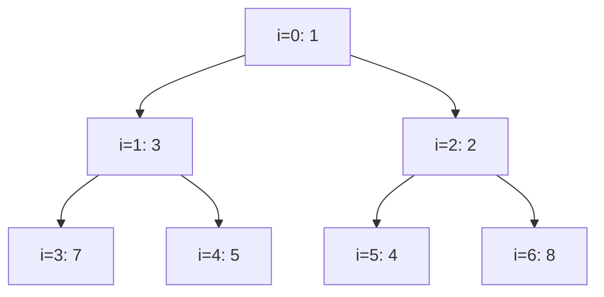

⚠️ A heap is **not sorted**: siblings have no order, and `3` (level 1) is larger than `2`. Only the root is guaranteed to be the minimum.

#### Core operations

| Operation | How | Time |
|---|---|---|
| `peek()` | Return `a[0]` | O(1) |
| `offer(x)` | Append at the end, **sift up** while smaller than parent | O(log n) |
| `poll()` | Take `a[0]`, move the last element to the root, **sift down** (swap with the smaller child) | O(log n) |
| `heapify(array)` | Sift down every non-leaf from `n/2 - 1` down to 0 | **O(n)** |
| Search / remove arbitrary | Linear scan | O(n) |

Insert 0 into the heap above — sift up:

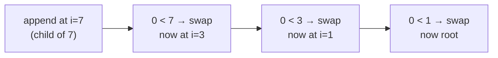

#### Implementing a min-heap

```java
public class MinHeap {
    private int[] a = new int[16];
    private int size;

    public void offer(int x) {
        if (size == a.length) a = Arrays.copyOf(a, size * 2);
        a[size] = x;
        siftUp(size++);
    }

    public int peek() {
        if (size == 0) throw new NoSuchElementException();
        return a[0];
    }

    public int poll() {
        int min = peek();
        a[0] = a[--size];       // move the last element to the root
        siftDown(0);
        return min;
    }

    private void siftUp(int i) {
        while (i > 0) {
            int parent = (i - 1) / 2;
            if (a[i] >= a[parent]) break;
            swap(i, parent);
            i = parent;
        }
    }

    private void siftDown(int i) {
        while (true) {
            int left = 2 * i + 1, right = left + 1, smallest = i;
            if (left < size && a[left] < a[smallest]) smallest = left;
            if (right < size && a[right] < a[smallest]) smallest = right;
            if (smallest == i) return;
            swap(i, smallest);
            i = smallest;
        }
    }

    private void swap(int i, int j) { int t = a[i]; a[i] = a[j]; a[j] = t; }
    public int size() { return size; }
}
```

🚀 **Why is heapify O(n), not O(n log n)?** Half the nodes are leaves (0 work), a quarter sift down at most 1 level, an eighth at most 2… The sum `n/4·1 + n/8·2 + n/16·3 + …` converges to **O(n)**. That's why `new PriorityQueue<>(collection)` is faster than offering elements one by one.

#### Java's PriorityQueue

```java
PriorityQueue<Integer> minHeap = new PriorityQueue<>();                          // natural order: min-heap
PriorityQueue<Integer> maxHeap = new PriorityQueue<>(Comparator.reverseOrder()); // max-heap
PriorityQueue<int[]> byDist = new PriorityQueue<>(Comparator.comparingInt(p -> p[0]));
PriorityQueue<Task> tasks = new PriorityQueue<>(
        Comparator.comparing(Task::priority).thenComparing(Task::createdAt));

minHeap.offer(5);   // add
minHeap.peek();     // smallest, null if empty
minHeap.poll();     // remove smallest, null if empty
```

| Gotcha | Detail |
|---|---|
| Iteration / `toString()` order | **Not sorted** — it's the internal array order. Poll repeatedly to get sorted output |
| `(a, b) -> a - b` comparator | **Overflows** for large/negative ints → use `Integer.compare(a, b)` or `Comparator.comparingInt` |
| `remove(Object)` / `contains` | O(n) |
| Mutating an element's priority while inside | Heap order breaks silently — remove, change, re-insert |
| Thread safety | Not thread-safe → `PriorityBlockingQueue` |
| Nulls | Not allowed |

**When to reach for a heap:** "**k** largest/smallest/most frequent", "**merge k** sorted things", "always process the **next smallest/earliest**" (Dijkstra, scheduling, event simulation), "**running median**" (two heaps).

<!-- subtopic: d17_t2_s2 -->
### 10. Kth Largest Element in an Array (LeetCode 215)

> **Problem:** return the k-th largest element (in sorted order, not distinct). Can you do it without full sorting? 🔗 [LeetCode 215](https://leetcode.com/problems/kth-largest-element-in-an-array/)

**Key idea:** keep a **min-heap of size k** holding the k largest elements seen so far. Its root is the smallest of those k → the k-th largest overall.

```java
public int findKthLargest(int[] nums, int k) {
    PriorityQueue<Integer> heap = new PriorityQueue<>();      // min-heap
    for (int x : nums) {
        heap.offer(x);
        if (heap.size() > k) heap.poll();                     // drop the smallest — it can't be in the top k
    }
    return heap.peek();
}   // O(n log k) time, O(k) space
```

Trace `nums = [3, 2, 1, 5, 6, 4], k = 2`:

| x | heap after (size ≤ 2) |
|---|---|
| 3 | [3] |
| 2 | [2, 3] |
| 1 | [1, 2, 3] → poll 1 → [2, 3] |
| 5 | [2, 3, 5] → poll 2 → [3, 5] |
| 6 | [3, 5, 6] → poll 3 → [5, 6] |
| 4 | [4, 5, 6] → poll 4 → [5, 6] |

Answer: `peek() = 5` ✅

Why a **min**-heap for the k **largest**? The root is the weakest member of the current top-k club, so it's the one to evict.

#### Alternatives

| Approach | Time | Space | Notes |
|---|---|---|---|
| Sort | O(n log n) | O(1)–O(n) | `nums[n - k]` after sorting |
| Min-heap of size k | O(n log k) | O(k) | Great when k ≪ n, works on streams |
| **Quickselect** | **O(n) average**, O(n²) worst | O(1) | Partition like quicksort, recurse into one side only. Randomize the pivot |
| Counting sort | O(n + range) | O(range) | When values are in a small range |

```java
// Quickselect (Lomuto partition, random pivot): target index n - k in ascending order
public int findKthLargestQuickselect(int[] nums, int k) {
    int target = nums.length - k, lo = 0, hi = nums.length - 1;
    Random rnd = new Random();
    while (true) {
        int p = partition(nums, lo, hi, lo + rnd.nextInt(hi - lo + 1));
        if (p == target) return nums[p];
        if (p < target) lo = p + 1; else hi = p - 1;
    }
}

private int partition(int[] a, int lo, int hi, int pivotIdx) {
    int pivot = a[pivotIdx];
    swap(a, pivotIdx, hi);
    int store = lo;
    for (int i = lo; i < hi; i++) if (a[i] < pivot) swap(a, i, store++);
    swap(a, store, hi);
    return store;
}

private void swap(int[] a, int i, int j) { int t = a[i]; a[i] = a[j]; a[j] = t; }
```

⚠️ On arrays with **many duplicates**, Lomuto quickselect degrades; a three-way (Dutch flag) partition fixes it.

Related: Kth Largest Element in a Stream (LC 703 — same min-heap kept as a field), K Closest Points to Origin (LC 973 — max-heap of size k by distance).

<!-- subtopic: d17_t2_s3 -->
### 11. Top K Frequent Elements (LeetCode 347)

> **Problem:** return the k most frequent elements, in any order. Required: better than O(n log n). 🔗 [LeetCode 347](https://leetcode.com/problems/top-k-frequent-elements/)

**Step 1:** count with a HashMap. **Step 2:** pick the top k by frequency — a min-heap of size k (O(n log k)) or **bucket sort** by frequency (O(n)).

```java
// Heap version — O(n log k)
public int[] topKFrequent(int[] nums, int k) {
    Map<Integer, Integer> freq = new HashMap<>();
    for (int x : nums) freq.merge(x, 1, Integer::sum);

    PriorityQueue<Integer> heap = new PriorityQueue<>(Comparator.comparingInt(freq::get)); // min by frequency
    for (int key : freq.keySet()) {
        heap.offer(key);
        if (heap.size() > k) heap.poll();
    }

    int[] result = new int[k];
    for (int i = k - 1; i >= 0; i--) result[i] = heap.poll();   // most frequent last → fill from the back
    return result;
}
```

```java
// Bucket sort version — O(n): frequency is at most n, so use it as an index
public int[] topKFrequentBuckets(int[] nums, int k) {
    Map<Integer, Integer> freq = new HashMap<>();
    for (int x : nums) freq.merge(x, 1, Integer::sum);

    List<Integer>[] buckets = new List[nums.length + 1];          // buckets[f] = numbers seen f times
    for (var e : freq.entrySet()) {
        int f = e.getValue();
        if (buckets[f] == null) buckets[f] = new ArrayList<>();
        buckets[f].add(e.getKey());
    }

    int[] result = new int[k];
    int idx = 0;
    for (int f = nums.length; f >= 1 && idx < k; f--) {
        if (buckets[f] == null) continue;
        for (int x : buckets[f]) {
            result[idx++] = x;
            if (idx == k) break;
        }
    }
    return result;
}
```

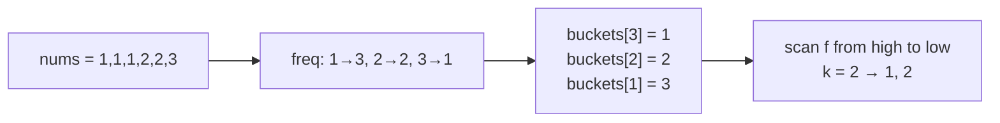

| Approach | Time | Space |
|---|---|---|
| Sort map entries by count | O(n log n) | O(n) |
| Min-heap of size k | O(n log k) | O(n + k) |
| Bucket sort | **O(n)** | O(n) |
| Quickselect on unique values | O(n) average | O(n) |

Related: Top K Frequent Words (LC 692 — heap comparator breaks ties alphabetically, reversed for the min-heap), Sort Characters By Frequency (LC 451).

<!-- subtopic: d17_t2_s4 -->
### 12. Merge K Sorted Lists (LeetCode 23 — Hard)

> **Problem:** merge k sorted linked lists into one sorted list. 🔗 [LeetCode 23](https://leetcode.com/problems/merge-k-sorted-lists/)

**Key idea:** the next node of the result is always the **smallest current head** among the k lists. A min-heap of the k heads gives that in O(log k).

```java
public ListNode mergeKLists(ListNode[] lists) {
    PriorityQueue<ListNode> heap = new PriorityQueue<>(Comparator.comparingInt(n -> n.val));
    for (ListNode head : lists) if (head != null) heap.offer(head);

    ListNode dummy = new ListNode(0), tail = dummy;
    while (!heap.isEmpty()) {
        ListNode smallest = heap.poll();
        tail.next = smallest;
        tail = smallest;
        if (smallest.next != null) heap.offer(smallest.next);   // its successor joins the race
    }
    return dummy.next;
}   // O(N log k) time where N = total nodes, O(k) heap space
```

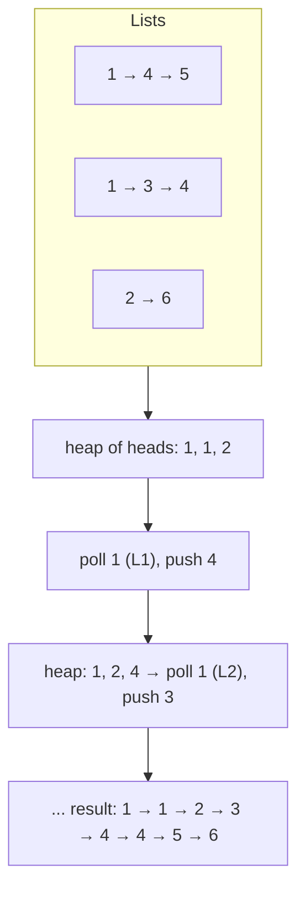

#### Alternative: divide and conquer

Merge lists in pairs (like merge sort): k → k/2 → k/4 … → 1. Each round touches all N nodes, there are log k rounds → **O(N log k)**, O(1) extra space (iterative) — no heap needed.

```java
public ListNode mergeKListsDC(ListNode[] lists) {
    if (lists.length == 0) return null;
    for (int step = 1; step < lists.length; step *= 2) {
        for (int i = 0; i + step < lists.length; i += 2 * step) {
            lists[i] = mergeTwo(lists[i], lists[i + step]);
        }
    }
    return lists[0];
}

private ListNode mergeTwo(ListNode a, ListNode b) {
    ListNode dummy = new ListNode(0), t = dummy;
    while (a != null && b != null) {
        if (a.val <= b.val) { t.next = a; a = a.next; } else { t.next = b; b = b.next; }
        t = t.next;
    }
    t.next = (a != null) ? a : b;
    return dummy.next;
}
```

| Approach | Time | Space |
|---|---|---|
| Collect all values, sort, rebuild | O(N log N) | O(N) |
| Merge one by one into the result | O(k · N) | O(1) |
| **Min-heap** | O(N log k) | O(k) |
| **Divide and conquer** | O(N log k) | O(1) iterative |

🚀 Same pattern at scale: **external merge sort** (merge sorted runs on disk), merging sorted SSTables in LSM-tree databases (Cassandra, RocksDB), merging results from k shards. Related: Find K Pairs with Smallest Sums (LC 373), Kth Smallest Element in a Sorted Matrix (LC 378), Smallest Range Covering K Lists (LC 632).

<!-- subtopic: d17_t2_s5 -->
### 13. Last Stone Weight (LeetCode 1046)

> **Problem:** each turn smash the two heaviest stones `x ≤ y`: if equal both vanish, otherwise a stone of weight `y - x` remains. Return the last stone's weight (or 0). 🔗 [LeetCode 1046](https://leetcode.com/problems/last-stone-weight/)

A direct **max-heap simulation**: repeatedly take the two largest.

```java
public int lastStoneWeight(int[] stones) {
    PriorityQueue<Integer> heap = new PriorityQueue<>(Comparator.reverseOrder());  // max-heap
    for (int s : stones) heap.offer(s);

    while (heap.size() > 1) {
        int y = heap.poll();          // heaviest
        int x = heap.poll();          // second heaviest
        if (y != x) heap.offer(y - x);
    }
    return heap.isEmpty() ? 0 : heap.peek();
}   // O(n log n) time, O(n) space
```

Trace `[2, 7, 4, 1, 8, 1]`:

| Smash | Heap after |
|---|---|
| 8, 7 → 1 | [4, 2, 1, 1, 1] |
| 4, 2 → 2 | [2, 1, 1, 1] |
| 2, 1 → 1 | [1, 1, 1] |
| 1, 1 → 0 | [1] |

Answer: **1**.

💡 Max-heap tricks without a comparator: push **negated** values into a min-heap (`offer(-s)`, `-poll()`) — common in Python, fine in Java for ints (avoid with `Integer.MIN_VALUE`).

🚀 Watch the twist: **Last Stone Weight II (LC 1049)** sounds the same but lets you pick *any* two stones — it becomes a **0/1 knapsack / partition DP** problem (DP starts on Day 25), not a heap problem.

---

## 📝 Day 21 Revision Cheat Sheet

| Topic | Remember this |
|---|---|
| Entity rules | `@Entity` + `@Id`, no-arg constructor, not final, no records; `@Enumerated(STRING)` |
| ID strategies | SEQUENCE (+allocationSize, batching ✅) > IDENTITY (batching ❌) > AUTO (be explicit); UUID for public ids |
| equals/hashCode | id-based with null check + constant hashCode, or a natural key; no Lombok `@Data` |
| Owning side | Has `@JoinColumn`; `@ManyToOne` owns one-to-many; `mappedBy` side is ignored for SQL; sync both sides |
| Default fetch | `*ToOne` EAGER ⚠️ → make LAZY; `*ToMany` LAZY |
| Cascade | Parent → child compositions only; never REMOVE on ManyToOne/ManyToMany; `orphanRemoval` |
| N+1 | 1 + N queries; detect with SQL logs / statistics / query-count tests |
| Fixes | JOIN FETCH, @EntityGraph, @BatchSize / default_batch_fetch_size, SUBSELECT, DTOs |
| Fetch pitfalls | Collection fetch + paging = in-memory paging; two bags = MultipleBagFetchException |
| JPQL vs native | Entities vs tables; portable vs DB features; named params; `@Modifying` + clear for bulk updates |
| Pagination | Page (count query) vs Slice (size + 1); unique tiebreaker; keyset for deep pages |
| Repositories | Crud → (List) → JpaRepository; PagingAndSorting no longer extends Crud (SD 3); `getReferenceById` |
| save() | persist if new else merge; assigned ids → implement `Persistable` |
| Projections | Interface (closed = fewer columns), DTO/record via `select new`, dynamic `Class<T>` |
| Heap | Complete tree in array; parent (i-1)/2, kids 2i+1, 2i+2; offer/poll O(log n), heapify O(n) |
| Kth largest | Min-heap of size k (O(n log k)) or quickselect (O(n) avg) |
| Top K frequent | Count + min-heap of k, or bucket sort O(n) |
| Merge K lists | Heap of heads O(N log k), or pairwise D&C |
| Last stone | Max-heap simulation |

### ⚡ Rapid-fire self-test

1. Which side of a `@OneToMany`/`@ManyToOne` pair owns the FK? → **The `@ManyToOne` side**
2. Default fetch type of `@ManyToOne`? → **EAGER (change it to LAZY)**
3. Which ID strategy disables JDBC insert batching? → **IDENTITY**
4. 100 orders + lazy customer accessed in a loop = how many queries? → **101**
5. Annotation that fetches associations declaratively on a derived query? → **@EntityGraph**
6. Exception when JOIN FETCHing two `List` collections? → **MultipleBagFetchException**
7. Which pagination type avoids the count query? → **Slice**
8. Repository method returning a proxy without querying? → **getReferenceById**
9. Heap poll complexity? Heapify? → **O(log n), O(n)**
10. Heap type for the k largest elements? → **Min-heap of size k**
