# Day 22 — Transactions, Hibernate Caching & Database Migrations

> **How to use these notes:** each section maps to one checklist item. Run the code, study the diagrams, then test yourself with the collapsible questions. 🚀 marks senior-level details.

**Today's goal:** understand exactly how `@Transactional` works (it's a **proxy**, which explains its biggest pitfall), choose the right **propagation** and **isolation level**, protect concurrent updates with **optimistic and pessimistic locking**, know the **entity lifecycle** and when SQL actually runs (flush vs commit), use Hibernate's **first- and second-level caches** correctly, and version your schema with **Flyway or Liquibase**. On the DSA side: **graphs** — vocabulary, representations, BFS, DFS and Number of Islands.

Running example: a bank-transfer service and an order service.

```java
@Entity
public class Account {
    @Id private Long id;
    private BigDecimal balance;
    @Version private long version;          // optimistic locking (section 4)

    public void withdraw(BigDecimal amount) {
        if (balance.compareTo(amount) < 0) throw new InsufficientFundsException(id, amount);
        balance = balance.subtract(amount);
    }
    public void deposit(BigDecimal amount) { balance = balance.add(amount); }
}
```

**ACID** refresher — what a transaction guarantees:

| Letter | Meaning | Example |
|---|---|---|
| **A**tomicity | All statements succeed or none do | Debit and credit both happen, or neither |
| **C**onsistency | Constraints hold before and after | Balance never violates `CHECK (balance >= 0)` |
| **I**solation | Concurrent transactions don't see each other's partial work (to a configurable degree) | Section 3 |
| **D**urability | Committed data survives crashes | Write-ahead log flushed on commit |

<!-- topic: d22_t1 -->
## 🌿 Spring — Transactions & Hibernate

<!-- subtopic: d22_t1_s1 -->
### 1. @Transactional — declarative transactions and the self-invocation pitfall

> **TL;DR:** `@Transactional` makes Spring wrap your bean in a **proxy**. A call **from outside** goes through the proxy, which begins a transaction, calls your method, then **commits** — or **rolls back** if a `RuntimeException` or `Error` escapes. A call from **inside the same class** (`this.method()`) **bypasses the proxy**, so its `@Transactional` settings are silently ignored.

```java
@Service
public class TransferService {
    private final AccountRepository accounts;

    public TransferService(AccountRepository accounts) { this.accounts = accounts; }

    @Transactional
    public void transfer(long fromId, long toId, BigDecimal amount) {
        Account from = accounts.findById(fromId).orElseThrow();
        Account to = accounts.findById(toId).orElseThrow();
        from.withdraw(amount);          // throws InsufficientFundsException (runtime) → rollback
        to.deposit(amount);
        // no save() needed: managed entities are dirty-checked and flushed at commit
    }
}
```

#### How the proxy works

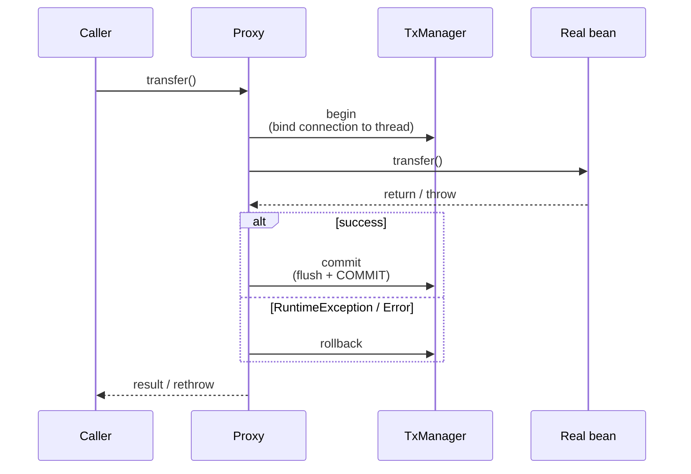

The transaction (connection + `EntityManager`) is bound to the **current thread** via `ThreadLocal`s in `TransactionSynchronizationManager`. That's why work you start on **another thread** (`@Async`, `CompletableFuture.supplyAsync`, parallel streams) does **not** join the transaction.

#### Rollback rules

| Thrown | Default behaviour |
|---|---|
| `RuntimeException` (unchecked) | **Rollback** |
| `Error` | **Rollback** |
| Checked `Exception` (e.g., `IOException`) | **Commit!** ⚠️ |
| Exception caught inside the method | Nothing — the proxy never sees it |

```java
@Transactional(rollbackFor = Exception.class)                // also roll back on checked exceptions
@Transactional(noRollbackFor = NotificationFailedException.class)
```

#### The self-invocation pitfall

```java
@Service
public class OrderService {

    public void placeAll(List<OrderRequest> requests) {
        for (OrderRequest r : requests) {
            placeOne(r);                     // ❌ this.placeOne(...) — NO proxy → NO new transaction
        }
    }

    @Transactional(propagation = Propagation.REQUIRES_NEW)
    public void placeOne(OrderRequest r) { /* ... */ }
}
```

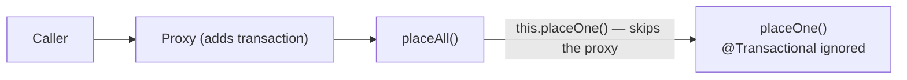

Fixes, best first:

1. **Move the method to another bean** (`OrderPlacer.placeOne`) and inject it — clearest design.
2. Use **`TransactionTemplate`** for programmatic control:
   ```java
   transactionTemplate.setPropagationBehavior(TransactionDefinition.PROPAGATION_REQUIRES_NEW);
   for (OrderRequest r : requests) {
       transactionTemplate.executeWithoutResult(status -> placeOneInternal(r));
   }
   ```
3. **Self-injection**: inject the bean's own proxy (`@Lazy @Autowired OrderService self;` then `self.placeOne(r)`) — works, but a design smell.
4. AspectJ weaving mode (`@EnableTransactionManagement(mode = AdviceMode.ASPECTJ)`) — weaves into the bytecode, so even self-calls are transactional. Rarely worth the setup.

#### Other rules and good practice

- **Private methods are never intercepted** (and `final` methods can't be overridden by the CGLIB proxy). Spring 6 also supports protected/package-private methods on class-based proxies; public is the safe habit.
- Put `@Transactional` on the **service layer** (use case boundaries), not on controllers or every repository call.
- `@Transactional(readOnly = true)` for queries: Hibernate skips dirty checking (no snapshots) and the flush; the driver/DB may route to a replica or optimise. Annotate the class `readOnly = true` and override write methods.
- `timeout = 5` (seconds) to fail long transactions.
- **Keep transactions short**: no HTTP calls, emails or file uploads inside — they hold a DB connection and locks while waiting. Do them after commit (`@TransactionalEventListener(phase = AFTER_COMMIT)`) or via the outbox pattern.
- `@Transactional` on a test method rolls back at the end of the test by default.

```java
// Run side effects only if the transaction commits
@TransactionalEventListener(phase = TransactionPhase.AFTER_COMMIT)
public void onOrderPlaced(OrderPlacedEvent e) {
    emailClient.sendConfirmation(e.orderId());
}
```

🚀 Spring 6.1 also supports `@Transactional` on reactive and Kotlin coroutine methods via `ReactiveTransactionManager` — the thread-binding explanation above applies to the classic blocking stack.

<!-- subtopic: d22_t1_s2 -->
### 2. Propagation: REQUIRED, REQUIRES_NEW, NESTED, MANDATORY, NEVER…

> **TL;DR:** Propagation decides what happens when a transactional method is called **while a transaction may already be active**. **REQUIRED** (default) joins the existing one or starts one. **REQUIRES_NEW** suspends the outer and runs its own independent transaction. **NESTED** uses a **savepoint** inside the outer one. **MANDATORY** requires an existing one, **NEVER** forbids one.

| Propagation | Existing transaction? → behaviour | No transaction? → behaviour | Typical use |
|---|---|---|---|
| **REQUIRED** (default) | Join it | Start new | Almost everything |
| **REQUIRES_NEW** | **Suspend** it, start an independent one | Start new | Audit logs, outbox records, sequence/number allocation that must persist even if the caller rolls back |
| **NESTED** | Create a **savepoint**; inner failure rolls back to it | Start new | Optional sub-steps in batch processing (best with JDBC) |
| **MANDATORY** | Join it | **Throw** `IllegalTransactionStateException` | Methods that must never run alone (e.g., repository helpers) |
| **SUPPORTS** | Join it | Run without | Read methods that don't care |
| **NOT_SUPPORTED** | **Suspend** it, run without | Run without | Long non-DB work, reporting |
| **NEVER** | **Throw** | Run without | Guard: must not be called inside a transaction |

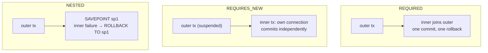

#### Audit log that survives a rollback

```java
@Service
public class AuditService {
    @Transactional(propagation = Propagation.REQUIRES_NEW)
    public void record(String action, String details) {
        auditRepository.save(new AuditEntry(action, details));
    }   // commits here, independent of the caller
}

@Service
public class TransferService {
    @Transactional
    public void transfer(long from, long to, BigDecimal amount) {
        auditService.record("TRANSFER_ATTEMPT", from + "->" + to);   // different bean → proxy applies
        // ... if this throws, the transfer rolls back but the audit row stays
    }
}
```

⚠️ REQUIRES_NEW takes a **second connection** from the pool while the first is held. Under load with a small pool, many threads each waiting for a second connection can **deadlock the pool**.

#### The "rollback-only" trap — UnexpectedRollbackException

```java
@Transactional
public void outer() {
    try {
        inner.process();          // REQUIRED: joins outer, throws RuntimeException
    } catch (RuntimeException e) {
        log.warn("ignored", e);   // you "handled" it...
    }
}   // ...but commit fails: UnexpectedRollbackException: Transaction silently rolled back because it has been marked as rollback-only
```

The inner method's proxy saw the exception and marked the **shared** transaction rollback-only. Catching it in the outer method doesn't undo that. Fix: make the inner call `REQUIRES_NEW`/`NESTED` if its failure really is optional, or don't let the exception cross a transactional boundary.

🚀 **NESTED** needs savepoint support: works with `DataSourceTransactionManager` (JDBC). With JPA the database rolls back to the savepoint, but the Hibernate persistence context is **not** rolled back, so entity state in memory can be inconsistent — prefer REQUIRES_NEW or redesign.

<!-- subtopic: d22_t1_s3 -->
### 3. Isolation levels — dirty, non-repeatable and phantom reads

> **TL;DR:** Isolation controls what one transaction can see of others running at the same time. Higher isolation = fewer anomalies but more locking/aborts. The SQL standard defines **READ_UNCOMMITTED → READ_COMMITTED → REPEATABLE_READ → SERIALIZABLE**. Spring's `Isolation.DEFAULT` means "use the database default": **READ COMMITTED** on PostgreSQL, Oracle and SQL Server; **REPEATABLE READ** on MySQL InnoDB.

#### The anomalies

| Anomaly | What happens |
|---|---|
| **Dirty read** | T1 reads T2's **uncommitted** change; T2 rolls back → T1 used data that never existed |
| **Non-repeatable read** | T1 reads a row twice; T2 **updates and commits** in between → different values |
| **Phantom read** | T1 runs the same `WHERE` query twice; T2 **inserts/deletes** matching rows in between → different row sets |
| **Lost update** | T1 and T2 both read balance 100, both write their result → one update overwrites the other |

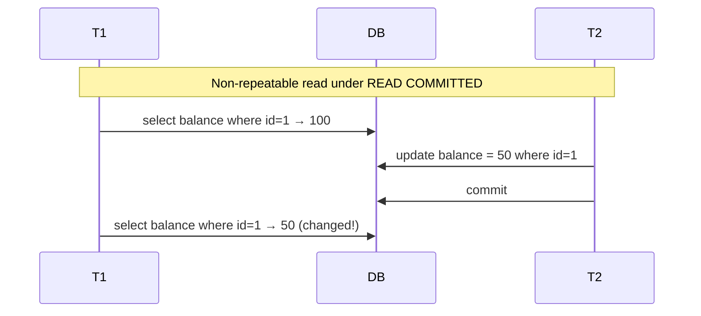

#### What each level prevents (SQL standard)

| Level | Dirty read | Non-repeatable read | Phantom read |
|---|---|---|---|
| READ_UNCOMMITTED | ❌ possible | ❌ possible | ❌ possible |
| READ_COMMITTED | ✅ prevented | ❌ possible | ❌ possible |
| REPEATABLE_READ | ✅ | ✅ | ❌ possible (standard) |
| SERIALIZABLE | ✅ | ✅ | ✅ |

Real databases differ from the standard:

- **PostgreSQL** uses MVCC snapshots: READ UNCOMMITTED behaves like READ COMMITTED; REPEATABLE READ is snapshot isolation and **also prevents phantoms**, aborting conflicting writers with "could not serialize access"; SERIALIZABLE (SSI) additionally prevents **write skew**.
- **MySQL InnoDB** REPEATABLE READ uses a consistent snapshot for plain reads and **next-key (gap) locks** for locking reads, which prevents most phantoms.

```java
@Transactional(isolation = Isolation.SERIALIZABLE)
public void bookLastSeat(long flightId, long userId) { ... }   // be ready to RETRY on serialization failures
```

| Choose | When |
|---|---|
| READ_COMMITTED (+ optimistic locking) | Default for most web apps |
| REPEATABLE_READ | Reports that read the same data several times and need a consistent view |
| SERIALIZABLE | Invariants across rows (e.g., "at most 5 on-call doctors") where write skew matters — with retry logic |

🚀 **Write skew** (allowed by snapshot isolation): two doctors both check "≥ 2 on call", both see 2, both go off call → 0 on call. Neither transaction updated the same row, so row-level conflict detection doesn't notice. Fix with SERIALIZABLE, or lock the rows read (`SELECT … FOR UPDATE`), or a constraint.

⚠️ The **lost update** isn't prevented by READ COMMITTED. Use `@Version` (next section), `SELECT … FOR UPDATE`, or atomic SQL (`update account set balance = balance - :amt where id = :id and balance >= :amt`).

<!-- subtopic: d22_t1_s4 -->
### 4. Optimistic locking (@Version) vs pessimistic locking (PESSIMISTIC_WRITE)

> **TL;DR:** **Optimistic**: assume conflicts are rare; add a `@Version` column; every UPDATE checks `where version = ?` and fails if someone else changed the row first → retry or return **409 Conflict**. **Pessimistic**: assume conflicts are likely; lock the row on read (`SELECT … FOR UPDATE`) so others **wait**.

#### Optimistic locking

```java
@Entity
public class Product {
    @Id private Long id;
    private int stock;
    @Version private long version;       // int, long, Integer, Long, or a timestamp
}
```

```sql
-- Hibernate generates
update product set stock = ?, version = 8 where id = ? and version = 7
-- 0 rows updated → someone else won → OptimisticLockException
```

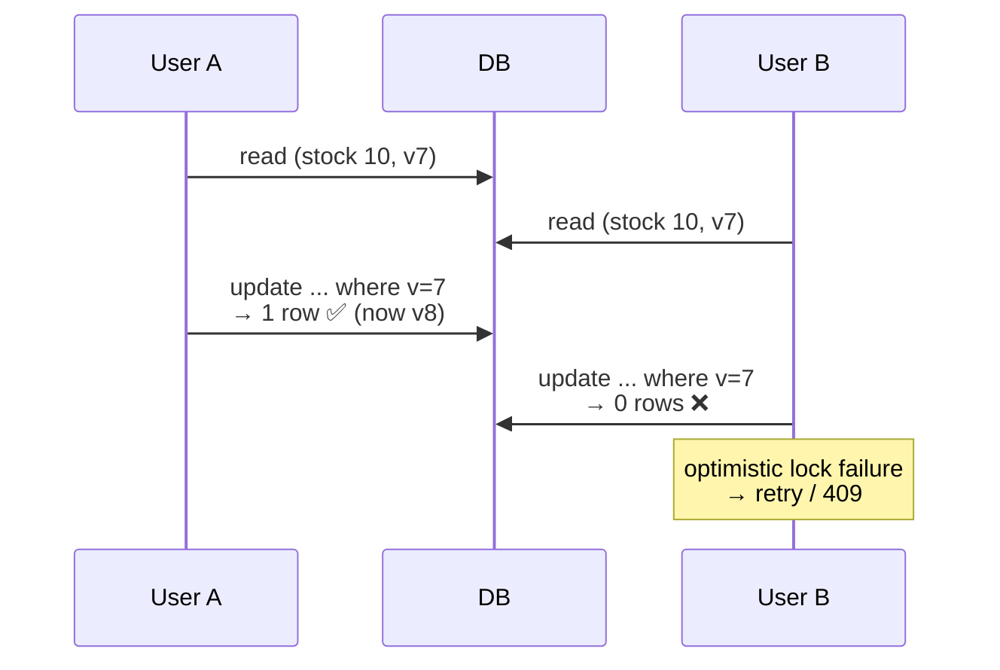

Spring translates the JPA `OptimisticLockException` into **`ObjectOptimisticLockingFailureException`**. Handle it:

```java
// Retry the whole transaction (spring-retry), with a new read each attempt
@Retryable(retryFor = ObjectOptimisticLockingFailureException.class, maxAttempts = 3,
           backoff = @Backoff(delay = 50))
@Transactional
public void reserve(long productId, int qty) {
    Product p = productRepository.findById(productId).orElseThrow();
    p.decreaseStock(qty);
}
```

⚠️ The retry must wrap the **transaction** (the retry proxy outside the transactional proxy), otherwise it retries inside an already-failed transaction.

For REST APIs, expose the version as an **ETag**; clients send `If-Match`, and you return **412 Precondition Failed** / **409 Conflict** when it doesn't match — this protects against lost updates across HTTP requests (where DB locks can't help).

#### Pessimistic locking

```java
public interface AccountRepository extends JpaRepository<Account, Long> {

    @Lock(LockModeType.PESSIMISTIC_WRITE)                 // SELECT ... FOR UPDATE
    @QueryHints(@QueryHint(name = "jakarta.persistence.lock.timeout", value = "3000"))
    @Query("select a from Account a where a.id = :id")
    Optional<Account> findForUpdate(@Param("id") Long id);
}

@Transactional
public void transfer(long fromId, long toId, BigDecimal amount) {
    // Lock in a consistent order (smaller id first) to avoid deadlocks
    long first = Math.min(fromId, toId), second = Math.max(fromId, toId);
    Account a = accounts.findForUpdate(first).orElseThrow();
    Account b = accounts.findForUpdate(second).orElseThrow();
    Account from = (a.getId() == fromId) ? a : b;
    Account to = (from == a) ? b : a;
    from.withdraw(amount);
    to.deposit(amount);
}
```

| Lock mode | SQL (PostgreSQL) | Effect |
|---|---|---|
| `PESSIMISTIC_READ` | `FOR SHARE` | Others can read-lock, nobody can write |
| `PESSIMISTIC_WRITE` | `FOR UPDATE` | Exclusive: other lockers wait |
| `PESSIMISTIC_FORCE_INCREMENT` | `FOR UPDATE` + version bump | Also increments `@Version` |
| `OPTIMISTIC_FORCE_INCREMENT` | — | Bumps version at commit even without changes (e.g., aggregate root when a child changed) |

#### Which one?

| | Optimistic | Pessimistic |
|---|---|---|
| Conflict frequency | Low | High (hot rows) |
| Throughput | High, no waiting | Lower, waiting / deadlock risk |
| On conflict | Exception → retry / 409 | Waits (or lock timeout) |
| Spans user think-time / HTTP requests | ✅ (version travels with the data) | ❌ never hold DB locks across requests |
| Examples | Editing a profile, product details | Seat booking, inventory counters, money transfers under contention |

🚀 **Job queues with `FOR UPDATE SKIP LOCKED`:** many workers each grab different pending rows without blocking each other:

```sql
select * from jobs where status = 'PENDING' order by created_at limit 10 for update skip locked;
```

(Hibernate: lock timeout hint `-2` = `SKIP LOCKED`.)

<!-- subtopic: d22_t1_s5 -->
### 5. Entity lifecycle: Transient → Managed → Detached → Removed; flush vs commit

> **TL;DR:** An entity is **transient** (just `new`), **managed** (tracked by the persistence context — changes are saved automatically), **detached** (was managed, context closed), or **removed** (scheduled for delete). Hibernate **writes SQL at flush**, which happens before commit (and before some queries). **Commit** makes it permanent.

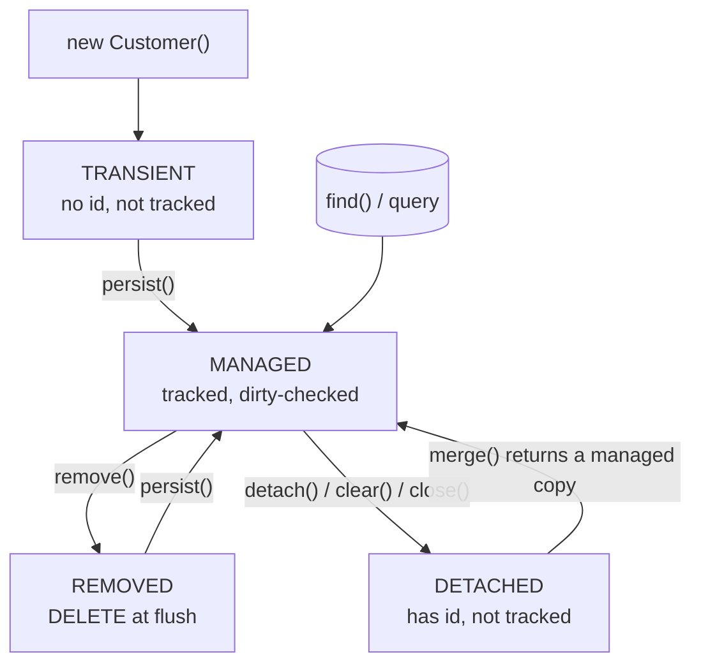

| Operation | Effect |
|---|---|
| `persist(e)` | Transient → managed; INSERT at flush (or immediately with IDENTITY) |
| `find(Class, id)` | Returns managed entity (from context if already loaded — no SQL) |
| `merge(e)` | Copies state of a detached/transient object onto a **managed instance** and returns it. The argument stays detached! |
| `remove(e)` | Managed → removed; DELETE at flush |
| `detach(e)` / `clear()` | Stop tracking one / all |
| `refresh(e)` | Reload state from the DB, discarding in-memory changes |
| `flush()` | Execute pending SQL now (within the transaction) |

```java
Customer detached = ...;                 // e.g. deserialized from a request
Customer managed = em.merge(detached);
managed.setStatus(BLOCKED);              // ✅ tracked
detached.setStatus(BLOCKED);             // ❌ not tracked — nothing happens
```

#### Dirty checking

When an entity becomes managed, Hibernate keeps a **snapshot** of its loaded state. At flush it compares current values with the snapshot and generates UPDATEs for changed entities — that's why you don't need `save()` for managed entities.

```java
@Transactional
public void rename(long id, String name) {
    Customer c = customerRepository.findById(id).orElseThrow();
    c.setLastName(name);          // no save() — UPDATE generated at flush
}
```

Cost: snapshots double memory, and flush compares every managed entity. For large read-only work use `readOnly = true` or projections; in batch jobs call `flush()` + `clear()` every N rows.

#### Flush vs commit

| | Flush | Commit |
|---|---|---|
| What | Sends pending INSERT/UPDATE/DELETE SQL to the DB | Ends the DB transaction, making changes durable and visible |
| Reversible? | Yes — a later rollback undoes flushed SQL | No |
| When (FlushMode.AUTO) | Before commit; before a JPQL/native query that touches affected tables; on `flush()` | End of the `@Transactional` method |

```java
@Transactional
public void example() {
    repo.save(new Customer("a@x.com", "A"));        // with SEQUENCE: no INSERT yet (queued)
    long count = repo.count();                       // AUTO flush: INSERT runs first so count is correct
    repo.flush();                                    // explicit flush: surfaces constraint violations now
    throw new RuntimeException("boom");              // everything above is rolled back
}
```

🚀 At flush Hibernate orders statements by type — roughly inserts, then updates, then collection changes, then **deletes last**. Deleting a row and inserting one with the same unique key in one flush therefore fails with a unique-constraint violation; call `flush()` between them.

<!-- subtopic: d22_t1_s6 -->
### 6. First-level cache vs second-level cache

> **TL;DR:** The **first-level cache** is the persistence context itself: per `EntityManager`/transaction, always on, guarantees **one Java object per row** in that context. The **second-level cache (L2)** is shared across sessions (application-wide), **opt-in per entity**, backed by a provider (Ehcache, Hazelcast, Infinispan via JCache). Use L2 for **read-mostly reference data**.

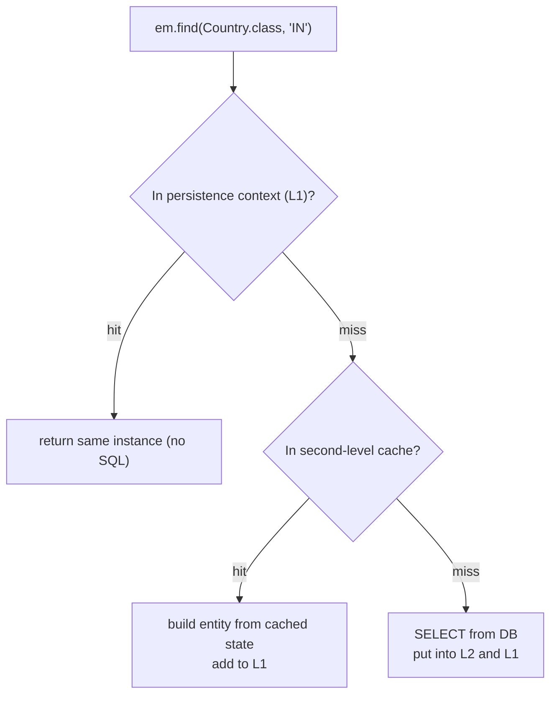

#### First-level cache in action

```java
@Transactional
public void l1Demo() {
    Customer a = repo.findById(1L).orElseThrow();   // SELECT
    Customer b = repo.findById(1L).orElseThrow();   // no SQL — same context
    System.out.println(a == b);                     // true: identity guaranteed
}
```

⚠️ `findById` uses the L1 cache, but a **JPQL query** (`findByEmail`) always hits the database (then reuses existing instances for rows already in the context). Without a transaction, every repository call gets a new context → no reuse.

#### Second-level cache setup (Hibernate + JCache/Ehcache)

```yaml
spring:
  jpa:
    properties:
      hibernate:
        cache:
          use_second_level_cache: true
          region.factory_class: jcache
        javax.cache.provider: org.ehcache.jsr107.EhcacheCachingProvider
```

```java
@Entity
@Cacheable                                                   // jakarta.persistence.Cacheable
@org.hibernate.annotations.Cache(usage = CacheConcurrencyStrategy.READ_WRITE)
public class Country {
    @Id private String code;
    private String name;

    @OneToMany(mappedBy = "country")
    @org.hibernate.annotations.Cache(usage = CacheConcurrencyStrategy.READ_WRITE)   // collection cache (ids only)
    private Set<City> cities;
}
```

| Strategy | Use for |
|---|---|
| `READ_ONLY` | Never-changing data (countries, currencies) — fastest |
| `NONSTRICT_READ_WRITE` | Rarely updated, brief staleness OK |
| `READ_WRITE` | Updated sometimes; soft locks keep it consistent |
| `TRANSACTIONAL` | JTA-capable providers only |

| | First-level | Second-level |
|---|---|---|
| Scope | One persistence context (≈ transaction / request) | Whole application (`SessionFactory`), optionally cluster |
| Enabled | Always | Opt-in per entity / collection |
| Stores | Entity objects | Dehydrated state (values, not objects) |
| Invalidation | Context ends / `clear()` | On updates through Hibernate; **not** on bulk/native SQL or other apps |

⚠️ **Name clash:** `jakarta.persistence.Cacheable` (L2 entity cache) is **not** Spring's `org.springframework.cache.annotation.@Cacheable` (method-result caching with `@EnableCaching` — e.g., caching a service method's DTO in Redis). Both are useful; they're different layers.

🚀 The **query cache** (`hibernate.cache.use_query_cache` + query hint) stores result **ids** per query + parameters and is invalidated whenever **any** row of the involved tables changes — rarely worth it on frequently written tables. In multi-instance deployments, a local L2 cache goes stale unless the provider is distributed or invalidated across nodes.

<!-- subtopic: d22_t1_s7 -->
### 7. Database migrations: Flyway vs Liquibase

> **TL;DR:** Never let Hibernate (`ddl-auto=update`) manage a production schema. Write **versioned migrations** that are stored with the code, applied **in order, exactly once**, and recorded in a history table. **Flyway** uses plain SQL files named `V1__init.sql`; **Liquibase** uses changelogs (XML/YAML/JSON/SQL) with changesets and built-in rollback.

#### Flyway

```
src/main/resources/db/migration/
├── V1__create_customers.sql
├── V2__create_orders.sql
├── V3__add_customer_status.sql
└── R__order_summary_view.sql      ← repeatable: re-run whenever its checksum changes
```

```sql
-- V1__create_customers.sql
create sequence customer_seq increment by 50;

create table customers (
    id          bigint primary key,
    email       varchar(255) not null,
    last_name   varchar(255) not null,
    created_at  timestamp with time zone not null default now(),
    constraint uk_customer_email unique (email)
);
```

```yaml
spring:
  flyway:
    enabled: true                     # auto-runs at startup when flyway-core is on the classpath
    locations: classpath:db/migration
    baseline-on-migrate: true         # for adopting Flyway on an existing database
  jpa:
    hibernate:
      ddl-auto: validate              # Hibernate only checks the mapping against the migrated schema
```

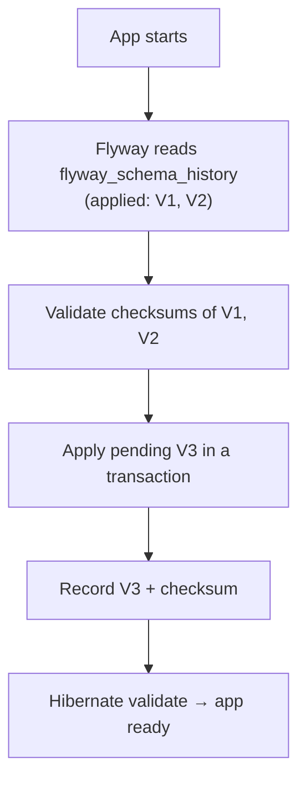

Rules:

- Naming: `V<version>__<description>.sql` (two underscores). Versions sort numerically (`V1_1__` = 1.1).
- **Never edit an applied migration** — the checksum changes and startup fails (`Validate failed: Migration checksum mismatch`). Add a new version instead.
- Undo = a new forward migration (Flyway's `U` undo files are a paid feature and rarely used).
- PostgreSQL statements that can't run in a transaction (`CREATE INDEX CONCURRENTLY`) need their own migration with Flyway's `executeInTransaction=false` script config.

#### Liquibase

```yaml
# src/main/resources/db/changelog/db.changelog-master.yaml
databaseChangeLog:
  - changeSet:
      id: 3-add-customer-status
      author: sarthak
      changes:
        - addColumn:
            tableName: customers
            columns:
              - column:
                  name: status
                  type: varchar(20)
                  defaultValue: ACTIVE
                  constraints:
                    nullable: false
      rollback:
        - dropColumn:
            tableName: customers
            columnName: status
```

Tracks applied changesets in `DATABASECHANGELOG` (by id + author + file), with `DATABASECHANGELOGLOCK` to stop two instances migrating at once.

| | Flyway | Liquibase |
|---|---|---|
| Format | Plain SQL (also Java migrations) | XML / YAML / JSON / SQL changelogs |
| Learning curve | Very low | Higher |
| DB-agnostic changes | No (you write dialect SQL) | Yes (abstract change types) |
| Rollback | Write a new migration | Built-in `rollback` blocks |
| Preconditions, contexts/labels | Limited | Rich |
| History table | `flyway_schema_history` | `DATABASECHANGELOG` |
| Best for | Teams fluent in SQL, one DB | Multi-DB products, need for rollbacks/diffs |

🚀 **Zero-downtime changes (expand → migrate → contract):** during a rolling deploy, old and new app versions run together, so each migration must work with both.

1. **Expand:** add the new column (nullable), deploy code that writes **both** old and new.
2. **Migrate:** backfill in batches.
3. **Contract:** once no old code remains, make it NOT NULL, stop writing the old column, and drop it in a later release.

Never rename or drop a column in the same release as the code change.

### 🎤 Interview Q&A — Transactions & Hibernate

<details><summary>Q1. Why doesn't @Transactional work when I call the method from the same class?</summary>

Spring applies transactions through a proxy around the bean. A `this.method()` call goes directly to the target object, skipping the proxy, so no transaction logic runs. Move the method to another bean or use `TransactionTemplate`.

</details>

<details><summary>Q2. Does @Transactional roll back on checked exceptions?</summary>

No, only on `RuntimeException` and `Error` by default. Use `rollbackFor = Exception.class` (or specific types) to change that.

</details>

<details><summary>Q3. When would you use REQUIRES_NEW?</summary>

When some work must commit independently of the caller's outcome — audit logs, recording a failed attempt, allocating a number. It suspends the outer transaction and uses a separate connection, so watch pool size.

</details>

<details><summary>Q4. What's the difference between optimistic and pessimistic locking?</summary>

Optimistic: no locks; a `@Version` column is checked on update and a conflict throws, so you retry or report 409. Pessimistic: rows are locked when read (`SELECT … FOR UPDATE`) and other transactions wait. Optimistic suits low contention and long user flows; pessimistic suits hot rows with frequent conflicts.

</details>

<details><summary>Q5. What's the difference between flush and commit?</summary>

Flush sends pending SQL to the database inside the current transaction; it can still be rolled back. Commit ends the transaction and makes the changes durable and visible to others.

</details>

<details><summary>Q6. What's the default isolation level?</summary>

Spring uses the database default: READ COMMITTED on PostgreSQL, Oracle and SQL Server; REPEATABLE READ on MySQL InnoDB.

</details>

<details><summary>Q7. Why use Flyway/Liquibase instead of ddl-auto=update?</summary>

Migrations are versioned, reviewed, repeatable across environments and recorded in a history table. `update` can't rename or drop, can't migrate data, and its result depends on the database's previous state.

</details>

<!-- topic: d18_t2 -->
## 🧮 DSA — Graphs Introduction

<!-- subtopic: d18_t2_s1 -->
### 8. Graph fundamentals — vertices, edges, directed/undirected, weighted

> **TL;DR:** A graph `G = (V, E)` is a set of **vertices** (nodes) and **edges** (connections). Edges can be **directed** (one-way: follows, prerequisites) or **undirected** (two-way: friendships, roads), **weighted** (distance, cost) or **unweighted**. Trees and linked lists are special graphs.

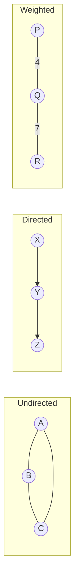

#### Vocabulary

| Term | Meaning |
|---|---|
| Degree | Number of edges at a vertex (directed: **in-degree** / **out-degree**) |
| Path | Sequence of vertices connected by edges |
| Cycle | Path that starts and ends at the same vertex |
| Connected | Every vertex reachable from every other (undirected) |
| Connected component | A maximal connected piece |
| Strongly connected (directed) | Every vertex reaches every other following edge directions |
| **DAG** | Directed Acyclic Graph — dependencies, build systems, course prerequisites (Day 23) |
| Tree | Connected, acyclic, undirected, exactly `V - 1` edges |
| Dense / sparse | `E` close to `V²` / `E` close to `V` |
| Self-loop, multi-edge | Edge to itself / several edges between the same pair |

Edge-count facts: an undirected simple graph has at most `V(V - 1)/2` edges; a directed one at most `V(V - 1)`. The sum of all degrees = `2E` (each edge counted at both ends).

| Real problem | Vertices | Edges |
|---|---|---|
| Social network | People | Friendships (undirected) / follows (directed) |
| Maps / GPS | Intersections | Roads (weighted by distance/time) |
| Course schedule | Courses | Prerequisite → course (DAG) |
| Web crawler | Pages | Links (directed) |
| Grid puzzles | Cells | Up/down/left/right moves (implicit graph) |
| Microservices | Services | Calls (dependency graph) |

**Recognising graph problems in interviews:** "connected", "islands", "reachable", "network", "dependencies/prerequisites", "shortest number of steps", "transform word A into B one letter at a time" → think graph + BFS/DFS.

<!-- subtopic: d18_t2_s2 -->
### 9. Graph representations — adjacency list vs adjacency matrix

> **TL;DR:** An **adjacency list** stores, for each vertex, the list of its neighbours — **O(V + E)** space, the default for sparse graphs (most interview graphs). An **adjacency matrix** is a `V × V` table with `1` (or the weight) where an edge exists — **O(V²)** space, O(1) edge lookup, good for dense graphs. Interview input usually arrives as an **edge list**, which you convert.

Graph: `0–1, 0–2, 1–2, 2–3` (undirected)

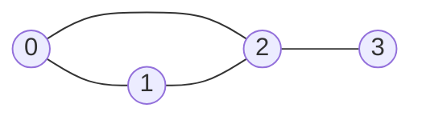

| Adjacency list | Adjacency matrix |
|---|---|
| `0 → [1, 2]` | `0: [0 1 1 0]` |
| `1 → [0, 2]` | `1: [1 0 1 0]` |
| `2 → [0, 1, 3]` | `2: [1 1 0 1]` |
| `3 → [2]` | `3: [0 0 1 0]` |

```java
// Edge list → adjacency list (undirected)
List<List<Integer>> buildGraph(int n, int[][] edges) {
    List<List<Integer>> graph = new ArrayList<>();
    for (int i = 0; i < n; i++) graph.add(new ArrayList<>());
    for (int[] e : edges) {
        graph.get(e[0]).add(e[1]);
        graph.get(e[1]).add(e[0]);          // omit this line for a directed graph
    }
    return graph;
}

// Weighted: store pairs
List<List<int[]>> weighted = new ArrayList<>();      // weighted.get(u) = list of {v, w}

// Vertices that aren't 0..n-1 (strings, objects): use a map
Map<String, List<String>> g = new HashMap<>();
g.computeIfAbsent("A", k -> new ArrayList<>()).add("B");

// Adjacency matrix
boolean[][] adj = new boolean[n][n];
for (int[] e : edges) adj[e[0]][e[1]] = adj[e[1]][e[0]] = true;
```

| Operation | Adjacency list | Adjacency matrix | Edge list |
|---|---|---|---|
| Space | O(V + E) | O(V²) | O(E) |
| Is `u–v` an edge? | O(deg(u)) | **O(1)** | O(E) |
| Iterate neighbours of `u` | **O(deg(u))** | O(V) | O(E) |
| Add an edge | O(1) | O(1) | O(1) |
| BFS/DFS total | **O(V + E)** | O(V²) | — |
| Best for | Sparse graphs, traversals | Dense graphs, Floyd–Warshall, quick lookups | Kruskal's MST, Bellman-Ford |

#### Grids are implicit graphs

Each cell `(r, c)` is a vertex; its neighbours are the 4 (or 8) adjacent cells. You don't build anything — just loop over direction arrays:

```java
int[][] DIRS = {{1, 0}, {-1, 0}, {0, 1}, {0, -1}};
for (int[] d : DIRS) {
    int nr = r + d[0], nc = c + d[1];
    if (nr < 0 || nc < 0 || nr >= rows || nc >= cols) continue;   // bounds check first
    // visit (nr, nc)
}
```

A grid with `m × n` cells has V = mn and E ≤ 4mn, so traversals are O(mn).

<!-- subtopic: d18_t2_s3 -->
### 10. BFS — queue-based, level by level; shortest path in unweighted graphs

> **TL;DR:** Breadth-First Search explores all vertices at distance 1, then distance 2, and so on, using a **queue**. Because it visits vertices in order of distance, the first time BFS reaches a vertex is along a **shortest path (fewest edges)**. Mark vertices visited **when you enqueue them**, not when you dequeue. Time **O(V + E)**.

```java
// Shortest distance (in edges) from src to every vertex; -1 if unreachable
int[] bfs(List<List<Integer>> graph, int src) {
    int n = graph.size();
    int[] dist = new int[n];
    Arrays.fill(dist, -1);
    Deque<Integer> queue = new ArrayDeque<>();

    dist[src] = 0;                         // dist != -1 doubles as "visited"
    queue.offer(src);
    while (!queue.isEmpty()) {
        int u = queue.poll();
        for (int v : graph.get(u)) {
            if (dist[v] == -1) {           // mark on ENQUEUE → each vertex enters the queue once
                dist[v] = dist[u] + 1;
                queue.offer(v);
            }
        }
    }
    return dist;
}
```

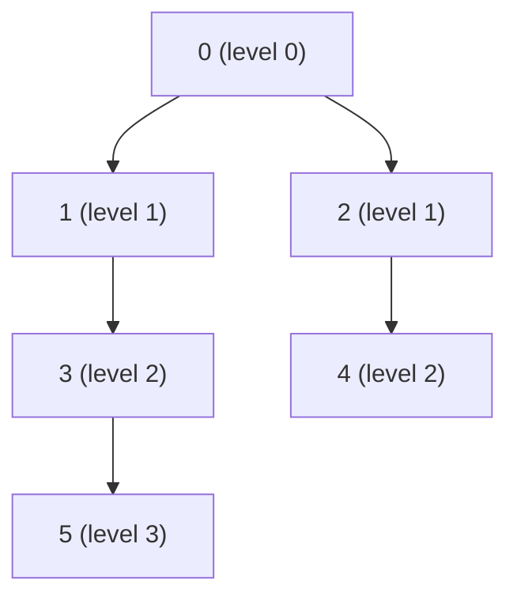

Queue trace from `0`: `[0] → [1, 2] → [2, 3] → [3, 4] → [4, 5] → [5] → []`.

#### Processing level by level

```java
int level = 0;
while (!queue.isEmpty()) {
    int size = queue.size();               // everything currently in the queue = one level
    for (int i = 0; i < size; i++) {
        int u = queue.poll();
        // ... enqueue unvisited neighbours (they belong to level + 1)
    }
    level++;
}
```

Used for "minimum minutes", "minimum steps", "number of moves" problems (e.g., Rotting Oranges on Day 23, Word Ladder).

#### Reconstructing the actual path

```java
List<Integer> shortestPath(List<List<Integer>> graph, int src, int dst) {
    int[] parent = new int[graph.size()];
    Arrays.fill(parent, -2);               // -2 = unvisited
    parent[src] = -1;
    Deque<Integer> q = new ArrayDeque<>(List.of(src));
    while (!q.isEmpty()) {
        int u = q.poll();
        if (u == dst) break;
        for (int v : graph.get(u)) {
            if (parent[v] == -2) { parent[v] = u; q.offer(v); }
        }
    }
    if (parent[dst] == -2) return List.of();                 // unreachable
    LinkedList<Integer> path = new LinkedList<>();
    for (int at = dst; at != -1; at = parent[at]) path.addFirst(at);
    return path;
}
```

⚠️ Marking visited on **dequeue** instead of enqueue lets the same vertex be enqueued many times — still correct for distances, but can blow up to O(E) queue entries per vertex in dense graphs and TLE.

⚠️ BFS gives shortest paths only when **all edges have equal weight**. Weighted → **Dijkstra** (a heap instead of a queue — Day 31). Weights 0/1 → 0-1 BFS with a deque.

<!-- subtopic: d18_t2_s4 -->
### 11. DFS — stack/recursion-based deep traversal; cycle detection

> **TL;DR:** Depth-First Search goes as **deep** as possible along one path before backtracking, using **recursion** (the call stack) or an explicit **stack**. O(V + E). Used for reachability, connected components, cycle detection, topological sort, and as the skeleton of backtracking.

```java
void dfs(List<List<Integer>> graph, int u, boolean[] visited) {
    visited[u] = true;
    // pre-order work here
    for (int v : graph.get(u)) {
        if (!visited[v]) dfs(graph, v, visited);
    }
    // post-order work here (e.g., topological sort pushes u now)
}

// Iterative version with an explicit stack (avoids StackOverflowError on deep graphs)
void dfsIterative(List<List<Integer>> graph, int src) {
    boolean[] visited = new boolean[graph.size()];
    Deque<Integer> stack = new ArrayDeque<>();
    stack.push(src);
    while (!stack.isEmpty()) {
        int u = stack.pop();
        if (visited[u]) continue;          // may have been pushed several times
        visited[u] = true;
        for (int v : graph.get(u)) if (!visited[v]) stack.push(v);
    }
}
```

#### Counting connected components

```java
int countComponents(int n, int[][] edges) {          // LeetCode 323
    List<List<Integer>> graph = buildGraph(n, edges);
    boolean[] visited = new boolean[n];
    int components = 0;
    for (int i = 0; i < n; i++) {
        if (!visited[i]) {
            dfs(graph, i, visited);                  // floods one whole component
            components++;
        }
    }
    return components;
}
```

#### Cycle detection — undirected graph

A visited neighbour that **isn't the vertex we came from** closes a cycle.

```java
boolean hasCycleUndirected(List<List<Integer>> graph) {
    boolean[] visited = new boolean[graph.size()];
    for (int i = 0; i < graph.size(); i++) {
        if (!visited[i] && dfsCycle(graph, i, -1, visited)) return true;
    }
    return false;
}

private boolean dfsCycle(List<List<Integer>> graph, int u, int parent, boolean[] visited) {
    visited[u] = true;
    for (int v : graph.get(u)) {
        if (!visited[v]) {
            if (dfsCycle(graph, v, u, visited)) return true;
        } else if (v != parent) {
            return true;                              // back edge to an ancestor
        }
    }
    return false;
}
```

#### Cycle detection — directed graph (three colours)

In a directed graph, reaching an already-**finished** vertex is fine (a cross edge); reaching a vertex **still on the current path** is a cycle.

```java
// 0 = WHITE (unvisited), 1 = GRAY (on the current DFS path), 2 = BLACK (fully explored)
boolean hasCycleDirected(List<List<Integer>> graph) {
    int[] color = new int[graph.size()];
    for (int i = 0; i < graph.size(); i++) {
        if (color[i] == 0 && dfsDirected(graph, i, color)) return true;
    }
    return false;
}

private boolean dfsDirected(List<List<Integer>> graph, int u, int[] color) {
    color[u] = 1;
    for (int v : graph.get(u)) {
        if (color[v] == 1) return true;                       // back edge → cycle
        if (color[v] == 0 && dfsDirected(graph, v, color)) return true;
    }
    color[u] = 2;
    return false;
}
```

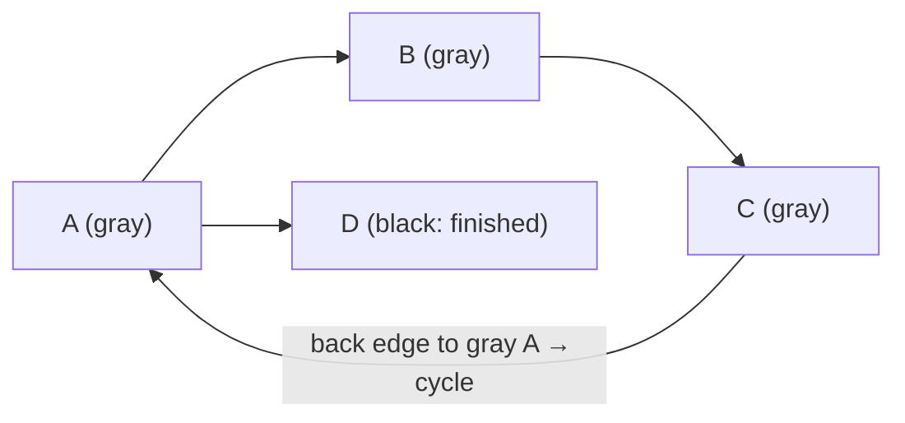

| | BFS | DFS |
|---|---|---|
| Data structure | Queue | Stack / recursion |
| Order | Level by level | Deep first, then backtrack |
| Shortest path (unweighted) | ✅ | ❌ |
| Memory | O(width of graph) | O(depth) — recursion may overflow at ~10⁴ deep |
| Natural for | Min steps, levels, multi-source spread | Components, cycles, topological sort, backtracking, path existence |

<!-- subtopic: d18_t2_s5 -->
### 12. Number of Islands (LeetCode 200)

> **Problem:** given an `m × n` grid of `'1'` (land) and `'0'` (water), count islands (groups of land connected horizontally/vertically). 🔗 [LeetCode 200](https://leetcode.com/problems/number-of-islands/)

**Key idea:** it's **counting connected components** in an implicit grid graph. Scan every cell; when you find unvisited land, increment the count and **flood-fill** the whole island so it's not counted again.

```java
public int numIslands(char[][] grid) {
    int islands = 0;
    for (int r = 0; r < grid.length; r++) {
        for (int c = 0; c < grid[0].length; c++) {
            if (grid[r][c] == '1') {
                islands++;
                sink(grid, r, c);
            }
        }
    }
    return islands;
}

private void sink(char[][] grid, int r, int c) {
    if (r < 0 || c < 0 || r >= grid.length || c >= grid[0].length || grid[r][c] != '1') return;
    grid[r][c] = '0';                  // mark visited by sinking the land (mutates input)
    sink(grid, r + 1, c);
    sink(grid, r - 1, c);
    sink(grid, r, c + 1);
    sink(grid, r, c - 1);
}   // O(m·n) time, O(m·n) recursion depth worst case (all land)
```

```
1 1 0 0 0        A A . . .
1 1 0 0 0   →    A A . . .      3 islands
0 0 1 0 0        . . B . .
0 0 0 1 1        . . . C C
```

#### BFS version (no deep recursion)

```java
private void sinkBfs(char[][] grid, int sr, int sc) {
    int[][] dirs = {{1, 0}, {-1, 0}, {0, 1}, {0, -1}};
    Deque<int[]> q = new ArrayDeque<>();
    grid[sr][sc] = '0';                                    // mark when enqueued
    q.offer(new int[]{sr, sc});
    while (!q.isEmpty()) {
        int[] cell = q.poll();
        for (int[] d : dirs) {
            int r = cell[0] + d[0], c = cell[1] + d[1];
            if (r >= 0 && c >= 0 && r < grid.length && c < grid[0].length && grid[r][c] == '1') {
                grid[r][c] = '0';
                q.offer(new int[]{r, c});
            }
        }
    }
}
```

| Approach | Time | Extra space | Notes |
|---|---|---|---|
| DFS (recursive) | O(mn) | O(mn) stack worst case | Shortest code; 300×300 all-land grid recurses 90 000 deep — can overflow in Java |
| BFS | O(mn) | O(min(m, n)) queue | Safe for large grids |
| Union-Find | O(mn · α) | O(mn) | Great for the streaming variant **Number of Islands II (LC 305)**, where land is added over time |

⚠️ If you must not modify the input, use a separate `boolean[][] visited`. Mention this trade-off in interviews.

Related: Max Area of Island (LC 695 — return the size from the flood fill), Surrounded Regions (LC 130 — flood from the border first), Number of Closed Islands (LC 1254), Count Sub Islands (LC 1905), Flood Fill (LC 733).

---

## 📝 Day 22 Revision Cheat Sheet

| Topic | Remember this |
|---|---|
| @Transactional | Proxy → begin / commit / rollback; thread-bound; service layer; keep short |
| Rollback | RuntimeException + Error roll back; checked commit unless `rollbackFor` |
| Self-invocation | `this.m()` bypasses proxy → move to another bean / TransactionTemplate |
| Propagation | REQUIRED join-or-create; REQUIRES_NEW suspend + independent; NESTED savepoint; MANDATORY needs one; NEVER forbids |
| Rollback-only trap | Inner REQUIRED throws + outer catches → UnexpectedRollbackException |
| Isolation | DEFAULT = DB's: Postgres/Oracle/SQL Server RC, MySQL RR; anomalies: dirty, non-repeatable, phantom, lost update, write skew |
| Optimistic | `@Version` → `where version = ?` → ObjectOptimisticLockingFailureException → retry / 409 |
| Pessimistic | `@Lock(PESSIMISTIC_WRITE)` = FOR UPDATE; lock order; timeouts; SKIP LOCKED queues |
| Lifecycle | Transient → Managed → Detached / Removed; merge returns the managed copy |
| Dirty checking | Snapshot compare at flush; no save() needed for managed entities |
| Flush vs commit | Flush = send SQL (reversible); commit = make durable |
| L1 cache | Per persistence context, always on, identity guarantee |
| L2 cache | App-wide, opt-in, READ_ONLY/READ_WRITE; reference data; not Spring's @Cacheable |
| Flyway | `V1__desc.sql`, history table + checksums, never edit applied; `ddl-auto=validate` |
| Liquibase | Changesets in YAML/XML, built-in rollback, DB-agnostic |
| Graph | V + E; directed/undirected, weighted; DAG; degree sum = 2E |
| Representation | List O(V + E) default; matrix O(V²) for dense / O(1) lookup |
| BFS | Queue, mark on enqueue, shortest path in unweighted, O(V + E) |
| DFS | Recursion/stack; components; undirected cycle = visited non-parent; directed cycle = gray node |
| Islands | Count components with flood fill; O(mn) |

### ⚡ Rapid-fire self-test

1. Does `this.save()` from inside a `@Transactional` bean apply a new propagation? → **No (bypasses the proxy)**
2. Default propagation? → **REQUIRED**
3. Which propagation uses a savepoint? → **NESTED**
4. Default isolation on PostgreSQL? MySQL InnoDB? → **READ COMMITTED; REPEATABLE READ**
5. SQL generated for an optimistic-locked update? → **`... where id = ? and version = ?`**
6. JPA lock mode for `SELECT … FOR UPDATE`? → **PESSIMISTIC_WRITE**
7. Does `merge()` make its argument managed? → **No, it returns a managed copy**
8. Which cache is always on? → **First-level (persistence context)**
9. Flyway file name for version 4? → **`V4__description.sql`**
10. Which traversal finds the shortest path in an unweighted graph? → **BFS**
