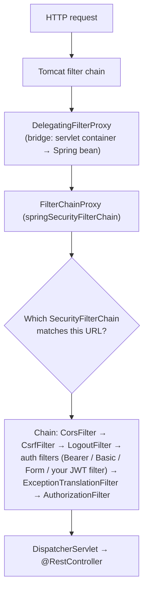
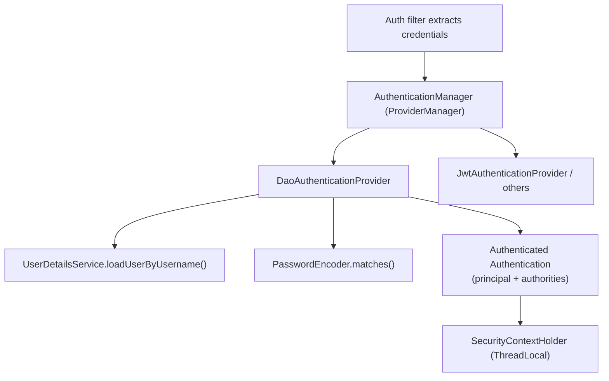
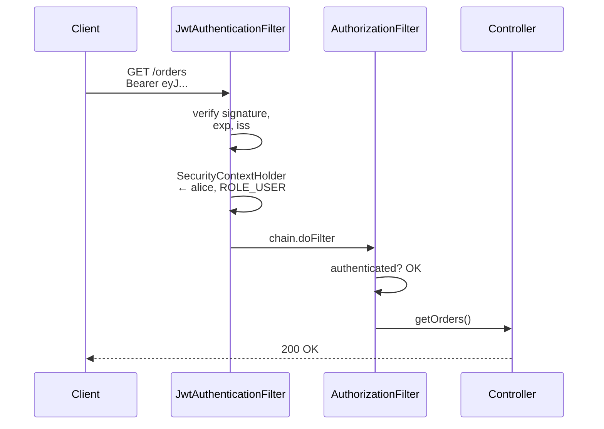
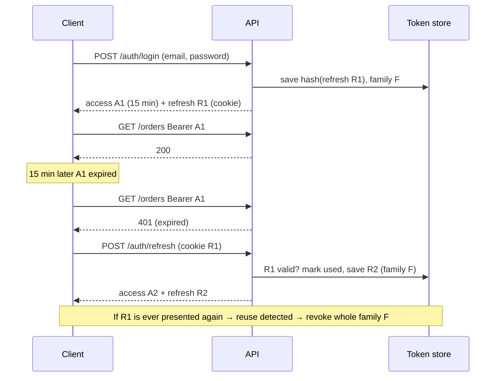
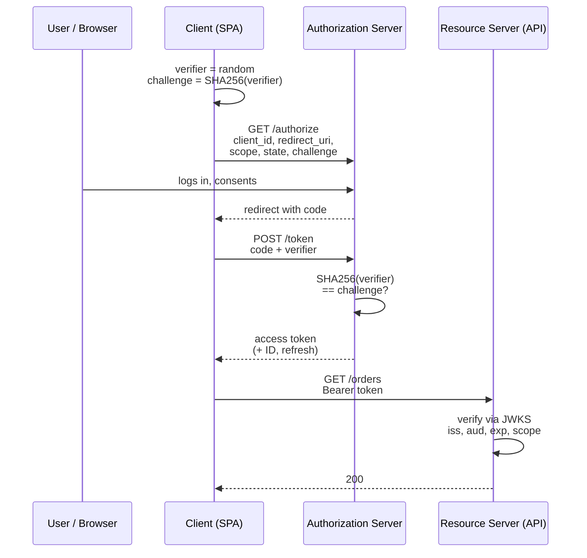
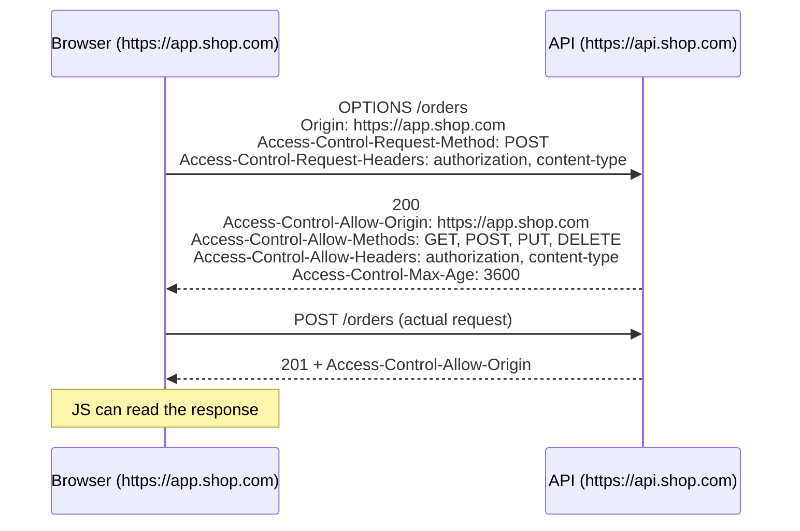
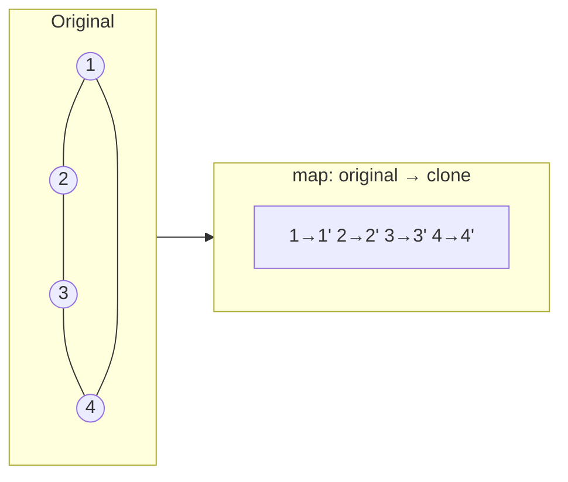
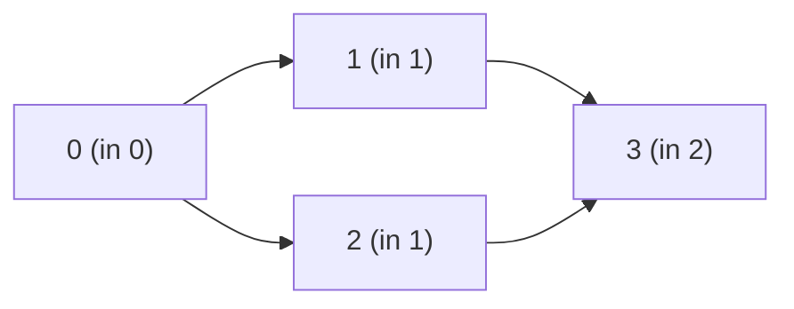
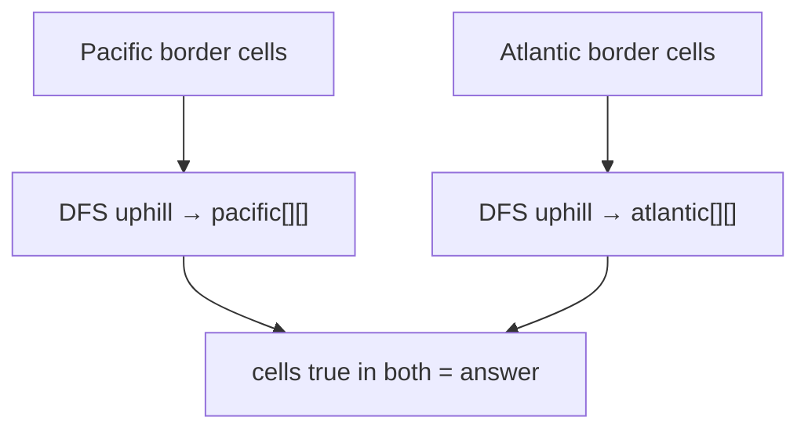

# Day 23 — Spring Security: JWT Authentication & OAuth2

> **How to use these notes:** each section maps to one checklist item. Run the code, study the diagrams, then test yourself with the collapsible questions. 🚀 marks senior-level details.

**Today's goal:** understand how Spring Security processes every request through a **filter chain**, build **stateless JWT authentication** (token structure, a custom `OncePerRequestFilter`, access + refresh tokens), know how **OAuth2 / OpenID Connect** with **PKCE** works and when to use it instead of hand-rolled JWT, secure methods with `@PreAuthorize`, configure **CORS** correctly, and store passwords safely with **BCrypt/Argon2**. On the DSA side: medium **graph** problems — cloning, multi-source BFS, **topological sort**, and reverse-flow search.

Two words to keep apart all day:

| Term | Question it answers | Failure status |
|---|---|---|
| **Authentication** (AuthN) | *Who are you?* (login, token validation) | **401 Unauthorized** |
| **Authorization** (AuthZ) | *What are you allowed to do?* (roles, permissions) | **403 Forbidden** |

<!-- topic: d23_t1 -->
## 🌿 Spring Security — Auth & JWT

<!-- subtopic: d23_t1_s1 -->
### 1. The security filter chain — SecurityFilterChain bean (Boot 3)

> **TL;DR:** Spring Security is a chain of **servlet filters** that runs **before** your controllers. You configure it by declaring a **`SecurityFilterChain` `@Bean`** using the lambda DSL. The old `WebSecurityConfigurerAdapter` (Boot 2) was deprecated in Spring Security 5.7 and **removed in 6.0** (Boot 3).

#### Where the filters sit



With no configuration, adding `spring-boot-starter-security` **locks every endpoint** behind HTTP Basic/form login with a generated password printed at startup.

#### A stateless REST API configuration (Spring Security 6)

```java
@Configuration
@EnableWebSecurity
@EnableMethodSecurity                                    // enables @PreAuthorize (section 6)
public class SecurityConfig {

    private final JwtAuthenticationFilter jwtFilter;

    public SecurityConfig(JwtAuthenticationFilter jwtFilter) { this.jwtFilter = jwtFilter; }

    @Bean
    SecurityFilterChain api(HttpSecurity http) throws Exception {
        http
            .csrf(csrf -> csrf.disable())                         // no cookies for auth → no CSRF risk
            .cors(Customizer.withDefaults())                      // uses the CorsConfigurationSource bean
            .sessionManagement(s -> s.sessionCreationPolicy(SessionCreationPolicy.STATELESS))
            .authorizeHttpRequests(auth -> auth
                .requestMatchers("/auth/**", "/actuator/health").permitAll()
                .requestMatchers(HttpMethod.GET, "/products/**").permitAll()
                .requestMatchers("/admin/**").hasRole("ADMIN")
                .anyRequest().authenticated())                    // order matters: first match wins
            .exceptionHandling(e -> e
                .authenticationEntryPoint(new HttpStatusEntryPoint(HttpStatus.UNAUTHORIZED))   // 401
                .accessDeniedHandler((req, res, ex) -> res.sendError(403)))                    // 403
            .addFilterBefore(jwtFilter, UsernamePasswordAuthenticationFilter.class);
        return http.build();
    }

    @Bean
    AuthenticationManager authenticationManager(AuthenticationConfiguration config) throws Exception {
        return config.getAuthenticationManager();
    }

    @Bean
    PasswordEncoder passwordEncoder() {
        return PasswordEncoderFactories.createDelegatingPasswordEncoder();   // section 8
    }
}
```

Boot 2 (old) vs Boot 3 (new):

| Spring Security 5 / Boot 2 | Spring Security 6 / Boot 3 |
|---|---|
| `extends WebSecurityConfigurerAdapter` + `configure(HttpSecurity)` | `@Bean SecurityFilterChain` |
| `authorizeRequests()` + `antMatchers()` | `authorizeHttpRequests()` + `requestMatchers()` |
| Chained `.and()` calls | Lambda DSL (`.csrf(c -> c.disable())`) |
| `@EnableGlobalMethodSecurity(prePostEnabled = true)` | `@EnableMethodSecurity` (pre/post on by default) |
| `javax.servlet` | `jakarta.servlet` |

#### The authentication architecture



```java
@Service
public class AppUserDetailsService implements UserDetailsService {
    private final UserRepository users;

    public AppUserDetailsService(UserRepository users) { this.users = users; }

    @Override
    public UserDetails loadUserByUsername(String email) {
        AppUser u = users.findByEmail(email)
                .orElseThrow(() -> new UsernameNotFoundException("not found"));
        return User.withUsername(u.getEmail())
                .password(u.getPasswordHash())
                .roles(u.getRole().name())          // "ADMIN" → authority "ROLE_ADMIN"
                .build();
    }
}

// Anywhere in the request thread:
Authentication auth = SecurityContextHolder.getContext().getAuthentication();
String email = auth.getName();

// Or in a controller
@GetMapping("/me")
public ProfileResponse me(@AuthenticationPrincipal UserDetails user) { ... }
```

🚀 You can declare **several** `SecurityFilterChain` beans with `http.securityMatcher("/api/**")` and `@Order` — e.g., stateless JWT for `/api/**` and session + form login for `/admin-ui/**`.

<!-- subtopic: d23_t1_s2 -->
### 2. JWT structure: Header.Payload.Signature — generation, validation, expiration

> **TL;DR:** A **JSON Web Token** is three **Base64URL**-encoded parts joined by dots: `header.payload.signature`. The header names the algorithm, the payload holds **claims** (`sub`, `exp`, roles…), and the signature proves the token was issued by someone holding the key and **wasn't modified**. It's **signed, not encrypted** — anyone can read the payload.

```
eyJhbGciOiJIUzI1NiJ9.eyJzdWIiOiJhbGljZUB4LmNvbSIsInJvbGVzIjpbIlVTRVIiXSwiaWF0IjoxNzMwMDAwMDAwLCJleHAiOjE3MzAwMDA5MDB9.4pC0...
└──── header ──────┘ └──────────────────────────── payload ───────────────────────────────────────────────┘ └ signature ┘
```

| Part | Decoded | Contains |
|---|---|---|
| Header | `{"alg":"HS256","typ":"JWT"}` | Signing algorithm, optional key id `kid` |
| Payload | `{"sub":"alice@x.com","roles":["USER"],"iat":1730000000,"exp":1730000900}` | Claims |
| Signature | `HMACSHA256(base64url(header) + "." + base64url(payload), secret)` | Integrity + authenticity |

Registered claims:

| Claim | Meaning |
|---|---|
| `iss` | Issuer (who created it) |
| `sub` | Subject (user id) |
| `aud` | Audience (which API it's for) |
| `exp` | Expiration time (seconds since epoch) |
| `iat` / `nbf` | Issued at / not valid before |
| `jti` | Unique token id (for revocation lists) |

#### Signing algorithms

| | HS256 (HMAC) | RS256 / ES256 (asymmetric) |
|---|---|---|
| Keys | One shared secret signs **and** verifies | Private key signs, **public key** verifies |
| Who can verify | Only holders of the secret (who could also mint tokens) | Anyone with the public key (published as **JWKS**) |
| Use | One service issues and validates its own tokens | An auth server issues tokens for many APIs (OAuth2/OIDC) |

#### Generating and validating (jjwt 0.12)

```java
@Component
public class JwtService {
    private final SecretKey key;
    private final Duration accessTtl = Duration.ofMinutes(15);

    public JwtService(@Value("${app.jwt.secret}") String base64Secret) {
        this.key = Keys.hmacShaKeyFor(Decoders.BASE64.decode(base64Secret));  // ≥ 256 bits for HS256
    }

    public String generateAccessToken(UserDetails user) {
        Instant now = Instant.now();
        return Jwts.builder()
                .issuer("shop-api")
                .subject(user.getUsername())
                .claim("roles", user.getAuthorities().stream().map(GrantedAuthority::getAuthority).toList())
                .issuedAt(Date.from(now))
                .expiration(Date.from(now.plus(accessTtl)))
                .id(UUID.randomUUID().toString())
                .signWith(key)                                   // picks HS256 for a 256-bit key
                .compact();
    }

    /** Verifies signature and expiry; throws JwtException if invalid. */
    public Claims parse(String token) {
        return Jwts.parser()
                .verifyWith(key)
                .requireIssuer("shop-api")
                .clockSkewSeconds(30)
                .build()
                .parseSignedClaims(token)                       // rejects unsigned ("alg":"none") tokens
                .getPayload();
    }
}
```

Validation must check: **signature**, **`exp`** (and `nbf`), **`iss`** and **`aud`**, and the **algorithm you expect** (never trust the header's `alg` blindly).

#### Sessions vs JWT

| | Server session (JSESSIONID cookie) | JWT bearer token |
|---|---|---|
| State | Server stores session (memory/Redis) | Stateless: token carries the data |
| Scaling | Needs sticky sessions or a shared store | Any instance can verify |
| Logout / revoke | Delete session → instant | Hard — valid until `exp` (short TTL, denylist by `jti`, rotate keys) |
| Size per request | Small cookie | Larger header (hundreds of bytes+) |
| CSRF | Must protect (cookies sent automatically) | Not applicable when sent in `Authorization` header |
| Best for | Server-rendered web apps, BFF | APIs, mobile apps, service-to-service |

⚠️ **JWT pitfalls:** never put secrets/PII in the payload (it's readable); don't store tokens in `localStorage` if you can avoid it (XSS can steal them); keep access tokens **short-lived**; hard-coded secrets in `application.yml` committed to Git are a breach — inject from env/secret manager.

<!-- subtopic: d23_t1_s3 -->
### 3. JwtAuthenticationFilter (OncePerRequestFilter)

> **TL;DR:** A custom filter that runs **once per request**: read `Authorization: Bearer <token>`, validate it, build an `Authentication` with the user's authorities, and put it into the **`SecurityContextHolder`**. Later filters (`AuthorizationFilter`) and `@PreAuthorize` then see an authenticated user. No token → do nothing and let the chain decide (public endpoint or 401).

```java
@Component
public class JwtAuthenticationFilter extends OncePerRequestFilter {

    private final JwtService jwtService;

    public JwtAuthenticationFilter(JwtService jwtService) { this.jwtService = jwtService; }

    @Override
    protected void doFilterInternal(HttpServletRequest request, HttpServletResponse response,
                                    FilterChain chain) throws ServletException, IOException {
        String header = request.getHeader(HttpHeaders.AUTHORIZATION);
        if (header == null || !header.startsWith("Bearer ")) {
            chain.doFilter(request, response);                 // anonymous → maybe permitted
            return;
        }

        String token = header.substring(7);
        try {
            Claims claims = jwtService.parse(token);
            List<SimpleGrantedAuthority> authorities = claims.get("roles", List.class).stream()
                    .map(r -> new SimpleGrantedAuthority((String) r))
                    .toList();

            var auth = new UsernamePasswordAuthenticationToken(claims.getSubject(), null, authorities);
            auth.setDetails(new WebAuthenticationDetailsSource().buildDetails(request));

            SecurityContext context = SecurityContextHolder.createEmptyContext();
            context.setAuthentication(auth);
            SecurityContextHolder.setContext(context);
        } catch (JwtException | IllegalArgumentException e) {
            SecurityContextHolder.clearContext();             // invalid/expired → stay anonymous → 401 later
        }
        chain.doFilter(request, response);
    }

    @Override
    protected boolean shouldNotFilter(HttpServletRequest request) {
        return request.getServletPath().startsWith("/auth/");
    }
}
```



#### The login endpoint that issues tokens

```java
@RestController
@RequestMapping("/auth")
public class AuthController {
    private final AuthenticationManager authManager;
    private final JwtService jwt;
    private final UserDetailsService users;

    // constructor ...

    @PostMapping("/login")
    public TokenResponse login(@Valid @RequestBody LoginRequest req) {
        authManager.authenticate(                                // BadCredentialsException → 401
                new UsernamePasswordAuthenticationToken(req.email(), req.password()));
        UserDetails user = users.loadUserByUsername(req.email());
        return new TokenResponse(jwt.generateAccessToken(user), "Bearer", 900);
    }
}
```

⚠️ **Double registration:** Spring Boot automatically registers every `Filter` `@Bean`/`@Component` with the **servlet container** too, so the filter can run twice (once outside the security chain). `OncePerRequestFilter` guards against the double call, but the clean fix is to disable the container registration:

```java
@Bean
FilterRegistrationBean<JwtAuthenticationFilter> jwtFilterRegistration(JwtAuthenticationFilter f) {
    var reg = new FilterRegistrationBean<>(f);
    reg.setEnabled(false);          // only run inside the Spring Security chain
    return reg;
}
```

🚀 **Prefer the built-in resource server** in real projects — it already does all of the above (signature, expiry, issuer, audience, JWKS key rotation, proper 401 `WWW-Authenticate` headers):

```java
http.oauth2ResourceServer(o -> o.jwt(Customizer.withDefaults()));
```

```yaml
spring.security.oauth2.resourceserver.jwt.issuer-uri: https://auth.example.com/realms/shop
```

Writing your own filter is a great interview exercise and fine for a self-issued HS256 setup; use the resource server when tokens come from an identity provider (Keycloak, Auth0, Okta, Cognito).

<!-- subtopic: d23_t1_s4 -->
### 4. Refresh token strategy — short access token + long refresh token

> **TL;DR:** Access tokens are **short-lived** (≈ 5–15 min) so a stolen one expires quickly. A **refresh token** (days/weeks) is used **only** at `/auth/refresh` to get a new access token without logging in again. Store refresh tokens **server-side (hashed)** so they can be revoked, and **rotate** them on every use.

| | Access token | Refresh token |
|---|---|---|
| Lifetime | 5–15 minutes | 7–30 days |
| Sent to | Every API call (`Authorization` header) | Only the refresh endpoint |
| Format | JWT (self-contained) | Usually an opaque random string |
| Stored by server? | No | **Yes** (hash + user + family + expiry + revoked flag) |
| Browser storage | Memory (JS variable) | **HttpOnly, Secure, SameSite** cookie scoped to `/auth/refresh` |



```java
@PostMapping("/refresh")
public TokenResponse refresh(@CookieValue("refresh_token") String presented, HttpServletResponse res) {
    RefreshToken stored = refreshTokens.findByHash(sha256(presented))
            .orElseThrow(() -> new BadCredentialsException("invalid"));

    if (stored.isUsed() || stored.isRevoked()) {
        refreshTokens.revokeFamily(stored.getFamilyId());     // token theft suspected
        throw new BadCredentialsException("reuse detected");
    }
    if (stored.getExpiresAt().isBefore(Instant.now())) throw new BadCredentialsException("expired");

    stored.markUsed();
    String newRefresh = randomToken();                        // 256-bit SecureRandom, Base64URL
    refreshTokens.save(RefreshToken.next(stored, sha256(newRefresh), Duration.ofDays(7)));

    res.addHeader(HttpHeaders.SET_COOKIE, ResponseCookie.from("refresh_token", newRefresh)
            .httpOnly(true).secure(true).sameSite("Strict").path("/auth/refresh")
            .maxAge(Duration.ofDays(7)).build().toString());

    UserDetails user = users.loadUserByUsername(stored.getUserEmail());
    return new TokenResponse(jwt.generateAccessToken(user), "Bearer", 900);
}
```

- **Rotation + reuse detection**: each refresh token works once. If an attacker and the user both use the same token, the second use reveals theft → revoke the family → everyone logs in again.
- **Logout**: revoke the refresh token (and optionally add the access token `jti` to a short-lived denylist in Redis until its `exp`).
- **"Log out of all devices"**: revoke all of the user's refresh tokens, or bump a `tokenVersion` on the user that tokens must match.

<!-- subtopic: d23_t1_s5 -->
### 5. OAuth2 / OpenID Connect — resource server, authorization server, PKCE

> **TL;DR:** **OAuth2** is a **delegated authorization** framework: an app gets an **access token** to call an API on a user's behalf without seeing the user's password. **OpenID Connect (OIDC)** adds **authentication** on top: an **ID token** (a JWT about the user). For browser apps and mobile apps the recommended flow is **Authorization Code + PKCE**.

| Role | Example |
|---|---|
| **Resource owner** | The user |
| **Client** | Your SPA, mobile app or backend that wants access |
| **Authorization server** | Keycloak, Auth0, Okta, Google, Spring Authorization Server — logs the user in, issues tokens |
| **Resource server** | Your API that accepts access tokens (`oauth2ResourceServer().jwt()`) |

#### Authorization Code flow with PKCE



**Why PKCE?** Public clients (SPAs, mobile apps) can't keep a client secret. If an attacker intercepts the authorization `code` (e.g., via a malicious app registered for the same redirect scheme), they still can't exchange it without the **code_verifier**, which never left the legitimate app. The OAuth 2.1 draft requires PKCE for every client using the authorization code flow.

#### Grant types

| Flow | For | Status |
|---|---|---|
| **Authorization Code + PKCE** | SPAs, mobile, web apps with a user | ✅ Recommended |
| **Client Credentials** | Service-to-service (no user) | ✅ |
| Device Code | TVs, CLIs | ✅ |
| Refresh Token | Getting new access tokens | ✅ |
| Implicit (token in URL fragment) | Old SPAs | ❌ Deprecated |
| Resource Owner Password | App collects the user's password | ❌ Deprecated |

#### Tokens

| Token | Audience | Purpose |
|---|---|---|
| **Access token** | The API (resource server) | Authorization: scopes/permissions. The client should treat it as opaque |
| **ID token** (OIDC) | The client | Authentication: who logged in (`sub`, `email`, `name`). **Never send it to APIs as an access token** |
| Refresh token | The authorization server | Get new access tokens |

#### Spring Boot as a resource server

```java
@Bean
SecurityFilterChain api(HttpSecurity http) throws Exception {
    http.authorizeHttpRequests(a -> a
            .requestMatchers(HttpMethod.GET, "/orders/**").hasAuthority("SCOPE_orders:read")
            .requestMatchers(HttpMethod.POST, "/orders/**").hasAuthority("SCOPE_orders:write")
            .anyRequest().authenticated())
        .oauth2ResourceServer(o -> o.jwt(j -> j.jwtAuthenticationConverter(rolesConverter())));
    return http.build();
}

// Map a custom "roles" claim to ROLE_ authorities (by default only scopes → SCOPE_xxx)
JwtAuthenticationConverter rolesConverter() {
    var authorities = new JwtGrantedAuthoritiesConverter();
    authorities.setAuthoritiesClaimName("roles");
    authorities.setAuthorityPrefix("ROLE_");
    var converter = new JwtAuthenticationConverter();
    converter.setJwtGrantedAuthoritiesConverter(authorities);
    return converter;
}
```

Other Spring pieces: `spring-boot-starter-oauth2-client` + `http.oauth2Login()` for "Login with Google/GitHub" in server-side apps; **Spring Authorization Server** to run your own OAuth2/OIDC server.

🚀 **BFF (Backend-for-Frontend) pattern:** the SPA never sees tokens — a small backend does the OAuth2 flow, keeps tokens server-side and gives the browser an HttpOnly session cookie. Currently considered the most secure option for browser apps.

<!-- subtopic: d23_t1_s6 -->
### 6. @PreAuthorize, @PostAuthorize, @Secured — method-level security

> **TL;DR:** URL rules (`authorizeHttpRequests`) are coarse. **Method security** protects service methods with **SpEL** expressions that can inspect the current user **and method arguments/return values**. Enable it with **`@EnableMethodSecurity`**. Like `@Transactional`, it's **proxy-based** — self-invocation skips it.

```java
@Service
public class OrderService {

    @PreAuthorize("hasRole('ADMIN')")                         // checked BEFORE the method runs
    public void deleteOrder(long id) { ... }

    @PreAuthorize("hasAuthority('SCOPE_orders:read') and #customerId == authentication.name")
    public List<Order> ordersOf(String customerId) { ... }   // users may only read their own orders

    @PostAuthorize("returnObject.ownerEmail == authentication.name or hasRole('ADMIN')")
    public OrderResponse getOrder(long id) { ... }           // checked AFTER — on the returned value

    @PreAuthorize("@orderSecurity.canModify(#id, authentication)")   // delegate complex rules to a bean
    public void updateOrder(long id, UpdateRequest r) { ... }

    @Secured("ROLE_ADMIN")                                    // older, no SpEL (needs securedEnabled = true)
    public void purge() { ... }

    @PostFilter("filterObject.ownerEmail == authentication.name")   // filters a returned collection
    public List<OrderResponse> all() { ... }
}

@Component("orderSecurity")
public class OrderSecurity {
    private final OrderRepository orders;
    public OrderSecurity(OrderRepository orders) { this.orders = orders; }

    public boolean canModify(long orderId, Authentication auth) {
        return orders.findOwnerEmail(orderId).map(auth.getName()::equals).orElse(false);
    }
}
```

| Annotation | When checked | SpEL | Enable with |
|---|---|---|---|
| `@PreAuthorize` | Before | ✅ (args via `#name`) | `@EnableMethodSecurity` (default on) |
| `@PostAuthorize` | After (can see `returnObject`) | ✅ | default on |
| `@PreFilter` / `@PostFilter` | Filter collection args / results | ✅ (`filterObject`) | default on |
| `@Secured` | Before | ❌ role list only | `securedEnabled = true` |
| `@RolesAllowed` (JSR-250) | Before | ❌ | `jsr250Enabled = true` |

#### hasRole vs hasAuthority

- An **authority** is any string: `"ROLE_ADMIN"`, `"SCOPE_orders:read"`, `"orders.delete"`.
- `hasRole('ADMIN')` checks for the authority **`ROLE_ADMIN`** (the prefix is added for you). `hasAuthority('ROLE_ADMIN')` is equivalent. In the URL DSL, `.hasRole("ROLE_ADMIN")` throws at startup ("should not start with 'ROLE_'") — pass the role name without the prefix.

Failures throw `AccessDeniedException` → **403** (or 401 if the user isn't authenticated).

⚠️ `@PostAuthorize` runs **after** the method — any side effects (writes, emails) already happened. Use it only for reads.

🚀 Meta-annotations keep rules in one place:

```java
@Target(ElementType.METHOD) @Retention(RetentionPolicy.RUNTIME)
@PreAuthorize("hasRole('ADMIN')")
public @interface AdminOnly { }
```

**IDOR (Insecure Direct Object Reference)** — `GET /orders/42` returning someone else's order — is one of the most common API vulnerabilities (OWASP API #1, "Broken Object Level Authorization"). Ownership checks like `canModify` above are how you prevent it.

<!-- subtopic: d23_t1_s7 -->
### 7. CORS configuration — @CrossOrigin and a global CorsConfigurationSource

> **TL;DR:** Browsers block JavaScript from reading responses from a **different origin** (scheme + host + port) unless the server opts in with **CORS** headers. For non-simple requests (JSON body, `Authorization` header, PUT/DELETE) the browser first sends a **preflight `OPTIONS`** request. Configure CORS **globally in Spring Security** so preflights aren't rejected with 401.



#### Global configuration (recommended)

```java
@Bean
CorsConfigurationSource corsConfigurationSource(@Value("${app.cors.origins}") List<String> origins) {
    CorsConfiguration config = new CorsConfiguration();
    config.setAllowedOrigins(origins);                               // exact origins, from config per env
    config.setAllowedMethods(List.of("GET", "POST", "PUT", "PATCH", "DELETE", "OPTIONS"));
    config.setAllowedHeaders(List.of("Authorization", "Content-Type"));
    config.setExposedHeaders(List.of("Location", "X-Total-Count"));  // headers JS may read
    config.setAllowCredentials(true);                                // cookies / auth
    config.setMaxAge(3600L);                                         // cache the preflight

    UrlBasedCorsConfigurationSource source = new UrlBasedCorsConfigurationSource();
    source.registerCorsConfiguration("/**", config);
    return source;
}

// In the SecurityFilterChain:  http.cors(Customizer.withDefaults());
```

#### Per-controller

```java
@CrossOrigin(origins = "https://app.shop.com", maxAge = 3600)
@RestController
public class ProductController { ... }
```

⚠️ Common mistakes:

| Mistake | Result |
|---|---|
| CORS configured only in Spring MVC (`WebMvcConfigurer`) while Security is on, without `http.cors()` | Preflight `OPTIONS` hits security first → **401** → browser reports a CORS error |
| `allowedOrigins("*")` + `allowCredentials(true)` | Rejected (`IllegalArgumentException`) — use `allowedOriginPatterns("https://*.shop.com")` |
| Reflecting any `Origin` back with credentials | Any website can make authenticated calls on behalf of your users |
| Thinking CORS protects the API | CORS is enforced **by browsers only**; curl/Postman/servers ignore it. It's not authentication |

🚀 **CORS vs CSRF:** CORS controls whether a page can **read** a cross-origin response. **CSRF** is about a malicious page making the browser **send** a request with the user's cookies. Cookie-based auth needs CSRF protection (`SameSite` cookies + CSRF tokens); bearer tokens in the `Authorization` header aren't sent automatically, which is why stateless JWT APIs disable CSRF.

<!-- subtopic: d23_t1_s8 -->
### 8. PasswordEncoder: BCrypt (default), Argon2 — never store plain text

> **TL;DR:** Store passwords as **slow, salted, one-way hashes**. **BCrypt** is Spring's default (cost factor 10); **Argon2id** (memory-hard, Password Hashing Competition winner) is the modern first choice; **SCrypt** and **PBKDF2** are also acceptable. Use **`DelegatingPasswordEncoder`** so the algorithm is stored with each hash and you can upgrade later.

```java
PasswordEncoder encoder = PasswordEncoderFactories.createDelegatingPasswordEncoder();

String hash = encoder.encode("s3cret!");
// {bcrypt}$2a$10$N9qo8uLOickgx2ZMRZoMye.IjZAgcfl7p92ldGxad68LJZdL17lhW
//  └ id ┘ └ver┘└cost┘└──── 22-char salt ────┘└──────── 31-char hash ───────┘

encoder.matches("s3cret!", hash);   // true — re-hashes with the stored salt and cost, compares
encoder.matches("wrong", hash);     // false
```

Never compare with `equals` on re-encoded output — BCrypt uses a **new random salt** each time, so `encode("x")` gives a different string every call. Always use `matches`.

#### Why not SHA-256 or MD5?

| Approach | Problem |
|---|---|
| Plain text | One DB leak = every password exposed (and reused on other sites) |
| Encryption (AES) | Reversible — whoever gets the key gets all passwords |
| MD5 / SHA-1 / SHA-256 | **Too fast**: GPUs compute billions per second; unsalted → rainbow tables |
| SHA-256 + salt | Still fast → brute force is cheap |
| **BCrypt / SCrypt / Argon2 / PBKDF2** | Deliberately slow, salted, tunable cost |

| Encoder | Strengths | Notes |
|---|---|---|
| `BCryptPasswordEncoder` | Battle-tested, everywhere | Cost 10 by default (each +1 doubles the time); input truncated at **72 bytes** |
| `Argon2PasswordEncoder` | Memory-hard (resists GPU/ASIC), Argon2id | Needs Bouncy Castle; tune memory/iterations |
| `SCryptPasswordEncoder` | Memory-hard | Needs Bouncy Castle |
| `Pbkdf2PasswordEncoder` | FIPS-approved | Needs many iterations (hundreds of thousands) |

Tune the cost so one verification takes roughly **0.5–1 second** on your servers (Spring's guidance is about 1 second) — slow for attackers, acceptable for a login.

#### Upgrading algorithms safely

`DelegatingPasswordEncoder` reads the `{id}` prefix to choose the encoder, so old `{sha256}…` or `{bcrypt}` hashes keep working while new ones use the current default. Implement `UserDetailsPasswordService` and Spring re-hashes a user's password with the current algorithm on their next successful login (`upgradeEncoding`).

⚠️ Related must-dos: rate-limit and lock out repeated login failures, return the **same error** for "unknown user" and "wrong password" (no user enumeration), and check new passwords against breach lists (e.g., Have I Been Pwned's k-anonymity API).

### 🎤 Interview Q&A — Spring Security

<details><summary>Q1. 401 vs 403?</summary>

401 Unauthorized means not authenticated (missing/invalid/expired credentials). 403 Forbidden means authenticated but lacking permission.

</details>

<details><summary>Q2. How does a request get authenticated with JWT in Spring Security?</summary>

A filter in the security chain reads the Bearer token, verifies its signature and claims, builds an `Authentication` with authorities and stores it in the `SecurityContextHolder`. The `AuthorizationFilter` and method security then make decisions from that context.

</details>

<details><summary>Q3. Is a JWT encrypted? Can you log a user out with JWTs?</summary>

A standard JWT (JWS) is only signed and Base64URL-encoded — anyone can read it (JWE is the encrypted variant). Logout is hard because tokens are self-contained: keep access tokens short-lived, revoke refresh tokens server-side, and use a `jti` denylist if immediate revocation is required.

</details>

<details><summary>Q4. Why do SPAs use PKCE?</summary>

They can't keep a client secret. PKCE binds the authorization code to a secret `code_verifier` created by the app, so an intercepted code can't be exchanged for tokens.

</details>

<details><summary>Q5. Why can you disable CSRF for a stateless JWT API?</summary>

CSRF exploits credentials the browser sends automatically (cookies). A bearer token in the `Authorization` header is only sent by your JavaScript, so a malicious site can't make the browser attach it.

</details>

<details><summary>Q6. Why BCrypt instead of SHA-256 for passwords?</summary>

SHA-256 is designed to be fast, so brute force is cheap. BCrypt is deliberately slow, salted and has a tunable cost factor, making large-scale guessing expensive.

</details>

<!-- topic: d19_t2 -->
## 🧮 DSA — Graphs: Medium

<!-- subtopic: d19_t2_s1 -->
### 9. Clone Graph (LeetCode 133)

> **Problem:** given a reference to a node in a connected undirected graph, return a **deep copy**. Each node has `val` and `List<Node> neighbors`. 🔗 [LeetCode 133](https://leetcode.com/problems/clone-graph/)

**Key idea:** traverse the graph and keep a **map original → clone**. The map is both the visited set and the way to reuse a clone that already exists (graphs have cycles: `1–2–1` would recurse forever otherwise).

```java
public Node cloneGraph(Node node) {
    return clone(node, new HashMap<>());
}

private Node clone(Node node, Map<Node, Node> copies) {
    if (node == null) return null;
    Node existing = copies.get(node);
    if (existing != null) return existing;            // already cloned (handles cycles)

    Node copy = new Node(node.val);
    copies.put(node, copy);                           // register BEFORE visiting neighbours
    for (Node nb : node.neighbors) {
        copy.neighbors.add(clone(nb, copies));
    }
    return copy;
}   // O(V + E) time, O(V) space
```



⚠️ Putting the copy into the map **after** cloning the neighbours causes infinite recursion on cycles.

BFS version: clone the start node, queue originals; for each neighbour, create its clone the first time you see it, enqueue it, and append the clone to the current clone's neighbours.

```java
public Node cloneGraphBfs(Node node) {
    if (node == null) return null;
    Map<Node, Node> copies = new HashMap<>();
    copies.put(node, new Node(node.val));
    Deque<Node> q = new ArrayDeque<>(List.of(node));
    while (!q.isEmpty()) {
        Node cur = q.poll();
        for (Node nb : cur.neighbors) {
            if (!copies.containsKey(nb)) {
                copies.put(nb, new Node(nb.val));
                q.offer(nb);
            }
            copies.get(cur).neighbors.add(copies.get(nb));
        }
    }
    return copies.get(node);
}
```

Related: Copy List with Random Pointer (LC 138 — the same "old → new map" idea).

<!-- subtopic: d19_t2_s2 -->
### 10. Rotting Oranges (LeetCode 994) — multi-source BFS

> **Problem:** grid cells are `0` empty, `1` fresh, `2` rotten. Every minute, fresh oranges adjacent (4 directions) to rotten ones rot. Return the minutes until no fresh orange remains, or `-1` if impossible. 🔗 [LeetCode 994](https://leetcode.com/problems/rotting-oranges/)

**Key idea:** rot spreads from **all rotten oranges simultaneously** → start BFS with **every** rotten cell in the queue at minute 0 (**multi-source BFS**). Each BFS level = one minute.

```java
public int orangesRotting(int[][] grid) {
    int rows = grid.length, cols = grid[0].length, fresh = 0;
    Deque<int[]> q = new ArrayDeque<>();
    for (int r = 0; r < rows; r++) {
        for (int c = 0; c < cols; c++) {
            if (grid[r][c] == 2) q.offer(new int[]{r, c});     // all sources at once
            else if (grid[r][c] == 1) fresh++;
        }
    }

    int[][] dirs = {{1, 0}, {-1, 0}, {0, 1}, {0, -1}};
    int minutes = 0;
    while (!q.isEmpty() && fresh > 0) {
        int size = q.size();                                     // one level = one minute
        for (int i = 0; i < size; i++) {
            int[] cell = q.poll();
            for (int[] d : dirs) {
                int r = cell[0] + d[0], c = cell[1] + d[1];
                if (r < 0 || c < 0 || r >= rows || c >= cols || grid[r][c] != 1) continue;
                grid[r][c] = 2;                                  // rot it = mark visited
                fresh--;
                q.offer(new int[]{r, c});
            }
        }
        minutes++;
    }
    return fresh == 0 ? minutes : -1;
}   // O(m·n) time and space
```

Trace:

```
minute 0     minute 1     minute 2     minute 3     minute 4
2 1 1        2 2 1        2 2 2        2 2 2        2 2 2
1 1 0   →    2 1 0   →    2 2 0   →    2 2 0   →    2 2 0
0 1 1        0 1 1        0 1 1        0 2 1        0 2 2
```

Answer: **4**.

⚠️ Edge cases: no fresh oranges at all → **0** (the `fresh > 0` loop condition avoids counting an extra minute); a fresh orange walled off by empty cells → **-1**.

Why not BFS from each rotten orange separately? That's O(k · mn) and gives the wrong timing — the multi-source version computes each cell's distance to the **nearest** source in one pass.

Related multi-source BFS: 01 Matrix (LC 542), Walls and Gates (LC 286), As Far from Land as Possible (LC 1162), Shortest Bridge (LC 934).

<!-- subtopic: d19_t2_s3 -->
### 11. Course Schedule (LeetCode 207) — topological sort with Kahn's BFS

> **Problem:** `numCourses` courses and `prerequisites[i] = [a, b]` meaning "take `b` before `a`". Can you finish all courses? 🔗 [LeetCode 207](https://leetcode.com/problems/course-schedule/)

**Key idea:** courses are vertices, `b → a` edges. All courses can be finished **iff the directed graph has no cycle** (it's a DAG). **Kahn's algorithm**: repeatedly take a course with **in-degree 0** (no remaining prerequisites), "complete" it, and decrement its dependants' in-degrees. If you complete all `n`, there's no cycle.

```java
public boolean canFinish(int numCourses, int[][] prerequisites) {
    List<List<Integer>> graph = new ArrayList<>();
    for (int i = 0; i < numCourses; i++) graph.add(new ArrayList<>());
    int[] inDegree = new int[numCourses];
    for (int[] p : prerequisites) {
        graph.get(p[1]).add(p[0]);          // b → a
        inDegree[p[0]]++;
    }

    Deque<Integer> q = new ArrayDeque<>();
    for (int i = 0; i < numCourses; i++) if (inDegree[i] == 0) q.offer(i);

    int taken = 0;
    while (!q.isEmpty()) {
        int course = q.poll();
        taken++;
        for (int next : graph.get(course)) {
            if (--inDegree[next] == 0) q.offer(next);   // all of next's prerequisites are done
        }
    }
    return taken == numCourses;            // courses stuck in a cycle never reach in-degree 0
}   // O(V + E) time and space
```



Queue: `[0]` → take 0 → in-degrees of 1 and 2 drop to 0 → `[1, 2]` → take 1 (3 → 1), take 2 (3 → 0) → `[3]` → take 3. Taken = 4 = n ✅.

With a cycle `0 → 1 → 0`, neither ever reaches in-degree 0 → taken = 0 → `false`.

#### DFS alternative (three colours from Day 22)

```java
public boolean canFinishDfs(int n, int[][] prerequisites) {
    List<List<Integer>> graph = new ArrayList<>();
    for (int i = 0; i < n; i++) graph.add(new ArrayList<>());
    for (int[] p : prerequisites) graph.get(p[1]).add(p[0]);
    int[] state = new int[n];                     // 0 unvisited, 1 visiting, 2 done
    for (int i = 0; i < n; i++) if (hasCycle(graph, i, state)) return false;
    return true;
}

private boolean hasCycle(List<List<Integer>> g, int u, int[] state) {
    if (state[u] == 1) return true;               // back edge
    if (state[u] == 2) return false;
    state[u] = 1;
    for (int v : g.get(u)) if (hasCycle(g, v, state)) return true;
    state[u] = 2;
    return false;
}
```

| | Kahn's (BFS) | DFS |
|---|---|---|
| Cycle signal | Processed count < n | Edge to a "visiting" node |
| Order produced | Directly, in queue order | Reverse post-order |
| Recursion | None | Depth up to V (stack overflow risk) |
| Bonus | Process level by level ("minimum semesters", LC 1136) | Natural for "find the cycle" |

Real-world topological sorts: build systems (Maven/Gradle task graphs), package managers, Spring bean creation order, spreadsheet recalculation, task schedulers (Airflow DAGs).

<!-- subtopic: d19_t2_s4 -->
### 12. Course Schedule II (LeetCode 210) — return an ordering

> **Problem:** same input; return **an** order to take all courses, or an empty array if impossible. 🔗 [LeetCode 210](https://leetcode.com/problems/course-schedule-ii/)

Kahn's algorithm already produces a valid order — just **record** courses as you dequeue them.

```java
public int[] findOrder(int numCourses, int[][] prerequisites) {
    List<List<Integer>> graph = new ArrayList<>();
    for (int i = 0; i < numCourses; i++) graph.add(new ArrayList<>());
    int[] inDegree = new int[numCourses];
    for (int[] p : prerequisites) {
        graph.get(p[1]).add(p[0]);
        inDegree[p[0]]++;
    }

    Deque<Integer> q = new ArrayDeque<>();
    for (int i = 0; i < numCourses; i++) if (inDegree[i] == 0) q.offer(i);

    int[] order = new int[numCourses];
    int idx = 0;
    while (!q.isEmpty()) {
        int course = q.poll();
        order[idx++] = course;
        for (int next : graph.get(course)) {
            if (--inDegree[next] == 0) q.offer(next);
        }
    }
    return idx == numCourses ? order : new int[0];
}   // O(V + E)
```

For the earlier example the output is `[0, 1, 2, 3]`; `[0, 2, 1, 3]` is also valid — **topological orders are not unique**. Use a `PriorityQueue` instead of a queue if the smallest-lexicographic order is required.

**DFS version:** push each vertex onto a list **after** all its descendants finish (post-order), then **reverse** the list. A course appears only after everything that depends on it has been placed, so reversing puts prerequisites first.

```java
// inside the 3-colour DFS: when state[u] becomes 2 → postOrder.add(u)
// answer = reverse(postOrder)    (if no cycle was found)
```

Related: Alien Dictionary (LC 269 — build edges from adjacent words, then topo sort), Parallel Courses (LC 1136), Minimum Height Trees (LC 310 — peel leaves like Kahn's), Sequence Reconstruction (LC 444 — unique order iff the queue never holds more than one node).

<!-- subtopic: d19_t2_s5 -->
### 13. Pacific Atlantic Water Flow (LeetCode 417)

> **Problem:** an `m × n` height grid; the Pacific touches the top and left edges, the Atlantic the bottom and right. Water flows from a cell to a neighbour with **height ≤ current**. Return all cells from which water can reach **both** oceans. 🔗 [LeetCode 417](https://leetcode.com/problems/pacific-atlantic-water-flow/)

**Key idea — reverse the flow:** instead of simulating from every cell (O((mn)²)), start from each **ocean's border** and climb **uphill** (to neighbours with height **≥** current). Cells reached from the Pacific border can drain to the Pacific; same for the Atlantic. The answer is the **intersection**.

```java
private static final int[][] DIRS = {{1, 0}, {-1, 0}, {0, 1}, {0, -1}};

public List<List<Integer>> pacificAtlantic(int[][] heights) {
    int m = heights.length, n = heights[0].length;
    boolean[][] pacific = new boolean[m][n], atlantic = new boolean[m][n];

    for (int r = 0; r < m; r++) {
        dfs(heights, r, 0, pacific);          // left edge → Pacific
        dfs(heights, r, n - 1, atlantic);     // right edge → Atlantic
    }
    for (int c = 0; c < n; c++) {
        dfs(heights, 0, c, pacific);          // top edge → Pacific
        dfs(heights, m - 1, c, atlantic);     // bottom edge → Atlantic
    }

    List<List<Integer>> result = new ArrayList<>();
    for (int r = 0; r < m; r++)
        for (int c = 0; c < n; c++)
            if (pacific[r][c] && atlantic[r][c]) result.add(List.of(r, c));
    return result;
}

private void dfs(int[][] h, int r, int c, boolean[][] seen) {
    if (seen[r][c]) return;
    seen[r][c] = true;
    for (int[] d : DIRS) {
        int nr = r + d[0], nc = c + d[1];
        if (nr < 0 || nc < 0 || nr >= h.length || nc >= h[0].length) continue;
        if (h[nr][nc] >= h[r][c]) dfs(h, nr, nc, seen);    // uphill in reverse = downhill for water
    }
}   // O(m·n) time — each cell visited at most twice; O(m·n) space
```



💡 The **"reverse the search from the targets"** trick appears often: Surrounded Regions (LC 130 — flood from border 'O's), Number of Enclaves (LC 1020), and multi-source BFS problems where you start from the exits instead of from every start cell.

---

## 📝 Day 23 Revision Cheat Sheet

| Topic | Remember this |
|---|---|
| Filter chain | DelegatingFilterProxy → FilterChainProxy → SecurityFilterChain(s) → controllers |
| Boot 3 config | `@Bean SecurityFilterChain`, lambda DSL, `requestMatchers`, no WebSecurityConfigurerAdapter |
| AuthN pieces | AuthenticationManager → Provider → UserDetailsService + PasswordEncoder → SecurityContextHolder |
| 401 vs 403 | Not authenticated vs not allowed (entry point vs access-denied handler) |
| JWT | header.payload.signature, Base64URL, signed not encrypted; check sig, exp, iss, aud, alg |
| HS256 vs RS256 | Shared secret vs private/public key (JWKS) |
| JWT filter | OncePerRequestFilter → Bearer → validate → SecurityContextHolder; addFilterBefore; avoid double registration |
| Refresh tokens | Access 15 min in memory; refresh 7 days HttpOnly cookie, hashed in DB, rotate + reuse detection |
| OAuth2 | Delegated authorization; roles: owner, client, auth server, resource server |
| OIDC | + ID token for authentication; never send ID tokens to APIs |
| PKCE | verifier → SHA256 → challenge; protects the code for public clients |
| Method security | `@EnableMethodSecurity`; @PreAuthorize SpEL with `#args`; @PostAuthorize for reads; proxy-based |
| hasRole | `hasRole('X')` = authority `ROLE_X` |
| CORS | Browser-only; preflight OPTIONS; configure in Security (`http.cors()`); no `*` with credentials |
| CSRF | Needed for cookie auth; disabled for bearer-token APIs |
| Passwords | BCrypt (cost 10, 72-byte limit) / Argon2id; DelegatingPasswordEncoder `{id}`; `matches()` |
| Clone graph | Map original → clone, register before recursing |
| Rotting oranges | Multi-source BFS, level = minute, count fresh |
| Course Schedule | Kahn's in-degree queue; processed < n → cycle |
| Course Schedule II | Record dequeue order; DFS = reverse post-order |
| Pacific Atlantic | Reverse flow from borders uphill; intersect two visited sets |

### ⚡ Rapid-fire self-test

1. Which class replaced `WebSecurityConfigurerAdapter`? → **A `SecurityFilterChain` @Bean**
2. Where is the authenticated user stored during a request? → **SecurityContextHolder (ThreadLocal)**
3. What are the three parts of a JWT? → **Header, payload, signature**
4. Can anyone read a JWT's payload? → **Yes — it's only Base64URL-encoded**
5. Typical access/refresh token lifetimes? → **~15 minutes / ~7 days**
6. What does PKCE send in the token request? → **The code_verifier**
7. `hasRole('ADMIN')` checks which authority? → **ROLE_ADMIN**
8. What HTTP method does a CORS preflight use? → **OPTIONS**
9. Default BCrypt cost factor in Spring? → **10**
10. Kahn's algorithm detects a cycle how? → **Fewer than n nodes processed**
