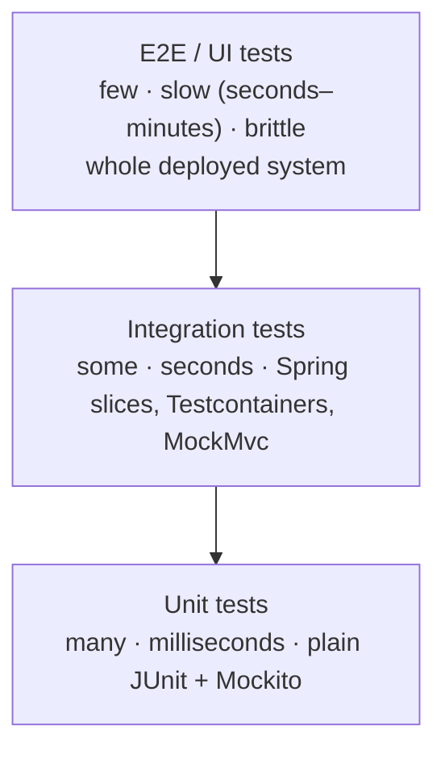
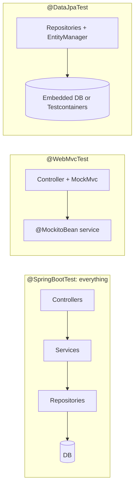
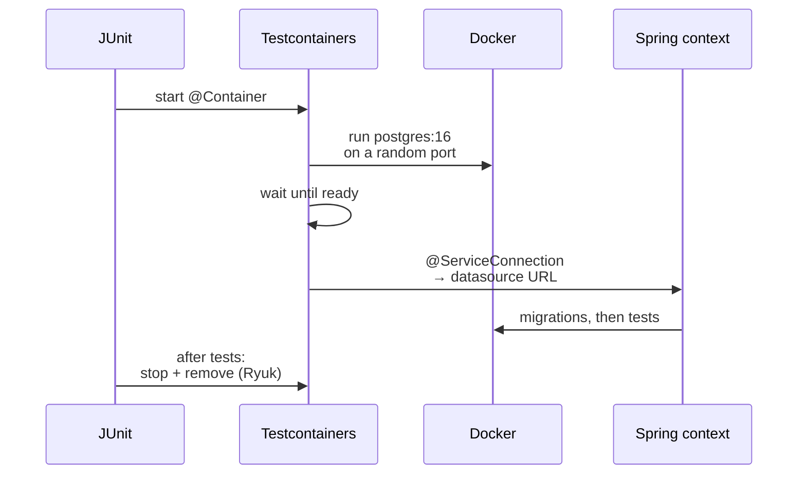
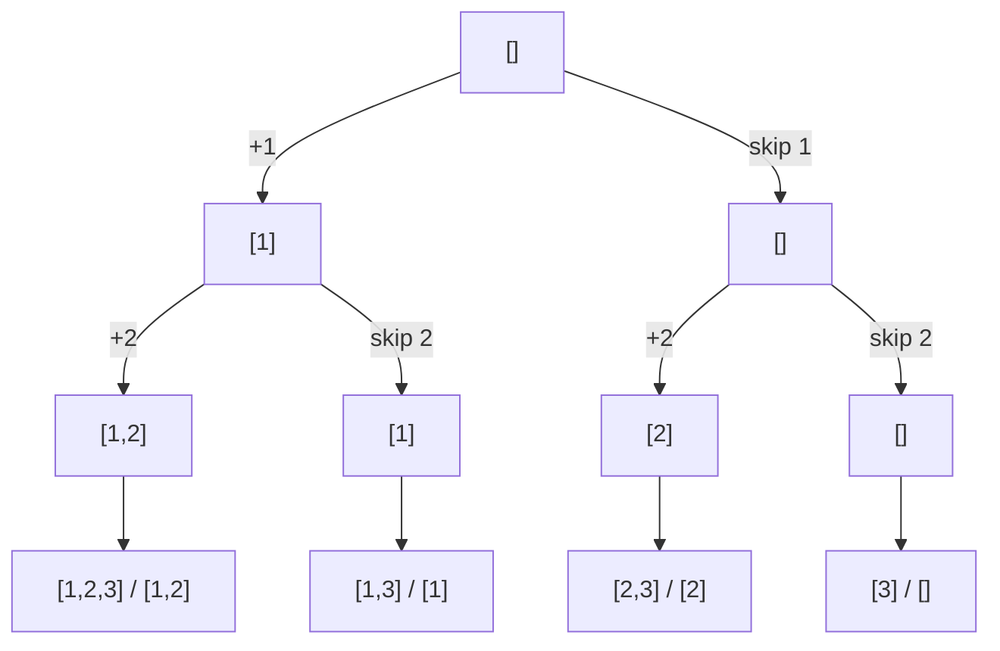
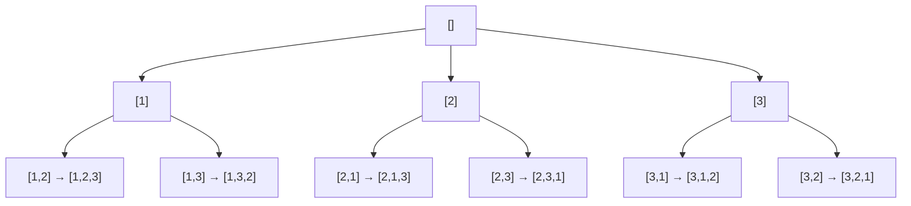
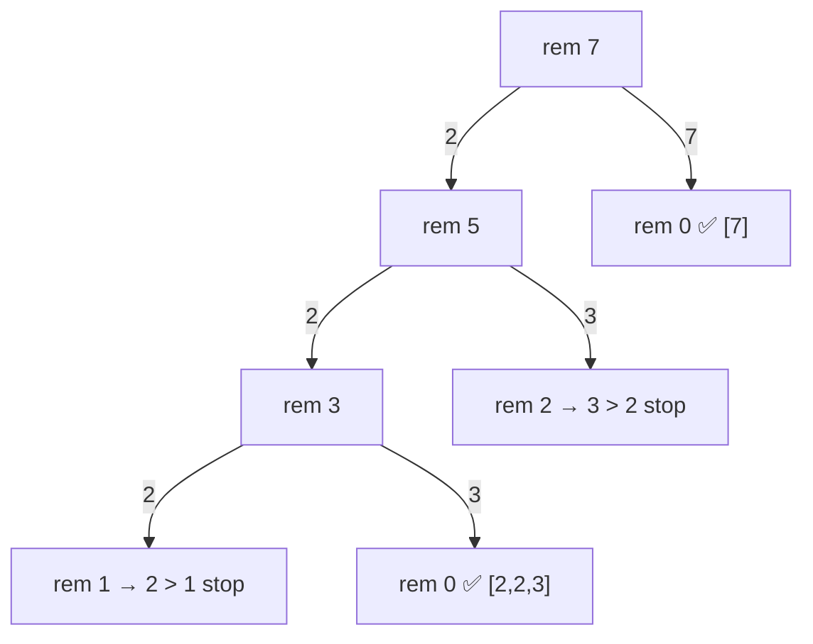
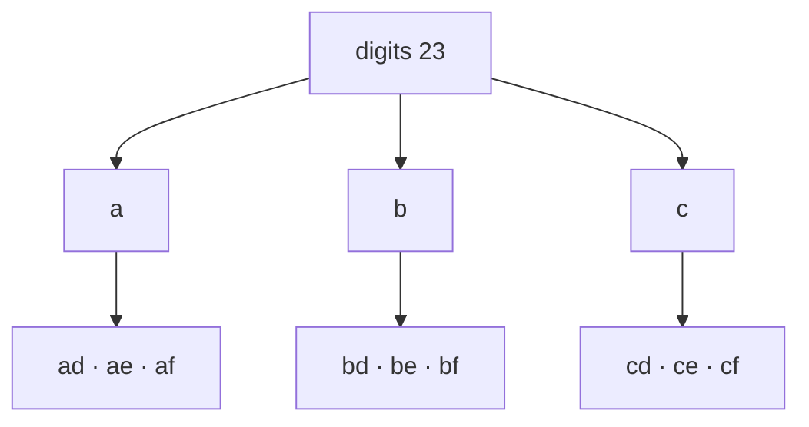

# Day 24 — Testing: JUnit 5, Mockito & Integration Tests

> **How to use these notes:** each section maps to one checklist item. Run the code, study the diagrams, then test yourself with the collapsible questions. 🚀 marks senior-level details.

**Today's goal:** write fast, reliable tests at every level of a Spring Boot app: plain **unit tests** with JUnit 5 and Mockito, **slice tests** (`@WebMvcTest`, `@DataJpaTest`) with **MockMvc** and mocked beans, and full **integration tests** against a real database with **Testcontainers** — structured with **Arrange-Act-Assert** and readable names. On the DSA side: **backtracking** — the choose → explore → unchoose template and four classic generators.

Running example: the order service from earlier days.

```java
@Service
public class OrderService {
    private final OrderRepository orders;
    private final PaymentClient payments;
    private final Clock clock;

    public OrderService(OrderRepository orders, PaymentClient payments, Clock clock) {
        this.orders = orders;
        this.payments = payments;
        this.clock = clock;           // inject time → deterministic tests
    }

    @Transactional
    public Order place(String customerId, List<OrderLine> lines) {
        if (lines.isEmpty()) throw new IllegalArgumentException("order has no lines");
        Order order = Order.create(customerId, lines, Instant.now(clock));
        PaymentResult result = payments.charge(customerId, order.total());
        if (!result.approved()) throw new PaymentDeclinedException(result.reason());
        order.markPaid(result.transactionId());
        return orders.save(order);
    }
}
```

Test dependency: `spring-boot-starter-test` brings **JUnit 5 (Jupiter)**, **Mockito**, **AssertJ**, Hamcrest, JsonPath, JSONassert and Spring's test support.

<!-- topic: d24_t1 -->
## 🌿 Testing — JUnit 5 & Mockito

<!-- subtopic: d24_t1_s1 -->
### 1. The test pyramid — many unit tests, fewer integration tests, few E2E

> **TL;DR:** Write **lots of fast unit tests** (milliseconds, no Spring, no I/O), a **moderate number of integration tests** (Spring context, real DB/HTTP layer), and **a few end-to-end tests** (whole system through the UI/API). Higher levels give more confidence per test but are slower, flakier and harder to debug.



| Level | Scope | Speed | Finds | Example here |
|---|---|---|---|---|
| **Unit** | One class, collaborators mocked | ~1 ms | Logic bugs | `OrderService` with a mocked repository and payment client |
| **Integration** | Several real components | 100 ms – seconds | Wiring, SQL, JSON mapping, config | `@DataJpaTest` with Postgres in Testcontainers; `@WebMvcTest` |
| **E2E** | Deployed system | Seconds+ | Broken user journeys, environment issues | Playwright/Selenium or REST-assured against staging |

A common rough split is **70 / 20 / 10**. The **testing trophy** (popular for front-ends and thin services) puts the biggest layer on integration tests instead — the point is the same: optimise for **confidence per second of feedback**.

**Good tests are F.I.R.S.T.:** **F**ast, **I**ndependent (no order dependence, no shared state), **R**epeatable (same result anywhere — no real clock, random, network), **S**elf-validating (pass/fail, no reading logs), **T**imely (written with the code).

What to test where in a Spring app:

| Layer | Test with |
|---|---|
| Domain / service logic | Plain unit tests (JUnit + Mockito) |
| Controllers: routing, validation, status codes, JSON | `@WebMvcTest` + MockMvc |
| Repositories: custom queries, mappings, constraints | `@DataJpaTest` + Testcontainers |
| External HTTP clients | `@RestClientTest` / WireMock |
| Everything wired together | A few `@SpringBootTest` tests |

⚠️ **Anti-pattern — the ice-cream cone:** mostly manual and E2E tests, few unit tests → slow feedback, flaky pipelines, nobody trusts a red build.

<!-- subtopic: d24_t1_s2 -->
### 2. @SpringBootTest vs @WebMvcTest vs @DataJpaTest — full context vs slices

> **TL;DR:** **`@SpringBootTest`** starts the **entire application context** (all beans) — realistic but slow. **Slice tests** start only one layer: **`@WebMvcTest`** = MVC components (controllers, advice, filters, Jackson) with services mocked; **`@DataJpaTest`** = JPA components (entities, repositories, `EntityManager`) with each test rolled back.



| | `@SpringBootTest` | `@WebMvcTest(OrderController.class)` | `@DataJpaTest` |
|---|---|---|---|
| Loads | All beans + auto-config | `@Controller`, `@ControllerAdvice`, `@JsonComponent`, filters, `WebMvcConfigurer`, Converters | `@Entity`, repositories, `EntityManager`, `TestEntityManager`, Flyway/Liquibase |
| Doesn't load | — | `@Service`, `@Repository`, `@Component` | Web layer, services |
| Server | MOCK by default; `RANDOM_PORT` starts real Tomcat | None (MockMvc) | None |
| DB | Whatever you configure | None | Replaced with **embedded** DB unless `@AutoConfigureTestDatabase(replace = NONE)` |
| Transactions | Not rolled back (unless `@Transactional` on test) | — | **Each test rolled back** |
| Speed | Slowest | Fast | Medium |

```java
// Full application on a random port, called over real HTTP
@SpringBootTest(webEnvironment = SpringBootTest.WebEnvironment.RANDOM_PORT)
class OrderApiIT {
    @Autowired TestRestTemplate rest;               // or WebTestClient / RestClient

    @Test
    void createsOrder() {
        ResponseEntity<OrderResponse> res =
                rest.postForEntity("/orders", new OrderRequest("c1", List.of(new LineRequest("SKU-1", 2))),
                                   OrderResponse.class);
        assertThat(res.getStatusCode()).isEqualTo(HttpStatus.CREATED);
    }
}
```

`webEnvironment` options: `MOCK` (default — mock servlet environment, use MockMvc via `@AutoConfigureMockMvc`), `RANDOM_PORT`, `DEFINED_PORT`, `NONE`.

Other slices: `@JsonTest` (Jackson mapping), `@RestClientTest` (HTTP clients with `MockRestServiceServer`), `@WebFluxTest`, `@DataMongoTest`, `@DataRedisTest`, `@JdbcTest`.

#### Context caching — why test suites get slow

Spring **caches application contexts** between test classes with an **identical configuration**. Every different combination of `@MockitoBean`s, `@ActiveProfiles`, properties or `@DirtiesContext` creates a **new context** (seconds each).

- Prefer a few shared base configurations over many unique ones.
- Avoid `@DirtiesContext` unless a test really corrupts the context.
- Check the logs: many "Starting … in N seconds" lines during a test run = cache misses.

<!-- subtopic: d24_t1_s3 -->
### 3. MockMvc — test REST controllers without starting a server

> **TL;DR:** **MockMvc** sends fake HTTP requests through the **real Spring MVC stack** (DispatcherServlet, argument resolvers, validation, exception handlers, message converters) **without a network or server**. You build requests with `perform(...)`, check results with `andExpect(...)`, and grab the raw result with `andReturn()`.

```java
@WebMvcTest(OrderController.class)
class OrderControllerTest {

    @Autowired MockMvc mvc;
    @Autowired ObjectMapper json;
    @MockitoBean OrderService orderService;           // Boot 3.4+; @MockBean on older versions

    @Test
    void getOrder_returns200AndBody() throws Exception {
        when(orderService.find(42L)).thenReturn(new OrderResponse(42L, "c1", "PAID", new BigDecimal("99.50")));

        mvc.perform(get("/orders/{id}", 42L).accept(MediaType.APPLICATION_JSON))
           .andDo(print())                                         // dump request/response on the console
           .andExpect(status().isOk())
           .andExpect(content().contentType(MediaType.APPLICATION_JSON))
           .andExpect(jsonPath("$.id").value(42))
           .andExpect(jsonPath("$.status").value("PAID"))
           .andExpect(jsonPath("$.total").value(99.50));
    }

    @Test
    void createOrder_withInvalidBody_returns400WithFieldErrors() throws Exception {
        String body = json.writeValueAsString(new OrderRequest("", List.of()));   // blank id, no lines

        mvc.perform(post("/orders").contentType(MediaType.APPLICATION_JSON).content(body))
           .andExpect(status().isBadRequest())
           .andExpect(jsonPath("$.errors[*].field", containsInAnyOrder("customerId", "lines")));

        verifyNoInteractions(orderService);                       // validation stopped it
    }

    @Test
    void createOrder_returns201WithLocation() throws Exception {
        when(orderService.create(any())).thenReturn(new OrderResponse(7L, "c1", "NEW", BigDecimal.TEN));

        MvcResult result = mvc.perform(post("/orders")
                        .contentType(MediaType.APPLICATION_JSON)
                        .content("""
                                 {"customerId":"c1","lines":[{"sku":"SKU-1","quantity":1}]}
                                 """))
                .andExpect(status().isCreated())
                .andExpect(header().string("Location", endsWith("/orders/7")))
                .andReturn();

        OrderResponse created = json.readValue(result.getResponse().getContentAsString(), OrderResponse.class);
        assertThat(created.id()).isEqualTo(7L);
    }

    @Test
    void unknownOrder_returns404ProblemDetail() throws Exception {
        when(orderService.find(99L)).thenThrow(new OrderNotFoundException(99L));

        mvc.perform(get("/orders/99"))
           .andExpect(status().isNotFound())
           .andExpect(jsonPath("$.title").value("Order not found"));   // from @RestControllerAdvice
    }
}
```

| Piece | Examples |
|---|---|
| Request builders | `get`, `post`, `put`, `delete`, `.param()`, `.header()`, `.contentType()`, `.content()`, `.with(...)` |
| Matchers | `status()`, `content()`, `jsonPath()`, `header()`, `cookie()`, `redirectedUrl()` |
| Handlers | `andDo(print())`, `andDo(log())` |
| Result | `andReturn().getResponse().getContentAsString()` |

#### With Spring Security on

`@WebMvcTest` also loads your `SecurityFilterChain` — so unauthenticated requests get **401**. Use `spring-security-test`:

```java
@Test
@WithMockUser(username = "alice", roles = "ADMIN")
void adminCanDelete() throws Exception {
    mvc.perform(delete("/orders/1").with(csrf())).andExpect(status().isNoContent());
}

@Test
void jwtUserCanRead() throws Exception {
    mvc.perform(get("/orders/1").with(jwt().authorities(new SimpleGrantedAuthority("SCOPE_orders:read"))))
       .andExpect(status().isOk());
}
```

🚀 Spring Framework 6.2 adds **`MockMvcTester`** with AssertJ-style assertions (`assertThat(mvc.get().uri("/orders/1")).hasStatusOk().bodyJson()...`). Also: `WebTestClient` can drive MockMvc, and `@SpringBootTest` + `@AutoConfigureMockMvc` runs MockMvc against the full context.

<!-- subtopic: d24_t1_s4 -->
### 4. @MockBean — replace real beans with mocks in the Spring context

> **TL;DR:** `@MockBean` (Spring Boot) creates a **Mockito mock and registers it in the application context**, replacing any existing bean of that type, so the code under test is wired with it. Since **Spring Boot 3.4** it's **deprecated** in favour of Spring Framework 6.2's **`@MockitoBean`** (and `@MockitoSpyBean` instead of `@SpyBean`). Plain unit tests don't need either — use Mockito's `@Mock`.

```java
@WebMvcTest(OrderController.class)
class OrderControllerTest {
    @Autowired MockMvc mvc;

    @MockitoBean OrderService orderService;      // Boot 3.4+ (org.springframework.test.context.bean.override.mockito)
    // @MockBean OrderService orderService;     // Boot ≤ 3.3 (org.springframework.boot.test.mock.mockito)
}

@SpringBootTest
class CheckoutFlowIT {
    @MockitoBean PaymentClient paymentClient;      // everything real except the external payment API
    @MockitoSpyBean AuditService auditService;     // real bean, but you can verify/stub some calls
}
```

| | `@Mock` (Mockito) | `@MockBean` / `@MockitoBean` (Spring) |
|---|---|---|
| Needs Spring context | No | Yes |
| Where the mock lives | A field in your test | **Inside the ApplicationContext**, injected into other beans |
| Used in | Unit tests (`@ExtendWith(MockitoExtension.class)`) | Slice and `@SpringBootTest` tests |
| Reset | New per test instance | Reset automatically after each test |
| Cost | Free | Changes the context cache key → may create a new context |

When to use it: mock **boundaries** — the service beneath a controller in `@WebMvcTest`, or external systems (payment API, email sender) in a `@SpringBootTest`. Don't mock the very thing you're trying to integration-test.

⚠️ Each distinct set of mocked beans is a distinct context. 20 test classes with 20 different `@MockitoBean` combinations = 20 context startups. Group them or put the common mocks in a shared base class.

<!-- subtopic: d24_t1_s5 -->
### 5. JUnit 5: @Test, lifecycle, @ParameterizedTest with @ValueSource and @CsvSource

> **TL;DR:** JUnit 5 = **Platform** (launcher) + **Jupiter** (new API) + **Vintage** (runs JUnit 4). Core annotations: `@Test`, `@BeforeEach`/`@AfterEach` (around each test), `@BeforeAll`/`@AfterAll` (once per class, `static`). `@ParameterizedTest` runs one test method with many inputs from `@ValueSource`, `@CsvSource`, `@MethodSource`, `@EnumSource`.

```java
@DisplayName("Money")
class MoneyTest {

    private Money ten;

    @BeforeAll static void beforeAll() { /* once: expensive shared setup */ }

    @BeforeEach
    void setUp() { ten = Money.of("10.00", "EUR"); }       // fresh fixture for EVERY test

    @AfterEach void tearDown() { /* cleanup per test */ }

    @Test
    @DisplayName("adds two amounts in the same currency")
    void add_sameCurrency_returnsSum() {
        assertEquals(Money.of("15.00", "EUR"), ten.add(Money.of("5.00", "EUR")));
    }

    @Test
    void add_differentCurrency_throws() {
        IllegalArgumentException ex = assertThrows(IllegalArgumentException.class,
                () -> ten.add(Money.of("1.00", "USD")));
        assertTrue(ex.getMessage().contains("currency"));
    }

    @Test
    void split_returnsEqualParts() {
        List<Money> parts = ten.split(3);
        assertAll(                                              // reports ALL failures, not just the first
                () -> assertEquals(3, parts.size()),
                () -> assertEquals(Money.of("3.34", "EUR"), parts.get(0)),     // remainder goes to first
                () -> assertEquals(ten, Money.sum(parts)));
    }

    @Nested
    class WhenNegative {                                       // group related tests, shares outer setup
        @Test void isNegative() { assertTrue(Money.of("-1.00", "EUR").isNegative()); }
    }
}
```

#### Parameterized tests

```java
@ParameterizedTest
@ValueSource(strings = {"", " ", "\t"})
void blankNames_areRejected(String name) {
    assertThrows(IllegalArgumentException.class, () -> new Customer("a@x.com", name));
}

@ParameterizedTest(name = "{0} + {1} = {2}")                  // readable names in the report
@CsvSource({
        "1,    2,    3",
        "-1,   1,    0",
        "100,  0,    100"
})
void adds(int a, int b, int expected) {
    assertEquals(expected, Calculator.add(a, b));
}

@ParameterizedTest
@CsvSource(delimiter = '|', textBlock = """
        # input       | expected
        racecar       | true
        hello         | false
        ''            | true
        """)
void palindromes(String input, boolean expected) {
    assertEquals(expected, Strings.isPalindrome(input));
}

@ParameterizedTest
@MethodSource("discountCases")
void discount(BigDecimal total, CustomerTier tier, BigDecimal expected) {
    assertEquals(expected, Pricing.discount(total, tier));
}

static Stream<Arguments> discountCases() {
    return Stream.of(
            Arguments.of(new BigDecimal("100"), CustomerTier.GOLD, new BigDecimal("10.00")),
            Arguments.of(new BigDecimal("100"), CustomerTier.BASIC, new BigDecimal("0.00")));
}

@ParameterizedTest
@EnumSource(value = OrderStatus.class, names = {"SHIPPED", "DELIVERED"})
void cannotCancelAfterShipping(OrderStatus status) { ... }

@ParameterizedTest
@NullAndEmptySource
@ValueSource(strings = " ")
void rejectsNullEmptyAndBlank(String input) { ... }
```

| Annotation | Purpose |
|---|---|
| `@DisplayName` | Human-readable test name |
| `@Nested` | Inner class grouping (needs non-static inner class) |
| `@Disabled("reason")` | Skip |
| `@Tag("slow")` | Filter in Maven/Gradle (`-Dgroups=slow`) |
| `@Timeout(2)` | Fail if slower than 2 s |
| `@RepeatedTest(10)` | Run N times (hunting flakiness) |
| `@TempDir Path dir` | Temporary directory, auto-deleted |
| `@ExtendWith(...)` | Plug in extensions (Mockito, Spring — `@SpringBootTest` already includes `SpringExtension`) |
| `@TestInstance(PER_CLASS)` | One instance for all tests → `@BeforeAll` needn't be static |

JUnit 4 → 5 mapping: `@Before` → `@BeforeEach`, `@BeforeClass` → `@BeforeAll`, `@Ignore` → `@Disabled`, `@RunWith` → `@ExtendWith`, `@Test(expected = X.class)` → `assertThrows`. Test classes and methods no longer need to be `public`.

💡 **AssertJ** (`assertThat(...)`) reads better and gives better failure messages than `assertEquals`:

```java
assertThat(order.lines()).hasSize(2).extracting(OrderLine::sku).containsExactly("A", "B");
assertThat(order.total()).isEqualByComparingTo("19.99");      // BigDecimal: ignores scale
assertThatThrownBy(() -> service.place("c1", List.of()))
        .isInstanceOf(IllegalArgumentException.class)
        .hasMessageContaining("no lines");
```

<!-- subtopic: d24_t1_s6 -->
### 6. Mockito: when/thenReturn, verify, ArgumentCaptor, @Spy, doThrow

> **TL;DR:** Mockito creates **test doubles**: **stub** what collaborators return (`when(...).thenReturn(...)`), then **verify** how they were called (`verify(...)`). **`ArgumentCaptor`** captures arguments for detailed assertions. **`@Spy`** wraps a real object (real methods unless stubbed). Use the **`doXxx().when(mock).method()`** form for `void` methods and spies.

```java
@ExtendWith(MockitoExtension.class)
class OrderServiceTest {

    @Mock OrderRepository orders;
    @Mock PaymentClient payments;
    Clock clock = Clock.fixed(Instant.parse("2026-11-01T10:00:00Z"), ZoneOffset.UTC);

    OrderService service;

    @BeforeEach
    void setUp() { service = new OrderService(orders, payments, clock); }   // or @InjectMocks

    @Test
    void place_whenPaymentApproved_savesPaidOrder() {
        // Arrange
        when(payments.charge(eq("c1"), any(BigDecimal.class)))
                .thenReturn(PaymentResult.approved("tx-1"));
        when(orders.save(any(Order.class))).thenAnswer(inv -> inv.getArgument(0));   // echo the argument

        // Act
        Order result = service.place("c1", List.of(new OrderLine("SKU-1", 2, new BigDecimal("5.00"))));

        // Assert
        assertThat(result.status()).isEqualTo(OrderStatus.PAID);
        ArgumentCaptor<Order> saved = ArgumentCaptor.forClass(Order.class);
        verify(orders).save(saved.capture());
        assertThat(saved.getValue().total()).isEqualByComparingTo("10.00");
        assertThat(saved.getValue().createdAt()).isEqualTo(Instant.parse("2026-11-01T10:00:00Z"));
    }

    @Test
    void place_whenPaymentDeclined_throwsAndDoesNotSave() {
        when(payments.charge(any(), any())).thenReturn(PaymentResult.declined("insufficient funds"));

        assertThatThrownBy(() -> service.place("c1", List.of(new OrderLine("SKU-1", 1, BigDecimal.ONE))))
                .isInstanceOf(PaymentDeclinedException.class);

        verify(orders, never()).save(any());
    }

    @Test
    void place_withNoLines_neverCallsPayment() {
        assertThrows(IllegalArgumentException.class, () -> service.place("c1", List.of()));
        verifyNoInteractions(payments, orders);
    }
}
```

#### Stubbing

```java
when(repo.findById(1L)).thenReturn(Optional.of(order));
when(repo.findById(2L)).thenReturn(Optional.empty());
when(client.call()).thenReturn("a", "b").thenThrow(new TimeoutException());   // consecutive calls
when(repo.save(any())).thenAnswer(inv -> inv.getArgument(0));                 // computed answer
when(client.call()).thenThrow(new IllegalStateException("down"));
```

Unstubbed methods return defaults: `null`, `0`, `false`, empty collections, `Optional.empty()`.

#### Argument matchers

`any()`, `any(Order.class)`, `anyLong()`, `eq(x)`, `isNull()`, `argThat(o -> o.total().signum() > 0)`.

⚠️ **All-or-nothing rule:** if one argument uses a matcher, **all** must: `when(svc.charge(eq("c1"), any()))` ✅, `when(svc.charge("c1", any()))` ❌ `InvalidUseOfMatchersException`.

#### Verification

```java
verify(repo).save(order);                       // exactly once (default times(1))
verify(repo, times(2)).findById(anyLong());
verify(repo, never()).delete(any());
verify(repo, atLeastOnce()).flush();
verifyNoMoreInteractions(repo);                 // use sparingly: makes tests brittle

InOrder inOrder = inOrder(payments, orders);
inOrder.verify(payments).charge(any(), any());  // charge happens before save
inOrder.verify(orders).save(any());
```

#### void methods and spies: the doXxx family

```java
doThrow(new MailException("smtp down")).when(mailer).send(any());   // void method throws
doNothing().when(mailer).send(any());
doAnswer(inv -> { latch.countDown(); return null; }).when(listener).onEvent(any());

List<String> spy = spy(new ArrayList<>());
spy.add("a");                                    // real method runs
when(spy.size()).thenReturn(100);                // OK here, but...
when(spy.get(5)).thenReturn("x");                // ❌ calls the REAL get(5) first → IndexOutOfBoundsException
doReturn("x").when(spy).get(5);                  // ✅ doesn't call the real method
```

| | `@Mock` | `@Spy` |
|---|---|---|
| Unstubbed calls | Return defaults | Call the **real** method |
| Built from | The class/interface | A real instance |
| Use | Collaborators | Partial mocking of legacy code (a smell in new code) |

#### Good Mockito habits

- `MockitoExtension` uses **strict stubs**: an unused stubbing fails the test with `UnnecessaryStubbingException` — it keeps tests honest.
- **Don't mock value objects or data classes** (`Order`, `Money`) — create real ones.
- **Don't mock types you don't own** (e.g., `RestTemplate`, `JdbcTemplate`) in depth; wrap them in your own gateway and mock that, or use WireMock/Testcontainers.
- Prefer **state verification** (check the result) over **interaction verification** (check calls) when both are possible.
- `BDDMockito` reads like given/when/then: `given(payments.charge(any(), any())).willReturn(...)`, `then(orders).should().save(any())`.
- Mockito 5 uses the inline mock maker by default, so `final` classes and `mockStatic(...)` (in try-with-resources) work — but needing static mocks usually signals a design to refactor (inject a `Clock` instead of mocking `Instant.now()`).

<!-- subtopic: d24_t1_s7 -->
### 7. Testcontainers — real Postgres/MySQL/Redis in Docker for integration tests

> **TL;DR:** **Testcontainers** starts **throwaway Docker containers** from your tests (PostgreSQL, MySQL, Redis, Kafka, LocalStack…), so integration tests run against the **same technology as production** instead of H2. Spring Boot 3.1+ wires the connection automatically with **`@ServiceConnection`**.

Why not H2? H2 (even in "PostgreSQL mode") differs in SQL dialect, types (JSONB, arrays), functions, locking, constraint and index behaviour. Tests pass, production fails.

```java
@DataJpaTest
@AutoConfigureTestDatabase(replace = AutoConfigureTestDatabase.Replace.NONE)   // don't swap in H2
@Testcontainers
class OrderRepositoryTest {

    @Container
    @ServiceConnection                                   // Boot 3.1+: sets spring.datasource.* for you
    static PostgreSQLContainer<?> postgres = new PostgreSQLContainer<>("postgres:16-alpine");

    @Autowired OrderRepository orders;
    @Autowired TestEntityManager em;

    @Test
    void findWithCustomerByStatus_fetchesCustomerInOneQuery() {
        Customer c = em.persist(new Customer("a@x.com", "A"));
        em.persist(Order.create(c, OrderStatus.PAID));
        em.flush();
        em.clear();                                       // force a real DB read

        List<Order> result = orders.findWithCustomerByStatus(OrderStatus.PAID);

        assertThat(result).hasSize(1);
        assertThat(Hibernate.isInitialized(result.get(0).getCustomer())).isTrue();   // JOIN FETCH worked
    }
}
```

Before Boot 3.1 (or for custom properties), use `@DynamicPropertySource`:

```java
@DynamicPropertySource
static void props(DynamicPropertyRegistry registry) {
    registry.add("spring.datasource.url", postgres::getJdbcUrl);
    registry.add("spring.datasource.username", postgres::getUsername);
    registry.add("spring.datasource.password", postgres::getPassword);
}

// Any image, e.g. Redis
@Container
static GenericContainer<?> redis = new GenericContainer<>("redis:7-alpine").withExposedPorts(6379);
// registry.add("spring.data.redis.host", redis::getHost);
// registry.add("spring.data.redis.port", () -> redis.getMappedPort(6379));
```



#### Keeping it fast

| Technique | Effect |
|---|---|
| `static` container field | One container per test **class** (instance field = one per test method!) |
| **Singleton container** in a shared base class (started in a static block, no `@Container`) | One container for the **whole** test run |
| Shared Spring context | Avoid re-creating contexts between classes |
| Small images (`-alpine`) | Faster pulls |
| `.withReuse(true)` + `testcontainers.reuse.enable=true` | Keep containers between local runs (dev only) |

🚀 Boot 3.1 also lets you run the **app locally** with containers: a `TestApplication` main using `SpringApplication.from(App::main).with(ContainersConfig.class).run(args)` starts Postgres/Kafka automatically for development. CI agents need Docker (or a Testcontainers Cloud / remote Docker host).

<!-- subtopic: d24_t1_s8 -->
### 8. AAA pattern (Arrange-Act-Assert) and given-when-then naming

> **TL;DR:** Structure every test in three visible blocks: **Arrange** (set up data and mocks), **Act** (call the one thing under test), **Assert** (check the outcome). **Given-When-Then** is the same idea in BDD language. Name tests after the **behaviour**: `method_condition_expectedResult` or `shouldXWhenY`.

```java
@Test
void withdraw_whenBalanceInsufficient_throwsAndKeepsBalance() {
    // Arrange (Given)
    Account account = new Account(1L, new BigDecimal("50.00"));

    // Act (When)
    Throwable thrown = catchThrowable(() -> account.withdraw(new BigDecimal("80.00")));

    // Assert (Then)
    assertThat(thrown).isInstanceOf(InsufficientFundsException.class);
    assertThat(account.balance()).isEqualByComparingTo("50.00");
}
```

#### Naming conventions

| Style | Example |
|---|---|
| `method_state_expected` | `withdraw_whenBalanceInsufficient_throws` |
| `should…When…` | `shouldRejectOrderWhenPaymentDeclined` |
| `given…When…Then…` | `givenGoldCustomer_whenCheckout_thenTenPercentOff` |
| `@DisplayName` | `@DisplayName("rejects orders when the payment is declined")` |

Pick one style per codebase. A failing test's **name alone** should tell you what broke.

#### Rules of thumb

- **One behaviour per test** (several asserts about the same outcome are fine). If the name needs "and", split it.
- **Act is one line.** If it's many, the API under test may be awkward.
- **No logic in tests** (`if`, loops computing expectations) — you'd need tests for your tests. Use parameterized tests instead.
- **Test data builders / object mothers** keep Arrange short and focused on what matters:
  ```java
  Order order = anOrder().withStatus(PAID).withTotal("99.00").build();   // everything else defaulted
  ```
- **Deterministic:** inject `Clock`, seed `Random`, avoid `Thread.sleep` (use Awaitility for async: `await().atMost(5, SECONDS).until(() -> repo.count() == 1)`).
- **Independent:** each test sets up its own data; never rely on test execution order.
- A test should **fail for one reason** — the behaviour it names.

🚀 Beyond line coverage: **JaCoCo** measures which lines run; **mutation testing** (PIT) changes your code (`>` → `>=`) and checks a test fails — it reveals tests that execute code without really asserting anything.

### 🎤 Interview Q&A — Testing

<details><summary>Q1. @WebMvcTest vs @SpringBootTest?</summary>

`@WebMvcTest` loads only the web layer (controllers, advice, filters, Jackson) and requires mocking services — fast and focused. `@SpringBootTest` loads the whole context for end-to-end wiring checks — slower. Use the slice for controller behaviour, the full test for a few critical flows.

</details>

<details><summary>Q2. @Mock vs @MockBean (@MockitoBean)?</summary>

`@Mock` is plain Mockito for unit tests without Spring. `@MockBean`/`@MockitoBean` creates a mock and registers it as a bean in the Spring context, replacing the real one so other beans get it injected.

</details>

<details><summary>Q3. Why use Testcontainers instead of H2?</summary>

H2 differs from production databases in dialect, types, functions and locking, so tests can pass while production fails. Testcontainers runs the real database version in Docker.

</details>

<details><summary>Q4. How do you test a void method that should throw?</summary>

`doThrow(new X()).when(mock).method(args)` to make a collaborator's void method throw; `assertThrows`/`assertThatThrownBy` to assert that the code under test throws.

</details>

<details><summary>Q5. When would you use an ArgumentCaptor?</summary>

When you need to assert on an object your code built and passed to a collaborator (e.g., the `Order` passed to `save`) and a simple `eq` matcher isn't enough.

</details>

<details><summary>Q6. Why is my test suite slow even though each test is fast?</summary>

Usually Spring context restarts: different `@MockitoBean` sets, profiles, properties or `@DirtiesContext` defeat context caching. Standardise configurations and use slices.

</details>

<!-- topic: d20_t2 -->
## 🧮 DSA — Backtracking: Easy → Medium

<!-- subtopic: d20_t2_s1 -->
### 9. The backtracking framework — choose → explore → unchoose

> **TL;DR:** Backtracking builds candidates **one decision at a time** and **undoes** each decision after exploring it, effectively doing a DFS over a **decision tree**. Template: if the current path is a complete answer, record a **copy**; otherwise for each valid choice — **choose** (add to path), **explore** (recurse), **unchoose** (remove). **Prune** branches that can't lead to a valid answer.

```java
void backtrack(State state, List<Choice> path, List<List<Choice>> results) {
    if (isComplete(state, path)) {
        results.add(new ArrayList<>(path));        // COPY — path keeps changing afterwards
        return;
    }
    for (Choice c : choicesFor(state, path)) {
        if (!isValid(c, path)) continue;           // prune
        path.add(c);                               // choose
        backtrack(next(state, c), path, results);  // explore
        path.remove(path.size() - 1);              // unchoose (restore state)
    }
}
```

Decision tree for subsets of `[1, 2, 3]` (include / exclude each element):



#### The three questions for every backtracking problem

| Question | Subsets | Permutations | Combination Sum |
|---|---|---|---|
| What is a **choice**? | Next element to add (from `start`) | Any unused element | Next candidate (from `start`, reuse allowed) |
| When is the path **complete**? | Every node is an answer | `path.size() == n` | `remaining == 0` |
| What can be **pruned**? | — | Used elements | `candidate > remaining` (after sorting) |

#### Complexity

Roughly **(number of nodes in the tree) × (cost to copy an answer)**: subsets O(2ⁿ · n), permutations O(n! · n), combinations C(n, k) · k. Backtracking is exponential by nature — interview inputs are small (n ≤ 10–20). Space: recursion depth O(n) + output.

⚠️ The two most common bugs: adding `path` itself instead of a **copy** (every result ends up as the same empty list), and **forgetting to undo** the choice (state leaks into sibling branches).

Backtracking vs plain DFS vs DP: DFS explores a graph once per node; backtracking explores **paths** and undoes state so other paths can reuse it; DP applies when subproblems **overlap** and you need a count/optimum rather than every configuration.

<!-- subtopic: d20_t2_s2 -->
### 10. Subsets (LeetCode 78) — power set

> **Problem:** given distinct integers, return all possible subsets (the power set), in any order. 🔗 [LeetCode 78](https://leetcode.com/problems/subsets/)

**Approach 1 — "start index" loop:** every node of the tree is an answer; from position `start` choose which element comes next.

```java
public List<List<Integer>> subsets(int[] nums) {
    List<List<Integer>> result = new ArrayList<>();
    backtrack(nums, 0, new ArrayList<>(), result);
    return result;
}

private void backtrack(int[] nums, int start, List<Integer> path, List<List<Integer>> result) {
    result.add(new ArrayList<>(path));              // every path is a subset
    for (int i = start; i < nums.length; i++) {
        path.add(nums[i]);                          // choose
        backtrack(nums, i + 1, path, result);       // explore: only later elements → no duplicates like [2,1]
        path.remove(path.size() - 1);               // unchoose
    }
}   // O(2^n · n) time, O(n) recursion depth
```

Output order for `[1, 2, 3]`: `[] [1] [1,2] [1,2,3] [1,3] [2] [2,3] [3]`.

**Approach 2 — include/exclude:** at index `i`, either take `nums[i]` or don't; record at the leaves (`i == n`).

```java
private void includeExclude(int[] nums, int i, List<Integer> path, List<List<Integer>> result) {
    if (i == nums.length) { result.add(new ArrayList<>(path)); return; }
    path.add(nums[i]);
    includeExclude(nums, i + 1, path, result);      // include
    path.remove(path.size() - 1);
    includeExclude(nums, i + 1, path, result);      // exclude
}
```

**Approach 3 — bitmask (iterative):** the numbers `0 … 2ⁿ − 1` in binary are exactly the include/exclude patterns.

```java
public List<List<Integer>> subsetsBitmask(int[] nums) {
    int n = nums.length;
    List<List<Integer>> result = new ArrayList<>();
    for (int mask = 0; mask < (1 << n); mask++) {
        List<Integer> subset = new ArrayList<>();
        for (int b = 0; b < n; b++) if ((mask & (1 << b)) != 0) subset.add(nums[b]);
        result.add(subset);
    }
    return result;
}
```

| mask | binary | subset |
|---|---|---|
| 0 | 000 | [] |
| 5 | 101 | [1, 3] |
| 7 | 111 | [1, 2, 3] |

**Subsets II (LC 90 — with duplicates):** sort first, then skip a duplicate at the same tree level: `if (i > start && nums[i] == nums[i - 1]) continue;`.

<!-- subtopic: d20_t2_s3 -->
### 11. Permutations (LeetCode 46)

> **Problem:** given distinct integers, return all permutations. 🔗 [LeetCode 46](https://leetcode.com/problems/permutations/)

Unlike subsets, **order matters** and every element must be used: at each level any **unused** element can come next. Track usage with a `boolean[] used`.

```java
public List<List<Integer>> permute(int[] nums) {
    List<List<Integer>> result = new ArrayList<>();
    backtrack(nums, new boolean[nums.length], new ArrayList<>(), result);
    return result;
}

private void backtrack(int[] nums, boolean[] used, List<Integer> path, List<List<Integer>> result) {
    if (path.size() == nums.length) {
        result.add(new ArrayList<>(path));
        return;
    }
    for (int i = 0; i < nums.length; i++) {          // start at 0 every time: any unused element
        if (used[i]) continue;
        used[i] = true;  path.add(nums[i]);           // choose
        backtrack(nums, used, path, result);          // explore
        used[i] = false; path.remove(path.size() - 1);  // unchoose
    }
}   // O(n! · n) time, O(n) extra space
```



**Swap version** (no `used` array): fix position `first` by swapping each candidate into it.

```java
private void permuteSwap(int[] nums, int first, List<List<Integer>> result) {
    if (first == nums.length) {
        result.add(Arrays.stream(nums).boxed().toList());
        return;
    }
    for (int i = first; i < nums.length; i++) {
        swap(nums, first, i);
        permuteSwap(nums, first + 1, result);
        swap(nums, first, i);                         // undo
    }
}
```

**Permutations II (LC 47 — duplicates):** sort, then `if (i > 0 && nums[i] == nums[i - 1] && !used[i - 1]) continue;` — only use the first copy of equal values at each level.

| | Subsets | Permutations |
|---|---|---|
| Loop starts at | `start` (only later elements) | `0` (any unused element) |
| Record when | Every node | `path.size() == n` |
| Count | 2ⁿ | n! |

<!-- subtopic: d20_t2_s4 -->
### 12. Combination Sum (LeetCode 39)

> **Problem:** distinct positive `candidates` and a `target`; return all unique combinations summing to `target`. Each number may be used **unlimited** times. 🔗 [LeetCode 39](https://leetcode.com/problems/combination-sum/)

Two key details: recurse with **`i`** (not `i + 1`) so the same number can be reused, and keep the `start` index so `[2, 3]` and `[3, 2]` aren't both produced. **Sorting** enables pruning: once a candidate exceeds the remaining sum, every later one does too.

```java
public List<List<Integer>> combinationSum(int[] candidates, int target) {
    Arrays.sort(candidates);
    List<List<Integer>> result = new ArrayList<>();
    backtrack(candidates, target, 0, new ArrayList<>(), result);
    return result;
}

private void backtrack(int[] c, int remaining, int start, List<Integer> path, List<List<Integer>> result) {
    if (remaining == 0) {
        result.add(new ArrayList<>(path));
        return;
    }
    for (int i = start; i < c.length; i++) {
        if (c[i] > remaining) break;                   // prune: sorted, so the rest are too big
        path.add(c[i]);
        backtrack(c, remaining - c[i], i, path, result);   // i, not i + 1 → reuse allowed
        path.remove(path.size() - 1);
    }
}
```

`candidates = [2, 3, 6, 7], target = 7` → `[[2, 2, 3], [7]]`.



Complexity: exponential, roughly O(N^(T/M + 1)) where T = target and M = smallest candidate (the tree depth is at most T/M).

| Variant | Difference | Change in code |
|---|---|---|
| **Combination Sum II (LC 40)** | Each number once, input has duplicates | Recurse with `i + 1`; skip `i > start && c[i] == c[i-1]` |
| **Combination Sum III (LC 216)** | k numbers from 1–9, each once | Add `path.size() == k` condition |
| **Combinations (LC 77)** | All k-subsets of 1..n | Prune when not enough numbers remain |
| **Combination Sum IV (LC 377)** | Count **ordered** sequences | That's **DP**, not backtracking |

<!-- subtopic: d20_t2_s5 -->
### 13. Letter Combinations of a Phone Number (LeetCode 17)

> **Problem:** given digits `2–9`, return all letter strings they could represent on a phone keypad. 🔗 [LeetCode 17](https://leetcode.com/problems/letter-combinations-of-a-phone-number/)

Each digit is one **level** of the tree; its letters are the choices at that level.

```java
private static final String[] KEYS = {"", "", "abc", "def", "ghi", "jkl", "mno", "pqrs", "tuv", "wxyz"};

public List<String> letterCombinations(String digits) {
    List<String> result = new ArrayList<>();
    if (digits.isEmpty()) return result;                 // "" → [] (not [""])
    backtrack(digits, 0, new StringBuilder(), result);
    return result;
}

private void backtrack(String digits, int index, StringBuilder path, List<String> result) {
    if (index == digits.length()) {
        result.add(path.toString());                     // toString() is already a copy
        return;
    }
    for (char ch : KEYS[digits.charAt(index) - '0'].toCharArray()) {
        path.append(ch);                                 // choose
        backtrack(digits, index + 1, path, result);      // explore
        path.deleteCharAt(path.length() - 1);            // unchoose
    }
}   // O(4^n · n) time (7 and 9 have 4 letters), O(n) depth
```



`"23"` → `[ad, ae, af, bd, be, bf, cd, ce, cf]` (3 × 3 = 9).

**Iterative BFS-style alternative:** start with `[""]`; for each digit, replace the list with every existing string + each letter.

```java
public List<String> letterCombinationsIterative(String digits) {
    if (digits.isEmpty()) return List.of();
    List<String> result = List.of("");
    for (char d : digits.toCharArray()) {
        List<String> next = new ArrayList<>();
        for (String prefix : result)
            for (char ch : KEYS[d - '0'].toCharArray()) next.add(prefix + ch);
        result = next;
    }
    return result;
}
```

💡 Using a `StringBuilder` with `deleteCharAt` avoids creating a new string at every level (`path + ch` in the recursion also works, and needs no undo step, but allocates more).

Related: Generate Parentheses (LC 22 — choices "(" or ")" with open/close counters as pruning), Word Search (LC 79 — grid backtracking with in-place marking), Palindrome Partitioning (LC 131), N-Queens (Day 34).

---

## 📝 Day 24 Revision Cheat Sheet

| Topic | Remember this |
|---|---|
| Test pyramid | Many unit (ms) > some integration > few E2E; F.I.R.S.T. |
| Full vs slice | @SpringBootTest = all beans; @WebMvcTest = web layer; @DataJpaTest = JPA, rolled back, embedded DB by default |
| Context cache | Same config = reused context; different mocks/profiles/@DirtiesContext = new context |
| MockMvc | `perform(get(...))` → `andExpect(status(), jsonPath())` → `andReturn()`; `with(csrf())`, `@WithMockUser`, `jwt()` |
| @MockBean | Mock registered in the context; deprecated in Boot 3.4 → @MockitoBean / @MockitoSpyBean |
| JUnit 5 | @BeforeEach/@AfterEach per test, @BeforeAll static; assertThrows, assertAll; @Nested, @DisplayName |
| Parameterized | @ValueSource, @CsvSource (textBlock), @MethodSource, @EnumSource, @NullAndEmptySource |
| Mockito stubbing | when/thenReturn/thenThrow/thenAnswer; all args matchers or none |
| Mockito verify | verify(times/never), inOrder, verifyNoInteractions, ArgumentCaptor |
| Spy / void | doReturn/doThrow/doNothing().when(x).m() for spies and void methods |
| Testcontainers | Real DB in Docker; static @Container; @ServiceConnection (3.1+) or @DynamicPropertySource |
| AAA | Arrange / Act (one line) / Assert; names describe behaviour; no logic in tests |
| Backtracking | Choose → explore → unchoose; record a COPY; prune |
| Subsets | Loop from start, record every node; 2ⁿ; bitmask alt |
| Permutations | Loop from 0 with used[]; record at size n; n! |
| Combination Sum | Sort, recurse with i (reuse), break when too big |
| Letter combos | One level per digit; empty input → [] |

### ⚡ Rapid-fire self-test

1. Which test annotation loads only controllers and web infrastructure? → **@WebMvcTest**
2. Are `@DataJpaTest` tests rolled back? → **Yes, each test**
3. What replaced `@MockBean` in Boot 3.4? → **@MockitoBean**
4. Must `@BeforeAll` methods be static? → **Yes, unless @TestInstance(PER_CLASS)**
5. Annotation to feed CSV rows to a test? → **@CsvSource**
6. Stub a void method to throw? → **`doThrow(...).when(mock).method()`**
7. Why `doReturn` with spies? → **`when(spy.m())` calls the real method first**
8. Annotation that wires a Testcontainers DB into Boot 3.1+ automatically? → **@ServiceConnection**
9. Number of subsets of n elements? Permutations? → **2ⁿ; n!**
10. In Combination Sum, why recurse with `i` instead of `i + 1`? → **The same number may be reused**
