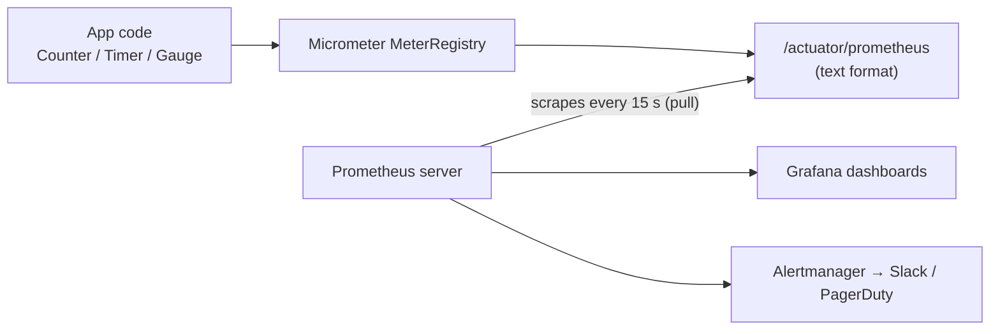
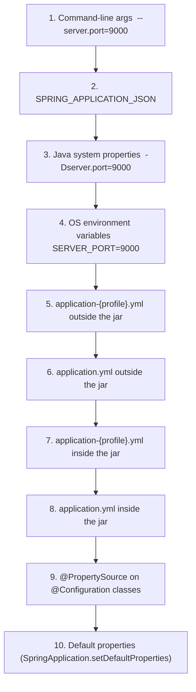
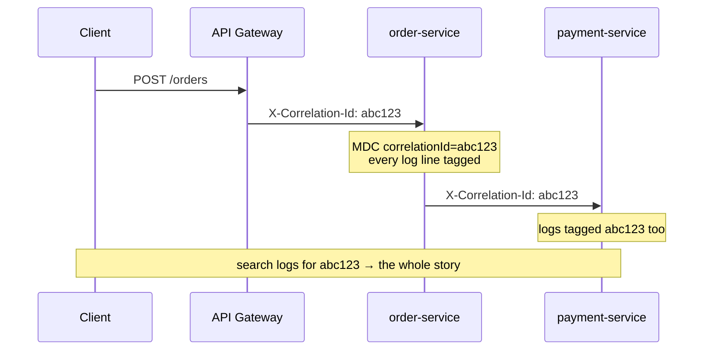
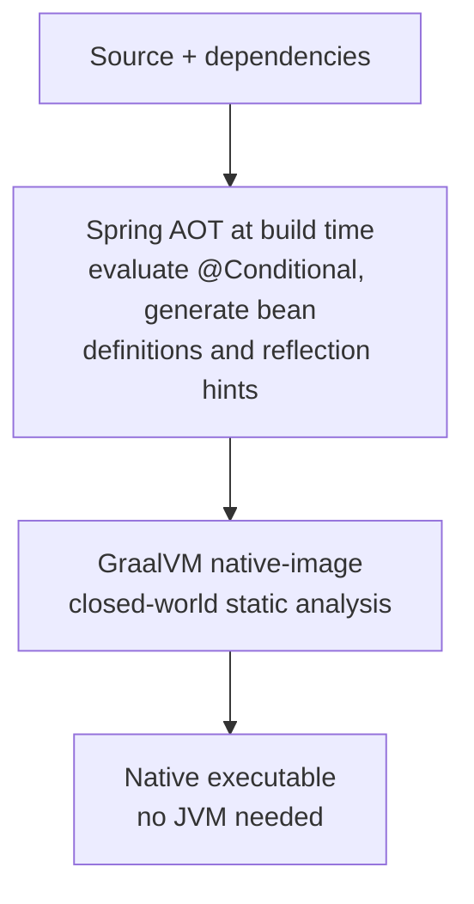
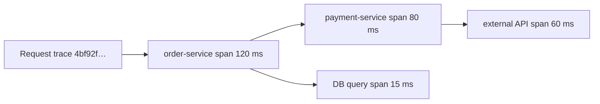
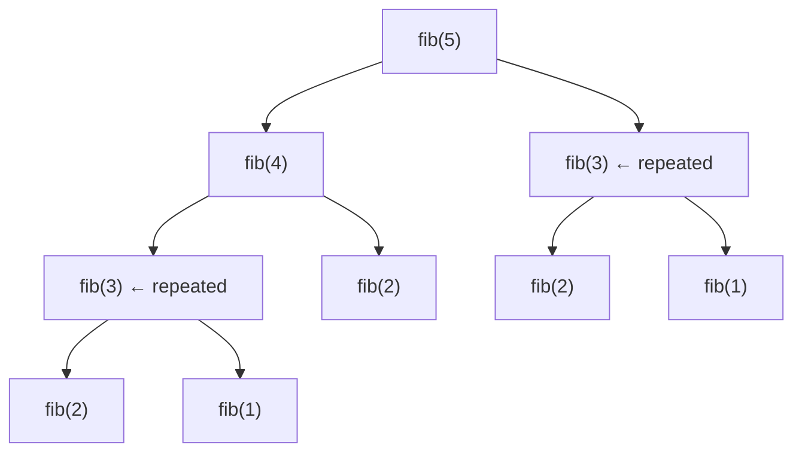
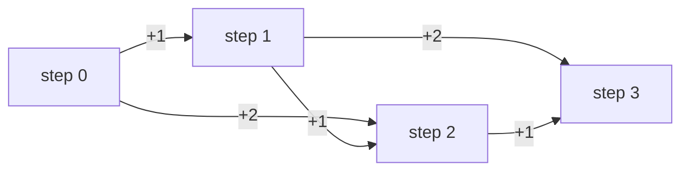
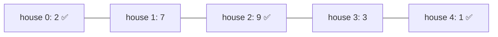

# Day 25 — Spring Boot: Actuator, Profiles, Configuration & Logging

> **How to use these notes:** each section maps to one checklist item. Run the code, study the diagrams, then test yourself with the collapsible questions. 🚀 marks senior-level details.

**Today's goal:** make a Spring Boot service **production-ready**: expose health and metrics with **Actuator**, write **custom health checks**, publish **Micrometer** metrics to Prometheus/Grafana, separate environments with **profiles**, bind configuration type-safely with **`@ConfigurationProperties`**, know exactly **which property source wins**, log properly with **SLF4J + Logback, structured JSON and MDC**, and know what changed in **Spring Boot 3**. On the DSA side: **Dynamic Programming** begins — memoization vs tabulation through four classic 1-D problems.

The three pillars of **observability** you'll touch today:

| Pillar | Question | Spring Boot tool |
|---|---|---|
| **Metrics** | How much / how fast / how often? (aggregated numbers) | Micrometer → Prometheus → Grafana |
| **Logs** | What exactly happened in this event? | SLF4J + Logback, JSON, MDC |
| **Traces** | Where did the time go across services for one request? | Micrometer Tracing → OpenTelemetry/Zipkin |

<!-- topic: d25_t1 -->
## 🌿 Spring Boot — Production Features

<!-- subtopic: d25_t1_s1 -->
### 1. Actuator endpoints: /health, /metrics, /info, /beans, /env

> **TL;DR:** `spring-boot-starter-actuator` adds operational endpoints under **`/actuator`**. Over HTTP only **`/actuator/health`** is exposed by default — you opt in to others with `management.endpoints.web.exposure.include`. Several endpoints leak sensitive information, so expose the minimum and **secure** the rest.

```xml
<dependency>
    <groupId>org.springframework.boot</groupId>
    <artifactId>spring-boot-starter-actuator</artifactId>
</dependency>
```

```yaml
management:
  server:
    port: 8081                       # separate port: not reachable from the public load balancer
  endpoints:
    web:
      exposure:
        include: health, info, metrics, prometheus, loggers
  endpoint:
    health:
      show-details: when-authorized  # never | when-authorized | always
      probes:
        enabled: true                # /actuator/health/liveness and /readiness (auto-on in Kubernetes)
  info:
    git:
      mode: simple
info:
  app:
    name: order-service
    team: payments
```

| Endpoint | Shows / does | Sensitive? |
|---|---|---|
| `/health` | UP/DOWN + component details | Details can reveal infrastructure |
| `/info` | Build, git commit, custom `info.*` | Low |
| `/metrics`, `/metrics/{name}` | Metric names and values (`/metrics/jvm.memory.used`) | Medium |
| `/prometheus` | All metrics in Prometheus text format (needs `micrometer-registry-prometheus`) | Medium |
| `/loggers` | View and **change log levels at runtime** (POST) | High (write) |
| `/env` | All property sources and values (values masked by default in Boot 3) | **High** |
| `/configprops` | `@ConfigurationProperties` beans | High |
| `/beans` | Every bean and its dependencies | Medium |
| `/mappings` | All `@RequestMapping` routes | Medium |
| `/conditions` | Auto-configuration report (why a bean was/wasn't created) | Low |
| `/threaddump` / `/heapdump` | Thread stacks / **HPROF heap dump** (may contain secrets, PII) | **Very high** |
| `/scheduledtasks`, `/httpexchanges`, `/caches`, `/flyway` | Operational details | Medium |
| `/shutdown` | Gracefully stops the app — **disabled** by default | **Very high** |

```bash
curl localhost:8081/actuator/health
# {"status":"UP","components":{"db":{"status":"UP","details":{"database":"PostgreSQL"}},"diskSpace":{...},"ping":{...}}}

curl -X POST localhost:8081/actuator/loggers/com.shop.order \
     -H 'Content-Type: application/json' -d '{"configuredLevel":"DEBUG"}'   # debug in prod without redeploying
```

#### Liveness vs readiness (Kubernetes)

| Probe | Question | On failure Kubernetes… | Should include |
|---|---|---|---|
| **Liveness** `/actuator/health/liveness` | Is the process broken beyond repair? | **Restarts** the container | Only internal state (deadlock, broken app state) |
| **Readiness** `/actuator/health/readiness` | Can it serve traffic right now? | **Removes it from the load balancer** | Warm-up, critical dependencies |

⚠️ Never put a **database check in liveness**: a DB outage would make Kubernetes restart every pod in a loop, which doesn't fix the DB and adds load.

#### Securing actuator

```java
@Bean
@Order(1)
SecurityFilterChain actuator(HttpSecurity http) throws Exception {
    http.securityMatcher(EndpointRequest.toAnyEndpoint())
        .authorizeHttpRequests(a -> a
            .requestMatchers(EndpointRequest.to(HealthEndpoint.class, InfoEndpoint.class)).permitAll()
            .anyRequest().hasRole("OPS"))
        .httpBasic(Customizer.withDefaults());
    return http.build();
}
```

<!-- subtopic: d25_t1_s2 -->
### 2. Custom HealthIndicator — check downstream dependencies

> **TL;DR:** Implement **`HealthIndicator`** (or extend `AbstractHealthIndicator`) as a bean; its name (minus the `HealthIndicator` suffix) becomes a component under `/actuator/health`. Return `Health.up()`/`down()` with details. Boot already ships indicators for DataSource, Redis, Mongo, Kafka, disk space, etc.

```java
@Component
public class PaymentGatewayHealthIndicator extends AbstractHealthIndicator {   // component name: "paymentGateway"

    private final RestClient client;

    public PaymentGatewayHealthIndicator(RestClient.Builder builder,
                                         @Value("${payments.base-url}") String baseUrl) {
        var factory = new SimpleClientHttpRequestFactory();
        factory.setConnectTimeout(Duration.ofSeconds(1));          // health checks must be quick
        factory.setReadTimeout(Duration.ofSeconds(2));
        this.client = builder.baseUrl(baseUrl).requestFactory(factory).build();
    }

    @Override
    protected void doHealthCheck(Health.Builder builder) {
        long start = System.nanoTime();
        ResponseEntity<Void> res = client.get().uri("/ping").retrieve().toBodilessEntity();
        long ms = (System.nanoTime() - start) / 1_000_000;
        if (res.getStatusCode().is2xxSuccessful()) {
            builder.up().withDetail("latencyMs", ms);
        } else {
            builder.down().withDetail("status", res.getStatusCode().value());
        }
        // an exception thrown here is caught by AbstractHealthIndicator → DOWN with the error
    }
}
```

```json
{
  "status": "DOWN",
  "components": {
    "db":             { "status": "UP" },
    "redis":          { "status": "UP" },
    "paymentGateway": { "status": "DOWN", "details": { "error": "ResourceAccessException: Read timed out" } }
  }
}
```

#### Status aggregation

The overall status is the **worst** component by severity: `DOWN` > `OUT_OF_SERVICE` > `UP` > `UNKNOWN` (configurable with `management.endpoint.health.status.order`). HTTP status: 503 for DOWN/OUT_OF_SERVICE, 200 otherwise.

#### Health groups

```yaml
management:
  endpoint:
    health:
      group:
        readiness:
          include: readinessState, db, redis      # critical dependencies → stop traffic
        liveness:
          include: livenessState                  # internal only
```

⚠️ Design rules:

- **Should a non-critical dependency make the whole app DOWN?** If the app degrades gracefully without the payment gateway (e.g., queues payments), keep it out of readiness — or the load balancer drops every instance at once.
- **Use short timeouts** — health endpoints are polled every few seconds; a hanging check ties up threads.
- Expensive checks can be **cached** for a few seconds.
- Reactive apps implement `ReactiveHealthIndicator`.

<!-- subtopic: d25_t1_s3 -->
### 3. Micrometer metrics: Counter, Gauge, Timer — Prometheus + Grafana

> **TL;DR:** **Micrometer** is "SLF4J for metrics": you record to a vendor-neutral **`MeterRegistry`**, and a registry implementation exports to Prometheus, Datadog, CloudWatch, etc. **Counter** = only goes up (requests, errors). **Gauge** = current value (queue size, pool usage). **Timer** = count + total time + max (+ percentiles/histograms) of operations. **Prometheus scrapes** `/actuator/prometheus`; **Grafana** queries Prometheus to draw dashboards and alerts.



```java
@Service
public class OrderMetrics {
    private final Counter ordersPlaced;
    private final Counter paymentsDeclined;
    private final Timer checkoutTimer;
    private final Queue<Order> pending = new ConcurrentLinkedQueue<>();

    public OrderMetrics(MeterRegistry registry) {
        this.ordersPlaced = Counter.builder("orders.placed")
                .description("Orders successfully placed")
                .tag("channel", "web")
                .register(registry);
        this.paymentsDeclined = registry.counter("payments.declined");
        this.checkoutTimer = Timer.builder("checkout.duration")
                .publishPercentileHistogram()                       // lets Prometheus compute p95/p99
                .serviceLevelObjectives(Duration.ofMillis(200), Duration.ofMillis(500))
                .register(registry);
        Gauge.builder("orders.pending", pending, Queue::size)       // sampled when scraped
                .register(registry);
    }

    public Order timedCheckout(Supplier<Order> checkout) {
        Order o = checkoutTimer.record(checkout);                 // measures duration
        ordersPlaced.increment();
        return o;
    }
}
```

| Meter | Measures | Example | Prometheus query |
|---|---|---|---|
| **Counter** | Monotonic count | `orders.placed` | `rate(orders_placed_total[5m])` — orders/sec |
| **Gauge** | Current value (can go up/down) | `orders.pending`, `hikaricp.connections.active` | `orders_pending` |
| **Timer** | Count, total time, max, histogram | `http.server.requests`, `checkout.duration` | `histogram_quantile(0.95, sum by (le) (rate(checkout_duration_seconds_bucket[5m])))` |
| DistributionSummary | Distribution of non-time values | Payload size, order amount | |
| LongTaskTimer | Currently running long tasks | Batch job in progress | |

Boot auto-registers lots of metrics: `http.server.requests` (per URI template, method, status), `jvm.memory.used`, `jvm.gc.pause`, `jvm.threads.live`, `hikaricp.connections.*`, `process.cpu.usage`, `logback.events`, cache and executor metrics.

Annotation style:

```java
@Timed(value = "orders.lookup", histogram = true)     // needs a TimedAspect bean
public Order find(long id) { ... }

@Observed(name = "order.place")                       // Observation API: one annotation → metrics AND a trace span
public Order place(...) { ... }
```

⚠️ **Cardinality explosion:** every unique tag combination is a separate time series. Never tag with **user ids, order ids, emails or raw URLs** — use bounded values (status, method, URI **template** `/orders/{id}`).

💡 What to put on a service dashboard: **RED** — **R**ate (requests/sec), **E**rrors (error rate), **D**uration (p50/p95/p99 latency); plus **USE** for resources — **U**tilisation, **S**aturation, **E**rrors (CPU, heap, DB pool, threads).

<!-- subtopic: d25_t1_s4 -->
### 4. Profiles: application-{profile}.yml, spring.profiles.active, profile-specific beans

> **TL;DR:** A **profile** is a named set of configuration and beans (`dev`, `test`, `prod`). Boot loads `application.yml` **plus** `application-{profile}.yml` for each active profile — the profile file **overrides** the base. Activate with `spring.profiles.active` (property, env var `SPRING_PROFILES_ACTIVE`, or `--spring.profiles.active=prod`). `@Profile` creates beans only in certain profiles.

```
src/main/resources/
├── application.yml          ← shared defaults
├── application-dev.yml      ← local development
├── application-test.yml     ← tests / CI
└── application-prod.yml     ← production (no secrets! those come from env/secret manager)
```

```yaml
# application.yml
server:
  port: 8080
app:
  payments:
    base-url: https://sandbox.pay.example.com
logging:
  level:
    root: INFO
---
# Same file, a profile-specific document (Boot 2.4+ syntax)
spring:
  config:
    activate:
      on-profile: prod
app:
  payments:
    base-url: https://api.pay.example.com
logging:
  level:
    root: WARN
```

```bash
java -jar order-service.jar --spring.profiles.active=prod
SPRING_PROFILES_ACTIVE=prod java -jar order-service.jar
```

#### Profile-specific beans

```java
@Configuration
public class NotificationConfig {

    @Bean
    @Profile("prod")
    EmailSender smtpSender(MailProperties props) { return new SmtpEmailSender(props); }

    @Bean
    @Profile("!prod")                                     // any profile except prod
    EmailSender loggingSender() { return new LoggingEmailSender(); }   // dev: just log emails
}
```

Expressions: `@Profile("dev | test")`, `@Profile("prod & eu")`, `@Profile("!prod")`.

| Feature | Detail |
|---|---|
| Default profile | When nothing is active, the `default` profile is (so `application-default.yml` applies) |
| Multiple profiles | `spring.profiles.active=prod,eu` — later ones win on conflicts |
| Profile groups | `spring.profiles.group.prod=prod-db,prod-mq` — activate a bundle with one name |
| In tests | `@ActiveProfiles("test")` |
| `spring.profiles.include` | Not allowed inside profile-specific documents (since 2.4) — use groups |

⚠️ Anti-patterns: **secrets in `application-prod.yml`** committed to Git; dozens of profiles that combine unpredictably; `if (env.acceptsProfiles("prod"))` scattered through business code — prefer **properties** (feature flags) over checking profile names.

🚀 12-factor guidance: the **same artifact** goes to every environment; only configuration (env vars, mounted files) differs. Profiles are fine for coarse differences, but environment-specific **values** belong in the environment.

<!-- subtopic: d25_t1_s5 -->
### 5. @ConfigurationProperties — type-safe config binding with @Validated

> **TL;DR:** Bind a **prefix** of properties to a class or **record**, get types (`Duration`, `DataSize`, `URI`, enums, lists, maps), nesting, **relaxed binding** and **validation at startup**. Prefer it over scattered `@Value("${...}")` for anything beyond one or two values.

```yaml
app:
  payments:
    base-url: https://api.pay.example.com
    connect-timeout: 2s          # → Duration
    read-timeout: 5s
    max-retries: 3
    api-key: ${PAYMENTS_API_KEY} # from an environment variable
    retry-on-status: [502, 503, 504]
    webhook:
      secret: ${PAYMENTS_WEBHOOK_SECRET}
      path: /webhooks/payments
```

```java
@ConfigurationProperties(prefix = "app.payments")
@Validated
public record PaymentProperties(
        @NotNull URI baseUrl,
        @NotNull Duration connectTimeout,
        @DefaultValue("10s") Duration readTimeout,
        @Min(0) @Max(10) int maxRetries,
        @NotBlank String apiKey,
        List<Integer> retryOnStatus,
        @Valid @NotNull Webhook webhook) {

    public record Webhook(@NotBlank String secret, @DefaultValue("/webhooks") String path) { }
}

@SpringBootApplication
@ConfigurationPropertiesScan          // registers all @ConfigurationProperties in the package
public class OrderServiceApplication { ... }

@Service
public class PaymentClient {
    public PaymentClient(PaymentProperties props, RestClient.Builder builder) {
        // props.baseUrl(), props.connectTimeout() ...
    }
}
```

If `api-key` is missing, the app **fails at startup** with a clear message:

```
Binding to target app.payments failed:
    Property: app.payments.apiKey
    Value: ""
    Reason: must not be blank
```

That's far better than a `NullPointerException` on the first payment at 3 a.m.

#### @ConfigurationProperties vs @Value

| | `@ConfigurationProperties` | `@Value("${app.x}")` |
|---|---|---|
| Grouping | Whole prefix in one typed object | One value per field |
| Relaxed binding (`base-url`, `baseUrl`, `BASE_URL`) | ✅ | Limited (use kebab-case exactly) |
| Validation (`@Validated`) | ✅ | ❌ |
| Immutability (records / constructor binding) | ✅ | ❌ (field injection) |
| SpEL expressions (`#{...}`) | ❌ | ✅ |
| IDE autocomplete | ✅ with `spring-boot-configuration-processor` | ❌ |
| Visible in `/actuator/configprops` | ✅ | ❌ |
| Use for | Real configuration groups | A single quick value |

Notes:

- **Constructor binding** is automatic for records and classes with a single parameterized constructor (Boot 3 — no more `@ConstructorBinding` on the type).
- Units: `Duration` accepts `500ms`, `2s`, `5m`, `1h`, `P1D`; `DataSize` accepts `10MB`.
- Add `spring-boot-configuration-processor` (annotation processor) to generate metadata for IDE autocomplete and docs.

<!-- subtopic: d25_t1_s6 -->
### 6. Config hierarchy — CLI args > env vars > profile files > application.yml > defaults

> **TL;DR:** Spring Boot builds one `Environment` from many **property sources**; when the same key appears in several, the **higher-priority** source wins. Simplified order (highest first): **command-line args → Java system properties → OS environment variables → profile-specific files → `application.yml` → `@PropertySource` → defaults**. Files **outside** the jar beat files **inside** it.



(Higher in the list = higher priority. The full list also includes devtools global settings and test properties such as `@TestPropertySource` / `@SpringBootTest(properties = ...)` at the very top, plus servlet/JNDI params.)

#### Environment variable mapping (relaxed binding)

| Property | Environment variable |
|---|---|
| `spring.datasource.url` | `SPRING_DATASOURCE_URL` |
| `app.payments.base-url` | `APP_PAYMENTS_BASEURL` (dashes removed, dots → underscores, uppercase) |
| `app.servers[0]` | `APP_SERVERS_0` |

```bash
# Same jar, different environments
java -jar app.jar                                         # application.yml defaults
SERVER_PORT=9090 java -jar app.jar                        # env var overrides the file
java -jar app.jar --server.port=7070                      # CLI arg beats the env var
```

#### Config locations and imports

- Default search: `classpath:/`, `classpath:/config/`, `./` (working dir), `./config/`, `./config/*/` — later locations override earlier ones.
- `--spring.config.location` replaces the defaults; `--spring.config.additional-location` adds to them.
- `spring.config.import` pulls in more sources:

```yaml
spring:
  config:
    import:
      - optional:file:./local-secrets.yml          # optional: don't fail if missing
      - optional:configtree:/run/secrets/          # Kubernetes/Docker secrets mounted as files
      - optional:vault://                          # Spring Cloud Vault
      - optional:configserver:http://config:8888   # Spring Cloud Config Server
```

💡 Debugging "why is this value X?": `/actuator/env/app.payments.base-url` shows **every source** that defines the key and which one won.

<!-- subtopic: d25_t1_s7 -->
### 7. Logging — SLF4J + Logback, levels, structured JSON, MDC correlation IDs

> **TL;DR:** Code against the **SLF4J** API (`LoggerFactory.getLogger`); Boot uses **Logback** as the default implementation. Levels: `TRACE < DEBUG < INFO < WARN < ERROR`. Use `{}` placeholders, pass exceptions as the last argument, log **structured JSON** in production (built into Boot 3.4+), and put a **correlation/trace id in the MDC** so you can follow one request across log lines and services.

```java
@Service
public class OrderService {
    private static final Logger log = LoggerFactory.getLogger(OrderService.class);

    public Order place(String customerId, List<OrderLine> lines) {
        log.debug("Placing order for customer={} lines={}", customerId, lines.size());   // ✅ lazy formatting
        try {
            Order o = doPlace(customerId, lines);
            log.info("Order placed orderId={} total={}", o.getId(), o.total());
            return o;
        } catch (PaymentDeclinedException e) {
            log.warn("Payment declined customer={} reason={}", customerId, e.getReason());  // expected → WARN, no stack trace
            throw e;
        } catch (RuntimeException e) {
            log.error("Order placement failed customer={}", customerId, e);   // exception LAST → full stack trace
            throw e;
        }
    }
}
```

| Level | Use for | Prod default |
|---|---|---|
| ERROR | Something failed and needs attention | ✅ |
| WARN | Unexpected but handled (retries, declined payments, deprecated usage) | ✅ |
| INFO | Business-significant events (order placed, app started) | ✅ |
| DEBUG | Diagnostic detail for developers | ❌ (turn on per package when needed) |
| TRACE | Very detailed flow (SQL bind params) | ❌ |

```yaml
logging:
  level:
    root: INFO
    com.shop: DEBUG
    org.hibernate.SQL: DEBUG
  file:
    name: logs/order-service.log          # default rotation: 10 MB per file, 7 days history
  structured:
    format:
      console: ecs                        # Boot 3.4+: ecs | logstash | gelf → one JSON object per line
```

```json
{"@timestamp":"2026-11-01T10:15:30.123Z","log.level":"INFO","message":"Order placed orderId=42 total=99.50","service.name":"order-service","traceId":"4bf92f3577b34da6","log.logger":"com.shop.order.OrderService"}
```

JSON logs can be searched and aggregated by field in ELK/Loki/Datadog — no fragile regex parsing.

#### Common mistakes

| ❌ | ✅ | Why |
|---|---|---|
| `log.debug("x=" + expensive())` | `log.debug("x={}", value)` | Concatenation happens even when DEBUG is off |
| `log.error(e.getMessage())` | `log.error("context", e)` | Loses the stack trace |
| Log and rethrow at every layer | Log once, where handled | Same error 5 times in the logs |
| Logging passwords, tokens, card numbers, full PII | Mask or omit | Compliance (GDPR, PCI) and breaches |
| `System.out.println` | A logger | No levels, no format, no routing |

For expensive computations, guard or use a supplier: `if (log.isDebugEnabled()) …` or SLF4J 2's fluent `log.atDebug().addArgument(() -> expensive()).log("x={}")`.

#### MDC — correlation ids

**MDC** (Mapped Diagnostic Context) is a per-thread map whose entries are added to every log line.

```java
@Component
@Order(Ordered.HIGHEST_PRECEDENCE)
public class CorrelationIdFilter extends OncePerRequestFilter {
    private static final String HEADER = "X-Correlation-Id";

    @Override
    protected void doFilterInternal(HttpServletRequest req, HttpServletResponse res, FilterChain chain)
            throws ServletException, IOException {
        String id = Optional.ofNullable(req.getHeader(HEADER)).orElse(UUID.randomUUID().toString());
        MDC.put("correlationId", id);
        res.setHeader(HEADER, id);                       // return it so clients can report it
        try {
            chain.doFilter(req, res);
        } finally {
            MDC.remove("correlationId");                 // threads are pooled — always clean up!
        }
    }
}
```

```yaml
logging.pattern.level: "%5p [corr=%X{correlationId:-}]"
```



⚠️ MDC is **thread-local**: it doesn't follow work to `@Async` methods, `CompletableFuture` pools or other executors unless you copy it (a `TaskDecorator`, or Micrometer's context propagation). With **Micrometer Tracing**, Boot puts `traceId`/`spanId` in the MDC automatically and propagates them over HTTP — usually you don't need a hand-written filter.

<!-- subtopic: d25_t1_s8 -->
### 8. Spring Boot 3 — Jakarta namespace, GraalVM native images, Micrometer Tracing

> **TL;DR:** Spring Boot 3 (Nov 2022, on Spring Framework 6) requires **Java 17+**, moves from `javax.*` to **`jakarta.*`** (Jakarta EE 9/10), adds first-class **GraalVM native image** support through **AOT processing**, and replaces Spring Cloud Sleuth with **Micrometer Tracing** and the **Observation API**.

#### The headline changes

| Area | Boot 2.x | Boot 3.x |
|---|---|---|
| Java baseline | 8 / 11 | **17** (21 recommended; virtual threads in 3.2+) |
| Namespace | `javax.persistence`, `javax.servlet`, `javax.validation` | `jakarta.persistence`, `jakarta.servlet`, `jakarta.validation` |
| Security | `WebSecurityConfigurerAdapter` | `SecurityFilterChain` bean (Day 23) |
| Tracing | Spring Cloud Sleuth | **Micrometer Tracing** (Brave or OpenTelemetry bridge) |
| Error responses | Custom formats | **`ProblemDetail`** (RFC 7807/9457) built in |
| HTTP clients | `RestTemplate`, `WebClient` | + **declarative `@HttpExchange` interfaces**, **`RestClient`** (3.2) |
| Native | Experimental Spring Native | **Built-in AOT + GraalVM native** |
| Auto-config registration | `spring.factories` | `AutoConfiguration.imports` |
| Hibernate | 5.x | **6.x** |

```java
// The most visible migration change
import javax.persistence.Entity;     // Boot 2
import jakarta.persistence.Entity;   // Boot 3
```

Migration tips: upgrade to the latest **2.7** first and fix deprecations, then run **OpenRewrite**'s Boot 3 recipe (rewrites `javax` → `jakarta` and many APIs), check that every library has a Jakarta-compatible version, and use `spring-boot-properties-migrator` to report renamed properties at startup.

#### GraalVM native images



```bash
./mvnw -Pnative native:compile           # native executable (needs GraalVM installed)
./mvnw -Pnative spring-boot:build-image  # native container image via Buildpacks (needs Docker)
```

| | JVM (JIT) | Native image (AOT) |
|---|---|---|
| Startup | Seconds | **Tens of milliseconds** |
| Memory (RSS) | Higher | **Much lower** |
| Peak throughput | **Higher** (JIT optimises hot code at runtime) | Lower to similar (PGO in Oracle GraalVM helps) |
| Build time | Seconds | **Minutes**, lots of RAM |
| Dynamic features | Everything | Reflection, proxies, resources need **hints**; no runtime class loading; `@Profile`/`@ConditionalOnProperty` fixed at build time |
| Best for | Long-running services | Serverless/FaaS, CLIs, scale-to-zero, many small containers |

Alternatives for faster startup on the JVM: **CDS / AppCDS** (Boot 3.3 support), **CRaC** (checkpoint/restore, Boot 3.2+), and lazy initialization.

#### Micrometer Tracing and the Observation API

```xml
<dependency><groupId>io.micrometer</groupId><artifactId>micrometer-tracing-bridge-otel</artifactId></dependency>
<dependency><groupId>io.opentelemetry</groupId><artifactId>opentelemetry-exporter-otlp</artifactId></dependency>
```

```yaml
management:
  tracing:
    sampling:
      probability: 0.1                    # sample 10% of requests in prod (default 0.1)
  otlp:
    tracing:
      endpoint: http://otel-collector:4318/v1/traces
```

One **Observation** produces both a **metric** (timer) and a **trace span**. Boot instruments incoming HTTP, `RestClient`/`WebClient`/`RestTemplate` built from Boot's builders, JDBC (with extra libs), Kafka and more; trace context propagates through W3C `traceparent` headers; `traceId`/`spanId` land in the MDC for logs.



🚀 Other Boot 3.x additions worth naming in interviews: **virtual threads** (`spring.threads.virtual.enabled=true`, 3.2), **Docker Compose support** and **Testcontainers at dev time** (3.1), **`@ServiceConnection`** (3.1), **structured logging** (3.4), **SSL bundles** (3.1), `@MockitoBean` replacing `@MockBean` (3.4).

### 🎤 Interview Q&A — Production-ready Spring Boot

<details><summary>Q1. Which actuator endpoints are exposed over HTTP by default?</summary>

Only `/actuator/health`. Everything else must be added to `management.endpoints.web.exposure.include`, and sensitive ones should be secured or kept on a separate management port.

</details>

<details><summary>Q2. Liveness vs readiness probes?</summary>

Liveness: is the app irrecoverably broken? Failure → restart. Readiness: can it take traffic now? Failure → removed from the load balancer. External dependencies may affect readiness but should never affect liveness.

</details>

<details><summary>Q3. Counter vs Gauge vs Timer?</summary>

Counter only increases (events). Gauge reports a current value that can go up or down (queue size). Timer records how many times something happened and how long it took, with optional percentile histograms.

</details>

<details><summary>Q4. Command-line arg, env var and application.yml all set server.port. Which wins?</summary>

The command-line argument, then the environment variable, then the profile-specific file, then `application.yml`.

</details>

<details><summary>Q5. Why prefer @ConfigurationProperties over @Value?</summary>

Typed, grouped, immutable binding with relaxed names, validation at startup, IDE metadata and visibility in actuator — instead of many scattered string keys that fail late.

</details>

<details><summary>Q6. What is MDC and what's the pitfall?</summary>

A per-thread map of context values (like a correlation id) added to every log line. Because it's thread-local, it must be cleared after each request and explicitly propagated to other threads.

</details>

<details><summary>Q7. What are the trade-offs of GraalVM native images?</summary>

Very fast startup and low memory, but slow builds, a closed-world assumption that needs hints for reflection/proxies, conditions fixed at build time, and often lower peak throughput than a warmed-up JIT.

</details>

<!-- topic: d21_t2 -->
## 🧮 DSA — Dynamic Programming: Easy

<!-- subtopic: d21_t2_s1 -->
### 9. DP fundamentals — overlapping subproblems, optimal substructure; memoization vs tabulation

> **TL;DR:** **Dynamic Programming** = recursion + **remembering answers to subproblems**. It applies when a problem has **optimal substructure** (the answer is built from answers to smaller subproblems) and **overlapping subproblems** (the same subproblems recur many times). **Memoization** = top-down recursion + cache. **Tabulation** = bottom-up loop filling a table. Both turn exponential time into polynomial.

#### Why plain recursion explodes



`fib(3)` is computed twice, `fib(2)` three times… The tree has ~2ⁿ nodes, but only **n distinct** subproblems. Store each once → O(n).

#### The 5-step DP recipe

1. **State:** what does `dp[i]` mean? (e.g., "number of ways to reach step `i`") — the most important step.
2. **Recurrence:** how does `dp[i]` follow from smaller states? (`dp[i] = dp[i-1] + dp[i-2]`)
3. **Base cases:** the smallest states you know directly (`dp[0]`, `dp[1]`).
4. **Order:** compute states so dependencies are ready (increasing `i`).
5. **Answer:** which state is the result (`dp[n]`, or `max(dp)`), then **optimise space** if only the last few states are used.

#### Memoization vs tabulation

```java
// Top-down: natural recursion + cache
int[] memo;
int solve(int i) {
    if (i <= 1) return base(i);
    if (memo[i] != -1) return memo[i];
    return memo[i] = combine(solve(i - 1), solve(i - 2));
}

// Bottom-up: iterate from base cases upward
int[] dp = new int[n + 1];
dp[0] = ...; dp[1] = ...;
for (int i = 2; i <= n; i++) dp[i] = combine(dp[i - 1], dp[i - 2]);
```

| | Memoization (top-down) | Tabulation (bottom-up) |
|---|---|---|
| Style | Recursive + cache | Iterative loops + table |
| Computes | Only states actually reached | All states in the table |
| Easier to write | Usually — follows the recurrence directly | Needs the right iteration order |
| Overhead | Call stack; **StackOverflowError** for deep n (~10⁴+ in Java) | None |
| Space optimisation | Hard | Easy — keep only the previous row/values |

#### Recognising DP problems

Keywords: "**number of ways**", "**minimum/maximum** cost/sum/length", "**can you** reach/partition/form", "**longest/shortest** subsequence". Choices at each step whose consequences overlap. If you'd need **all** configurations (not a count/best), it's usually backtracking (Day 24) instead.

| DP vs | Difference |
|---|---|
| Divide & conquer (merge sort) | Subproblems **don't overlap** → no caching benefit |
| Greedy | Takes the locally best choice without exploring others — only correct when proven (Day 28) |
| Backtracking | Enumerates every solution; DP aggregates them |

<!-- subtopic: d21_t2_s2 -->
### 10. Climbing Stairs (LeetCode 70) — the Fibonacci pattern

> **Problem:** you can climb 1 or 2 steps at a time. How many distinct ways to reach step `n`? 🔗 [LeetCode 70](https://leetcode.com/problems/climbing-stairs/)

**State:** `ways[i]` = number of ways to reach step `i`. **Recurrence:** the last move onto step `i` was either a 1-step (from `i-1`) or a 2-step (from `i-2`), so `ways[i] = ways[i-1] + ways[i-2]`. **Base:** `ways[0] = 1` (stand still), `ways[1] = 1`.

```java
// Memoization
public int climbStairsMemo(int n) {
    return ways(n, new int[n + 1]);
}
private int ways(int i, int[] memo) {
    if (i <= 1) return 1;
    if (memo[i] != 0) return memo[i];
    return memo[i] = ways(i - 1, memo) + ways(i - 2, memo);
}

// Tabulation
public int climbStairsTab(int n) {
    int[] dp = new int[n + 1];
    dp[0] = 1;
    dp[1] = 1;
    for (int i = 2; i <= n; i++) dp[i] = dp[i - 1] + dp[i - 2];
    return dp[n];
}

// O(1) space — only the last two values are ever needed
public int climbStairs(int n) {
    int prev2 = 1, prev1 = 1;               // ways[i-2], ways[i-1]
    for (int i = 2; i <= n; i++) {
        int cur = prev1 + prev2;
        prev2 = prev1;
        prev1 = cur;
    }
    return prev1;
}   // O(n) time, O(1) space
```

| i | 0 | 1 | 2 | 3 | 4 | 5 |
|---|---|---|---|---|---|---|
| ways | 1 | 1 | 2 | 3 | 5 | 8 |



Generalisations: steps from a set `{1, 3, 5}` → `ways[i] = Σ ways[i - s]`; that's **Combination Sum IV** (LC 377), where order matters. **Coin Change II** (Day 26) counts unordered combinations instead, which changes the loop order. Stairs with broken steps → set `ways[broken] = 0`.

<!-- subtopic: d21_t2_s3 -->
### 11. House Robber (LeetCode 198)

> **Problem:** houses in a row with money `nums[i]`; you can't rob two **adjacent** houses. Maximise the total. 🔗 [LeetCode 198](https://leetcode.com/problems/house-robber/)

**State:** `dp[i]` = the best total using houses `0..i`. **Choice at house `i`:** skip it (`dp[i-1]`) or rob it (`nums[i] + dp[i-2]`, since `i-1` must be skipped).

`dp[i] = max(dp[i-1], dp[i-2] + nums[i])`

```java
public int rob(int[] nums) {
    int prev2 = 0;          // best up to i-2
    int prev1 = 0;          // best up to i-1
    for (int money : nums) {
        int cur = Math.max(prev1, prev2 + money);   // skip vs rob
        prev2 = prev1;
        prev1 = cur;
    }
    return prev1;
}   // O(n) time, O(1) space
```

Trace `nums = [2, 7, 9, 3, 1]`:

| i | nums[i] | skip = dp[i-1] | rob = dp[i-2] + nums[i] | dp[i] |
|---|---|---|---|---|
| 0 | 2 | 0 | 0 + 2 | **2** |
| 1 | 7 | 2 | 0 + 7 | **7** |
| 2 | 9 | 7 | 2 + 9 | **11** |
| 3 | 3 | 11 | 7 + 3 | **11** |
| 4 | 1 | 11 | 11 + 1 | **12** |

Answer **12** (houses 0, 2, 4: 2 + 9 + 1).



⚠️ Greedy "take every other house" or "take the largest first" both fail: `[2, 1, 1, 2]` → best is **4** (houses 0 and 3), which neither even/odd picking finds.

| Variant | Twist | Solution |
|---|---|---|
| **House Robber II (LC 213)** | Houses in a **circle** (first and last adjacent) | `max(rob(0..n-2), rob(1..n-1))` |
| **House Robber III (LC 337)** | Houses in a **binary tree** | Tree DP: each node returns `{robbed, notRobbed}` |
| Delete and Earn (LC 740) | Taking `x` deletes `x-1` and `x+1` | Bucket sums by value → House Robber |

<!-- subtopic: d21_t2_s4 -->
### 12. Min Cost Climbing Stairs (LeetCode 746)

> **Problem:** `cost[i]` is paid when you step **on** stair `i`; from there you climb 1 or 2. You may start at index 0 or 1. Return the minimum cost to reach the **top** (index `n`, past the last stair). 🔗 [LeetCode 746](https://leetcode.com/problems/min-cost-climbing-stairs/)

**State:** `dp[i]` = minimum cost to **arrive at** position `i` (not yet paying `cost[i]`). **Recurrence:** arrive from `i-1` (paying `cost[i-1]`) or from `i-2` (paying `cost[i-2]`).

`dp[i] = min(dp[i-1] + cost[i-1], dp[i-2] + cost[i-2])`, with `dp[0] = dp[1] = 0` (free starts). Answer: `dp[n]`.

```java
public int minCostClimbingStairs(int[] cost) {
    int n = cost.length;
    int prev2 = 0, prev1 = 0;                     // dp[i-2], dp[i-1]; dp[0] = dp[1] = 0
    for (int i = 2; i <= n; i++) {
        int cur = Math.min(prev1 + cost[i - 1], prev2 + cost[i - 2]);
        prev2 = prev1;
        prev1 = cur;
    }
    return prev1;
}   // O(n) time, O(1) space
```

Trace `cost = [10, 15, 20]`:

| i | from i-1 | from i-2 | dp[i] |
|---|---|---|---|
| 0 | — | — | 0 |
| 1 | — | — | 0 |
| 2 | 0 + 15 | 0 + 10 | 10 |
| 3 (top) | 10 + 20 | 0 + 15 | **15** |

Answer **15**: start at index 1, pay 15, jump 2 to the top.

The equivalent "pay on the stair" formulation: `dp[i] = cost[i] + min(dp[i-1], dp[i-2])` and answer `min(dp[n-1], dp[n-2])`. Both work — what matters is **defining the state precisely** and being consistent. Most DP bugs are off-by-one errors from a vague state definition.

<!-- subtopic: d21_t2_s5 -->
### 13. Fibonacci Number (LeetCode 509) — recursive → memo → tabulation → O(1)

> **Problem:** `F(0) = 0`, `F(1) = 1`, `F(n) = F(n-1) + F(n-2)`. Compute `F(n)`. 🔗 [LeetCode 509](https://leetcode.com/problems/fibonacci-number/)

The perfect problem for seeing the **whole DP progression** in one place.

```java
// 1. Plain recursion — O(2^n) time (≈ O(1.618^n)), O(n) stack
public int fibRecursive(int n) {
    if (n <= 1) return n;
    return fibRecursive(n - 1) + fibRecursive(n - 2);
}

// 2. Memoization — O(n) time, O(n) space
public int fibMemo(int n) {
    int[] memo = new int[n + 1];
    Arrays.fill(memo, -1);
    return fibMemo(n, memo);
}
private int fibMemo(int n, int[] memo) {
    if (n <= 1) return n;
    if (memo[n] != -1) return memo[n];
    return memo[n] = fibMemo(n - 1, memo) + fibMemo(n - 2, memo);
}

// 3. Tabulation — O(n) time, O(n) space
public int fibTab(int n) {
    if (n <= 1) return n;
    int[] dp = new int[n + 1];
    dp[1] = 1;
    for (int i = 2; i <= n; i++) dp[i] = dp[i - 1] + dp[i - 2];
    return dp[n];
}

// 4. Space-optimised — O(n) time, O(1) space
public int fib(int n) {
    if (n <= 1) return n;
    int a = 0, b = 1;                 // F(i-2), F(i-1)
    for (int i = 2; i <= n; i++) {
        int c = a + b;
        a = b;
        b = c;
    }
    return b;
}
```

| Version | Time | Space | fib(40) calls/steps |
|---|---|---|---|
| Recursive | O(φⁿ) | O(n) | ~330 million calls |
| Memoized | O(n) | O(n) | ~80 calls |
| Tabulated | O(n) | O(n) | 39 iterations |
| Two variables | O(n) | **O(1)** | 39 iterations |
| Matrix power 🚀 | **O(log n)** | O(1) | ~6 squarings |

🚀 **O(log n) with matrix exponentiation:** `[[1,1],[1,0]]ⁿ = [[F(n+1), F(n)], [F(n), F(n-1)]]`. Raise the matrix to the n-th power with **fast exponentiation** (square and multiply, Day 17's bit tricks) — useful when n is ~10¹⁸ and answers are taken modulo a prime.

```java
public long fibMatrix(long n, long mod) {
    long[][] result = {{1, 0}, {0, 1}};          // identity
    long[][] base = {{1, 1}, {1, 0}};
    while (n > 0) {
        if ((n & 1) == 1) result = multiply(result, base, mod);
        base = multiply(base, base, mod);
        n >>= 1;
    }
    return result[0][1];                          // F(n)
}

private long[][] multiply(long[][] x, long[][] y, long mod) {
    long[][] r = new long[2][2];
    for (int i = 0; i < 2; i++)
        for (int j = 0; j < 2; j++)
            r[i][j] = (x[i][0] * y[0][j] + x[i][1] * y[1][j]) % mod;
    return r;
}
```

⚠️ Overflow: `F(47)` exceeds `int`, `F(93)` exceeds `long`. Use `long`, `BigInteger`, or modulo arithmetic as the problem requires. (LC 509 limits `n ≤ 30`.)

---

## 📝 Day 25 Revision Cheat Sheet

| Topic | Remember this |
|---|---|
| Actuator | Only `/health` exposed over HTTP by default; `exposure.include`; separate management port; secure env/heapdump/loggers |
| Probes | Liveness = restart (internal only); readiness = stop traffic (may include dependencies) |
| HealthIndicator | Bean named `xxxHealthIndicator` → component `xxx`; short timeouts; worst status wins |
| Micrometer | Facade over registries; Counter (up only), Gauge (current), Timer (count + time + histogram) |
| Prometheus/Grafana | Prometheus pulls `/actuator/prometheus`; Grafana dashboards; avoid high-cardinality tags; RED/USE |
| Profiles | `application-{p}.yml` overrides base; `spring.profiles.active`; `@Profile("!prod")`; groups |
| @ConfigurationProperties | Record + prefix + `@Validated`; Duration/DataSize; relaxed binding; fail fast at startup |
| Precedence | CLI > system props > env vars > files outside the jar > files inside (profile-specific beats plain in each) > @PropertySource > defaults |
| Env vars | `app.payments.base-url` → `APP_PAYMENTS_BASEURL` |
| Logging | SLF4J API + Logback; `{}` placeholders; exception last; log once; no secrets |
| Structured logs | Boot 3.4 `logging.structured.format.console` = ecs / logstash / gelf |
| MDC | Thread-local context in every line; clear in `finally`; propagate to other threads; traceId automatic with tracing |
| Boot 3 | Java 17, jakarta.*, Framework 6, Hibernate 6, ProblemDetail, AOT/native, Micrometer Tracing, RestClient |
| Native image | Fast start, low memory; slow build, hints, closed world |
| DP | Overlapping subproblems + optimal substructure; state → recurrence → base → order → answer |
| Memo vs tab | Top-down cache (only needed states, stack risk) vs bottom-up table (easy space optimisation) |
| Climbing Stairs | ways[i] = ways[i-1] + ways[i-2] |
| House Robber | dp[i] = max(dp[i-1], dp[i-2] + nums[i]) |
| Min Cost Stairs | dp[i] = min(dp[i-1] + cost[i-1], dp[i-2] + cost[i-2]), answer dp[n] |
| Fibonacci | Recursive O(φⁿ) → memo/tab O(n) → O(1) space → matrix O(log n) |

### ⚡ Rapid-fire self-test

1. Which actuator endpoint is exposed over HTTP by default? → **health**
2. Should a database check be part of the liveness probe? → **No**
3. Meter type for "current queue size"? → **Gauge**
4. Does Prometheus push or pull metrics? → **Pull (scrape)**
5. Annotation to activate a bean only outside production? → **`@Profile("!prod")`**
6. CLI arg vs env var — which wins? → **CLI arg**
7. Annotation to validate `@ConfigurationProperties` at startup? → **@Validated**
8. Where must exceptions go in an SLF4J call to log the stack trace? → **As the last argument**
9. Minimum Java version for Spring Boot 3? → **17**
10. Two properties a problem needs for DP? → **Overlapping subproblems and optimal substructure**
