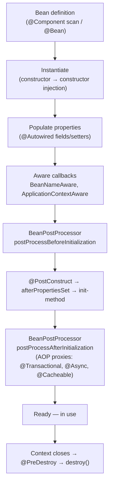
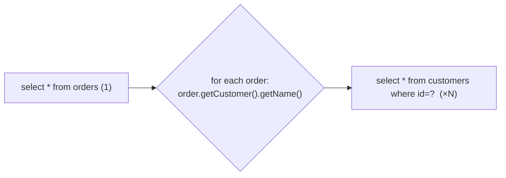
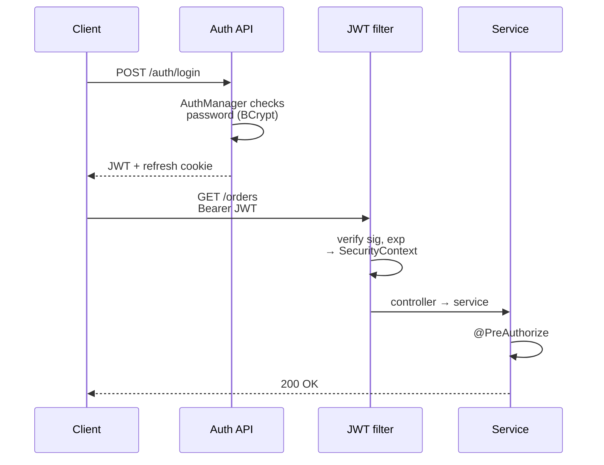
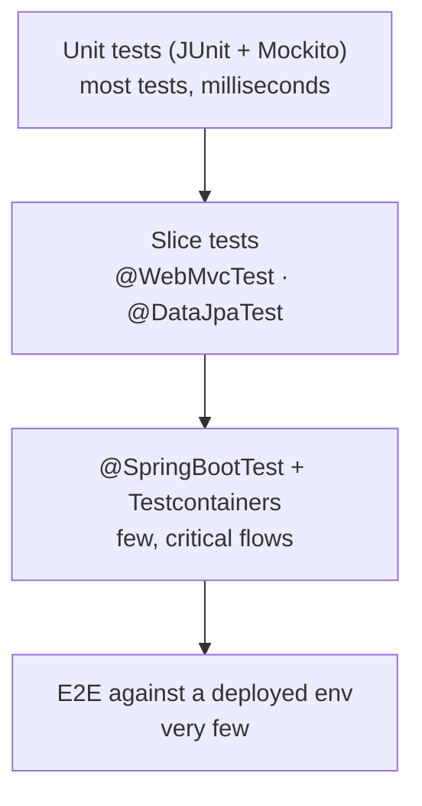
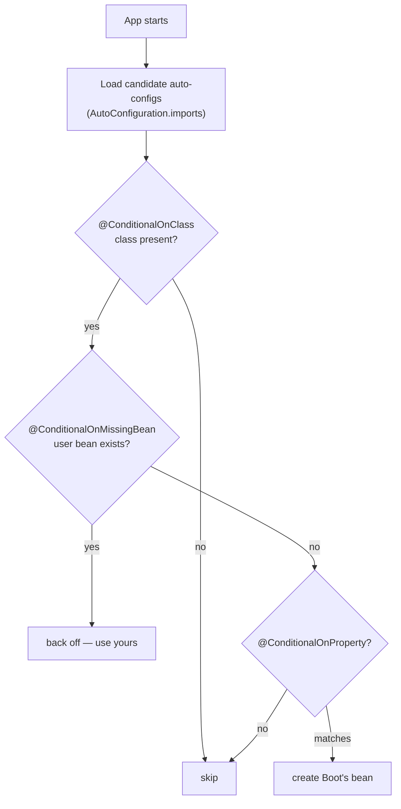
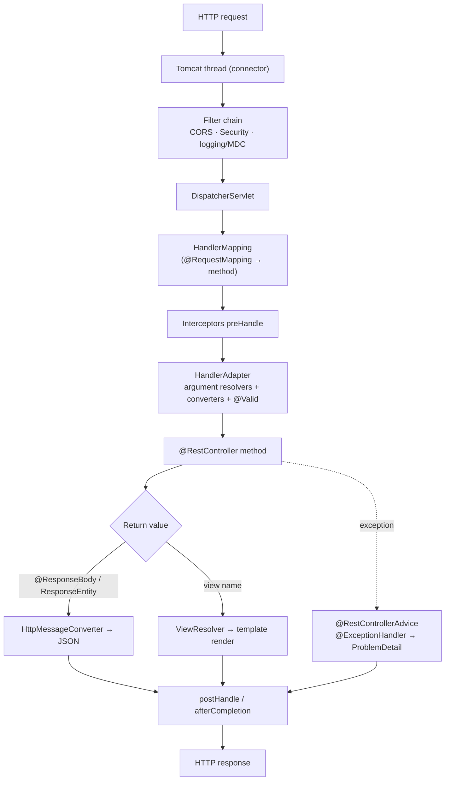
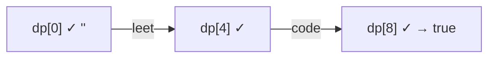

# Day 26 — Phase 3 Review: Spring Boot Rapid-Fire

> **How to use these notes:** each section maps to one checklist item. Today is a **review day** — try to explain each topic out loud *before* reading the answer, then check yourself with the collapsible questions. 🚀 marks senior-level details.

**Today's goal:** consolidate Phase 3 (Days 19–25) into crisp, interview-ready explanations: IoC/DI and the bean lifecycle, `@Transactional` pitfalls, the N+1 problem, the JWT flow end-to-end, test slices, auto-configuration, and the full Spring MVC request lifecycle. On the DSA side: **1-D dynamic programming, medium level** — Coin Change, LIS, Word Break, Decode Ways and Maximum Product Subarray.

**How to answer "explain X" questions** — a structure that works for every item below:

| Step | What to say | Time |
|---|---|---|
| 1. One-line definition | "DI means objects receive their dependencies instead of creating them." | 10 s |
| 2. Why it exists | The problem it solves | 20 s |
| 3. How it works | Mechanism, ideally with a tiny diagram or code | 60 s |
| 4. Pitfall / trade-off | Shows real experience | 20 s |
| 5. Your project | "In my last project we…" | 30 s |

<!-- topic: d26_t1 -->
## 🌿 Spring — Comprehensive Review

<!-- subtopic: d26_t1_s1 -->
### 1. IoC, DI, bean lifecycle and @Transactional pitfalls

> **TL;DR:** **IoC** = the container creates and wires objects, not your code. **DI** = dependencies are passed in (constructor injection preferred). A bean goes **instantiate → populate → aware callbacks → BeanPostProcessor (before) → @PostConstruct / afterPropertiesSet → BeanPostProcessor (after, proxies created here) → ready → @PreDestroy**. `@Transactional` works through a **proxy**, so self-invocation and private methods are not transactional, and checked exceptions **commit** by default.

#### The bean lifecycle in one picture



```java
@Service
public class PriceService {
    private final PriceRepository repo;              // constructor injection: final, testable, no nulls

    public PriceService(PriceRepository repo) { this.repo = repo; }

    @PostConstruct
    void warmUp() { repo.findTopSellers(); }         // runs once dependencies are injected

    @PreDestroy
    void shutdown() { /* release resources */ }      // singleton only — prototypes are NOT destroyed by Spring
}
```

#### Scopes recap

| Scope | Instances | Note |
|---|---|---|
| `singleton` (default) | One per container | Must be thread-safe (stateless) |
| `prototype` | New per injection/lookup | Spring doesn't call destroy callbacks |
| `request` / `session` | Per HTTP request / session | Inject into singletons through a scoped proxy |

#### @Transactional pitfalls (Day 22)

| Pitfall | Why | Fix |
|---|---|---|
| Self-invocation (`this.method()`) | Call bypasses the proxy | Move to another bean / `TransactionTemplate` |
| Private / final methods | Proxy can't intercept | Make it public on a Spring bean |
| Checked exception commits | Default rollback is for `RuntimeException`/`Error` only | `rollbackFor = Exception.class` |
| Catching and swallowing | Proxy never sees the exception | Rethrow or mark rollback-only |
| Inner `REQUIRED` throws, outer catches | Shared transaction is rollback-only → `UnexpectedRollbackException` | `REQUIRES_NEW` for optional work |
| Long transactions with HTTP calls | Hold connections and locks | Do remote calls outside; `@TransactionalEventListener(AFTER_COMMIT)` |
| `@Transactional` on a non-bean (`new MyService()`) | No proxy at all | Let Spring create it |

<details><summary>Q1. Constructor vs field injection — which and why?</summary>

Constructor injection: dependencies are explicit and `final`, the object is always fully initialised, it's testable with plain `new`, and circular dependencies fail fast at startup. Field injection hides dependencies and needs reflection or a Spring context to test.

</details>

<details><summary>Q2. When are AOP proxies created in the bean lifecycle?</summary>

In `postProcessAfterInitialization` of a BeanPostProcessor (e.g., `AnnotationAwareAspectJAutoProxyCreator`), after `@PostConstruct` has run. That's why calling a `@Transactional` method from `@PostConstruct` on the same bean isn't transactional.

</details>

<!-- subtopic: d26_t1_s2 -->
### 2. The N+1 problem and three solutions

> **TL;DR:** Loading N parent rows with one query, then touching a lazy association on each, fires **N more queries**. Fix by telling Hibernate up front what you need: **JOIN FETCH** (one joined query), **@EntityGraph** (declarative join fetch), or **@BatchSize / default_batch_fetch_size** (IN-batches, plays well with pagination). For read-only screens, **DTO projections** avoid entities entirely.



```java
// 1) JOIN FETCH — one query
@Query("select o from Order o join fetch o.customer where o.status = :s")
List<Order> findWithCustomer(@Param("s") OrderStatus s);

// 2) @EntityGraph — same SQL, no JPQL
@EntityGraph(attributePaths = {"customer", "lines"})
List<Order> findByStatus(OrderStatus s);

// 3) Batch fetching — 1 + N/50 queries
@OneToMany(mappedBy = "order") @BatchSize(size = 50)
private List<OrderLine> lines;
// or globally: spring.jpa.properties.hibernate.default_batch_fetch_size=50
```

| Fix | Queries | Watch out for |
|---|---|---|
| JOIN FETCH | 1 | Collection fetch + paging = in-memory paging (HHH90003004); two `List` bags = `MultipleBagFetchException` |
| @EntityGraph | 1 | Same as JOIN FETCH |
| @BatchSize | 1 + N/size | Still several queries, but safe with pagination |
| DTO projection | 1 | Read-only |

**Detect it:** `logging.level.org.hibernate.SQL=debug`, `hibernate.generate_statistics=true`, or assert query counts in tests. Remember **EAGER does not fix N+1** — it just makes the extra queries unconditional.

<details><summary>Q. Your paginated endpoint uses JOIN FETCH on a collection and memory spikes. Why?</summary>

With a collection fetch Hibernate can't apply LIMIT/OFFSET in SQL (rows are multiplied), so it loads every matching row and paginates in memory (warning HHH90003004). Page the parent ids first, then fetch the collections by `id in (:ids)`, or use `@BatchSize`.

</details>

<!-- subtopic: d26_t1_s3 -->
### 3. JWT authentication end-to-end

> **TL;DR:** **Login** (`POST /auth/login`) → `AuthenticationManager` checks credentials with `UserDetailsService` + `PasswordEncoder` → server **signs a JWT** (and issues a refresh token) → client sends `Authorization: Bearer <jwt>` on every call → **JwtAuthenticationFilter** verifies signature/expiry and puts an `Authentication` in the **SecurityContextHolder** → `AuthorizationFilter` checks URL rules → **@PreAuthorize** checks method rules → controller runs.



Key talking points:

| Step | Detail worth mentioning |
|---|---|
| Password check | BCrypt/Argon2 via `PasswordEncoder.matches`; same error for unknown user and wrong password |
| Token | Header.Payload.Signature, Base64URL, **signed not encrypted**; short-lived (≈15 min) |
| Filter | `OncePerRequestFilter`, `addFilterBefore(..., UsernamePasswordAuthenticationFilter.class)`; invalid token → stay anonymous → 401 |
| Context | `SecurityContextHolder` is thread-local; cleared after the request |
| Authorization | URL rules first, then `@PreAuthorize("hasRole('ADMIN') or #id == authentication.name")` |
| Refresh | Opaque refresh token, hashed in DB, rotated on use, HttpOnly cookie |
| Prod alternative | `oauth2ResourceServer().jwt()` with an identity provider (Keycloak, Auth0, Cognito) |

<details><summary>Q. Where would you revoke a compromised user's access with JWTs?</summary>

Revoke their refresh tokens server-side (they can't get new access tokens), keep access tokens short-lived, and for immediate cut-off add the access token's `jti` (or the user id with a "tokens issued before" timestamp) to a deny-list checked by the filter, e.g. in Redis until expiry.

</details>

<!-- subtopic: d26_t1_s4 -->
### 4. @WebMvcTest vs @SpringBootTest; MockMvc vs a real server

> **TL;DR:** **@WebMvcTest** loads only the web slice (controllers, advice, filters, Jackson) — fast; you mock services with `@MockitoBean`. **@SpringBootTest** loads the whole application — realistic, slower. **MockMvc** drives the MVC stack in-process without a server; **`webEnvironment = RANDOM_PORT`** starts real Tomcat and you call it over HTTP with `TestRestTemplate`/`WebTestClient`.

| Question | Use |
|---|---|
| Does my controller map URLs, validate input, return the right status/JSON? | `@WebMvcTest` + MockMvc |
| Does my custom JPQL query / mapping work on the real DB? | `@DataJpaTest` + Testcontainers |
| Is everything wired together (security, transactions, DB)? | `@SpringBootTest` (+ MockMvc or RANDOM_PORT) |
| Do filters/servlet container behaviour/real HTTP matter (compression, SSL, timeouts)? | `RANDOM_PORT` + real client |



| | MockMvc | Real server (RANDOM_PORT) |
|---|---|---|
| Starts Tomcat | ❌ | ✅ |
| Speed | Fast | Slower |
| Same thread as test | ✅ (`@Transactional` test rollback works) | ❌ (server thread — no rollback) |
| Tests | MVC layer, security filters | Full HTTP behaviour |

<details><summary>Q. Why doesn't @Transactional on a RANDOM_PORT test roll back the data your request inserted?</summary>

The request is handled on a server thread with its own transaction, not the test thread's transaction. Clean up explicitly (truncate tables, unique test data) or use MockMvc, which runs on the test thread.

</details>

<!-- subtopic: d26_t1_s5 -->
### 5. Auto-configuration with @ConditionalOnClass and @ConditionalOnMissingBean

> **TL;DR:** `@EnableAutoConfiguration` loads the classes listed in `META-INF/spring/org.springframework.boot.autoconfigure.AutoConfiguration.imports`. Each is guarded by **conditions**: `@ConditionalOnClass` (a library is on the classpath), `@ConditionalOnMissingBean` (you haven't defined your own), `@ConditionalOnProperty` (a property is set). That's why adding a starter "just works" and why **defining your own bean overrides Boot's**.

```java
@AutoConfiguration
@ConditionalOnClass(ObjectMapper.class)                       // Jackson on the classpath?
public class JacksonAutoConfigurationSketch {

    @Bean
    @ConditionalOnMissingBean                                  // back off if the app defines one
    ObjectMapper objectMapper(Jackson2ObjectMapperBuilder builder) {
        return builder.build();
    }
}
```



**Debug:** run with `--debug` (or `debug=true`) to print the **conditions evaluation report**, or hit `/actuator/conditions`. Exclude one: `@SpringBootApplication(exclude = DataSourceAutoConfiguration.class)`.

🚀 **Write your own starter:** an `xyz-spring-boot-autoconfigure` module with `@AutoConfiguration` classes + `@ConfigurationProperties`, registered in `AutoConfiguration.imports`, plus an `xyz-spring-boot-starter` that only pulls dependencies. User configuration is processed first, so `@ConditionalOnMissingBean` sees their beans.

<!-- subtopic: d26_t1_s6 -->
### 6. Draw the Spring MVC request lifecycle

> **TL;DR:** Request → servlet **filters** (incl. Spring Security) → **DispatcherServlet** → **HandlerMapping** finds the controller method → **HandlerInterceptor.preHandle** → **HandlerAdapter** resolves arguments (`@PathVariable`, `@RequestBody` via HttpMessageConverters, `@Valid`) and invokes the method → return value handled (`@ResponseBody` → JSON via Jackson, or a view name → **ViewResolver**) → `postHandle`/`afterCompletion` → exceptions go to **@ControllerAdvice** → response.



| Component | Job | Customise with |
|---|---|---|
| Filter | Servlet-level, before Spring MVC (sees every request) | `OncePerRequestFilter`, `FilterRegistrationBean` |
| DispatcherServlet | Front controller | — |
| HandlerMapping | URL + method + headers → handler | `@RequestMapping`, `consumes`/`produces` |
| HandlerInterceptor | Around controller calls (knows the handler) | `WebMvcConfigurer.addInterceptors` |
| ArgumentResolver | Builds method parameters | `HandlerMethodArgumentResolver` |
| HttpMessageConverter | Body ↔ Java (Jackson) | `ObjectMapper` config, custom converters |
| ExceptionResolver | Maps exceptions to responses | `@RestControllerAdvice` |

**Filter vs interceptor:** filters belong to the servlet container and run for everything (static files, errors); interceptors belong to Spring MVC and know which controller method will run.

🚀 Threading: one Tomcat worker thread (default pool 200) handles the whole request. With `spring.threads.virtual.enabled=true` (Boot 3.2, Java 21) each request runs on a virtual thread instead.

### 🎤 Interview Q&A — Phase 3 lightning round

<details><summary>Q1. What does @SpringBootApplication combine?</summary>

`@SpringBootConfiguration` (a `@Configuration`), `@EnableAutoConfiguration` and `@ComponentScan` of the main class's package and sub-packages.

</details>

<details><summary>Q2. Default isolation and propagation of @Transactional?</summary>

Propagation `REQUIRED`; isolation `DEFAULT`, i.e. the database's default (READ COMMITTED on PostgreSQL, REPEATABLE READ on MySQL InnoDB).

</details>

<details><summary>Q3. 401 vs 403 in Spring Security?</summary>

401 when the request isn't authenticated (handled by the AuthenticationEntryPoint); 403 when it is authenticated but lacks permission (AccessDeniedHandler).

</details>

<details><summary>Q4. Optimistic vs pessimistic locking in one sentence each?</summary>

Optimistic: a `@Version` column is checked on update and a conflict throws, so you retry or return 409. Pessimistic: `SELECT … FOR UPDATE` locks the row so other writers wait.

</details>

<details><summary>Q5. How do you make a config value type-safe and validated?</summary>

A `@ConfigurationProperties` record with `@Validated` and Bean Validation annotations; the app fails at startup if the value is missing or invalid.

</details>

<!-- topic: d22_t2 -->
## 🧮 DSA — Dynamic Programming: Medium (1D)

Recipe from Day 25: **state → recurrence → base cases → order → answer → space-optimise.** Today every problem is a 1-D array of states.

<!-- subtopic: d22_t2_s1 -->
### 7. Coin Change (LeetCode 322)

> **Problem:** coins of given denominations (unlimited supply) and an `amount`; return the **fewest coins** that make the amount, or `-1`. 🔗 [LeetCode 322](https://leetcode.com/problems/coin-change/)

**State:** `dp[a]` = min coins to make amount `a`. **Recurrence:** try every coin as the last one: `dp[a] = min(dp[a - c] + 1)` over coins `c ≤ a`. **Base:** `dp[0] = 0`. Unreachable amounts stay at "infinity".

```java
public int coinChange(int[] coins, int amount) {
    int[] dp = new int[amount + 1];
    Arrays.fill(dp, amount + 1);                 // "infinity": more coins than could ever be needed
    dp[0] = 0;
    for (int a = 1; a <= amount; a++) {
        for (int c : coins) {
            if (c <= a) dp[a] = Math.min(dp[a], dp[a - c] + 1);
        }
    }
    return dp[amount] > amount ? -1 : dp[amount];
}   // O(amount × coins) time, O(amount) space
```

Trace `coins = [1, 2, 5], amount = 11`:

| a | 0 | 1 | 2 | 3 | 4 | 5 | 6 | 7 | 8 | 9 | 10 | 11 |
|---|---|---|---|---|---|---|---|---|---|---|---|---|
| dp | 0 | 1 | 1 | 2 | 2 | 1 | 2 | 2 | 3 | 3 | 2 | **3** |

Answer **3** (5 + 5 + 1).

⚠️ **Greedy fails:** coins `[1, 3, 4]`, amount 6 — greedy takes 4 + 1 + 1 = 3 coins, optimal is 3 + 3 = 2.

| Variant | Difference | Loop order |
|---|---|---|
| **Coin Change II (LC 518)** — count combinations | Order doesn't matter: `{1,2}` = `{2,1}` | **coins outer, amount inner**: `dp[a] += dp[a - c]` |
| **Combination Sum IV (LC 377)** — count sequences | Order matters | **amount outer, coins inner** |
| Coin Change (min) | Optimum, not a count | Either order works |

<!-- subtopic: d22_t2_s2 -->
### 8. Longest Increasing Subsequence (LeetCode 300)

> **Problem:** length of the longest strictly increasing subsequence (not necessarily contiguous). 🔗 [LeetCode 300](https://leetcode.com/problems/longest-increasing-subsequence/)

**O(n²) DP:** `dp[i]` = length of the LIS **ending at** index `i` = `1 + max(dp[j])` for `j < i` with `nums[j] < nums[i]`. Answer = `max(dp)`.

```java
public int lengthOfLIS(int[] nums) {
    int[] dp = new int[nums.length];
    int best = 0;
    for (int i = 0; i < nums.length; i++) {
        dp[i] = 1;
        for (int j = 0; j < i; j++) {
            if (nums[j] < nums[i]) dp[i] = Math.max(dp[i], dp[j] + 1);
        }
        best = Math.max(best, dp[i]);
    }
    return best;
}   // O(n²)
```

**O(n log n) — patience sorting:** keep `tails[k]` = the **smallest possible tail** of an increasing subsequence of length `k + 1`. For each number, binary-search the first tail ≥ it and replace it (or append).

```java
public int lengthOfLISFast(int[] nums) {
    int[] tails = new int[nums.length];
    int size = 0;
    for (int x : nums) {
        int lo = 0, hi = size;
        while (lo < hi) {                       // first index with tails[idx] >= x
            int mid = (lo + hi) >>> 1;
            if (tails[mid] < x) lo = mid + 1; else hi = mid;
        }
        tails[lo] = x;
        if (lo == size) size++;
    }
    return size;
}   // O(n log n)
```

Trace `[10, 9, 2, 5, 3, 7, 101, 18]`:

| x | tails after |
|---|---|
| 10 | [10] |
| 9 | [9] |
| 2 | [2] |
| 5 | [2, 5] |
| 3 | [2, 3] |
| 7 | [2, 3, 7] |
| 101 | [2, 3, 7, 101] |
| 18 | [2, 3, 7, 18] |

Length **4**. ⚠️ `tails` is **not** an actual subsequence — only its length is meaningful (reconstruct with parent pointers if asked).

Related: Russian Doll Envelopes (LC 354 — sort by width asc, height desc, then LIS on heights), Number of LIS (LC 673), Longest String Chain (LC 1048).

<!-- subtopic: d22_t2_s3 -->
### 9. Word Break (LeetCode 139)

> **Problem:** can string `s` be segmented into words from `wordDict` (words reusable)? 🔗 [LeetCode 139](https://leetcode.com/problems/word-break/)

**State:** `dp[i]` = can the **prefix of length i** be segmented. `dp[i] = true` if some `j < i` has `dp[j]` and `s.substring(j, i)` is a word.

```java
public boolean wordBreak(String s, List<String> wordDict) {
    Set<String> words = new HashSet<>(wordDict);
    int maxLen = wordDict.stream().mapToInt(String::length).max().orElse(0);
    boolean[] dp = new boolean[s.length() + 1];
    dp[0] = true;                                        // empty prefix
    for (int i = 1; i <= s.length(); i++) {
        for (int j = Math.max(0, i - maxLen); j < i; j++) {   // only check plausible word lengths
            if (dp[j] && words.contains(s.substring(j, i))) {
                dp[i] = true;
                break;
            }
        }
    }
    return dp[s.length()];
}   // O(n · maxLen · maxLen) with substring cost
```



*`s = "leetcode", dict = ["leet", "code"]`.*

⚠️ Plain recursion without memo is exponential on inputs like `"aaaa…ab"` with dict `["a", "aa", "aaa"]`.

Follow-up **Word Break II (LC 140, Hard)**: return all sentences → backtracking + memo of `start → list of sentences`. A **Trie** (Day 30) speeds up the inner loop when the dictionary is large.

<!-- subtopic: d22_t2_s4 -->
### 10. Decode Ways (LeetCode 91)

> **Problem:** `'A' → "1" … 'Z' → "26"`. Count the ways to decode a digit string. 🔗 [LeetCode 91](https://leetcode.com/problems/decode-ways/)

**State:** `dp[i]` = ways to decode the first `i` characters. Look at the last one or two digits:
- single digit `s[i-1]` in `1..9` → add `dp[i-1]`
- two digits `s[i-2..i-1]` in `10..26` → add `dp[i-2]`

```java
public int numDecodings(String s) {
    if (s.isEmpty() || s.charAt(0) == '0') return 0;
    int prev2 = 1, prev1 = 1;                    // dp[0] = 1 (empty), dp[1] = 1
    for (int i = 2; i <= s.length(); i++) {
        int cur = 0;
        int one = s.charAt(i - 1) - '0';
        int two = (s.charAt(i - 2) - '0') * 10 + one;
        if (one >= 1) cur += prev1;
        if (two >= 10 && two <= 26) cur += prev2;
        prev2 = prev1;
        prev1 = cur;
    }
    return prev1;
}   // O(n) time, O(1) space
```

| s | ways | why |
|---|---|---|
| "12" | 2 | "1 2" (AB), "12" (L) |
| "226" | 3 | "2 2 6", "22 6", "2 26" |
| "06" | 0 | Leading zero can't be decoded |
| "10" | 1 | Only "10" (J) |
| "100" | 0 | "00" and "0" invalid |

⚠️ **Zeros are the whole trick**: `'0'` can only appear as the second digit of 10 or 20. It's Climbing Stairs (Day 25) with validity checks on each step.

<!-- subtopic: d22_t2_s5 -->
### 11. Maximum Product Subarray (LeetCode 152)

> **Problem:** the contiguous subarray with the largest product. 🔗 [LeetCode 152](https://leetcode.com/problems/maximum-product-subarray/)

Kadane (Day 10) tracks only the maximum, but with products a **negative × negative** can become the new maximum. Track **both the max and the min product ending here**; a negative number swaps their roles.

```java
public int maxProduct(int[] nums) {
    int maxHere = nums[0], minHere = nums[0], best = nums[0];
    for (int i = 1; i < nums.length; i++) {
        int x = nums[i];
        if (x < 0) {                             // a negative flips which one is biggest
            int t = maxHere; maxHere = minHere; minHere = t;
        }
        maxHere = Math.max(x, maxHere * x);      // extend, or restart at x
        minHere = Math.min(x, minHere * x);
        best = Math.max(best, maxHere);
    }
    return best;
}   // O(n) time, O(1) space
```

Trace `[2, 3, -2, 4, -1]`:

| x | maxHere | minHere | best |
|---|---|---|---|
| 2 | 2 | 2 | 2 |
| 3 | 6 | 3 | 6 |
| -2 | -2 | -12 | 6 |
| 4 | 4 | -48 | 6 |
| -1 | **48** | -4 | **48** |

Answer **48** (the whole array). Zeros reset both trackers naturally (`max(0, …)`), splitting the array.

Alternative trick: the answer is the best of prefix products and suffix products (resetting to 1 after a zero) — scanning from both ends handles an odd number of negatives.

---

## 📝 Day 26 Revision Cheat Sheet

| Topic | Remember this |
|---|---|
| IoC / DI | Container creates + wires; constructor injection (final, testable, fail-fast cycles) |
| Lifecycle | Instantiate → populate → Aware → BPP before → @PostConstruct → BPP after (proxies) → @PreDestroy |
| @Transactional traps | Self-invocation, private, checked exceptions commit, swallowed exceptions, rollback-only |
| N+1 | JOIN FETCH / @EntityGraph (1 query), @BatchSize (IN batches), DTO projections |
| JWT flow | Login → AuthManager → sign JWT → Bearer → filter → SecurityContext → @PreAuthorize |
| Test choice | @WebMvcTest (web slice), @DataJpaTest (JPA), @SpringBootTest (all); MockMvc vs RANDOM_PORT |
| Auto-config | AutoConfiguration.imports + @ConditionalOnClass / OnMissingBean / OnProperty; `--debug` report |
| MVC lifecycle | Filters → DispatcherServlet → HandlerMapping → interceptors → adapter (args, @Valid) → converters → advice |
| Coin Change | dp[a] = min(dp[a-c] + 1); init amount+1; greedy fails |
| LIS | O(n²) dp ending at i; O(n log n) tails + binary search |
| Word Break | dp[i] = any dp[j] && word(j, i); limit j by max word length |
| Decode Ways | One digit 1–9 adds dp[i-1]; two digits 10–26 add dp[i-2]; zeros! |
| Max Product | Track max and min ending here; swap on negative |

### ⚡ Rapid-fire self-test

1. Which callback runs after dependencies are injected but before proxies are created? → **@PostConstruct**
2. Does `@Transactional` roll back a checked exception by default? → **No**
3. Annotation that declares a fetch plan without JPQL? → **@EntityGraph**
4. Which filter base class is typical for a JWT filter? → **OncePerRequestFilter**
5. Test annotation that loads only controllers and web infrastructure? → **@WebMvcTest**
6. Condition that lets your own bean replace Boot's? → **@ConditionalOnMissingBean**
7. Component that converts a returned object to JSON? → **HttpMessageConverter (Jackson)**
8. Coin Change II loop order (count combinations)? → **Coins outer, amount inner**
9. LIS in O(n log n) uses what? → **Tails array + binary search**
10. Max Product Subarray keeps which two values? → **Max and min product ending here**
