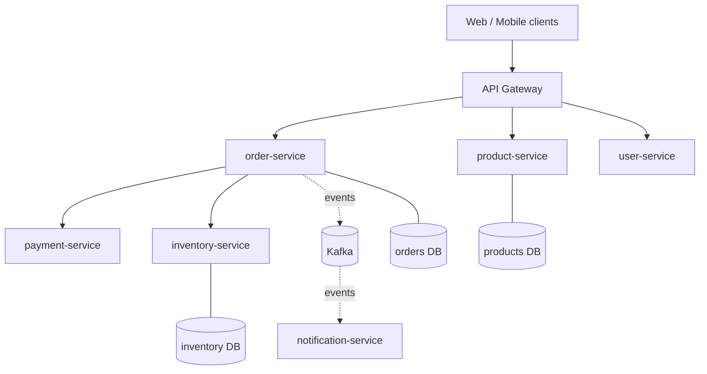
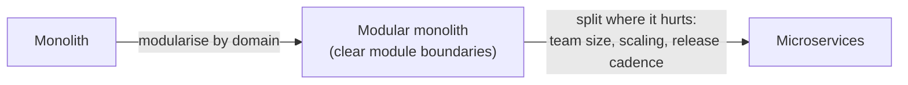
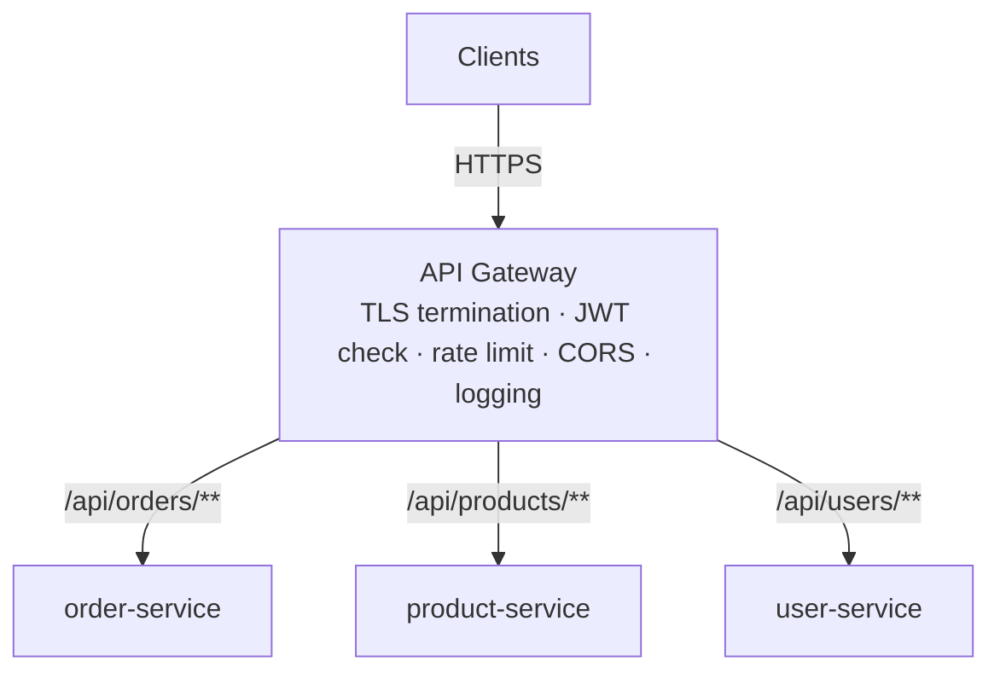
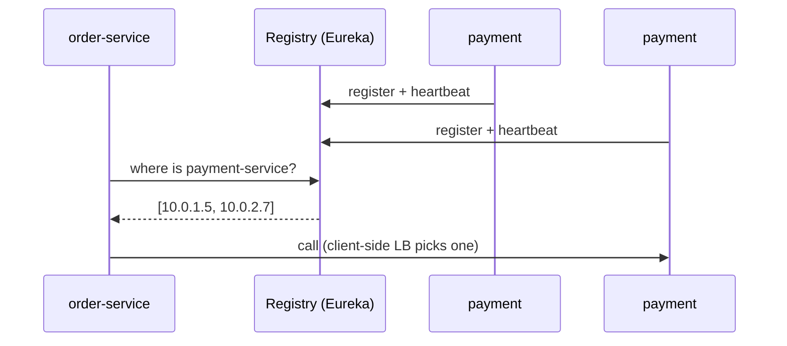
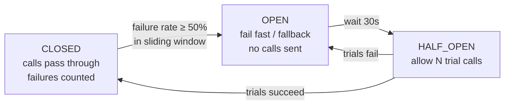
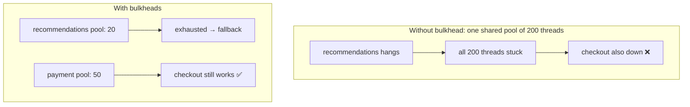
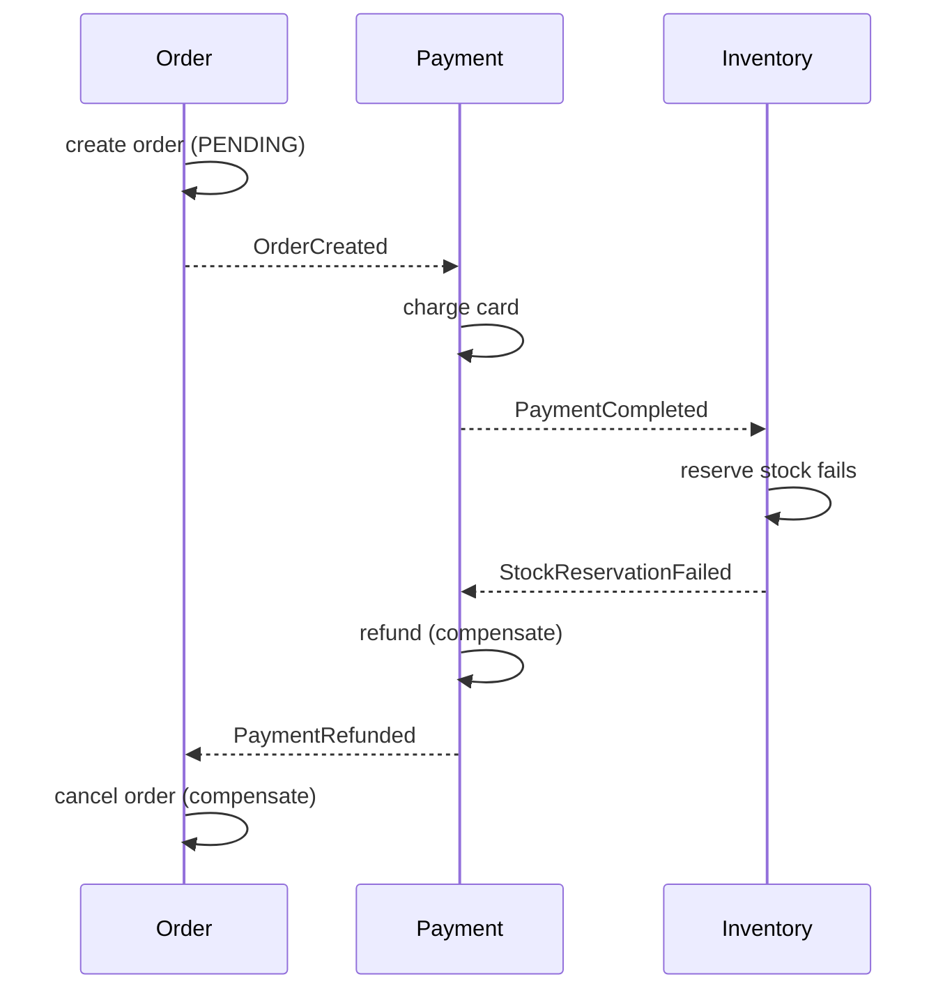
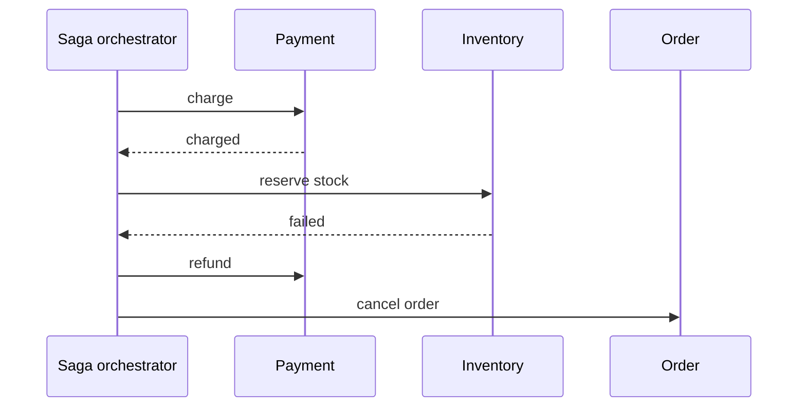
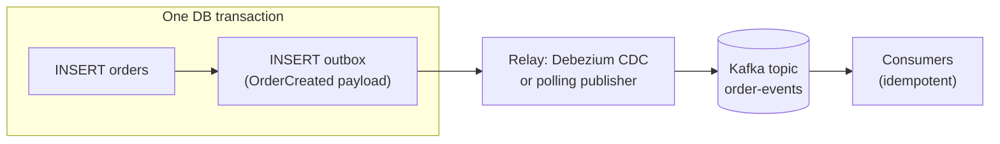
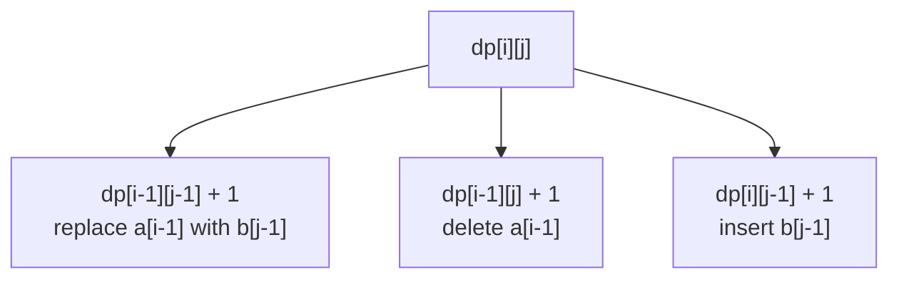

# Day 27 — Microservices Patterns: API Gateway & Service Discovery

> **How to use these notes:** each section maps to one checklist item. Run the code, study the diagrams, then test yourself with the collapsible questions. 🚀 marks senior-level details.

**Today's goal:** argue monolith vs microservices like a senior engineer, then learn the core patterns that make a microservice system work: **API Gateway**, **Service Discovery**, **Circuit Breaker**, **Bulkhead**, the **Saga** pattern for multi-service transactions, and the **Outbox** pattern for reliable events. On the DSA side: **2-D dynamic programming** — LCS, Edit Distance, Unique Paths, 0/1 Knapsack and Target Sum.

Running example — an online shop split into services:



<!-- topic: d27_t1 -->
## 🏗️ Microservices — Core Patterns

<!-- subtopic: d27_t1_s1 -->
### 1. Monolith vs microservices — the real trade-offs

> **TL;DR:** A **monolith** is one deployable unit with one database — simple to build, test, deploy and debug. **Microservices** are independently deployable services, each **owning its data**, organised around business capabilities — they buy **team autonomy, independent deployment and scaling** at the price of **distributed-systems complexity** (network failures, eventual consistency, observability, ops). Start with a well-modularised monolith; split when team or scaling pain is real.

| Dimension | Monolith | Microservices |
|---|---|---|
| Deployment | One artifact; any change redeploys everything | Each service independently, many times a day |
| Scaling | Scale the whole app | Scale hot services only (e.g., search ×10) |
| Data | One DB, ACID joins and transactions | **Database per service**; no cross-service joins; eventual consistency |
| Failure | In-process calls don't fail on the network | Every call can time out; need timeouts, retries, circuit breakers |
| Team autonomy | Shared codebase, coordination needed | Teams own services end-to-end ("you build it, you run it") |
| Tech choice | One stack | Polyglot possible (but costs expertise) |
| Testing | Easy end-to-end | Contract tests, integration environments |
| Debugging | Stack trace | Distributed tracing, correlation IDs |
| Ops overhead | Low | High: CI/CD per service, K8s, service mesh, monitoring |
| Latency | Method calls (ns) | Network hops (ms) |



**When microservices make sense:** many teams (≈ Conway's law — systems mirror org structure), parts with very different scaling or availability needs, independent release cadence. **When they don't:** small team, unclear domain boundaries, early product. "Distributed monolith" — services that must deploy together or share a database — gets the costs of both.

**How to find boundaries:** Domain-Driven Design **bounded contexts** (Order, Catalog, Payment, Shipping), high cohesion inside a service, low coupling between, and each service owns the data it needs.

<details><summary>Q. What is a "distributed monolith" and why is it bad?</summary>

Services that are split physically but coupled logically — shared database, synchronous call chains, lock-step deployments. You pay network latency, partial failures and operational overhead without gaining independent deployment or scaling.

</details>

<!-- subtopic: d27_t1_s2 -->
### 2. API Gateway — the single entry point

> **TL;DR:** An **API Gateway** sits in front of all services and handles **cross-cutting concerns** once: routing (`/orders/** → order-service`), authentication (validate JWT), rate limiting, SSL termination, CORS, request/response transformation, aggregation and observability. Spring Cloud Gateway (reactive, Netty), AWS API Gateway, Kong, NGINX, Envoy.



```yaml
# Spring Cloud Gateway
spring:
  cloud:
    gateway:
      routes:
        - id: orders
          uri: lb://order-service              # "lb://" = resolve via service discovery + load balance
          predicates:
            - Path=/api/orders/**
          filters:
            - StripPrefix=1                     # /api/orders/1 → /orders/1
            - name: RequestRateLimiter
              args:
                redis-rate-limiter.replenishRate: 10
                redis-rate-limiter.burstCapacity: 20
            - name: CircuitBreaker
              args:
                name: ordersCB
                fallbackUri: forward:/fallback/orders
```

| Responsibility | Why at the gateway |
|---|---|
| Routing & versioning | Clients know one host; internal topology can change |
| Authentication | Validate tokens once; pass user identity downstream (header / JWT) |
| Rate limiting & quotas | Protect services from abuse; per-client plans |
| TLS termination | Certificates managed in one place |
| Aggregation (API composition) | One client call → several service calls (reduce mobile round trips) |
| Observability | Access logs, correlation ID injection, metrics |

**BFF (Backend for Frontend):** a gateway per client type (web, mobile, partner) shaping APIs for that client.

⚠️ Pitfalls: putting **business logic** in the gateway, making it a single point of failure (run several instances behind a load balancer), and letting it become a bottleneck team. Services should still **authorize** requests themselves (zero trust) — the gateway authenticates, services check permissions.

<!-- subtopic: d27_t1_s3 -->
### 3. Service Discovery — Eureka, Consul

> **TL;DR:** Service instances come and go (auto-scaling, deployments, crashes), so their IPs change. With **service discovery**, instances **register** themselves in a **registry** (Eureka, Consul) and send heartbeats; callers look up healthy instances **by name** (`order-service`). **Client-side discovery**: the caller fetches the list and load-balances itself (Eureka + Spring Cloud LoadBalancer). **Server-side discovery**: a load balancer/router does it (Kubernetes Services, AWS ALB).



```java
// Client side (Spring Cloud): call by logical name
@Bean
@LoadBalanced
RestClient.Builder restClientBuilder() { return RestClient.builder(); }

String status = restClientBuilder.build()
        .get().uri("http://payment-service/payments/{id}", id)   // resolved through the registry
        .retrieve().body(String.class);
```

| | Client-side (Eureka) | Server-side (Kubernetes Service, ALB) |
|---|---|---|
| Who picks the instance | The caller's library | A proxy / kube-proxy / LB |
| Language support | Needs a client library per language | Any language, plain DNS |
| Extra hop | No | Sometimes |
| Typical today | Spring Cloud on VMs | **Kubernetes**: `http://payment-service:8080` via DNS |

**Health matters:** the registry should only return healthy instances (heartbeats, health checks). Eureka favours **availability over consistency** (AP): during a network partition it keeps serving possibly-stale entries (self-preservation mode). Consul and ZooKeeper are CP-leaning.

🚀 In Kubernetes you rarely need Eureka: a `Service` gives a stable DNS name and load-balances across ready pods. A **service mesh** (Istio, Linkerd) adds mTLS, retries and traffic shifting in a sidecar proxy (Day 28).

<!-- subtopic: d27_t1_s4 -->
### 4. Circuit Breaker — CLOSED → OPEN → HALF_OPEN

> **TL;DR:** When a downstream service is failing or slow, retrying every call wastes threads and can take **your** service down too (**cascading failure**). A **circuit breaker** watches recent calls; past a failure-rate threshold it **OPENS** and fails fast (or uses a fallback) for a cool-down period, then goes **HALF_OPEN** to let a few trial calls through; success → **CLOSED**, failure → **OPEN** again.



```java
@Service
public class PaymentClient {
    @CircuitBreaker(name = "payment", fallbackMethod = "paymentFallback")
    public PaymentResult charge(String orderId, BigDecimal amount) {
        return restClient.post().uri("/payments").body(new ChargeRequest(orderId, amount))
                .retrieve().body(PaymentResult.class);
    }

    // Same signature + the exception
    private PaymentResult paymentFallback(String orderId, BigDecimal amount, Throwable ex) {
        return PaymentResult.pending(orderId);   // e.g. queue for later instead of failing the order
    }
}
```

```yaml
resilience4j.circuitbreaker.instances.payment:
  sliding-window-type: COUNT_BASED
  sliding-window-size: 20
  minimum-number-of-calls: 10
  failure-rate-threshold: 50          # % failures that opens the circuit
  slow-call-duration-threshold: 2s
  slow-call-rate-threshold: 80        # slow calls count too
  wait-duration-in-open-state: 30s
  permitted-number-of-calls-in-half-open-state: 3
```

| Why it helps | |
|---|---|
| Fail fast | Callers don't block threads waiting for timeouts |
| Give the downstream time to recover | No retry storm while it's struggling |
| Graceful degradation | Fallback: cached data, default, "try later" |

⚠️ Always combine with **timeouts** (a circuit breaker without timeouts still waits on hanging calls). Day 29 covers Resilience4j configuration in depth.

<!-- subtopic: d27_t1_s5 -->
### 5. Bulkhead — isolate failures

> **TL;DR:** Like watertight compartments in a ship: give each downstream dependency its **own limited pool** (threads or concurrent-call permits). If the recommendations service hangs, it can only exhaust **its** pool — checkout keeps working.



```java
@Bulkhead(name = "recommendations", type = Bulkhead.Type.SEMAPHORE, fallbackMethod = "noRecommendations")
public List<Product> recommendationsFor(String userId) { ... }
```

```yaml
resilience4j.bulkhead.instances.recommendations:
  max-concurrent-calls: 20      # semaphore bulkhead
  max-wait-duration: 0          # reject immediately when full
resilience4j.thread-pool-bulkhead.instances.reports:
  core-thread-pool-size: 4      # thread-pool bulkhead (runs call on a separate pool, returns CompletableFuture)
  max-thread-pool-size: 8
  queue-capacity: 20
```

| Type | How | Use |
|---|---|---|
| Semaphore | Limits concurrent calls on the caller's thread | Most cases; cheap |
| Thread pool | Separate executor per dependency | Isolate blocking calls fully, add timeouts |

Bulkheads also exist at other levels: separate **connection pools** per DB, separate **K8s deployments** for critical vs batch workloads, separate **consumer groups**.

<!-- subtopic: d27_t1_s6 -->
### 6. Saga pattern — choreography vs orchestration

> **TL;DR:** With a database per service you can't use one ACID transaction across services. A **saga** is a sequence of **local transactions**; each step publishes an event or is triggered by a coordinator. If a step fails, previous steps are undone with **compensating transactions** (refund, release stock, cancel order). **Choreography**: services react to each other's events (no central brain). **Orchestration**: a saga orchestrator tells each service what to do.

#### Choreography



#### Orchestration



| | Choreography | Orchestration |
|---|---|---|
| Coordination | Events between services | Central orchestrator (state machine) |
| Coupling | Loose, but flow is implicit | Services coupled to orchestrator commands |
| Visibility | Hard to see the whole flow | Flow is explicit in one place |
| Best for | 2–4 simple steps | Many steps, branching, timeouts |
| Tools | Kafka events | Temporal, Camunda, AWS Step Functions, custom state machine |

Design rules:
- **Compensations are business actions**, not rollbacks (you can't un-send an email; you send a correction).
- Every step and compensation must be **idempotent** (messages can be redelivered).
- Use **semantic locks / pending states** (`PENDING_PAYMENT`) so others don't act on half-finished data.
- Order steps so the **hardest-to-compensate step comes last** (ship goods after everything else succeeded).

<!-- subtopic: d27_t1_s7 -->
### 7. Outbox pattern — avoid the dual write

> **TL;DR:** Saving to the DB **and** publishing to Kafka are two systems — if the app crashes between them you either lose the event or publish an event for data that was rolled back (**dual-write problem**). Instead, write the event to an **outbox table in the same local transaction** as the business data; a separate relay (polling publisher or **CDC** like Debezium reading the DB log) publishes it to Kafka and marks it sent.



```java
@Transactional
public Order placeOrder(OrderRequest req) {
    Order order = orderRepository.save(Order.from(req));
    outboxRepository.save(new OutboxEvent(
            UUID.randomUUID(), "Order", order.getId().toString(), "OrderCreated",
            json.writeValueAsString(OrderCreated.from(order)), Instant.now()));
    return order;                     // both rows commit together — or neither does
}
```

```sql
create table outbox (
  id             uuid primary key,
  aggregate_type varchar(50)  not null,
  aggregate_id   varchar(100) not null,   -- use as Kafka key → per-order ordering
  event_type     varchar(100) not null,
  payload        jsonb        not null,
  created_at     timestamptz  not null,
  published_at   timestamptz             -- null until relayed (polling approach)
);
```

| Relay | How | Trade-off |
|---|---|---|
| Polling publisher | `@Scheduled` job: select unpublished rows → send → mark published | Simple; adds latency and DB load; need locking (`FOR UPDATE SKIP LOCKED`) with several instances |
| CDC (Debezium + Kafka Connect) | Reads the DB transaction log (WAL/binlog) | Near real-time, no polling; more infrastructure |

The relay can publish **more than once** (crash after send, before marking) → it's **at-least-once**, so consumers must be **idempotent** (store processed event ids). The mirror image on the consumer side is the **Inbox** pattern.

### 🎤 Interview Q&A — Microservices core

<details><summary>Q1. How do services in a microservice system share data?</summary>

They don't share databases. Each service owns its data and exposes it through APIs or events; others keep local read copies (updated from events) when they need fast access. Consistency across services is eventual.

</details>

<details><summary>Q2. What does an API gateway do, and what should it not do?</summary>

It's the single entry point for routing, authentication, rate limiting, TLS, CORS and observability. It should not contain business logic or become a team bottleneck; services still authorize requests themselves.

</details>

<details><summary>Q3. Explain the circuit breaker states.</summary>

CLOSED: calls pass and failures are counted. When the failure (or slow-call) rate crosses the threshold it goes OPEN and fails fast for a wait period. Then HALF_OPEN lets a few trial calls through; if they succeed it closes, otherwise it opens again.

</details>

<details><summary>Q4. Saga choreography vs orchestration?</summary>

Choreography: services react to each other's events, no central coordinator — loosely coupled but the flow is implicit. Orchestration: a central orchestrator sends commands and tracks state — explicit and easier to change for complex flows, at the cost of a central component.

</details>

<details><summary>Q5. Why the outbox pattern instead of publishing to Kafka inside @Transactional?</summary>

Kafka isn't part of the DB transaction: the publish can succeed while the DB rolls back, or the DB commits and the app crashes before publishing. Writing the event to an outbox table in the same transaction makes both atomic; a relay publishes it afterwards (at-least-once).

</details>

<!-- topic: d23_t2 -->
## 🧮 DSA — Dynamic Programming: Medium (2D)

2-D DP: the state has **two indices** — usually `dp[i][j]` over two strings, a grid, or (item, capacity).

<!-- subtopic: d23_t2_s1 -->
### 8. Longest Common Subsequence (LeetCode 1143)

> **Problem:** length of the longest subsequence common to `text1` and `text2`. 🔗 [LeetCode 1143](https://leetcode.com/problems/longest-common-subsequence/)

**State:** `dp[i][j]` = LCS of `text1[0..i)` and `text2[0..j)`.
- If `text1[i-1] == text2[j-1]`: `dp[i][j] = dp[i-1][j-1] + 1` (use the matching char)
- else: `dp[i][j] = max(dp[i-1][j], dp[i][j-1])` (drop one char from either string)

```java
public int longestCommonSubsequence(String a, String b) {
    int m = a.length(), n = b.length();
    int[][] dp = new int[m + 1][n + 1];          // row 0 / col 0 = empty prefix = 0
    for (int i = 1; i <= m; i++) {
        for (int j = 1; j <= n; j++) {
            dp[i][j] = a.charAt(i - 1) == b.charAt(j - 1)
                    ? dp[i - 1][j - 1] + 1
                    : Math.max(dp[i - 1][j], dp[i][j - 1]);
        }
    }
    return dp[m][n];
}   // O(m·n) time and space (O(min(m, n)) with two rows)
```

Table for `"abcde"` vs `"ace"`:

| | "" | a | c | e |
|---|---|---|---|---|
| "" | 0 | 0 | 0 | 0 |
| a | 0 | **1** | 1 | 1 |
| b | 0 | 1 | 1 | 1 |
| c | 0 | 1 | **2** | 2 |
| d | 0 | 1 | 2 | 2 |
| e | 0 | 1 | 2 | **3** |

Answer **3** ("ace"). Rebuild the subsequence by walking back from `dp[m][n]`: diagonal on a match, otherwise toward the larger neighbour.

Related: Longest Common Substring (contiguous → reset to 0 on mismatch), Shortest Common Supersequence (LC 1092: `m + n - LCS`), Delete Operation for Two Strings (LC 583: `m + n - 2·LCS`), `diff`/git line diffs.

<!-- subtopic: d23_t2_s2 -->
### 9. Edit Distance (LeetCode 72)

> **Problem:** minimum insertions, deletions and replacements to turn `word1` into `word2` (Levenshtein distance). 🔗 [LeetCode 72](https://leetcode.com/problems/edit-distance/)

**State:** `dp[i][j]` = edits to turn `word1[0..i)` into `word2[0..j)`.
- Base: `dp[i][0] = i` (delete all), `dp[0][j] = j` (insert all)
- Same last char: `dp[i][j] = dp[i-1][j-1]`
- Else `1 + min(dp[i-1][j-1]` replace, `dp[i-1][j]` delete, `dp[i][j-1]` insert`)`

```java
public int minDistance(String a, String b) {
    int m = a.length(), n = b.length();
    int[][] dp = new int[m + 1][n + 1];
    for (int i = 0; i <= m; i++) dp[i][0] = i;
    for (int j = 0; j <= n; j++) dp[0][j] = j;
    for (int i = 1; i <= m; i++) {
        for (int j = 1; j <= n; j++) {
            if (a.charAt(i - 1) == b.charAt(j - 1)) dp[i][j] = dp[i - 1][j - 1];
            else dp[i][j] = 1 + Math.min(dp[i - 1][j - 1], Math.min(dp[i - 1][j], dp[i][j - 1]));
        }
    }
    return dp[m][n];
}   // O(m·n)
```



`"horse" → "ros"` = **3** (horse → rorse → rose → ros).

Used in spell checkers, fuzzy search ("did you mean…"), DNA alignment. Related: One Edit Distance (LC 161), Delete Operation for Two Strings (LC 583).

<!-- subtopic: d23_t2_s3 -->
### 10. Unique Paths (LeetCode 62)

> **Problem:** a robot at the top-left of an `m × n` grid moves only right or down. How many paths reach the bottom-right? 🔗 [LeetCode 62](https://leetcode.com/problems/unique-paths/)

`dp[r][c] = dp[r-1][c] + dp[r][c-1]` (arrive from above or from the left); first row and column are 1. One row is enough:

```java
public int uniquePaths(int m, int n) {
    int[] dp = new int[n];
    Arrays.fill(dp, 1);                          // first row: one way to each cell
    for (int r = 1; r < m; r++) {
        for (int c = 1; c < n; c++) {
            dp[c] += dp[c - 1];                  // dp[c] (from above) + dp[c-1] (from the left)
        }
    }
    return dp[n - 1];
}   // O(m·n) time, O(n) space
```

| | c0 | c1 | c2 | c3 |
|---|---|---|---|---|
| r0 | 1 | 1 | 1 | 1 |
| r1 | 1 | 2 | 3 | 4 |
| r2 | 1 | 3 | 6 | **10** |

🚀 **Math:** a path is `(m-1)` downs and `(n-1)` rights in some order → `C(m+n-2, m-1)`. For 3 × 4: C(5, 2) = 10.

Variants: Unique Paths II (LC 63 — obstacles set `dp = 0`), Minimum Path Sum (LC 64 — `grid[r][c] + min(up, left)`), Dungeon Game (LC 174, Hard — fill backwards from the end).

<!-- subtopic: d23_t2_s4 -->
### 11. 0/1 Knapsack and Partition Equal Subset Sum (LeetCode 416)

> **0/1 knapsack:** items with weight `w[i]` and value `v[i]`, capacity `W`; each item used **at most once**; maximise value. **Partition Equal Subset Sum:** can the array be split into two subsets with equal sums? → "is there a subset summing to `total / 2`?" — a boolean knapsack. 🔗 [LeetCode 416](https://leetcode.com/problems/partition-equal-subset-sum/)

**Classic 2-D state:** `dp[i][c]` = best value using the first `i` items with capacity `c` = `max(dp[i-1][c]` skip, `v[i] + dp[i-1][c - w[i]]` take`)`.

```java
// 1-D version: iterate capacity DOWNWARDS so each item is used at most once
public int knapsack(int[] w, int[] v, int capacity) {
    int[] dp = new int[capacity + 1];
    for (int i = 0; i < w.length; i++) {
        for (int c = capacity; c >= w[i]; c--) {
            dp[c] = Math.max(dp[c], v[i] + dp[c - w[i]]);
        }
    }
    return dp[capacity];
}   // O(n·W) time, O(W) space
```

```java
public boolean canPartition(int[] nums) {
    int total = Arrays.stream(nums).sum();
    if (total % 2 == 1) return false;            // odd total can't split evenly
    int target = total / 2;
    boolean[] dp = new boolean[target + 1];
    dp[0] = true;                                // empty subset sums to 0
    for (int x : nums) {
        for (int s = target; s >= x; s--) {      // downwards: x used once
            dp[s] = dp[s] || dp[s - x];
        }
    }
    return dp[target];
}   // O(n·target)
```

`[1, 5, 11, 5]` → total 22, target 11 → {11} and {1, 5, 5} ✅.

| Loop direction over capacity | Meaning |
|---|---|
| **High → low** | Each item at most once (**0/1 knapsack**) |
| Low → high | Items reusable (**unbounded knapsack** — Coin Change, Day 26) |

⚠️ Knapsack is **pseudo-polynomial**: O(n·W) depends on the numeric value W, not the input size. With huge W, use other techniques (meet-in-the-middle, bitsets: `BitSet` shifting for subset sums).

<!-- subtopic: d23_t2_s5 -->
### 12. Target Sum (LeetCode 494)

> **Problem:** put `+` or `-` before each number so the expression equals `target`. Count the ways. 🔗 [LeetCode 494](https://leetcode.com/problems/target-sum/)

**Reduction:** let `P` be the numbers with `+` and `N` those with `-`. `P - N = target` and `P + N = total` → `P = (target + total) / 2`. So: **count subsets summing to `(target + total) / 2`** — a counting 0/1 knapsack.

```java
public int findTargetSumWays(int[] nums, int target) {
    int total = Arrays.stream(nums).sum();
    if (Math.abs(target) > total || (target + total) % 2 != 0) return 0;
    int goal = (target + total) / 2;
    int[] dp = new int[goal + 1];
    dp[0] = 1;                                    // one way to make 0: choose nothing
    for (int x : nums) {
        for (int s = goal; s >= x; s--) dp[s] += dp[s - x];
    }
    return dp[goal];
}   // O(n·goal)
```

`nums = [1,1,1,1,1], target = 3` → total 5, goal 4 → choose which four are `+` → **5** ways.

⚠️ Zeros: a `0` can be `+0` or `-0` — the counting DP handles it (iterating `s >= 0` doubles counts correctly because `dp[s] += dp[s - 0]`).

Alternative: memoised DFS over `(index, runningSum)` — simpler to derive, O(n·total) with a HashMap memo.

---

## 📝 Day 27 Revision Cheat Sheet

| Topic | Remember this |
|---|---|
| Monolith vs micro | Simplicity vs autonomy/independent deploy/scaling; DB per service; start modular monolith |
| API Gateway | Routing, authN, rate limit, TLS, CORS, aggregation; no business logic; BFF per client |
| Discovery | Register + heartbeat; lookup by name; client-side (Eureka) vs server-side (K8s Service DNS) |
| Circuit breaker | CLOSED → (failure rate) OPEN → (wait) HALF_OPEN → trials → CLOSED/OPEN; + timeouts + fallback |
| Bulkhead | Separate pools/permits per dependency; semaphore vs thread-pool |
| Saga | Local TXs + compensations; choreography (events) vs orchestration (coordinator); idempotent steps |
| Outbox | Business row + event row in one TX; relay via polling or CDC (Debezium); consumers idempotent |
| LCS | match → diag + 1; else max(up, left) |
| Edit distance | match → diag; else 1 + min(replace, delete, insert); base row/col = i/j |
| Unique paths | up + left; one row; C(m+n-2, m-1) |
| 0/1 knapsack | Capacity loop high → low; unbounded = low → high |
| Partition | Subset sum to total/2; odd total → false |
| Target sum | Count subsets summing to (target + total)/2 |

### ⚡ Rapid-fire self-test

1. Name the problem of services that must deploy together and share a DB. → **Distributed monolith**
2. Spring Cloud Gateway URI prefix that resolves via discovery? → **lb://**
3. In Kubernetes, what usually replaces Eureka? → **Service (DNS-based discovery)**
4. Circuit breaker state that allows a few trial calls? → **HALF_OPEN**
5. Pattern that isolates each dependency in its own pool? → **Bulkhead**
6. Saga style with a central coordinator? → **Orchestration**
7. What undoes a completed saga step? → **A compensating transaction**
8. Pattern that solves the DB + Kafka dual write? → **Transactional outbox**
9. 0/1 knapsack capacity loop direction in the 1-D version? → **High to low**
10. Target Sum reduces to counting subsets with which sum? → **(target + total) / 2**
