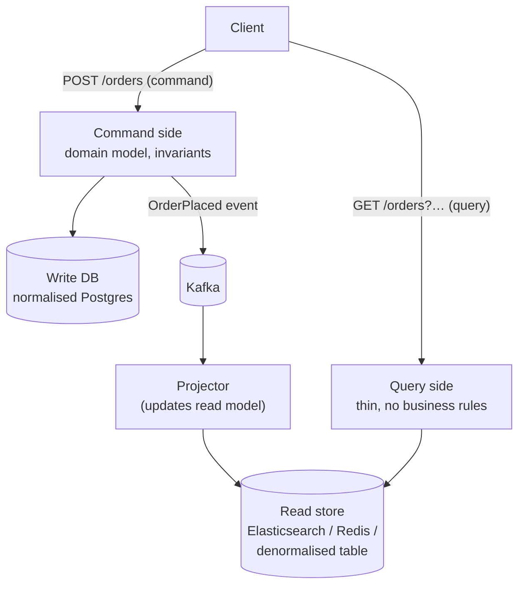
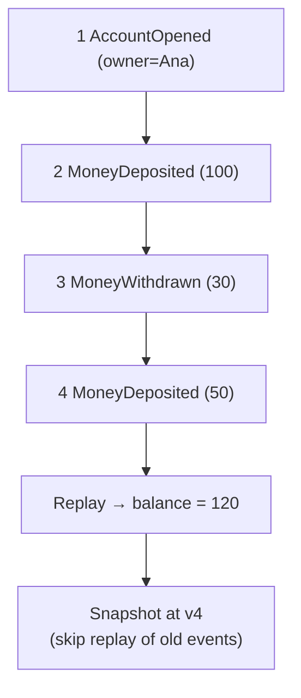
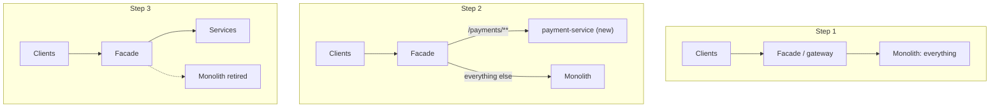
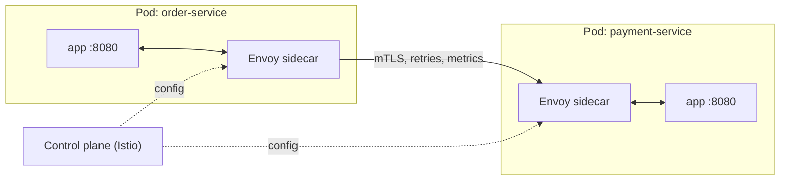
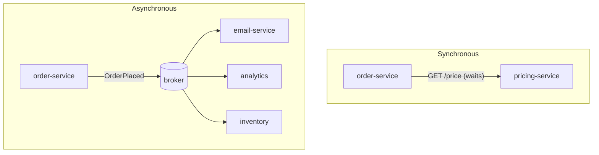
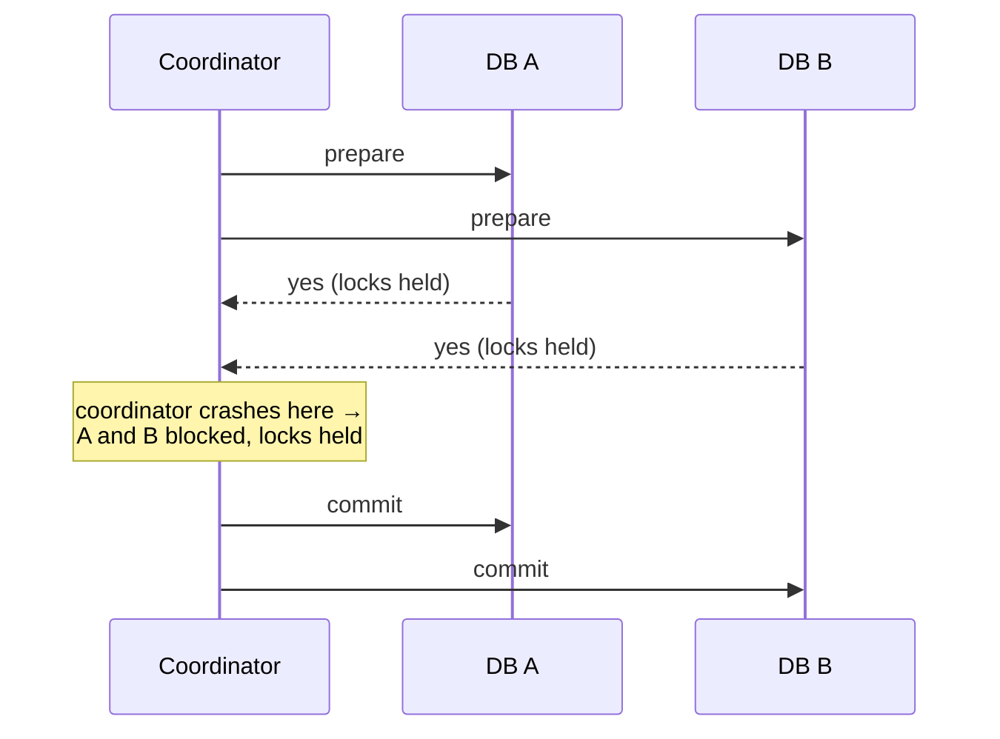
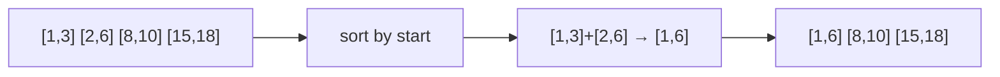

# Day 28 — Microservices: CQRS, Event Sourcing & Communication

> **How to use these notes:** each section maps to one checklist item. Run the code, study the diagrams, then test yourself with the collapsible questions. 🚀 marks senior-level details.

**Today's goal:** the advanced patterns — **CQRS** and **Event Sourcing**, migrating a monolith with the **Strangler Fig**, the **Sidecar** and service mesh, choosing **sync (REST/gRPC) vs async (Kafka, RabbitMQ, SQS)** communication, and handling **distributed transactions** without 2PC. On the DSA side: **greedy algorithms** — when they work, plus Jump Game, Gas Station and two interval classics.

<!-- topic: d28_t1 -->
## 🏗️ Microservices — Advanced Patterns

<!-- subtopic: d28_t1_s1 -->
### 1. CQRS — separate read and write models

> **TL;DR:** **Command Query Responsibility Segregation**: use one model for **commands** (writes: validate, enforce invariants, normalised, transactional) and a different model for **queries** (reads: denormalised, shaped exactly for the screen, often in a different store like Elasticsearch, Redis or a read replica). The read side is updated from **events**, so it's **eventually consistent**.



```java
// Write side — rich model, transactional
@Transactional
public void placeOrder(PlaceOrderCommand cmd) {
    Order order = Order.place(cmd.customerId(), cmd.lines());   // validates invariants
    orders.save(order);
    outbox.save(OrderPlaced.from(order));                        // event for the read side (Day 27 outbox)
}

// Read side — projection keeps a screen-shaped document up to date
@KafkaListener(topics = "order-events")
public void on(OrderPlaced e) {
    orderSummaryRepository.save(new OrderSummaryDoc(
            e.orderId(), e.customerName(), e.total(), e.itemCount(), "PLACED", e.placedAt()));
}
```

| When CQRS helps | When it's overkill |
|---|---|
| Reads ≫ writes, very different shapes (dashboards, search, feeds) | Simple CRUD |
| Read needs full-text search, aggregations, or a different DB | Small team, low load |
| Scaling reads and writes independently | Strong read-your-writes needed everywhere |
| Combining data from several services into one view | |

⚠️ **Eventual consistency UX:** after a write, the read model may lag by milliseconds to seconds. Mitigate: return the new state from the command, optimistic UI updates, "read your own writes" by reading the write DB for that user briefly, or version numbers.

"CQRS lite" in one service: entities + JPA for writes, **DTO projections or a read replica** for queries (Day 21) — no separate store, no events.

<!-- subtopic: d28_t1_s2 -->
### 2. Event Sourcing — state as a sequence of events

> **TL;DR:** Instead of storing the **current state** (`balance = 70`), store every **event** that happened (`AccountOpened`, `Deposited 100`, `Withdrew 30`) in an append-only **event store**. Current state = **replay** (fold) of the events. You get a full audit trail, time travel and the ability to build new read models later — at the cost of complexity (schema evolution, snapshots, eventual consistency). Pairs naturally with CQRS.



```java
public sealed interface AccountEvent permits Opened, Deposited, Withdrawn { }
public record Opened(String owner) implements AccountEvent { }
public record Deposited(BigDecimal amount) implements AccountEvent { }
public record Withdrawn(BigDecimal amount) implements AccountEvent { }

public class Account {
    private BigDecimal balance = BigDecimal.ZERO;
    private long version = 0;
    private final List<AccountEvent> pending = new ArrayList<>();

    public static Account replay(List<AccountEvent> history) {
        Account a = new Account();
        history.forEach(a::apply);
        return a;
    }

    // Command: check the rule, then record an event
    public void withdraw(BigDecimal amount) {
        if (balance.compareTo(amount) < 0) throw new InsufficientFundsException();
        record(new Withdrawn(amount));
    }

    private void record(AccountEvent e) { apply(e); pending.add(e); }

    // Apply: pure state change, no rules (also used when replaying)
    private void apply(AccountEvent e) {
        switch (e) {
            case Opened o -> { }
            case Deposited d -> balance = balance.add(d.amount());
            case Withdrawn w -> balance = balance.subtract(w.amount());
        }
        version++;
    }
}
```

Saving appends `pending` events with an **expected version** (`… where version = ?`) — optimistic concurrency, just like `@Version` (Day 22).

| Benefits | Costs |
|---|---|
| Complete audit log (finance, compliance) | Querying current state needs projections |
| Rebuild any read model by replaying | Event schema evolution (upcasting old events) |
| Debug: "how did we get here?" | Snapshots needed for long streams |
| Natural event stream for other services | Harder to learn; GDPR deletion is tricky (crypto-shredding) |

Tools: EventStoreDB, Axon Framework, or Postgres/Kafka as the store. ⚠️ Kafka alone is a weak event store per aggregate (no efficient "load stream for aggregate 42" or per-aggregate optimistic concurrency).

<!-- subtopic: d28_t1_s3 -->
### 3. Strangler Fig — migrate a monolith gradually

> **TL;DR:** Don't rewrite the monolith in one big bang. Put a **routing facade** (API gateway / proxy) in front of it, build new functionality (or extract one capability at a time) as new services, and **route those paths to the new service**. Over time the monolith shrinks until it can be removed — like a strangler fig growing around a tree.



Practical steps:
1. Pick a **low-risk, well-bounded** capability first (notifications, search) — not the core.
2. **Untangle the data**: the new service gets its own tables; sync via events or CDC during the transition ("anti-corruption layer" translates between old and new models).
3. Route traffic gradually (feature flags, canary percentages), compare results (**shadow traffic / parallel run**).
4. Delete the old code path once the new one is proven.

⚠️ The hardest part is usually the **shared database**, not the code.

<!-- subtopic: d28_t1_s4 -->
### 4. Sidecar pattern — Envoy and the service mesh

> **TL;DR:** A **sidecar** is a helper container deployed **next to** the main container in the same Pod, sharing its network and lifecycle. It adds capabilities without changing app code: proxying (Envoy), log shipping (Fluent Bit), secrets refresh, TLS. A **service mesh** (Istio, Linkerd) injects a proxy sidecar into every pod to handle **mTLS, retries, timeouts, circuit breaking, traffic splitting and telemetry** uniformly.



| Concern | Library approach (Resilience4j, Micrometer) | Mesh approach (Istio/Linkerd) |
|---|---|---|
| Language | Per language/framework | Language-agnostic |
| Config | In app code / properties | Central YAML (VirtualService, DestinationRule) |
| mTLS between services | Manual certs | Automatic |
| Overhead | In-process | Extra hop + memory per pod (Istio "ambient" mode reduces this) |
| Business-aware fallbacks | ✅ | ❌ (network-level only) |

Other sidecar uses: Cloud SQL proxy, Vault agent, Dapr. Related: **ambassador** (proxy for outbound calls) and **adapter** (normalise output, e.g. metrics format).

<!-- subtopic: d28_t1_s5 -->
### 5. Sync (REST/WebClient) vs async (Kafka, RabbitMQ, SQS)

> **TL;DR:** **Synchronous** request/response (REST, gRPC) when the caller **needs the answer now** (get price, validate user). **Asynchronous** messaging when the caller can continue and others react later (order placed → email, analytics, inventory), for **decoupling, buffering load spikes and resilience** (the consumer can be down). Use **Kafka** for high-throughput event streams with replay, **RabbitMQ** for flexible routing/work queues, **SQS** for simple managed queues on AWS.



| | Synchronous (REST/gRPC) | Asynchronous (messaging) |
|---|---|---|
| Coupling | Temporal: callee must be up | Decoupled in time |
| Latency to caller | Sum of the chain | Caller returns immediately |
| Failure handling | Timeouts, retries, circuit breakers | Retries, DLQ, redelivery |
| Consistency | Immediate answer | Eventual |
| Debugging | Simple call chain | Need correlation IDs/tracing |
| Good for | Queries, validations needing an answer | Events, notifications, workflows, load levelling |

```java
// Non-blocking HTTP with WebClient (or RestClient for blocking code / virtual threads)
Mono<Price> price = webClient.get().uri("http://pricing-service/prices/{sku}", sku)
        .retrieve().bodyToMono(Price.class)
        .timeout(Duration.ofSeconds(2));
```

| Broker | Model | Strengths | Use |
|---|---|---|---|
| **Kafka** | Distributed log, consumer pulls, retained messages | Huge throughput, ordering per partition, **replay**, many independent consumer groups | Event streaming, CDC, analytics, event sourcing |
| **RabbitMQ** | Broker pushes to queues via exchanges | Flexible routing (topic/direct/fanout), per-message ack, priorities, delays | Task/work queues, RPC-style messaging |
| **AWS SQS** (+ SNS) | Managed queue (SNS for pub/sub fan-out) | Zero ops, scales automatically; FIFO queues available | Simple async jobs on AWS |

⚠️ Avoid long **synchronous chains** (A → B → C → D): latency adds up and availability multiplies (0.99⁴ ≈ 0.96). Prefer async events or data replication for non-critical paths.

<!-- subtopic: d28_t1_s6 -->
### 6. gRPC — Protocol Buffers for internal calls

> **TL;DR:** **gRPC** is an RPC framework over **HTTP/2** using **Protocol Buffers** (compact binary, schema-first). It generates typed client/server stubs from a `.proto` file, supports **streaming** (server, client, bidirectional), deadlines and multiplexing. Faster and more strictly typed than JSON/REST — great for **internal service-to-service** calls; REST stays better for public/browser APIs.

```protobuf
syntax = "proto3";
package inventory;

service InventoryService {
  rpc Reserve (ReserveRequest) returns (ReserveReply);
  rpc WatchStock (StockQuery) returns (stream StockLevel);   // server streaming
}

message ReserveRequest {
  string order_id = 1;          // field numbers identify fields on the wire — never reuse them
  string sku = 2;
  int32 quantity = 3;
}

message ReserveReply {
  bool reserved = 1;
  string reason = 2;
}
```

```java
// Generated stub usage (grpc-java)
InventoryServiceGrpc.InventoryServiceBlockingStub stub = InventoryServiceGrpc.newBlockingStub(channel)
        .withDeadlineAfter(2, TimeUnit.SECONDS);
ReserveReply reply = stub.reserve(ReserveRequest.newBuilder()
        .setOrderId("o-1").setSku("SKU-1").setQuantity(2).build());
```

| | REST + JSON | gRPC + Protobuf |
|---|---|---|
| Transport | HTTP/1.1 or 2 | HTTP/2 (multiplexed streams) |
| Payload | Text JSON, human-readable | Binary, ~3–10× smaller |
| Contract | OpenAPI (optional) | `.proto` required, code generated |
| Streaming | SSE / WebSocket add-ons | Built-in (4 call types) |
| Browser support | Native | Needs gRPC-Web proxy |
| Debugging | curl, browser | grpcurl, special tools |
| Best for | Public APIs, web clients | Internal, low-latency, polyglot services |

Schema evolution rules: add fields with **new numbers**, never change a field's number or type, mark removed numbers `reserved`.

<!-- subtopic: d28_t1_s7 -->
### 7. Distributed transactions — avoid 2PC; use Saga + idempotency

> **TL;DR:** **Two-phase commit (2PC/XA)** makes several resources commit atomically via a coordinator (prepare → commit), but it's **blocking** (participants hold locks waiting for the coordinator), fragile (coordinator failure), slow, and unsupported by most modern brokers and cloud databases. In microservices, use **local transactions + Saga compensations + outbox events + idempotent consumers**, accepting **eventual consistency**.



The toolbox instead of 2PC:

| Tool | Solves |
|---|---|
| **Saga** (Day 27) | Multi-step business transaction with compensations |
| **Outbox** (Day 27) | Atomic "update DB + publish event" |
| **Idempotency keys** | Safe retries: the client sends `Idempotency-Key: <uuid>`; the server stores the result per key and returns it on a repeat |
| **Idempotent consumers / inbox** | Redelivered messages processed once (dedupe by event id) |
| **Pending states + timeouts** | `PENDING` orders expire if the saga doesn't finish |
| **Reconciliation jobs** | Periodic checks fix rare inconsistencies (payments vs orders) |

```java
// Idempotent endpoint: same key → same result, no double charge
@PostMapping("/payments")
public ResponseEntity<PaymentResponse> pay(@RequestHeader("Idempotency-Key") String key,
                                           @RequestBody PaymentRequest req) {
    return idempotencyStore.find(key)
            .map(ResponseEntity::ok)                                  // replay stored response
            .orElseGet(() -> {
                PaymentResponse res = paymentService.charge(req);     // inside: unique constraint on key
                idempotencyStore.save(key, res);
                return ResponseEntity.status(201).body(res);
            });
}
```

🚀 **CAP/PACELC reminder:** during a partition you choose availability or consistency; even without one you trade latency against consistency. Most business flows tolerate seconds of inconsistency if the end state is correct and visible to the user ("payment processing…").

### 🎤 Interview Q&A — Advanced patterns

<details><summary>Q1. What is CQRS and what problem does it introduce?</summary>

Separate models for writes and reads, with the read model updated from events and shaped for queries. It introduces eventual consistency between the write and read sides, plus more moving parts.

</details>

<details><summary>Q2. Event sourcing vs storing current state?</summary>

Event sourcing stores the full sequence of state-changing events and rebuilds state by replaying them, giving audit history and replayable projections; storing current state is simpler but loses history. Event sourcing needs snapshots, projections and careful event versioning.

</details>

<details><summary>Q3. How would you migrate a monolith to microservices?</summary>

Strangler fig: put a routing facade in front, extract one well-bounded capability at a time (starting with low-risk ones), give it its own data synced via events/CDC during the transition, shift traffic gradually with flags/canaries, then delete the old path.

</details>

<details><summary>Q4. REST vs gRPC vs Kafka for service communication?</summary>

REST for public/browser APIs and simple request/response; gRPC for fast, strongly typed internal calls and streaming; Kafka (async events) when the caller doesn't need an immediate answer, for decoupling, buffering and multiple consumers with replay.

</details>

<details><summary>Q5. Why not use 2PC across microservices?</summary>

It's blocking and fragile — participants hold locks waiting for the coordinator, a coordinator failure can block them indefinitely, it adds latency, and most modern datastores/brokers don't support XA. Sagas with compensations, outbox and idempotency give eventual consistency without global locks.

</details>

<!-- topic: d24_t2 -->
## 🧮 DSA — Greedy Algorithms

<!-- subtopic: d24_t2_s1 -->
### 8. The greedy choice property — when greedy works

> **TL;DR:** A greedy algorithm makes the **locally best choice** at each step and never reconsiders. It's correct only when the problem has the **greedy choice property** (some optimal solution starts with the greedy choice) and **optimal substructure**. If a counterexample exists, you need **DP** (which explores all choices).

| Problem | Greedy works? | Why |
|---|---|---|
| Activity selection / Non-overlapping intervals | ✅ | Earliest end time leaves the most room |
| Coin change with US coins (25, 10, 5, 1) | ✅ (canonical system) | Special coin systems only |
| Coin change with `[1, 3, 4]`, amount 6 | ❌ | Greedy 4+1+1, optimal 3+3 → DP |
| Fractional knapsack | ✅ | Take by value/weight ratio |
| 0/1 knapsack | ❌ | Can't take fractions → DP |
| Huffman coding, Dijkstra, Kruskal/Prim | ✅ | Proven exchange arguments |

**How to convince an interviewer:**
1. **Exchange argument:** take any optimal solution that differs from the greedy choice; swap in the greedy choice and show it's no worse.
2. **Stays ahead:** show greedy's partial solution is always at least as good as any other after each step.
3. Or quickly try **small counterexamples** — if one breaks it, switch to DP.

Typical greedy shapes: **sort first** (by end time, ratio, deadline), then a single pass; or **track the best reachable state** (Jump Game); or a **heap** of best candidates (Meeting Rooms, Day 29).

<!-- subtopic: d24_t2_s2 -->
### 9. Jump Game (LeetCode 55)

> **Problem:** `nums[i]` is your maximum jump length from index `i`. Starting at 0, can you reach the last index? 🔗 [LeetCode 55](https://leetcode.com/problems/jump-game/)

**Greedy:** keep the **farthest index reachable** so far. If you ever stand at an index beyond it, you're stuck.

```java
public boolean canJump(int[] nums) {
    int farthest = 0;
    for (int i = 0; i < nums.length; i++) {
        if (i > farthest) return false;          // this index is unreachable
        farthest = Math.max(farthest, i + nums[i]);
        if (farthest >= nums.length - 1) return true;
    }
    return true;
}   // O(n) time, O(1) space
```

| nums | farthest by step | result |
|---|---|---|
| [2, 3, 1, 1, 4] | 2 → 4 ✓ | true |
| [3, 2, 1, 0, 4] | 3 → 3 → 3 → 3, then i=4 > 3 | false (stuck at the 0) |

Why it's correct: every index ≤ `farthest` is reachable (you could stop anywhere along a jump), so tracking the max covers all options — no need for DP's O(n²).

**Jump Game II (LC 45):** minimum jumps → greedy **BFS by levels**: the current jump covers `[start, end]`; the next level ends at the farthest point reachable from that window.

```java
public int jump(int[] nums) {
    int jumps = 0, end = 0, farthest = 0;
    for (int i = 0; i < nums.length - 1; i++) {
        farthest = Math.max(farthest, i + nums[i]);
        if (i == end) { jumps++; end = farthest; }    // must jump again to go further
    }
    return jumps;
}
```

<!-- subtopic: d24_t2_s3 -->
### 10. Gas Station (LeetCode 134)

> **Problem:** stations in a circle; `gas[i]` fuel available, `cost[i]` fuel to reach the next station. Return the start index to complete the circuit once, or `-1`. The answer is unique if it exists. 🔗 [LeetCode 134](https://leetcode.com/problems/gas-station/)

Two facts make it O(n):
1. If **total gas < total cost**, it's impossible.
2. If you start at `s` and run out before station `j`, then **no station between s and j** can be a valid start either (each of them would arrive at `j` with even less fuel) → restart from `j + 1`.

```java
public int canCompleteCircuit(int[] gas, int[] cost) {
    int total = 0, tank = 0, start = 0;
    for (int i = 0; i < gas.length; i++) {
        int diff = gas[i] - cost[i];
        total += diff;
        tank += diff;
        if (tank < 0) {          // can't reach i+1 from start → none of start..i works
            start = i + 1;
            tank = 0;
        }
    }
    return total >= 0 ? start : -1;
}   // O(n) time, O(1) space
```

Trace `gas = [1,2,3,4,5], cost = [3,4,5,1,2]` → diffs `[-2,-2,-2,3,3]`, total 0 ≥ 0:

| i | diff | tank | start |
|---|---|---|---|
| 0 | -2 | -2 → reset | 1 |
| 1 | -2 | -2 → reset | 2 |
| 2 | -2 | -2 → reset | 3 |
| 3 | 3 | 3 | 3 |
| 4 | 3 | 6 | 3 |

Answer **3**.

<!-- subtopic: d24_t2_s4 -->
### 11. Merge Intervals (LeetCode 56)

> **Problem:** merge all overlapping intervals. 🔗 [LeetCode 56](https://leetcode.com/problems/merge-intervals/)

**Sort by start**, then sweep: if the next interval starts **at or before** the current end, extend the end; otherwise start a new interval.

```java
public int[][] merge(int[][] intervals) {
    Arrays.sort(intervals, Comparator.comparingInt(a -> a[0]));
    List<int[]> merged = new ArrayList<>();
    for (int[] cur : intervals) {
        if (merged.isEmpty() || merged.get(merged.size() - 1)[1] < cur[0]) {
            merged.add(cur);                                   // no overlap
        } else {
            int[] last = merged.get(merged.size() - 1);
            last[1] = Math.max(last[1], cur[1]);               // overlap → extend
        }
    }
    return merged.toArray(new int[0][]);
}   // O(n log n) for the sort
```



⚠️ Use `Math.max` for the end — `[1,10]` followed by `[2,3]` must stay `[1,10]`. Decide whether touching intervals (`[1,4]`, `[4,5]`) merge: here `<` means they do.

Interval toolkit: **sort by start** to merge/insert; **sort by end** to select a maximum set of non-overlapping intervals; a **min-heap of end times** for "how many rooms" (Day 29).

<!-- subtopic: d24_t2_s5 -->
### 12. Non-overlapping Intervals (LeetCode 435)

> **Problem:** minimum number of intervals to remove so the rest don't overlap. 🔗 [LeetCode 435](https://leetcode.com/problems/non-overlapping-intervals/)

Equivalent to **keeping the maximum number of non-overlapping intervals** (activity selection): **sort by end time** and always keep the interval that **ends earliest** — it leaves the most room for the rest.

```java
public int eraseOverlapIntervals(int[][] intervals) {
    Arrays.sort(intervals, Comparator.comparingInt(a -> a[1]));   // by END
    int kept = 0;
    int lastEnd = Integer.MIN_VALUE;
    for (int[] iv : intervals) {
        if (iv[0] >= lastEnd) {          // starts after the last kept one ends (touching is fine)
            kept++;
            lastEnd = iv[1];
        }
    }
    return intervals.length - kept;
}   // O(n log n)
```

`[[1,2],[2,3],[3,4],[1,3]]` → sorted by end: [1,2] keep, [2,3] keep, [1,3] skip, [3,4] keep → remove **1**.

**Exchange argument:** in any optimal selection, replace its first interval with the earliest-ending one — it ends no later, so everything after still fits. Hence greedy is optimal.

⚠️ Sorting by **start** is the classic wrong answer here (a long early interval would block many short ones).

Related: Minimum Number of Arrows to Burst Balloons (LC 452 — same sort-by-end), Meeting Rooms (LC 252), Video Stitching (LC 1024).

---

## 📝 Day 28 Revision Cheat Sheet

| Topic | Remember this |
|---|---|
| CQRS | Write model (rules, normalised) vs read model (denormalised, from events); eventual consistency |
| Event sourcing | Append-only events → replay = state; snapshots; expected-version concurrency; audit/time travel |
| Strangler fig | Facade routes paths to new services one capability at a time; data is the hard part |
| Sidecar / mesh | Helper container in the Pod; Envoy/Istio for mTLS, retries, traffic split, telemetry |
| Sync vs async | Need the answer now → REST/gRPC; decouple/buffer/fan-out → Kafka/RabbitMQ/SQS |
| Kafka vs Rabbit vs SQS | Log + replay + throughput / routing + work queues / managed simple queue |
| gRPC | HTTP/2 + Protobuf, typed stubs, streaming, deadlines; internal calls |
| No 2PC | Blocking, fragile; use Saga + outbox + idempotency keys + idempotent consumers + reconciliation |
| Greedy | Locally optimal + proof (exchange argument); counterexample → DP |
| Jump Game | Track farthest reachable; i > farthest → false |
| Gas Station | total < 0 → -1; tank < 0 → start = i + 1 |
| Merge intervals | Sort by start; extend end with max |
| Non-overlapping | Sort by END; keep earliest finishing; answer = n − kept |

### ⚡ Rapid-fire self-test

1. Which side of CQRS enforces business invariants? → **The command (write) side**
2. What speeds up rebuilding a long event-sourced stream? → **Snapshots**
3. Pattern for migrating a monolith piece by piece? → **Strangler fig**
4. Typical sidecar proxy in Istio? → **Envoy**
5. Broker best suited to replaying old events? → **Kafka**
6. gRPC's serialization format? → **Protocol Buffers**
7. Main problem with 2PC? → **Blocking locks / coordinator failure**
8. Header that makes a POST safely retryable? → **Idempotency-Key**
9. Sort intervals by what to minimise removals? → **End time**
10. Jump Game: when do you return false? → **When i is beyond the farthest reachable index**
