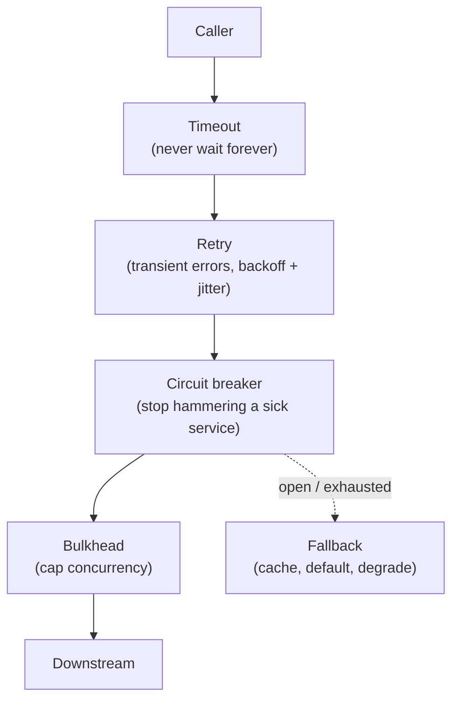
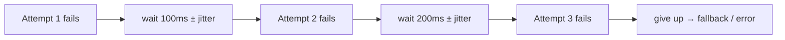
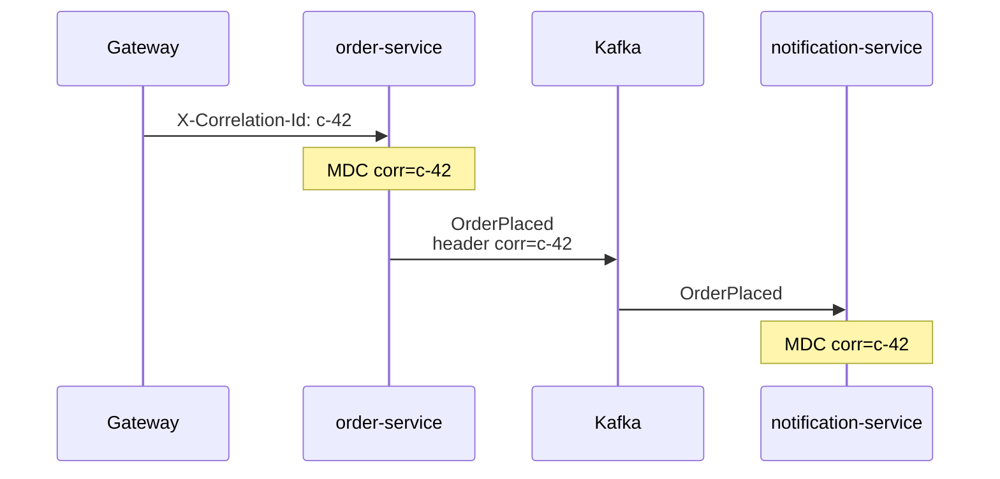
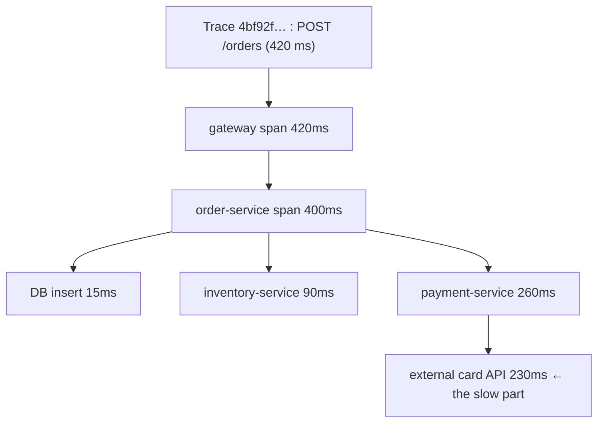
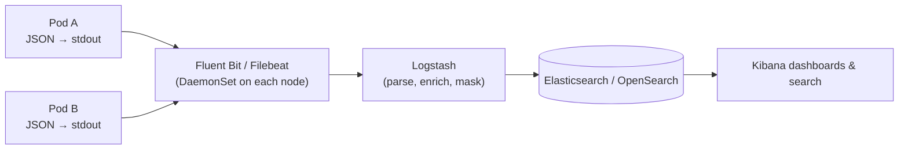
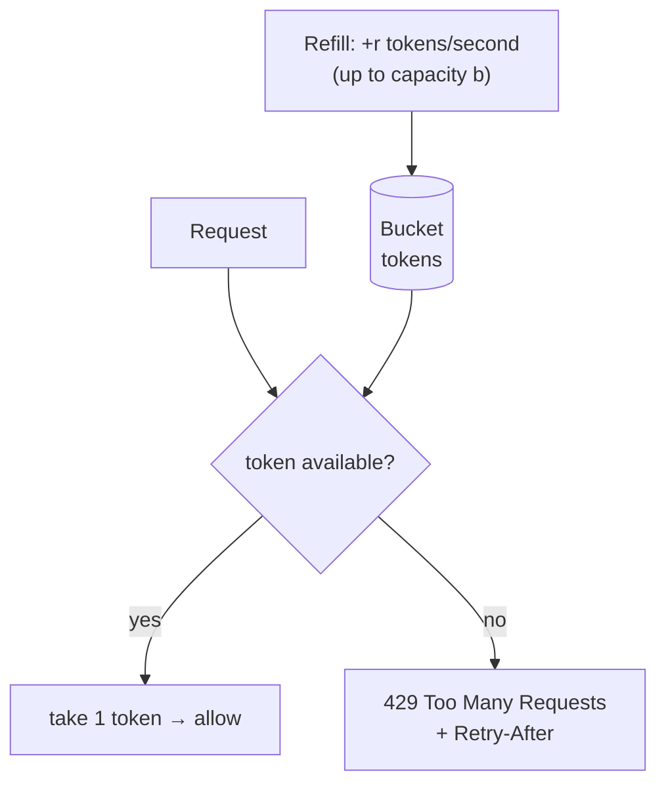

# Day 29 — Resilience & Observability: Resilience4j, Tracing, Logging

> **How to use these notes:** each section maps to one checklist item. Run the code, study the diagrams, then test yourself with the collapsible questions. 🚀 marks senior-level details.

**Today's goal:** make services survive failures and make failures visible. **Resilience4j** (circuit breaker, retry, rate limiter, time limiter, bulkhead) and how to configure and combine them, **retries with exponential backoff and jitter**, **fallbacks**, **correlation IDs**, **distributed tracing** with Micrometer Tracing, **centralized structured logging** (ELK / CloudWatch), and **rate limiting** algorithms including a Redis-based distributed limiter. On the DSA side: **intervals and matrix** problems.

The failure mindset: in a distributed system **every remote call can be slow, fail, or succeed without you knowing**. Defend in layers:



<!-- topic: d29_t1 -->
## 🏗️ Microservices — Resilience & Observability

<!-- subtopic: d29_t1_s1 -->
### 1. Resilience4j — @CircuitBreaker, @Retry, @RateLimiter, @TimeLimiter, @Bulkhead

> **TL;DR:** Resilience4j is a lightweight library of decorators. With `resilience4j-spring-boot3` + AOP, you annotate methods and configure **named instances** in YAML. Default aspect order (outermost → innermost): **Retry → CircuitBreaker → RateLimiter → TimeLimiter → Bulkhead → your method**.

```xml
<dependency>
  <groupId>io.github.resilience4j</groupId>
  <artifactId>resilience4j-spring-boot3</artifactId>
</dependency>
<dependency>
  <groupId>org.springframework.boot</groupId>
  <artifactId>spring-boot-starter-aop</artifactId>
</dependency>
```

```java
@Service
public class InventoryClient {

    @Retry(name = "inventory")
    @CircuitBreaker(name = "inventory", fallbackMethod = "stockUnknown")
    @Bulkhead(name = "inventory")
    public StockLevel stock(String sku) {
        return restClient.get().uri("/stock/{sku}", sku).retrieve().body(StockLevel.class);
    }

    // TimeLimiter needs an async return type
    @TimeLimiter(name = "inventory")
    @CircuitBreaker(name = "inventory", fallbackMethod = "stockUnknownAsync")
    public CompletableFuture<StockLevel> stockAsync(String sku) {
        return CompletableFuture.supplyAsync(() -> stock(sku), executor);
    }

    @RateLimiter(name = "partnerApi")
    public Quote partnerQuote(String sku) { ... }

    private StockLevel stockUnknown(String sku, Throwable ex) { return StockLevel.unknown(sku); }
    private CompletableFuture<StockLevel> stockUnknownAsync(String sku, Throwable ex) {
        return CompletableFuture.completedFuture(StockLevel.unknown(sku));
    }
}
```

```yaml
resilience4j:
  circuitbreaker:
    instances:
      inventory:
        sliding-window-type: COUNT_BASED
        sliding-window-size: 20
        minimum-number-of-calls: 10
        failure-rate-threshold: 50
        slow-call-duration-threshold: 2s
        slow-call-rate-threshold: 80
        wait-duration-in-open-state: 30s
        permitted-number-of-calls-in-half-open-state: 3
        record-exceptions: [java.io.IOException, org.springframework.web.client.ResourceAccessException]
        ignore-exceptions: [com.shop.NotFoundException]     # business errors shouldn't open the circuit
  retry:
    instances:
      inventory:
        max-attempts: 3                     # total attempts, including the first
        wait-duration: 200ms
        enable-exponential-backoff: true
        exponential-backoff-multiplier: 2
        enable-randomized-wait: true        # jitter
        retry-exceptions: [java.io.IOException]
  ratelimiter:
    instances:
      partnerApi:
        limit-for-period: 50                # 50 calls…
        limit-refresh-period: 1s            # …per second
        timeout-duration: 0                 # don't wait for a permit, reject immediately
  timelimiter:
    instances:
      inventory:
        timeout-duration: 2s
        cancel-running-future: true
  bulkhead:
    instances:
      inventory:
        max-concurrent-calls: 25
```

| Module | Protects against | Key settings |
|---|---|---|
| **CircuitBreaker** | Hammering a failing service; cascading failure | failure/slow-call thresholds, window, wait in open |
| **Retry** | Transient blips (network glitch, 503) | max attempts, backoff, which exceptions |
| **RateLimiter** | Exceeding your own/partner quota | permits per period |
| **TimeLimiter** | Hanging calls | timeout (async methods) |
| **Bulkhead** | One dependency exhausting threads | max concurrent calls / pool size |

⚠️ Pitfalls:
- **Retry outside the circuit breaker** (the default order) means each retry attempt is counted by the breaker; that's usually what you want, but understand it.
- Don't retry **non-idempotent** operations (POST /payments) unless they carry an idempotency key.
- Count only **technical** failures (`record-exceptions`), not 404/validation errors.
- The fallback signature must match the method plus a `Throwable` parameter.
- Observe it: Resilience4j publishes Micrometer metrics (`resilience4j_circuitbreaker_state`) and Actuator endpoints (`/actuator/circuitbreakers`).

<!-- subtopic: d29_t1_s2 -->
### 2. Retry with exponential backoff and jitter

> **TL;DR:** Retry only **transient** failures, a **limited** number of times, waiting **longer each time** (exponential backoff: 100 ms, 200 ms, 400 ms…) plus **random jitter** so that thousands of clients don't retry in lockstep and create a **thundering herd** that knocks the recovering service down again.



```java
// "Full jitter" (AWS architecture blog): sleep a random time between 0 and the exponential cap
long backoffMillis(int attempt, long baseMs, long capMs) {
    long exp = Math.min(capMs, baseMs * (1L << attempt));
    return ThreadLocalRandom.current().nextLong(exp + 1);
}
```

| Retry? | Examples |
|---|---|
| ✅ Transient | Timeouts, connection reset, 502/503/504, 429 (respect `Retry-After`), deadlocks, optimistic-lock conflicts |
| ❌ Permanent | 400 validation, 401/403, 404, business rule violations |
| ⚠️ Only if idempotent | POST that creates/charges — needs an idempotency key |

**Retry budgets:** limit retries to a percentage of total traffic (e.g., ≤ 10 %) so a big outage doesn't triple the load. And don't stack retries at every layer: gateway × service × client × driver = **multiplicative** retries (3 × 3 × 3 = 27 calls for one request).

<!-- subtopic: d29_t1_s3 -->
### 3. Fallback strategies — degrade gracefully

> **TL;DR:** When a dependency fails or the circuit is open, return something **useful but reduced** instead of an error page: a **cached** value, a **default**, a **partial** response, or **queue the work for later**. Decide per feature what "good enough" is — and make degraded mode visible in metrics.

| Strategy | Example | Watch out for |
|---|---|---|
| Cached / last-known-good | Product price from Redis when pricing is down | Staleness; show "updated 5 min ago" |
| Static default | Empty recommendations list, generic banner | Must not hide real problems |
| Partial response | Order page without the "delivery estimate" widget | Client must tolerate missing fields |
| Queue for later | Accept the order as `PENDING_PAYMENT`, retry payment asynchronously | Needs a saga/outbox and customer messaging |
| Alternative provider | Secondary SMS/payment provider | Cost, consistency |
| Fail fast with a clear error | Checkout when payments are down | Better than hanging |

```java
private ProductView productFallback(String id, Throwable ex) {
    log.warn("catalog unavailable, serving cached product id={}", id, ex);
    meterRegistry.counter("fallback.used", "dependency", "catalog").increment();
    return productCache.get(id)
            .map(p -> p.withStale(true))
            .orElseThrow(() -> new ServiceUnavailableException("Catalog temporarily unavailable"));
}
```

⚠️ A fallback that itself calls another remote service needs its own timeout and protection. Never fall back silently for **money or correctness** paths (charging, stock) — degrade to "pending" instead.

<!-- subtopic: d29_t1_s4 -->
### 4. Correlation IDs across services

> **TL;DR:** Generate (or accept) an ID at the edge (gateway), **pass it on every outgoing call and message** (HTTP header `X-Correlation-Id` / W3C `traceparent`, Kafka header), and put it in the **MDC** so every log line carries it. Then one search shows a request's full journey across services.



```java
// Outgoing HTTP: copy the id from MDC onto every request
@Bean
RestClient.Builder restClientBuilder() {
    return RestClient.builder().requestInterceptor((req, body, exec) -> {
        String id = MDC.get("correlationId");
        if (id != null) req.getHeaders().add("X-Correlation-Id", id);
        return exec.execute(req, body);
    });
}

// Kafka: producer adds the header, consumer restores it into MDC
ProducerRecord<String, OrderPlaced> record = new ProducerRecord<>("order-events", key, event);
record.headers().add("correlationId", MDC.get("correlationId").getBytes(StandardCharsets.UTF_8));

@KafkaListener(topics = "order-events")
void on(OrderPlaced e, @Header(name = "correlationId", required = false) String corr) {
    try (var ignored = MDC.putCloseable("correlationId", corr != null ? corr : UUID.randomUUID().toString())) {
        handle(e);
    }
}
```

The incoming side (servlet filter that reads or creates the ID and puts it in MDC) is in Day 25. 🚀 With **Micrometer Tracing** the `traceId` already plays this role and is propagated automatically for instrumented clients (next section) — many teams use the trace id as the correlation id.

<!-- subtopic: d29_t1_s5 -->
### 5. Distributed tracing — Micrometer Tracing, trace/span IDs, Zipkin/Jaeger

> **TL;DR:** A **trace** is the whole journey of one request; it's made of **spans** — timed operations (an HTTP call, a DB query, a Kafka publish) with a parent/child structure. Every span carries the **traceId** and its own **spanId**; context is propagated in headers (W3C `traceparent`). Spring Boot 3 uses **Micrometer Tracing** (bridges to OpenTelemetry or Brave) and exports to **Zipkin, Jaeger, Tempo** or any OTLP backend, where you see a waterfall of where the time went.



```
traceparent: 00-4bf92f3577b34da6a3ce929d0e0e4736-00f067aa0ba902b7-01
             ver  trace-id (16 bytes)              parent span id   sampled
```

```xml
<dependency><groupId>io.micrometer</groupId><artifactId>micrometer-tracing-bridge-otel</artifactId></dependency>
<dependency><groupId>io.opentelemetry</groupId><artifactId>opentelemetry-exporter-zipkin</artifactId></dependency>
```

```yaml
management:
  tracing:
    sampling:
      probability: 1.0        # 100% in dev; 0.05–0.1 in prod (default 0.1)
  zipkin:
    tracing:
      endpoint: http://zipkin:9411/api/v2/spans
logging:
  pattern:
    level: "%5p [${spring.application.name:},%X{traceId:-},%X{spanId:-}]"
```

Custom spans for important business steps:

```java
@Observed(name = "order.place", contextualName = "place-order")   // metric + span (needs ObservedAspect bean)
public Order place(PlaceOrderCommand cmd) { ... }
```

| Term | Meaning |
|---|---|
| Trace | One end-to-end request (shared traceId) |
| Span | One unit of work with start/end, tags, events |
| Parent / child | Call hierarchy (child span's parentId = caller's spanId) |
| Context propagation | Passing trace context across threads, HTTP, messages |
| Sampling | Recording only a fraction of traces to save cost (head vs tail sampling) |

⚠️ Propagation only works for clients built from Spring's auto-configured builders (`RestClient.Builder`, `WebClient.Builder`, `RestTemplateBuilder`) and instrumented Kafka templates — `new RestTemplate()` loses the trace. Async executors need context propagation (`ContextExecutorService` / `TaskDecorator`).

<!-- subtopic: d29_t1_s6 -->
### 6. Centralized logging — ELK / CloudWatch, structured JSON

> **TL;DR:** With dozens of pods that come and go, logs must be **shipped off the machines** to a central store and searched there. Log **structured JSON to stdout**; a collector (Filebeat / Fluent Bit / Logstash, or the CloudWatch agent) ships it to **Elasticsearch + Kibana** (ELK), **OpenSearch**, **Loki + Grafana**, or **CloudWatch Logs**. Search by `traceId`, `correlationId`, `orderId`, level, service.



```yaml
logging:
  structured:
    format:
      console: ecs        # Boot 3.4+: one JSON object per line (Elastic Common Schema)
```

```json
{"@timestamp":"2026-11-14T10:15:30.123Z","log.level":"ERROR","service.name":"order-service",
 "message":"Payment failed","traceId":"4bf92f3577b34da6","orderId":"o-981","error.type":"TimeoutException"}
```

| Practice | Why |
|---|---|
| Log to **stdout** (12-factor), not files in the container | Collectors pick it up; no disk filling |
| **Structured** fields (JSON) | Query `orderId:o-981` instead of regex |
| Include `traceId`, `service`, `env`, `version` | Correlate across services and deployments |
| **Mask PII / secrets** | Compliance (GDPR, PCI) |
| Sensible levels + **sampling** of noisy logs | Cost: log storage is expensive |
| Retention policy (hot 7 days, archive 90) | Cost and compliance |
| Alert on **metrics**, investigate with logs and traces | Logs are bad for alerting on rates |

The three pillars together: **metrics** tell you *something is wrong* (error rate spiked), **traces** tell you *where* (payment span slow), **logs** tell you *why* (the exception and context).

<!-- subtopic: d29_t1_s7 -->
### 7. Rate limiting — token bucket, leaky bucket, Redis-based

> **TL;DR:** Rate limiting caps how many requests a client can make in a time window, protecting services from abuse and overload and enforcing plans. **Token bucket** (bucket refills at rate r, holds up to b tokens; each request takes one) allows short **bursts**. **Leaky bucket** processes at a fixed rate (smooths traffic). **Fixed window** is simple but bursty at boundaries; **sliding window** fixes that. Across many instances, keep counters in **Redis** with atomic operations (Lua script).



| Algorithm | Behaviour | Pros | Cons |
|---|---|---|---|
| **Token bucket** | Average rate r, bursts up to b | Bursts allowed, simple, memory O(1) | Two params to tune |
| **Leaky bucket** | Queue drained at constant rate | Smooth output | Bursts wait/drop; added latency |
| **Fixed window counter** | N per minute, counter resets at :00 | Very simple | 2N burst around the boundary |
| **Sliding window log** | Store timestamps, count last 60 s | Exact | Memory per request |
| **Sliding window counter** | Weighted current + previous window | Good approximation, O(1) | Approximate |

#### Token bucket in Java (single instance)

```java
public final class TokenBucket {
    private final long capacity;
    private final double refillPerNano;
    private double tokens;
    private long lastRefill = System.nanoTime();

    public TokenBucket(long capacity, double tokensPerSecond) {
        this.capacity = capacity;
        this.refillPerNano = tokensPerSecond / 1_000_000_000.0;
        this.tokens = capacity;
    }

    public synchronized boolean tryAcquire() {
        long now = System.nanoTime();
        tokens = Math.min(capacity, tokens + (now - lastRefill) * refillPerNano);
        lastRefill = now;
        if (tokens >= 1) { tokens -= 1; return true; }
        return false;
    }
}
```

#### Distributed: Redis + Lua (atomic across all instances)

```lua
-- KEYS[1] = bucket key, ARGV = capacity, refill per second, now (ms)
local b = redis.call('HMGET', KEYS[1], 'tokens', 'ts')
local cap, rate, now = tonumber(ARGV[1]), tonumber(ARGV[2]), tonumber(ARGV[3])
local tokens = tonumber(b[1]) or cap
local ts = tonumber(b[2]) or now
tokens = math.min(cap, tokens + (now - ts) / 1000 * rate)
local allowed = 0
if tokens >= 1 then tokens = tokens - 1; allowed = 1 end
redis.call('HSET', KEYS[1], 'tokens', tokens, 'ts', now)
redis.call('PEXPIRE', KEYS[1], math.ceil(cap / rate * 1000) * 2)
return allowed
```

Ready-made: Spring Cloud Gateway `RequestRateLimiter` (Redis token bucket), Bucket4j (with Redis/Hazelcast), API Gateway usage plans, NGINX `limit_req`.

Design choices to mention: **key** (per user / API key / IP / endpoint), respond **429 + `Retry-After`** and `X-RateLimit-Remaining` headers, decide **fail-open vs fail-closed** if Redis is down, and put limits at the **edge** (gateway) plus protective limits inside services.

### 🎤 Interview Q&A — Resilience & observability

<details><summary>Q1. Why add jitter to exponential backoff?</summary>

Without jitter, clients that failed together retry together, producing synchronized spikes (thundering herd) that can knock the recovering service down again. Randomising the wait spreads retries out.

</details>

<details><summary>Q2. Which errors should not be retried?</summary>

Permanent errors such as 400 validation errors, 401/403, 404 and business rule violations — and non-idempotent operations unless protected by an idempotency key.

</details>

<details><summary>Q3. Trace vs span?</summary>

A trace is one end-to-end request identified by a traceId; spans are the timed operations inside it (each with its own spanId and a parent), forming the call tree.

</details>

<details><summary>Q4. Token bucket vs leaky bucket?</summary>

Token bucket allows bursts up to the bucket capacity while enforcing an average rate; leaky bucket outputs at a constant rate, smoothing traffic by queueing or dropping bursts.

</details>

<details><summary>Q5. How do you rate limit across 10 instances of a service?</summary>

Keep the counters in a shared store such as Redis and update them atomically (Lua script or Redis-cell/Bucket4j), keyed by client; or enforce the limit centrally at the API gateway.

</details>

<!-- topic: d25_t2 -->
## 🧮 DSA — Intervals & Matrix

<!-- subtopic: d25_t2_s1 -->
### 8. Insert Interval (LeetCode 57)

> **Problem:** non-overlapping intervals sorted by start; insert `newInterval` and merge as needed. 🔗 [LeetCode 57](https://leetcode.com/problems/insert-interval/)

Three phases in one pass: copy intervals **entirely before** the new one, **merge** all that overlap it, copy the rest.

```java
public int[][] insert(int[][] intervals, int[] newInterval) {
    List<int[]> out = new ArrayList<>();
    int i = 0, n = intervals.length;
    int start = newInterval[0], end = newInterval[1];

    while (i < n && intervals[i][1] < start) out.add(intervals[i++]);      // ends before → keep
    while (i < n && intervals[i][0] <= end) {                              // overlaps → absorb
        start = Math.min(start, intervals[i][0]);
        end = Math.max(end, intervals[i][1]);
        i++;
    }
    out.add(new int[]{start, end});
    while (i < n) out.add(intervals[i++]);                                 // after → keep
    return out.toArray(new int[0][]);
}   // O(n) — already sorted
```

`[[1,2],[3,5],[6,7],[8,10],[12,16]]` + `[4,8]` → `[[1,2],[3,10],[12,16]]`.

<!-- subtopic: d25_t2_s2 -->
### 9. Meeting Rooms II (LeetCode 253)

> **Problem:** given meeting intervals, the minimum number of conference rooms required. 🔗 [LeetCode 253](https://leetcode.com/problems/meeting-rooms-ii/) *(Premium)*

**Min-heap of end times:** sort by start; for each meeting, if the earliest-ending room is free by now (`heap.peek() <= start`), reuse it (poll); then push this meeting's end. The heap size is the number of rooms in use; its maximum is the answer.

```java
public int minMeetingRooms(int[][] intervals) {
    Arrays.sort(intervals, Comparator.comparingInt(a -> a[0]));
    PriorityQueue<Integer> ends = new PriorityQueue<>();
    int rooms = 0;
    for (int[] m : intervals) {
        if (!ends.isEmpty() && ends.peek() <= m[0]) ends.poll();   // a room freed up → reuse it
        ends.offer(m[1]);
        rooms = Math.max(rooms, ends.size());
    }
    return rooms;
}   // O(n log n)
```

**Sweep-line alternative:** sort all starts and all ends separately; walk through time, `+1` on a start, `-1` on an end (process an end before a start at the same time); the peak count is the answer.

```java
public int minMeetingRoomsSweep(int[][] intervals) {
    int n = intervals.length;
    int[] starts = new int[n], ends = new int[n];
    for (int i = 0; i < n; i++) { starts[i] = intervals[i][0]; ends[i] = intervals[i][1]; }
    Arrays.sort(starts);
    Arrays.sort(ends);
    int rooms = 0, best = 0, e = 0;
    for (int s : starts) {
        while (e < n && ends[e] <= s) { e++; rooms--; }
        rooms++;
        best = Math.max(best, rooms);
    }
    return best;
}
```

`[[0,30],[5,10],[15,20]]` → **2**. The same "max overlap" idea answers: max concurrent users, CPU cores needed, peak parking spots.

<!-- subtopic: d25_t2_s3 -->
### 10. Spiral Matrix (LeetCode 54)

> **Problem:** return all elements of an `m × n` matrix in spiral order. 🔗 [LeetCode 54](https://leetcode.com/problems/spiral-matrix/)

Keep four **boundaries** (top, bottom, left, right) and shrink them after walking each side.

```java
public List<Integer> spiralOrder(int[][] matrix) {
    List<Integer> out = new ArrayList<>();
    int top = 0, bottom = matrix.length - 1, left = 0, right = matrix[0].length - 1;
    while (top <= bottom && left <= right) {
        for (int c = left; c <= right; c++) out.add(matrix[top][c]);      // → along the top
        top++;
        for (int r = top; r <= bottom; r++) out.add(matrix[r][right]);    // ↓ down the right
        right--;
        if (top <= bottom) {                                              // guard: single row left
            for (int c = right; c >= left; c--) out.add(matrix[bottom][c]);   // ← along the bottom
            bottom--;
        }
        if (left <= right) {                                              // guard: single column left
            for (int r = bottom; r >= top; r--) out.add(matrix[r][left]);     // ↑ up the left
            left++;
        }
    }
    return out;
}   // O(m·n)
```

```
1  2  3  4
5  6  7  8      →  1 2 3 4 8 12 11 10 9 5 6 7
9 10 11 12
```

⚠️ The two `if` guards prevent double-counting when the remaining area is a single row or column (the classic bug). Related: Spiral Matrix II (LC 59 — fill 1..n² in the same order).

<!-- subtopic: d25_t2_s4 -->
### 11. Rotate Image (LeetCode 48)

> **Problem:** rotate an `n × n` matrix 90° clockwise **in place**. 🔗 [LeetCode 48](https://leetcode.com/problems/rotate-image/)

**Transpose, then reverse each row.** (Counter-clockwise: transpose, then reverse each column — or reverse rows first.)

```java
public void rotate(int[][] m) {
    int n = m.length;
    for (int i = 0; i < n; i++) {                 // transpose: swap across the main diagonal
        for (int j = i + 1; j < n; j++) {
            int t = m[i][j]; m[i][j] = m[j][i]; m[j][i] = t;
        }
    }
    for (int[] row : m) {                         // reverse each row
        for (int l = 0, r = n - 1; l < r; l++, r--) {
            int t = row[l]; row[l] = row[r]; row[r] = t;
        }
    }
}   // O(n²) time, O(1) extra space
```

```
1 2 3      transpose      1 4 7      reverse rows      7 4 1
4 5 6      ───────→       2 5 8      ───────────→      8 5 2
7 8 9                     3 6 9                        9 6 3
```

Alternative: rotate **four cells at a time** layer by layer (`top ← left ← bottom ← right ← top`). Why it works: clockwise rotation maps `(i, j) → (j, n-1-i)`; transpose gives `(j, i)`, row reversal then gives `(j, n-1-i)`.

<!-- subtopic: d25_t2_s5 -->
### 12. Set Matrix Zeroes (LeetCode 73)

> **Problem:** if a cell is 0, set its entire row and column to 0, in place. Follow-up: O(1) extra space. 🔗 [LeetCode 73](https://leetcode.com/problems/set-matrix-zeroes/)

O(m + n) idea: record which rows/columns contain a zero, then zero them. **O(1)**: use the **first row and first column as the markers**, remembering separately whether they themselves had zeros.

```java
public void setZeroes(int[][] m) {
    int rows = m.length, cols = m[0].length;
    boolean firstRowZero = false, firstColZero = false;
    for (int c = 0; c < cols; c++) if (m[0][c] == 0) firstRowZero = true;
    for (int r = 0; r < rows; r++) if (m[r][0] == 0) firstColZero = true;

    // 1) mark: a zero at (r, c) sets the row marker m[r][0] and the column marker m[0][c]
    for (int r = 1; r < rows; r++)
        for (int c = 1; c < cols; c++)
            if (m[r][c] == 0) { m[r][0] = 0; m[0][c] = 0; }

    // 2) zero the inner cells using the markers
    for (int r = 1; r < rows; r++)
        for (int c = 1; c < cols; c++)
            if (m[r][0] == 0 || m[0][c] == 0) m[r][c] = 0;

    // 3) finally the first row / column themselves
    if (firstRowZero) Arrays.fill(m[0], 0);
    if (firstColZero) for (int r = 0; r < rows; r++) m[r][0] = 0;
}   // O(m·n) time, O(1) extra space
```

⚠️ Zeroing cells **while scanning** for zeros spreads zeros everywhere — always separate "find" from "write". And handle row 0 / column 0 **last**, because they hold the markers.

---

## 📝 Day 29 Revision Cheat Sheet

| Topic | Remember this |
|---|---|
| Layers | Timeout → retry (backoff + jitter) → circuit breaker → bulkhead → fallback |
| Resilience4j order | Retry ( CircuitBreaker ( RateLimiter ( TimeLimiter ( Bulkhead ( method ))))) |
| Config | Named instances in YAML; record technical exceptions only; fallback = same args + Throwable |
| Retry | Transient errors only; idempotent ops; retry budget; avoid retries at every layer |
| Fallback | Cache / default / partial / queue / alternative; never silent on money paths |
| Correlation ID | Edge creates, headers carry (HTTP + Kafka), MDC logs; trace id often reused |
| Tracing | Trace = request, spans = operations; traceparent header; Micrometer Tracing → Zipkin/Jaeger/OTLP; sampling |
| Logging | JSON to stdout → Fluent Bit/Filebeat → ELK/Loki/CloudWatch; traceId fields; mask PII |
| Rate limiting | Token bucket (bursts), leaky (smooth), fixed vs sliding window; Redis + Lua; 429 + Retry-After |
| Insert interval | Before / merge overlapping / after — O(n) |
| Meeting rooms II | Sort by start + min-heap of ends; or sweep line |
| Spiral | Four boundaries; guard single row/column |
| Rotate image | Transpose + reverse rows |
| Set zeroes | First row/col as markers; handle them last |

### ⚡ Rapid-fire self-test

1. Resilience4j module that needs a CompletableFuture return type? → **TimeLimiter**
2. What does jitter prevent? → **Thundering herd / synchronized retries**
3. Should you retry a 400 Bad Request? → **No**
4. HTTP header for W3C trace context? → **traceparent**
5. Spring Boot 3 tracing facade? → **Micrometer Tracing**
6. Where should containers write logs? → **stdout (as structured JSON)**
7. Rate-limit algorithm that allows bursts? → **Token bucket**
8. Status code when rate limited? → **429 Too Many Requests**
9. Meeting Rooms II data structure? → **Min-heap of end times**
10. Rotate a matrix 90° clockwise in place? → **Transpose, then reverse each row**
