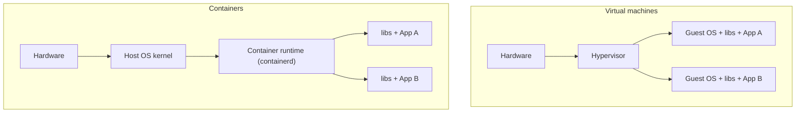
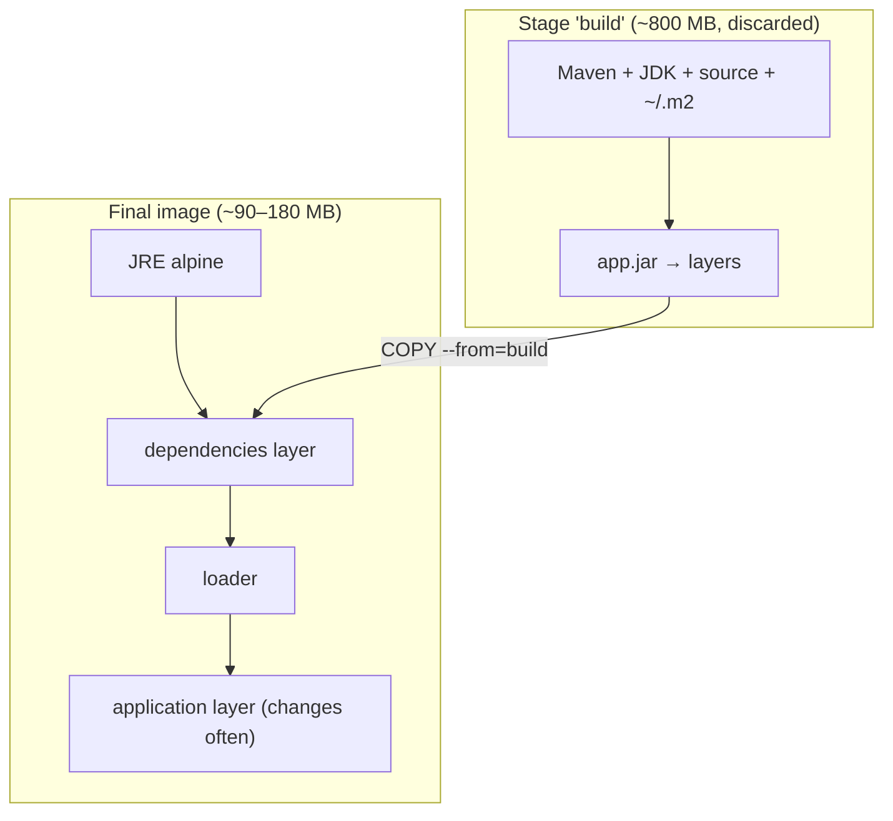
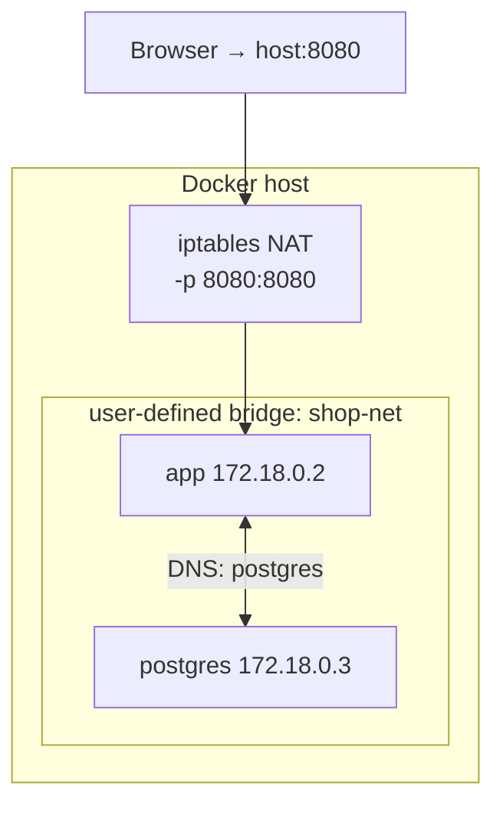
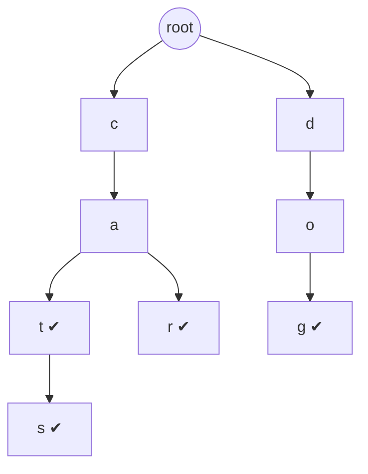
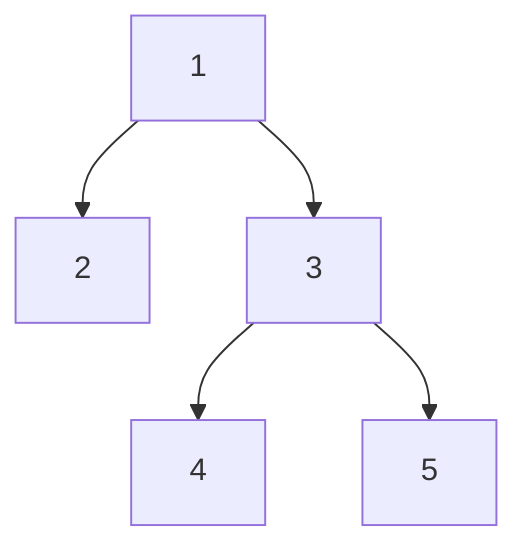

# Day 30 — Docker: Containers, Images & Dockerizing Spring Boot

> **How to use these notes:** each section maps to one checklist item. Run the commands, study the diagrams, then test yourself with the collapsible questions. 🚀 marks senior-level details.

**Today's goal:** understand containers well enough to explain and build them: every **Dockerfile instruction**, **multi-stage builds** that shrink images 10×, **docker compose** for local dev with Postgres/Redis/Kafka, **security** best practices, **Dockerizing a Spring Boot app** properly (layers, JVM memory, health checks), and **Docker networking**. On the DSA side: the **Trie** plus two "advanced tree/heap" classics — running median and tree serialization.

#### Containers vs virtual machines



| | VM | Container |
|---|---|---|
| Isolation | Full OS per VM (strong) | Shares the host kernel (namespaces + cgroups) |
| Size / start | GBs, minutes | MBs, seconds |
| Density | Tens per host | Hundreds per host |
| Use | Different OS, strong isolation | Packaging apps consistently: "works on my machine" → works everywhere |

**Image** = read-only template made of **layers**; **container** = a running instance of an image with a thin writable layer. Images live in **registries** (Docker Hub, ECR, GHCR).

<!-- topic: d30_t1 -->
## 🐳 DevOps — Docker

<!-- subtopic: d30_t1_s1 -->
### 1. Dockerfile instructions — FROM, COPY, RUN, CMD vs ENTRYPOINT, EXPOSE, WORKDIR, ARG vs ENV

> **TL;DR:** A Dockerfile is a recipe; **each instruction that changes the filesystem creates a cached layer**. Order instructions from **least to most frequently changing** so rebuilds reuse the cache. `RUN` executes at **build** time; `CMD`/`ENTRYPOINT` define what runs at **container start**.

```dockerfile
FROM eclipse-temurin:21-jre-alpine          # base image (pin a version, never "latest" in prod)
ARG APP_VERSION=dev                          # build-time variable (docker build --build-arg)
ENV SPRING_PROFILES_ACTIVE=prod \
    JAVA_OPTS=""                             # runtime environment variable (persists in the container)
WORKDIR /app                                 # cd (creates the dir); later relative paths start here
COPY target/order-service.jar app.jar        # copy from build context into the image
RUN addgroup -S app && adduser -S app -G app # executed at build time → new layer
USER app                                     # run as non-root from here on
EXPOSE 8080                                  # documentation only — does NOT publish the port
LABEL org.opencontainers.image.version=$APP_VERSION
HEALTHCHECK --interval=30s --timeout=3s CMD wget -qO- http://localhost:8080/actuator/health || exit 1
ENTRYPOINT ["java", "-jar", "/app/app.jar"]  # the executable (exec form → PID 1, gets SIGTERM)
CMD ["--server.port=8080"]                   # default ARGUMENTS to ENTRYPOINT, overridable
```

| Instruction | Purpose | Gotcha |
|---|---|---|
| `FROM` | Base image; starts a build stage | Pin versions/digests for reproducibility |
| `WORKDIR` | Set working directory | Prefer over `RUN cd …` |
| `COPY` | Copy files from the build context | Prefer over `ADD` (which also untars and fetches URLs) |
| `RUN` | Run a command at build time | Combine related commands; clean caches in the same `RUN` |
| `ENV` | Env var at build **and** runtime | Visible in `docker inspect` — no secrets |
| `ARG` | Variable at **build** time only | Not available in the running container (unless copied to ENV) |
| `EXPOSE` | Documents the port | Publishing is `docker run -p 8080:8080` |
| `USER` | Switch user | Use a non-root user |
| `ENTRYPOINT` | The main executable | Exec form `["java", …]` so signals reach the JVM |
| `CMD` | Default command or default args to ENTRYPOINT | Replaced by args after the image name in `docker run` |
| `HEALTHCHECK` | Container health status | Kubernetes ignores it (uses probes instead) |

#### CMD vs ENTRYPOINT

| Dockerfile | `docker run img` runs | `docker run img --debug` runs |
|---|---|---|
| `CMD ["java","-jar","app.jar"]` | java -jar app.jar | `--debug` (CMD replaced entirely ❌) |
| `ENTRYPOINT ["java","-jar","app.jar"]` | java -jar app.jar | java -jar app.jar --debug |
| `ENTRYPOINT ["java","-jar","app.jar"]` + `CMD ["--server.port=8080"]` | … app.jar --server.port=8080 | … app.jar --debug |

⚠️ **Shell form** (`ENTRYPOINT java -jar app.jar`) runs under `/bin/sh -c`; the shell is PID 1 and doesn't forward **SIGTERM**, so the JVM never shuts down gracefully and gets killed after the timeout. Use the **exec form** (JSON array).

<!-- subtopic: d30_t1_s2 -->
### 2. Multi-stage builds — from 800 MB to under 100 MB

> **TL;DR:** Build in one stage (JDK + Maven + source), then **copy only the artifact** into a slim runtime stage (JRE or distroless). Build tools, source code and caches never reach the final image → smaller, faster to pull, smaller attack surface.

```dockerfile
# ---- Stage 1: build ----
FROM maven:3.9-eclipse-temurin-21 AS build
WORKDIR /src
COPY pom.xml .
RUN mvn -q dependency:go-offline              # cached until pom.xml changes
COPY src ./src
RUN mvn -q package -DskipTests

# Split the fat jar into layers (dependencies change rarely, your code often)
RUN java -Djarmode=tools -jar target/*.jar extract --layers --launcher --destination extracted

# ---- Stage 2: runtime ----
FROM eclipse-temurin:21-jre-alpine
WORKDIR /app
RUN addgroup -S app && adduser -S app -G app
COPY --from=build /src/extracted/dependencies/ ./
COPY --from=build /src/extracted/spring-boot-loader/ ./
COPY --from=build /src/extracted/snapshot-dependencies/ ./
COPY --from=build /src/extracted/application/ ./
USER app
EXPOSE 8080
ENTRYPOINT ["java", "org.springframework.boot.loader.launch.JarLauncher"]
```



| Base image | Approx. size | Notes |
|---|---|---|
| `maven:…-temurin-21` (build only) | ~800 MB | Never ship it |
| `eclipse-temurin:21-jdk` | ~400 MB | Includes compiler — not needed at runtime |
| `eclipse-temurin:21-jre-alpine` | ~190 MB | musl libc; common choice |
| `gcr.io/distroless/java21-debian12` | ~190 MB | No shell or package manager — very small attack surface |
| Custom `jlink` runtime | ~60–90 MB | Only the JDK modules you use |
| GraalVM native (Day 25) | ~50–80 MB | No JVM at all |

**Layer caching:** with the layered jar, a code change rebuilds and re-pushes only the small `application/` layer (a few hundred KB) instead of the whole 60 MB fat jar. 🚀 Alternative without a Dockerfile: `./mvnw spring-boot:build-image` (Cloud Native Buildpacks) or Jib — both produce layered, non-root images.

<!-- subtopic: d30_t1_s3 -->
### 3. docker compose — multi-container local development

> **TL;DR:** `compose.yaml` declares the services, networks and volumes of a local environment; `docker compose up -d` starts everything on a shared network where containers reach each other **by service name** (`postgres:5432`). Use **volumes** for data that must survive restarts and **healthchecks + depends_on conditions** for start-up order.

```yaml
# compose.yaml
services:
  app:
    build: .
    ports: ["8080:8080"]                       # host:container
    environment:
      SPRING_DATASOURCE_URL: jdbc:postgresql://postgres:5432/shop
      SPRING_DATASOURCE_USERNAME: shop
      SPRING_DATASOURCE_PASSWORD: secret
      SPRING_DATA_REDIS_HOST: redis
      SPRING_KAFKA_BOOTSTRAP_SERVERS: kafka:9092
    depends_on:
      postgres: { condition: service_healthy }
      redis: { condition: service_started }

  postgres:
    image: postgres:16-alpine
    environment: { POSTGRES_DB: shop, POSTGRES_USER: shop, POSTGRES_PASSWORD: secret }
    volumes: ["pgdata:/var/lib/postgresql/data"]   # named volume: survives `down`
    healthcheck:
      test: ["CMD-SHELL", "pg_isready -U shop"]
      interval: 5s
      retries: 10

  redis:
    image: redis:7-alpine

  kafka:
    image: apache/kafka:3.8.0                  # KRaft mode, no ZooKeeper (Day 35)
    environment:
      KAFKA_NODE_ID: 1
      KAFKA_PROCESS_ROLES: broker,controller
      KAFKA_LISTENERS: PLAINTEXT://:9092,CONTROLLER://:9093
      KAFKA_ADVERTISED_LISTENERS: PLAINTEXT://kafka:9092
      KAFKA_CONTROLLER_LISTENER_NAMES: CONTROLLER
      KAFKA_CONTROLLER_QUORUM_VOTERS: 1@kafka:9093
      KAFKA_OFFSETS_TOPIC_REPLICATION_FACTOR: 1

volumes:
  pgdata:
```

```bash
docker compose up -d            # start in background (builds "app" if needed)
docker compose logs -f app      # follow logs
docker compose ps               # status + health
docker compose down             # stop and remove containers (named volumes kept)
docker compose down -v          # …and delete volumes (fresh DB)
```

| Concept | Meaning |
|---|---|
| Service name = DNS name | `app` connects to `postgres:5432`, not `localhost` |
| `ports` | Publish to the host (only what you need from outside) |
| Named volume | Managed by Docker, persists data |
| Bind mount (`./data:/data`) | Host folder mapped in (live code reload, configs) |
| `depends_on` + `condition: service_healthy` | Wait for readiness, not just "started" |
| `.env` file | Variable substitution (`${DB_PASSWORD}`) |

⚠️ Inside a container, `localhost` means **the container itself**. 🚀 Spring Boot 3.1+ `spring-boot-docker-compose` starts `compose.yaml` automatically on `bootRun` and wires the connection properties for you.

<!-- subtopic: d30_t1_s4 -->
### 4. .dockerignore, non-root user, minimal base images — security basics

> **TL;DR:** Keep the **build context small and clean** with `.dockerignore`, **never run as root**, use **minimal, pinned** base images, **never bake secrets** into layers, and **scan** images for CVEs.

```gitignore
# .dockerignore — everything here never reaches the build context
.git
target/
!target/*.jar
*.log
.env
.idea/
node_modules/
**/*.pem
```

| Practice | Why |
|---|---|
| `.dockerignore` | Faster builds, no secrets/`.git` copied by `COPY . .` |
| Non-root `USER` | A container escape as root = root on the host (or wide damage) |
| Minimal base (alpine / distroless / jlink) | Fewer packages → fewer CVEs, smaller attack surface |
| Pin versions / digests (`image@sha256:…`) | Reproducible builds, no surprise upgrades |
| No secrets in `ENV`, `ARG` or files | They live forever in image layers/history; inject at runtime (K8s Secrets, Vault, `--secret` BuildKit mounts) |
| Read-only root filesystem (`--read-only`) | Attackers can't drop files; mount `/tmp` as tmpfs |
| Drop capabilities (`--cap-drop ALL`) | Least privilege |
| Scan images (Trivy, Grype, Docker Scout) in CI | Catch vulnerable libraries before deploy |
| Rebuild regularly | Pick up base image security patches |

```bash
docker build --secret id=npmrc,src=$HOME/.npmrc .     # BuildKit secret: available during RUN, never stored in a layer
trivy image --severity HIGH,CRITICAL shop/order-service:1.4.2
```

⚠️ Deleting a secret in a later layer doesn't remove it — `docker history` and layer extraction still reveal it.

<!-- subtopic: d30_t1_s5 -->
### 5. Dockerizing Spring Boot — JVM options, memory, health checks

> **TL;DR:** Use a layered jar (multi-stage), let the JVM **size its heap from the container memory limit** with `-XX:MaxRAMPercentage` (instead of hard-coded `-Xmx`), run as non-root with an exec-form entrypoint for **graceful shutdown**, and expose **Actuator health** for Docker/Kubernetes checks.

```dockerfile
ENV JAVA_TOOL_OPTIONS="-XX:MaxRAMPercentage=75.0 -XX:+ExitOnOutOfMemoryError -XX:+UseG1GC"
ENTRYPOINT ["java", "org.springframework.boot.loader.launch.JarLauncher"]
```

```yaml
# application.yml
server:
  shutdown: graceful                       # finish in-flight requests on SIGTERM
spring:
  lifecycle:
    timeout-per-shutdown-phase: 20s
management:
  endpoint:
    health:
      probes:
        enabled: true                      # /actuator/health/liveness and /readiness
```

| JVM option | Meaning | Container advice |
|---|---|---|
| `-Xms` / `-Xmx` | Initial / max heap | Fixed values ignore the container limit; OK if you set them consistently |
| `-XX:MaxRAMPercentage=75` | Heap = 75 % of the container's memory limit | ✅ Preferred — scales with the limit, leaves room for metaspace, threads, direct buffers |
| `-XX:InitialRAMPercentage` | Initial heap as % | Set equal for predictable start-up |
| `-XX:+ExitOnOutOfMemoryError` | Exit instead of limping on | Lets the orchestrator restart a clean pod |
| `-XX:ActiveProcessorCount=n` | Override detected CPUs | When CPU limits are fractional |

Since JDK 10 (and 8u191) the JVM is **container-aware**: it reads cgroup limits for memory and CPU. ⚠️ Memory limit = heap **plus** non-heap (metaspace, thread stacks ~1 MB each, code cache, direct buffers). `-Xmx` equal to the limit ⇒ the kernel **OOM-kills** the container (exit code 137).

```bash
docker run -d --name orders -p 8080:8080 --memory=768m --cpus=1.5 \
  -e SPRING_PROFILES_ACTIVE=prod shop/order-service:1.4.2
docker stats orders              # live CPU / memory
docker logs -f orders
docker exec -it orders sh        # shell inside (not available on distroless)
```

Startup speed tips: CDS archives (Boot 3.3 `-XX:SharedArchiveFile`), lazy init for dev, or native images (Day 25).

<!-- subtopic: d30_t1_s6 -->
### 6. Docker networking — bridge, host, overlay

> **TL;DR:** **Bridge** (default): containers get private IPs on a virtual network on one host; **user-defined bridges** add DNS by container name (compose uses one). **Host**: the container shares the host's network stack (no isolation, no port mapping). **Overlay**: spans multiple hosts (Swarm) — in Kubernetes, the CNI plugin plays this role. **none**: no network.



| Driver | Scope | Container-to-container | Use |
|---|---|---|---|
| `bridge` (default `docker0`) | Single host | By IP only (no DNS on the default bridge) | Legacy single containers |
| **user-defined bridge** | Single host | **By name (built-in DNS)** | Local multi-container apps (compose) |
| `host` | Single host | Shares host ports | Max network performance, Linux only |
| `overlay` | Multi-host | By service name | Docker Swarm |
| `none` | — | None | Fully isolated jobs |

```bash
docker network create shop-net
docker run -d --name postgres --network shop-net postgres:16-alpine
docker run -d --name app --network shop-net -p 8080:8080 shop/order-service
# inside "app": jdbc:postgresql://postgres:5432/shop
```

Port publishing `-p 8080:80` maps **host 8080 → container 80**; `EXPOSE` alone publishes nothing. To reach a service running on your laptop from a container: `host.docker.internal`.

### 🎤 Interview Q&A — Docker

<details><summary>Q1. Image vs container?</summary>

An image is an immutable, layered template; a container is a running (or stopped) instance of an image with its own writable layer, process namespace and network.

</details>

<details><summary>Q2. CMD vs ENTRYPOINT?</summary>

ENTRYPOINT defines the executable that always runs; CMD supplies default arguments (or a default command) that `docker run` arguments replace. Use exec (JSON) form so the process receives signals.

</details>

<details><summary>Q3. Why use multi-stage builds?</summary>

To keep build tools, source code and caches out of the final image: smaller images, faster pulls and deploys, fewer vulnerabilities.

</details>

<details><summary>Q4. A Java container keeps getting OOM-killed (exit 137). What do you check?</summary>

The heap is probably too close to the container limit: non-heap memory (metaspace, threads, direct buffers) pushes the process over. Use `-XX:MaxRAMPercentage` (~75 %) instead of `-Xmx` equal to the limit, check for leaks, and give the container enough memory.

</details>

<details><summary>Q5. How do two containers talk in docker compose?</summary>

Compose puts them on a user-defined bridge network with built-in DNS, so they use the service name and container port (e.g., `postgres:5432`), not localhost.

</details>

<!-- topic: d26_t2 -->
## 🧮 DSA — Trie & Advanced Trees

<!-- subtopic: d26_t2_s1 -->
### 7. Trie (prefix tree) — insert, search, startsWith

> **TL;DR:** A **trie** stores strings character by character along paths from the root; words sharing a prefix share the path. Each node has **children** (array of 26 or a HashMap) and an **end-of-word** flag. Insert, search and prefix lookup are all **O(L)** in the word length — independent of how many words are stored.



*Words: cat, car, cats, dog (✔ = end of word).*

```java
class TrieNode {
    final Map<Character, TrieNode> children = new HashMap<>();   // or TrieNode[26] for a–z
    boolean isWord;
}
```

| | `TrieNode[26]` array | `HashMap<Character, TrieNode>` |
|---|---|---|
| Speed | Fastest (index by `c - 'a'`) | Hash overhead |
| Memory | 26 refs per node even if empty | Only existing children |
| Alphabet | Fixed (lowercase) | Any characters (Unicode, digits) |

| Operation | Trie | HashSet of words |
|---|---|---|
| Exact lookup | O(L) | O(L) average (hashing) |
| **Prefix query** ("all words starting with ca") | **O(L + results)** | O(n · L) scan |
| Sorted iteration | DFS in order | Need sorting |
| Memory | Higher (node per char) | Lower |

Uses: autocomplete, spell check, IP routing (longest-prefix match on bits), word games (Word Search II, Day 41), T9.

<!-- subtopic: d26_t2_s2 -->
### 8. Implement Trie (LeetCode 208)

> **Problem:** implement `insert`, `search` (whole word) and `startsWith` (prefix). 🔗 [LeetCode 208](https://leetcode.com/problems/implement-trie-prefix-tree/)

```java
class Trie {
    private static class Node {
        Node[] next = new Node[26];
        boolean isWord;
    }

    private final Node root = new Node();

    public void insert(String word) {
        Node cur = root;
        for (char ch : word.toCharArray()) {
            int i = ch - 'a';
            if (cur.next[i] == null) cur.next[i] = new Node();
            cur = cur.next[i];
        }
        cur.isWord = true;
    }

    public boolean search(String word) {
        Node node = walk(word);
        return node != null && node.isWord;          // path exists AND marks a word end
    }

    public boolean startsWith(String prefix) {
        return walk(prefix) != null;                 // path exists is enough
    }

    private Node walk(String s) {
        Node cur = root;
        for (char ch : s.toCharArray()) {
            cur = cur.next[ch - 'a'];
            if (cur == null) return null;
        }
        return cur;
    }
}   // each op O(L); space O(total characters × 26)
```

`insert("apple")` → `search("app")` is **false** (no end flag), `startsWith("app")` is **true**; after `insert("app")`, `search("app")` is **true**.

**Autocomplete extension:** walk to the prefix node, then DFS collecting words (store a `topK` list or counts per node for ranked suggestions — LC 642/1268).

<!-- subtopic: d26_t2_s3 -->
### 9. Design Add and Search Words (LeetCode 211)

> **Problem:** `addWord(word)` and `search(word)` where `search` may contain `'.'` matching any letter. 🔗 [LeetCode 211](https://leetcode.com/problems/design-add-and-search-words-data-structure/)

Trie insertion as before; search uses **DFS**: a normal letter follows one child, a `'.'` tries **every** existing child.

```java
class WordDictionary {
    private static class Node { Node[] next = new Node[26]; boolean isWord; }
    private final Node root = new Node();

    public void addWord(String word) {
        Node cur = root;
        for (char ch : word.toCharArray()) {
            int i = ch - 'a';
            if (cur.next[i] == null) cur.next[i] = new Node();
            cur = cur.next[i];
        }
        cur.isWord = true;
    }

    public boolean search(String word) {
        return dfs(word, 0, root);
    }

    private boolean dfs(String w, int pos, Node node) {
        if (node == null) return false;
        if (pos == w.length()) return node.isWord;
        char ch = w.charAt(pos);
        if (ch != '.') return dfs(w, pos + 1, node.next[ch - 'a']);
        for (Node child : node.next) {                    // wildcard: try all branches
            if (child != null && dfs(w, pos + 1, child)) return true;
        }
        return false;
    }
}   // add O(L); search O(L) without dots, up to O(26^dots · L) worst case
```

`addWord("bad"), addWord("dad"), addWord("mad")` → `search(".ad")` true, `search("b..")` true, `search("pad")` false.

🚀 Optimisation: bucket words by length first (`Map<Integer, Trie>`) so `search` only explores words of the right length.

<!-- subtopic: d26_t2_s4 -->
### 10. Find Median from Data Stream (LeetCode 295 — Hard)

> **Problem:** support `addNum(x)` and `findMedian()` over a stream. 🔗 [LeetCode 295](https://leetcode.com/problems/find-median-from-data-stream/)

**Two heaps:** a **max-heap `low`** for the smaller half and a **min-heap `high`** for the larger half. Keep `low.size() == high.size()` or one more; every element of `low` ≤ every element of `high`. The median is at the tops.

```java
class MedianFinder {
    private final PriorityQueue<Integer> low = new PriorityQueue<>(Comparator.reverseOrder()); // max-heap
    private final PriorityQueue<Integer> high = new PriorityQueue<>();                          // min-heap

    public void addNum(int num) {
        low.offer(num);
        high.offer(low.poll());              // move the largest of the low half up → keeps order
        if (high.size() > low.size()) {      // rebalance: low may hold one extra
            low.offer(high.poll());
        }
    }

    public double findMedian() {
        return low.size() > high.size()
                ? low.peek()
                : (low.peek() + (long) high.peek()) / 2.0;   // long avoids int overflow
    }
}   // addNum O(log n), findMedian O(1)
```


Stream `1, 2, 3`: after 1 → low [1] → median 1; after 2 → low [1], high [2] → 1.5; after 3 → low [1, 2], high [3] → 2.

Follow-ups: values only in 0–100 → counting array O(100); 99 % in 0–100 → counts + two outer lists; **sliding window median** (LC 480) → two heaps with lazy deletion or two `TreeMap`s.

<!-- subtopic: d26_t2_s5 -->
### 11. Serialize and Deserialize Binary Tree (LeetCode 297 — Hard)

> **Problem:** convert a binary tree to a string and back to the identical tree. 🔗 [LeetCode 297](https://leetcode.com/problems/serialize-and-deserialize-binary-tree/)

**Preorder with null markers** is enough to rebuild uniquely: write `value,` for a node and `#,` for null; read back with the same recursion.

```java
public class Codec {
    public String serialize(TreeNode root) {
        StringBuilder sb = new StringBuilder();
        write(root, sb);
        return sb.toString();
    }

    private void write(TreeNode node, StringBuilder sb) {
        if (node == null) { sb.append("#,"); return; }
        sb.append(node.val).append(',');
        write(node.left, sb);
        write(node.right, sb);
    }

    public TreeNode deserialize(String data) {
        Deque<String> tokens = new ArrayDeque<>(Arrays.asList(data.split(",")));
        return read(tokens);
    }

    private TreeNode read(Deque<String> tokens) {
        String t = tokens.poll();
        if (t.equals("#")) return null;
        TreeNode node = new TreeNode(Integer.parseInt(t));
        node.left = read(tokens);                // same order as written: node, left, right
        node.right = read(tokens);
        return node;
    }
}   // O(n) both ways
```



Serialized: `1,2,#,#,3,4,#,#,5,#,#,`

Why the null markers matter: preorder alone (`1,2,3,4,5`) can't tell where subtrees end (Day 20 needed inorder too). Alternative: **level-order (BFS)** like LeetCode's own format `[1,2,3,null,null,4,5]`. For a **BST** (LC 449) you can skip nulls — the value bounds tell you where each subtree ends.

⚠️ Deep, skewed trees overflow the recursion — use the BFS version for very large inputs.

---

## 📝 Day 30 Revision Cheat Sheet

| Topic | Remember this |
|---|---|
| Container vs VM | Shared kernel (namespaces + cgroups) vs full guest OS |
| Layers & cache | Each instruction = layer; order least → most changing; COPY pom + go-offline before src |
| CMD vs ENTRYPOINT | Default args vs executable; exec form for SIGTERM |
| ARG vs ENV | Build-time only vs build + runtime; no secrets in either |
| EXPOSE | Documentation; publish with -p host:container |
| Multi-stage | Build stage (JDK + Maven) → copy jar layers → slim JRE/distroless stage |
| Compose | Services on a bridge network, DNS by service name, named volumes, healthcheck + depends_on |
| Security | .dockerignore, non-root USER, minimal pinned bases, BuildKit secrets, read-only FS, Trivy |
| JVM in containers | MaxRAMPercentage ≈ 75; non-heap needs room; exit 137 = OOM-killed; graceful shutdown |
| Networking | Default bridge (IP only), user bridge (DNS), host, overlay, none; host.docker.internal |
| Trie | Children + isWord; O(L) insert/search/prefix |
| Wildcard search | DFS; '.' tries all children |
| Running median | Max-heap low + min-heap high; sizes equal or low +1 |
| Serialize tree | Preorder with # for nulls; read back recursively |

### ⚡ Rapid-fire self-test

1. Which instruction publishes a port to the host? → **None — `docker run -p` does; EXPOSE only documents**
2. CMD or ENTRYPOINT is replaced by `docker run` arguments? → **CMD**
3. Why use the exec form of ENTRYPOINT? → **So the JVM is PID 1 and receives SIGTERM**
4. ARG or ENV is available inside the running container? → **ENV**
5. Exit code of an OOM-killed container? → **137**
6. JVM flag that sizes heap from the container limit? → **-XX:MaxRAMPercentage**
7. How does `app` reach Postgres in compose? → **By service name, e.g. postgres:5432**
8. Network driver for multi-host Swarm services? → **Overlay**
9. Complexity of trie search for a word of length L? → **O(L)**
10. Heaps used for the running median? → **Max-heap for the low half, min-heap for the high half**
