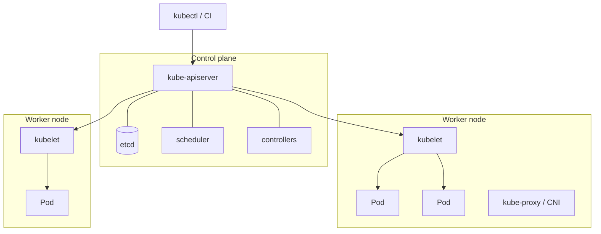
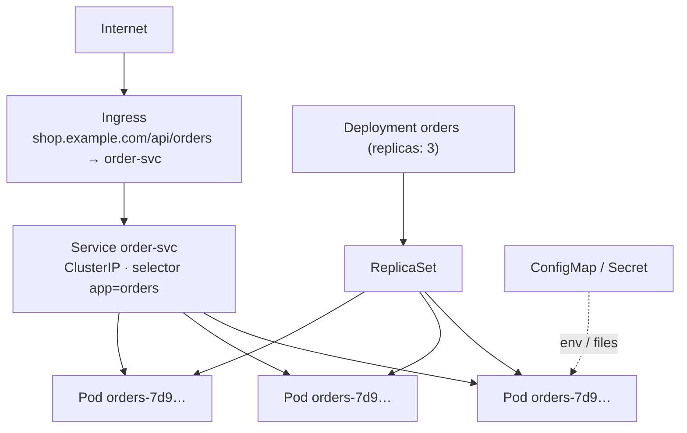
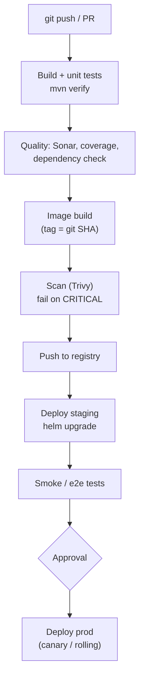
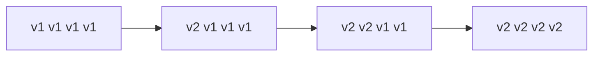
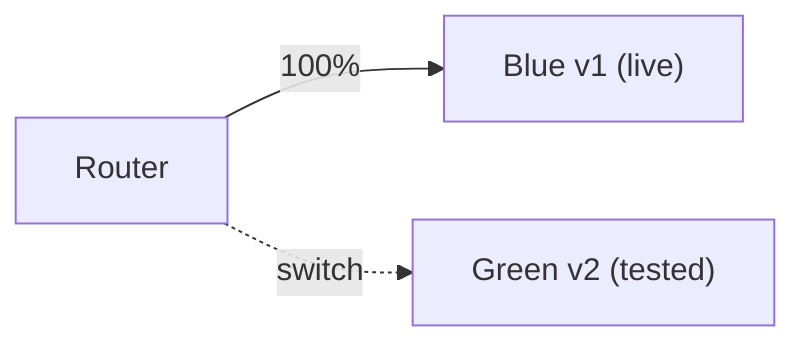
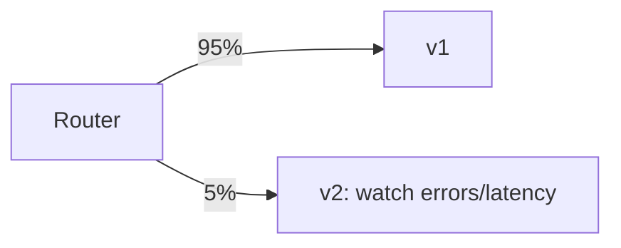
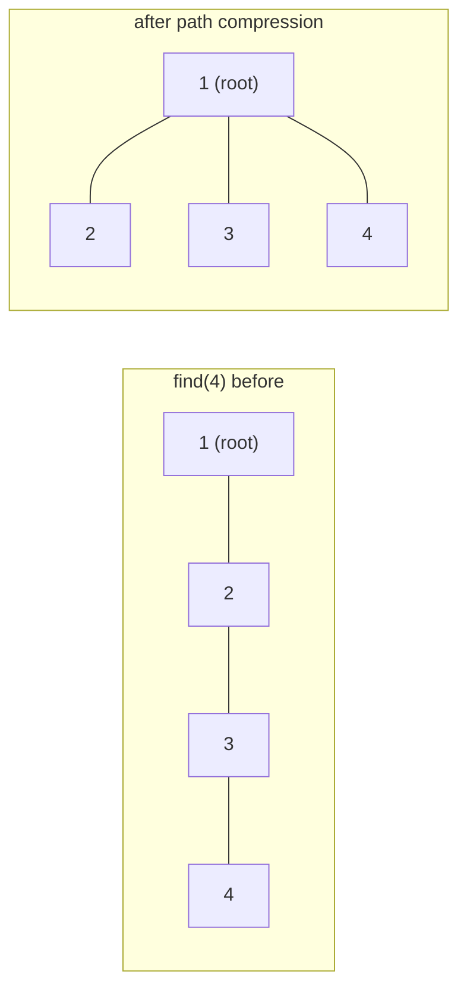
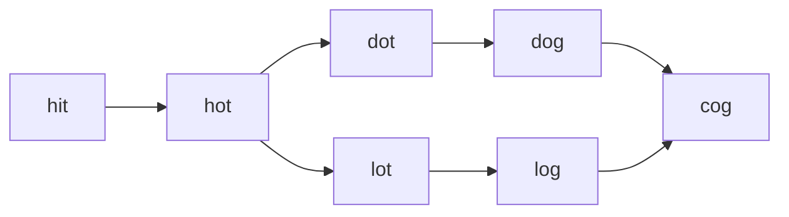
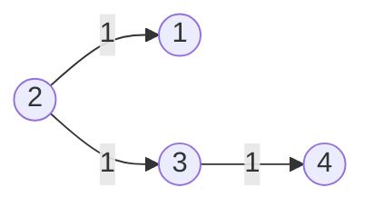

# Day 31 — Kubernetes Basics & CI/CD Pipelines

> **How to use these notes:** each section maps to one checklist item. Read the YAML, study the diagrams, then test yourself with the collapsible questions. 🚀 marks senior-level details.

**Today's goal:** know Kubernetes well enough for a backend interview — the **core objects** and what each does, **probes, resources, sidecars and init containers**, packaging with **Helm**, a real **CI/CD pipeline** (GitHub Actions / Jenkins), **deployment strategies** (rolling, blue-green, canary), and **container security**. On the DSA side: **Union-Find**, plus BFS on implicit graphs (Word Ladder) and **Dijkstra**.

#### The big picture



Kubernetes is **declarative**: you submit the **desired state** (YAML); controllers continuously **reconcile** the actual state toward it (a crashed pod is replaced, a missing replica is created).

<!-- topic: d31_t1 -->
## ☸️ DevOps — K8s & CI/CD

<!-- subtopic: d31_t1_s1 -->
### 1. Core objects — Pod, Deployment, Service, ConfigMap, Secret, Ingress

> **TL;DR:** **Pod** = smallest deployable unit (one or more containers sharing network/storage). **Deployment** = manages ReplicaSets → keeps N identical pods running and does rolling updates. **Service** = stable virtual IP + DNS name load-balancing to matching pods. **ConfigMap / Secret** = configuration injected as env vars or files. **Ingress** = HTTP(S) routing from outside to Services (host/path rules, TLS).



```yaml
apiVersion: apps/v1
kind: Deployment
metadata:
  name: orders
spec:
  replicas: 3
  selector:
    matchLabels: { app: orders }
  template:
    metadata:
      labels: { app: orders }
    spec:
      containers:
        - name: app
          image: ghcr.io/shop/order-service:1.4.2
          ports: [{ containerPort: 8080 }]
          envFrom:
            - configMapRef: { name: orders-config }
            - secretRef: { name: orders-secrets }
---
apiVersion: v1
kind: Service
metadata:
  name: order-svc
spec:
  selector: { app: orders }          # routes to pods with this label
  ports: [{ port: 80, targetPort: 8080 }]
  type: ClusterIP                    # internal; other types: NodePort, LoadBalancer
---
apiVersion: v1
kind: ConfigMap
metadata: { name: orders-config }
data:
  SPRING_PROFILES_ACTIVE: prod
  PAYMENTS_BASE_URL: http://payment-svc
---
apiVersion: v1
kind: Secret
metadata: { name: orders-secrets }
type: Opaque
stringData:                          # stored base64-encoded — NOT encrypted by default
  SPRING_DATASOURCE_PASSWORD: change-me
---
apiVersion: networking.k8s.io/v1
kind: Ingress
metadata: { name: shop }
spec:
  ingressClassName: nginx
  tls: [{ hosts: [shop.example.com], secretName: shop-tls }]
  rules:
    - host: shop.example.com
      http:
        paths:
          - path: /api/orders
            pathType: Prefix
            backend: { service: { name: order-svc, port: { number: 80 } } }
```

| Object | Job | Remember |
|---|---|---|
| Pod | Runs containers together (shared IP, volumes) | Ephemeral — never rely on a pod's IP |
| ReplicaSet | Keeps N pod replicas | Managed by a Deployment; rarely created directly |
| Deployment | Declarative updates for stateless apps | Rolling update, rollback (`kubectl rollout undo`) |
| StatefulSet | Stable names + per-pod storage | Databases, Kafka, ZooKeeper |
| DaemonSet | One pod per node | Log collectors, node agents |
| Job / CronJob | Run to completion / on a schedule | Batch jobs, migrations |
| Service | Stable DNS (`order-svc.namespace.svc.cluster.local`) + load balancing | `ClusterIP` (internal), `NodePort`, `LoadBalancer` (cloud LB) |
| Ingress | L7 HTTP routing + TLS | Needs an ingress controller (NGINX, ALB); Gateway API is the successor |
| ConfigMap | Non-secret config | Env vars or mounted files; restart (or reload) to pick up changes |
| Secret | Sensitive config | Base64 ≠ encryption — enable etcd encryption, use External Secrets/Vault, RBAC |
| Namespace | Logical isolation, quotas | Per team/env |
| HPA | Horizontal Pod Autoscaler | Scale replicas on CPU/memory/custom metrics |

```bash
kubectl apply -f k8s/                     # declare desired state
kubectl get pods -l app=orders -o wide
kubectl describe pod orders-7d9…          # events: image pull errors, probe failures, OOMKilled
kubectl logs -f deploy/orders
kubectl rollout status deploy/orders
kubectl rollout undo deploy/orders        # back to the previous ReplicaSet
kubectl port-forward svc/order-svc 8080:80
```

<!-- subtopic: d31_t1_s2 -->
### 2. Pod patterns, probes and resources

> **TL;DR:** **Sidecar**: helper container in the same pod (proxy, log shipper). **Init container**: runs to completion **before** the app starts (wait for DB, run migrations, fetch config). **Probes**: **startup** (slow boot), **liveness** (restart if dead), **readiness** (only route traffic when ready). **Resources**: `requests` are reserved for scheduling; `limits` cap usage — exceeding the memory limit = OOMKilled, CPU limit = throttled.

```yaml
spec:
  initContainers:
    - name: wait-for-db
      image: busybox:1.36
      command: ["sh", "-c", "until nc -z postgres 5432; do echo waiting; sleep 2; done"]
  containers:
    - name: app
      image: ghcr.io/shop/order-service:1.4.2
      resources:
        requests: { cpu: 250m, memory: 512Mi }    # scheduler reserves this
        limits:   { memory: 768Mi }               # hard cap (many teams omit CPU limits to avoid throttling)
      startupProbe:
        httpGet: { path: /actuator/health/liveness, port: 8080 }
        failureThreshold: 30
        periodSeconds: 5                           # up to 150s to start
      livenessProbe:
        httpGet: { path: /actuator/health/liveness, port: 8080 }
        periodSeconds: 10
      readinessProbe:
        httpGet: { path: /actuator/health/readiness, port: 8080 }
        periodSeconds: 5
      lifecycle:
        preStop:
          exec: { command: ["sh", "-c", "sleep 10"] }   # let endpoints update before shutdown
    - name: log-shipper                              # sidecar
      image: fluent/fluent-bit:3.0
  terminationGracePeriodSeconds: 40
```

| Probe | Question | On failure | Typical endpoint |
|---|---|---|---|
| startup | Has it finished starting? | Keep waiting; other probes disabled until it passes | liveness endpoint with a generous threshold |
| liveness | Is it alive (not deadlocked)? | **Restart** container | `/actuator/health/liveness` (internal state only) |
| readiness | Can it take traffic now? | **Remove from Service endpoints** | `/actuator/health/readiness` (+ critical deps) |

| Resource setting | Effect |
|---|---|
| `requests.cpu: 250m` | 0.25 core reserved; decides which node the pod fits on |
| `limits.cpu` | Throttling above it (can hurt JVM latency, GC) |
| `requests.memory` | Reserved for scheduling |
| `limits.memory` | Exceeding → **OOMKilled** (exit 137) — size the JVM with `MaxRAMPercentage` (Day 30) |

**QoS classes:** Guaranteed (requests = limits), Burstable, BestEffort (none) — BestEffort pods are evicted first under node pressure.

**Graceful shutdown sequence:** pod marked Terminating → removed from endpoints (async!) → `preStop` hook → SIGTERM → Spring finishes in-flight requests (`server.shutdown=graceful`) → SIGKILL after `terminationGracePeriodSeconds`.

<!-- subtopic: d31_t1_s3 -->
### 3. Helm — templated, versioned K8s packages

> **TL;DR:** Helm packages Kubernetes manifests as a **chart**: templates (Go templates) + default `values.yaml`. You install a **release** with environment-specific overrides (`-f values-prod.yaml`), upgrade it, and **roll back** to a previous revision. It removes copy-paste between dev/staging/prod manifests.

```
order-service/
├── Chart.yaml              # name, version (chart), appVersion (app)
├── values.yaml             # defaults
├── values-prod.yaml        # overrides per environment
└── templates/
    ├── deployment.yaml
    ├── service.yaml
    ├── ingress.yaml
    ├── hpa.yaml
    └── _helpers.tpl        # reusable named templates (labels, names)
```

```yaml
# templates/deployment.yaml (excerpt)
apiVersion: apps/v1
kind: Deployment
metadata:
  name: {{ include "order-service.fullname" . }}
spec:
  replicas: {{ .Values.replicaCount }}
  template:
    spec:
      containers:
        - name: app
          image: "{{ .Values.image.repository }}:{{ .Values.image.tag | default .Chart.AppVersion }}"
          resources: {{- toYaml .Values.resources | nindent 12 }}
          {{- if .Values.env }}
          env:
            {{- range $k, $v := .Values.env }}
            - name: {{ $k }}
              value: {{ $v | quote }}
            {{- end }}
          {{- end }}
```

```yaml
# values.yaml
replicaCount: 2
image: { repository: ghcr.io/shop/order-service, tag: "" }
resources:
  requests: { cpu: 250m, memory: 512Mi }
  limits: { memory: 768Mi }
env:
  SPRING_PROFILES_ACTIVE: dev
```

```bash
helm upgrade --install orders ./order-service -n shop \
  -f values-prod.yaml --set image.tag=1.4.2 --atomic --timeout 5m   # atomic: auto-rollback on failure
helm history orders -n shop
helm rollback orders 7 -n shop
helm template ./order-service -f values-prod.yaml    # render locally to review the YAML
```

Alternatives: **Kustomize** (patch-based overlays, built into kubectl), and GitOps tools (**Argo CD**, Flux) that sync charts/manifests from Git to the cluster.

<!-- subtopic: d31_t1_s4 -->
### 4. CI/CD pipelines — build → test → scan → deploy

> **TL;DR:** **CI** (continuous integration): every push builds and tests automatically. **CD** (continuous delivery/deployment): every green build produces a versioned artifact that is deployed to environments automatically (with approvals for prod in delivery). Typical stages: **checkout → build → unit tests → integration tests → static analysis → build image → scan → push → deploy to staging → smoke tests → (approval) → prod**.



```yaml
# .github/workflows/ci.yml
name: ci
on:
  push: { branches: [main] }
  pull_request:
jobs:
  build:
    runs-on: ubuntu-latest
    permissions: { contents: read, packages: write }
    steps:
      - uses: actions/checkout@v4
      - uses: actions/setup-java@v4
        with: { distribution: temurin, java-version: "21", cache: maven }
      - run: ./mvnw -B verify                      # unit + integration tests (Testcontainers works on GH runners)
      - name: Build image
        run: docker build -t ghcr.io/shop/order-service:${{ github.sha }} .
      - name: Scan image
        uses: aquasecurity/trivy-action@0.24.0
        with:
          image-ref: ghcr.io/shop/order-service:${{ github.sha }}
          severity: CRITICAL,HIGH
          exit-code: "1"
      - name: Push
        if: github.ref == 'refs/heads/main'
        run: |
          echo "${{ secrets.GITHUB_TOKEN }}" | docker login ghcr.io -u ${{ github.actor }} --password-stdin
          docker push ghcr.io/shop/order-service:${{ github.sha }}
  deploy-staging:
    needs: build
    if: github.ref == 'refs/heads/main'
    runs-on: ubuntu-latest
    environment: staging                           # environment-scoped secrets + protection rules
    steps:
      - uses: actions/checkout@v4
      - run: helm upgrade --install orders ./chart -f chart/values-staging.yaml --set image.tag=${{ github.sha }} --atomic
```

```groovy
// Jenkinsfile (declarative) — same stages
pipeline {
  agent any
  stages {
    stage('Build')   { steps { sh './mvnw -B verify' } }
    stage('Image')   { steps { sh "docker build -t shop/orders:${env.GIT_COMMIT} ." } }
    stage('Scan')    { steps { sh "trivy image --exit-code 1 --severity CRITICAL shop/orders:${env.GIT_COMMIT}" } }
    stage('Deploy')  { when { branch 'main' } steps { sh "helm upgrade --install orders ./chart --set image.tag=${env.GIT_COMMIT}" } }
  }
  post { failure { slackSend message: "Build failed: ${env.BUILD_URL}" } }
}
```

Good-pipeline rules: **build once, deploy the same artifact everywhere** (tag by git SHA, never rebuild per env); fast feedback (unit tests first, parallel jobs); secrets from the CI secret store/OIDC, never in the repo; DB migrations (Flyway) run as part of deploy, backwards compatible (expand/contract, Day 22); automatic **rollback** on failed health checks.

<!-- subtopic: d31_t1_s5 -->
### 5. Deployment strategies — rolling, blue-green, canary

> **TL;DR:** **Rolling** (K8s default): replace pods gradually — no extra infrastructure, but old and new versions run together. **Blue-green**: run the new version (green) fully alongside the old (blue), test it, then **switch all traffic at once** — instant rollback, double resources. **Canary**: send a **small percentage** of real traffic (1 % → 10 % → 50 % → 100 %) to the new version while watching metrics — smallest blast radius, needs traffic-splitting tooling.

**Rolling** — pods replaced a few at a time:



**Blue-green** — switch all traffic at once:



**Canary** — a small slice of traffic first:



| | Rolling | Blue-green | Canary |
|---|---|---|---|
| Extra capacity | Small (`maxSurge`) | 2× during switch | Small |
| Rollback speed | Minutes (roll back) | Instant (switch back) | Instant (route 0 %) |
| Risk exposure | All users gradually | All users at switch | Only the canary % |
| Mixed versions live | Yes | No (briefly) | Yes |
| Tooling | Built into Deployment | Two Deployments + Service selector / LB switch | Ingress weights, service mesh, Argo Rollouts, Flagger |
| Best for | Most stateless services | Big-bang releases needing quick rollback | High-traffic, risky changes |

```yaml
# Rolling update tuning
strategy:
  type: RollingUpdate
  rollingUpdate:
    maxSurge: 25%          # extra pods above desired during the update
    maxUnavailable: 0      # never drop below desired capacity
```

All strategies need: **readiness probes** (don't route to unready pods), **backwards-compatible DB schema and APIs** (old and new run together), and **automated analysis** (error rate, latency) to stop bad releases. **Feature flags** decouple deploy (code shipped) from release (feature turned on).

<!-- subtopic: d31_t1_s6 -->
### 6. Container security — non-root, read-only FS, scanning, minimal images

> **TL;DR:** Defense in depth: **build** minimal, scanned, signed images; **run** them as non-root with a read-only root filesystem, no privilege escalation and dropped Linux capabilities; **restrict** network (NetworkPolicies), API access (RBAC, dedicated ServiceAccounts) and secrets.

```yaml
spec:
  serviceAccountName: orders            # own SA with minimal RBAC; automountServiceAccountToken: false if unused
  securityContext:
    runAsNonRoot: true
    runAsUser: 10001
    fsGroup: 10001
    seccompProfile: { type: RuntimeDefault }
  containers:
    - name: app
      securityContext:
        allowPrivilegeEscalation: false
        readOnlyRootFilesystem: true
        capabilities: { drop: ["ALL"] }
      volumeMounts:
        - { name: tmp, mountPath: /tmp }      # writable scratch space for the JVM
  volumes:
    - name: tmp
      emptyDir: {}
---
apiVersion: networking.k8s.io/v1
kind: NetworkPolicy
metadata: { name: orders-db-only }
spec:
  podSelector: { matchLabels: { app: postgres } }
  ingress:
    - from: [{ podSelector: { matchLabels: { app: orders } } }]   # only orders may reach the DB
```

| Layer | Controls |
|---|---|
| Image | Minimal base (distroless/alpine), pinned digests, **Trivy/Grype** scanning in CI, SBOM, signing (cosign) |
| Pod | `runAsNonRoot`, `readOnlyRootFilesystem`, `allowPrivilegeEscalation: false`, drop capabilities, seccomp |
| Cluster | Pod Security Admission (`restricted` profile), admission policies (Kyverno/OPA Gatekeeper) |
| Network | NetworkPolicies (default deny), mTLS via service mesh |
| Secrets | External Secrets / Vault / cloud secret manager, etcd encryption, least-privilege RBAC |
| Runtime | Falco for suspicious behaviour, audit logs |

### 🎤 Interview Q&A — Kubernetes & CI/CD

<details><summary>Q1. Deployment vs StatefulSet?</summary>

Deployments run interchangeable stateless pods with random names; StatefulSets give each pod a stable identity (name, DNS, persistent volume) and ordered start/stop — for databases and brokers.

</details>

<details><summary>Q2. Liveness vs readiness probe?</summary>

Liveness failure restarts the container (it's broken); readiness failure removes the pod from Service endpoints (it's temporarily unable to serve). Don't put external dependencies in liveness.

</details>

<details><summary>Q3. What happens when a pod exceeds its memory limit? Its CPU limit?</summary>

Memory: the container is OOMKilled (exit 137) and restarted. CPU: it is throttled, which slows it down (and can hurt latency) but doesn't kill it.

</details>

<details><summary>Q4. Blue-green vs canary?</summary>

Blue-green runs two full environments and switches all traffic at once (instant rollback, double resources). Canary routes a small, growing percentage of traffic to the new version while monitoring it (smallest blast radius, needs traffic splitting).

</details>

<details><summary>Q5. Are Kubernetes Secrets secure?</summary>

Not by default — they're only base64-encoded in etcd. Enable encryption at rest, restrict access with RBAC, and preferably source them from an external secret manager (Vault, AWS Secrets Manager via External Secrets).

</details>

<!-- topic: d27_t2 -->
## 🧮 DSA — Graphs: Advanced

<!-- subtopic: d27_t2_s1 -->
### 7. Union-Find (Disjoint Set Union)

> **TL;DR:** Union-Find tracks which elements belong to the same group. `find(x)` returns the group's representative (root); `union(a, b)` merges two groups. With **path compression** and **union by rank/size**, both are **almost O(1)** — amortised O(α(n)), the inverse Ackermann function (≤ 4 for any realistic n).

```java
class UnionFind {
    private final int[] parent, rank;
    private int components;

    UnionFind(int n) {
        parent = new int[n];
        rank = new int[n];
        components = n;
        for (int i = 0; i < n; i++) parent[i] = i;      // everyone is their own root
    }

    int find(int x) {
        if (parent[x] != x) parent[x] = find(parent[x]); // path compression: point straight at the root
        return parent[x];
    }

    boolean union(int a, int b) {
        int ra = find(a), rb = find(b);
        if (ra == rb) return false;                      // already connected → this edge closes a cycle
        if (rank[ra] < rank[rb]) { int t = ra; ra = rb; rb = t; }
        parent[rb] = ra;                                 // attach the shorter tree under the taller
        if (rank[ra] == rank[rb]) rank[ra]++;
        components--;
        return true;
    }

    int components() { return components; }
}
```



| Use Union-Find when | Use BFS/DFS when |
|---|---|
| Edges arrive one by one (dynamic connectivity) | Graph is static and you need paths/distances |
| Detect a cycle in an **undirected** graph while adding edges | Directed graphs (use colours/Kahn's) |
| Kruskal's MST, counting components, grouping (accounts, islands II) | Shortest path, level order |

<!-- subtopic: d27_t2_s2 -->
### 8. Redundant Connection (LeetCode 684)

> **Problem:** a tree with `n` nodes plus **one extra edge**. Return the edge that can be removed to make it a tree (the last such edge in the input). 🔗 [LeetCode 684](https://leetcode.com/problems/redundant-connection/)

Add edges one by one; the first edge whose endpoints are **already connected** closes a cycle → it's redundant.

```java
public int[] findRedundantConnection(int[][] edges) {
    UnionFind uf = new UnionFind(edges.length + 1);     // nodes are 1..n
    for (int[] e : edges) {
        if (!uf.union(e[0], e[1])) return e;            // already in the same set → cycle
    }
    return new int[0];
}   // O(n · α(n))
```

`[[1,2],[1,3],[2,3]]` → union(1,2) ✓, union(1,3) ✓, union(2,3): 2 and 3 already share root 1 → return **[2,3]**.

Hard variant LC 685 (directed graph): handle a node with two parents and/or a cycle separately.

<!-- subtopic: d27_t2_s3 -->
### 9. Graph Valid Tree (LeetCode 261)

> **Problem:** given `n` nodes and undirected edges, is it a valid tree? 🔗 [LeetCode 261](https://leetcode.com/problems/graph-valid-tree/) *(Premium)*

A tree has **exactly n − 1 edges**, **no cycle** and is **connected**. With exactly n − 1 edges, "no cycle" implies connected (and vice versa).

```java
public boolean validTree(int n, int[][] edges) {
    if (edges.length != n - 1) return false;            // too few → disconnected; too many → cycle
    UnionFind uf = new UnionFind(n);
    for (int[] e : edges) {
        if (!uf.union(e[0], e[1])) return false;        // cycle
    }
    return true;                                        // n-1 edges + no cycle ⇒ connected
}   // O(n · α(n))
```

| n | edges | result |
|---|---|---|
| 5 | [0,1],[0,2],[0,3],[1,4] | ✅ true |
| 5 | [0,1],[1,2],[2,3],[1,3],[1,4] | ❌ 5 edges ≠ 4 |
| 4 | [0,1],[2,3],[1,0] | ❌ cycle (0-1 twice), node set split |

BFS/DFS alternative: check edge count, then traverse from 0 and confirm all n nodes are visited.

<!-- subtopic: d27_t2_s4 -->
### 10. Word Ladder (LeetCode 127 — Hard)

> **Problem:** transform `beginWord` into `endWord` changing **one letter at a time**, each intermediate word must be in `wordList`. Return the number of words in the shortest sequence (0 if impossible). 🔗 [LeetCode 127](https://leetcode.com/problems/word-ladder/)

Words are vertices, one-letter differences are edges → **shortest path in an unweighted graph = BFS** (Day 22). Generate neighbours on the fly: for each position try `'a'..'z'`.

```java
public int ladderLength(String begin, String end, List<String> wordList) {
    Set<String> dict = new HashSet<>(wordList);
    if (!dict.contains(end)) return 0;
    Deque<String> queue = new ArrayDeque<>(List.of(begin));
    dict.remove(begin);
    int steps = 1;
    while (!queue.isEmpty()) {
        for (int size = queue.size(); size > 0; size--) {
            char[] w = queue.poll().toCharArray();
            for (int i = 0; i < w.length; i++) {
                char original = w[i];
                for (char c = 'a'; c <= 'z'; c++) {
                    if (c == original) continue;
                    w[i] = c;
                    String next = new String(w);
                    if (next.equals(end)) return steps + 1;
                    if (dict.remove(next)) queue.offer(next);   // remove = mark visited
                }
                w[i] = original;
            }
        }
        steps++;
    }
    return 0;
}   // O(N · L · 26) where N words of length L
```



`hit → hot → dot → dog → cog` = **5** words.

🚀 **Bidirectional BFS:** expand from both ends, always the smaller frontier; stop when they meet — dramatically fewer states. Word Ladder II (LC 126) asks for all shortest paths → BFS to build parent links, then DFS/backtrack.

<!-- subtopic: d27_t2_s5 -->
### 11. Network Delay Time (LeetCode 743) — Dijkstra

> **Problem:** directed weighted edges `times[i] = (u, v, w)`; a signal starts at `k`. How long until all `n` nodes receive it? `-1` if some never do. 🔗 [LeetCode 743](https://leetcode.com/problems/network-delay-time/)

Answer = the **largest shortest-path distance** from `k`. Non-negative weights → **Dijkstra**: repeatedly settle the unvisited node with the smallest known distance (min-heap), relaxing its edges.

```java
public int networkDelayTime(int[][] times, int n, int k) {
    List<List<int[]>> graph = new ArrayList<>();
    for (int i = 0; i <= n; i++) graph.add(new ArrayList<>());
    for (int[] t : times) graph.get(t[0]).add(new int[]{t[1], t[2]});

    int[] dist = new int[n + 1];
    Arrays.fill(dist, Integer.MAX_VALUE);
    dist[k] = 0;
    PriorityQueue<int[]> pq = new PriorityQueue<>(Comparator.comparingInt(a -> a[1]));   // {node, dist}
    pq.offer(new int[]{k, 0});

    while (!pq.isEmpty()) {
        int[] cur = pq.poll();
        int u = cur[0], d = cur[1];
        if (d > dist[u]) continue;                          // stale entry (lazy deletion)
        for (int[] edge : graph.get(u)) {
            int v = edge[0], nd = d + edge[1];
            if (nd < dist[v]) {                             // relax
                dist[v] = nd;
                pq.offer(new int[]{v, nd});
            }
        }
    }

    int max = 0;
    for (int i = 1; i <= n; i++) {
        if (dist[i] == Integer.MAX_VALUE) return -1;
        max = Math.max(max, dist[i]);
    }
    return max;
}   // O((V + E) log V)
```



`k = 2` → dist {1:1, 3:1, 4:2} → answer **2**.

| Algorithm | Weights | Complexity | Use |
|---|---|---|---|
| BFS | All equal | O(V + E) | Unweighted shortest path |
| 0-1 BFS (deque) | 0 or 1 | O(V + E) | Binary weights |
| **Dijkstra** | **Non-negative** | O((V + E) log V) | Most routing problems |
| Bellman-Ford | Negative allowed | O(V · E) | Detects negative cycles; "at most K stops" (LC 787) |
| Floyd-Warshall | Any (no neg. cycles) | O(V³) | All pairs, small V |

⚠️ Dijkstra is **wrong with negative edges** — a settled node could later be reached more cheaply.

---

## 📝 Day 31 Revision Cheat Sheet

| Topic | Remember this |
|---|---|
| K8s model | Declarative desired state; controllers reconcile; control plane (apiserver, etcd, scheduler, controllers) + kubelets |
| Objects | Pod, Deployment → ReplicaSet, StatefulSet, DaemonSet, Job, Service, Ingress, ConfigMap, Secret, HPA |
| Service types | ClusterIP (internal), NodePort, LoadBalancer; DNS name = service name |
| Probes | startup (slow boot), liveness (restart), readiness (traffic) |
| Resources | requests = scheduling, limits = cap; memory over → OOMKilled; CPU over → throttled |
| Init / sidecar | Init runs before app; sidecar runs alongside |
| Helm | Chart = templates + values; release; upgrade --install --atomic; rollback |
| CI/CD | Build once (tag = SHA) → test → scan → push → staging → smoke → approve → prod |
| Strategies | Rolling (default), blue-green (instant switch), canary (small % + metrics) |
| Security | Non-root, read-only FS, drop caps, NetworkPolicies, RBAC, scan & sign images, external secrets |
| Union-Find | find with path compression, union by rank; α(n) ≈ O(1) |
| Redundant connection | First union that fails |
| Valid tree | edges == n-1 and no cycle |
| Word Ladder | BFS over one-letter changes; remove from dict as visited; bidirectional BFS |
| Dijkstra | Min-heap by distance, skip stale, relax; no negative edges |

### ⚡ Rapid-fire self-test

1. Which object keeps N identical stateless pods running? → **Deployment (via a ReplicaSet)**
2. Which probe failure restarts the container? → **Liveness**
3. What happens on exceeding the memory limit? → **OOMKilled (exit 137)**
4. Are Secrets encrypted by default? → **No, only base64-encoded**
5. Helm flag that rolls back automatically on a failed upgrade? → **--atomic**
6. Strategy that sends 5% of traffic to the new version? → **Canary**
7. Why tag images with the git SHA? → **Build once, deploy the same immutable artifact everywhere**
8. Union-Find amortised complexity? → **O(α(n)), effectively constant**
9. Shortest path when all edges cost the same? → **BFS**
10. Can Dijkstra handle negative edges? → **No — use Bellman-Ford**
