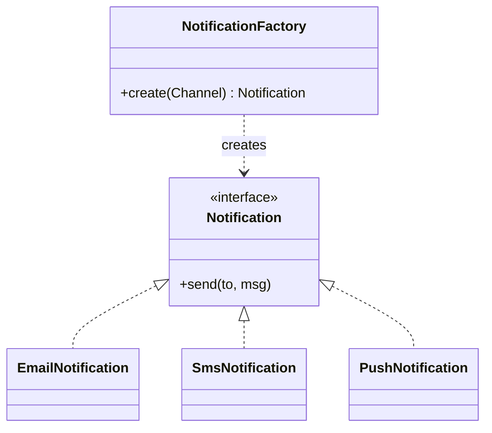
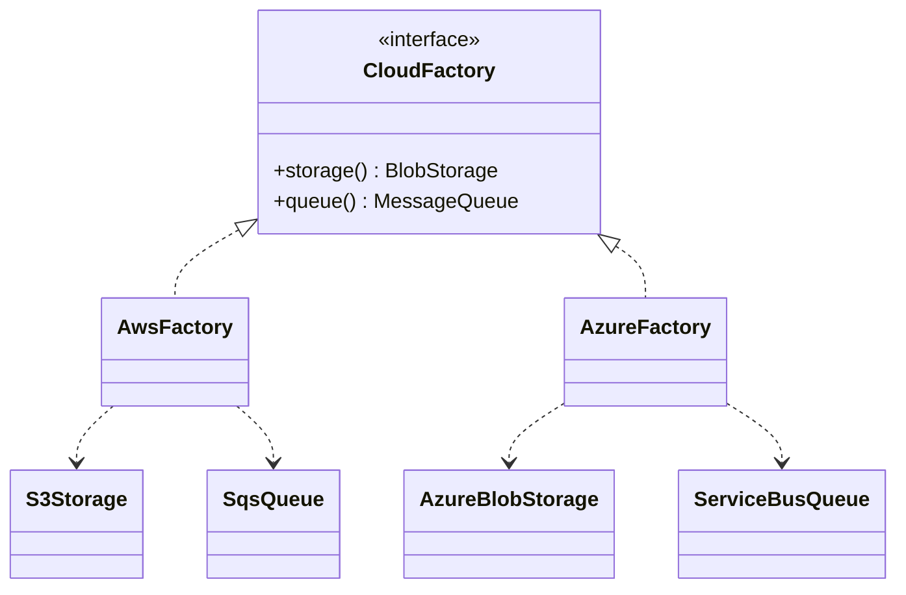
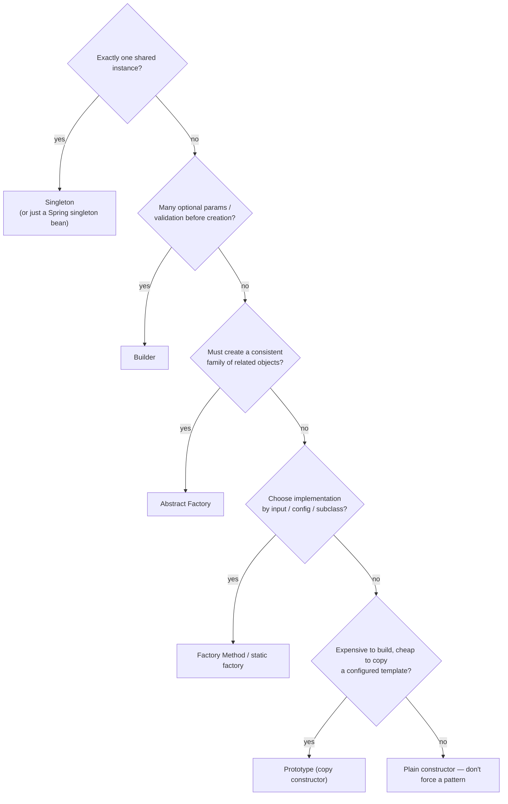
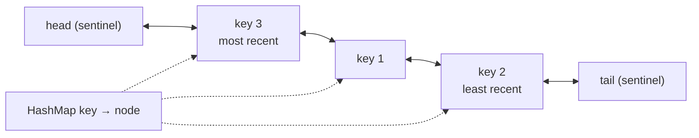

# Day 32 — LLD: Creational Design Patterns

> **How to use these notes:** each section maps to one checklist item. Run the code, study the diagrams, then test yourself with the collapsible questions. 🚀 marks senior-level details.

**Today's goal:** the **creational** Gang-of-Four patterns — how objects get created — with modern Java code, where Spring and the JDK use them, and a decision matrix for interviews: **Singleton** (thread-safe variants), **Factory Method**, **Abstract Factory**, **Builder**, **Prototype**. On the DSA side: **design-a-data-structure** problems — LRU Cache, HashMap from scratch, Insert/Delete/GetRandom O(1), and a time-based key-value store.

Design patterns are **named, reusable solutions to recurring design problems**. In interviews, the pattern name matters less than: *what problem does it solve, what's the trade-off, and where have you seen it?*

| Family | Concerned with | Today / tomorrow |
|---|---|---|
| **Creational** | How objects are created | Day 32 |
| Structural | How objects are composed | Day 33 |
| Behavioral | How objects interact and share responsibility | Day 33 |

<!-- topic: d32_t1 -->
## 🧱 LLD — Creational Patterns

<!-- subtopic: d32_t1_s1 -->
### 1. Singleton — thread-safe variants

> **TL;DR:** Exactly **one instance** with a global access point. Thread-safe options, best first: **enum singleton** (serialization- and reflection-safe), **Bill Pugh holder** (lazy, no locking), **double-checked locking with `volatile`**. In Spring apps you rarely write one — beans are **singleton-scoped by default**, which is better for testing (injectable, replaceable).

```java
// 1) Enum — simplest and safest (Effective Java, Item 3)
public enum AppConfig {
    INSTANCE;
    private final Properties props = load();
    public String get(String key) { return props.getProperty(key); }
    private static Properties load() { /* read file */ return new Properties(); }
}
// usage: AppConfig.INSTANCE.get("db.url")

// 2) Bill Pugh / initialization-on-demand holder — lazy, thread-safe via class loading
public final class IdGenerator {
    private IdGenerator() { }
    private static class Holder {                     // loaded only on first getInstance() call
        static final IdGenerator INSTANCE = new IdGenerator();
    }
    public static IdGenerator getInstance() { return Holder.INSTANCE; }
}

// 3) Double-checked locking — needs volatile
public final class ConnectionPool {
    private static volatile ConnectionPool instance;  // volatile: no half-constructed object visible
    private ConnectionPool() { }
    public static ConnectionPool getInstance() {
        ConnectionPool local = instance;
        if (local == null) {                          // 1st check: no lock on the hot path
            synchronized (ConnectionPool.class) {
                local = instance;
                if (local == null) {                  // 2nd check: someone may have created it meanwhile
                    instance = local = new ConnectionPool();
                }
            }
        }
        return local;
    }
}
```

| Variant | Lazy | Thread-safe | Reflection/serialization safe | Notes |
|---|---|---|---|---|
| Eager `static final` field | ❌ | ✅ | ❌ | Fine if creation is cheap |
| `synchronized getInstance()` | ✅ | ✅ | ❌ | Lock on every call |
| Double-checked locking | ✅ | ✅ **only with `volatile`** | ❌ | JMM: without volatile, another thread may see a partially constructed object (Day 8) |
| **Holder idiom** | ✅ | ✅ (JVM class init is thread-safe) | ❌ | Clean, fast |
| **Enum** | ❌ (on first use of enum) | ✅ | ✅ | Can't extend a class |

⚠️ Singletons are **global state**: hard to mock, hidden dependencies, test pollution. Prefer dependency injection; use a static singleton only for truly process-wide, stateless or immutable things. Examples in the JDK: `Runtime.getRuntime()`, `Desktop.getDesktop()`.

<details><summary>Q. Why is `volatile` required in double-checked locking?</summary>

`instance = new X()` is not atomic: allocation, construction and assignment can be reordered, so another thread could see a non-null reference to an object whose constructor hasn't finished. `volatile` establishes happens-before, forbidding that reordering.

</details>

<!-- subtopic: d32_t1_s2 -->
### 2. Factory Method — let subclasses (or a method) decide what to create

> **TL;DR:** Define a method that **creates objects**, so callers depend on an **interface**, not concrete classes. In the GoF form, subclasses override the factory method; in everyday Java it's often a **static factory** or a factory class selecting an implementation from input. Spring's `BeanFactory` / `@Bean` methods are factories.



```java
public interface Notification { void send(String to, String message); }

public enum Channel { EMAIL, SMS, PUSH }

// Simple factory (most common in real code)
public final class NotificationFactory {
    public static Notification create(Channel channel) {
        return switch (channel) {
            case EMAIL -> new EmailNotification();
            case SMS -> new SmsNotification();
            case PUSH -> new PushNotification();
        };
    }
}

// GoF Factory Method: the creator defers creation to subclasses
public abstract class ReportExporter {
    public final byte[] export(Report r) {                 // template using the factory method
        Formatter f = createFormatter();
        return f.format(r);
    }
    protected abstract Formatter createFormatter();        // ← factory method
}
public class PdfExporter extends ReportExporter {
    @Override protected Formatter createFormatter() { return new PdfFormatter(); }
}
```

**Spring-friendly version** — no switch, open for extension (OCP): let Spring collect all implementations.

```java
@Component
public class NotificationRouter {
    private final Map<Channel, Notification> byChannel;

    public NotificationRouter(List<ChannelNotification> all) {          // every implementation bean
        this.byChannel = all.stream().collect(Collectors.toMap(ChannelNotification::channel, n -> n));
    }

    public Notification forChannel(Channel c) {
        return Optional.ofNullable(byChannel.get(c))
                .orElseThrow(() -> new IllegalArgumentException("No sender for " + c));
    }
}
```

Adding WhatsApp = one new `@Component` class; no existing code changes.

JDK examples: `List.of(...)`, `Calendar.getInstance()`, `NumberFormat.getInstance(locale)`, `Executors.newFixedThreadPool(n)`, `Path.of(...)`.

<!-- subtopic: d32_t1_s3 -->
### 3. Abstract Factory — families of related objects

> **TL;DR:** An interface for creating **families of related objects** that must be used together, without naming concrete classes. Switch the whole family by switching the factory: a `DarkThemeFactory` makes dark buttons **and** dark checkboxes; a `PostgresFactory` makes Postgres connections **and** Postgres dialect objects.



```java
public interface CloudFactory {
    BlobStorage storage();
    MessageQueue queue();
}

public final class AwsFactory implements CloudFactory {
    public BlobStorage storage() { return new S3Storage(); }
    public MessageQueue queue() { return new SqsQueue(); }
}

public final class AzureFactory implements CloudFactory {
    public BlobStorage storage() { return new AzureBlobStorage(); }
    public MessageQueue queue() { return new ServiceBusQueue(); }
}

// Client code only knows the abstractions — the family stays consistent
public class InvoiceArchiver {
    private final BlobStorage storage;
    private final MessageQueue queue;
    public InvoiceArchiver(CloudFactory cloud) {
        this.storage = cloud.storage();
        this.queue = cloud.queue();
    }
}
```

| | Factory Method | Abstract Factory |
|---|---|---|
| Creates | One product | A **family** of related products |
| Mechanism | One method (often overridden) | An object with several factory methods |
| Typical | Pick an implementation | Swap a whole platform/theme/vendor |

In Spring, `@Profile("aws")` / `@Profile("azure")` configuration classes play the abstract-factory role. JDK: `DocumentBuilderFactory`, `javax.xml.transform.TransformerFactory`; JDBC drivers provide a family (`Connection`, `Statement`, `ResultSet`) per vendor.

<!-- subtopic: d32_t1_s4 -->
### 4. Builder — step-by-step construction

> **TL;DR:** For objects with **many parameters, many optional**, a builder replaces **telescoping constructors** (`new Pizza(size, true, false, true, null, …)`) with readable, named steps, and can **validate** before producing an **immutable** object. Lombok `@Builder` generates one; records can use a small static builder.

```java
public final class HttpRequestSpec {
    private final String url;                 // required
    private final String method;
    private final Map<String, String> headers;
    private final Duration timeout;
    private final int retries;

    private HttpRequestSpec(Builder b) {
        this.url = b.url;
        this.method = b.method;
        this.headers = Map.copyOf(b.headers);     // defensive, immutable copy
        this.timeout = b.timeout;
        this.retries = b.retries;
    }

    public static Builder builder(String url) { return new Builder(url); }   // required args up front

    public static final class Builder {
        private final String url;
        private String method = "GET";
        private final Map<String, String> headers = new LinkedHashMap<>();
        private Duration timeout = Duration.ofSeconds(5);
        private int retries = 0;

        private Builder(String url) { this.url = Objects.requireNonNull(url); }

        public Builder method(String m) { this.method = m; return this; }
        public Builder header(String k, String v) { headers.put(k, v); return this; }
        public Builder timeout(Duration t) { this.timeout = t; return this; }
        public Builder retries(int r) { this.retries = r; return this; }

        public HttpRequestSpec build() {
            if (retries < 0 || retries > 5) throw new IllegalStateException("retries must be 0..5");
            return new HttpRequestSpec(this);
        }
    }
}

HttpRequestSpec spec = HttpRequestSpec.builder("https://api.pay.example.com/charges")
        .method("POST")
        .header("Idempotency-Key", key)
        .timeout(Duration.ofSeconds(2))
        .retries(2)
        .build();
```

```java
// Lombok equivalent
@Builder(toBuilder = true)
@Value                                 // immutable: private final fields, getters, equals/hashCode
public class OrderEmail {
    @NonNull String to;
    String subject;
    @Builder.Default List<String> cc = List.of();
}
OrderEmail mail = OrderEmail.builder().to("a@x.com").subject("Your order").build();
OrderEmail copy = mail.toBuilder().subject("Updated").build();   // copy-with-changes
```

| Alternative | Problem |
|---|---|
| Telescoping constructors | Unreadable, easy to swap two `boolean`s or `String`s |
| JavaBeans setters | Object is mutable and can be used half-built/invalid |
| **Builder** | Readable, validated, immutable result — more code (or Lombok) |

JDK/Spring examples: `StringBuilder`, `HttpRequest.newBuilder()`, `Stream.builder()`, `UriComponentsBuilder`, `ResponseEntity.ok().header(...).body(...)`, `WebClient.builder()`, `MockMvcRequestBuilders`.

<!-- subtopic: d32_t1_s5 -->
### 5. Prototype — clone instead of construct

> **TL;DR:** Create new objects by **copying an existing, pre-configured prototype**, useful when construction is expensive or when you want many variations of a template. In Java prefer a **copy constructor / copy factory** over `Cloneable`/`clone()` (broken design: shallow by default, no constructor call, checked exception, final fields problem). Not to be confused with Spring's **prototype scope** (a new bean per lookup).

```java
public final class DocumentTemplate {
    private final String title;
    private final List<String> sections;            // mutable content → must deep-copy
    private final Map<String, String> styles;

    public DocumentTemplate(String title, List<String> sections, Map<String, String> styles) {
        this.title = title;
        this.sections = new ArrayList<>(sections);
        this.styles = new HashMap<>(styles);
    }

    // Copy constructor = explicit, deep where needed
    public DocumentTemplate(DocumentTemplate other) {
        this(other.title, other.sections, other.styles);
    }

    public DocumentTemplate withTitle(String newTitle) {   // copy-with-change
        return new DocumentTemplate(newTitle, sections, styles);
    }
}

// Registry of prototypes
Map<String, DocumentTemplate> templates = Map.of(
        "invoice", new DocumentTemplate("Invoice", List.of("Header", "Lines", "Totals"), Map.of("font", "Inter")));
DocumentTemplate mine = new DocumentTemplate(templates.get("invoice")).withTitle("Invoice #981");
```

| Shallow copy | Deep copy |
|---|---|
| Copies field values; nested objects are **shared** | Recursively copies nested mutable objects |
| `Object.clone()` default, `Arrays.copyOf` of objects | Copy constructors that copy collections; serialization tricks (slow) |
| Bugs: changing the copy's list changes the original | Safe |

**Spring prototype scope** (Day 19): `@Scope("prototype")` → the container builds a **new instance** each time it's requested (e.g., a stateful `ReportContext` per job). Inject with `ObjectProvider<T>` into singletons, otherwise you get one instance forever.

<!-- subtopic: d32_t1_s6 -->
### 6. When to use which — interview decision matrix

> **TL;DR:** Ask: *how many instances? how complex is construction? does the caller need to choose the concrete type? must related objects stay consistent? is copying cheaper than building?*



| Pattern | Use when | Real examples | Watch out |
|---|---|---|---|
| Singleton | One shared resource/config | `Runtime`, Spring singleton beans, logger factories | Global state, testing |
| Factory Method | Caller shouldn't know the concrete class | `List.of`, `Executors`, Spring `@Bean` | Switch statements violating OCP → use a registry |
| Abstract Factory | Swap a whole family consistently | JDBC drivers, cloud providers, UI themes | Adding a new product type changes every factory |
| Builder | Many params, optional fields, immutability | `HttpRequest`, `ResponseEntity`, Lombok `@Builder` | Boilerplate (use Lombok/records) |
| Prototype | Many similar objects from templates | Copy constructors, `toBuilder()` | Shallow-copy bugs |

**Interview tip:** relate each to code you've written — "our notification service uses a factory map keyed by channel; we build HTTP calls with a builder; our config objects are Spring singletons".

### 🎤 Interview Q&A — Creational patterns

<details><summary>Q1. Best way to implement a thread-safe singleton in Java?</summary>

An enum with a single constant: lazy enough, thread-safe through class initialisation, and safe against serialization and reflection attacks. The holder idiom is the best choice when the singleton must extend a class.

</details>

<details><summary>Q2. Factory Method vs Abstract Factory?</summary>

Factory Method creates one product and lets subclasses or a method decide the concrete class. Abstract Factory is an object that creates a family of related products that must be used together.

</details>

<details><summary>Q3. Why prefer Builder over telescoping constructors?</summary>

Named steps are readable, optional parameters have defaults, validation happens in `build()`, and the result can be immutable — no long, error-prone positional argument lists.

</details>

<details><summary>Q4. Why avoid Cloneable?</summary>

`clone()` is protected on Object, shallow by default, bypasses constructors, throws a checked exception and conflicts with final fields. Copy constructors or copy factories are explicit and type-safe.

</details>

<details><summary>Q5. Where does Spring use creational patterns?</summary>

Singleton (default bean scope), Factory (BeanFactory, `@Bean` methods, FactoryBean), Prototype (prototype scope), Builder (`WebClient.builder()`, `UriComponentsBuilder`, `ResponseEntity`), Abstract Factory (`@Profile` configurations providing families of beans).

</details>

<!-- topic: d30_t2 -->
## 🧮 DSA — Design-based Problems

<!-- subtopic: d30_t2_s1 -->
### 7. LRU Cache (LeetCode 146)

> **Problem:** a fixed-capacity cache with `get(key)` and `put(key, value)` in **O(1)**, evicting the **least recently used** entry when full. 🔗 [LeetCode 146](https://leetcode.com/problems/lru-cache/)

**HashMap** (key → node) for O(1) lookup + **doubly linked list** ordered by recency for O(1) move-to-front and evict-from-tail. Sentinel head/tail nodes remove edge cases.



```java
class LRUCache {
    private static final class Node {
        int key, value;
        Node prev, next;
        Node(int k, int v) { key = k; value = v; }
    }

    private final int capacity;
    private final Map<Integer, Node> map = new HashMap<>();
    private final Node head = new Node(0, 0), tail = new Node(0, 0);

    public LRUCache(int capacity) {
        this.capacity = capacity;
        head.next = tail;
        tail.prev = head;
    }

    public int get(int key) {
        Node n = map.get(key);
        if (n == null) return -1;
        moveToFront(n);
        return n.value;
    }

    public void put(int key, int value) {
        Node n = map.get(key);
        if (n != null) {
            n.value = value;
            moveToFront(n);
            return;
        }
        if (map.size() == capacity) {
            Node lru = tail.prev;                 // least recently used
            unlink(lru);
            map.remove(lru.key);                  // ← why the node stores its key
        }
        n = new Node(key, value);
        map.put(key, n);
        addFirst(n);
    }

    private void moveToFront(Node n) { unlink(n); addFirst(n); }
    private void unlink(Node n) { n.prev.next = n.next; n.next.prev = n.prev; }
    private void addFirst(Node n) {
        n.next = head.next; n.prev = head;
        head.next.prev = n; head.next = n;
    }
}   // get/put O(1)
```

**Java shortcut** (mention it, then implement by hand if asked):

```java
class LRU<K, V> extends LinkedHashMap<K, V> {
    private final int capacity;
    LRU(int capacity) { super(16, 0.75f, true); this.capacity = capacity; }   // accessOrder = true
    @Override protected boolean removeEldestEntry(Map.Entry<K, V> eldest) { return size() > capacity; }
}
```

Follow-ups: thread safety (lock or `ConcurrentHashMap` + `ConcurrentLinkedDeque` approximations; Caffeine in production), **LFU** (LC 460: frequency buckets of linked lists), TTL expiry.

<!-- subtopic: d30_t2_s2 -->
### 8. Design HashMap (LeetCode 706)

> **Problem:** implement `put`, `get`, `remove` without built-in hash tables. 🔗 [LeetCode 706](https://leetcode.com/problems/design-hashmap/)

**Separate chaining:** an array of buckets, each a linked list of entries. Hash the key to a bucket index; walk the chain. **Resize** (double + rehash) when `size > capacity × loadFactor` to keep chains short (Day 12 covers `java.util.HashMap` internals).

```java
class MyHashMap {
    private static final class Entry {
        final int key;
        int value;
        Entry next;
        Entry(int k, int v, Entry n) { key = k; value = v; next = n; }
    }

    private Entry[] buckets = new Entry[16];
    private int size;

    private int index(int key, int length) {
        int h = Integer.hashCode(key);
        h ^= (h >>> 16);                           // spread high bits (like java.util.HashMap)
        return h & (length - 1);                   // length is a power of two
    }

    public void put(int key, int value) {
        int i = index(key, buckets.length);
        for (Entry e = buckets[i]; e != null; e = e.next) {
            if (e.key == key) { e.value = value; return; }   // update
        }
        buckets[i] = new Entry(key, value, buckets[i]);       // insert at chain head
        if (++size > buckets.length * 0.75) resize();
    }

    public int get(int key) {
        for (Entry e = buckets[index(key, buckets.length)]; e != null; e = e.next) {
            if (e.key == key) return e.value;
        }
        return -1;
    }

    public void remove(int key) {
        int i = index(key, buckets.length);
        Entry dummy = new Entry(0, 0, buckets[i]);
        for (Entry prev = dummy; prev.next != null; prev = prev.next) {
            if (prev.next.key == key) { prev.next = prev.next.next; size--; break; }
        }
        buckets[i] = dummy.next;
    }

    private void resize() {
        Entry[] old = buckets;
        buckets = new Entry[old.length * 2];
        for (Entry head : old) {
            for (Entry e = head; e != null; e = e.next) {
                int i = index(e.key, buckets.length);
                buckets[i] = new Entry(e.key, e.value, buckets[i]);
            }
        }
    }
}   // average O(1); worst O(n) when everything collides
```

Talking points: load factor trade-off (memory vs chain length), power-of-two capacity + bit mask instead of `%`, Java 8 **treeifies** long chains (≥ 8) into red-black trees, and **open addressing** (linear probing) as the alternative — better cache locality, needs tombstones for delete.

<!-- subtopic: d30_t2_s3 -->
### 9. Insert Delete GetRandom O(1) (LeetCode 380)

> **Problem:** a set supporting `insert`, `remove` and `getRandom` (uniformly random element), all in average **O(1)**. 🔗 [LeetCode 380](https://leetcode.com/problems/insert-delete-getrandom-o1/)

An **ArrayList** gives O(1) random access for `getRandom`; a **HashMap value → index** gives O(1) lookup. Remove in O(1) by **swapping the element with the last one** and deleting the last slot.

```java
class RandomizedSet {
    private final List<Integer> values = new ArrayList<>();
    private final Map<Integer, Integer> indexOf = new HashMap<>();
    private final Random random = new Random();

    public boolean insert(int val) {
        if (indexOf.containsKey(val)) return false;
        indexOf.put(val, values.size());
        values.add(val);
        return true;
    }

    public boolean remove(int val) {
        Integer i = indexOf.get(val);
        if (i == null) return false;
        int last = values.get(values.size() - 1);
        values.set(i, last);                 // move the last element into the hole
        indexOf.put(last, i);
        values.remove(values.size() - 1);    // O(1): removing the tail
        indexOf.remove(val);
        return true;
    }

    public int getRandom() {
        return values.get(random.nextInt(values.size()));
    }
}
```

```
values  [5, 9, 2, 7]      remove(9): copy 7 into index 1 → [5, 7, 2, 7] → drop tail → [5, 7, 2]
indexOf {5:0, 9:1, 2:2, 7:3}                                      → {5:0, 7:1, 2:2}
```

⚠️ Order matters when `val` **is** the last element: the code still works because `indexOf.remove(val)` happens after `put(last, i)`. Variant LC 381 allows duplicates → `Map<Integer, Set<Integer>>` of indices.

<!-- subtopic: d30_t2_s4 -->
### 10. Time Based Key-Value Store (LeetCode 981)

> **Problem:** `set(key, value, timestamp)` and `get(key, timestamp)` returning the value with the **largest timestamp ≤ the given one** (or ""). Timestamps for `set` are strictly increasing. 🔗 [LeetCode 981](https://leetcode.com/problems/time-based-key-value-store/)

Per key, keep values in **timestamp order** (appends are already sorted) and **binary search** for the floor.

```java
class TimeMap {
    private record Version(int ts, String value) { }
    private final Map<String, List<Version>> store = new HashMap<>();

    public void set(String key, String value, int timestamp) {
        store.computeIfAbsent(key, k -> new ArrayList<>()).add(new Version(timestamp, value));
    }

    public String get(String key, int timestamp) {
        List<Version> versions = store.get(key);
        if (versions == null) return "";
        int lo = 0, hi = versions.size() - 1, found = -1;
        while (lo <= hi) {                            // last index with ts <= timestamp
            int mid = (lo + hi) >>> 1;
            if (versions.get(mid).ts() <= timestamp) { found = mid; lo = mid + 1; }
            else hi = mid - 1;
        }
        return found == -1 ? "" : versions.get(found).value();
    }
}   // set O(1), get O(log n)
```

Alternative: `Map<String, TreeMap<Integer, String>>` with `floorEntry(timestamp)` — O(log n) both ways, and works even if timestamps arrive out of order.

This is exactly how **MVCC** databases (Day 22) and versioned config stores answer "what was the value at time T?".

---

## 📝 Day 32 Revision Cheat Sheet

| Topic | Remember this |
|---|---|
| Singleton | Enum (best) · holder idiom · DCL + volatile; prefer DI singletons |
| Factory Method | Create via a method/subclass; caller depends on the interface; Spring: map of implementations |
| Abstract Factory | Family of related products; swap the whole family (cloud, theme, JDBC vendor) |
| Builder | Many optional params, validation in build(), immutable result; Lombok @Builder/toBuilder |
| Prototype | Copy a configured template; copy constructor > clone(); shallow vs deep |
| Spring | Singleton/prototype scopes, BeanFactory/@Bean factories, builders everywhere, @Profile families |
| LRU | HashMap + doubly linked list with sentinels; or LinkedHashMap(accessOrder) + removeEldestEntry |
| HashMap | Buckets of chains, spread hash, power-of-two mask, resize at 0.75 |
| RandomizedSet | ArrayList + value→index map; remove = swap with last |
| TimeMap | Per-key sorted versions + binary search floor (or TreeMap.floorEntry) |

### ⚡ Rapid-fire self-test

1. Safest singleton implementation in Java? → **Enum singleton**
2. Keyword required for double-checked locking? → **volatile**
3. Pattern that creates a consistent family of related objects? → **Abstract Factory**
4. Pattern that fixes telescoping constructors? → **Builder**
5. Prefer `clone()` or a copy constructor? → **Copy constructor**
6. Default Spring bean scope? → **Singleton**
7. LRU cache data structures? → **HashMap + doubly linked list**
8. LinkedHashMap constructor flag for LRU order? → **accessOrder = true**
9. How does RandomizedSet remove in O(1)? → **Swap with the last element, then remove the tail**
10. TreeMap method for "latest value at or before time t"? → **floorEntry**
