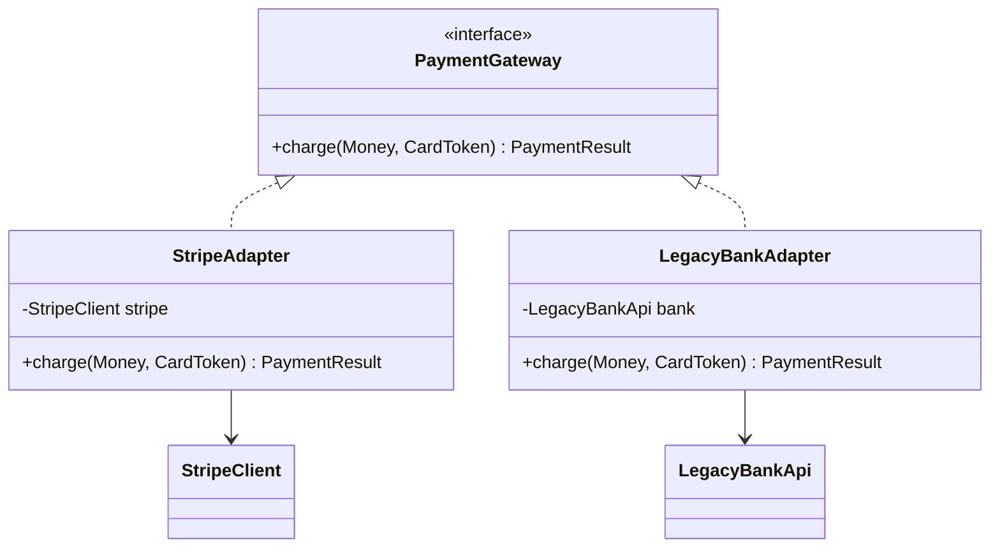
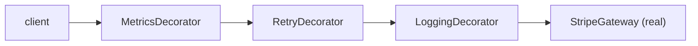
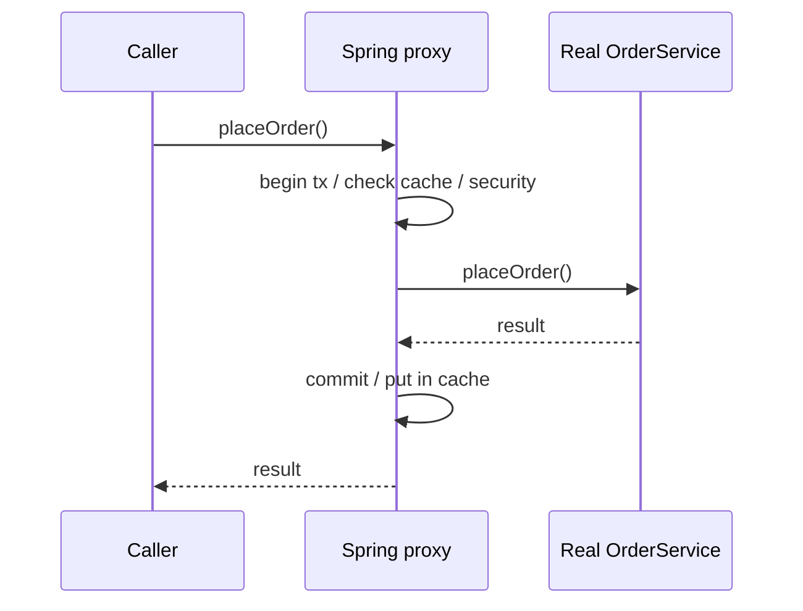
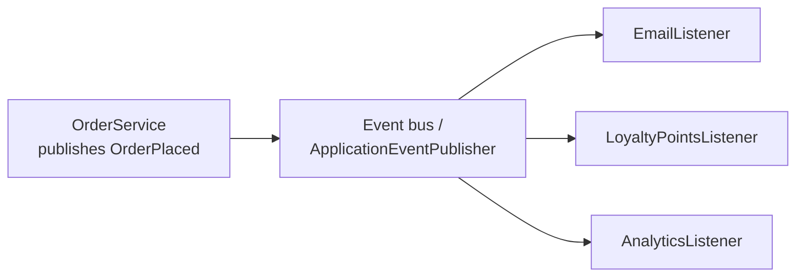
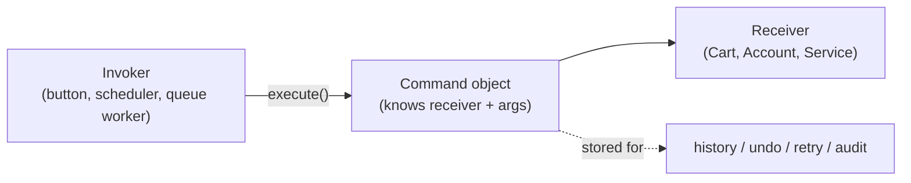

# Day 33 — LLD: Structural & Behavioral Patterns

> **How to use these notes:** each section maps to one checklist item. Run the code, study the diagrams, then test yourself with the collapsible questions. 🚀 marks senior-level details.

**Today's goal:** the patterns you'll actually name in interviews and see in Spring every day — **structural** (Adapter, Decorator, Proxy) and **behavioral** (Observer, Strategy, Template Method, Command) — each with modern Java code and the real framework example. On the DSA side: your first **Hard** problems — monotonic stack and deque techniques (Largest Rectangle, Trapping Rain Water, Sliding Window Maximum) and Longest Palindromic Substring.

Running example: a payment platform.

<!-- topic: d33_t1 -->
## 🧩 LLD — Structural & Behavioral Patterns

<!-- subtopic: d33_t1_s1 -->
### 1. Adapter — make incompatible interfaces work together

> **TL;DR:** Wrap a class with an incompatible interface (legacy code, third-party SDK) behind the interface your code expects. The **adapter translates calls and data**; the client never touches the foreign API. Think travel plug adapter.



```java
public interface PaymentGateway {
    PaymentResult charge(Money amount, CardToken card);
}

// The legacy API we can't change: cents as long, String status codes, checked exceptions
public class LegacyBankApi {
    public String debit(String accountRef, long cents) throws BankException { ... }
}

public class LegacyBankAdapter implements PaymentGateway {
    private final LegacyBankApi bank;
    public LegacyBankAdapter(LegacyBankApi bank) { this.bank = bank; }

    @Override
    public PaymentResult charge(Money amount, CardToken card) {
        try {
            String code = bank.debit(card.value(), amount.toCents());          // translate the call
            return "00".equals(code) ? PaymentResult.approved(code)           // translate the result
                                     : PaymentResult.declined("bank code " + code);
        } catch (BankException e) {
            throw new PaymentUnavailableException("legacy bank failed", e);  // translate errors
        }
    }
}
```

Real examples: `Arrays.asList` (array → List), `InputStreamReader` (bytes → chars), Spring MVC **HandlerAdapter** (lets DispatcherServlet call any handler type), Spring's `JpaVendorAdapter`, SLF4J bindings. An **anti-corruption layer** (Day 28) is an adapter at the boundary between bounded contexts.

<!-- subtopic: d33_t1_s2 -->
### 2. Decorator — add behaviour by wrapping

> **TL;DR:** Wrap an object with another object of the **same interface** that adds behaviour before/after delegating. Decorators **stack** in any combination at runtime — composition instead of an explosion of subclasses. Java I/O is the textbook example: `new BufferedReader(new InputStreamReader(new FileInputStream(f)))`.



```java
public abstract class PaymentGatewayDecorator implements PaymentGateway {
    protected final PaymentGateway inner;
    protected PaymentGatewayDecorator(PaymentGateway inner) { this.inner = inner; }
}

public class LoggingGateway extends PaymentGatewayDecorator {
    private static final Logger log = LoggerFactory.getLogger(LoggingGateway.class);
    public LoggingGateway(PaymentGateway inner) { super(inner); }

    @Override
    public PaymentResult charge(Money amount, CardToken card) {
        log.info("charging {}", amount);
        PaymentResult r = inner.charge(amount, card);          // delegate
        log.info("charge result {}", r.status());
        return r;
    }
}

public class RetryingGateway extends PaymentGatewayDecorator {
    public RetryingGateway(PaymentGateway inner) { super(inner); }

    @Override
    public PaymentResult charge(Money amount, CardToken card) {
        for (int attempt = 1; ; attempt++) {
            try { return inner.charge(amount, card); }
            catch (PaymentUnavailableException e) { if (attempt == 3) throw e; }
        }
    }
}

PaymentGateway gateway = new LoggingGateway(new RetryingGateway(new StripeGateway(client)));
```

| Decorator | Inheritance |
|---|---|
| Combine behaviours at runtime in any order | Fixed at compile time |
| N small decorators → any combination | 2ᴺ subclasses (LoggingRetryingStripe…) |
| Same interface as the wrapped object | Is-a relationship |

Real examples: `java.io` streams, `Collections.unmodifiableList` / `synchronizedList`, Spring's `TransactionAwareDataSourceProxy`, `HttpServletRequestWrapper`, Resilience4j `Decorators.ofSupplier(...).withRetry(...).withCircuitBreaker(...)`.

<!-- subtopic: d33_t1_s3 -->
### 3. Proxy — control access to an object

> **TL;DR:** A **stand-in** with the same interface that controls access to the real object: **lazy loading** (virtual proxy), **security** (protection proxy), **remote calls** (remote proxy), **caching**, or **cross-cutting concerns**. Structurally like a decorator; the intent differs — a proxy **controls access**, a decorator **adds features**. Spring AOP is proxy-based: **JDK dynamic proxies** (interface-based) or **CGLIB** subclasses.



```java
// A JDK dynamic proxy that times every call on an interface
@SuppressWarnings("unchecked")
public static <T> T timed(T target, Class<T> type) {
    return (T) Proxy.newProxyInstance(type.getClassLoader(), new Class<?>[]{type},
            (proxy, method, args) -> {
                long start = System.nanoTime();
                try {
                    return method.invoke(target, args);
                } finally {
                    System.out.printf("%s took %d µs%n", method.getName(), (System.nanoTime() - start) / 1000);
                }
            });
}

PaymentGateway g = timed(new StripeGateway(client), PaymentGateway.class);
```

| Proxy type | Example |
|---|---|
| Virtual (lazy) | Hibernate lazy-loading proxies (`getReferenceById`, Day 21) |
| Protection | Spring Security method security (`@PreAuthorize`) |
| Remote | gRPC/Feign clients, RMI stubs |
| Caching | `@Cacheable` |
| Smart/AOP | `@Transactional`, `@Async`, `@Retryable` |

| | JDK dynamic proxy | CGLIB proxy |
|---|---|---|
| Requires | An interface | A non-final class |
| How | Implements the interface | Generates a subclass |
| Can't intercept | Methods not on the interface | `final`/`private` methods |
| Spring Boot default | — | **CGLIB** (`proxyTargetClass=true`) |

Both explain the **self-invocation pitfall** (Day 22): `this.method()` skips the proxy.

<!-- subtopic: d33_t1_s4 -->
### 4. Observer — publish events, let subscribers react

> **TL;DR:** A **subject** keeps a list of **observers** and notifies them when something happens; the subject doesn't know what they do. Decouples "something happened" from "who cares". In Spring: `ApplicationEventPublisher` + `@EventListener`; across services: **Kafka** topics (pub/sub).



```java
public record OrderPlaced(long orderId, String customerEmail, BigDecimal total) { }

@Service
public class OrderService {
    private final ApplicationEventPublisher events;
    public OrderService(ApplicationEventPublisher events) { this.events = events; }

    @Transactional
    public Order place(OrderRequest req) {
        Order order = orders.save(Order.from(req));
        events.publishEvent(new OrderPlaced(order.getId(), req.email(), order.total()));
        return order;            // no knowledge of email, loyalty, analytics
    }
}

@Component
class EmailListener {
    @TransactionalEventListener(phase = TransactionPhase.AFTER_COMMIT)   // only if the order really committed
    @Async
    public void on(OrderPlaced e) { mailer.sendConfirmation(e.customerEmail(), e.orderId()); }
}

@Component
class LoyaltyListener {
    @EventListener
    public void on(OrderPlaced e) { loyalty.addPoints(e.customerEmail(), e.total()); }
}
```

| | In-process (`@EventListener`) | Kafka (between services) |
|---|---|---|
| Delivery | Same JVM; lost on crash | Durable, replayable |
| Sync/async | Sync by default (`@Async` for async) | Async |
| Failure isolation | A throwing sync listener breaks the publisher | Consumer failures don't affect the producer |
| Use | Decouple modules inside a service | Decouple services (+ outbox for reliability) |

Other examples: `PropertyChangeListener`, JavaScript DOM events, reactive streams (`Flux` subscribers).

<!-- subtopic: d33_t1_s5 -->
### 5. Strategy — interchangeable algorithms

> **TL;DR:** Define a family of algorithms behind one interface and pick one **at runtime** — no big `if/else`/`switch`. Each strategy is easy to test and add (Open/Closed principle). `Comparator` is a strategy; so are payment methods, pricing/discount rules, authentication providers, retry policies.

```java
public interface DiscountStrategy {
    boolean supports(Customer c);
    BigDecimal discount(Order o);
}

@Component @Order(1)
class GoldCustomerDiscount implements DiscountStrategy {
    public boolean supports(Customer c) { return c.tier() == Tier.GOLD; }
    public BigDecimal discount(Order o) { return o.total().multiply(new BigDecimal("0.10")); }
}

@Component @Order(2)
class FirstOrderDiscount implements DiscountStrategy {
    public boolean supports(Customer c) { return c.orderCount() == 0; }
    public BigDecimal discount(Order o) { return new BigDecimal("5.00"); }
}

@Component @Order(Ordered.LOWEST_PRECEDENCE)
class NoDiscount implements DiscountStrategy {
    public boolean supports(Customer c) { return true; }
    public BigDecimal discount(Order o) { return BigDecimal.ZERO; }
}

@Service
class PricingService {
    private final List<DiscountStrategy> strategies;          // Spring injects all, sorted by @Order
    PricingService(List<DiscountStrategy> strategies) { this.strategies = strategies; }

    BigDecimal finalPrice(Order o, Customer c) {
        DiscountStrategy s = strategies.stream().filter(x -> x.supports(c)).findFirst().orElseThrow();
        return o.total().subtract(s.discount(o));
    }
}
```

```java
// Lambdas make small strategies trivial
Comparator<Order> byTotal = Comparator.comparing(Order::total);
orders.sort(byTotal.reversed().thenComparing(Order::createdAt));
```

| Strategy | State |
|---|---|
| The **client chooses** the algorithm | The object **switches its own behaviour** as its internal state changes |
| Strategies usually don't know each other | States often trigger transitions to other states |

Spring examples: `AuthenticationProvider` list in `ProviderManager`, `PasswordEncoder`, `HandlerMethodArgumentResolver`s, `ResourceLoader`.

<!-- subtopic: d33_t1_s6 -->
### 6. Template Method — fixed skeleton, customizable steps

> **TL;DR:** A base class defines the **algorithm's skeleton** in a (final) method and calls **abstract or hook steps** that subclasses fill in. Spring's `*Template` classes use a callback variant: the template handles the boilerplate (open connection, handle exceptions, close), **you supply only the varying part** as a lambda.

```java
public abstract class DataImportJob {
    // the template method: order of steps is fixed
    public final ImportReport run(Path file) {
        List<String> lines = read(file);
        List<Record> records = parse(lines);          // varies per format
        validate(records);                            // hook with a default
        int saved = save(records);
        return new ImportReport(records.size(), saved);
    }

    protected List<String> read(Path file) { return Files.readAllLines(file); }
    protected abstract List<Record> parse(List<String> lines);
    protected void validate(List<Record> records) { /* default: nothing */ }
    protected abstract int save(List<Record> records);
}

public class CsvCustomerImport extends DataImportJob {
    @Override protected List<Record> parse(List<String> lines) { /* split on commas */ }
    @Override protected int save(List<Record> records) { /* batch insert */ }
}
```

```java
// Spring's callback-style template: boilerplate (connection, statement, exception translation, closing) is done for you
List<Customer> vip = jdbcTemplate.query(
        "select id, name from customers where tier = ?",
        (rs, rowNum) -> new Customer(rs.getLong("id"), rs.getString("name")),   // only the varying step
        "GOLD");

transactionTemplate.executeWithoutResult(status -> transfer(from, to, amount));
```

Examples: `JdbcTemplate`, `RestTemplate`, `TransactionTemplate`, `KafkaTemplate`, `AbstractList` (implement `get`/`size`, get the rest), JUnit lifecycle (`@BeforeEach` → test → `@AfterEach`), servlet `HttpServlet.service()` → `doGet/doPost`.

⚠️ Inheritance-based templates couple subclasses to the base class; prefer the **callback/strategy** flavour when steps vary independently.

<!-- subtopic: d33_t1_s7 -->
### 7. Command — a request as an object

> **TL;DR:** Turn a request into an **object** with everything needed to execute it (`execute()`, optionally `undo()`). Commands can be **queued, scheduled, logged, retried, undone** and executed by someone who doesn't know what they do. `Runnable`/`Callable` submitted to an executor are commands; so are `@Scheduled` jobs, job-queue messages and undo/redo stacks.

```java
public interface Command {
    void execute();
    void undo();
}

public record AddLineCommand(Cart cart, Product product, int qty) implements Command {
    public void execute() { cart.add(product, qty); }
    public void undo() { cart.remove(product, qty); }
}

public class CartEditor {
    private final Deque<Command> undo = new ArrayDeque<>();
    private final Deque<Command> redo = new ArrayDeque<>();

    public void run(Command c) { c.execute(); undo.push(c); redo.clear(); }
    public void undo() { if (!undo.isEmpty()) { Command c = undo.pop(); c.undo(); redo.push(c); } }
    public void redo() { if (!redo.isEmpty()) { Command c = redo.pop(); c.execute(); undo.push(c); } }
}
```



| Use | Example |
|---|---|
| Async execution | `executor.submit(() -> sendEmail(order))` |
| Job queues / retries | Message payload = serialized command, worker executes |
| Undo/redo | Editors, carts, admin tools |
| Scheduling | `@Scheduled`, Quartz jobs |
| Auditing / event logs | Store each executed command (CQRS "commands", Day 28) |

### 🎤 Interview Q&A — Structural & behavioral

<details><summary>Q1. Decorator vs Proxy?</summary>

Both wrap an object with the same interface. A decorator's intent is to add behaviour and decorators are stacked by the client; a proxy's intent is to control access (lazy loading, security, remote, caching, transactions) and usually manages the real object's lifecycle.

</details>

<details><summary>Q2. Adapter vs Decorator?</summary>

An adapter changes the interface to make an incompatible class fit; a decorator keeps the same interface and adds behaviour.

</details>

<details><summary>Q3. Where does Spring use the Proxy pattern?</summary>

AOP: `@Transactional`, `@Cacheable`, `@Async`, method security and `@Retryable` are implemented with JDK dynamic proxies or CGLIB subclasses wrapping the bean; also Hibernate lazy-loading proxies and scoped proxies for request/session beans.

</details>

<details><summary>Q4. Strategy vs Template Method?</summary>

Strategy uses composition: the whole algorithm is swapped by injecting a different object. Template Method uses inheritance: the skeleton is fixed in a base class and subclasses override specific steps.

</details>

<details><summary>Q5. How is the Observer pattern implemented in Spring?</summary>

`ApplicationEventPublisher.publishEvent()` plus `@EventListener` (or `@TransactionalEventListener` to run after commit), optionally `@Async` for asynchronous listeners.

</details>

<!-- topic: d31_t2 -->
## 🧮 DSA — Hard Problem Intro

A **monotonic stack/deque** keeps elements in increasing or decreasing order; each element is pushed and popped **once** → O(n) for problems that naively look O(n²): "next greater/smaller element", "how far can this bar extend", "max of each window".

<!-- subtopic: d31_t2_s1 -->
### 8. Largest Rectangle in Histogram (LeetCode 84 — Hard)

> **Problem:** bar heights; find the area of the largest rectangle within the histogram. 🔗 [LeetCode 84](https://leetcode.com/problems/largest-rectangle-in-histogram/)

For each bar, the widest rectangle with that bar as the **shortest** extends left and right until a **shorter** bar. Keep a stack of indices with **increasing heights**; when a shorter bar arrives, pop: the popped bar's rectangle is bounded by the new index on the right and the new stack top on the left.

```java
public int largestRectangleArea(int[] heights) {
    Deque<Integer> stack = new ArrayDeque<>();              // indices, heights increasing
    int best = 0;
    for (int i = 0; i <= heights.length; i++) {
        int h = (i == heights.length) ? 0 : heights[i];     // sentinel 0 flushes the stack at the end
        while (!stack.isEmpty() && heights[stack.peek()] > h) {
            int height = heights[stack.pop()];
            int left = stack.isEmpty() ? -1 : stack.peek(); // first shorter bar on the left
            int width = i - left - 1;                       // i is the first shorter bar on the right
            best = Math.max(best, height * width);
        }
        stack.push(i);
    }
    return best;
}   // O(n): each index pushed and popped once
```

Trace `[2, 1, 5, 6, 2, 3]`:

| i (h) | pops (height × width) | stack after |
|---|---|---|
| 0 (2) | — | [0] |
| 1 (1) | 2 × 1 = 2 | [1] |
| 2 (5) | — | [1, 2] |
| 3 (6) | — | [1, 2, 3] |
| 4 (2) | 6 × 1 = 6, **5 × 2 = 10** | [1, 4] |
| 5 (3) | — | [1, 4, 5] |
| 6 (0) | 3 × 1 = 3, 2 × 4 = 8, 1 × 6 = 6 | [6] |

Answer **10**. Follow-up **Maximal Rectangle (LC 85)**: build histogram heights row by row in a binary matrix and run this per row.

<!-- subtopic: d31_t2_s2 -->
### 9. Trapping Rain Water (LeetCode 42 — Hard, revision with a stack)

> **Problem:** elevation map; how much water is trapped after raining? 🔗 [LeetCode 42](https://leetcode.com/problems/trapping-rain-water/)

Water above bar `i` = `min(maxLeft, maxRight) − height[i]`. You've seen the **two-pointer** O(1)-space version (Day 9). The **monotonic stack** version fills water **layer by layer** between a left wall and a right wall:

```java
public int trapStack(int[] height) {
    Deque<Integer> stack = new ArrayDeque<>();      // indices, heights decreasing
    int water = 0;
    for (int i = 0; i < height.length; i++) {
        while (!stack.isEmpty() && height[i] > height[stack.peek()]) {
            int bottom = stack.pop();                // the "floor" being filled
            if (stack.isEmpty()) break;              // no left wall → water escapes
            int left = stack.peek();
            int width = i - left - 1;
            int bounded = Math.min(height[left], height[i]) - height[bottom];
            water += width * bounded;
        }
        stack.push(i);
    }
    return water;
}   // O(n)
```

```java
// Two pointers (recap): move the side with the smaller max — its water level is already decided
public int trap(int[] h) {
    int l = 0, r = h.length - 1, leftMax = 0, rightMax = 0, water = 0;
    while (l < r) {
        if (h[l] < h[r]) {
            leftMax = Math.max(leftMax, h[l]);
            water += leftMax - h[l++];
        } else {
            rightMax = Math.max(rightMax, h[r]);
            water += rightMax - h[r--];
        }
    }
    return water;
}
```

`[0,1,0,2,1,0,1,3,2,1,2,1]` → **6**.

| Approach | Time | Space | Idea |
|---|---|---|---|
| Prefix max arrays | O(n) | O(n) | Precompute maxLeft/maxRight |
| Two pointers | O(n) | **O(1)** | Process the side with the smaller wall |
| Monotonic stack | O(n) | O(n) | Fill horizontal layers between walls |

Hard 2-D version: Trapping Rain Water II (LC 407) — min-heap over the boundary cells (Dijkstra-like).

<!-- subtopic: d31_t2_s3 -->
### 10. Sliding Window Maximum (LeetCode 239 — Hard)

> **Problem:** the maximum of every window of size `k`. 🔗 [LeetCode 239](https://leetcode.com/problems/sliding-window-maximum/)

Keep a **deque of indices whose values are decreasing**. The front is the window max. When adding a new element, pop smaller elements from the back (they can never be a max again while the new one is in the window); pop the front when it leaves the window.

```java
public int[] maxSlidingWindow(int[] nums, int k) {
    int[] out = new int[nums.length - k + 1];
    Deque<Integer> dq = new ArrayDeque<>();               // indices, values decreasing front → back
    for (int i = 0; i < nums.length; i++) {
        if (!dq.isEmpty() && dq.peekFirst() <= i - k) dq.pollFirst();      // out of window
        while (!dq.isEmpty() && nums[dq.peekLast()] <= nums[i]) dq.pollLast(); // useless smaller ones
        dq.offerLast(i);
        if (i >= k - 1) out[i - k + 1] = nums[dq.peekFirst()];
    }
    return out;
}   // O(n): each index added and removed at most once
```

Trace `nums = [1,3,-1,-3,5,3,6,7], k = 3`:

| Window | Deque (values) | Max |
|---|---|---|
| [1 3 -1] | 3, -1 | 3 |
| [3 -1 -3] | 3, -1, -3 | 3 |
| [-1 -3 5] | 5 | 5 |
| [-3 5 3] | 5, 3 | 5 |
| [5 3 6] | 6 | 6 |
| [3 6 7] | 7 | 7 |

| Approach | Time |
|---|---|
| Brute force | O(n·k) |
| Max-heap with lazy deletion / TreeMap | O(n log n) / O(n log k) |
| **Monotonic deque** | **O(n)** |

Same idea: Shortest Subarray with Sum at Least K (LC 862), Jump Game VI (LC 1696), Constrained Subsequence Sum (LC 1425).

<!-- subtopic: d31_t2_s4 -->
### 11. Longest Palindromic Substring (LeetCode 5)

> **Problem:** return the longest palindromic substring. 🔗 [LeetCode 5](https://leetcode.com/problems/longest-palindromic-substring/)

**Expand around center:** every palindrome has a center — a character (odd length) or a gap between two characters (even length). There are `2n − 1` centers; expand each while both ends match.

```java
public String longestPalindrome(String s) {
    int bestStart = 0, bestLen = 0;
    for (int c = 0; c < s.length(); c++) {
        int odd = expand(s, c, c);          // "aba"
        int even = expand(s, c, c + 1);     // "abba"
        int len = Math.max(odd, even);
        if (len > bestLen) {
            bestLen = len;
            bestStart = c - (len - 1) / 2;
        }
    }
    return s.substring(bestStart, bestStart + bestLen);
}

private int expand(String s, int l, int r) {
    while (l >= 0 && r < s.length() && s.charAt(l) == s.charAt(r)) { l--; r++; }
    return r - l - 1;                        // length of the palindrome found
}   // O(n²) time, O(1) space
```

`"babad"` → `"bab"` (or `"aba"`); `"cbbd"` → `"bb"`.

| Approach | Time | Space |
|---|---|---|
| Check every substring | O(n³) | O(1) |
| DP `dp[i][j] = s[i]==s[j] && dp[i+1][j-1]` | O(n²) | O(n²) |
| **Expand around center** | O(n²) | **O(1)** |
| Manacher's algorithm 🚀 | **O(n)** | O(n) |

Related: Palindromic Substrings (LC 647 — count during expansion), Longest Palindromic Subsequence (LC 516 — LCS of `s` and `reverse(s)`, Day 27).

---

## 📝 Day 33 Revision Cheat Sheet

| Pattern | One-liner | Where you've seen it |
|---|---|---|
| Adapter | Translate an incompatible interface | InputStreamReader, HandlerAdapter, legacy SDK wrappers |
| Decorator | Same interface, add behaviour by wrapping, stackable | java.io streams, Collections.unmodifiable*, Resilience4j decorators |
| Proxy | Same interface, control access | Spring AOP (@Transactional, @Cacheable), Hibernate lazy proxies |
| Observer | Publish events, decoupled subscribers | @EventListener, @TransactionalEventListener, Kafka |
| Strategy | Swap algorithms at runtime | Comparator, AuthenticationProvider, discount rules |
| Template Method | Fixed skeleton, custom steps | JdbcTemplate, RestTemplate, TransactionTemplate, HttpServlet |
| Command | Request as an object: queue, retry, undo | Runnable/Callable, @Scheduled, job queues, undo stacks |
| Monotonic stack | Increasing stack → nearest smaller on both sides | Largest rectangle |
| Rain water | min(maxL, maxR) − h; two pointers O(1) space | Trapping rain water |
| Monotonic deque | Decreasing deque; front = window max | Sliding window maximum |
| Palindrome | Expand around 2n−1 centers | Longest palindromic substring |

### ⚡ Rapid-fire self-test

1. Pattern behind `new BufferedReader(new FileReader(f))`? → **Decorator**
2. Pattern that makes a legacy API fit your interface? → **Adapter**
3. Spring's default proxy mechanism in Boot? → **CGLIB (class-based)**
4. Listener annotation that runs only after the transaction commits? → **@TransactionalEventListener**
5. Pattern behind `Comparator`? → **Strategy**
6. Pattern behind `JdbcTemplate`? → **Template Method (callback style)**
7. Pattern that enables undo/redo? → **Command**
8. Largest Rectangle uses which structure? → **Monotonic increasing stack of indices**
9. Sliding Window Maximum complexity with a deque? → **O(n)**
10. How many centers in expand-around-center for length n? → **2n − 1**
