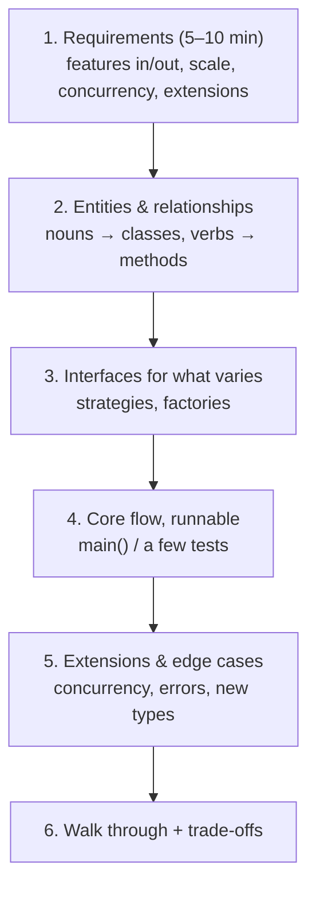
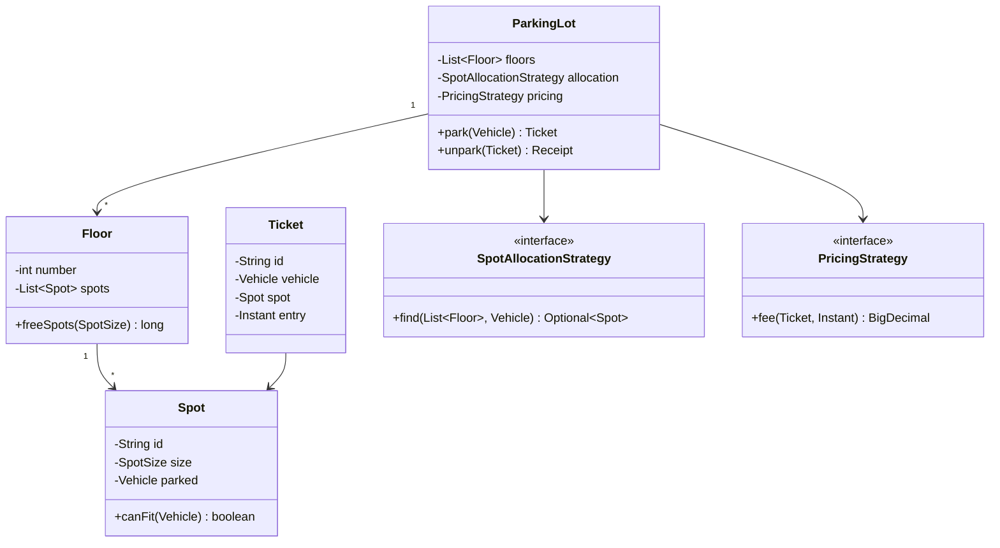
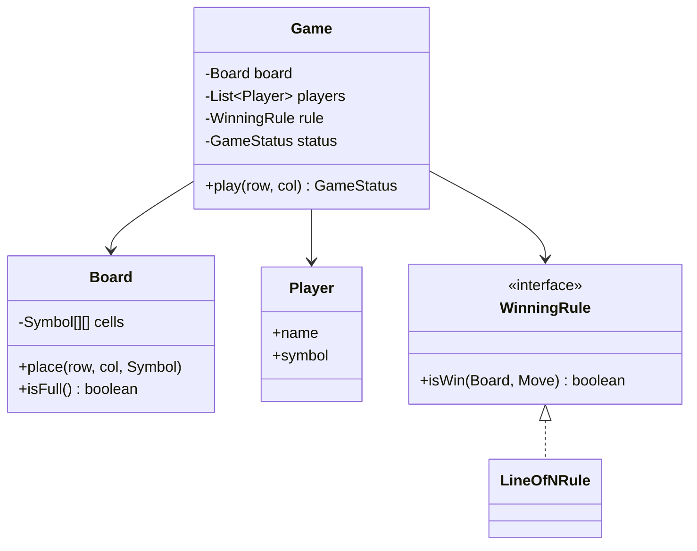
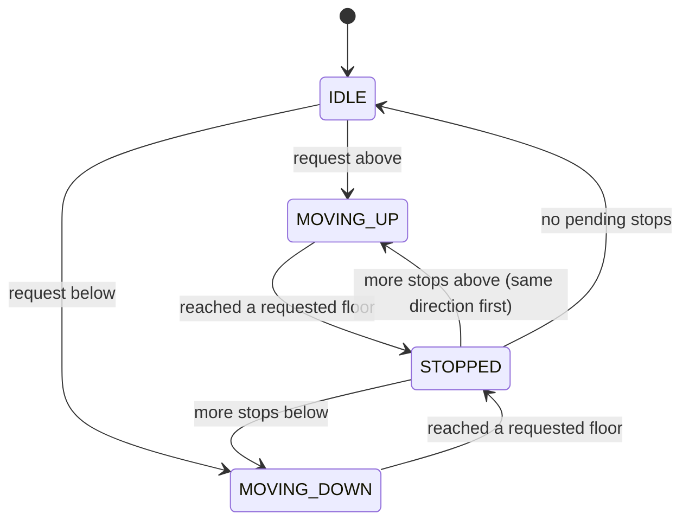
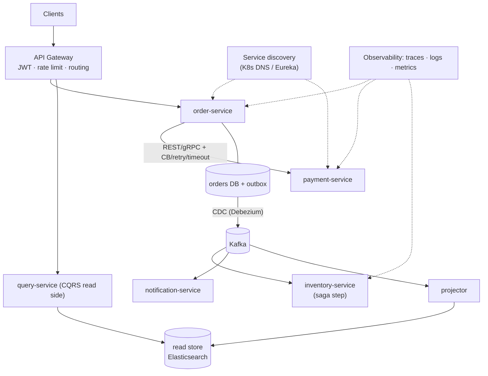
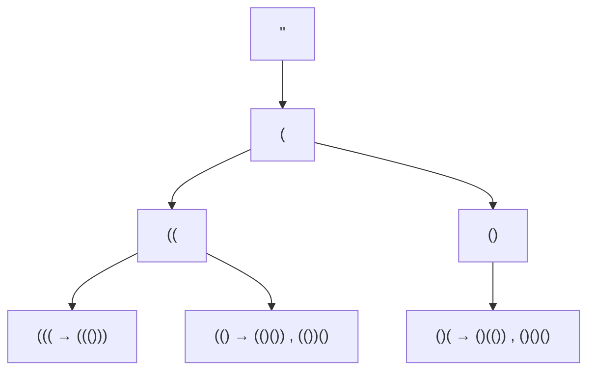

# Day 34 — Phase 4 Review: Machine Coding Practice

> **How to use these notes:** each section maps to one checklist item. For the designs, **try them yourself on paper first (30–45 min each)**, then compare with the reference solution. 🚀 marks senior-level details.

**Today's goal:** learn a repeatable approach for **machine coding / LLD rounds**, then apply it to three classics — **Parking Lot**, **Tic-Tac-Toe**, **Elevator System** — review your designs for SOLID and smells, and redraw the **microservices architecture** from Days 27–29. On the DSA side: **hard backtracking** — N-Queens, Word Search, Generate Parentheses, Palindrome Partitioning.

<!-- topic: d34_t1 -->
## 🧱 LLD — Machine Coding

<!-- subtopic: d34_t1_s1 -->
### 1. The machine coding approach

> **TL;DR:** Spend the first 5–10 minutes **clarifying requirements and scope**, then identify **entities, relationships and behaviours**, define **interfaces** for the parts that vary, write **working, runnable code** for the core flow first (with a small `main`/test), then extend. Interviewers grade: correct + runnable, clean OOP/SOLID, extensibility, naming, and how you communicate trade-offs.



| Phase | Questions to ask / things to do |
|---|---|
| Requirements | Which features are must-have? Single machine or concurrent users? In-memory OK? Payment needed? What will likely change? |
| Entities | Underline nouns (Vehicle, Spot, Floor, Ticket) and verbs (park, unpark, pay) |
| Design | Enums for fixed sets, interfaces for variations (`ParkingStrategy`, `PricingStrategy`), immutable value objects |
| Code | Small classes, single responsibility, no God class, validation + custom exceptions |
| Extensibility | Show where a new vehicle type / pricing rule plugs in **without editing existing classes** |
| Concurrency | Identify shared mutable state (spot allocation, seat booking) and protect it |

**SOLID as a checklist** (Day 10):

| Principle | In machine coding |
|---|---|
| **S**RP | `ParkingLot` doesn't compute fees; `FeeCalculator` does |
| **O**CP | New pricing rule = new `PricingStrategy` class |
| **L**SP | Every `Vehicle` subtype works wherever a `Vehicle` is expected |
| **I**SP | Separate `Payable` from `Printable` instead of one fat interface |
| **D**IP | `ParkingLot` depends on `SpotAllocationStrategy` interface, injected via constructor |

<!-- subtopic: d34_t1_s2 -->
### 2. Design a Parking Lot

> **Requirements (agreed):** multiple floors; spot sizes SMALL / MEDIUM / LARGE; vehicles BIKE / CAR / TRUCK fit spots of their size or larger; issue a ticket on entry; on exit compute a fee by duration and vehicle type; show free spots per floor; multiple entry gates run **concurrently**.



```java
public enum VehicleType { BIKE, CAR, TRUCK }
public enum SpotSize { SMALL, MEDIUM, LARGE }               // ordinal order = size order

public record Vehicle(String plate, VehicleType type) {
    SpotSize minSize() {
        return switch (type) { case BIKE -> SpotSize.SMALL; case CAR -> SpotSize.MEDIUM; case TRUCK -> SpotSize.LARGE; };
    }
}

public final class Spot {
    private final String id;
    private final SpotSize size;
    private Vehicle parked;                                  // guarded by the ParkingLot lock

    public Spot(String id, SpotSize size) { this.id = id; this.size = size; }
    boolean isFree() { return parked == null; }
    boolean canFit(Vehicle v) { return isFree() && size.compareTo(v.minSize()) >= 0; }
    void occupy(Vehicle v) { parked = v; }
    void release() { parked = null; }
    public String id() { return id; }
    public SpotSize size() { return size; }
}

public record Floor(int number, List<Spot> spots) {
    long freeSpots(SpotSize size) { return spots.stream().filter(s -> s.isFree() && s.size() == size).count(); }
}

public record Ticket(String id, Vehicle vehicle, Spot spot, Instant entry) { }
public record Receipt(Ticket ticket, Instant exit, BigDecimal fee) { }

public interface SpotAllocationStrategy { Optional<Spot> find(List<Floor> floors, Vehicle v); }
public interface PricingStrategy { BigDecimal fee(Ticket t, Instant exit); }

// Nearest floor, smallest spot that fits — keeps large spots for trucks
public class SmallestFitStrategy implements SpotAllocationStrategy {
    public Optional<Spot> find(List<Floor> floors, Vehicle v) {
        return floors.stream()
                .flatMap(f -> f.spots().stream())
                .filter(s -> s.canFit(v))
                .min(Comparator.comparing(Spot::size));
    }
}

public class HourlyPricing implements PricingStrategy {
    private final Map<VehicleType, BigDecimal> ratePerHour =
            Map.of(VehicleType.BIKE, new BigDecimal("10"), VehicleType.CAR, new BigDecimal("40"), VehicleType.TRUCK, new BigDecimal("80"));

    public BigDecimal fee(Ticket t, Instant exit) {
        long minutes = Math.max(1, Duration.between(t.entry(), exit).toMinutes());
        long hours = (minutes + 59) / 60;                    // round up started hours
        return ratePerHour.get(t.vehicle().type()).multiply(BigDecimal.valueOf(hours));
    }
}

public class ParkingLot {
    private final List<Floor> floors;
    private final SpotAllocationStrategy allocation;
    private final PricingStrategy pricing;
    private final Clock clock;
    private final Map<String, Ticket> active = new ConcurrentHashMap<>();
    private final ReentrantLock lock = new ReentrantLock();           // spot allocation must be atomic

    public ParkingLot(List<Floor> floors, SpotAllocationStrategy a, PricingStrategy p, Clock clock) {
        this.floors = floors; this.allocation = a; this.pricing = p; this.clock = clock;
    }

    public Ticket park(Vehicle v) {
        lock.lock();
        try {
            Spot spot = allocation.find(floors, v).orElseThrow(() -> new ParkingFullException(v.type()));
            spot.occupy(v);
            Ticket t = new Ticket(UUID.randomUUID().toString(), v, spot, clock.instant());
            active.put(t.id(), t);
            return t;
        } finally {
            lock.unlock();
        }
    }

    public Receipt unpark(String ticketId) {
        Ticket t = Optional.ofNullable(active.remove(ticketId)).orElseThrow(() -> new InvalidTicketException(ticketId));
        lock.lock();
        try { t.spot().release(); } finally { lock.unlock(); }
        Instant exit = clock.instant();
        return new Receipt(t, exit, pricing.fee(t, exit));
    }
}
```

Discussion points that score well:
- **Concurrency:** two gates must not get the same spot → allocation + occupy under one lock (or per-floor locks / `AtomicReference` CAS on each spot for more throughput).
- **Extensibility:** EV spots with chargers → new `SpotSize`/capability + strategy; weekend pricing → new `PricingStrategy` (OCP).
- **Injected `Clock`** makes fee calculation testable.
- Out of scope unless asked: payment providers (another strategy), display boards (Observer on spot changes), persistence.

<!-- subtopic: d34_t1_s3 -->
### 3. Design Tic-Tac-Toe

> **Requirements:** N × N board, 2 players (extensible to more), players alternate, detect win (row, column, diagonal of N) or draw, reject invalid moves; make the **winning rule extensible** (e.g., "K in a row" on a bigger board).



```java
public enum Symbol { X, O }
public enum GameStatus { IN_PROGRESS, WON, DRAW }
public record Player(String name, Symbol symbol) { }
public record Move(int row, int col, Symbol symbol) { }

public final class Board {
    private final Symbol[][] cells;
    private int filled;
    public Board(int n) { cells = new Symbol[n][n]; }

    public int size() { return cells.length; }
    public Symbol at(int r, int c) { return cells[r][c]; }

    void place(Move m) {
        if (m.row() < 0 || m.col() < 0 || m.row() >= size() || m.col() >= size())
            throw new InvalidMoveException("outside the board");
        if (cells[m.row()][m.col()] != null) throw new InvalidMoveException("cell taken");
        cells[m.row()][m.col()] = m.symbol();
        filled++;
    }
    boolean isFull() { return filled == size() * size(); }
}

public interface WinningRule { boolean isWin(Board b, Move last); }

// K in a row in any of 4 directions through the last move — O(K) per move, works for any N and K
public final class KInARowRule implements WinningRule {
    private static final int[][] DIRS = {{0, 1}, {1, 0}, {1, 1}, {1, -1}};
    private final int k;
    public KInARowRule(int k) { this.k = k; }

    public boolean isWin(Board b, Move m) {
        for (int[] d : DIRS) {
            int count = 1 + countFrom(b, m, d[0], d[1]) + countFrom(b, m, -d[0], -d[1]);
            if (count >= k) return true;
        }
        return false;
    }

    private int countFrom(Board b, Move m, int dr, int dc) {
        int r = m.row() + dr, c = m.col() + dc, n = 0;
        while (r >= 0 && c >= 0 && r < b.size() && c < b.size() && b.at(r, c) == m.symbol()) {
            n++; r += dr; c += dc;
        }
        return n;
    }
}

public final class Game {
    private final Board board;
    private final List<Player> players;
    private final WinningRule rule;
    private int turn;
    private GameStatus status = GameStatus.IN_PROGRESS;
    private Player winner;

    public Game(int n, List<Player> players, WinningRule rule) {
        this.board = new Board(n); this.players = List.copyOf(players); this.rule = rule;
    }

    public GameStatus play(int row, int col) {
        if (status != GameStatus.IN_PROGRESS) throw new IllegalStateException("game over");
        Player current = players.get(turn % players.size());
        Move move = new Move(row, col, current.symbol());
        board.place(move);
        if (rule.isWin(board, move)) { status = GameStatus.WON; winner = current; }
        else if (board.isFull()) status = GameStatus.DRAW;
        else turn++;
        return status;
    }
}
```

🚀 **O(1) win check for classic N-in-a-row:** keep counters `rows[r]`, `cols[c]`, `diag`, `antiDiag`, adding +1 for X and −1 for O; a win is when any counter reaches ±N (LC 348). Mention it as an optimisation, but the K-in-a-row rule is more extensible.

<!-- subtopic: d34_t1_s4 -->
### 4. Design an Elevator System

> **Requirements:** a building with F floors and E elevators; **hall calls** (floor + direction) and **car calls** (destination inside the elevator); a **dispatcher** assigns hall calls to elevators; each elevator serves requests efficiently (don't zig-zag); extensible scheduling.



```java
public enum Direction { UP, DOWN, IDLE }

public final class Elevator {
    private final int id;
    private int floor;
    private Direction direction = Direction.IDLE;
    private final TreeSet<Integer> upStops = new TreeSet<>();      // served ascending
    private final TreeSet<Integer> downStops = new TreeSet<>();    // served descending

    public Elevator(int id) { this.id = id; }

    synchronized void addStop(int target) {
        if (target > floor) upStops.add(target);
        else if (target < floor) downStops.add(target);
        if (direction == Direction.IDLE) direction = target > floor ? Direction.UP : Direction.DOWN;
    }

    // One tick of the simulation: move one floor, stop if requested (SCAN / "elevator algorithm")
    synchronized void step() {
        if (direction == Direction.UP) {
            if (upStops.isEmpty()) { direction = downStops.isEmpty() ? Direction.IDLE : Direction.DOWN; return; }
            floor++;
            if (upStops.remove(floor)) openDoors();
        } else if (direction == Direction.DOWN) {
            if (downStops.isEmpty()) { direction = upStops.isEmpty() ? Direction.IDLE : Direction.UP; return; }
            floor--;
            if (downStops.remove(floor)) openDoors();
        }
    }

    synchronized int floor() { return floor; }
    synchronized Direction direction() { return direction; }
    synchronized int pendingStops() { return upStops.size() + downStops.size(); }
    private void openDoors() { /* notify display, wait, close */ }
}

public interface DispatchStrategy { Elevator choose(List<Elevator> elevators, int floor, Direction dir); }

// Prefer an elevator already moving toward the caller in the same direction, else the nearest idle, else least busy
public final class NearestSuitableStrategy implements DispatchStrategy {
    public Elevator choose(List<Elevator> all, int floor, Direction dir) {
        return all.stream().min(Comparator.comparingInt(e -> cost(e, floor, dir))).orElseThrow();
    }

    private int cost(Elevator e, int floor, Direction dir) {
        int distance = Math.abs(e.floor() - floor);
        boolean onTheWay = (e.direction() == Direction.UP && dir == Direction.UP && e.floor() <= floor)
                        || (e.direction() == Direction.DOWN && dir == Direction.DOWN && e.floor() >= floor);
        if (onTheWay) return distance;
        if (e.direction() == Direction.IDLE) return distance + 1;
        return distance + 10 + e.pendingStops() * 2;         // busy and going away: penalise
    }
}

public final class ElevatorController {
    private final List<Elevator> elevators;
    private final DispatchStrategy dispatch;

    public ElevatorController(List<Elevator> elevators, DispatchStrategy dispatch) {
        this.elevators = elevators; this.dispatch = dispatch;
    }

    public void hallCall(int floor, Direction dir) { dispatch.choose(elevators, floor, dir).addStop(floor); }
    public void carCall(int elevatorId, int floor) { elevators.get(elevatorId).addStop(floor); }
    public void tick() { elevators.forEach(Elevator::step); }   // driven by a scheduler thread
}
```

| Scheduling algorithm | Idea | Trade-off |
|---|---|---|
| FCFS | Serve in arrival order | Zig-zags, long waits |
| SSTF (nearest first) | Closest stop next | Starvation of far floors |
| **SCAN / LOOK** (elevator algorithm) | Keep direction until no more stops ahead | Fair, efficient — the default choice |
| Destination dispatch | Passengers enter destination in the lobby; group by destination | Best for skyscrapers |

Extensions to mention: capacity/weight limits, express elevators serving certain floors (filter in strategy), maintenance mode (State pattern), emergency (fire) mode overriding all calls.

<!-- subtopic: d34_t1_s5 -->
### 5. Code review your designs

> **TL;DR:** Before saying "done", review your own code like a reviewer would: does each class have **one reason to change**? Can I add a new type **without editing** existing classes? Are there **God classes**, long `switch`es on type, leaky mutable state, missing validation, untestable time/randomness? Name the patterns you used and why.

| Smell | Symptom | Fix |
|---|---|---|
| God class | `ParkingLot` with 600 lines doing allocation, pricing, payments, printing | Extract strategies/services (SRP) |
| Switch on type everywhere | `if (type == TRUCK) … else if …` in several places | Polymorphism or a strategy map (OCP) |
| Primitive obsession | `String plate`, `double fee`, `long timestamp` everywhere | Value objects (`Money`, `Plate`), `BigDecimal`, `Instant` |
| Anemic + leaky model | Public setters, lists returned mutable | Encapsulate (`List.copyOf`), behaviour methods (`spot.occupy(v)`) |
| Hidden dependencies | `new HourlyPricing()` inside the class, `Instant.now()` calls | Constructor injection, `Clock` (DIP, testability) |
| Missing invariants | Two vehicles in one spot possible | Validate + exceptions + concurrency control |
| Over-engineering | 15 interfaces for a 2-hour exercise | Interfaces only where variation is likely |

**Patterns used today:** Strategy (allocation, pricing, winning rule, dispatch), State (elevator direction/mode), Factory (vehicle/spot creation), Observer (displays), Singleton (only if asked: one `ParkingLot` instance — via DI).

**Show it runs:** a short `main` or JUnit test per flow (park → unpark → fee; win/draw; hall call served) earns more than perfect UML without code.

<!-- subtopic: d34_t1_s6 -->
### 6. Review: draw the microservices architecture

> **TL;DR:** Be able to draw this from memory and narrate a request through it: client → **API gateway** (auth, rate limit) → services found via **discovery** → sync calls wrapped in **timeouts/retries/circuit breakers** → each service with **its own DB** → **outbox** → **Kafka** → consumers (**saga** steps, **CQRS** projections) → **observability** (traces, logs, metrics) everywhere.



Narrate "place an order": gateway validates the JWT and rate limit → order-service saves the order as `PENDING` + outbox event in one transaction → calls payment with a circuit breaker (fallback: keep `PENDING_PAYMENT`) → CDC publishes `OrderPlaced` → inventory reserves stock (or emits a failure that triggers compensation) → notification emails → the projector updates the read model the UI queries → every hop shares one trace id.

### 🎤 Interview Q&A — Machine coding

<details><summary>Q1. How do you start a machine coding round?</summary>

Clarify scope and must-have features, ask about concurrency and extensions, list entities and their responsibilities, agree on the core flow, then write runnable code for that flow before adding extras.

</details>

<details><summary>Q2. How do you keep a parking lot design open for new vehicle types and pricing?</summary>

Model vehicle type and spot size as data/enums with a fit rule, and put allocation and pricing behind strategy interfaces injected into the ParkingLot — new rules become new classes, not edits.

</details>

<details><summary>Q3. How would you prevent two gates from assigning the same spot?</summary>

Make "find a free spot and occupy it" atomic: a lock around the allocation, per-floor locks for more throughput, or a compare-and-set on each spot's state; in a distributed version, a DB row lock or unique constraint.

</details>

<details><summary>Q4. Which scheduling algorithm would you use for an elevator?</summary>

SCAN/LOOK: keep moving in the current direction while there are stops ahead, then reverse. It avoids zig-zagging and starvation; the dispatcher picks the elevator already heading toward the caller or the nearest idle one.

</details>

<!-- topic: d33_t2 -->
## 🧮 DSA — N-Queens & Hard Backtracking

Template from Day 24: **choose → explore → unchoose**, with **pruning** as early as possible. Today's problems prune with constraints (attacks, grid bounds, balance, palindromes).

<!-- subtopic: d33_t2_s1 -->
### 7. N-Queens (LeetCode 51 — Hard)

> **Problem:** place `n` queens on an `n × n` board so no two attack each other; return all boards. 🔗 [LeetCode 51](https://leetcode.com/problems/n-queens/)

Place **one queen per row**. A column is safe if no queen occupies that **column**, **diagonal** (`row − col` constant) or **anti-diagonal** (`row + col` constant). Track them in boolean arrays for O(1) checks.

```java
public List<List<String>> solveNQueens(int n) {
    List<List<String>> result = new ArrayList<>();
    char[][] board = new char[n][n];
    for (char[] row : board) Arrays.fill(row, '.');
    place(0, n, board, new boolean[n], new boolean[2 * n - 1], new boolean[2 * n - 1], result);
    return result;
}

private void place(int row, int n, char[][] board, boolean[] cols, boolean[] diag, boolean[] anti,
                   List<List<String>> result) {
    if (row == n) {
        List<String> snapshot = new ArrayList<>();
        for (char[] r : board) snapshot.add(new String(r));
        result.add(snapshot);
        return;
    }
    for (int c = 0; c < n; c++) {
        int d = row - c + n - 1, a = row + c;              // shift row-col into 0..2n-2
        if (cols[c] || diag[d] || anti[a]) continue;       // prune attacked squares
        cols[c] = diag[d] = anti[a] = true;  board[row][c] = 'Q';     // choose
        place(row + 1, n, board, cols, diag, anti, result);          // explore
        cols[c] = diag[d] = anti[a] = false; board[row][c] = '.';     // unchoose
    }
}   // O(n!) worst case
```

```
n = 4, one solution:
. Q . .
. . . Q
Q . . .
. . Q .
```

n = 4 → 2 solutions; n = 8 → 92. **N-Queens II (LC 52)** counts only — same code without building boards (or bitmasks for speed: `available = ~(cols | diag | anti) & ((1 << n) - 1)`).

<!-- subtopic: d33_t2_s2 -->
### 8. Word Search (LeetCode 79)

> **Problem:** does `word` exist in the grid as a path of horizontally/vertically adjacent cells, each used at most once? 🔗 [LeetCode 79](https://leetcode.com/problems/word-search/)

DFS from every cell matching the first letter; **mark the cell as visited in place** while exploring, restore it when backtracking.

```java
public boolean exist(char[][] board, String word) {
    for (int r = 0; r < board.length; r++)
        for (int c = 0; c < board[0].length; c++)
            if (dfs(board, word, 0, r, c)) return true;
    return false;
}

private boolean dfs(char[][] b, String w, int i, int r, int c) {
    if (i == w.length()) return true;
    if (r < 0 || c < 0 || r >= b.length || c >= b[0].length || b[r][c] != w.charAt(i)) return false;
    char saved = b[r][c];
    b[r][c] = '#';                                              // choose: mark visited
    boolean found = dfs(b, w, i + 1, r + 1, c) || dfs(b, w, i + 1, r - 1, c)
                 || dfs(b, w, i + 1, r, c + 1) || dfs(b, w, i + 1, r, c - 1);
    b[r][c] = saved;                                            // unchoose: restore
    return found;
}   // O(m·n·4^L)
```

Pruning tricks: return early if the word is longer than the grid; if the **last** letter is rarer than the first in the board, search the **reversed** word (fewer starting points); check that the board has enough of each letter.

**Word Search II (LC 212, Day 41):** many words at once → put them in a **Trie** (Day 30) and DFS once.

<!-- subtopic: d33_t2_s3 -->
### 9. Generate Parentheses (LeetCode 22)

> **Problem:** all combinations of `n` pairs of well-formed parentheses. 🔗 [LeetCode 22](https://leetcode.com/problems/generate-parentheses/)

Build left to right with two counters. Add `'('` if `open < n`; add `')'` only if `close < open` — this pruning guarantees every partial string is a valid prefix, so no final validity check is needed.

```java
public List<String> generateParenthesis(int n) {
    List<String> out = new ArrayList<>();
    build(new StringBuilder(), 0, 0, n, out);
    return out;
}

private void build(StringBuilder sb, int open, int close, int n, List<String> out) {
    if (sb.length() == 2 * n) { out.add(sb.toString()); return; }
    if (open < n) {
        sb.append('(');
        build(sb, open + 1, close, n, out);
        sb.deleteCharAt(sb.length() - 1);
    }
    if (close < open) {
        sb.append(')');
        build(sb, open, close + 1, n, out);
        sb.deleteCharAt(sb.length() - 1);
    }
}
```



n = 3 → `((()))`, `(()())`, `(())()`, `()(())`, `()()()` — the 3rd **Catalan number** (5). Count grows as Cₙ ≈ 4ⁿ / (n^1.5 √π).

<!-- subtopic: d33_t2_s4 -->
### 10. Palindrome Partitioning (LeetCode 131)

> **Problem:** partition `s` so every substring is a palindrome; return all partitions. 🔗 [LeetCode 131](https://leetcode.com/problems/palindrome-partitioning/)

At position `start`, try every end `i`: if `s[start..i]` is a palindrome, choose it and recurse from `i + 1`. Precompute a palindrome table so each check is O(1).

```java
public List<List<String>> partition(String s) {
    int n = s.length();
    boolean[][] pal = new boolean[n][n];                 // pal[i][j]: s[i..j] is a palindrome
    for (int i = n - 1; i >= 0; i--)
        for (int j = i; j < n; j++)
            pal[i][j] = s.charAt(i) == s.charAt(j) && (j - i < 2 || pal[i + 1][j - 1]);

    List<List<String>> out = new ArrayList<>();
    backtrack(s, 0, pal, new ArrayList<>(), out);
    return out;
}

private void backtrack(String s, int start, boolean[][] pal, List<String> path, List<List<String>> out) {
    if (start == s.length()) { out.add(new ArrayList<>(path)); return; }
    for (int end = start; end < s.length(); end++) {
        if (!pal[start][end]) continue;                  // prune non-palindromes
        path.add(s.substring(start, end + 1));
        backtrack(s, end + 1, pal, path, out);
        path.remove(path.size() - 1);
    }
}   // O(n · 2^n) worst case ("aaaa…")
```

`"aab"` → `[["a","a","b"], ["aa","b"]]`.

Related: **Palindrome Partitioning II (LC 132, Hard)** — the *minimum* number of cuts → DP (`cuts[i] = min(cuts[j-1] + 1)` over palindromes `s[j..i]`), not backtracking. The pattern again: **all solutions → backtracking; best/count → DP**.

---

## 📝 Day 34 Revision Cheat Sheet

| Topic | Remember this |
|---|---|
| Approach | Requirements → entities → interfaces for variation → runnable core → extensions → trade-offs |
| SOLID check | SRP (no God class), OCP (strategies), LSP, ISP, DIP (inject strategies + Clock) |
| Parking lot | Floor/Spot/Ticket/Vehicle; SpotAllocationStrategy + PricingStrategy; atomic allocation |
| Tic-tac-toe | Board, Player, Game, WinningRule (K in a row through last move); O(1) counters variant |
| Elevator | Controller + DispatchStrategy; per-elevator up/down TreeSets; SCAN/LOOK; state machine |
| Code review | God class, type switches, primitive obsession, hidden deps, missing invariants, over-engineering |
| Architecture | Gateway → services (discovery, resilience) → DB + outbox → Kafka → consumers/projections → observability |
| N-Queens | Row by row; cols + diag (r−c) + anti-diag (r+c) sets |
| Word search | DFS with in-place marking + restore |
| Parentheses | open < n → '('; close < open → ')'; Catalan count |
| Palindrome partition | Precompute pal[i][j]; backtrack over end positions |

### ⚡ Rapid-fire self-test

1. First thing to do in a machine coding round? → **Clarify requirements and scope**
2. Pattern for interchangeable parking fee rules? → **Strategy**
3. Why inject a Clock? → **Deterministic, testable time-based logic**
4. Elevator scheduling that avoids zig-zagging? → **SCAN/LOOK (elevator algorithm)**
5. Name for a class that does everything? → **God class**
6. N-Queens: what's constant along a diagonal? → **row − col (anti-diagonal: row + col)**
7. Number of 8-queens solutions? → **92**
8. How does Word Search mark visited cells cheaply? → **Overwrite the cell (e.g. '#') and restore after**
9. When may you add ')' in Generate Parentheses? → **When close < open**
10. Minimum palindrome cuts: backtracking or DP? → **DP**
