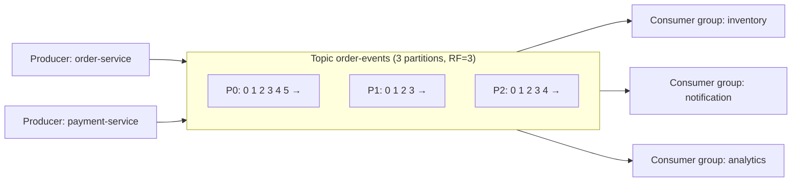
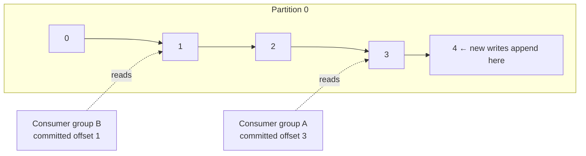
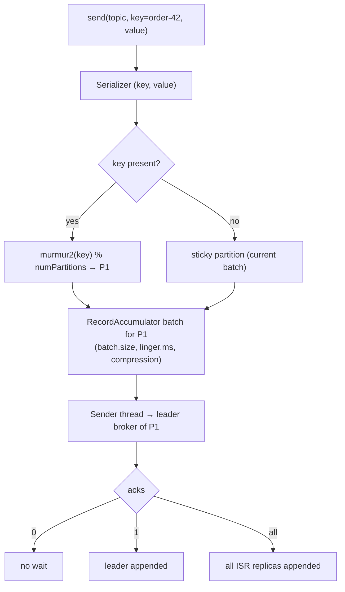
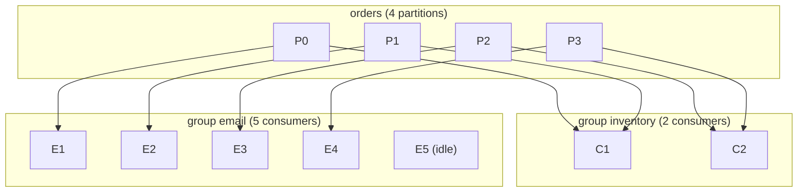
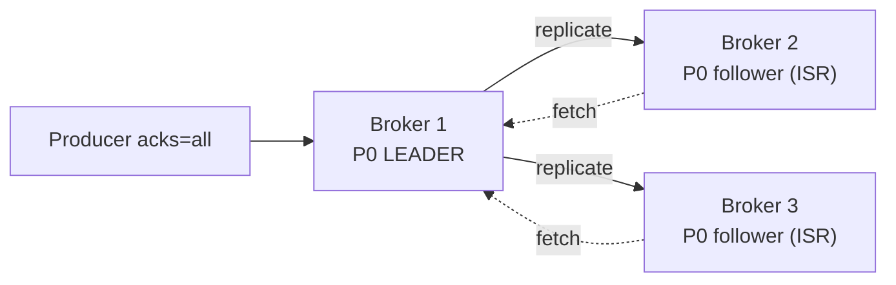
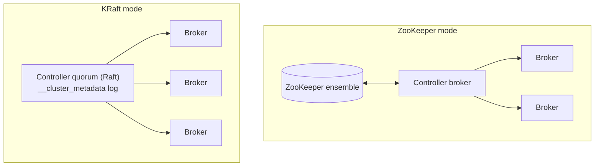
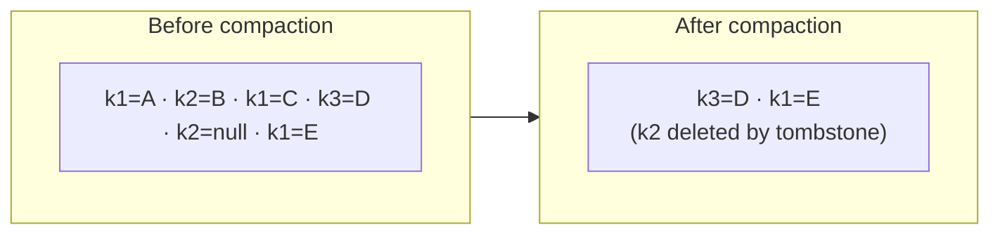
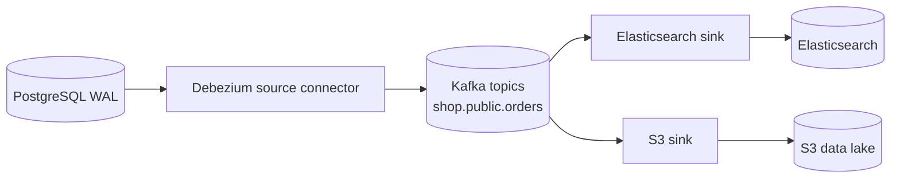

# Day 35 — Kafka Core: Topics, Partitions, Producers & Consumers

> **How to use these notes:** each section maps to one checklist item. Run the code, study the diagrams, then test yourself with the collapsible questions. 🚀 marks senior-level details.

**Today's goal:** understand Kafka from the storage model up: **topics, partitions and offsets** (an append-only log), how **producers** pick partitions and what `acks` means, how **consumer groups** share partitions, **brokers, replication and ISR**, **KRaft** replacing ZooKeeper, **log compaction**, and **Kafka Connect**. Then use it from Spring Boot: `@KafkaListener`, `KafkaTemplate` (sync and async) and `@KafkaHandler` for polymorphic messages. Phase 5 (Days 35–42) is all about Kafka — the most asked-about middleware in backend interviews.



Kafka in one sentence: a **distributed, replicated, partitioned commit log** — producers append records, consumers read them at their own pace and position, and records stay for a retention period regardless of being read.

<!-- topic: d35_t1 -->
## 📨 Kafka — Fundamentals

<!-- subtopic: d35_t1_s1 -->
### 1. Topics, partitions, offsets — the append-only log

> **TL;DR:** A **topic** is a named stream of records, split into **partitions**. Each partition is an **ordered, immutable, append-only log**; every record gets a sequential **offset** within its partition. Ordering is guaranteed **only within a partition**. Records are kept by **retention** (time/size) — reading doesn't delete them, so many consumers can read (and re-read) independently.



| Concept | Meaning |
|---|---|
| Record | key (optional), value, headers, timestamp |
| Topic | Logical stream, e.g. `order-events` |
| Partition | Unit of parallelism, ordering and storage; lives on brokers |
| Offset | Position of a record in a partition (per partition, not global) |
| Segment | Partition files on disk (`.log` + indexes), rolled by size/time |
| Retention | `retention.ms` (default 7 days) / `retention.bytes` — then old segments are deleted |
| Consumer offset | Each group's committed position, stored in the internal `__consumer_offsets` topic |

**Why partitions?** They spread a topic across brokers (storage and throughput scale horizontally) and they're the unit of consumer parallelism. Rules of thumb: more partitions = more parallelism, but more open files, longer failover and rebalances; you can **increase** partitions later but **never decrease**, and increasing **changes the key → partition mapping** (breaks per-key ordering for existing keys).

```bash
kafka-topics.sh --bootstrap-server localhost:9092 --create --topic order-events \
  --partitions 6 --replication-factor 3 --config retention.ms=604800000
kafka-topics.sh --bootstrap-server localhost:9092 --describe --topic order-events
kafka-console-consumer.sh --bootstrap-server localhost:9092 --topic order-events --from-beginning \
  --property print.key=true --property print.offset=true
```

Why Kafka is fast: **sequential disk I/O**, the OS **page cache**, **zero-copy** (`sendfile`) from disk to socket, **batching** and **compression** of record batches.

<!-- subtopic: d35_t1_s2 -->
### 2. Producer — partitioning strategies and acks

> **TL;DR:** The producer decides the partition: **with a key** → `hash(key) % partitions` (same key → same partition → **ordered per key**); **without a key** → the **sticky partitioner** fills a batch for one partition, then switches (older clients used round-robin). `acks` controls durability: **0** = fire and forget, **1** = leader wrote it, **all** = all in-sync replicas wrote it (safest, the default since Kafka 3.0).



| acks | Durability | Latency | Possible data loss |
|---|---|---|---|
| `0` | None | Lowest | Yes — even if the broker never got it |
| `1` | Leader only | Low | Yes — leader dies before followers copy |
| `all` (`-1`) | All in-sync replicas | Higher | No, with `min.insync.replicas ≥ 2` and RF ≥ 3 |

Important producer settings:

| Setting | Purpose |
|---|---|
| `enable.idempotence=true` (default in 3.x) | Broker de-duplicates retries (producer id + sequence numbers) → no duplicates, ordering kept |
| `retries`, `delivery.timeout.ms` | Retry transient errors up to the total timeout (default 2 min) |
| `max.in.flight.requests.per.connection` | ≤ 5 keeps ordering with idempotence |
| `batch.size`, `linger.ms` | Bigger batches / short wait (5–20 ms) → higher throughput |
| `compression.type` | `lz4`/`zstd`/`snappy` — less network and disk |
| `partitioner.class` | Custom partitioning (e.g., by tenant) |

⚠️ **Hot partitions:** one very popular key (a celebrity user, one big tenant) overloads a single partition and its consumer. Mitigate by key salting (`key + "-" + n`, losing strict order) or splitting traffic.

<!-- subtopic: d35_t1_s3 -->
### 3. Consumer groups — each partition to one consumer per group

> **TL;DR:** Consumers with the same `group.id` **share** the topic's partitions: each partition is assigned to **exactly one consumer in the group**, so the group processes in parallel while keeping per-partition order. Different groups each get **all** records (pub/sub). Max useful consumers in a group = **number of partitions** — extra consumers sit idle.



The consumer loop (plain Java client):

```java
Properties p = new Properties();
p.put(ConsumerConfig.BOOTSTRAP_SERVERS_CONFIG, "localhost:9092");
p.put(ConsumerConfig.GROUP_ID_CONFIG, "inventory");
p.put(ConsumerConfig.KEY_DESERIALIZER_CLASS_CONFIG, StringDeserializer.class);
p.put(ConsumerConfig.VALUE_DESERIALIZER_CLASS_CONFIG, StringDeserializer.class);
p.put(ConsumerConfig.AUTO_OFFSET_RESET_CONFIG, "earliest");   // where to start when the group has no offset
p.put(ConsumerConfig.ENABLE_AUTO_COMMIT_CONFIG, false);        // commit after processing (Day 36)

try (KafkaConsumer<String, String> consumer = new KafkaConsumer<>(p)) {
    consumer.subscribe(List.of("order-events"));
    while (running) {
        ConsumerRecords<String, String> records = consumer.poll(Duration.ofMillis(500));
        for (ConsumerRecord<String, String> r : records) {
            process(r.key(), r.value());                     // partition r.partition(), offset r.offset()
        }
        consumer.commitSync();                               // at-least-once
    }
}
```

| Setting | Meaning |
|---|---|
| `group.id` | Which group (shared offsets, partition sharing) |
| `auto.offset.reset` | `earliest` / `latest` when no committed offset exists |
| `max.poll.records` | Records per poll (default 500) |
| `max.poll.interval.ms` | Max time between polls (default 5 min) before the consumer is considered stuck → rebalance |
| `session.timeout.ms` / `heartbeat.interval.ms` | Liveness via background heartbeats |
| `partition.assignment.strategy` | Range, RoundRobin, Sticky, **CooperativeSticky** (incremental rebalances) |

**Rebalancing** (Day 37/38): when consumers join/leave/crash, the group coordinator reassigns partitions. Scale out by adding consumers up to the partition count; beyond that, add partitions.

<!-- subtopic: d35_t1_s4 -->
### 4. Brokers, leader/follower replicas, ISR, min.insync.replicas

> **TL;DR:** A Kafka **cluster** has several **brokers**. Each partition has **one leader** (all reads and writes go to it by default) and **followers** that replicate it. The **ISR (in-sync replicas)** is the set of replicas caught up with the leader. With `acks=all`, a write succeeds only when **all ISR members** have it, and `min.insync.replicas` sets how many must be in the ISR for writes to be accepted at all.



| Term | Meaning |
|---|---|
| Replication factor (RF) | Copies per partition (3 is standard in production) |
| Leader | Handles produce/consume for the partition |
| Follower | Fetches from the leader to stay in sync |
| ISR | Replicas within `replica.lag.time.max.ms` (30 s) of the leader |
| High watermark | Highest offset replicated to all ISR — consumers only see up to here |
| `min.insync.replicas` | Minimum ISR size to accept `acks=all` writes (e.g., 2) |
| `unclean.leader.election.enable` | `false` (default): never elect an out-of-sync replica → no data loss, possible unavailability |
| Controller | Broker(s) managing leadership, partition assignment, metadata (KRaft quorum) |

**The classic production setting: RF = 3, `min.insync.replicas = 2`, `acks = all`.** One broker can fail and writes continue with no data loss; if two fail, producers get `NotEnoughReplicasException` (availability sacrificed for durability).

When a leader dies, the controller elects a new leader **from the ISR**; clients refresh metadata and continue. Leaders are spread across brokers to balance load (preferred leader election). 🚀 Since Kafka 2.4 consumers can **fetch from the closest follower** (rack-aware) to cut cross-AZ costs.

<!-- subtopic: d35_t1_s5 -->
### 5. ZooKeeper (legacy) vs KRaft (Kafka 3.x+)

> **TL;DR:** Kafka used **ZooKeeper** to store cluster metadata and elect the controller — a second distributed system to run and tune. **KRaft** (Kafka Raft) moves metadata into Kafka itself: a quorum of **controller** nodes keeps an internal **metadata log** replicated with Raft. KRaft became production-ready in 3.3, ZooKeeper was deprecated in 3.5 and **removed in Kafka 4.0**.



| | ZooKeeper mode | KRaft mode |
|---|---|---|
| Metadata store | ZooKeeper znodes | Internal Raft-replicated metadata topic |
| Systems to operate | Kafka + ZooKeeper | Kafka only |
| Controller failover | Slow (reload all metadata) | Fast (standby controllers already have the log) |
| Scale | ~hundreds of thousands of partitions | Millions of partitions |
| Status | Removed in 4.0 | Default |

Roles in KRaft: `process.roles=broker`, `controller`, or `broker,controller` (combined mode, fine for dev — the compose file in Day 30 uses it). Production: 3 or 5 dedicated controllers.

<!-- subtopic: d35_t1_s6 -->
### 6. Log compaction — keep the latest value per key

> **TL;DR:** With `cleanup.policy=compact`, Kafka keeps **at least the latest record for every key** and removes older ones in the background. A record with a **null value (tombstone)** marks the key for deletion (removed after `delete.retention.ms`). Compacted topics act like a **changelog / table**: replaying them rebuilds the current state.



| Use case | Why compaction |
|---|---|
| `__consumer_offsets` | Only the latest offset per group/partition matters |
| Kafka Streams state store changelogs (Day 37) | Restore state quickly |
| CDC topics (latest row per primary key) | Bootstrap a new consumer with current data |
| Config / reference data distribution | "Current price per SKU", "current user profile" |

```bash
kafka-topics.sh --create --topic customer-profiles --partitions 6 --replication-factor 3 \
  --config cleanup.policy=compact --config min.cleanable.dirty.ratio=0.1 --config delete.retention.ms=86400000
```

Notes: the **active segment** is never compacted (recent duplicates remain visible); offsets stay the same (gaps appear); `cleanup.policy=compact,delete` combines both (compact, but also drop data older than retention).

<!-- subtopic: d35_t1_s7 -->
### 7. Kafka Connect — source and sink connectors

> **TL;DR:** **Kafka Connect** is a framework for moving data between Kafka and other systems **without writing code**: **source connectors** import (DB via CDC, files, S3, MQ) and **sink connectors** export (Elasticsearch, S3, JDBC, Snowflake). Configured with JSON over a REST API, scalable in distributed mode, with converters and single message transforms (SMTs).



```json
{
  "name": "orders-cdc",
  "config": {
    "connector.class": "io.debezium.connector.postgresql.PostgresConnector",
    "database.hostname": "postgres",
    "database.port": "5432",
    "database.user": "debezium",
    "database.password": "${file:/secrets/db.properties:password}",
    "database.dbname": "shop",
    "topic.prefix": "shop",
    "table.include.list": "public.outbox",
    "transforms": "outbox",
    "transforms.outbox.type": "io.debezium.transforms.outbox.EventRouter"
  }
}
```

```bash
curl -X POST -H "Content-Type: application/json" --data @orders-cdc.json http://connect:8083/connectors
curl http://connect:8083/connectors/orders-cdc/status
```

| Piece | Role |
|---|---|
| Worker | JVM process running connectors (standalone or distributed cluster) |
| Connector / tasks | Config + units of parallel work |
| Converter | Serialization (JSON, Avro + Schema Registry) |
| SMT | Small per-record transforms (rename fields, route topics, Debezium outbox router) |
| Offsets | Connect tracks source positions in Kafka topics → resumable |

The **outbox pattern** (Day 27) is commonly implemented with Debezium's `EventRouter` SMT: rows inserted into `outbox` become events on per-aggregate topics, keyed by aggregate id.

### 🎤 Interview Q&A — Kafka fundamentals

<details><summary>Q1. How does Kafka guarantee ordering?</summary>

Only within a partition. Records with the same key go to the same partition (hash of the key), so per-key order is preserved; there is no global order across partitions.

</details>

<details><summary>Q2. What do acks=0, 1 and all mean?</summary>

0: the producer doesn't wait for any acknowledgment. 1: the leader appended the record. all: every in-sync replica appended it — combined with min.insync.replicas ≥ 2 and RF 3 it prevents data loss when one broker dies.

</details>

<details><summary>Q3. You have 6 partitions and 10 consumers in one group. What happens?</summary>

Only 6 consumers get partitions; the other 4 stay idle as standbys. To use more consumers you need more partitions.

</details>

<details><summary>Q4. What is the ISR?</summary>

The set of replicas fully caught up with the partition leader. acks=all waits for all of them, and only ISR members can be elected leader when unclean leader election is disabled.

</details>

<details><summary>Q5. What is log compaction used for?</summary>

Keeping only the latest value per key (tombstones delete keys) so a topic acts as a changelog of current state — consumer offsets, Kafka Streams changelogs, CDC tables, reference data.

</details>

<!-- topic: d35_t2 -->
## 🌿 Kafka — Spring Boot Integration

```yaml
spring:
  kafka:
    bootstrap-servers: localhost:9092
    producer:
      key-serializer: org.apache.kafka.common.serialization.StringSerializer
      value-serializer: org.springframework.kafka.support.serializer.JsonSerializer
      acks: all
      properties:
        enable.idempotence: true
        linger.ms: 10
    consumer:
      group-id: inventory
      auto-offset-reset: earliest
      key-deserializer: org.apache.kafka.common.serialization.StringDeserializer
      value-deserializer: org.springframework.kafka.support.serializer.ErrorHandlingDeserializer
      properties:
        spring.deserializer.value.delegate.class: org.springframework.kafka.support.serializer.JsonDeserializer
        spring.json.trusted.packages: "com.shop.events"
    listener:
      ack-mode: record          # commit after each record is processed (Day 36)
```

`ErrorHandlingDeserializer` wraps the JSON deserializer so a **malformed message** becomes an error the error handler can route to a DLT, instead of crashing the consumer in a loop (poison pill, Day 38).

<!-- subtopic: d35_t2_s1 -->
### 8. @KafkaListener — topics, groupId, containerFactory, concurrency, batch

> **TL;DR:** Annotate a method to consume a topic. Spring creates a **listener container** that runs the poll loop, deserializes, invokes your method, handles errors and commits offsets. `concurrency = "3"` starts 3 consumers (threads) in the group — useful up to the partition count. Batch mode receives a `List` per poll.

```java
@Component
public class InventoryListener {

    @KafkaListener(topics = "order-events", groupId = "inventory", concurrency = "3")
    public void onOrder(OrderPlaced event,
                        @Header(KafkaHeaders.RECEIVED_KEY) String key,
                        @Header(KafkaHeaders.RECEIVED_PARTITION) int partition,
                        @Header(KafkaHeaders.OFFSET) long offset) {
        inventory.reserve(event.orderId(), event.lines());
    }

    // Full record access
    @KafkaListener(topics = "payment-events", groupId = "inventory")
    public void onPayment(ConsumerRecord<String, PaymentEvent> record) { ... }

    // Batch listener: one call per poll (needs a batch-enabled container factory)
    @KafkaListener(topics = "clicks", groupId = "analytics", containerFactory = "batchFactory")
    public void onClicks(List<ClickEvent> clicks) {
        analyticsRepository.saveAll(clicks.stream().map(Click::from).toList());   // bulk insert
    }
}

@Configuration
class KafkaConfig {
    @Bean
    ConcurrentKafkaListenerContainerFactory<String, Object> batchFactory(ConsumerFactory<String, Object> cf) {
        var factory = new ConcurrentKafkaListenerContainerFactory<String, Object>();
        factory.setConsumerFactory(cf);
        factory.setBatchListener(true);
        factory.setConcurrency(2);
        return factory;
    }
}
```

| Attribute | Meaning |
|---|---|
| `topics` / `topicPattern` / `topicPartitions` | What to consume (explicit partitions skip group management) |
| `groupId` | Overrides `spring.kafka.consumer.group-id` |
| `concurrency` | Number of consumer threads (≤ partitions to be useful) |
| `containerFactory` | Which factory (batch mode, error handler, filters) |
| `id` / `autoStartup` | Control the container via `KafkaListenerEndpointRegistry` (pause/resume) |

⚠️ Each consumer thread processes its partitions **sequentially**. Slow processing → lag; keep handlers fast, make them **idempotent** (at-least-once delivery), and don't exceed `max.poll.interval.ms` or you'll trigger rebalances.

<!-- subtopic: d35_t2_s2 -->
### 9. KafkaTemplate.send() — synchronous and asynchronous

> **TL;DR:** `kafkaTemplate.send(topic, key, value)` is **asynchronous** and returns a `CompletableFuture<SendResult>` (Spring Kafka 3.x). Attach callbacks for success/failure, or call `.get(timeout)` to **block** until the broker acknowledges (simpler, slower — use when the caller must know the write is durable).

```java
@Service
public class OrderEventsPublisher {
    private static final Logger log = LoggerFactory.getLogger(OrderEventsPublisher.class);
    private final KafkaTemplate<String, Object> kafka;

    public OrderEventsPublisher(KafkaTemplate<String, Object> kafka) { this.kafka = kafka; }

    // Async (default): don't block the request thread
    public void publish(OrderPlaced event) {
        kafka.send("order-events", event.orderId(), event)          // key = orderId → per-order ordering
             .whenComplete((result, ex) -> {
                 if (ex != null) {
                     log.error("publish failed orderId={}", event.orderId(), ex);   // alert / retry / outbox
                 } else {
                     RecordMetadata md = result.getRecordMetadata();
                     log.debug("published to {}-{}@{}", md.topic(), md.partition(), md.offset());
                 }
             });
    }

    // Sync: wait for the ack (with a timeout!)
    public void publishAndWait(OrderPlaced event) throws Exception {
        kafka.send("order-events", event.orderId(), event).get(5, TimeUnit.SECONDS);
    }

    // With headers via a ProducerRecord / Message
    public void publishWithHeaders(OrderPlaced event, String correlationId) {
        ProducerRecord<String, Object> record = new ProducerRecord<>("order-events", event.orderId(), event);
        record.headers().add("correlationId", correlationId.getBytes(StandardCharsets.UTF_8));
        kafka.send(record);
    }
}
```

| | Async + callback | Sync `.get(timeout)` |
|---|---|---|
| Throughput | High (batching works) | Low (one at a time) |
| Error handling | In the callback (log, retry, alert) | Exception in the caller |
| Use | Most event publishing | When the API response depends on the event being stored |

⚠️ Publishing inside `@Transactional` **is not atomic with the DB** — use the outbox (Day 27) or Kafka transactions (Day 37). `ListenableFuture` was replaced by `CompletableFuture` in Spring Kafka 3.0.

<!-- subtopic: d35_t2_s3 -->
### 10. @KafkaHandler — polymorphic messages in one listener

> **TL;DR:** Put `@KafkaListener` on the **class** and `@KafkaHandler` on methods; Spring dispatches each record to the method whose **parameter type** matches the deserialized payload. Useful when one topic carries several event types (all events of an aggregate on one topic to keep per-key ordering). `isDefault = true` catches unknown types.

```java
@Component
@KafkaListener(topics = "order-events", groupId = "order-projection")
public class OrderEventsHandler {

    @KafkaHandler
    public void on(OrderPlaced e) { projection.create(e); }

    @KafkaHandler
    public void on(OrderPaid e) { projection.markPaid(e.orderId(), e.paidAt()); }

    @KafkaHandler
    public void on(OrderCancelled e) { projection.cancel(e.orderId(), e.reason()); }

    @KafkaHandler(isDefault = true)
    public void unknown(Object event) { log.warn("Ignoring unknown event type {}", event.getClass()); }
}
```

For this to work, the deserializer must know the concrete type: `JsonSerializer` adds a `__TypeId__` **header** by default, and `JsonDeserializer` uses it (with `spring.json.trusted.packages` set). Across services with different class names, map types explicitly:

```yaml
spring.kafka.producer.properties.spring.json.type.mapping: placed:com.shop.events.OrderPlaced,paid:com.shop.events.OrderPaid
spring.kafka.consumer.properties.spring.json.type.mapping: placed:com.inventory.events.OrderPlaced,paid:com.inventory.events.OrderPaid
```

| One topic, many event types | Topic per event type |
|---|---|
| ✅ Per-aggregate ordering (placed before paid before cancelled) | ❌ No ordering across topics |
| Consumers ignore types they don't need | Consumers subscribe to exactly what they need |
| Needs type info (header/schema) | Simpler schemas |

🚀 With **Avro + Schema Registry** (Day 36), `TopicRecordNameStrategy` allows multiple schemas per topic in a governed way.

---

## 📝 Day 35 Revision Cheat Sheet

| Topic | Remember this |
|---|---|
| Log model | Topic → partitions → ordered immutable log; offsets per partition; retention, not delete-on-read |
| Partitions | Unit of parallelism + ordering; can only increase (changes key mapping) |
| Producer partitioning | Key → hash % partitions; no key → sticky partitioner |
| acks | 0 none, 1 leader, all ISR; + idempotence; RF 3 + min.insync 2 |
| Consumer groups | Partition → exactly one consumer per group; max useful consumers = partitions; groups independent |
| Offsets | Stored in __consumer_offsets; auto.offset.reset earliest/latest |
| Replication | Leader + followers; ISR; high watermark; unclean election off |
| KRaft | Metadata in a Raft quorum inside Kafka; ZooKeeper removed in 4.0 |
| Compaction | Latest value per key; tombstone = null value; changelogs |
| Connect | Source/sink connectors, no code; Debezium CDC; SMTs; outbox EventRouter |
| @KafkaListener | Container runs poll loop; concurrency ≤ partitions; batch factory; idempotent handlers |
| KafkaTemplate | send() → CompletableFuture; callback or .get(timeout); key for ordering |
| @KafkaHandler | Class-level listener, dispatch by payload type; __TypeId__ header / type mapping |

### ⚡ Rapid-fire self-test

1. Is order guaranteed across partitions? → **No — only within a partition**
2. Partition for a keyed record? → **hash(key) % number of partitions**
3. Default acks in Kafka 3.x producers? → **all**
4. Max useful consumers in one group? → **The number of partitions**
5. Standard durable config? → **RF=3, min.insync.replicas=2, acks=all**
6. What replaced ZooKeeper? → **KRaft**
7. Record that deletes a key in a compacted topic? → **Tombstone (null value)**
8. Tool to stream DB changes into Kafka without code? → **Kafka Connect + Debezium**
9. Return type of KafkaTemplate.send() in Spring Kafka 3? → **`CompletableFuture<SendResult>`**
10. Annotation that dispatches by payload type in one listener class? → **@KafkaHandler**
