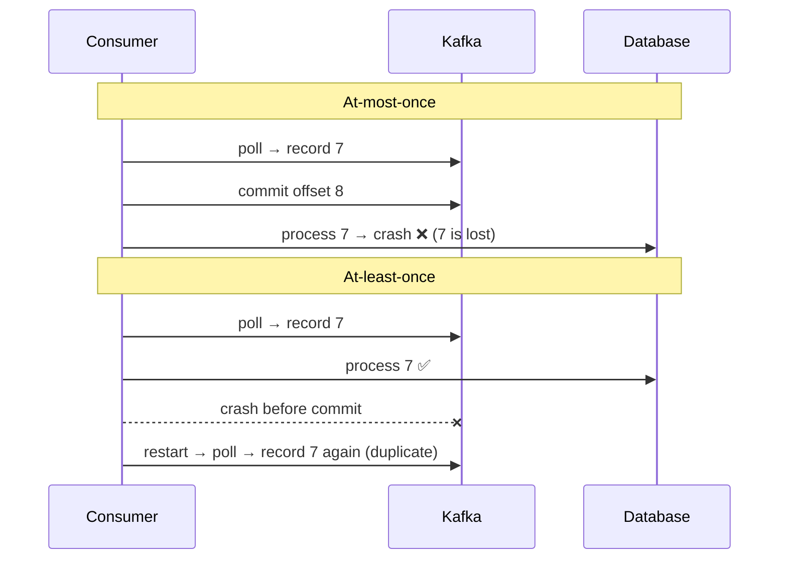
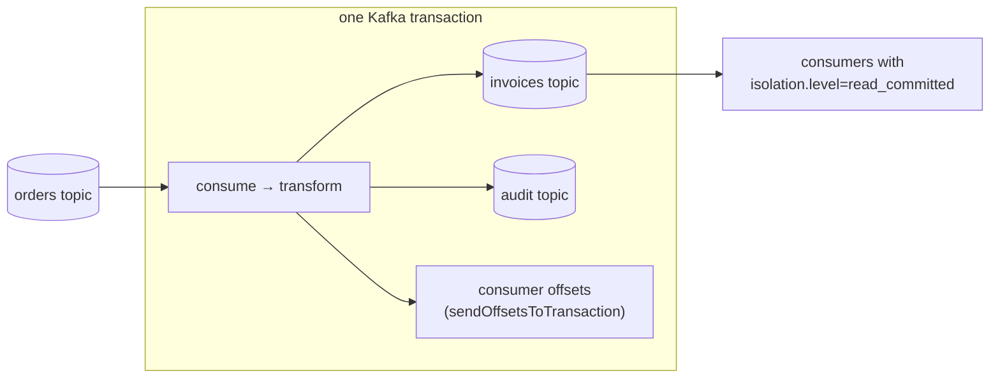
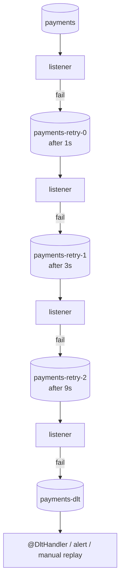
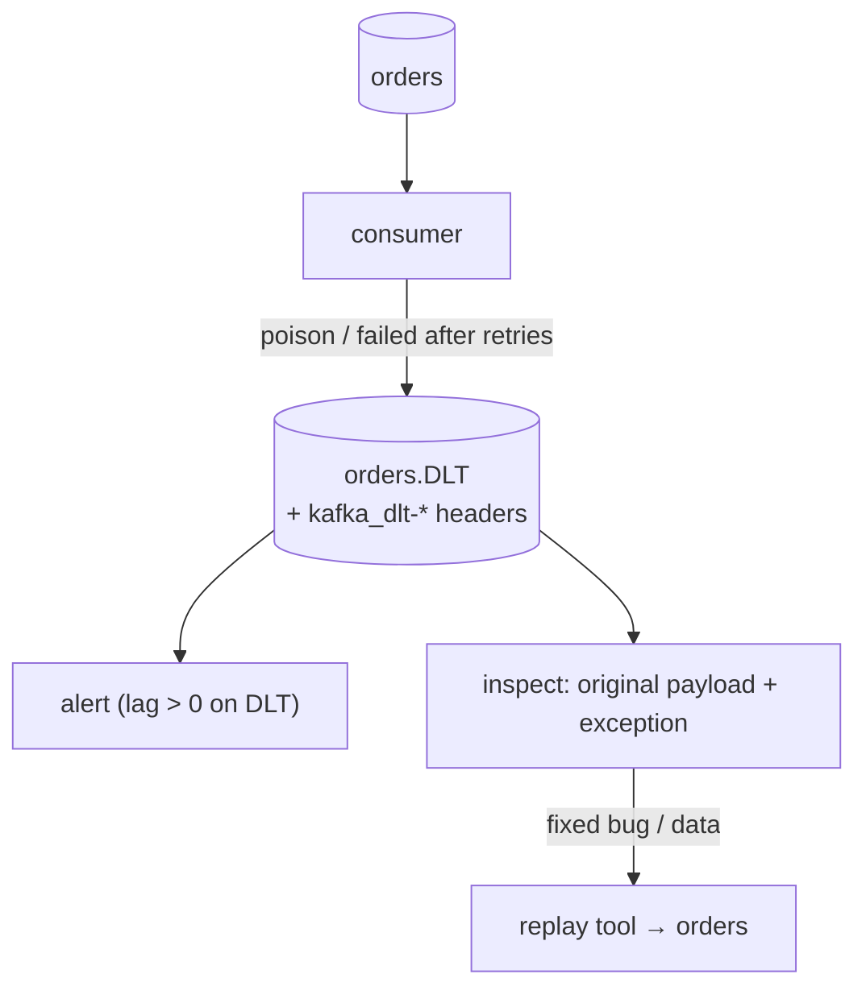
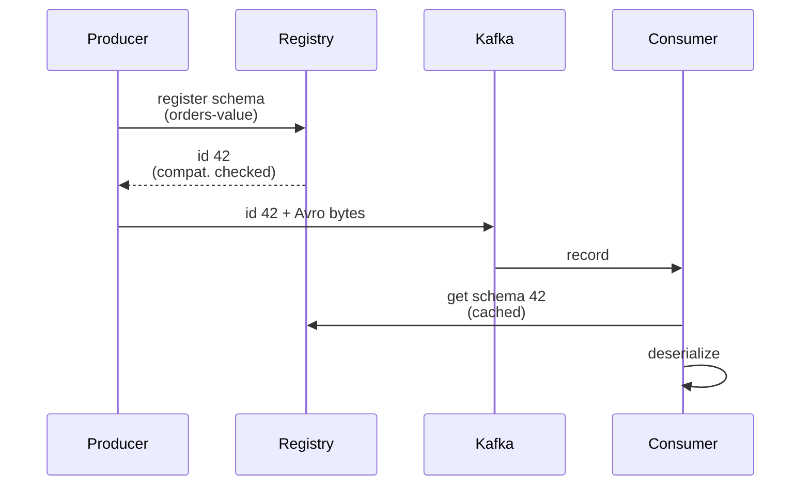
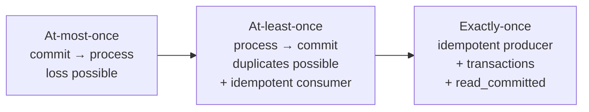
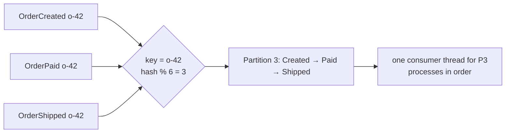

# Day 36 — Kafka: Error Handling, DLT & Exactly-Once Semantics

> **How to use these notes:** each section maps to one checklist item. Run the code, study the diagrams, then test yourself with the collapsible questions. 🚀 marks senior-level details.

**Today's goal:** the questions interviewers love: **delivery guarantees** (at-most-once, at-least-once, exactly-once) and how each is configured, **exactly-once semantics** (idempotent producer + transactions + `read_committed`), **error handling** in Spring Kafka (`DefaultErrorHandler`, `DeadLetterPublishingRecoverer`, `@RetryableTopic`), **Dead Letter Topics**, **offset commit** strategies, **Schema Registry with Avro**, and **testing with Embedded Kafka**. Then three interview answers rehearsed end-to-end: guarantees, consumer lag, ordering.

<!-- topic: d36_t1 -->
## 📨 Kafka — Delivery Guarantees & Error Handling

<!-- subtopic: d36_t1_s1 -->
### 1. Delivery guarantees — at-most-once, at-least-once, exactly-once

> **TL;DR:** The guarantee is decided by **when the consumer commits its offset relative to processing** (and by producer retries). **Commit before processing → at-most-once** (may lose). **Process, then commit → at-least-once** (may duplicate — the usual choice, with **idempotent consumers**). **Exactly-once** needs idempotent producers + transactions (Kafka → Kafka), or at-least-once + **idempotent processing** for external side effects.



| Guarantee | Producer side | Consumer side | Risk | Use |
|---|---|---|---|---|
| **At-most-once** | `acks=0`/no retries | Commit **before** processing | Data loss | Metrics/logs where loss is OK |
| **At-least-once** | `acks=all`, retries | Process **then** commit | Duplicates | Default for business events + idempotent consumers |
| **Exactly-once** | Idempotent + transactional producer | `isolation.level=read_committed`, offsets committed in the same transaction | Complexity, latency | Kafka → Kafka pipelines, Kafka Streams |

"Exactly-once" in Kafka means **effectively once for Kafka writes**: a read-process-write cycle where the output records and the consumer offsets are committed atomically. It does **not** extend to arbitrary external systems (sending an email, calling a payment API) — for those you need idempotency on the side-effect (dedupe keys).

<!-- subtopic: d36_t1_s2 -->
### 2. Exactly-once — idempotent producer + transactions + read_committed

> **TL;DR:** Three pieces: (1) the **idempotent producer** (`enable.idempotence=true`) removes duplicates caused by producer retries using a producer id + per-partition sequence numbers; (2) **transactions** (`transactional.id`) make writes to several partitions **and** the consumer's offset commit atomic; (3) consumers with `isolation.level=read_committed` only see committed transactional records.



```java
// Plain client: read-process-write with exactly-once
producer.initTransactions();
while (running) {
    ConsumerRecords<String, Order> records = consumer.poll(Duration.ofMillis(500));
    if (records.isEmpty()) continue;
    producer.beginTransaction();
    try {
        for (ConsumerRecord<String, Order> r : records) {
            producer.send(new ProducerRecord<>("invoices", r.key(), Invoice.from(r.value())));
        }
        producer.sendOffsetsToTransaction(nextOffsets(records), consumer.groupMetadata());  // offsets inside the TX
        producer.commitTransaction();
    } catch (ProducerFencedException e) {
        producer.close();                     // another instance with the same transactional.id took over
        throw e;
    } catch (KafkaException e) {
        producer.abortTransaction();          // outputs discarded, offsets not committed → records re-read
    }
}
```

```yaml
# Spring Boot
spring:
  kafka:
    producer:
      transaction-id-prefix: invoice-tx-      # enables transactions on KafkaTemplate + listener containers
    consumer:
      isolation-level: read_committed
      enable-auto-commit: false
```

With a transaction prefix configured, a `@KafkaListener` that sends via `KafkaTemplate` runs **inside a Kafka transaction started by the container**, and the consumed offset is committed in it automatically.

| Setting | Role |
|---|---|
| `enable.idempotence=true` | No duplicates from producer retries (default since 3.0) |
| `transactional.id` | Stable per producer instance; fences "zombie" instances after restarts |
| `isolation.level=read_committed` | Hide aborted and in-flight transactional records |
| `processing.guarantee=exactly_once_v2` | The Kafka Streams switch (Day 37) |

⚠️ A DB write inside the listener is **not** part of the Kafka transaction. For Kafka → DB, use at-least-once + an idempotent upsert / processed-messages table (Day 38).

<!-- subtopic: d36_t1_s3 -->
### 3. Error handling — DefaultErrorHandler, DeadLetterPublishingRecoverer, @RetryableTopic

> **TL;DR:** When a listener throws, Spring Kafka's **`DefaultErrorHandler`** (which replaced `SeekToCurrentErrorHandler` in 2.8) **seeks back** so the record is redelivered, retries with a **BackOff**, and after the last attempt hands the record to a **recoverer** — usually `DeadLetterPublishingRecoverer`, which publishes it to `<topic>.DLT`. This retries **blocking** (the partition waits). **`@RetryableTopic`** does **non-blocking** retries via separate retry topics with delays, so other records keep flowing.

#### Blocking retries + DLT

```java
@Configuration
class KafkaErrorConfig {
    @Bean
    DefaultErrorHandler errorHandler(KafkaTemplate<Object, Object> template) {
        var recoverer = new DeadLetterPublishingRecoverer(template,
                (record, ex) -> new TopicPartition(record.topic() + ".DLT", record.partition()));
        var backOff = new ExponentialBackOffWithMaxRetries(3);       // 3 retries after the first attempt
        backOff.setInitialInterval(500);
        backOff.setMultiplier(2.0);                                  // 0.5s, 1s, 2s
        var handler = new DefaultErrorHandler(recoverer, backOff);
        handler.addNotRetryableExceptions(ValidationException.class, DeserializationException.class);
        return handler;                                              // Boot wires a single bean into the container factory
    }
}
```

#### Non-blocking retries with @RetryableTopic

```java
@Component
public class PaymentListener {

    @RetryableTopic(
            attempts = "4",                                          // 1 try + 3 retries
            backoff = @Backoff(delay = 1000, multiplier = 3.0),     // 1s, 3s, 9s
            exclude = { ValidationException.class },                 // straight to DLT
            topicSuffixingStrategy = TopicSuffixingStrategy.SUFFIX_WITH_INDEX_VALUE)
    @KafkaListener(topics = "payments", groupId = "payment-processor")
    public void process(PaymentRequest req) {
        gateway.charge(req);                                         // throws on transient failure
    }

    @DltHandler
    public void dlt(PaymentRequest req, @Header(KafkaHeaders.EXCEPTION_MESSAGE) String error) {
        alerts.raise("Payment failed permanently: " + req.id() + " — " + error);
    }
}
```



| | Blocking (`DefaultErrorHandler`) | Non-blocking (`@RetryableTopic`) |
|---|---|---|
| Partition progress | **Stops** until retries finish | Continues; failed record moves to a retry topic |
| Ordering | Preserved | **Broken** for retried records |
| Long delays | Bad (blocks; risk of `max.poll.interval.ms`) | Fine (minutes are OK) |
| Infrastructure | Just the DLT | Retry topics + DLT |
| Use | Short transient blips, ordering matters | External outages, ordering not required |

<!-- subtopic: d36_t1_s4 -->
### 4. Dead Letter Topic (DLT)

> **TL;DR:** After retries are exhausted (or for non-retryable errors), the failed record goes to a **dead letter topic** (`<topic>.DLT` by default) with **headers describing the failure** (original topic/partition/offset, exception class, message, stack trace). The main consumer keeps going; the DLT is **monitored, alerted on, investigated and replayed** after fixing the cause.



DLT headers added by `DeadLetterPublishingRecoverer`:

| Header | Content |
|---|---|
| `kafka_dlt-original-topic` / `-partition` / `-offset` | Where it came from |
| `kafka_dlt-exception-fqcn` | Exception class |
| `kafka_dlt-exception-message` / `-stacktrace` | Details |
| `kafka_dlt-original-timestamp` | Original record time |

Good DLT practice:
- **Alert** when anything arrives (DLT messages are bugs or bad data, not noise).
- Keep **long retention** on DLTs (weeks).
- Build a **replay** path (CLI/endpoint that republishes selected records to the main topic after the fix).
- Separate **non-retryable** errors (validation, deserialization) to go to the DLT immediately — retrying them is pointless.
- The DLT has the **same partition** number by default → make sure it has at least as many partitions.

<!-- subtopic: d36_t1_s5 -->
### 5. Offset management — auto-commit vs manual commit

> **TL;DR:** With **`enable.auto.commit=true`** the client commits the latest polled offsets every 5 s in the background — simple, but it can commit records **you haven't processed yet** (crash → loss) or not yet commit processed ones (crash → duplicates). **Manual commit** after processing gives **at-least-once** control. In Spring Kafka, auto-commit is off by default and the container commits per **`AckMode`**.

| AckMode (Spring Kafka) | When offsets are committed |
|---|---|
| `BATCH` (default) | After all records from one `poll()` are processed |
| `RECORD` | After each record |
| `TIME` / `COUNT` / `COUNT_TIME` | Periodically / every N records |
| `MANUAL` | When you call `ack.acknowledge()` (committed at the end of the batch) |
| `MANUAL_IMMEDIATE` | Immediately when you call `acknowledge()` |

```java
// spring.kafka.listener.ack-mode: manual_immediate
@KafkaListener(topics = "orders", groupId = "billing")
public void on(OrderPlaced e, Acknowledgment ack) {
    billing.createInvoice(e);       // idempotent (unique constraint on orderId)
    ack.acknowledge();               // commit only after success
}
```

| Commit style | Pros | Cons |
|---|---|---|
| Auto-commit (plain client) | Zero code | Loss or duplicates around crashes; no control |
| `commitSync()` | Simple, reliable | Blocks; lower throughput |
| `commitAsync()` + final `commitSync()` on shutdown | Fast | Async commits can fail silently/out of order |
| Container AckMode BATCH/RECORD | Best default in Spring | At-least-once → idempotent handlers |

**Rebalance safety:** commit processed offsets in `onPartitionsRevoked` (Spring's container does this) so the next owner doesn't redo work. **Resetting offsets** for replay: `kafka-consumer-groups.sh --reset-offsets --to-datetime …` (group must be stopped).

<!-- subtopic: d36_t1_s6 -->
### 6. Schema Registry — Avro and schema evolution

> **TL;DR:** With JSON, producers can change the payload and silently break consumers. **Confluent Schema Registry** stores versioned schemas (**Avro**, Protobuf, JSON Schema). The producer's serializer registers/looks up the schema and writes only a **schema id + compact binary payload**; the consumer fetches the schema by id. The registry enforces **compatibility rules** so changes can't break readers.



```json
{
  "type": "record",
  "name": "OrderPlaced",
  "namespace": "com.shop.events",
  "fields": [
    { "name": "orderId", "type": "string" },
    { "name": "total", "type": { "type": "bytes", "logicalType": "decimal", "precision": 12, "scale": 2 } },
    { "name": "currency", "type": "string", "default": "EUR" },
    { "name": "couponCode", "type": ["null", "string"], "default": null }
  ]
}
```

| Compatibility | Allowed changes | Upgrade order |
|---|---|---|
| **BACKWARD** (default) | New schema can read old data: add fields **with defaults**, delete fields | Upgrade **consumers first** |
| FORWARD | Old schema can read new data: add fields, delete fields **with defaults** | Upgrade **producers first** |
| FULL | Both | Any order |
| `*_TRANSITIVE` | Checked against all previous versions, not just the last | — |

Never: rename a field (it's delete + add), change a type incompatibly, or reuse a removed field's meaning. Spring config: `value-serializer: io.confluent.kafka.serializers.KafkaAvroSerializer`, `properties.schema.registry.url: http://schema-registry:8081`, and `specific.avro.reader: true` on the consumer to get generated classes.

<!-- subtopic: d36_t1_s7 -->
### 7. Embedded Kafka for testing — @EmbeddedKafka

> **TL;DR:** `spring-kafka-test` provides **`@EmbeddedKafka`**: an in-memory Kafka broker (KRaft) started for the test, so you can test producers, listeners, error handling and DLT routing without Docker. For production parity (exact versions, Schema Registry), use **Testcontainers Kafka** (Day 24).

```java
@SpringBootTest(properties = "spring.kafka.bootstrap-servers=${spring.embedded.kafka.brokers}")
@EmbeddedKafka(partitions = 1, topics = {"orders", "orders.DLT"})
class OrderListenerIT {

    @Autowired KafkaTemplate<String, Object> kafka;
    @MockitoBean BillingService billing;
    @Autowired EmbeddedKafkaBroker broker;

    @Test
    void validOrder_isProcessed() {
        kafka.send("orders", "o-1", new OrderPlaced("o-1", new BigDecimal("20.00")));

        await().atMost(Duration.ofSeconds(10)).untilAsserted(() ->
                verify(billing).createInvoice(argThat(e -> e.orderId().equals("o-1"))));
    }

    @Test
    void failingOrder_endsUpInDlt() {
        doThrow(new ValidationException("bad total")).when(billing).createInvoice(any());
        kafka.send("orders", "o-2", new OrderPlaced("o-2", new BigDecimal("-1")));

        Map<String, Object> props = KafkaTestUtils.consumerProps("dlt-test", "false", broker);
        try (Consumer<String, String> consumer = new DefaultKafkaConsumerFactory<>(props,
                new StringDeserializer(), new StringDeserializer()).createConsumer()) {
            broker.consumeFromAnEmbeddedTopic(consumer, "orders.DLT");
            ConsumerRecord<String, String> dead = KafkaTestUtils.getSingleRecord(consumer, "orders.DLT");
            assertThat(dead.key()).isEqualTo("o-2");
        }
    }
}
```

```java
// Testcontainers alternative (Boot 3.1+)
@Container @ServiceConnection
static KafkaContainer kafka = new KafkaContainer(DockerImageName.parse("apache/kafka:3.8.0"));
```

| | `@EmbeddedKafka` | Testcontainers Kafka |
|---|---|---|
| Needs Docker | No | Yes |
| Speed | Fast | Slower first start |
| Fidelity | Same broker code, in-process | Real image/version, plus Schema Registry/Connect containers |
| Use | Listener/error-handling unit-ish tests | Full integration tests |

Tips: listeners are **asynchronous** → assert with Awaitility, not `Thread.sleep`; use unique topic/group names per test to avoid cross-talk; set `auto-offset-reset=earliest` in tests.

<!-- topic: d36_t2 -->
## 🎤 Kafka — Interview Q&A

<!-- subtopic: d36_t2_s1 -->
### 8. Q: Explain at-most-once vs at-least-once vs exactly-once — with trade-offs

> **Model answer (≈ 90 s):** "It depends on where offsets are committed relative to processing, plus producer retries. **At-most-once**: commit first, then process — a crash loses the message; fine for telemetry. **At-least-once**: process, then commit, with `acks=all` and retries on the producer — a crash causes redelivery, so we make consumers **idempotent** (dedupe table or upserts). That's our default for business events. **Exactly-once**: idempotent producer + Kafka transactions + `read_committed`, committing output and offsets atomically — it holds for Kafka-to-Kafka pipelines like Kafka Streams; it costs latency and complexity, and it doesn't cover external side effects such as sending emails or calling payment APIs, which still need idempotency keys."



<details><summary>Follow-up: How do you make a consumer idempotent?</summary>

Store a processed-message id (event id or business key) in the same DB transaction as the side effect, with a unique constraint; skip the message if the insert conflicts. Or design writes as natural upserts ("set status = PAID where id = ?") that are safe to repeat.

</details>

<!-- subtopic: d36_t2_s2 -->
### 9. Q: What is consumer lag and how do you monitor it?

> **Model answer:** "**Lag** = for each partition, the **log-end offset** (latest written) minus the group's **committed offset** — how far behind the consumers are. Growing lag means consumers can't keep up (slow processing, too few consumers, a stuck partition, rebalance storms) and data is getting stale. I monitor it with `kafka-consumer-groups.sh --describe`, **Burrow** (lag evaluation with status, not just thresholds), or the Prometheus **kafka-exporter / JMX exporter** with Grafana alerts — alerting on lag that keeps **growing** or on **time lag** (how old the oldest unprocessed record is)."

```bash
kafka-consumer-groups.sh --bootstrap-server localhost:9092 --describe --group inventory

GROUP      TOPIC         PARTITION  CURRENT-OFFSET  LOG-END-OFFSET  LAG    CONSUMER-ID
inventory  order-events  0          10520           10524           4      consumer-1-…
inventory  order-events  1          9876            15990           6114   consumer-2-…   ← hot/stuck partition
inventory  order-events  2          11002           11002           0      consumer-3-…
```

| Cause of lag | Fix |
|---|---|
| Slow handler (DB, HTTP calls) | Batch writes, async I/O, cache, optimise queries |
| Too few consumers | Add consumers / `concurrency` up to partition count |
| Too few partitions | Increase partitions (mind key ordering) |
| One hot partition | Better key distribution |
| Frequent rebalances | Tune `max.poll.interval.ms`/`max.poll.records`, static membership, cooperative rebalancing |
| Poison message retried forever | DLT + non-retryable exceptions |

Metrics to name: `records-lag-max` (consumer JMX), `kafka_consumergroup_lag` (kafka-exporter); with KEDA you can **autoscale consumers on lag** in Kubernetes.

<!-- subtopic: d36_t2_s3 -->
### 10. Q: How do you guarantee message ordering?

> **Model answer:** "Kafka orders records **within a partition only**. So: (1) give all messages that must stay ordered the **same key** (e.g., `orderId`) so they land in the same partition; (2) on the producer, keep ordering under retries — use the **idempotent producer** (default; ordering preserved with up to 5 in-flight requests) or, without idempotence, `max.in.flight.requests.per.connection=1`; (3) on the consumer, process each partition **sequentially** — don't fan records of one key out to parallel threads, and avoid non-blocking retry topics for ordered flows. Increasing partitions later remaps keys, so plan partition counts up front."



| Threat to ordering | Mitigation |
|---|---|
| Producer retries reorder batches | `enable.idempotence=true` (or `max.in.flight=1`) |
| Different keys for related events | Key by aggregate id |
| Increasing partition count | Plan ahead; migrate with a new topic if needed |
| Parallel processing inside the consumer | Per-key queues/threads (e.g., Confluent Parallel Consumer with key ordering) |
| Non-blocking retries (`@RetryableTopic`) | Use blocking retries for ordered topics |
| Multiple producers for the same key | Single writer per aggregate (or version numbers to reject stale events) |

---

## 📝 Day 36 Revision Cheat Sheet

| Topic | Remember this |
|---|---|
| Guarantees | Commit before processing = at-most-once; after = at-least-once; EOS = idempotent producer + transactions + read_committed |
| EOS scope | Kafka → Kafka (offsets in the TX); external side effects need idempotency keys |
| Transactions | transactional.id / transaction-id-prefix; sendOffsetsToTransaction; fencing zombies |
| Error handling | DefaultErrorHandler (seek + BackOff) → DeadLetterPublishingRecoverer → topic.DLT |
| @RetryableTopic | Non-blocking retry topics with backoff + @DltHandler; breaks ordering |
| DLT | Failure headers, alert, long retention, replay tool; non-retryable → DLT immediately |
| Offsets | Auto-commit risky; Spring AckMode BATCH/RECORD/MANUAL(_IMMEDIATE); idempotent handlers |
| Schema Registry | Schema id + binary Avro; BACKWARD default (add with defaults, upgrade consumers first) |
| Testing | @EmbeddedKafka (no Docker) or Testcontainers; Awaitility; unique topics/groups |
| Lag | Log-end − committed per partition; kafka-consumer-groups, Burrow, exporter; alert on growth/time |
| Ordering | Same key → same partition; idempotent producer; sequential per partition; no retry topics |

### ⚡ Rapid-fire self-test

1. Commit offsets before processing gives which guarantee? → **At-most-once**
2. Default practical guarantee for business events? → **At-least-once with idempotent consumers**
3. Consumer setting that hides aborted transactional records? → **isolation.level=read_committed**
4. Spring Kafka error handler that replaced SeekToCurrentErrorHandler? → **DefaultErrorHandler**
5. Recoverer that sends failed records to a DLT? → **DeadLetterPublishingRecoverer**
6. Annotation for non-blocking retries with delays? → **@RetryableTopic**
7. Default DLT name for topic `orders`? → **orders.DLT**
8. Schema Registry default compatibility? → **BACKWARD**
9. Consumer lag formula? → **Log-end offset − committed offset (per partition)**
10. Producer setting that keeps order under retries? → **enable.idempotence=true**
