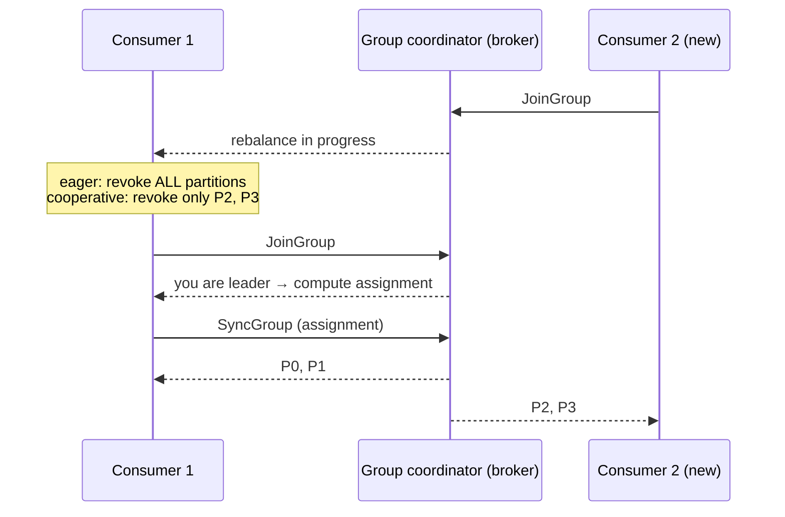
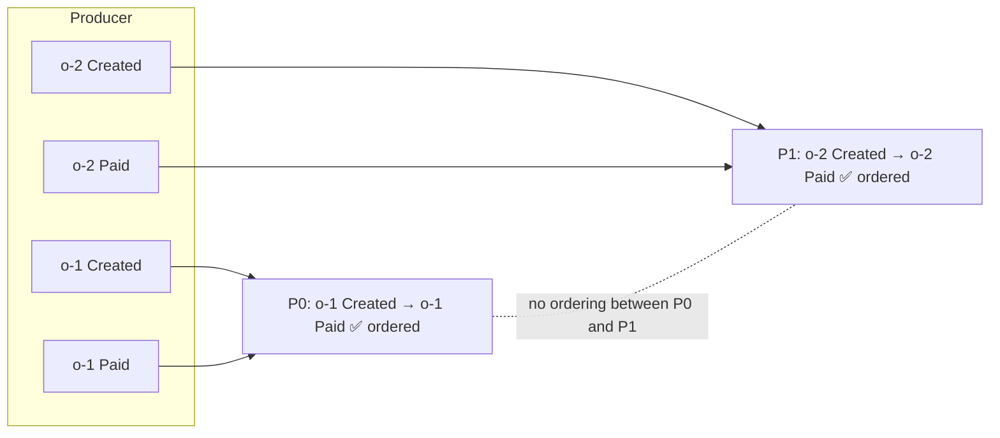
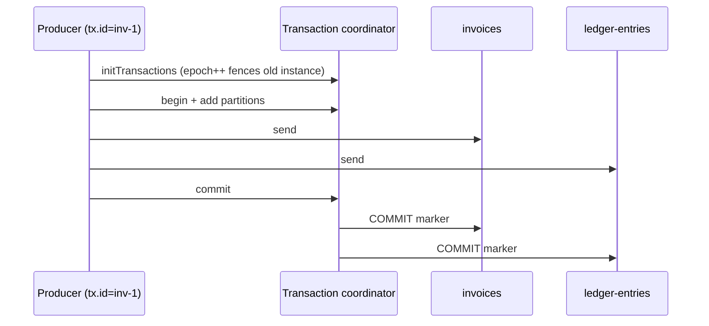
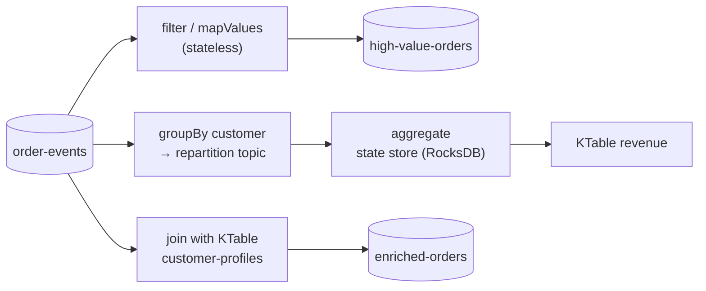
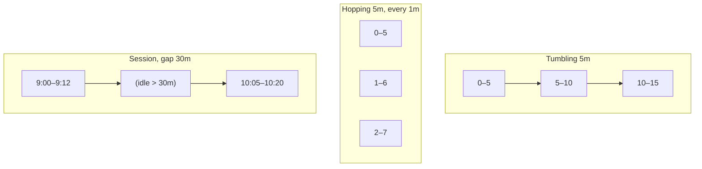
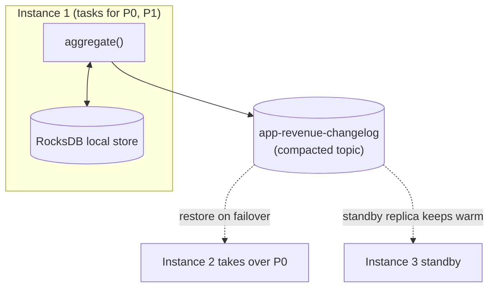
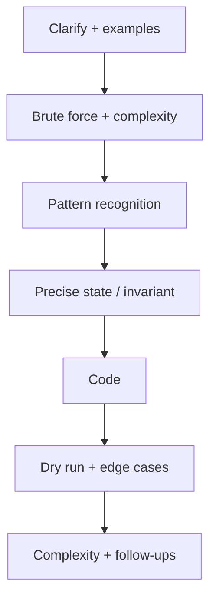

# Day 37 — Kafka Advanced: Streams, Transactions & Rebalancing

> **How to use these notes:** each section maps to one checklist item. Run the code, study the diagrams, then test yourself with the collapsible questions. 🚀 marks senior-level details.

**Today's goal:** the deeper Kafka topics: **consumer rebalancing** (eager vs cooperative, static membership in Kubernetes), **ordering** rules, **Kafka transactions** API, **Kafka Streams** (stateless and stateful processing, joins), **windowing**, **state stores** with RocksDB and changelog topics, and **AWS MSK**. On the DSA side: **hard DP** — Regular Expression Matching, Longest Valid Parentheses, Burst Balloons (interval DP) and a timed drill.

<!-- topic: d37_t1 -->
## 📨 Kafka — Advanced Topics

<!-- subtopic: d37_t1_s1 -->
### 1. Partition rebalancing — and static membership in Kubernetes

> **TL;DR:** A **rebalance** reassigns partitions among a group's consumers when membership or subscriptions change: a consumer **joins**, **leaves**, **crashes** (missed heartbeats → `session.timeout.ms`), **is too slow** (`max.poll.interval.ms` exceeded), or partitions are added. **Eager** rebalancing stops all consumers ("stop the world"); **cooperative** (incremental) rebalancing moves only the partitions that need to move. **Static membership** (`group.instance.id`) lets a restarting pod rejoin **without** a rebalance — ideal for rolling deployments.



| Trigger | Example | Prevention / tuning |
|---|---|---|
| Consumer joins | Scale-out, pod restart | Static membership for restarts |
| Consumer leaves cleanly | Shutdown | Static membership: no immediate rebalance |
| Missed heartbeats | Crash, network, long GC | `session.timeout.ms` (default 45 s) |
| Slow processing | Handler takes longer than `max.poll.interval.ms` (5 min) | Smaller `max.poll.records`, faster handlers, async hand-off |
| Topic/partition change | New partitions, regex subscriptions | Plan capacity |

```yaml
spring:
  kafka:
    consumer:
      properties:
        partition.assignment.strategy: org.apache.kafka.clients.consumer.CooperativeStickyAssignor
        group.instance.id: ${HOSTNAME}         # StatefulSet pod name → stable identity
        session.timeout.ms: 60000              # time allowed to come back before reassigning
        max.poll.records: 200
```

| Assignor | Behaviour |
|---|---|
| Range / RoundRobin | Eager; recompute everything |
| Sticky | Eager, but tries to keep previous assignments |
| **CooperativeSticky** | Incremental — only moved partitions pause (default list in Kafka 3.x includes it) |
| New protocol (KIP-848, Kafka 4.0) | Server-side assignment, no global sync barrier |

⚠️ During a rebalance, uncommitted work may be redone → **commit in `onPartitionsRevoked`** and keep consumers idempotent. A pod that keeps exceeding `max.poll.interval.ms` causes a **rebalance storm**.

<!-- subtopic: d37_t1_s2 -->
### 2. Message ordering — within a partition, not across

> **TL;DR:** Order is guaranteed **per partition** only. Messages that must be processed in order need the **same key** (→ same partition) and **sequential processing** of that partition. There is **no global order** across a topic unless it has a single partition (which kills parallelism).



Checklist (the full interview answer is Day 36, section 10):
- Key = aggregate id (`orderId`, `accountId`).
- Idempotent producer (default) keeps order across retries.
- One consumer thread per partition; parallelise **across keys**, never within one.
- Avoid non-blocking retry topics for ordered streams.
- Consumers should tolerate **out-of-order across aggregates** and use **version numbers** to reject stale events if multiple writers exist.

🚀 Need total order? Single partition (low throughput), or sequence numbers assigned by a single writer and re-ordering buffers on the consumer (complex). Most business flows only need **per-entity** order.

<!-- subtopic: d37_t1_s3 -->
### 3. Kafka Transactions — atomic writes to multiple topics

> **TL;DR:** A transactional producer (`transactional.id`) can **write to several partitions/topics and commit consumer offsets atomically**: `beginTransaction()` → sends → `sendOffsetsToTransaction()` → `commitTransaction()` (or `abortTransaction()`). Consumers with `read_committed` see all or nothing. The transaction coordinator writes **commit/abort markers**; `transactional.id` **fences** zombie producers (an old instance after a restart can't commit).

```java
// Spring: KafkaTemplate with transaction-id-prefix configured
@Service
public class InvoiceIssuer {
    private final KafkaTemplate<String, Object> kafka;
    public InvoiceIssuer(KafkaTemplate<String, Object> kafka) { this.kafka = kafka; }

    public void issue(Invoice invoice) {
        kafka.executeInTransaction(ops -> {
            ops.send("invoices", invoice.orderId(), invoice);
            ops.send("ledger-entries", invoice.orderId(), LedgerEntry.debit(invoice));
            ops.send("notifications", invoice.customerId(), new InvoiceReady(invoice.id()));
            return true;                     // all three visible to read_committed consumers — or none
        });
    }
}
```



| Fact | Detail |
|---|---|
| Scope | Kafka only — a DB write in the same method is **not** covered |
| Cost | Extra round trips; consumers with read_committed wait for the **last stable offset** |
| `transaction.timeout.ms` | Aborts transactions that hang (default 60 s) |
| Zombie fencing | Same `transactional.id` + higher epoch → old producer gets `ProducerFencedException` |
| Combining with DB | Use the outbox pattern (Day 27), or "best effort 1PC" ordering with idempotent consumers |

Spring also offers `@Transactional("kafkaTransactionManager")`; mixing a JPA and a Kafka transaction manager in one method gives **two separate transactions** (synchronised, not atomic).

<!-- subtopic: d37_t1_s4 -->
### 4. Kafka Streams — stateless and stateful processing

> **TL;DR:** **Kafka Streams** is a Java **library** (no separate cluster) for processing topics continuously: read → transform → write, scaled by running more instances (partitions are distributed among them like a consumer group). **Stateless** ops: `filter`, `map`, `mapValues`, `flatMap`, `branch`. **Stateful** ops: `groupByKey` + `count`/`aggregate`/`reduce`, **joins**, **windowing** — backed by local state stores. `KStream` = event stream; `KTable` = changelog/latest value per key.

```java
@Configuration
@EnableKafkaStreams
public class OrderStreams {

    @Bean
    public KStream<String, OrderPlaced> pipeline(StreamsBuilder builder) {
        KStream<String, OrderPlaced> orders = builder.stream("order-events",
                Consumed.with(Serdes.String(), orderSerde()));

        // Stateless: filter + transform
        orders.filter((id, o) -> o.total().compareTo(new BigDecimal("1000")) > 0)
              .mapValues(o -> new HighValueAlert(o.orderId(), o.customerId(), o.total()))
              .to("high-value-orders", Produced.with(Serdes.String(), alertSerde()));

        // Stateful: revenue per customer (KTable, backed by a state store)
        KTable<String, BigDecimal> revenue = orders
                .groupBy((id, o) -> o.customerId(), Grouped.with(Serdes.String(), orderSerde()))
                .aggregate(() -> BigDecimal.ZERO,
                           (customer, o, total) -> total.add(o.total()),
                           Materialized.<String, BigDecimal, KeyValueStore<Bytes, byte[]>>as("revenue-by-customer")
                                   .withValueSerde(bigDecimalSerde()));

        // Stream-table join: enrich orders with the latest customer profile
        KTable<String, Customer> customers = builder.table("customer-profiles");   // compacted topic
        orders.selectKey((id, o) -> o.customerId())
              .join(customers, (o, c) -> EnrichedOrder.of(o, c))
              .to("enriched-orders");

        return orders;
    }
}
```

```yaml
spring:
  kafka:
    streams:
      application-id: order-analytics        # = consumer group id + prefix of internal topics
      properties:
        processing.guarantee: exactly_once_v2
        num.stream.threads: 2
```



| | KStream | KTable | GlobalKTable |
|---|---|---|---|
| Models | Every event (insert) | Latest value per key (upsert) | Full table replicated to every instance |
| Example | Clicks, orders | Account balance, profile | Small reference data (countries) |
| Join note | Co-partitioned with the other side | Co-partitioned | No co-partitioning needed |

**Kafka Streams vs alternatives:** Flink (separate cluster, richer event-time/stateful features, any source), Spark Structured Streaming (micro-batch), ksqlDB (SQL on Kafka Streams). Kafka Streams shines for **microservice-embedded** processing.

⚠️ Re-keying (`selectKey`, `groupBy`) creates an internal **repartition topic**; joins require **co-partitioning** (same partition count and key).

<!-- subtopic: d37_t1_s5 -->
### 5. Windowing — tumbling, hopping, session

> **TL;DR:** Windowed aggregations group records by **time** as well as key. **Tumbling**: fixed size, non-overlapping (orders per minute). **Hopping**: fixed size, overlapping, advancing by a hop (5-minute window every minute = moving average). **Session**: dynamic, per key, closed after an **inactivity gap** (a user's browsing session). Windows use **event time** (record timestamp) and a **grace period** for late records.



```java
// Orders per customer per 5-minute tumbling window, accepting records up to 1 minute late
orders.groupByKey()
      .windowedBy(TimeWindows.ofSizeAndGrace(Duration.ofMinutes(5), Duration.ofMinutes(1)))
      .count(Materialized.as("orders-per-5min"))
      .suppress(Suppressed.untilWindowCloses(Suppressed.BufferConfig.unbounded()))   // emit once, final result
      .toStream()
      .map((windowedKey, count) -> KeyValue.pair(windowedKey.key(),
              new WindowCount(windowedKey.window().startTime(), count)))
      .to("orders-per-customer-5min");

// Hopping: 5-minute window, every minute
TimeWindows.ofSizeWithNoGrace(Duration.ofMinutes(5)).advanceBy(Duration.ofMinutes(1));

// Session: close after 30 minutes of inactivity
SessionWindows.ofInactivityGapWithNoGrace(Duration.ofMinutes(30));
```

| Window | Size | Overlap | Use |
|---|---|---|---|
| Tumbling | Fixed | No | Per-minute counts, billing periods |
| Hopping | Fixed | Yes | Moving averages, rolling rates (fraud: >5 payments in any 10 min) |
| Sliding (`SlidingWindows`) | Fixed, defined by record time differences | Yes | "Events within X of each other" |
| Session | Dynamic | No (per key) | User sessions, activity bursts |

**Event time vs processing time:** use the event's timestamp so replays and delays give the same answers; the **grace period** decides how long late events can still update a closed window.

<!-- subtopic: d37_t1_s6 -->
### 6. State stores — RocksDB + changelog topics

> **TL;DR:** Stateful Kafka Streams operations keep state in **local state stores** — by default **RocksDB** (embedded key-value store on local disk) with an in-memory cache. Every update is also written to a compacted **changelog topic** in Kafka. If an instance dies, another one takes its partitions and **restores the store by replaying the changelog**; **standby replicas** keep warm copies to make failover fast.



| Concept | Meaning |
|---|---|
| State store | Local KV/window/session store per task (partition) |
| RocksDB | Default persistent store (disk), handles state larger than RAM |
| Changelog topic | `<application.id>-<store>-changelog`, compacted, source of truth for recovery |
| Standby replicas | `num.standby.replicas=1` — another instance keeps a hot copy |
| Restoration | Replaying the changelog; can take minutes for big stores (standbys/static membership help) |
| Interactive queries | Read a store via REST: `streams.store(StoreQueryParameters.fromNameAndType("revenue-by-customer", keyValueStore()))` |

```java
ReadOnlyKeyValueStore<String, BigDecimal> store = kafkaStreams.store(
        StoreQueryParameters.fromNameAndType("revenue-by-customer", QueryableStoreTypes.keyValueStore()));
BigDecimal revenue = store.get("c-42");     // local lookup; keys on other instances → route by metadata
```

In Kubernetes run Kafka Streams apps as a **StatefulSet** with persistent volumes so RocksDB survives restarts and restoration is incremental.

<!-- subtopic: d37_t1_s7 -->
### 7. Amazon MSK — managed Kafka on AWS

> **TL;DR:** **MSK** runs Apache Kafka for you: AWS manages brokers, controllers/ZooKeeper, patching, multi-AZ replication and storage. **MSK Provisioned** (you choose broker size/count, storage auto-scaling, tiered storage), **MSK Serverless** (no capacity planning, pay per throughput, some limits), and **MSK Connect** (managed Kafka Connect workers for connectors like Debezium or S3 sink).

| Feature | Details |
|---|---|
| Provisioned clusters | Broker instance types, 2–3 AZs, EBS storage with **auto-scaling**, **tiered storage** to S3 for long retention |
| MSK Serverless | Auto scales; per-partition and throughput quotas; IAM auth only |
| MSK Connect | Managed Connect workers; upload plugin JARs; auto-scaling |
| Security | IAM access control (SASL/IAM), TLS in transit, KMS at rest, private VPC access |
| Monitoring | CloudWatch metrics (incl. consumer lag), Open Monitoring with Prometheus |
| Integrations | Lambda event source, Glue Schema Registry, Kinesis Data Firehose/Flink |

```yaml
# Spring Boot → MSK with IAM auth (aws-msk-iam-auth library)
spring:
  kafka:
    bootstrap-servers: b-1.shop.abc123.c2.kafka.eu-west-1.amazonaws.com:9098
    properties:
      security.protocol: SASL_SSL
      sasl.mechanism: AWS_MSK_IAM
      sasl.jaas.config: software.amazon.msk.auth.iam.IAMLoginModule required;
      sasl.client.callback.handler.class: software.amazon.msk.auth.iam.IAMClientCallbackHandler
```

| Choose | When |
|---|---|
| Self-managed Kafka (EC2/K8s, Strimzi) | Full control, custom versions/plugins, cost at large scale |
| **MSK Provisioned** | Standard Kafka API, less ops, predictable workloads |
| **MSK Serverless** | Spiky/unknown load, small teams |
| Confluent Cloud | Fully managed + Schema Registry, ksqlDB, connectors as a service |
| Kinesis / SQS | AWS-native alternatives when Kafka features (replay, ecosystem) aren't needed |

### 🎤 Interview Q&A — Advanced Kafka

<details><summary>Q1. What triggers a consumer group rebalance, and how do you reduce them?</summary>

Members joining, leaving, crashing (missed heartbeats), exceeding max.poll.interval.ms, or topic/partition changes. Reduce them with static membership (group.instance.id) for restarts, the CooperativeSticky assignor, fast handlers or smaller max.poll.records, and sensible session timeouts.

</details>

<details><summary>Q2. KStream vs KTable?</summary>

A KStream is an append-only stream of events — every record is a new fact. A KTable is a changelog view holding the latest value per key — a new record updates (or with null, deletes) that key.

</details>

<details><summary>Q3. How does Kafka Streams survive an instance crash without losing state?</summary>

Every state store update is also written to a compacted changelog topic. Another instance takes over the partitions and rebuilds the RocksDB store from the changelog; standby replicas make this nearly instant.

</details>

<details><summary>Q4. Tumbling vs hopping vs session windows?</summary>

Tumbling: fixed, non-overlapping. Hopping: fixed size, overlapping, advancing by a hop. Session: per-key windows that close after a period of inactivity, so their size varies.

</details>

<details><summary>Q5. Are Kafka transactions enough to make "write to DB + publish event" atomic?</summary>

No — they only cover Kafka writes and offset commits. For a DB write plus an event, use the transactional outbox with CDC, and idempotent consumers.

</details>

<!-- topic: d34_t2 -->
## 🧮 DSA — Hard DP Practice

<!-- subtopic: d34_t2_s1 -->
### 8. Regular Expression Matching (LeetCode 10 — Hard)

> **Problem:** implement matching of `s` against pattern `p` supporting `.` (any char) and `*` (zero or more of the **preceding** element); the whole string must match. 🔗 [LeetCode 10](https://leetcode.com/problems/regular-expression-matching/)

**State:** `dp[i][j]` = does `s[0..i)` match `p[0..j)`.
- `p[j-1]` is a letter or `.`: `dp[i][j] = dp[i-1][j-1] && matches(s[i-1], p[j-1])`
- `p[j-1] == '*'` (with preceding `x = p[j-2]`):
  - **zero** occurrences: `dp[i][j-2]`
  - **one more** occurrence: `matches(s[i-1], x) && dp[i-1][j]`

```java
public boolean isMatch(String s, String p) {
    int m = s.length(), n = p.length();
    boolean[][] dp = new boolean[m + 1][n + 1];
    dp[0][0] = true;
    for (int j = 2; j <= n; j++)                              // patterns like a*, a*b*, .* match ""
        if (p.charAt(j - 1) == '*') dp[0][j] = dp[0][j - 2];

    for (int i = 1; i <= m; i++) {
        for (int j = 1; j <= n; j++) {
            char pc = p.charAt(j - 1);
            if (pc == '*') {
                char prev = p.charAt(j - 2);
                dp[i][j] = dp[i][j - 2]                                        // use x* zero times
                        || (matches(s.charAt(i - 1), prev) && dp[i - 1][j]);   // consume one char, stay on x*
            } else {
                dp[i][j] = matches(s.charAt(i - 1), pc) && dp[i - 1][j - 1];
            }
        }
    }
    return dp[m][n];
}

private boolean matches(char c, char p) { return p == '.' || p == c; }   // O(m·n)
```

| s | p | result |
|---|---|---|
| "aa" | "a" | false |
| "aa" | "a*" | true |
| "ab" | ".*" | true |
| "aab" | "c*a*b" | true (c zero times) |
| "mississippi" | "mis*is*p*." | false |

Related: **Wildcard Matching (LC 44)** — `*` matches any sequence by itself (`dp[i][j] = dp[i][j-1] || dp[i-1][j]`).

<!-- subtopic: d34_t2_s2 -->
### 9. Longest Valid Parentheses (LeetCode 32 — Hard)

> **Problem:** length of the longest well-formed (valid) parentheses **substring**. 🔗 [LeetCode 32](https://leetcode.com/problems/longest-valid-parentheses/)

**Stack of indices** with a **base** marker: push `-1` first. For `'('` push its index. For `')'` pop; if the stack becomes empty, push the current index as the new base (an unmatched `)` breaks validity); otherwise the valid length ends here: `i − stack.peek()`.

```java
public int longestValidParentheses(String s) {
    Deque<Integer> stack = new ArrayDeque<>();
    stack.push(-1);                                  // base: position before the current valid run
    int best = 0;
    for (int i = 0; i < s.length(); i++) {
        if (s.charAt(i) == '(') {
            stack.push(i);
        } else {
            stack.pop();
            if (stack.isEmpty()) stack.push(i);      // unmatched ')' → new base
            else best = Math.max(best, i - stack.peek());
        }
    }
    return best;
}   // O(n) time, O(n) space
```

**DP version:** `dp[i]` = length of the longest valid substring **ending at** `i`.
- `s[i] == ')'` and `s[i-1] == '('` → `dp[i] = dp[i-2] + 2`
- `s[i] == ')'` and `s[i-1] == ')'` and `s[i - dp[i-1] - 1] == '('` → `dp[i] = dp[i-1] + 2 + dp[i - dp[i-1] - 2]`

**O(1) space:** scan left→right counting `open`/`close` (reset when close > open, record when equal), then right→left with the mirrored rule.

`")()())"` → **4** (`"()()"`); `"(()"` → **2**.

<!-- subtopic: d34_t2_s3 -->
### 10. Burst Balloons (LeetCode 312 — Hard, interval DP)

> **Problem:** bursting balloon `i` earns `nums[left] × nums[i] × nums[right]` (its current neighbours; out of bounds = 1). Maximise coins by choosing the burst order. 🔗 [LeetCode 312](https://leetcode.com/problems/burst-balloons/)

The trick: think about which balloon is burst **last** in an interval. If `k` is the last balloon burst between boundaries `l` and `r` (exclusive), its neighbours at that moment are exactly `l` and `r`, and the two sides are independent subproblems.

`dp[l][r] = max over k in (l, r) of dp[l][k] + val[l]·val[k]·val[r] + dp[k][r]`

```java
public int maxCoins(int[] nums) {
    int n = nums.length + 2;
    int[] val = new int[n];
    val[0] = val[n - 1] = 1;                          // virtual balloons with value 1 at both ends
    for (int i = 0; i < nums.length; i++) val[i + 1] = nums[i];

    int[][] dp = new int[n][n];                       // dp[l][r]: best coins bursting everything strictly between l and r
    for (int len = 2; len < n; len++) {               // interval length (r - l)
        for (int l = 0; l + len < n; l++) {
            int r = l + len;
            for (int k = l + 1; k < r; k++) {         // k = last balloon burst inside (l, r)
                dp[l][r] = Math.max(dp[l][r], dp[l][k] + val[l] * val[k] * val[r] + dp[k][r]);
            }
        }
    }
    return dp[0][n - 1];
}   // O(n³) time, O(n²) space
```

`[3, 1, 5, 8]` → **167** (burst 1, 5, 3, 8: 3·1·5 + 3·5·8 + 1·3·8 + 1·8·1 = 15 + 120 + 24 + 8).

**Interval DP template:** iterate by **interval length**, then left end, then split point. Same family: Matrix Chain Multiplication, Minimum Cost to Cut a Stick (LC 1547), Stone Game variants, Palindrome Partitioning II.

<!-- subtopic: d34_t2_s4 -->
### 11. Timed: one Hard problem in 40 minutes

> **Goal:** simulate a real Hard round. Pick an unseen Hard (e.g., **Edit Distance variants, Minimum Window Substring (LC 76), Median of Two Sorted Arrays (LC 4), Distinct Subsequences (LC 115)**) and follow the clock below. Practising the *process* matters as much as solving.

| Minutes | Do |
|---|---|
| 0–5 | Restate the problem, clarify constraints (n up to?), work 1–2 examples by hand, note edge cases |
| 5–12 | Brute force first, say its complexity; look for the pattern (DP? monotonic stack? binary search on answer? two heaps?) |
| 12–17 | Define the state/invariant precisely; confirm with the example; state target complexity |
| 17–32 | Code cleanly with helper methods; narrate decisions |
| 32–37 | Dry-run on the example + an edge case; fix bugs |
| 37–40 | Final complexity; mention optimisations and follow-ups |



**Pattern hints for Hard DP:** two strings → `dp[i][j]` on prefixes; "order of operations / last action" → interval DP; "pick from either end" → interval DP; "subsequence count" → `dp[i][j]` with take/skip; constraints n ≤ 20 → bitmask DP; n ≤ 500 → O(n³) interval DP OK; n ≤ 10⁵ → O(n log n) or O(n).

After the timer, write a 3-line post-mortem: where you got stuck, the pattern you missed, and one similar problem to do tomorrow.

---

## 📝 Day 37 Revision Cheat Sheet

| Topic | Remember this |
|---|---|
| Rebalance triggers | Join, leave, crash (session timeout), slow poll (max.poll.interval), partition changes |
| Fewer rebalances | Static membership (group.instance.id), CooperativeSticky, fast handlers, smaller max.poll.records |
| Ordering | Per partition only; key by aggregate; sequential per partition |
| Transactions | transactional.id; begin → sends → sendOffsetsToTransaction → commit/abort; fencing; Kafka-only scope |
| Kafka Streams | Library; KStream (events) vs KTable (latest per key) vs GlobalKTable; repartition + co-partitioning |
| Windows | Tumbling (fixed, no overlap), hopping (overlap), sliding, session (inactivity gap); event time + grace |
| State stores | RocksDB local + compacted changelog; standby replicas; interactive queries; StatefulSet |
| MSK | Provisioned (auto-scaling storage, tiered), Serverless, MSK Connect, IAM auth |
| Regex matching | `*` → zero (j−2) or one more (i−1 if match); dp[0][j] for x* patterns |
| Valid parentheses | Stack with base −1; i − peek; or two-pass counters |
| Burst balloons | Interval DP; k burst LAST in (l, r); iterate by length |
| Timed hard | Clarify → brute → pattern → state → code → dry run → complexity |

### ⚡ Rapid-fire self-test

1. Config that avoids a rebalance when a pod restarts quickly? → **group.instance.id (static membership)**
2. Assignor for incremental rebalancing? → **CooperativeStickyAssignor**
3. Producer call that commits consumer offsets inside a transaction? → **sendOffsetsToTransaction**
4. KStream or KTable for "current balance per account"? → **KTable**
5. Window type with overlapping fixed windows? → **Hopping**
6. Window type defined by an inactivity gap? → **Session window**
7. Default state store engine in Kafka Streams? → **RocksDB**
8. What restores a lost state store? → **Its compacted changelog topic**
9. Regex DP: what does `x*` matching zero times refer to? → **dp[i][j-2]**
10. Burst Balloons: which balloon does the split point represent? → **The last one burst in the interval**
