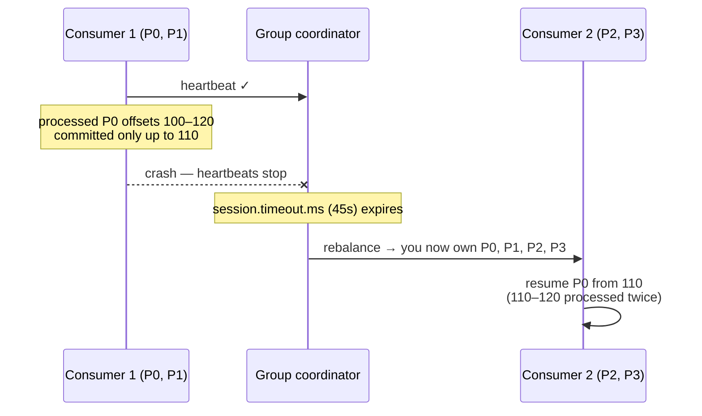
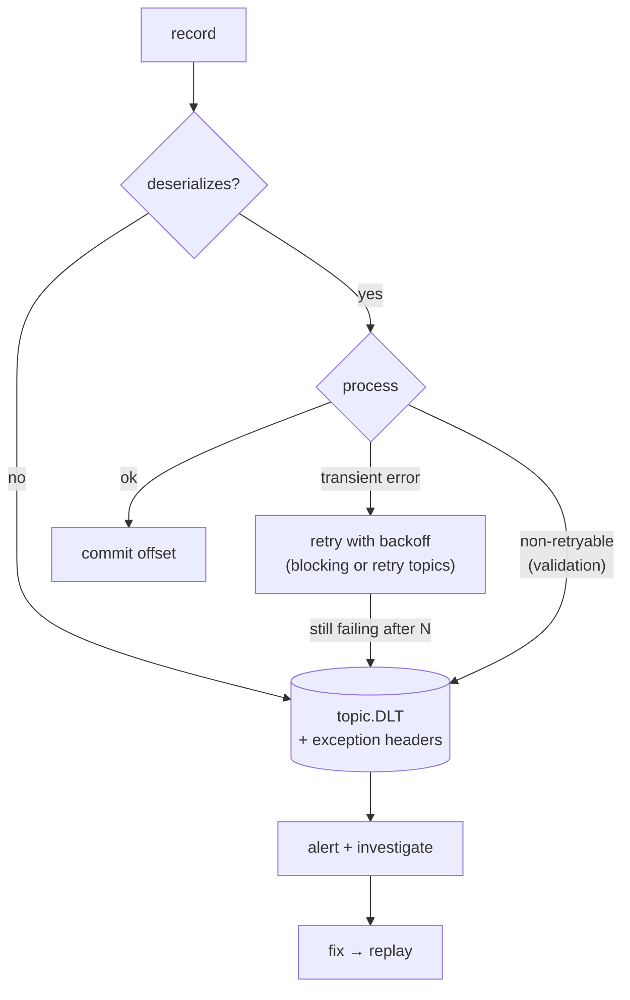
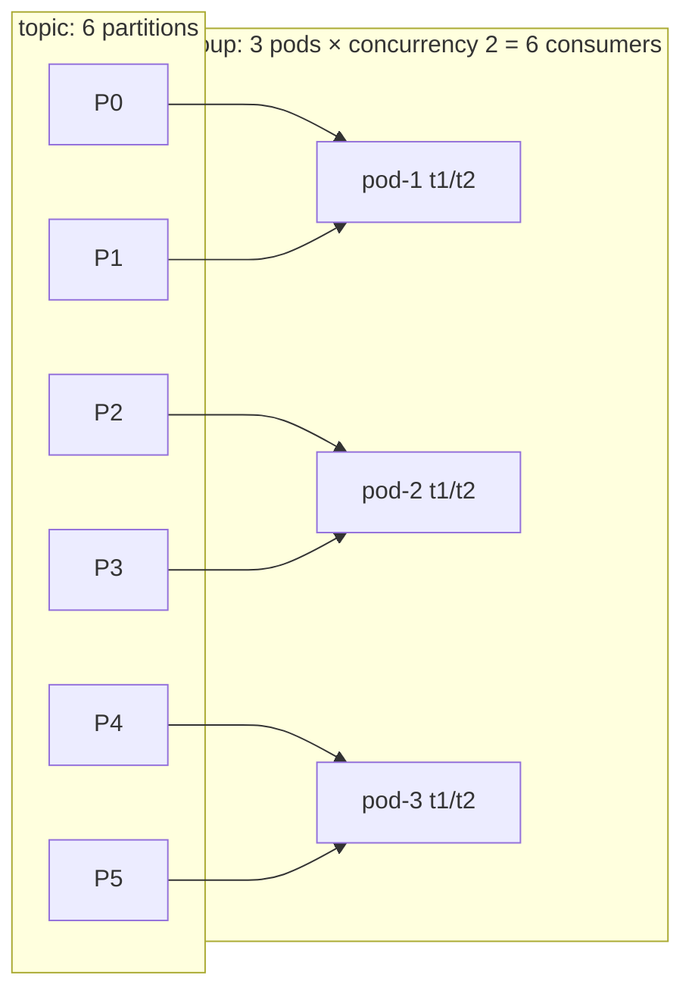
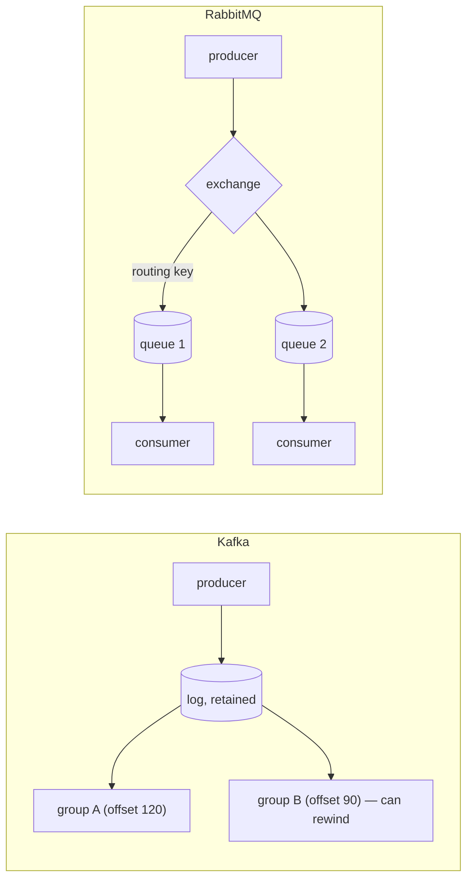
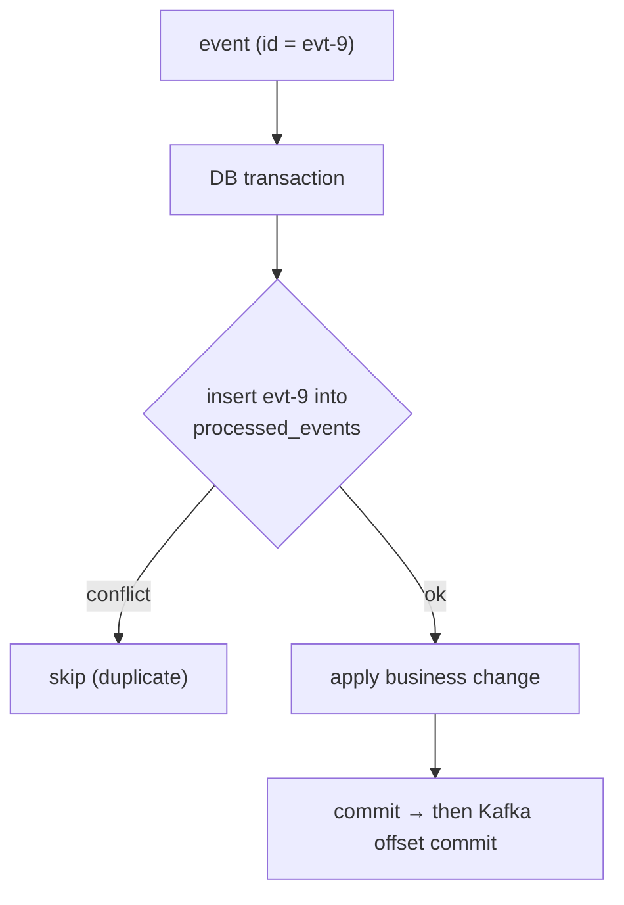
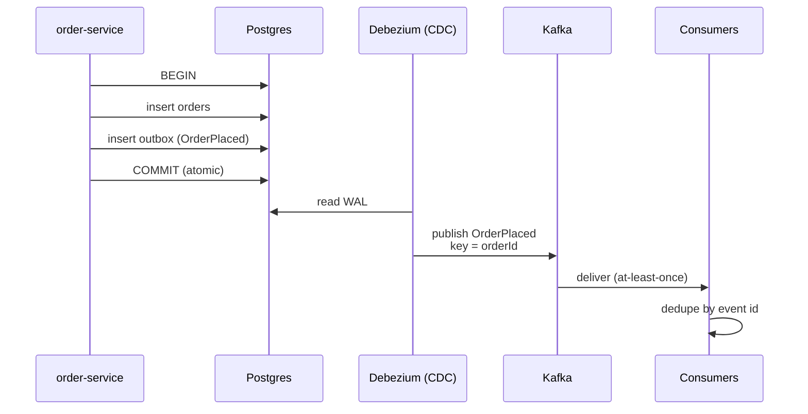
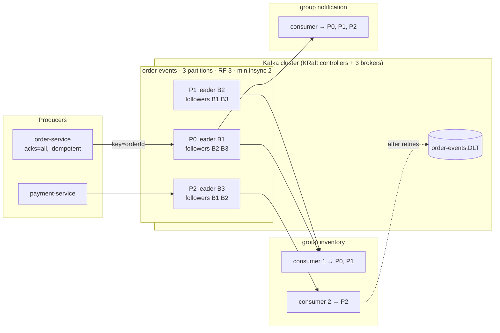
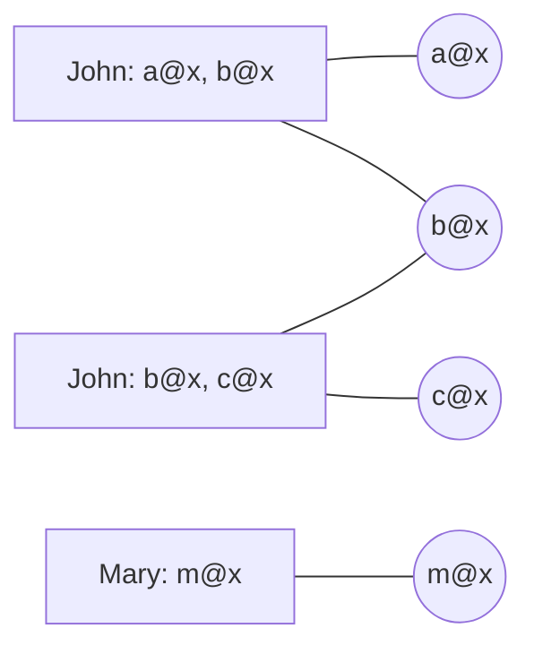

# Day 38 — Kafka Interview Prep & Consumer Deep Dive

> **How to use these notes:** today is **interview practice**. For each question, answer **out loud first** (aim for 60–90 seconds), then compare with the model answer and the diagram. 🚀 marks senior-level details.

**Today's goal:** rehearse the seven Kafka questions that come up most — consumer crashes, poison pills, scaling consumers, Kafka vs RabbitMQ vs SQS, idempotent consumers, the outbox pattern — and be able to **draw the whole architecture**. On the DSA side: mixed graph practice — Alien Dictionary (topological sort), Accounts Merge (Union-Find), Surrounded Regions (border flood fill) and a timed drill.

**Answer shape that works for every Kafka question:**

| Step | Example ("consumer crashes") |
|---|---|
| Mechanism | Heartbeats stop → coordinator removes it → rebalance |
| Consequence | Uncommitted records are redelivered to the new owner |
| What we do about it | Idempotent processing, commit after processing, static membership |
| Numbers / config | `session.timeout.ms=45s`, `max.poll.interval.ms=5m` |
| Experience | "We saw duplicate emails after deploys until we added a dedupe table…" |

<!-- topic: d38_t1 -->
## 🎤 Kafka — Interview Q&A

<!-- subtopic: d38_t1_s1 -->
### 1. Q: What happens when a consumer crashes?

> **Model answer:** "The consumer stops sending **heartbeats** (background thread). After `session.timeout.ms` (45 s by default) the **group coordinator** — a broker — marks it dead and triggers a **rebalance**: its partitions are reassigned to the remaining members. The new owner resumes from the **last committed offset**, so anything the crashed consumer processed but hadn't committed is **processed again** — that's why we use at-least-once with **idempotent** handlers. If the process is alive but stuck (doesn't call `poll()` within `max.poll.interval.ms`, 5 min), it's kicked out the same way. To limit impact: commit after processing, keep handlers fast, use **CooperativeSticky** so only its partitions move, and **static membership** so a quick pod restart doesn't rebalance at all."



| Detection | Setting | Default |
|---|---|---|
| Process died / network gone | `session.timeout.ms` (heartbeats every `heartbeat.interval.ms`) | 45 s / 3 s |
| Process alive but not polling | `max.poll.interval.ms` | 5 min |
| Clean shutdown | `consumer.close()` → LeaveGroup → immediate rebalance | — |

<!-- subtopic: d38_t1_s2 -->
### 2. Q: How do you handle poison pill messages?

> **Model answer:** "A **poison pill** is a record that can never be processed — malformed JSON, an unknown schema, or data that violates a business rule. If unhandled, the consumer retries it forever and the **whole partition stalls** (lag grows). First, deserialization errors: wrap the deserializer in **`ErrorHandlingDeserializer`** so a bad payload becomes a handled error instead of a crash loop. Then configure the error handler: mark such exceptions **non-retryable**, retry only transient errors a few times with backoff (`DefaultErrorHandler` or `@RetryableTopic`), and route failures to a **Dead Letter Topic** with the exception in headers. Alert on the DLT, investigate, fix the producer or the code, and **replay** from the DLT."



```java
@Bean
DefaultErrorHandler errorHandler(KafkaTemplate<Object, Object> template) {
    var handler = new DefaultErrorHandler(new DeadLetterPublishingRecoverer(template),
                                          new FixedBackOff(1000L, 2));            // 2 retries, 1s apart
    handler.addNotRetryableExceptions(DeserializationException.class,
                                      ValidationException.class, JsonProcessingException.class);
    return handler;
}
```

Don't forget: **monitor DLT volume**, keep the original payload bytes (so you can replay after a schema fix), and fix the source — a DLT is not a trash can.

<!-- subtopic: d38_t1_s3 -->
### 3. Q: How do you scale consumers?

> **Model answer:** "Parallelism is bounded by **partitions**: one partition is consumed by at most one consumer per group. So: (1) add consumers (instances or `concurrency` threads) **up to the partition count** — beyond that they idle; (2) if that's not enough, **increase partitions** — remembering it changes the key-to-partition mapping, so per-key ordering is broken during the transition; (3) make each consumer faster — batch processing, bulk DB writes, async I/O, fewer round trips; (4) if work per record is heavy, consume and hand off to a **worker pool keyed by message key** to keep per-key ordering. In Kubernetes we **autoscale on consumer lag** with KEDA."



| Lever | Effect | Caveat |
|---|---|---|
| More consumers | Up to #partitions | Extra ones idle |
| More partitions | Higher ceiling | Can't decrease; key remapping; more rebalance/failover cost |
| Batch listeners + bulk writes | Fewer round trips | Error handling per batch |
| Parallel processing per key (e.g., Confluent Parallel Consumer) | Parallelism beyond partitions | Complexity; offsets per key |
| Autoscale on lag (KEDA) | Elastic | Rebalances on scale events |

Partition sizing rule of thumb: `partitions ≥ max(target throughput / per-consumer throughput, expected max consumers)`, with headroom (e.g., 12–30 for a busy topic). 🚀 Kafka 4.0 adds **share groups** (queue semantics, KIP-932, early access) allowing more consumers than partitions.

<!-- subtopic: d38_t1_s4 -->
### 4. Q: Kafka vs RabbitMQ vs SQS

> **Model answer:** "**Kafka** is a distributed **log**: messages are retained and **replayable**, consumers pull and track their own offsets, many groups read the same data independently, ordering is per partition, throughput is very high — ideal for event streaming, CDC, analytics, event sourcing. **RabbitMQ** is a **broker with queues**: it pushes messages to consumers, supports rich routing (direct, topic, fanout exchanges), per-message acknowledgements, priorities and delays; messages are removed once acked — great for task queues and RPC-style workflows. **SQS** is AWS's fully **managed queue**: no servers, scales automatically, at-least-once with visibility timeouts (FIFO queues for ordering + dedupe), pairs with SNS for fan-out — the simplest choice for decoupled jobs on AWS."

| | Kafka | RabbitMQ | AWS SQS |
|---|---|---|---|
| Model | Partitioned log (pull) | Exchanges → queues (push) | Managed queue (pull, long polling) |
| Retention / replay | Days–forever; **replay any time** | Until acked | Up to 14 days; no replay after delete |
| Ordering | Per partition | Per queue (single consumer) | FIFO queues (per message group) |
| Throughput | Millions msgs/s | Tens of thousands/s per node | Virtually unlimited (standard) |
| Multiple consumers of same data | Many independent groups | Copy per queue via fanout | SNS → many SQS queues |
| Routing | Topic/partition only | Very flexible (routing keys, headers) | None (SNS filters) |
| Delays / priorities | Not native | ✅ | Delay queues; no priorities |
| Operations | Heavier (or MSK/Confluent) | Moderate | None |
| Best for | Event streaming, CDC, analytics, high volume | Work queues, complex routing, RPC | Simple async jobs on AWS |



<!-- subtopic: d38_t1_s5 -->
### 5. Q: How do you implement idempotent consumers?

> **Model answer:** "With at-least-once delivery, duplicates **will** happen — after rebalances, retries or producer resends. I make processing idempotent: each event carries a unique **event id** (or I use a natural business key like `orderId + eventType`). In the **same DB transaction** as the side effect, I insert that id into a `processed_events` table with a **unique constraint**; if the insert conflicts, the event was already handled and I skip it. Where possible, I also design operations as **upserts / state transitions** (`set status=PAID where status=PENDING`) which are naturally safe to repeat. For external calls (payments), I pass an **idempotency key** downstream."

```java
@KafkaListener(topics = "payment-events", groupId = "order-service")
@Transactional
public void on(PaymentCompleted e) {
    // 1) dedupe inside the same DB transaction as the business change
    int inserted = jdbc.update("""
            insert into processed_events(event_id, processed_at) values (?, now())
            on conflict (event_id) do nothing
            """, e.eventId());
    if (inserted == 0) return;                                  // duplicate → already handled

    // 2) business change — also written as a guarded transition
    int updated = jdbc.update("update orders set status='PAID' where id=? and status='PENDING_PAYMENT'", e.orderId());
    if (updated == 0) log.warn("order {} not pending, ignoring", e.orderId());
}
```



| Technique | Notes |
|---|---|
| Processed-events table (inbox) | Unique constraint; same TX as the change; clean up old rows |
| Natural idempotence | Upserts, absolute sets (`balance = 70` not `+= 10`), guarded state transitions |
| Version numbers | Ignore events with `version ≤ current` (also fixes reordering) |
| Redis `SETNX` with TTL | Fast dedupe window, not transactional with the DB |
| Idempotency keys downstream | Payment/email providers dedupe on their side |

<!-- subtopic: d38_t1_s6 -->
### 6. Q: Explain the Outbox pattern

> **Model answer:** "Services often need to **update their DB and publish an event**. Doing both directly is a **dual write**: if the DB commits and the publish fails (or vice versa), systems diverge. With the **transactional outbox**, the service writes the business row **and** an event row into an `outbox` table **in one local transaction**. A separate relay publishes outbox rows to Kafka — either **CDC** (Debezium reading the WAL, near real-time) or a **polling publisher**. Publishing is at-least-once, so consumers are idempotent; keying events by aggregate id keeps per-aggregate ordering."



Full code and table design: Day 27, section 7. Talking points: why not `@Transactional` + `kafkaTemplate.send()` (not atomic), CDC vs polling trade-offs, outbox cleanup (delete after publish / partitioned table), and the **inbox** counterpart on the consumer.

<!-- subtopic: d38_t1_s7 -->
### 7. Practice: draw the Kafka architecture

> **Task:** draw this from memory in under 5 minutes and narrate one record's journey: producer → partition (by key) → leader + replicas → consumer group → commit → failure path to the DLT.



Narration checklist:
1. Producer serializes, partitions by **key hash**, batches, sends to the **leader**; `acks=all` waits for the **ISR**.
2. Followers replicate; the **high watermark** advances; consumers see the record.
3. Each **group** reads independently; within a group each partition has **one** consumer.
4. Consumer processes **idempotently**, then **commits** the offset to `__consumer_offsets`.
5. Failure: retries with backoff, then the **DLT** with exception headers, then alert and replay.
6. Broker failure: a new leader is elected **from the ISR**; clients refresh metadata.
7. Consumer failure: heartbeats stop, a **rebalance** runs and its partitions are reassigned.

<!-- topic: d37_t2 -->
## 🧮 DSA — Mixed Practice

<!-- subtopic: d37_t2_s1 -->
### 8. Alien Dictionary (LeetCode 269 — Hard)

> **Problem:** words sorted in an unknown alien alphabet; derive a valid letter order, or "" if impossible. 🔗 [LeetCode 269](https://leetcode.com/problems/alien-dictionary/) *(Premium)*

Compare each **adjacent** pair of words: the **first differing letter** gives an edge `a → b` (a comes before b). Then **topological sort** (Kahn's, Day 23). A cycle → invalid. Edge case: a word followed by its own **prefix** (`"abc"` before `"ab"`) is invalid.

```java
public String alienOrder(String[] words) {
    Map<Character, Set<Character>> graph = new HashMap<>();
    Map<Character, Integer> inDegree = new HashMap<>();
    for (String w : words)
        for (char c : w.toCharArray()) { graph.putIfAbsent(c, new HashSet<>()); inDegree.putIfAbsent(c, 0); }

    for (int i = 0; i + 1 < words.length; i++) {
        String a = words[i], b = words[i + 1];
        if (a.length() > b.length() && a.startsWith(b)) return "";        // "abc" before "ab" is impossible
        for (int j = 0; j < Math.min(a.length(), b.length()); j++) {
            char x = a.charAt(j), y = b.charAt(j);
            if (x != y) {
                if (graph.get(x).add(y)) inDegree.merge(y, 1, Integer::sum);
                break;                                                    // only the FIRST difference counts
            }
        }
    }

    Deque<Character> queue = new ArrayDeque<>();
    inDegree.forEach((c, d) -> { if (d == 0) queue.offer(c); });
    StringBuilder order = new StringBuilder();
    while (!queue.isEmpty()) {
        char c = queue.poll();
        order.append(c);
        for (char next : graph.get(c)) if (inDegree.merge(next, -1, Integer::sum) == 0) queue.offer(next);
    }
    return order.length() == inDegree.size() ? order.toString() : "";   // leftover letters → cycle
}   // O(total characters)
```

`["wrt","wrf","er","ett","rftt"]` → edges t→f, w→e, r→t, e→r → order **"wertf"**.

<!-- subtopic: d37_t2_s2 -->
### 9. Accounts Merge (LeetCode 721)

> **Problem:** each account is `[name, email1, email2, …]`; accounts sharing **any email** belong to the same person. Merge them; emails sorted. 🔗 [LeetCode 721](https://leetcode.com/problems/accounts-merge/)

**Union-Find over emails** (Day 31): union every email in an account with the account's first email; then group emails by root.

```java
public List<List<String>> accountsMerge(List<List<String>> accounts) {
    Map<String, String> parent = new HashMap<>();
    Map<String, String> owner = new HashMap<>();

    for (List<String> acc : accounts) {
        String name = acc.get(0), first = acc.get(1);
        for (int i = 1; i < acc.size(); i++) {
            String email = acc.get(i);
            parent.putIfAbsent(email, email);
            owner.put(email, name);
            union(parent, first, email);
        }
    }

    Map<String, TreeSet<String>> groups = new HashMap<>();
    for (String email : parent.keySet())
        groups.computeIfAbsent(find(parent, email), r -> new TreeSet<>()).add(email);

    List<List<String>> result = new ArrayList<>();
    groups.forEach((root, emails) -> {
        List<String> merged = new ArrayList<>();
        merged.add(owner.get(root));
        merged.addAll(emails);                          // TreeSet → sorted
        result.add(merged);
    });
    return result;
}

private String find(Map<String, String> parent, String x) {
    String p = parent.get(x);
    if (!p.equals(x)) { p = find(parent, p); parent.put(x, p); }   // path compression
    return p;
}

private void union(Map<String, String> parent, String a, String b) {
    String ra = find(parent, a), rb = find(parent, b);
    if (!ra.equals(rb)) parent.put(rb, ra);
}   // ≈ O(E log E) for sorting, union-find ≈ O(E α(E))
```



*Accounts 1 and 2 share `b@x` → merged into John [a@x, b@x, c@x]; Mary stays separate.*

⚠️ Same **name** doesn't mean same person — only shared emails merge. DFS on an email graph is the alternative solution.

<!-- subtopic: d37_t2_s3 -->
### 10. Surrounded Regions (LeetCode 130)

> **Problem:** capture all `'O'` regions **completely surrounded** by `'X'` (flip them to `'X'`); regions touching the border survive. 🔗 [LeetCode 130](https://leetcode.com/problems/surrounded-regions/)

**Reverse thinking** (like Pacific Atlantic, Day 23): flood-fill from every **border `'O'`** and mark those cells safe (`'S'`). Afterwards every remaining `'O'` is surrounded → flip to `'X'`; restore `'S'` → `'O'`.

```java
public void solve(char[][] board) {
    int m = board.length, n = board[0].length;
    for (int r = 0; r < m; r++) { mark(board, r, 0); mark(board, r, n - 1); }
    for (int c = 0; c < n; c++) { mark(board, 0, c); mark(board, m - 1, c); }

    for (int r = 0; r < m; r++)
        for (int c = 0; c < n; c++)
            board[r][c] = board[r][c] == 'S' ? 'O' : 'X';      // safe → O, everything else (incl. captured O) → X
}

private void mark(char[][] b, int r, int c) {
    Deque<int[]> stack = new ArrayDeque<>();                   // iterative DFS: no recursion depth issues
    stack.push(new int[]{r, c});
    while (!stack.isEmpty()) {
        int[] p = stack.pop();
        int i = p[0], j = p[1];
        if (i < 0 || j < 0 || i >= b.length || j >= b[0].length || b[i][j] != 'O') continue;
        b[i][j] = 'S';
        stack.push(new int[]{i + 1, j}); stack.push(new int[]{i - 1, j});
        stack.push(new int[]{i, j + 1}); stack.push(new int[]{i, j - 1});
    }
}   // O(m·n)
```

```
X X X X        X X X X
X O O X   →    X X X X
X X O X        X X X X
X O X X        X O X X   ← border-connected O survives
```

Related: Number of Enclaves (LC 1020 — count instead of flip), Number of Closed Islands (LC 1254).

<!-- subtopic: d37_t2_s4 -->
### 11. Timed: two Mediums in 30 minutes

> **Goal:** speed + accuracy under pressure — **15 minutes per problem**. Suggested unseen pairs: *Rotting Oranges + Top K Frequent Words*, *Course Schedule II + Koko Eating Bananas*, *Decode Ways + Search in Rotated Sorted Array*.

| Minute (per problem) | Target |
|---|---|
| 0–2 | Restate, constraints, one example |
| 2–5 | Name the pattern and complexity before coding |
| 5–12 | Code (use templates you know cold: BFS, Kahn's, binary search, sliding window, heap of k) |
| 12–15 | Dry run + edge cases (empty, single element, duplicates, negatives) |

**Templates to know by heart** (they buy you minutes): BFS with level loop, DFS on grid with bounds check, Kahn's topological sort, Union-Find, binary search (`lo < hi` vs `lo <= hi`), sliding window (expand right, shrink left), min-heap of size k, backtracking choose/explore/unchoose, 1-D and 2-D DP tables.

After the drill, log: time per problem, the bug you hit, and which template would have saved time.

---

## 📝 Day 38 Revision Cheat Sheet

| Question | Key points |
|---|---|
| Consumer crash | Heartbeats stop → session timeout → rebalance → resume from committed offset → duplicates → idempotent |
| Poison pill | ErrorHandlingDeserializer, non-retryable exceptions, limited retries, DLT with headers, alert, replay |
| Scaling | Consumers ≤ partitions; add partitions (key remap); faster/batched handlers; KEDA on lag |
| Kafka vs RabbitMQ vs SQS | Replayable log + groups / routing + per-message acks / managed simple queue + SNS fan-out |
| Idempotent consumer | Event id + unique constraint in the same TX; upserts; version checks; downstream idempotency keys |
| Outbox | Business row + outbox row in one TX; CDC/polling relay; at-least-once; key by aggregate |
| Architecture | Producer → leader/ISR → high watermark → groups → commit → DLT; failover from ISR |
| Alien dictionary | First differing char → edge; prefix check; Kahn's; cycle → "" |
| Accounts merge | Union-Find over emails; group by root; sort |
| Surrounded regions | Flood from border O's → safe; flip the rest |

### ⚡ Rapid-fire self-test

1. Default `session.timeout.ms`? → **45 seconds**
2. What does a stuck consumer exceed before being kicked out? → **max.poll.interval.ms**
3. Deserializer wrapper that turns bad payloads into handled errors? → **ErrorHandlingDeserializer**
4. 12 partitions, 20 consumers in a group — how many are active? → **12**
5. Broker where messages are removed once acknowledged? → **RabbitMQ (and SQS on delete)**
6. Where do you store processed event ids? → **A table with a unique constraint, in the same DB transaction**
7. Relay types for the outbox? → **CDC (Debezium) or polling publisher**
8. Alien Dictionary: which pair of letters creates an edge? → **The first differing letters of adjacent words**
9. Accounts Merge: what do you union? → **All emails of an account with its first email**
10. Surrounded Regions: where does the flood fill start? → **From 'O' cells on the border**
