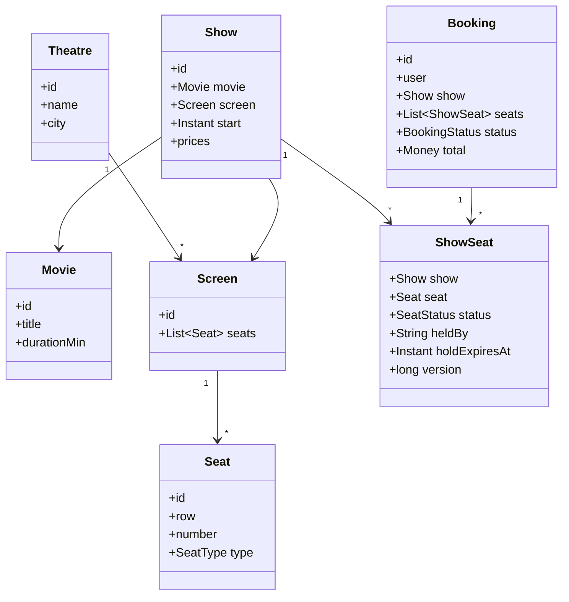
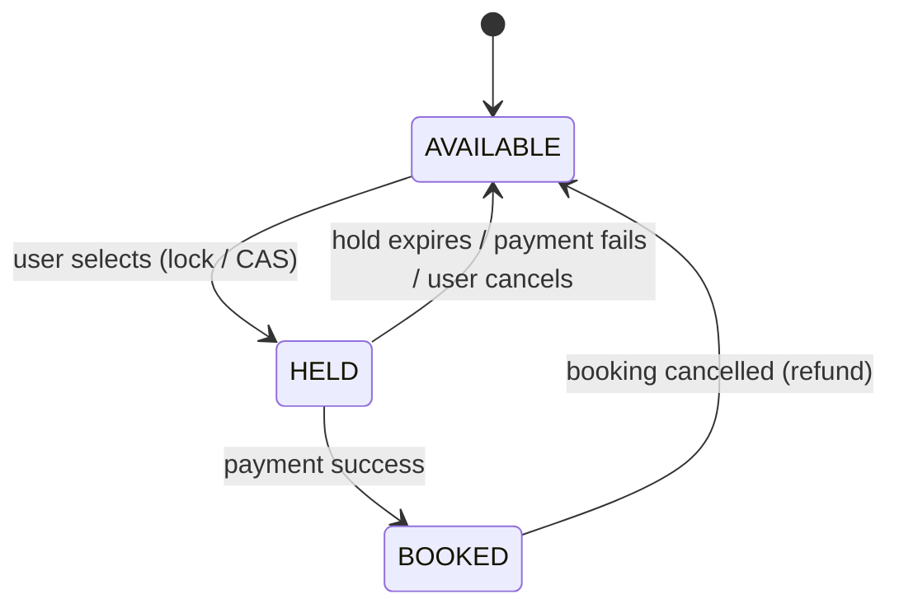
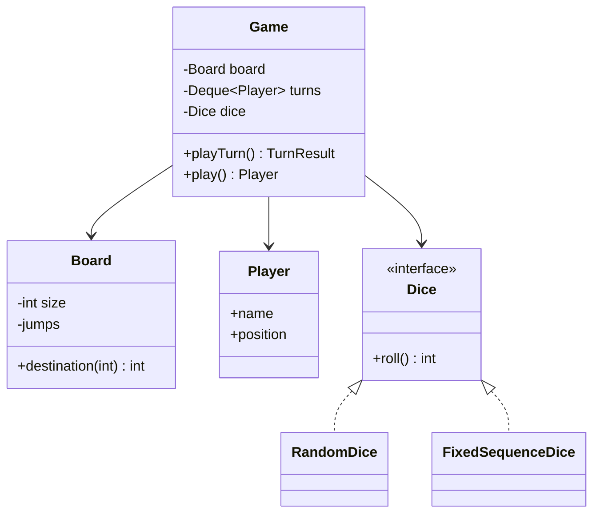
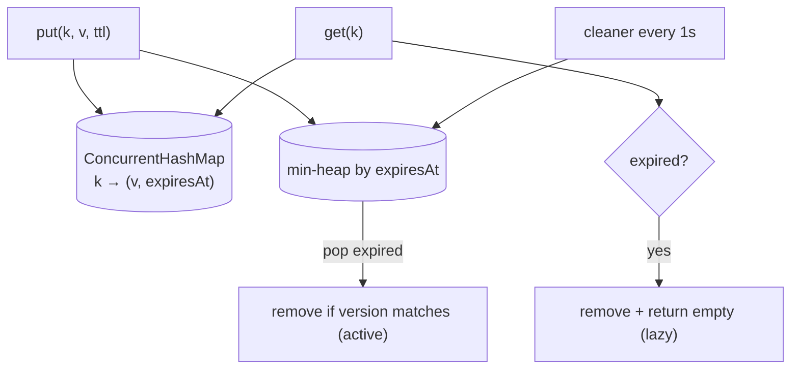
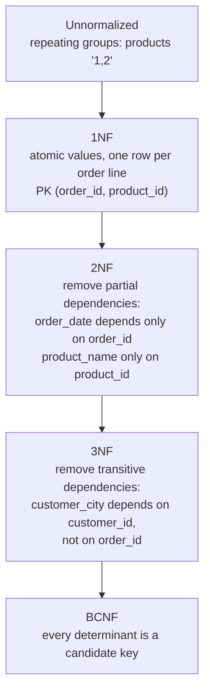
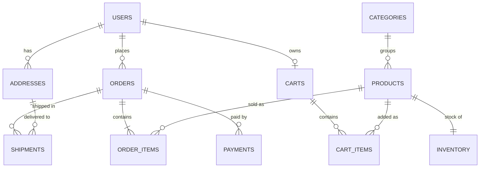

# Day 39 — Machine Coding Practice & Schema Design

> **How to use these notes:** each section maps to one checklist item. **Attempt each design yourself first** (30–45 minutes, runnable code), then compare. 🚀 marks senior-level details.

**Today's goal:** three more machine-coding classics — **BookMyShow** (with the concurrency problem of double booking), **Snake and Ladder** (clean game loop OOP), and a **Key-Value Store with TTL** — plus the design principles **DRY, KISS, YAGNI**, **database normalization** (1NF → BCNF, and when to denormalize), and an **e-commerce ER diagram**. Day 34's approach applies: requirements → entities → interfaces → runnable core → extensions.

<!-- topic: d39_t1 -->
## 🧱 LLD — Machine Coding & Schema

<!-- subtopic: d39_t1_s1 -->
### 1. Design BookMyShow — seat selection and concurrent booking

> **Requirements (agreed):** cities → theatres → screens → shows (movie + screen + start time); users browse shows, see a **seat map**, **hold** seats for a few minutes while paying, then **confirm**; holds expire automatically; **two users must never book the same seat**. Payment is an external step that can fail.



The key modelling insight: **seat availability belongs to a show**, not to the physical seat → a `ShowSeat` row per (show, seat) with status `AVAILABLE → HELD → BOOKED`.



#### Preventing double booking — three options

```java
// Option A: atomic conditional update (optimistic, works across many app instances)
@Transactional
public Hold holdSeats(long showId, List<Long> seatIds, String userId) {
    Instant expires = clock.instant().plus(Duration.ofMinutes(7));
    int updated = jdbc.update("""
            update show_seat
               set status = 'HELD', held_by = ?, hold_expires_at = ?
             where show_id = ? and seat_id = any(?) 
               and (status = 'AVAILABLE' or (status = 'HELD' and hold_expires_at < now()))
            """, userId, Timestamp.from(expires), showId, seatIds.toArray(Long[]::new));
    if (updated != seatIds.size()) {
        throw new SeatsUnavailableException(showId, seatIds);   // all-or-nothing: the TX rolls back
    }
    return new Hold(showId, seatIds, userId, expires);
}
```

| Option | How | Pros | Cons |
|---|---|---|---|
| **A. Conditional UPDATE** (`where status='AVAILABLE'`) | Count updated rows; rollback if fewer | Simple, no explicit locks, scales | Retry UX on conflict |
| B. Pessimistic lock | `select … for update` on the show_seat rows (sorted by id to avoid deadlocks) | Straightforward | Holds row locks; contention on hot shows |
| C. Optimistic `@Version` | Read, modify, save; conflict → exception | Familiar JPA | More conflicts at peak |
| D. Distributed lock (Redis `SET NX PX`) | Lock key `show:42:seat:A7` during hold | Very fast for flash sales | Must still persist safely; lock expiry edge cases |

**Unique constraint as the last line of defence:** `booking_seat(show_id, seat_id)` unique → even a bug can't create two confirmed bookings for the same seat.

```java
// Confirm after payment (idempotent: same bookingId twice → same result)
@Transactional
public Booking confirm(String holdId, PaymentResult payment) {
    if (!payment.approved()) { releaseHold(holdId); throw new PaymentFailedException(); }
    int n = jdbc.update("update show_seat set status='BOOKED' where hold_id=? and status='HELD' and hold_expires_at > now()", holdId);
    if (n == 0) { refunds.refund(payment); throw new HoldExpiredException(holdId); }   // paid too late → refund
    return bookings.save(Booking.confirmed(holdId, payment));
}

// Release expired holds (also handled lazily by the "or hold_expires_at < now()" condition above)
@Scheduled(fixedDelay = 30_000)
void releaseExpiredHolds() {
    jdbc.update("update show_seat set status='AVAILABLE', held_by=null where status='HELD' and hold_expires_at < now()");
}
```

Scaling notes: cache the **seat map** (Redis) with short TTL and push updates (WebSocket); a **virtual waiting room** / queue for blockbuster releases; payment via **saga** (hold → pay → confirm, compensate on failure); idempotency keys on confirm.

<!-- subtopic: d39_t1_s2 -->
### 2. Design Snake and Ladder

> **Requirements:** board of N cells (default 100), configurable snakes and ladders, 2+ players taking turns, a dice (extensible: two dice, loaded dice for tests), first to land **exactly** on 100 wins (overshoot → stay), detect the winner and print moves.



```java
public interface Dice { int roll(); }

public final class RandomDice implements Dice {
    private final int count;
    private final RandomGenerator rng;
    public RandomDice(int count, RandomGenerator rng) { this.count = count; this.rng = rng; }
    public int roll() { int s = 0; for (int i = 0; i < count; i++) s += rng.nextInt(1, 7); return s; }
}

public final class FixedSequenceDice implements Dice {          // deterministic tests
    private final Iterator<Integer> it;
    public FixedSequenceDice(Integer... rolls) { this.it = Arrays.asList(rolls).iterator(); }
    public int roll() { return it.next(); }
}

public final class Board {
    private final int size;
    private final Map<Integer, Integer> jumps;                  // snakes (head → tail) and ladders (bottom → top)

    public Board(int size, Map<Integer, Integer> snakes, Map<Integer, Integer> ladders) {
        this.size = size;
        Map<Integer, Integer> all = new HashMap<>(snakes);
        ladders.forEach((from, to) -> {
            if (all.containsKey(from)) throw new IllegalArgumentException("cell " + from + " has a snake and a ladder");
            all.put(from, to);
        });
        all.forEach((from, to) -> {
            if (from < 1 || from >= size || to < 1 || to > size) throw new IllegalArgumentException("bad jump " + from);
        });
        this.jumps = Map.copyOf(all);
    }

    public int size() { return size; }
    public int destination(int cell) { return jumps.getOrDefault(cell, cell); }
}

public final class Player {
    private final String name;
    private int position;                                        // 0 = off the board
    public Player(String name) { this.name = name; }
    public String name() { return name; }
    public int position() { return position; }
    void moveTo(int p) { position = p; }
}

public record TurnResult(Player player, int roll, int from, int to, boolean won) { }

public final class Game {
    private final Board board;
    private final Dice dice;
    private final Deque<Player> turns;
    private Player winner;

    public Game(Board board, Dice dice, List<Player> players) {
        if (players.size() < 2) throw new IllegalArgumentException("need at least 2 players");
        this.board = board; this.dice = dice; this.turns = new ArrayDeque<>(players);
    }

    public TurnResult playTurn() {
        if (winner != null) throw new IllegalStateException("game over");
        Player p = turns.poll();
        int roll = dice.roll();
        int from = p.position();
        int target = from + roll;
        int to = target > board.size() ? from : board.destination(target);   // overshoot → stay
        p.moveTo(to);
        boolean won = to == board.size();
        if (won) winner = p; else turns.offer(p);                // back of the queue
        return new TurnResult(p, roll, from, to, won);
    }

    public Player play() {
        while (winner == null) System.out.println(playTurn());
        return winner;
    }
}
```

Extensions interviewers ask about: **extra turn on a 6** (Rule strategy), three 6s = lose turn, multiple dice, cells with special effects (polymorphic `Cell` objects instead of a map), undo (Command, Day 33), and **testing** with `FixedSequenceDice`.

<!-- subtopic: d39_t1_s3 -->
### 3. Design a Key-Value Store with TTL

> **Requirements:** `put(key, value, ttl)`, `get(key)`, `delete(key)`; expired keys are never returned; memory must not grow forever with expired keys; thread-safe; optional max size with eviction.

Two-part expiry, like Redis: **lazy expiration** (check on read) + **active expiration** (background cleanup). A **min-heap / DelayQueue ordered by expiry time** finds expired keys efficiently.

```java
public final class TtlCache<K, V> implements AutoCloseable {
    private record Entry<V>(V value, long expiresAtNanos) { }
    private record Expiry<K>(K key, long expiresAtNanos) { }

    private final ConcurrentHashMap<K, Entry<V>> map = new ConcurrentHashMap<>();
    private final PriorityBlockingQueue<Expiry<K>> expiries =
            new PriorityBlockingQueue<>(64, Comparator.comparingLong(Expiry::expiresAtNanos));
    private final ScheduledExecutorService cleaner = Executors.newSingleThreadScheduledExecutor(r -> {
        Thread t = new Thread(r, "ttl-cleaner");
        t.setDaemon(true);
        return t;
    });
    private final LongSupplier clock;                                   // System::nanoTime, or a fake in tests

    public TtlCache(LongSupplier clock) {
        this.clock = clock;
        cleaner.scheduleWithFixedDelay(this::evictExpired, 1, 1, TimeUnit.SECONDS);
    }

    public void put(K key, V value, Duration ttl) {
        long expiresAt = clock.getAsLong() + ttl.toNanos();
        map.put(key, new Entry<>(value, expiresAt));
        expiries.offer(new Expiry<>(key, expiresAt));
    }

    public Optional<V> get(K key) {
        Entry<V> e = map.get(key);
        if (e == null) return Optional.empty();
        if (e.expiresAtNanos() <= clock.getAsLong()) {                 // lazy expiration
            map.remove(key, e);                                         // remove only if unchanged
            return Optional.empty();
        }
        return Optional.of(e.value());
    }

    public void delete(K key) { map.remove(key); }

    // Active expiration: pop everything whose time has come; skip heap entries made stale by overwrites
    void evictExpired() {
        long now = clock.getAsLong();
        Expiry<K> head;
        while ((head = expiries.peek()) != null && head.expiresAtNanos() <= now) {
            expiries.poll();
            Entry<V> current = map.get(head.key());
            if (current != null && current.expiresAtNanos() == head.expiresAtNanos()) {
                map.remove(head.key(), current);
            }
        }
    }

    @Override public void close() { cleaner.shutdownNow(); }
}
```



| Design decision | Choice & reason |
|---|---|
| Time source | Monotonic `nanoTime` (wall-clock jumps don't break TTLs); injectable for tests |
| Overwrites | Heap may hold stale entries → compare expiry before removing |
| Concurrency | `ConcurrentHashMap` + atomic `remove(key, value)`; heap is thread-safe |
| Max size | Add LRU eviction (Day 32 LinkedHashMap/linked list) or W-TinyLFU (Caffeine) |
| Persistence (follow-up) | Append-only log / snapshots (Redis AOF/RDB) |
| Distribution (follow-up) | Consistent hashing across nodes, replication |

🚀 In production use **Caffeine** (`expireAfterWrite`, `expireAfter(Expiry)`, size-based W-TinyLFU) or Redis (`SET key value EX 60`).

<!-- subtopic: d39_t1_s4 -->
### 4. DRY, KISS, YAGNI — apply them in your designs

> **TL;DR:** **DRY** — every piece of *knowledge* has one authoritative place (not "never repeat a line"). **KISS** — choose the simplest design that works; complexity must earn its place. **YAGNI** — don't build for imagined future requirements; design so it's *easy to add* later instead. In interviews, show judgment: extension points where change is **likely**, plain code elsewhere.

| Principle | Violation | Better |
|---|---|---|
| **DRY** | Seat-price rules duplicated in booking, refund and invoice code | One `PricingPolicy` used by all three |
| DRY (over-applied) | Merging two similar-looking functions with different reasons to change into one with flags | Keep them separate — duplication is cheaper than the wrong abstraction |
| **KISS** | Event-sourced microservices for a 2-hour parking-lot exercise | In-memory classes with clear responsibilities |
| KISS | Generic "rule engine" for three discount rules | A `DiscountStrategy` list |
| **YAGNI** | Multi-currency, multi-tenant, plugin system "just in case" | Single currency now; `Money` value object keeps it addable |
| YAGNI | Abstract factory with one implementation | A constructor; extract an interface when the second implementation arrives |

```java
// DRY: one source of truth for a business rule
public final class CancellationPolicy {
    public Money refundFor(Booking b, Instant now) {
        Duration untilShow = Duration.between(now, b.show().start());
        if (untilShow.toHours() >= 24) return b.total();                    // full refund
        if (untilShow.toHours() >= 2) return b.total().percent(50);         // half
        return Money.zero(b.total().currency());
    }
}
// used by: BookingService.cancel(), RefundJob, the "refund preview" API — never re-implemented
```

How they relate to SOLID: SRP/OCP tell you *where* to put extension points; YAGNI/KISS tell you *not to add them everywhere*. A good answer names the trade-off: "I made pricing a strategy because the interviewer mentioned weekend rates; I kept seat layout as plain data because nothing suggests it varies."

<!-- subtopic: d39_t1_s5 -->
### 5. Database normalization — 1NF, 2NF, 3NF, BCNF, and denormalization

> **TL;DR:** Normalization removes **redundancy and update anomalies** by splitting tables according to **functional dependencies**. **1NF**: atomic values, no repeating groups. **2NF**: no non-key column depends on **part** of a composite key. **3NF**: no non-key column depends on **another non-key column** (no transitive dependencies). **BCNF**: every determinant is a candidate key. **Denormalize** deliberately for read performance, with a plan to keep copies consistent.

Starting point — one wide table (anomalies everywhere):

| order_id | order_date | customer_id | customer_name | customer_city | product_id | product_name | unit_price | qty |
|---|---|---|---|---|---|---|---|---|
| 1 | 2026-11-01 | C1 | Ana | Pune | P1 | Keyboard | 2000 | 1 |
| 1 | 2026-11-01 | C1 | Ana | Pune | P2 | Mouse | 800 | 2 |

| Anomaly | Example |
|---|---|
| Update | Ana moves city → must update many rows; miss one → inconsistent |
| Insert | Can't add a product that has never been ordered |
| Delete | Deleting the only order of a product loses the product's data |



Result in 3NF:

| Table | Columns | Key |
|---|---|---|
| customers | customer_id, name, city | customer_id |
| products | product_id, name, list_price | product_id |
| orders | order_id, order_date, customer_id (FK) | order_id |
| order_lines | order_id (FK), product_id (FK), qty, **unit_price_at_purchase** | (order_id, product_id) |

Note `unit_price_at_purchase`: it **looks** like duplication of `products.list_price`, but it's a different fact (the price when ordered) — historical values belong with the transaction.

| Normal form | Rule | Violation example |
|---|---|---|
| 1NF | Atomic values, no repeating groups, a key | `phones = "123, 456"` |
| 2NF | 1NF + no partial dependency on part of a composite key | `product_name` in `order_lines(order_id, product_id)` |
| 3NF | 2NF + no transitive dependency (non-key → non-key) | `customer_city` in `orders` |
| BCNF | Every determinant is a candidate key | (student, course) → teacher, but teacher → course |

#### When to denormalize

| Situation | Denormalization | Keep consistent via |
|---|---|---|
| Hot read path joins 5 tables | Store `customer_name` on orders for listing | Event/trigger updates or accept snapshot semantics |
| Counters (likes, order count) | `post.like_count` column | Atomic increments, periodic reconciliation |
| Reporting / analytics | Star schema in a warehouse | ETL/CDC pipelines |
| CQRS read model (Day 28) | Screen-shaped documents | Projections from events |
| NoSQL key-value access | Embed related data in one item | Application writes both |

Rule: **normalize the write model (source of truth), denormalize read models** — and know which copy wins.

<!-- subtopic: d39_t1_s6 -->
### 6. ER diagram exercise — e-commerce

> **Task:** model users, addresses, products (with categories and inventory), carts, orders with lines, payments and shipments. Identify cardinalities, keys, and constraints that protect invariants.



```sql
create table users (
  id            bigint primary key,
  email         varchar(255) not null unique,
  password_hash varchar(100) not null,
  created_at    timestamptz not null default now()
);

create table products (
  id           bigint primary key,
  sku          varchar(40) not null unique,
  name         varchar(200) not null,
  category_id  bigint not null references categories(id),
  price        numeric(12,2) not null check (price >= 0),
  active       boolean not null default true
);

create table inventory (
  product_id   bigint primary key references products(id),
  on_hand      int not null check (on_hand >= 0),
  reserved     int not null default 0 check (reserved >= 0 and reserved <= on_hand),
  version      bigint not null default 0                         -- optimistic locking (Day 22)
);

create table orders (
  id                  bigint primary key,
  user_id             bigint not null references users(id),
  status              varchar(20) not null,                      -- PENDING_PAYMENT, PAID, SHIPPED, CANCELLED
  shipping_address    jsonb not null,                            -- snapshot: later address edits don't change old orders
  total               numeric(12,2) not null,
  created_at          timestamptz not null default now()
);
create index idx_orders_user_created on orders(user_id, created_at desc);   -- "my orders" page

create table order_items (
  order_id     bigint references orders(id),
  product_id   bigint references products(id),
  qty          int not null check (qty > 0),
  unit_price   numeric(12,2) not null,                           -- price at purchase time
  primary key (order_id, product_id)
);

create table payments (
  id               bigint primary key,
  order_id         bigint not null references orders(id),
  provider_ref     varchar(100) unique,
  idempotency_key  varchar(64) not null unique,                  -- no double charge on retries
  amount           numeric(12,2) not null,
  status           varchar(20) not null,
  created_at       timestamptz not null default now()
);
```

Design notes to say out loud:
- **Snapshots** for history: order address and unit prices are copied, not referenced (they must not change when the user edits their profile).
- **Constraints protect invariants**: `check (reserved <= on_hand)`, unique `idempotency_key`, unique `sku`.
- **Indexes follow access patterns**: `(user_id, created_at desc)` for order history; product search goes to Elasticsearch (CQRS read side).
- **Money**: `numeric(12,2)` + currency, never floating point.
- **Soft delete** for products (`active=false`) because orders reference them.
- **Scaling**: shard orders by `user_id` later; inventory is the hot row → reservations with conditional updates (as in BookMyShow) or a separate inventory service.

### 🎤 Interview Q&A — Machine coding & schema

<details><summary>Q1. How do you prevent two users from booking the same seat?</summary>

Model per-show seat status and make the transition atomic: a conditional UPDATE (`where status = 'AVAILABLE'`) and check the affected row count, or SELECT … FOR UPDATE / optimistic versioning; add a unique constraint on (show, seat) for confirmed bookings, and expire holds automatically.

</details>

<details><summary>Q2. How do you implement TTL expiry efficiently?</summary>

Lazy expiration on read plus active expiration: a background task pops expired keys from a min-heap (or DelayQueue) ordered by expiry, verifying the entry wasn't overwritten. Use a monotonic clock.

</details>

<details><summary>Q3. Explain 2NF vs 3NF with an example.</summary>

2NF removes partial dependencies on part of a composite key — e.g., product_name in order_lines keyed by (order_id, product_id) depends only on product_id. 3NF removes transitive dependencies — e.g., customer_city in orders depends on customer_id, not on order_id.

</details>

<details><summary>Q4. When would you denormalize?</summary>

For read-heavy paths where joins are too expensive, for counters, reporting and CQRS read models — keeping the normalized write model as the source of truth and updating copies through events, triggers or batch reconciliation.

</details>

<details><summary>Q5. What does YAGNI mean in a design interview?</summary>

Don't add abstractions for requirements nobody asked for; keep the design simple but easy to extend, and add extension points (strategies, interfaces) only where change is likely or stated.

</details>

---

## 📝 Day 39 Revision Cheat Sheet

| Topic | Remember this |
|---|---|
| BookMyShow | ShowSeat per (show, seat): AVAILABLE → HELD (expiry) → BOOKED; conditional UPDATE / FOR UPDATE / @Version; unique constraint; saga with payment |
| Snake & Ladder | Board (jumps map, validation), Player, Dice interface (Random/Fixed for tests), Game with a turn queue; overshoot rule |
| TTL store | ConcurrentHashMap + min-heap of expiries; lazy + active expiration; stale heap entries; nanoTime; Caffeine/Redis in prod |
| DRY / KISS / YAGNI | One source of truth per rule; simplest thing that works; don't build for imagined needs |
| Normal forms | 1NF atomic; 2NF no partial deps; 3NF no transitive deps; BCNF determinants are keys |
| Denormalize | Read models, counters, reporting; write model stays normalized |
| E-commerce ERD | Snapshots for history, constraints for invariants, indexes by access pattern, numeric money, idempotency keys |

### ⚡ Rapid-fire self-test

1. Which entity holds seat status in BookMyShow? → **ShowSeat (per show, per seat)**
2. How do you detect a lost race with a conditional UPDATE? → **Fewer rows updated than requested**
3. Why inject the Dice in Snake and Ladder? → **Deterministic tests (fixed rolls)**
4. Two expiry strategies in a TTL cache? → **Lazy (on read) and active (background)**
5. Clock to use for TTLs inside one JVM? → **Monotonic System.nanoTime**
6. Which principle says "don't build it until you need it"? → **YAGNI**
7. Normal form that removes transitive dependencies? → **3NF**
8. `product_name` in `order_lines(order_id, product_id)` violates? → **2NF (partial dependency)**
9. Why copy the shipping address into the order? → **Historical snapshot — later edits must not change past orders**
10. Data type for money in SQL? → **numeric/decimal (never float)**
