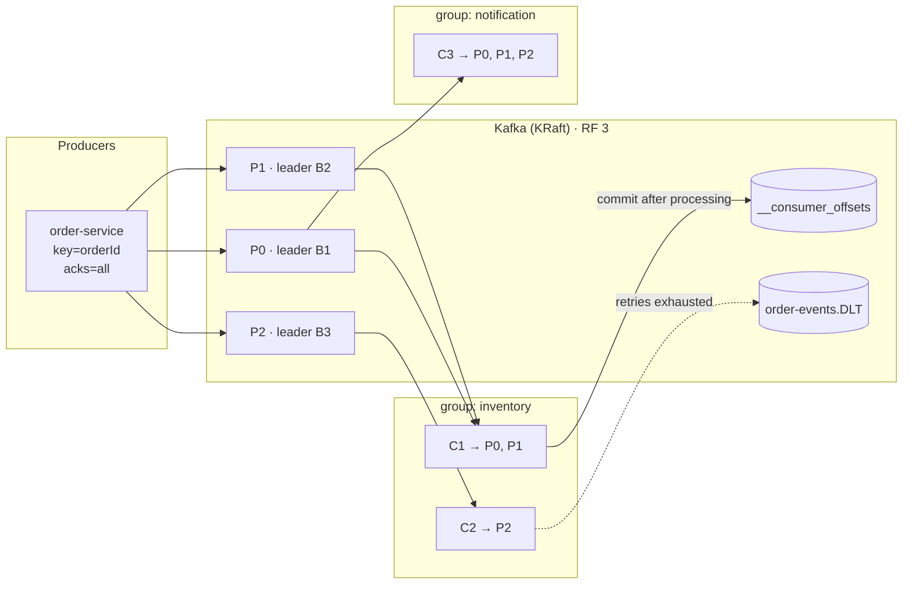
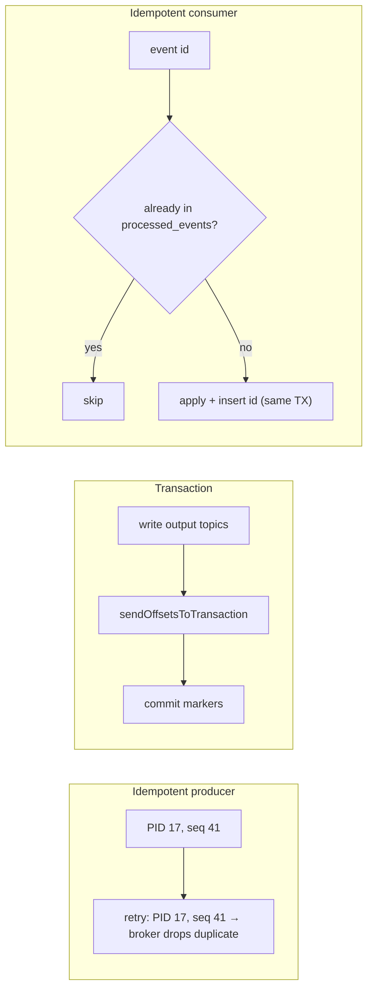
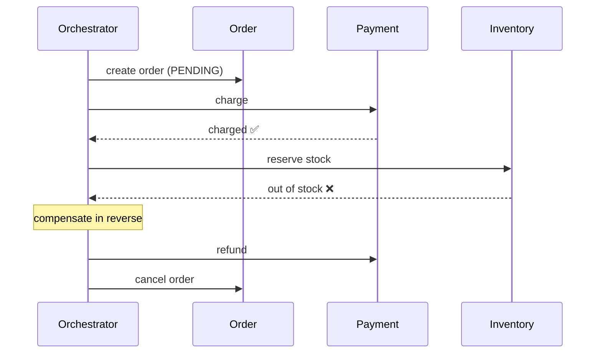
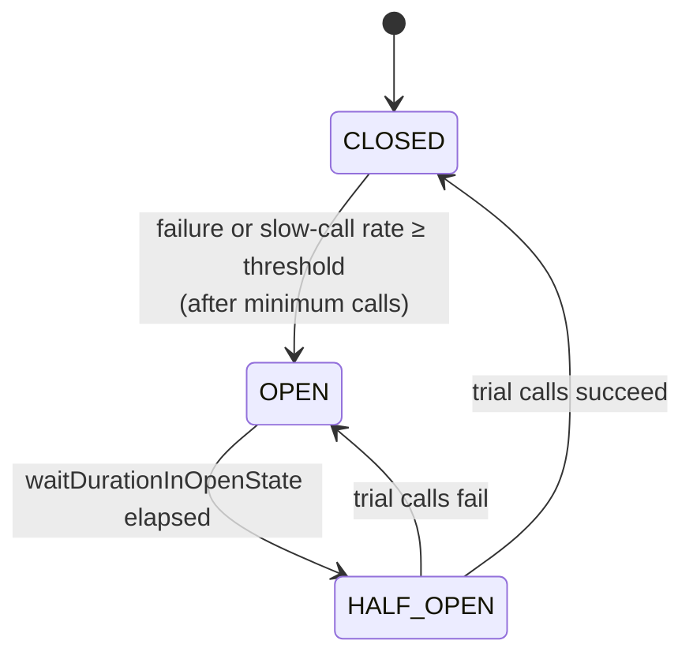
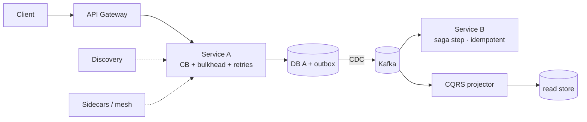
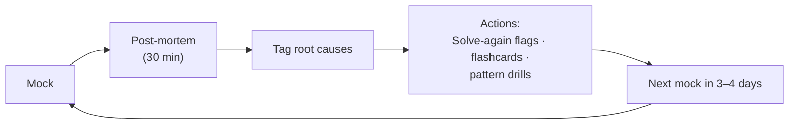

# Day 40 — Phase 5 Review: Kafka + Patterns Consolidation

> **How to use these notes:** a **review and mock day**. Do each exercise **before** reading its answer: whiteboard from memory, explain out loud with a timer, then compare. The DSA half is a full **90-minute mock round** — treat it like the real thing. 🚀 marks senior-level details.

**Today's goal:** prove you can **whiteboard Kafka**, explain **delivery guarantees**, **sagas** and **circuit breakers** crisply, **name design and microservices patterns from a scenario** in seconds, and run a realistic **2 Medium + 1 Hard coding mock** with a post-mortem. Phase 5 is done after today; Phase 6 (AWS) starts tomorrow.

<!-- topic: d40_t1 -->
## 🏁 Phase 5 — Comprehensive Review

<!-- subtopic: d40_t1_s1 -->
### 1. Whiteboard: Kafka architecture

> **Exercise (5 min, from memory):** draw producers, a topic with partitions and replicas across brokers, two consumer groups, offset commits, a rebalance, and the DLT path. Then compare.

**Self-check — can you explain each label?**

| Element | One-line explanation |
|---|---|
| Partition | Ordered append-only log; unit of parallelism and ordering |
| Key → partition | `hash(key) % partitions` → same key, same partition, ordered |
| Leader / ISR | Writes go to the leader; ISR are caught-up replicas; acks=all waits for them |
| `min.insync.replicas=2` | With RF 3, survive one broker loss without data loss |
| Consumer group | Each partition to one consumer in the group; groups are independent |
| `__consumer_offsets` | Compacted topic storing each group's committed positions |
| Rebalance | Membership change → partitions reassigned (cooperative = incremental) |
| DLT | Records that failed after retries, with exception headers, for alert + replay |
| KRaft | Raft quorum of controllers holding cluster metadata (no ZooKeeper) |

<!-- subtopic: d40_t1_s2 -->
### 2. Explain: delivery guarantees, exactly-once, idempotent producer and consumer

> **Model answer (90 s):** "Guarantees come from **when the consumer commits relative to processing** plus **producer retries**. Commit first → **at-most-once** (loss). Process then commit, with `acks=all` and retries → **at-least-once** (duplicates) — our default, paired with **idempotent consumers**: a processed-event table with a unique constraint in the same DB transaction, or naturally idempotent upserts. **Exactly-once** in Kafka = **idempotent producer** (producer id + sequence numbers so retries don't duplicate) + **transactions** (writes to several partitions and the consumer offsets commit atomically) + consumers in **read_committed**. It covers Kafka-to-Kafka processing like Kafka Streams with `exactly_once_v2`; anything external — DB writes, emails, payments — still needs idempotency keys."

| Term | Protects against |
|---|---|
| Idempotent producer | Duplicates from **producer retries** (network errors after the broker wrote) |
| Transactions + read_committed | Partial writes / output without offset commit in read-process-write |
| Idempotent consumer | Duplicates from **redelivery** (rebalances, crashes before commit, outbox relays) |

<!-- subtopic: d40_t1_s3 -->
### 3. Explain: the Saga pattern with compensating transactions

> **Model answer:** "Microservices own their databases, so there's no single ACID transaction for 'create order → charge payment → reserve stock → ship'. A **saga** runs it as a sequence of **local transactions**, each publishing an event or replying to a coordinator. If a step fails, the saga runs **compensating transactions** for the completed steps in reverse — refund the payment, cancel the order. In **choreography** services react to each other's events — loose coupling, but the flow is implicit and hard to follow. In **orchestration** a saga orchestrator (state machine; Temporal, Step Functions) sends commands and tracks progress — explicit and easier to change for longer flows. Requirements: idempotent steps and compensations, **pending states** visible to users, timeouts, and the **outbox** so state changes and events are published atomically."

| Design rule | Why |
|---|---|
| Compensations are business actions | You can't "un-send" — you refund, cancel, send a correction |
| Put the least reversible step last | Ship only after payment and stock are secured |
| Idempotent steps | Messages can be redelivered |
| Semantic locks / pending states | Others don't act on half-done orders |
| Timeouts + retries | A missing reply must not hang the saga forever |

<!-- subtopic: d40_t1_s4 -->
### 4. Explain: circuit breaker states and transitions

> **Model answer:** "A circuit breaker protects callers from a failing dependency. **CLOSED**: calls pass through while it records outcomes in a sliding window (count- or time-based). When the **failure rate** or **slow-call rate** exceeds the threshold — after a minimum number of calls — it trips to **OPEN**: calls fail immediately (or go to a fallback) without touching the dependency, giving it time to recover and freeing our threads. After `waitDurationInOpenState` it moves to **HALF_OPEN** and lets a few **trial calls** through: if they succeed it **closes**, if they fail it **opens** again. It must be combined with **timeouts** (otherwise hanging calls never count as failures fast) and usually retries with backoff, with retry outside the breaker."

| Transition | Trigger (Resilience4j config) |
|---|---|
| CLOSED → OPEN | `failureRateThreshold` (e.g. 50 %) or `slowCallRateThreshold` over `slidingWindowSize`, with `minimumNumberOfCalls` |
| OPEN → HALF_OPEN | `waitDurationInOpenState` (e.g. 30 s), or automatic transition enabled |
| HALF_OPEN → CLOSED | `permittedNumberOfCallsInHalfOpenState` succeed under the threshold |
| HALF_OPEN → OPEN | Trial calls exceed the threshold |
| Also | `DISABLED` / `FORCED_OPEN` for manual control in incidents |

<!-- subtopic: d40_t1_s5 -->
### 5. Rapid-fire: name the design pattern (10 scenarios)

> **Exercise:** cover the answers, give yourself **10 seconds per scenario**, then check.

1. You need exactly one shared configuration object across the app.

**Singleton** — in Spring, a singleton-scoped bean; in plain Java, an enum singleton.

2. Construct an HTTP request with many optional settings and validate it before use.

**Builder.**

3. Your code expects `PaymentGateway`, but the bank's SDK has a totally different API.

**Adapter.**

4. Add logging, metrics and retries around a client, combinable in any order at runtime.

**Decorator.**

5. `@Transactional` and `@Cacheable` add behaviour without touching your class.

**Proxy** (Spring AOP via JDK dynamic proxies or CGLIB).

6. When an order is placed, email, loyalty and analytics should react without the order service knowing them.

**Observer** (Spring application events / Kafka pub-sub).

7. Choose between card, UPI and wallet payment algorithms at runtime.

**Strategy.**

8. `JdbcTemplate` handles connections and exceptions; you supply only the row mapping.

**Template Method** (callback style).

9. An editor needs undo/redo for user actions, and actions can be queued.

**Command.**

10. Create a consistent family of AWS (S3 + SQS) or Azure (Blob + Service Bus) clients.

**Abstract Factory.**

<!-- subtopic: d40_t1_s6 -->
### 6. Rapid-fire: microservices patterns

> **Exercise:** for each pattern, say **problem → solution → trade-off** in one breath (≈ 20 s), then check the table.

| Pattern | Problem | Solution | Trade-off |
|---|---|---|---|
| **API Gateway** | Clients calling many services; repeated auth, rate limiting, TLS | Single entry point for routing + cross-cutting concerns | Extra hop; must be highly available; no business logic |
| **Service Discovery** | Instances' IPs change constantly | Registry + lookup by name (Eureka; K8s Service DNS) | Registry availability; stale entries |
| **Circuit Breaker** | Failing dependency causes cascading failures | Fail fast after a failure threshold; half-open trials | Tuning thresholds; needs fallbacks |
| **Bulkhead** | One slow dependency exhausts all threads | Separate pools/limits per dependency | Capacity split; more config |
| **Saga** | No ACID across services | Local transactions + compensations | Eventual consistency, complex failure handling |
| **Outbox** | DB write + event publish can't be atomic (dual write) | Event row in the same TX; CDC/poller publishes | Extra table + relay; at-least-once |
| **CQRS** | Read and write needs conflict | Separate write model and denormalized read model | Eventual consistency, two models |
| **Event Sourcing** | Need full history/audit, rebuildable state | Store events, derive state by replay | Snapshots, event versioning, complexity |
| **Strangler Fig** | Risky big-bang monolith rewrite | Route capabilities to new services one by one | Long transition, data sync |
| **Sidecar / Service mesh** | Same networking concerns in every service | Proxy container per pod (mTLS, retries, telemetry) | Resource overhead, operational complexity |
| **Idempotency key** | Retries cause double effects | Client-generated key; server stores result per key | Storage + expiry of keys |
| **Database per service** | Shared DB couples services | Each service owns its schema | No cross-service joins; data duplication |

Q. Outbox vs event sourcing — how are they different?

Outbox keeps the current state as the source of truth and additionally records events in the same transaction so they can be published reliably. Event sourcing makes the events themselves the source of truth and derives current state by replaying them.

Q. CQRS without event sourcing — is that possible?

Yes. CQRS only separates read and write models; the read model can be fed by outbox events, CDC, or simply read replicas and DTO projections. Event sourcing is optional.

<!-- topic: d40_t2 -->
## 🧮 DSA — Full Mock Coding Round

<!-- subtopic: d40_t2_s1 -->
### 7. Mock: 2 Medium + 1 Hard in 90 minutes

> **Setup:** pick **three unseen problems** (or ask a friend to pick), set a 90-minute timer, close notes and IDE autocomplete, and solve in a plain editor speaking out loud. Suggested sets:

| Set | Medium 1 | Medium 2 | Hard |
|---|---|---|---|
| A | Top K Frequent Words (LC 692) | Course Schedule II (LC 210) | Minimum Window Substring (LC 76) |
| B | Koko Eating Bananas (LC 875) | Longest Common Subsequence (LC 1143) | Merge K Sorted Lists (LC 23) |
| C | Rotting Oranges (LC 994) | Coin Change (LC 322) | Sliding Window Maximum (LC 239) |
| D | Accounts Merge (LC 721) | Decode Ways (LC 91) | Largest Rectangle in Histogram (LC 84) |

**Time budget:**

| Within each problem | Minutes (Medium / Hard) |
|---|---|
| Clarify, examples, constraints | 3 / 5 |
| Approach + complexity, agree before coding | 4 / 7 |
| Code | 12 / 15 |
| Test by hand, edge cases, fix | 5 / 6 |
| Complexity + improvements | 1 / 2 |

Rules: if stuck for **5 minutes**, write the brute force and move on — partial working code beats a perfect idea in your head. Don't let one problem eat the others' time.

<!-- subtopic: d40_t2_s2 -->
### 8. Practice: think aloud, ask clarifying questions, discuss trade-offs

> **TL;DR:** Interviewers grade **communication and problem-solving process**, not just the final code. Narrate your reasoning, confirm assumptions, propose a brute force, improve it with a named pattern, and state trade-offs. Silence for minutes is the most common avoidable failure.

**Clarifying questions worth asking:**

| Area | Questions |
|---|---|
| Input size / limits | How large can n be? Values negative? Fits in int? |
| Edge cases | Empty input? Single element? Duplicates? Already sorted? |
| Output | Any valid answer or a specific one? Order matters? Return indices or values? |
| Constraints | Can I modify the input? Memory limits? Online/stream? |
| Expectations | Is O(n log n) acceptable or do you expect O(n)? |

**Phrases that structure the conversation:**
- "Let me restate the problem to make sure I understood…"
- "The brute force is … which is O(n²); with n up to 10⁵ that's too slow, so I'm looking for O(n log n) or better."
- "This looks like a **sliding window** because we need a contiguous range with a condition."
- "I'll use a HashMap here — trade-off: O(n) extra space for O(1) lookups."
- "Let me trace this example: …"
- "Edge cases I want to check: empty, all equal, negative numbers."
- "If we had more time / a follow-up, I'd …"

**Pattern triggers (say the trigger out loud):**

| Trigger in the problem | Pattern |
|---|---|
| Sorted array, find target/boundary | Binary search (also "binary search on the answer") |
| Contiguous subarray/substring with a constraint | Sliding window / prefix sums |
| Pairs in sorted data | Two pointers |
| Top/Kth/most frequent | Heap of size k / bucket sort |
| Shortest steps, levels, unweighted | BFS |
| All combinations/permutations | Backtracking |
| Count ways / min-max with overlapping subproblems | DP |
| Dependencies / ordering | Topological sort |
| Connectivity, merging groups | Union-Find |
| Next greater/smaller, histogram | Monotonic stack |
| Prefix lookups on words | Trie |

<!-- subtopic: d40_t2_s3 -->
### 9. Post-mock: identify weak patterns and plan revision

> **TL;DR:** A mock is only useful if you **analyse it**. Within 30 minutes, write a short post-mortem per problem, tag the root cause, and turn it into specific actions in this tracker's **Revise** page (topic revisions, flashcards and the Solve-again list).

| Problem | Solved? | Time | Where it went wrong | Root cause | Action |
|---|---|---|---|---|---|
| Medium 1 | ✅ | 18 min | — | — | — |
| Medium 2 | ⚠️ bug | 29 min | Off-by-one in DP indices | State definition vague | Re-do LCS/Edit Distance from memory; write state in words first |
| Hard | ❌ | 35 min | Didn't see the monotonic deque | Pattern not recognised | 3 more deque problems (LC 239, 862, 1696) + flashcard |

**Root-cause categories:**

| Category | Typical fix |
|---|---|
| Didn't recognise the pattern | Pattern drills: 3 problems of that pattern this week |
| Knew the pattern, couldn't implement | Write the template from memory daily until automatic |
| Bugs (off-by-one, null, overflow) | Dry-run checklist; trace small examples before submitting |
| Too slow | Timed practice; templates; stop over-polishing |
| Communication gaps | Record yourself or practise with a friend; use the phrase list |

In this tracker: flag the problems you missed with **🔁 Solve again** in their 📝 problem log (Question Sets page), write the insight in the log's approach field, and redo them from the Revise tab before the next mock.

---

## 📝 Day 40 Revision Cheat Sheet

| Topic | Remember this |
|---|---|
| Kafka whiteboard | Producer (key, acks=all, idempotent) → partitions with leader/ISR (RF 3, min.insync 2) → groups → offsets → DLT; KRaft |
| Guarantees | At-most-once (commit first), at-least-once (process first + idempotent consumer), EOS (idempotent producer + TX + read_committed) |
| Saga | Local TXs + compensations; choreography vs orchestration; idempotent, pending states, timeouts, outbox |
| Circuit breaker | CLOSED → OPEN (rate threshold) → HALF_OPEN (wait) → CLOSED/OPEN (trials); + timeouts |
| Patterns quiz | Singleton, Builder, Adapter, Decorator, Proxy, Observer, Strategy, Template Method, Command, Abstract Factory |
| Microservices quiz | Gateway, Discovery, CB, Bulkhead, Saga, Outbox, CQRS, Event Sourcing, Strangler, Sidecar, Idempotency key, DB per service |
| Mock | 25 + 25 + 35 + 5 minutes; brute force after 5 min stuck |
| Think aloud | Restate, clarify, brute force → pattern, trade-offs, trace, edge cases |
| Post-mortem | Root cause → concrete actions → Solve-again + flashcards → next mock |

### ⚡ Rapid-fire self-test

1. Which replicas can become leader with unclean election disabled? → **Only in-sync replicas (ISR)**
2. Three ingredients of Kafka exactly-once? → **Idempotent producer, transactions, read_committed consumers**
3. Saga style with a central state machine? → **Orchestration**
4. What runs when a saga step fails? → **Compensating transactions for completed steps, in reverse**
5. Circuit breaker state that allows trial calls? → **HALF_OPEN**
6. Pattern behind `@Transactional`? → **Proxy**
7. Pattern for runtime-swappable algorithms? → **Strategy**
8. Pattern solving the dual-write problem? → **Transactional outbox**
9. Time budget for the Hard problem in the mock? → **35 minutes**
10. What do you do after 5 minutes stuck in a mock? → **Write the brute force and move on**
